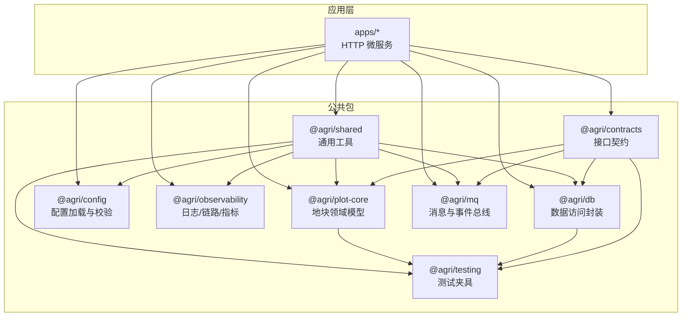
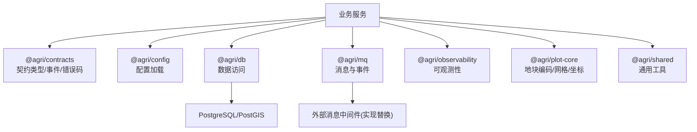
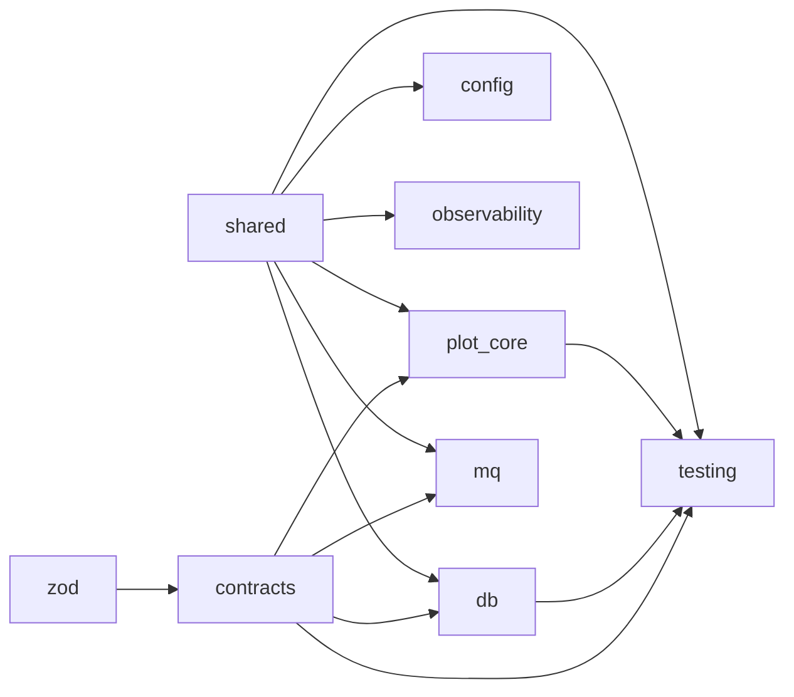

# 公共包文档

<cite>
**本文引用的文件**   
- [README.md](file://README.md)
</cite>

## 目录
1. [引言](#引言)
2. [项目结构](#项目结构)
3. [核心公共包总览](#核心公共包总览)
4. [架构总览](#架构总览)
5. [详细组件分析](#详细组件分析)
6. [依赖关系分析](#依赖关系分析)
7. [性能与可观测性](#性能与可观测性)
8. [故障排查指南](#故障排查指南)
9. [结论](#结论)
10. [附录：包级接口清单与最佳实践](#附录包级接口清单与最佳实践)

## 引言
本文件面向智慧农业平台的 Node.js 工程，聚焦 packages 下的 8 个公共包：@agri/contracts、@agri/config、@agri/db、@agri/mq、@agri/observability、@agri/plot-core、@agri/shared、@agri/testing。目标是给出每个包的职责边界、对外契约、配置项、使用模式、依赖关系与设计原则，帮助开发者在统一规范下扩展服务与领域能力。

## 项目结构
仓库采用 pnpm workspace + Turborepo + tsc -b 的工程引用体系，apps 为业务微服务，packages 为公共能力包。根 README 明确了各公共包职责、运行时约束与关键约定（如地块编码、事件不丢不重、软删除字段、错误码分段等）。

图表来源
- [README.md:68-100](file://README.md#L68-L100)

章节来源
- [README.md:58-84](file://README.md#L58-L84)
- [README.md:86-103](file://README.md#L86-L103)

## 核心公共包总览
- @agri/contracts：定义响应信封、事件主题与载荷、错误码、共享数据对象与枚举；仅依赖 zod，便于前端复用。
- @agri/shared：异常基类、时间处理、单位换算、分页、标识生成等通用工具。
- @agri/plot-core：地块六段式编码、校验位算法、网格换算、坐标系转换；空间运算下沉数据库。
- @agri/config：环境变量校验结构、启动期配置加载、密钥读取。
- @agri/observability：结构化日志、链路追踪、指标采集与运行期采集器。
- @agri/db：客户端生命周期、事务、分库路由、分页、软删除。
- @agri/mq：发布订阅、本地消息表、重试死信、幂等。
- @agri/testing：测试数据库、内存事件总线、可控时钟、模块构造器。

章节来源
- [README.md:68-100](file://README.md#L68-L100)

## 架构总览
公共包遵循“契约与能力分离”的设计原则：
- contracts 只依赖 zod，不被能力包反向依赖，保证契约稳定且前端可低成本引用。
- 能力包之间禁止循环引用，通过 contracts 与 shared 解耦。
- 事件采用“本地消息表 + 中继投递 + 消费幂等”的可靠交付方案。
- 空间计算下沉 PostGIS，坐标统一 CGCS2000（EPSG:4490），仅在出参方向做坐标系换算。

图表来源
- [README.md:68-100](file://README.md#L68-L100)

## 详细组件分析

### @agri/contracts 接口契约
职责
- 定义跨服务共享的类型与契约：响应信封、事件主题与载荷、错误码、共享数据对象与枚举。
- 仅依赖 zod，确保契约轻量、稳定且前端可复用。

关键约定
- 错误码采用“域缩写-分类码-序号”三段式，含义一经发布不得修改。
- 事件主题与载荷需先在契约包中声明，再在生产者与消费者中使用。

使用模式
- 新增事件：先在 EventTopic 与 events/payload.ts 中定义主题与载荷，再在生产者侧入队、消费者侧注册处理器。
- 新增共享类型：在对应模块导出，供其他包与服务引用。

最佳实践
- 避免在 contracts 中引入业务逻辑或能力包依赖。
- 对输入输出进行 zod 校验，保持契约即验证。

章节来源
- [README.md:86-103](file://README.md#L86-L103)
- [README.md:153-155](file://README.md#L153-L155)

### @agri/shared 共享工具
职责
- 提供异常基类、时间处理、单位换算、分页、标识生成等通用能力。
- 作为其他能力包的基础依赖，避免重复造轮子。

使用模式
- 在业务服务中直接复用工具函数，避免在各服务内重复实现。
- 自定义异常应继承统一异常基类，便于上层捕获与标准化返回。

最佳实践
- 时间处理注意时区与格式化一致性。
- 分页参数需结合服务端白名单与上限控制。

章节来源
- [README.md:86-103](file://README.md#L86-L103)

### @agri/plot-core 地块核心
职责
- 实现地块六段式编码、校验位算法、网格换算与坐标系转换。
- 将复杂空间运算下沉至数据库（PostGIS），自身只做编码级与索引级计算。

关键约定
- 地块编码是数据关联锚点，格式为“区划码-农场码-片区号-地块序号-网格号-校验位”。
- 坐标统一 CGCS2000（EPSG:4490），仅在出参方向换算。

使用模式
- 所有地块编码生成与解析必须走 plot-core，禁止业务代码自行拼接。
- 叠加、缓冲区、面积等空间计算通过 SQL 在 PostGIS 完成。

最佳实践
- 编码生成后务必执行校验位校验。
- 网格化场景注意网格段为空串与具体网格值的区分。

章节来源
- [README.md:105-118](file://README.md#L105-L118)

### @agri/config 配置管理
职责
- 环境变量校验结构、启动期配置加载、密钥读取。
- 基于 zod 的结构化校验，确保运行期配置安全可用。

配置选项
- 典型项包括数据库连接、消息中间件地址、日志级别、服务端口等（由具体服务装配决定）。

使用模式
- 在服务根模块中导入 ConfigModule.forRoot，按需注入配置。
- 对缺失或非法配置抛出明确错误，便于部署阶段快速定位。

最佳实践
- 敏感信息通过密钥读取机制注入，避免硬编码。
- 不同环境使用独立配置源，但保持键名一致。

章节来源
- [README.md:86-103](file://README.md#L86-L103)

### @agri/observability 可观测性
职责
- 结构化日志、链路追踪、指标采集与运行期采集器。
- 为服务提供统一的观测能力，便于问题定位与容量规划。

使用模式
- 在控制器/服务中注入日志与指标工具，记录关键流程与异常。
- 暴露健康检查端点，配合运维脚本巡检。

最佳实践
- 日志包含必要上下文（请求 ID、用户 ID、地块编码等）。
- 指标维度设计要利于聚合与告警。

章节来源
- [README.md:86-103](file://README.md#L86-L103)

### @agri/db 数据库封装
职责
- 客户端生命周期管理、事务、分库路由、分页与软删除。
- 统一数据访问语义，屏蔽底层差异。

关键约定
- 软删除统一使用 deletedAt 字段。
- 分页每页上限 200，排序字段必须命中服务端白名单。

使用模式
- 仓储方法首参显式传入事务对象，避免事务边界静默扩大。
- 查询条件自动附加软删除过滤。

最佳实践
- 严格限定排序字段白名单，防止注入风险。
- 大表分页优先使用游标或范围查询优化。

章节来源
- [README.md:105-118](file://README.md#L105-L118)

### @agri/mq 消息队列
职责
- 事件发布订阅、本地消息表、重试死信与幂等。
- 保障事件“不丢也不重”，支持指数退避与死信归档。

关键约定
- 业务数据与待投递事件写入同一事务（本地消息表），提交后由中继投递。
- 消费侧用 eventId 幂等去重。

使用模式
- 生产者通过 OutboxService.enqueue 入队。
- 消费者通过 @registerHandler 声明处理方法。

最佳实践
- 事件载荷尽量小且不可变，避免频繁变更导致兼容性问题。
- 重试策略与死信阈值按业务容忍度调优。

章节来源
- [README.md:105-118](file://README.md#L105-L118)
- [README.md:153-155](file://README.md#L153-L155)

### @agri/testing 测试工具
职责
- 测试数据库、内存事件总线、可控时钟、模块构造器。
- 为单元测试与集成测试提供稳定、可控的环境。

使用模式
- 在测试中替换真实依赖为内存实现，隔离外部系统。
- 使用可控时钟断言时序相关逻辑。

最佳实践
- 测试用例覆盖异常路径与边界条件。
- 夹具数据最小化，避免耦合生产数据。

章节来源
- [README.md:86-103](file://README.md#L86-L103)

## 依赖关系分析
- contracts 仅依赖 zod，无能力包依赖，处于依赖树根部。
- shared 被多个能力包依赖，提供基础工具。
- plot-core 依赖 contracts 与 shared，承载地块领域规则。
- config、observability、db、mq 均依赖 shared，部分依赖 contracts。
- testing 依赖 contracts、db、plot-core、shared，用于构建测试环境。
- 能力包之间禁止循环引用，契约与能力清晰分层。

图表来源
- [README.md:86-103](file://README.md#L86-L103)

章节来源
- [README.md:86-103](file://README.md#L86-L103)

## 性能与可观测性
- 空间运算下沉数据库：减少应用层计算压力，利用 PostGIS 索引与 SQL 优化。
- 分页限制与白名单：防止全表扫描与排序开销。
- 事件幂等与重试：避免重复处理导致的放大效应，合理设置重试间隔与死信阈值。
- 结构化日志与指标：便于定位瓶颈与容量评估。

[本节为通用指导，不涉及具体文件分析]

## 故障排查指南
- 配置缺失或非法：检查环境变量与密钥读取，确认 ConfigModule 装配正确。
- 事件未消费或重复消费：核查本地消息表是否提交成功、消费端 eventId 幂等是否生效。
- 分页报错或结果异常：检查排序字段是否在白名单、分页上限是否超限。
- 地块编码错误：确认是否通过 plot-core 生成与校验，网格段是否为空串或有效网格值。
- 软删除数据可见：确认查询是否自动附加 deletedAt 过滤。

章节来源
- [README.md:105-118](file://README.md#L105-L118)

## 结论
公共包以 contracts 为契约中心、shared 为基础支撑，围绕 plot-core、config、observability、db、mq、testing 形成清晰的层次与职责边界。遵循“契约与能力分离”“事件可靠交付”“空间计算下沉数据库”等原则，可在保证稳定性的同时提升扩展性与可维护性。

[本节为总结性内容，不涉及具体文件分析]

## 附录：包级接口清单与最佳实践

- @agri/contracts
  - 接口清单：响应信封、事件主题与载荷、错误码、共享数据对象与枚举。
  - 最佳实践：新增事件先定义主题与载荷；错误码发布后不可改义。

- @agri/shared
  - 接口清单：异常基类、时间、单位换算、分页、标识。
  - 最佳实践：统一异常与时间处理；分页参数受控。

- @agri/plot-core
  - 接口清单：地块编码生成/解析、校验位、网格换算、坐标转换。
  - 最佳实践：编码必须经 plot-core；空间计算走 PostGIS。

- @agri/config
  - 接口清单：配置加载、环境变量校验、密钥读取。
  - 最佳实践：敏感信息走密钥；多环境键名一致。

- @agri/observability
  - 接口清单：结构化日志、链路追踪、指标采集、运行期采集器。
  - 最佳实践：日志带上下文；指标维度利于告警。

- @agri/db
  - 接口清单：客户端生命周期、事务、分库路由、分页、软删除。
  - 最佳实践：仓储方法显式传事务；排序字段白名单。

- @agri/mq
  - 接口清单：发布订阅、本地消息表、重试死信、幂等。
  - 最佳实践：OutboxService.enqueue 入队；@registerHandler 消费；eventId 幂等。

- @agri/testing
  - 接口清单：测试数据库、内存事件总线、可控时钟、模块构造器。
  - 最佳实践：替换真实依赖为内存实现；夹具数据最小化。

章节来源
- [README.md:86-103](file://README.md#L86-L103)
- [README.md:153-155](file://README.md#L153-L155)