基于我的分析，现在我可以更新共享工具包文档。新增了两个重要的工具函数：`likePattern()` 用于SQL LIKE模式转义，`keywordHits()` 用于字段级关键词匹配。让我更新文档：

# 共享工具包 (@agri/shared)

<cite>
**本文引用的文件**   
- [packages/shared/package.json](file://packages/shared/package.json)
- [packages/shared/src/index.ts](file://packages/shared/src/index.ts)
- [packages/shared/src/errors.ts](file://packages/shared/src/errors.ts)
- [packages/shared/src/datetime.ts](file://packages/shared/src/datetime.ts)
- [packages/shared/src/unit.ts](file://packages/shared/src/unit.ts)
- [packages/shared/src/area.ts](file://packages/shared/src/area.ts)
- [packages/shared/src/paging.ts](file://packages/shared/src/paging.ts)
- [packages/shared/src/id.ts](file://packages/shared/src/id.ts)
- [packages/shared/src/utils.ts](file://packages/shared/src/utils.ts)
- [packages/shared/test/shared.spec.ts](file://packages/shared/test/shared.spec.ts)
- [apps/web/test/geo.spec.ts](file://apps/web/test/geo.spec.ts)
- [apps/web/src/utils/geo.ts](file://apps/web/src/utils/geo.ts)
- [apps/auth-service/src/user.repository.ts](file://apps/auth-service/src/user.repository.ts)
</cite>

## 更新摘要
**变更内容**   
- 新增搜索工具函数：`likePattern()` 和 `keywordHits()`
- 增强搜索逻辑一致性：确保 SQL 和内存实现产生相同结果
- 完善单元测试覆盖：新增搜索相关测试用例
- 更新使用示例：展示新的搜索工具函数用法

## 目录
1. [简介](#简介)
2. [项目结构](#项目结构)
3. [核心组件](#核心组件)
4. [架构总览](#架构总览)
5. [详细组件分析](#详细组件分析)
6. [依赖关系分析](#依赖关系分析)
7. [性能与可靠性](#性能与可靠性)
8. [故障排查指南](#故障排查指南)
9. [结论](#结论)
10. [附录：使用示例与测试覆盖](#附录使用示例与测试覆盖)

## 简介
@agri/shared 是农服平台的全局共享工具包，提供跨服务复用的通用能力，包括异常框架、日期时间处理、面积单位换算、多边形面积计算、分页结果组装、标识生成以及常用纯函数工具。**最新增强了搜索功能**，新增了 `likePattern()` 和 `keywordHits()` 工具函数，用于统一的 SQL LIKE 模式转义和字段级关键词匹配，确保数据库查询与内存过滤的一致性。该包遵循纯函数设计与无副作用原则，对外暴露稳定的 API，避免在业务代码中散落重复实现，降低一致性风险。

包说明强调其职责边界：异常基类、时间、单位换算、面积计算、分页、标识生成、搜索工具等通用能力集中管理；下游模块仅通过主入口导入，不感知内部文件组织。

**章节来源**
- [packages/shared/package.json:1-23](file://packages/shared/package.json#L1-L23)
- [packages/shared/src/index.ts:1-13](file://packages/shared/src/index.ts#L1-L13)

## 项目结构
共享工具包采用按功能域拆分的扁平结构，每个文件聚焦单一职责，便于独立维护与测试。

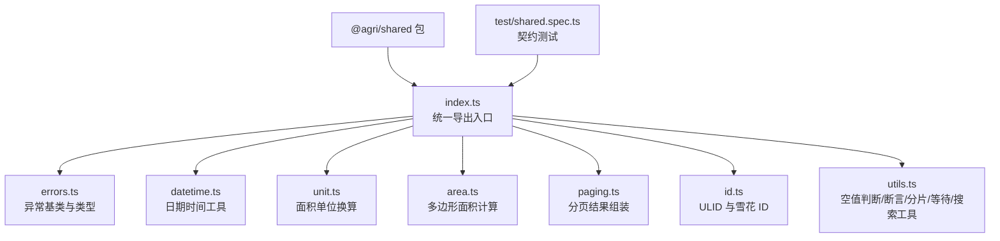

**图表来源**
- [packages/shared/src/index.ts:1-13](file://packages/shared/src/index.ts#L1-L13)
- [packages/shared/test/shared.spec.ts:1-17](file://packages/shared/test/shared.spec.ts#L1-L17)

**章节来源**
- [packages/shared/src/index.ts:1-13](file://packages/shared/src/index.ts#L1-L13)

## 核心组件
- 异常框架：定义 BizError 基类及 ValidationError、NotFoundError、ConflictError 等具体异常，附带错误码与 HTTP 状态码，便于全局过滤器统一处理。
- 日期时间：以 ISO 8601 UTC 字符串为系统内时间表示，提供 toUtcIso、parseDate、dayRange 等工具，默认业务日按东八区划分。
- 单位换算：集中管理亩、平方米、公顷之间的换算，避免业务侧手写系数导致精度不一致。
- 面积计算：实现标准化的多边形面积计算算法，确保前后端计算结果一致性，支持环面积和多边形面积计算。
- 分页：定义 PageInput/PageResult 接口并提供 toPageResult 组装器，自动计算 pages 并修正 page/size 边界。
- 标识生成：提供 ULID（事件/请求）与雪花算法主键（业务 ID），保证有序性与唯一性。
- **搜索工具**：**新增** likePattern() 用于 SQL LIKE 模式转义，keywordHits() 用于字段级关键词匹配，确保 SQL 和内存实现产生相同结果。
- 通用工具：isNil、omitUndefined、assertDefined、chunk、sleep 等纯函数，用于参数校验、对象清理、批量操作与异步等待。

**章节来源**
- [packages/shared/src/errors.ts:1-53](file://packages/shared/src/errors.ts#L1-L53)
- [packages/shared/src/datetime.ts:1-99](file://packages/shared/src/datetime.ts#L1-L99)
- [packages/shared/src/unit.ts:1-41](file://packages/shared/src/unit.ts#L1-L41)
- [packages/shared/src/area.ts:1-74](file://packages/shared/src/area.ts#L1-L74)
- [packages/shared/src/paging.ts:1-42](file://packages/shared/src/paging.ts#L1-L42)
- [packages/shared/src/id.ts:1-70](file://packages/shared/src/id.ts#L1-L70)
- [packages/shared/src/utils.ts:1-81](file://packages/shared/src/utils.ts#L1-L81)

## 架构总览
共享工具包作为横切能力层，被各微服务与前端应用通过 @agri/shared 主入口引入。它不反向依赖业务契约包，但保持与契约包的数据结构一致，确保跨进程调用时的类型兼容。

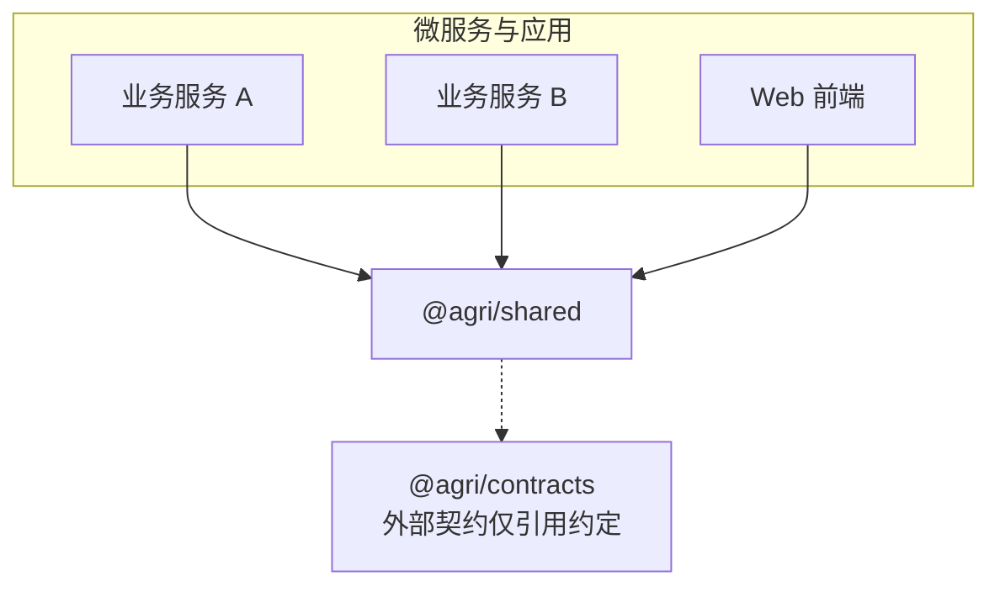

**图表来源**
- [packages/shared/src/index.ts:1-13](file://packages/shared/src/index.ts#L1-L13)
- [packages/shared/src/paging.ts:1-7](file://packages/shared/src/paging.ts#L1-L7)

**章节来源**
- [packages/shared/src/paging.ts:1-7](file://packages/shared/src/paging.ts#L1-L7)

## 详细组件分析

### 异常处理框架
异常框架围绕 BizError 基类构建，所有业务异常均携带 code 与 httpStatus，便于全局异常过滤器进行统一转换。ValidationError 支持字段级 ErrorDetail，适合表单或入参校验场景。NotFoundError 与 ConflictError 分别对应资源未找到与状态冲突的常见业务语义。

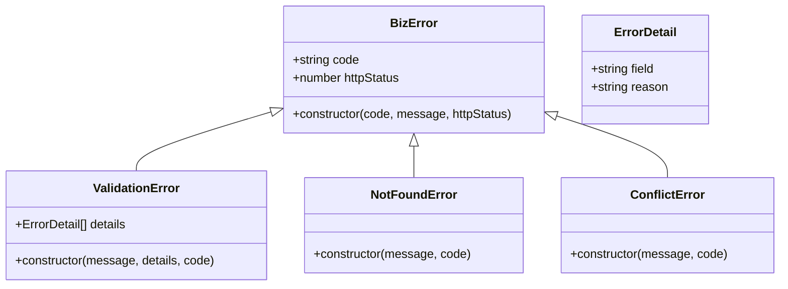

**图表来源**
- [packages/shared/src/errors.ts:1-53](file://packages/shared/src/errors.ts#L1-L53)

设计要点
- 统一基类减少分支判断，提升全局异常处理效率。
- 错误码规范建议采用"SYS-XXX-YYY"形式，便于分类与定位。
- 字段级校验明细利于前端展示与问题回溯。

**章节来源**
- [packages/shared/src/errors.ts:1-53](file://packages/shared/src/errors.ts#L1-L53)

### 日期时间工具
日期时间模块以 ISO 8601 UTC 字符串为系统内标准表示，时区转换下沉到客户端或服务端展示层，避免同一时刻在不同服务中表述不一致。默认业务日按东八区（Asia/Shanghai）划分。

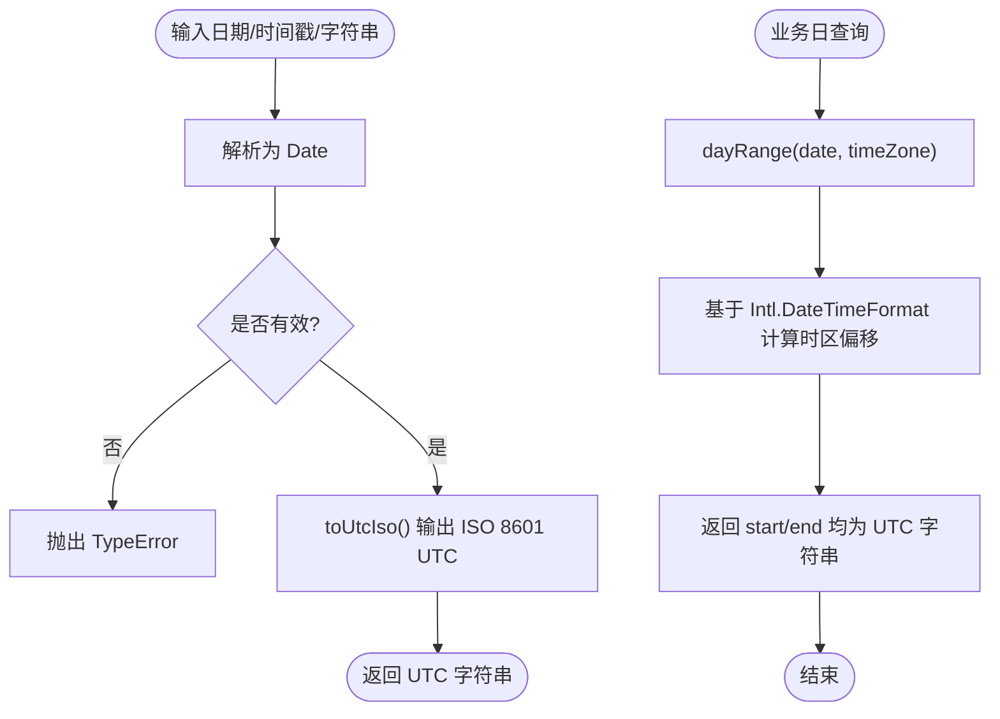

**图表来源**
- [packages/shared/src/datetime.ts:1-99](file://packages/shared/src/datetime.ts#L1-L99)

关键函数
- toUtcIso：将任意可解析输入转为 ISO 8601 UTC 字符串，非法输入抛 TypeError。
- parseDate：安全解析，失败返回 null。
- dayRange：按指定时区计算某日的起止区间，返回 UTC 字符串对。

注意事项
- 禁止在服务侧做面向用户的时区显示转换，统一由客户端负责。
- 业务日边界必须通过 dayRange 获取，避免手写边界导致数据偏差。

**章节来源**
- [packages/shared/src/datetime.ts:1-99](file://packages/shared/src/datetime.ts#L1-L99)

### 面积单位换算
面积换算集中在 unit.ts，统一使用"亩"作为对外单位，仅在空间计算与遥感分析环节使用平方米与公顷。换算函数避免业务侧手写系数，防止不同报表出现几十平方米的差异。

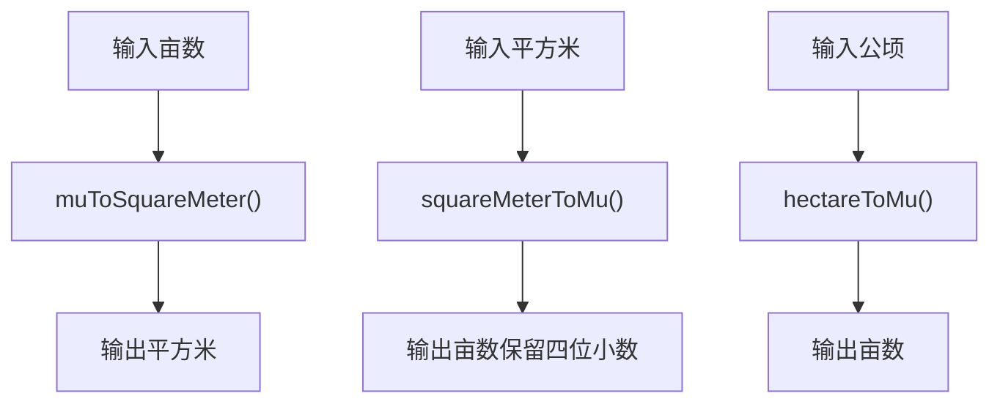

**图表来源**
- [packages/shared/src/unit.ts:1-41](file://packages/shared/src/unit.ts#L1-L41)

常量与函数
- SQUARE_METER_PER_MU：每亩平方米数。
- MU_PER_HECTARE：每公顷亩数。
- muToSquareMeter、squareMeterToMu、hectareToMu：三种换算路径。

精度策略
- squareMeterToMu 使用 Math.round 保留四位小数，避免浮点误差累积。
- 测试用例验证两条换算路径的一致性（如 15 亩 = 1 公顷）。

**章节来源**
- [packages/shared/src/unit.ts:1-41](file://packages/shared/src/unit.ts#L1-L41)

### 多边形面积计算
新增的面积计算库实现了标准化的多边形面积计算算法，确保前后端计算结果一致性。该模块采用等距圆柱投影鞋带公式，通过顶点去重、重心平移和坐标缩放来保证计算精度。

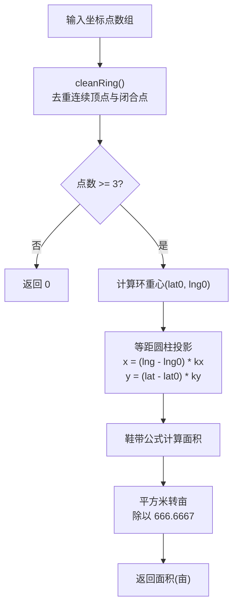

**图表来源**
- [packages/shared/src/area.ts:17-61](file://packages/shared/src/area.ts#L17-L61)

核心函数
- ringAreaMu：计算环面积（亩），输入为 [纬度, 经度] 顺序的坐标点数组。
- polygonAreaMu：计算多边形面积（亩），输入为 GeoJSON 顺序 [经度, 纬度] 的坐标点数组。
- roundAreaMu：将面积四舍五入到两位小数，与数据库存储格式保持一致。

算法特点
- 顶点去重：去除连续重复顶点和末尾闭合点，避免影响环重心计算。
- 重心平移：以环重心为原点进行坐标平移，消除大坐标值导致的数值溢出。
- 等距圆柱投影：使用 cos(lat) 进行经度缩放，保证不同纬度下的面积计算精度。
- 鞋带公式：采用标准的平面多边形面积计算公式。

一致性保证
- 与前端 apps/web/src/utils/geo.ts 中的实现完全一致。
- 与数据库迁移脚本 infra/postgres/migrations/015_plot_area_from_boundary.sql 保持同步。
- 通过 apps/web/test/geo.spec.ts 中的对比测试确保三处实现逐位相同。

**章节来源**
- [packages/shared/src/area.ts:1-74](file://packages/shared/src/area.ts#L1-L74)

### 分页结果组装
分页模块定义 PageInput 与 PageResult 接口，结构与 @agri/contracts 保持一致，但不反向依赖契约包。toPageResult 自动计算 pages，并对 page 与 size 做边界修正。

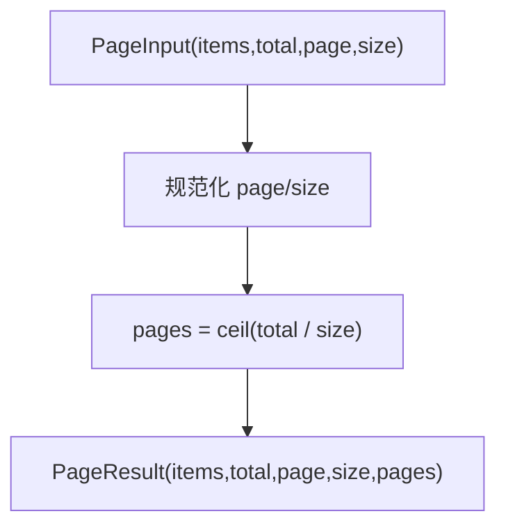

**图表来源**
- [packages/shared/src/paging.ts:1-42](file://packages/shared/src/paging.ts#L1-L42)

行为约定
- size <= 0 时回退为 1。
- page <= 0 时回退为 1。
- pages 始终为 Math.ceil(total / size)。

**章节来源**
- [packages/shared/src/paging.ts:1-42](file://packages/shared/src/paging.ts#L1-L42)

### 标识生成
id.ts 提供两类标识：
- ULID：按时间有序、固定长度 26 位，适用于事件与请求标识。
- 雪花算法主键：返回十进制字符串，避免前端数值安全范围溢出。

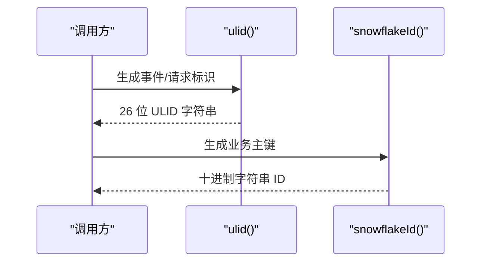

**图表来源**
- [packages/shared/src/id.ts:1-70](file://packages/shared/src/id.ts#L1-L70)

实现要点
- ULID：时间部分高位优先，随机部分均匀分布，字符集去除易混淆字符。
- 雪花 ID：处理时钟回拨与同毫秒序列号递增，返回字符串以避免 BigInt 溢出。

**章节来源**
- [packages/shared/src/id.ts:1-70](file://packages/shared/src/id.ts#L1-L70)

### 搜索工具函数
**新增** 搜索工具函数提供了统一的 SQL LIKE 模式转义和字段级关键词匹配功能，确保数据库查询与内存过滤产生相同的结果。

#### likePattern() - SQL LIKE 模式转义
likePattern() 函数对用户输入的关键词进行 SQL LIKE 模式转义，正确处理通配符 `%` 和下划线 `_`，防止 SQL 注入和意外匹配。

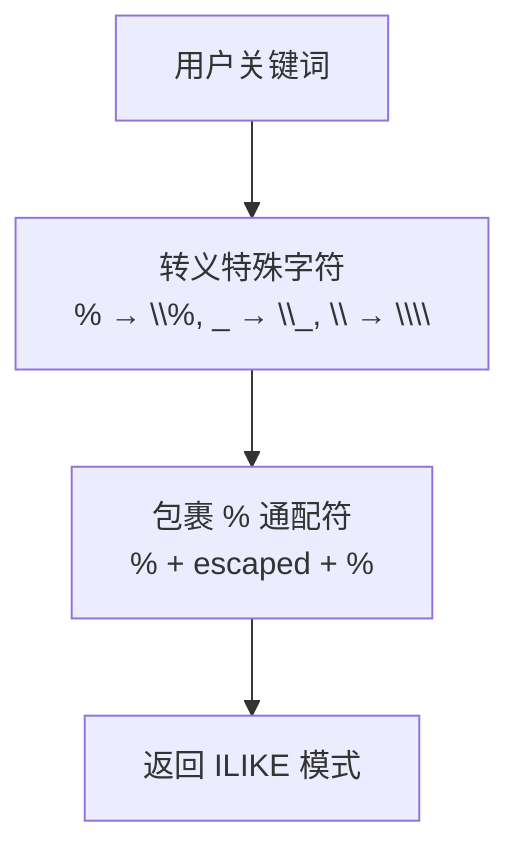

**图表来源**
- [packages/shared/src/utils.ts:58-60](file://packages/shared/src/utils.ts#L58-L60)

关键特性
- 自动转义 SQL LIKE 通配符：`%`、`_`、`\`
- 返回标准的 ILIKE 模式字符串
- 防止 SQL 注入攻击
- 与内存实现的 keywordHits() 保持一致的匹配语义

#### keywordHits() - 字段级关键词匹配
keywordHits() 函数实现与 SQL ILIKE 查询相同的字段级匹配逻辑，对每个字段单独进行大小写不敏感的字面量子串匹配。

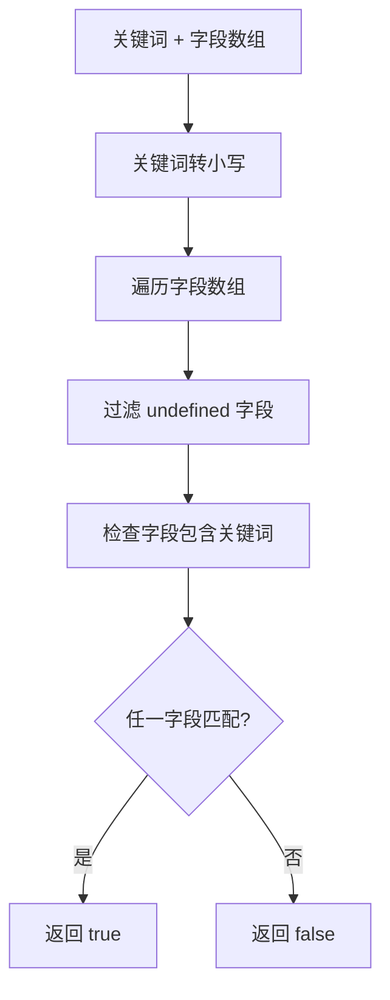

**图表来源**
- [packages/shared/src/utils.ts:67-70](file://packages/shared/src/utils.ts#L67-L70)

关键特性
- 字段级匹配：每个字段单独匹配，避免跨字段假命中
- 大小写不敏感：与 SQL ILIKE 行为一致
- 忽略 undefined 字段：只匹配非空字段
- 内存优化：使用 some() 方法短路求值

#### 使用示例
以下示例展示了如何在业务服务中使用这些搜索工具：

```typescript
// SQL 查询中使用 likePattern
const pattern = likePattern(query.keyword);
conditions.push(`(username ILIKE $${values.length} OR name ILIKE $${values.length})`);
values.push(pattern);

// 内存过滤中使用 keywordHits
const filtered = records.filter(record => 
  keywordHits(keyword, [record.username, record.name])
);
```

**章节来源**
- [packages/shared/src/utils.ts:53-70](file://packages/shared/src/utils.ts#L53-L70)

### 通用工具函数
utils.ts 提供一组纯函数，强调无副作用与明确边界：
- isNil：仅 null 与 undefined 视为空。
- omitUndefined：剔除值为 undefined 的字段，避免序列化污染。
- assertDefined：断言非空，失败抛出 ValidationError 并携带字段名。
- chunk：数组分片，用于批量写入/查询，size 必须为正整数。
- sleep：异步等待，常用于重试或限流模拟。

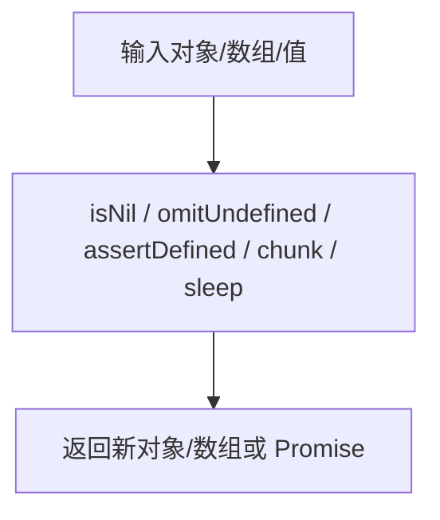

**图表来源**
- [packages/shared/src/utils.ts:1-81](file://packages/shared/src/utils.ts#L1-L81)

**章节来源**
- [packages/shared/src/utils.ts:1-81](file://packages/shared/src/utils.ts#L1-L81)

## 依赖关系分析
- 入口文件 index.ts 聚合导出所有子模块，下游只依赖入口，不感知内部文件。
- utils.ts 依赖 errors.ts 中的 ValidationError，体现"工具函数与异常框架"的单向依赖。
- paging.ts 声明与 @agri/contracts 一致的 PageResult 结构，但不反向依赖契约包，保持包的独立性。
- id.ts 依赖 Node.js crypto 模块生成随机字节。
- area.ts 作为独立的面积计算模块，不依赖其他共享模块，保持算法的纯粹性。
- **搜索工具**：**新增** likePattern() 和 keywordHits() 被多个业务服务广泛使用，确保搜索逻辑的一致性。

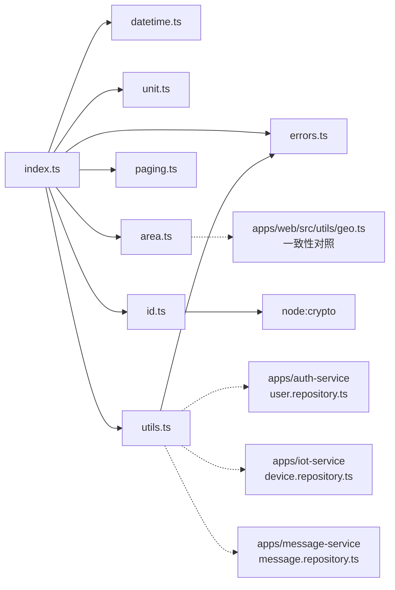

**图表来源**
- [packages/shared/src/index.ts:1-13](file://packages/shared/src/index.ts#L1-L13)
- [packages/shared/src/utils.ts:1-2](file://packages/shared/src/utils.ts#L1-L2)
- [packages/shared/src/id.ts:1-1](file://packages/shared/src/id.ts#L1-L1)
- [packages/shared/src/area.ts:4-7](file://packages/shared/src/area.ts#L4-L7)
- [apps/auth-service/src/user.repository.ts:3](file://apps/auth-service/src/user.repository.ts#L3)

**章节来源**
- [packages/shared/src/index.ts:1-13](file://packages/shared/src/index.ts#L1-L13)
- [packages/shared/src/utils.ts:1-2](file://packages/shared/src/utils.ts#L1-L2)
- [packages/shared/src/id.ts:1-1](file://packages/shared/src/id.ts#L1-L1)
- [packages/shared/src/area.ts:4-7](file://packages/shared/src/area.ts#L4-L7)

## 性能与可靠性
- 纯函数设计：所有工具函数不修改外部状态，便于缓存与并行执行。
- 时间处理：UTC 字符串传输减少跨服务歧义；Intl.DateTimeFormat 用于时区计算，避免第三方库开销。
- 单位换算：集中系数与精度控制，避免分散实现导致的数值漂移。
- 面积计算：等距圆柱投影鞋带公式，O(n) 时间复杂度，内存占用 O(1)，通过重心平移避免数值溢出。
- 分页计算：O(1) 计算 pages，边界修正避免无效页。
- 标识生成：ULID 与雪花 ID 均具备高吞吐与低碰撞概率；雪花 ID 处理时钟回拨与序列号回绕。
- **搜索工具**：**新增** likePattern() 使用正则表达式高效转义，keywordHits() 使用 some() 短路求值优化性能。
- 内存友好：omitUndefined、chunk 返回新对象/数组，避免原地修改带来的副作用。
- 一致性保障：面积计算算法通过前端、后端、数据库三处实现的对比测试确保计算结果完全一致。

[本节为通用指导，不直接分析具体文件]

## 故障排查指南
常见问题与定位方法
- 时间解析失败：toUtcIso 与 dayRange 对非法输入抛出 TypeError，检查传入字符串格式与时区参数。
- 分页异常：确认 page 与 size 是否为正数，toPageResult 会自动修正，但业务逻辑需配合合理默认值。
- 单位换算偏差：核对是否误用平方换算路径，优先使用 unit.ts 提供的函数，避免手写系数。
- 面积计算异常：检查输入坐标点是否至少包含三个不共线的点，确认经纬度顺序是否符合要求。
- 面积计算不一致：如果前后端面积计算结果不一致，检查是否使用了不同的算法实现，参考 apps/web/test/geo.spec.ts 中的对比测试。
- 标识冲突：ULID 应保证时间单调；雪花 ID 若出现重复，检查时钟回拨与 sequence 回绕逻辑。
- 校验失败：assertDefined 抛出 ValidationError，查看 field 与 reason 定位字段级问题。
- **搜索匹配异常**：**新增** 检查 likePattern() 是否正确转义特殊字符，确认 keywordHits() 的字段数组不包含 undefined 值。
- **搜索结果不一致**：**新增** 确保 SQL 查询和内存过滤都使用相同的搜索工具函数，避免手动实现不同的匹配逻辑。

**章节来源**
- [packages/shared/src/datetime.ts:16-22](file://packages/shared/src/datetime.ts#L16-L22)
- [packages/shared/src/datetime.ts:83-98](file://packages/shared/src/datetime.ts#L83-L98)
- [packages/shared/src/paging.ts:31-41](file://packages/shared/src/paging.ts#L31-L41)
- [packages/shared/src/unit.ts:20-40](file://packages/shared/src/unit.ts#L20-L40)
- [packages/shared/src/area.ts:37-61](file://packages/shared/src/area.ts#L37-L61)
- [packages/shared/src/id.ts:25-69](file://packages/shared/src/id.ts#L25-L69)
- [packages/shared/src/utils.ts:29-50](file://packages/shared/src/utils.ts#L29-L50)
- [packages/shared/src/utils.ts:58-70](file://packages/shared/src/utils.ts#L58-L70)

## 结论
@agri/shared 通过清晰的模块划分与纯函数设计，为平台提供了稳定可靠的通用能力。异常框架统一了错误处理语义，日期时间与单位换算保证了数据一致性，新增的多边形面积计算库确保了前后端计算结果的精确一致，分页与标识生成提升了可扩展性与可观测性。**最新的搜索工具函数进一步增强了平台的搜索一致性**，通过 likePattern() 和 keywordHits() 确保 SQL 查询与内存过滤产生相同的结果，避免了因实现差异导致的数据不一致问题。建议在业务服务中严格使用该包，避免重复实现与口径不一致。

[本节为总结性内容，不直接分析具体文件]

## 附录：使用示例与测试覆盖

### 使用示例（路径指引）
- 异常与校验
  - 抛出字段级校验异常：参考 [packages/shared/src/utils.ts:29-34](file://packages/shared/src/utils.ts#L29-L34)
  - 自定义业务异常：参考 [packages/shared/src/errors.ts:7-19](file://packages/shared/src/errors.ts#L7-L19)
- 日期时间
  - 转换为 UTC ISO 字符串：参考 [packages/shared/src/datetime.ts:16-22](file://packages/shared/src/datetime.ts#L16-L22)
  - 按东八区计算自然日区间：参考 [packages/shared/src/datetime.ts:83-98](file://packages/shared/src/datetime.ts#L83-L98)
- 单位换算
  - 亩转平方米：参考 [packages/shared/src/unit.ts:20-22](file://packages/shared/src/unit.ts#L20-L22)
  - 平方米转亩：参考 [packages/shared/src/unit.ts:29-31](file://packages/shared/src/unit.ts#L29-L31)
  - 公顷转亩：参考 [packages/shared/src/unit.ts:38-40](file://packages/shared/src/unit.ts#L38-L40)
- 面积计算
  - 计算环面积（纬度, 经度顺序）：参考 [packages/shared/src/area.ts:37-61](file://packages/shared/src/area.ts#L37-L61)
  - 计算多边形面积（经度, 纬度顺序）：参考 [packages/shared/src/area.ts:67-69](file://packages/shared/src/area.ts#L67-L69)
  - 面积四舍五入：参考 [packages/shared/src/area.ts:72-74](file://packages/shared/src/area.ts#L72-L74)
- 分页
  - 组装分页结果：参考 [packages/shared/src/paging.ts:31-41](file://packages/shared/src/paging.ts#L31-L41)
- 标识生成
  - 生成 ULID：参考 [packages/shared/src/id.ts:25-45](file://packages/shared/src/id.ts#L25-L45)
  - 生成雪花 ID：参考 [packages/shared/src/id.ts:51-69](file://packages/shared/src/id.ts#L51-L69)
- **搜索工具**：**新增**
  - SQL LIKE 模式转义：参考 [packages/shared/src/utils.ts:58-60](file://packages/shared/src/utils.ts#L58-L60)
  - 字段级关键词匹配：参考 [packages/shared/src/utils.ts:67-70](file://packages/shared/src/utils.ts#L67-L70)
  - 业务服务使用示例：参考 [apps/auth-service/src/user.repository.ts:72](file://apps/auth-service/src/user.repository.ts#L72)、[apps/auth-service/src/user.repository.ts:204](file://apps/auth-service/src/user.repository.ts#L204)
- 通用工具
  - 空值判定与断言：参考 [packages/shared/src/utils.ts:3-6](file://packages/shared/src/utils.ts#L3-L6)、[packages/shared/src/utils.ts:29-34](file://packages/shared/src/utils.ts#L29-L34)
  - 剔除 undefined 字段：参考 [packages/shared/src/utils.ts:13-21](file://packages/shared/src/utils.ts#L13-L21)
  - 数组分片：参考 [packages/shared/src/utils.ts:42-51](file://packages/shared/src/utils.ts#L42-L51)
  - 异步等待：参考 [packages/shared/src/utils.ts:76-80](file://packages/shared/src/utils.ts#L76-L80)

### 单元测试覆盖情况
测试文件 shared.spec.ts 覆盖了以下关键场景：
- 分页结果自动计算总页数与边界修正
- 单位换算符合定义与路径一致性
- 按东八区切分自然日与非法输入异常
- ULID 长度与唯一性、雪花 ID 十进制字符串与正值
- 工具函数在边界输入下的行为（chunk、omitUndefined、assertDefined）
- 业务异常携带错误码与状态码，以及字段级详情
- **搜索工具测试**：**新增** likePattern() 正确转义通配符、keywordHits() 字段级匹配逻辑、大小写不敏感匹配、undefined 字段处理

新增的面积计算库通过 apps/web/test/geo.spec.ts 进行一致性测试，确保：
- 前端实现与 @agri/shared 实现逐位相同
- 退化几何（空数组、两点、三点共线）返回 0
- 面积计算不受经纬度绝对值漂移影响
- 与球面参考面积相差不到 1%

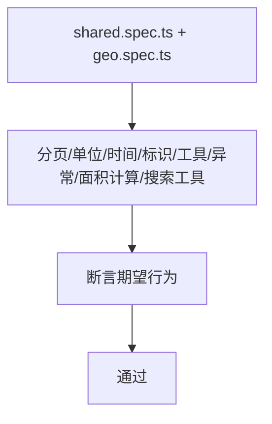

**图表来源**
- [packages/shared/test/shared.spec.ts:1-101](file://packages/shared/test/shared.spec.ts#L1-L101)
- [apps/web/test/geo.spec.ts:1-117](file://apps/web/test/geo.spec.ts#L1-L117)

**章节来源**
- [packages/shared/test/shared.spec.ts:1-101](file://packages/shared/test/shared.spec.ts#L1-L101)
- [apps/web/test/geo.spec.ts:1-117](file://apps/web/test/geo.spec.ts#L1-L117)