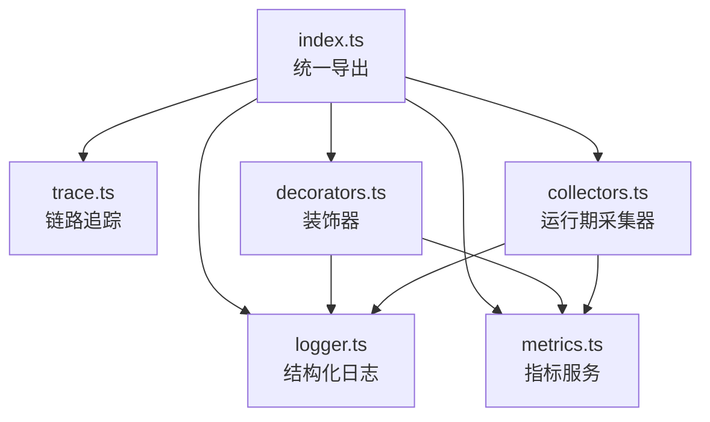
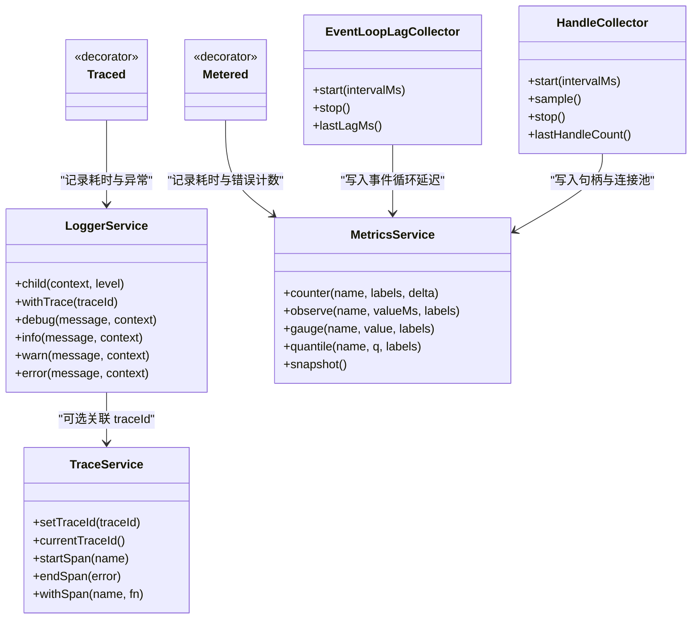
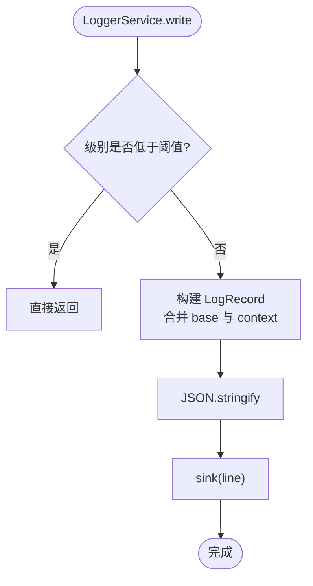
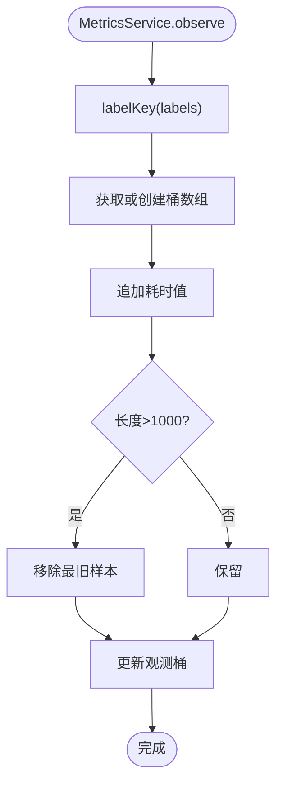
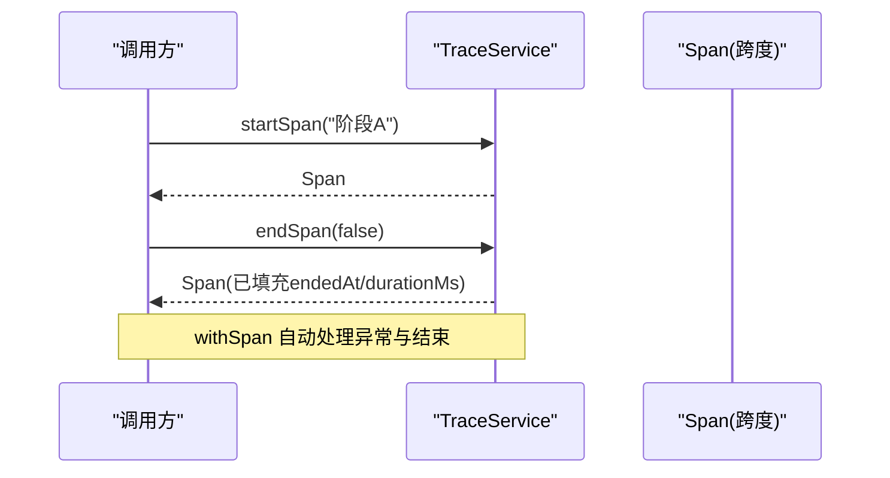
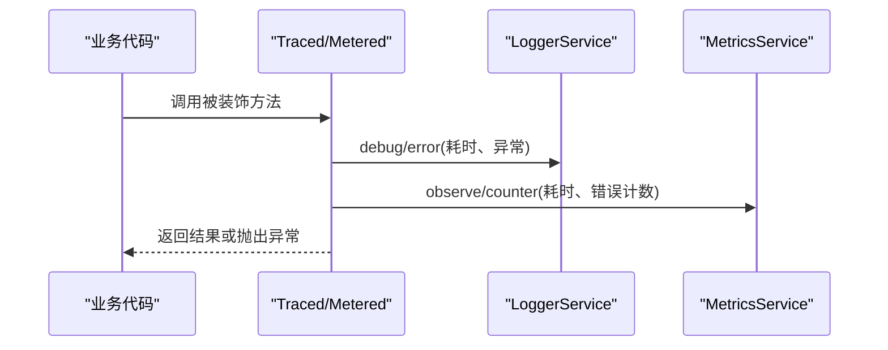
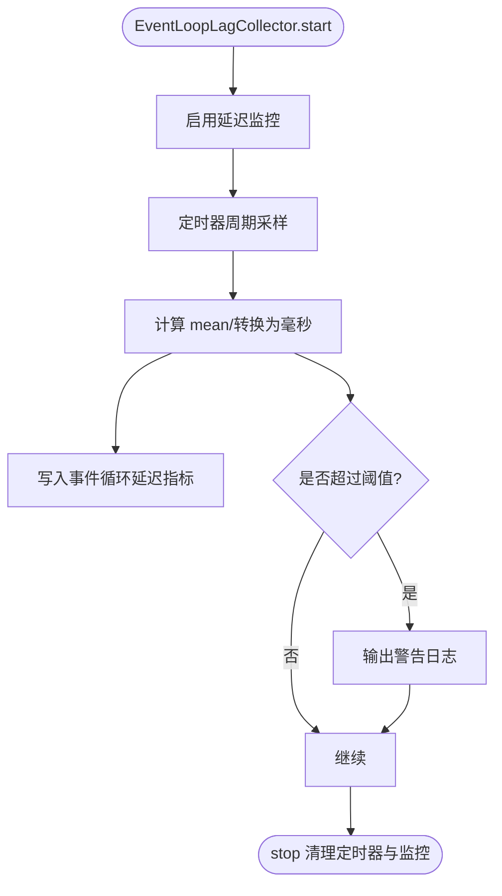
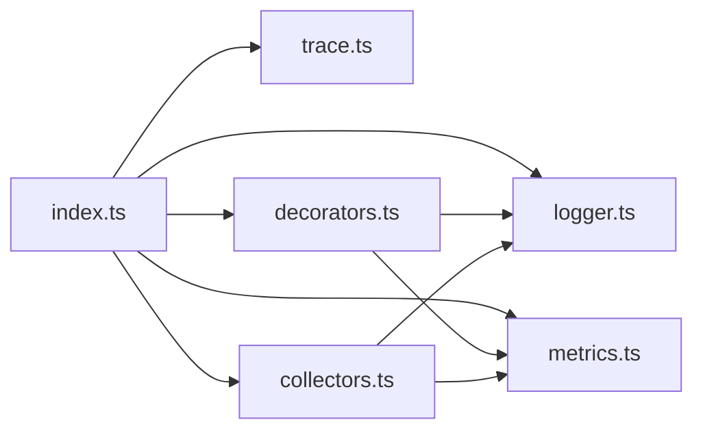

# 可观测性包 (@agri/observability)

<cite>
**本文引用的文件**   
- [packages/observability/src/index.ts](file://packages/observability/src/index.ts)
- [packages/observability/src/logger.ts](file://packages/observability/src/logger.ts)
- [packages/observability/src/metrics.ts](file://packages/observability/src/metrics.ts)
- [packages/observability/src/trace.ts](file://packages/observability/src/trace.ts)
- [packages/observability/src/decorators.ts](file://packages/observability/src/decorators.ts)
- [packages/observability/src/collectors.ts](file://packages/observability/src/collectors.ts)
- [packages/observability/package.json](file://packages/observability/package.json)
</cite>

## 目录
1. [简介](#简介)
2. [项目结构](#项目结构)
3. [核心组件](#核心组件)
4. [架构总览](#架构总览)
5. [详细组件分析](#详细组件分析)
6. [依赖关系分析](#依赖关系分析)
7. [性能与内存特性](#性能与内存特性)
8. [日志聚合、告警与监控面板示例](#日志聚合告警与监控面板示例)
9. [AOP 切面在可观测性中的应用](#aop-切面在可观测性中的应用)
10. [故障排查指南](#故障排查指南)
11. [结论](#结论)

## 简介
@agri/observability 是平台级的可观测性能力包，提供结构化日志、指标采集、分布式链路追踪以及运行期采集器。其设计目标是：
- 统一上下文：一次请求的日志、指标与链路共享同一套标识，便于跨服务串联排查。
- 非侵入式：通过装饰器与采集器在不修改业务逻辑的前提下实现横切关注点监控。
- 面向 Node.js：重点采集事件循环延迟、活动句柄数与连接池使用率等典型劣化信号。
- 可扩展：支持自定义指标定义、采样策略与输出落点替换。

该包以模块化的方式组织功能，并通过统一的入口导出所有能力，供各微服务按需引入。

**章节来源**
- [packages/observability/src/index.ts:1-10](file://packages/observability/src/index.ts#L1-L10)
- [packages/observability/package.json:1-27](file://packages/observability/package.json#L1-L27)

## 项目结构
包内按职责划分源文件：
- index.ts：统一导出入口，声明日志、指标、链路、采集器与装饰器的对外能力。
- logger.ts：结构化日志器，固定字段输出 JSON 行，支持级别过滤、基础上下文与 sink 替换。
- metrics.ts：指标服务，包含计数器、直方图观测与当前值型指标，并提供分位数计算与快照导出。
- trace.ts：链路追踪服务，生成 traceId/spanId，管理跨度栈，封装 withSpan 调用。
- decorators.ts：方法级装饰器 Traced 与 Metered，用于自动埋点与打点。
- collectors.ts：运行期采集器 EventLoopLagCollector 与 HandleCollector，周期性采集系统指标并写入指标服务。

**图表来源**
- [packages/observability/src/index.ts:1-10](file://packages/observability/src/index.ts#L1-L10)
- [packages/observability/src/logger.ts:1-102](file://packages/observability/src/logger.ts#L1-L102)
- [packages/observability/src/metrics.ts:1-106](file://packages/observability/src/metrics.ts#L1-L106)
- [packages/observability/src/trace.ts:1-83](file://packages/observability/src/trace.ts#L1-L83)
- [packages/observability/src/decorators.ts:1-90](file://packages/observability/src/decorators.ts#L1-L90)
- [packages/observability/src/collectors.ts:1-124](file://packages/observability/src/collectors.ts#L1-L124)

**章节来源**
- [packages/observability/src/index.ts:1-10](file://packages/observability/src/index.ts#L1-L10)

## 核心组件
- 结构化日志 LoggerService：固定字段 LogRecord，支持 child/withTrace 派生子日志器，sink 可替换为测试或采集函数。
- 指标服务 MetricsService：提供 counter/observe/gauge 三类指标，支持 quantile 分位数与 snapshot 全量导出。
- 链路追踪 TraceService：生成 traceId/spanId，维护 spanStack，提供 withSpan 包装异步调用。
- 装饰器 Traced/Metered：基于类名与方法名自动生成跨度名称与指标标签，注入日志与指标服务。
- 运行期采集器 EventLoopLagCollector/HandleCollector：定时采集事件循环延迟、活动句柄数与连接池使用率，并触发告警日志。

**章节来源**
- [packages/observability/src/logger.ts:1-102](file://packages/observability/src/logger.ts#L1-L102)
- [packages/observability/src/metrics.ts:1-106](file://packages/observability/src/metrics.ts#L1-L106)
- [packages/observability/src/trace.ts:1-83](file://packages/observability/src/trace.ts#L1-L83)
- [packages/observability/src/decorators.ts:1-90](file://packages/observability/src/decorators.ts#L1-L90)
- [packages/observability/src/collectors.ts:1-124](file://packages/observability/src/collectors.ts#L1-L124)

## 架构总览
下图展示可观测性包内部组件之间的协作关系：装饰器与采集器依赖日志与指标服务；链路服务独立生成 traceId/spanId；日志记录时携带 traceId，使一次请求贯穿多个服务。

**图表来源**
- [packages/observability/src/logger.ts:1-102](file://packages/observability/src/logger.ts#L1-L102)
- [packages/observability/src/metrics.ts:1-106](file://packages/observability/src/metrics.ts#L1-L106)
- [packages/observability/src/trace.ts:1-83](file://packages/observability/src/trace.ts#L1-L83)
- [packages/observability/src/decorators.ts:1-90](file://packages/observability/src/decorators.ts#L1-L90)
- [packages/observability/src/collectors.ts:1-124](file://packages/observability/src/collectors.ts#L1-L124)

## 详细组件分析

### 结构化日志系统
- 日志级别：debug/info/warn/error，内部以权重控制过滤。
- 固定字段：timestamp、level、service、message，以及可选 traceId 与扩展字段。
- 上下文传播：通过 child 合并 base 上下文，withTrace 注入 traceId，保证跨服务可串联。
- 输出落点：默认 stdout，可通过 sink 替换为采集器或测试断言。

**图表来源**
- [packages/observability/src/logger.ts:87-100](file://packages/observability/src/logger.ts#L87-L100)

**章节来源**
- [packages/observability/src/logger.ts:1-102](file://packages/observability/src/logger.ts#L1-L102)

### 指标采集框架
- 指标类型：
  - 计数器：只增不减，适合累计量（如 MQ 死信总数）。
  - 直方图观测：保存最近样本，支持分位数查询（如 HTTP 耗时 p95）。
  - 当前值型指标：适合瞬时值（如事件循环延迟、活动句柄数）。
- 标准指标：HTTP 耗时、事件循环延迟、活动句柄、数据库连接池使用率、MQ 消费耗时与死信、设备遥测总量。
- 标签键：将标签对象排序后拼接为稳定字符串，确保同标签组合聚拢到同一时间序列。
- 导出接口：snapshot 返回全部计数器与 gauge 样本，供 Prometheus 拉取端使用。

**图表来源**
- [packages/observability/src/metrics.ts:62-72](file://packages/observability/src/metrics.ts#L62-L72)

**章节来源**
- [packages/observability/src/metrics.ts:1-106](file://packages/observability/src/metrics.ts#L1-L106)

### 分布式链路追踪
- 标识生成：traceId 由网关设置或随机生成，spanId 每次跨度随机生成。
- 跨度栈：startSpan 入栈，endSpan 出栈并计算 durationMs 与 error 标记。
- 包装调用：withSpan 自动捕获异常并结束跨度，保证即使抛错也能正确收尾。
- 与日志集成：日志器可通过 withTrace 注入 traceId，使日志与链路关联。

**图表来源**
- [packages/observability/src/trace.ts:46-68](file://packages/observability/src/trace.ts#L46-L68)
- [packages/observability/src/trace.ts:70-81](file://packages/observability/src/trace.ts#L70-L81)

**章节来源**
- [packages/observability/src/trace.ts:1-83](file://packages/observability/src/trace.ts#L1-L83)

### 装饰器与 AOP 切面
- Traced：自动记录方法执行耗时与异常信息，便于定位慢方法与失败路径。
- Metered：自动记录方法耗时与错误计数，标签包含 class/method，便于在指标系统中按维度聚合。
- 依赖注入：configureDecorators 注入 LoggerService 与 MetricsService，避免装饰器强耦合。

**图表来源**
- [packages/observability/src/decorators.ts:32-58](file://packages/observability/src/decorators.ts#L32-L58)
- [packages/observability/src/decorators.ts:63-89](file://packages/observability/src/decorators.ts#L63-L89)

**章节来源**
- [packages/observability/src/decorators.ts:1-90](file://packages/observability/src/decorators.ts#L1-L90)

### 运行期采集器
- EventLoopLagCollector：基于 perf_hooks 的事件循环延迟监控，超过阈值输出 warn 日志，同时写入指标。
- HandleCollector：定时采样 process.getActiveResourcesInfo 得到活动句柄数，并可接入连接池使用率回调，写入指标。

**图表来源**
- [packages/observability/src/collectors.ts:37-57](file://packages/observability/src/collectors.ts#L37-L57)

**章节来源**
- [packages/observability/src/collectors.ts:1-124](file://packages/observability/src/collectors.ts#L1-L124)

## 依赖关系分析
- 模块内依赖：
  - decorators.ts 依赖 metrics.ts 与 logger.ts。
  - collectors.ts 依赖 metrics.ts 与 logger.ts。
  - index.ts 统一导出所有子模块。
- 外部依赖：
  - Node.js 内置 perf_hooks 用于事件循环延迟监控。
  - NestJS 公共库作为运行时依赖，便于与 Nest 生态集成。

**图表来源**
- [packages/observability/src/index.ts:1-10](file://packages/observability/src/index.ts#L1-L10)
- [packages/observability/src/decorators.ts:1-90](file://packages/observability/src/decorators.ts#L1-L90)
- [packages/observability/src/collectors.ts:1-124](file://packages/observability/src/collectors.ts#L1-L124)

**章节来源**
- [packages/observability/src/index.ts:1-10](file://packages/observability/src/index.ts#L1-L10)
- [packages/observability/src/decorators.ts:1-90](file://packages/observability/src/decorators.ts#L1-L90)
- [packages/observability/src/collectors.ts:1-124](file://packages/observability/src/collectors.ts#L1-L124)

## 性能与内存特性
- 指标样本限制：直方图单键最多保留 1000 个样本，防止长期运行导致内存增长。
- 采集器定时器：使用 unref 避免阻塞进程退出，降低对服务生命周期的影响。
- 标签稳定性：指标标签排序后拼接为稳定键，减少重复时间序列带来的开销。
- 建议：
  - 避免在循环体内使用装饰器，以免产生大量跨度与指标标签。
  - 合理配置事件循环延迟阈值，结合业务特征调优。
  - 定期导出 snapshot 并上报至监控系统，避免本地样本无限累积。

[本节为通用指导，不直接分析具体文件]

## 日志聚合、告警与监控面板示例
- 日志聚合：
  - 将 LoggerService.sink 替换为日志采集函数，将 JSON 行发送到集中式日志系统。
  - 确保每条日志包含 service 与 traceId，以便跨服务检索。
- 告警规则：
  - 事件循环延迟持续高于阈值：结合 EventLoopLagCollector 输出的 warn 日志与指标进行告警。
  - 活动句柄数持续增长：结合 HandleCollector 的 ActiveHandles 指标趋势告警。
  - MQ 死信累计非零：结合 METRIC.MqDeadLetter 计数器进行即时告警。
- 监控面板：
  - 使用 MetricsService.snapshot 暴露指标数据，由 Prometheus 拉取。
  - 关键面板：HTTP 耗时分布、事件循环延迟、活动句柄数、数据库连接池使用率、MQ 消费耗时与死信、设备遥测总量。

[本节为概念性说明，不直接分析具体文件]

## AOP 切面在可观测性中的应用
- 横切关注点：
  - 方法耗时统计：通过 Traced 装饰器自动记录耗时与异常。
  - 错误率统计：通过 Metered 装饰器自动记录错误计数与耗时分布。
- 非侵入式实现：
  - 通过 configureDecorators 注入 LoggerService 与 MetricsService，避免在业务代码中硬编码埋点。
  - 装饰器仅作用于目标方法，不影响原有业务逻辑。
- 最佳实践：
  - 仅在关键入口与热点方法上使用装饰器，避免过度埋点。
  - 结合链路追踪，在装饰器日志中附带 traceId，提升排障效率。

**章节来源**
- [packages/observability/src/decorators.ts:1-90](file://packages/observability/src/decorators.ts#L1-L90)

## 故障排查指南
- 事件循环延迟告警：
  - 现象：EventLoopLagCollector 输出 warn 日志，事件循环延迟指标升高。
  - 排查：检查是否存在同步阻塞任务（如影像处理、批量核算），优化算法或拆分任务。
- 活动句柄泄漏：
  - 现象：HandleCollector 的 ActiveHandles 指标持续增长。
  - 排查：检查未释放的连接、定时器或资源，确保在适当生命周期关闭。
- 指标缺失或标签漂移：
  - 现象：Prometheus 中缺少预期指标或出现过多标签组合。
  - 排查：确认 labelKey 的标签集合稳定，避免动态高基数标签。
- 链路断裂：
  - 现象：日志中 traceId 不一致或为空。
  - 排查：确保网关设置 traceId 并在下游服务通过 LoggerService.withTrace 注入。

**章节来源**
- [packages/observability/src/collectors.ts:1-124](file://packages/observability/src/collectors.ts#L1-L124)
- [packages/observability/src/logger.ts:1-102](file://packages/observability/src/logger.ts#L1-L102)
- [packages/observability/src/metrics.ts:1-106](file://packages/observability/src/metrics.ts#L1-L106)
- [packages/observability/src/trace.ts:1-83](file://packages/observability/src/trace.ts#L1-L83)

## 结论
@agri/observability 提供了完整的可观测性基础设施：结构化日志、指标采集、链路追踪与运行期采集器。通过装饰器与采集器，可在不侵入业务代码的前提下实现横切关注点的监控与告警。建议在网关层统一设置 traceId，在各服务中通过 LoggerService.withTrace 注入，并结合 MetricsService.snapshot 暴露指标给 Prometheus，形成从日志、指标到链路的完整闭环。

[本节为总结性内容，不直接分析具体文件]