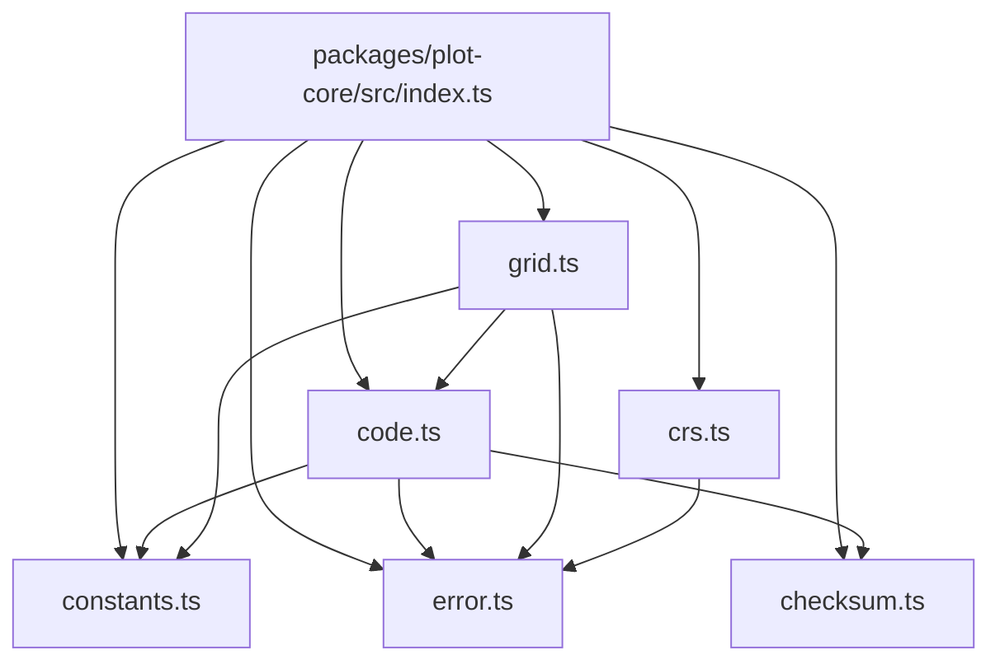
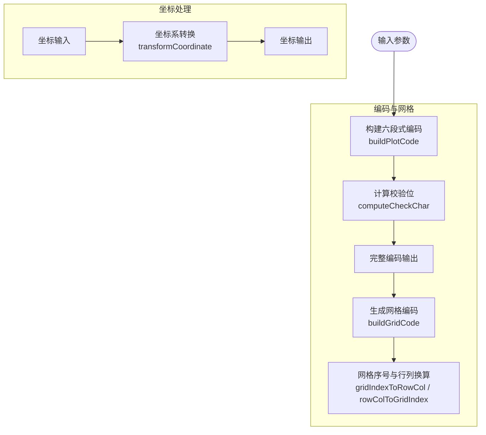
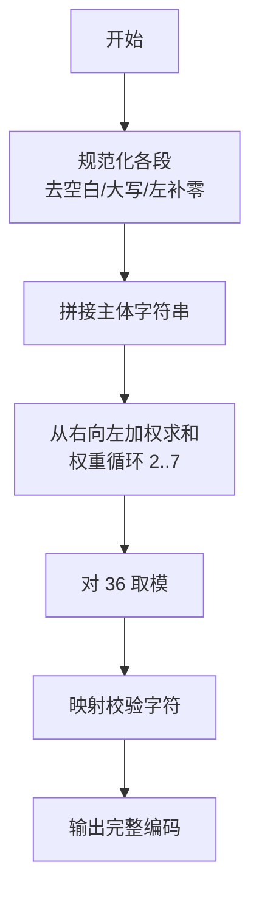
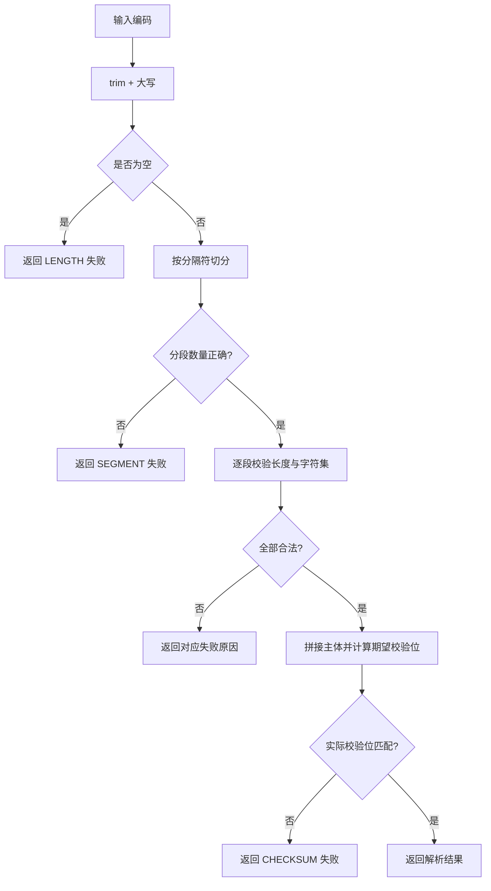
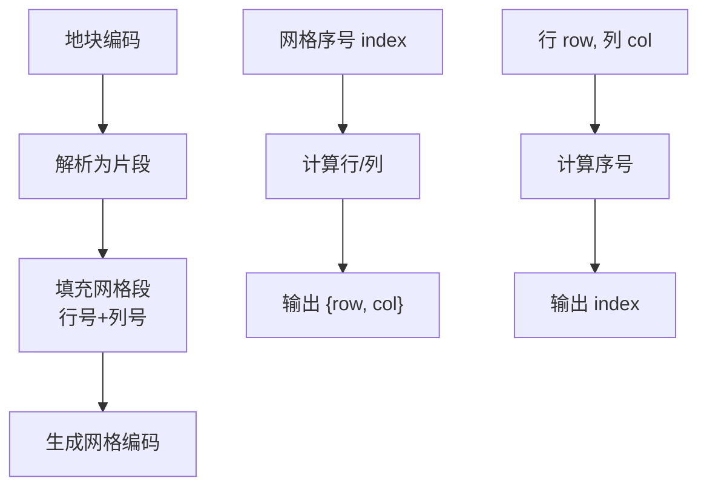
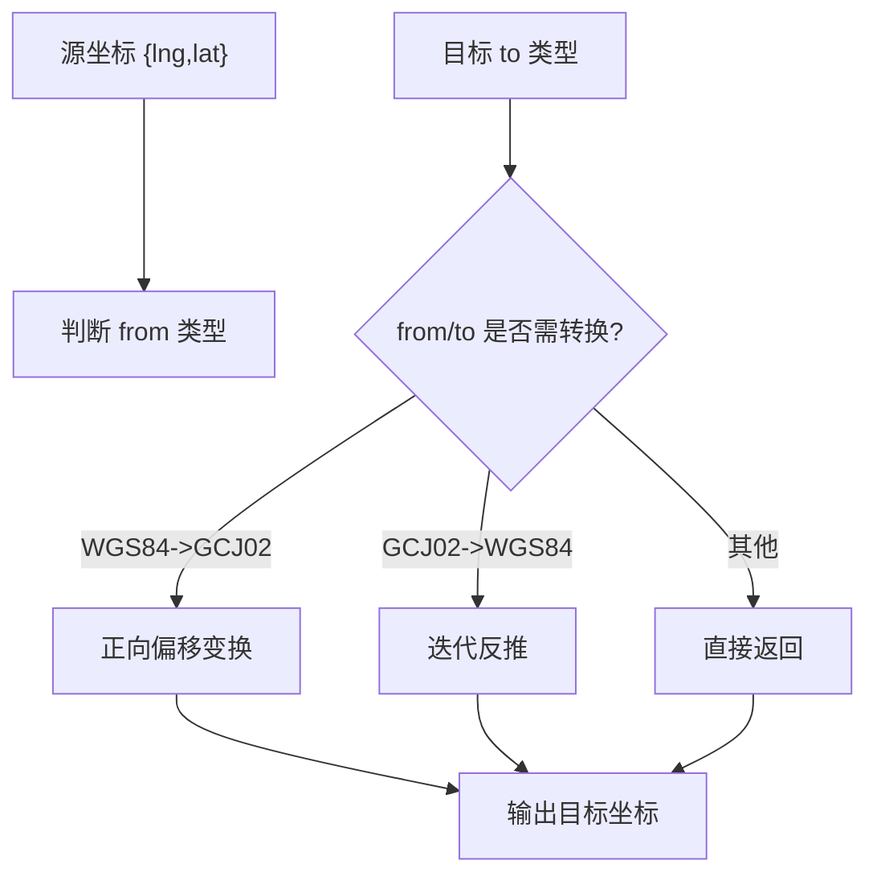
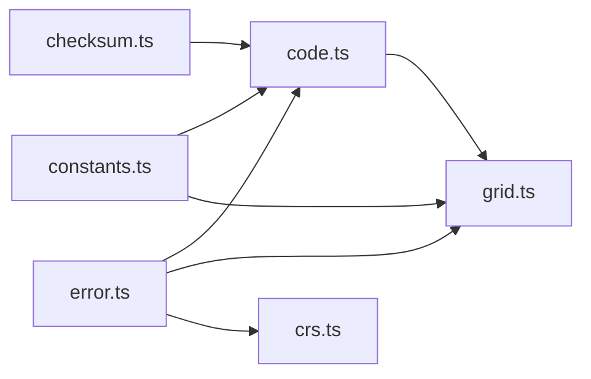

# 地块核心包 (@agri/plot-core)

<cite>
**本文引用的文件**   
- [index.ts](file://packages/plot-core/src/index.ts)
- [constants.ts](file://packages/plot-core/src/constants.ts)
- [error.ts](file://packages/plot-core/src/error.ts)
- [code.ts](file://packages/plot-core/src/code.ts)
- [checksum.ts](file://packages/plot-core/src/checksum.ts)
- [grid.ts](file://packages/plot-core/src/grid.ts)
- [crs.ts](file://packages/plot-core/src/crs.ts)
</cite>

## 目录
1. [引言](#引言)
2. [项目结构](#项目结构)
3. [核心组件](#核心组件)
4. [架构总览](#架构总览)
5. [详细组件分析](#详细组件分析)
6. [依赖关系分析](#依赖关系分析)
7. [性能与精度考量](#性能与精度考量)
8. [故障排查指南](#故障排查指南)
9. [结论](#结论)
10. [附录：API 速查与使用示例](#附录api-速查与使用示例)

## 引言
@agri/plot-core 是智慧农业平台的地块领域核心包，聚焦“编码级与索引级”计算，提供六段式地块编码、校验位算法、网格换算以及坐标参考系统转换能力。该包明确不做几何叠加、缓冲区、面积等空间运算，这些能力下沉到空间数据库以 SQL 完成，从而保证平台在大规模作业场景下的可维护性与一致性。

本包的设计目标包括：
- 为小农户“一地块一编号”与规模主体“一网格一编号”提供统一标识体系；
- 通过强约束的编码规则与校验位算法，确保跨服务、跨库的数据锚点稳定可靠；
- 在出参与展示时进行坐标系转换，但存储层统一采用国家大地坐标系 CGCS2000（EPSG:4490）；
- 将网格划分与任务分片纳入同一编码体系，便于变量作业调度与追溯。

## 项目结构
该包采用按职责划分的模块组织方式，入口集中导出，内部模块之间耦合清晰：

**图表来源**
- [index.ts:7-12](file://packages/plot-core/src/index.ts#L7-L12)
- [code.ts:1-10](file://packages/plot-core/src/code.ts#L1-L10)
- [grid.ts:1-4](file://packages/plot-core/src/grid.ts#L1-L4)
- [crs.ts:1-3](file://packages/plot-core/src/crs.ts#L1-L3)

**章节来源**
- [index.ts:1-13](file://packages/plot-core/src/index.ts#L1-L13)

## 核心组件
- 常量与错误定义：集中声明编码段定义、字符集、分隔符、占位符、网格上限及业务异常类型。
- 编码模块：负责六段式编码的生成、解析、校验与原始段拆分。
- 校验位模块：实现模 36 加权校验位算法，保证编码可复现且无外部依赖。
- 网格模块：基于地块编码生成网格编码，并提供行列号与序号之间的换算。
- 坐标系模块：支持 WGS84、GCJ02 与 CGCS2000 的转换策略，并封装扁平坐标数组与对象数组互转。

**章节来源**
- [constants.ts:1-38](file://packages/plot-core/src/constants.ts#L1-L38)
- [error.ts:1-11](file://packages/plot-core/src/error.ts#L1-L11)
- [code.ts:1-196](file://packages/plot-core/src/code.ts#L1-L196)
- [checksum.ts:1-44](file://packages/plot-core/src/checksum.ts#L1-L44)
- [grid.ts:1-105](file://packages/plot-core/src/grid.ts#L1-L105)
- [crs.ts:1-138](file://packages/plot-core/src/crs.ts#L1-L138)

## 架构总览
从数据流角度，本包围绕“编码—网格—坐标”三条主线展开：

**图表来源**
- [code.ts:79-88](file://packages/plot-core/src/code.ts#L79-L88)
- [checksum.ts:25-43](file://packages/plot-core/src/checksum.ts#L25-L43)
- [grid.ts:32-43](file://packages/plot-core/src/grid.ts#L32-L43)
- [grid.ts:69-99](file://packages/plot-core/src/grid.ts#L69-L99)
- [crs.ts:97-116](file://packages/plot-core/src/crs.ts#L97-L116)

## 详细组件分析

### 六段式编码与校验位
六段式编码由行政区划码、农场代码、片区号、地块序号、网格号与校验位组成。编码生成时对每段进行规范化（去空白、大写、左补零），并按固定顺序拼接后计算校验位。校验位采用模 36 加权算法，权重循环序列为 2、3、4、5、6、7，从右向左遍历有效字符，最终取 (36 - 余数) mod 36 对应的字符作为校验位。

关键特性：
- 段长度严格受控，超长直接抛出业务异常；
- 校验失败返回结构化原因码，便于前端提示与批量导入纠错；
- 网格段为空串时表示地块级编码，内部以占位符区分。

**图表来源**
- [code.ts:55-70](file://packages/plot-core/src/code.ts#L55-L70)
- [checksum.ts:17-43](file://packages/plot-core/src/checksum.ts#L17-L43)

**章节来源**
- [constants.ts:9-32](file://packages/plot-core/src/constants.ts#L9-L32)
- [code.ts:12-88](file://packages/plot-core/src/code.ts#L12-L88)
- [checksum.ts:1-44](file://packages/plot-core/src/checksum.ts#L1-L44)

### 编码解析与校验
编码解析流程先做基础格式检查（空值、分段数量、段长、字符集），再校验校验位。校验通过则返回结构化片段对象；否则返回包含失败原因的可读消息。对外暴露三种接口：
- 解析：抛错模式，适合强约束调用；
- 判定：布尔模式，适合快速过滤；
- 明细：结构化结果，适合表单校验与批量导入。

**图表来源**
- [code.ts:104-175](file://packages/plot-core/src/code.ts#L104-L175)

**章节来源**
- [code.ts:90-185](file://packages/plot-core/src/code.ts#L90-L185)

### 网格编码与行列换算
网格编码复用前四段，仅替换网格段，因此天然携带所属地块信息。网格行列号取值范围为 1 至 99，并以两位数字格式化。网格序号从 1 开始，先行后列编号，用于变量作业的任务分片。

主要能力：
- 由地块编码与行列号生成网格编码；
- 解析网格编码并提取行列号；
- 网格序号与行列号双向换算；
- 提供可读形式的网格编码片段，便于日志与前端展示。

**图表来源**
- [grid.ts:32-43](file://packages/plot-core/src/grid.ts#L32-L43)
- [grid.ts:50-61](file://packages/plot-core/src/grid.ts#L50-L61)
- [grid.ts:69-99](file://packages/plot-core/src/grid.ts#L69-L99)

**章节来源**
- [grid.ts:1-105](file://packages/plot-core/src/grid.ts#L1-L105)

### 坐标参考系统与转换
平台统一以 CGCS2000（EPSG:4490）存储几何数据，与自然资源部门成果口径一致。转换仅在出参与展示时单向发生，不得把转换后的坐标回写入库。当前实现支持：
- WGS84 与 GCJ02 之间的近似偏移转换；
- CGCS2000 与 WGS84 在厘米级精度下视为一致，不进行额外变换；
- 同系或无效组合直接返回原坐标，避免静默错误。

WGS84 到 GCJ02 的正向变换采用经验公式，包含经纬度非线性修正项与正弦扰动项；反向变换通过迭代逼近消除正向偏移。坐标对象来自共享契约类型，包内还提供扁平数组与对象数组之间的互转工具。

**图表来源**
- [crs.ts:24-82](file://packages/plot-core/src/crs.ts#L24-L82)
- [crs.ts:97-116](file://packages/plot-core/src/crs.ts#L97-L116)

**章节来源**
- [crs.ts:1-138](file://packages/plot-core/src/crs.ts#L1-L138)

### 地理信息系统相关数学与算法说明
- 校验位算法：模 36 加权，权重循环 2、3、4、5、6、7，从右向左累加，最后取 (36 - sum % 36) % 36 的下标字符。
- WGS84 到 GCJ02：基于椭球参数与经验偏移函数，包含纬度与经度的多项式与三角函数修正项。
- GCJ02 到 WGS84：迭代逼近，每次用正向变换误差校正候选坐标，直至收敛阈值。
- 网格编号：先行后列的一维序号与二维行列号的双射映射。

上述算法在本包中以纯函数形式实现，不引入第三方 GIS 库，便于在服务端与数据库侧保持一致性。

**章节来源**
- [checksum.ts:4-15](file://packages/plot-core/src/checksum.ts#L4-L15)
- [crs.ts:34-82](file://packages/plot-core/src/crs.ts#L34-L82)
- [grid.ts:69-99](file://packages/plot-core/src/grid.ts#L69-L99)

## 依赖关系分析
模块间依赖遵循“低耦合、高内聚”原则：
- code.ts 依赖 constants.ts、checksum.ts、error.ts；
- grid.ts 依赖 code.ts、constants.ts、error.ts；
- crs.ts 依赖 error.ts 与共享契约类型 Coordinate；
- index.ts 仅做聚合导出，不引入业务逻辑。

**图表来源**
- [code.ts:1-10](file://packages/plot-core/src/code.ts#L1-L10)
- [grid.ts:1-4](file://packages/plot-core/src/grid.ts#L1-L4)
- [crs.ts:1-3](file://packages/plot-core/src/crs.ts#L1-L3)

**章节来源**
- [code.ts:1-10](file://packages/plot-core/src/code.ts#L1-L10)
- [grid.ts:1-4](file://packages/plot-core/src/grid.ts#L1-L4)
- [crs.ts:1-3](file://packages/plot-core/src/crs.ts#L1-L3)

## 性能与精度考量
- 编码与校验：时间复杂度 O(n)，n 为有效字符长度；空间复杂度 O(1)。校验位计算无分支热点，适合高频调用。
- 网格换算：O(1) 算术运算，适合任务分片与批量调度。
- 坐标转换：WGS84 到 GCJ02 为常数时间；GCJ02 到 WGS84 最多 MAX_ITERATION 次迭代，通常快速收敛。
- 精度策略：CGCS2000 与 WGS84 在平台范围内视为一致，避免不必要的数值漂移；GCJ02 转换采用经验模型，适用于互联网地图展示，不应用于高精度测绘。
- 可扩展性：若未来需要 BD09 等坐标系，可在 crs.ts 中新增转换分支，保持 transformCoordinate 的统一入口。

[本节为通用性能讨论，不直接分析具体文件]

## 故障排查指南
常见错误与定位建议：
- 编码长度或分段数错误：检查输入是否包含多余空格、大小写不一致或分隔符缺失。
- 段长或字符集非法：确认各段是否按声明长度左补零，字符是否在 0-9、A-Z 范围内。
- 校验位不匹配：核对主体拼接顺序与权重循环方向，确认未混入分隔符。
- 网格行列越界：确认行列号为 1 至 99 的整数，网格布局列数为正整数。
- 坐标转换异常：确认 from/to 为支持的坐标系，避免将转换结果回写到 CGCS2000 存储层。

所有异常均继承业务异常基类，并带有统一错误码，便于全局异常过滤器识别与用户提示。

**章节来源**
- [error.ts:1-11](file://packages/plot-core/src/error.ts#L1-L11)
- [code.ts:104-175](file://packages/plot-core/src/code.ts#L104-L175)
- [grid.ts:14-18](file://packages/plot-core/src/grid.ts#L14-L18)
- [crs.ts:97-116](file://packages/plot-core/src/crs.ts#L97-L116)

## 结论
@agri/plot-core 以强约束的六段式编码为核心，结合校验位算法、网格换算与坐标转换，为智慧农业平台提供了稳定、可追溯、可扩展的地块标识与索引能力。通过将几何运算下沉至数据库，该包在保证精度的同时提升了系统的可维护性与扩展性。建议在后续演进中：
- 保持 CGCS2000 为唯一存储基准，所有转换仅在展示与出参阶段进行；
- 在网格划分与任务调度中充分利用行列号与序号的双射关系；
- 如需支持更多坐标系，优先评估精度影响与适用边界，并在 crs.ts 中统一扩展。

[本节为总结性内容，不直接分析具体文件]

## 附录：API 速查与使用示例

### 编码与校验 API
- 生成编码：buildPlotCode(input)
- 解析编码：parsePlotCode(code)
- 判定合法性：validatePlotCode(code)
- 校验明细：checkPlotCode(code)
- 原始段拆分：splitRaw(code)

使用要点：
- input 中的 region、farm、area、parcel 必填；grid 可选，省略时生成地块级编码；
- 所有段会进行规范化处理，超长将抛出业务异常；
- 校验失败可通过 checkPlotCode 获取 reason 与 message。

**章节来源**
- [code.ts:28-88](file://packages/plot-core/src/code.ts#L28-L88)
- [code.ts:90-185](file://packages/plot-core/src/code.ts#L90-L185)

### 网格换算 API
- 生成网格编码：buildGridCode(parcelCode, row, col)
- 解析网格编码：parseGridCode(gridCode)
- 序号转行列：gridIndexToRowCol(index, layout)
- 行列转序号：rowColToGridIndex(row, col, layout)
- 格式化网格编码：formatGridCode(parcelCode, row, col)

使用要点：
- row、col 必须为 1 至 99 的整数；
- layout.cols 必须为正整数；
- 网格编码复用前四段，便于关联地块上下文。

**章节来源**
- [grid.ts:32-43](file://packages/plot-core/src/grid.ts#L32-L43)
- [grid.ts:50-61](file://packages/plot-core/src/grid.ts#L50-L61)
- [grid.ts:69-99](file://packages/plot-core/src/grid.ts#L69-L99)
- [grid.ts:101-104](file://packages/plot-core/src/grid.ts#L101-L104)

### 坐标转换 API
- 坐标系转换：transformCoordinate(coord, from, to)
- 扁平坐标转对象：toCoordinates(flat)
- 对象坐标转扁平：fromCoordinates(coords)

使用要点：
- 平台存储基准为 CGCS2000（EPSG:4490）；
- 仅支持 WGS84、GCJ02 与 CGCS2000 的组合；
- 转换结果不得回写到存储层。

**章节来源**
- [crs.ts:97-116](file://packages/plot-core/src/crs.ts#L97-L116)
- [crs.ts:123-137](file://packages/plot-core/src/crs.ts#L123-L137)