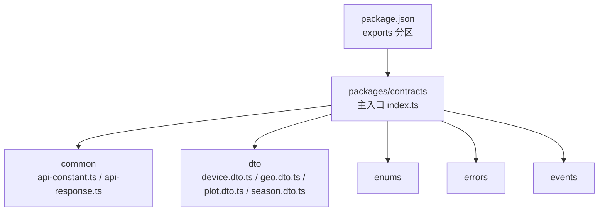
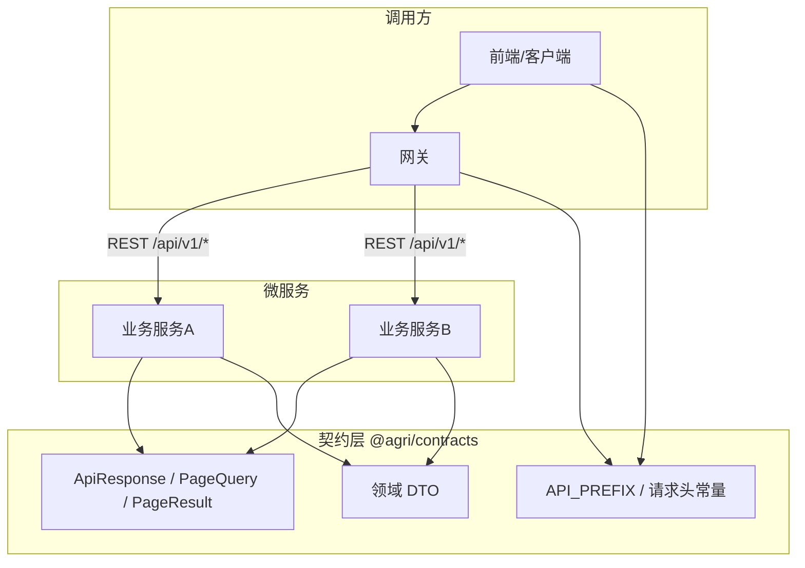
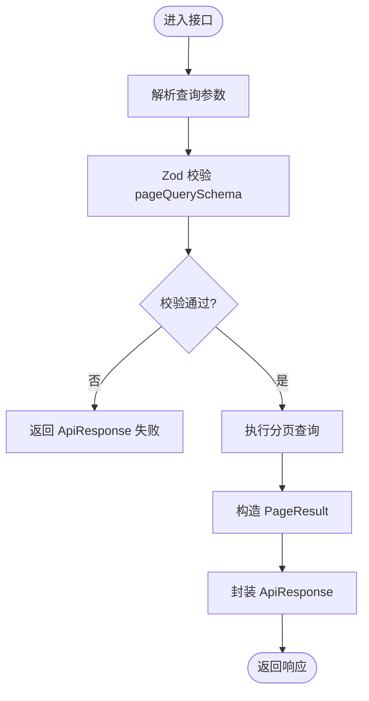
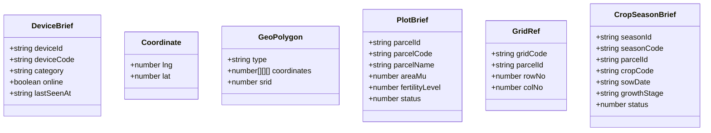
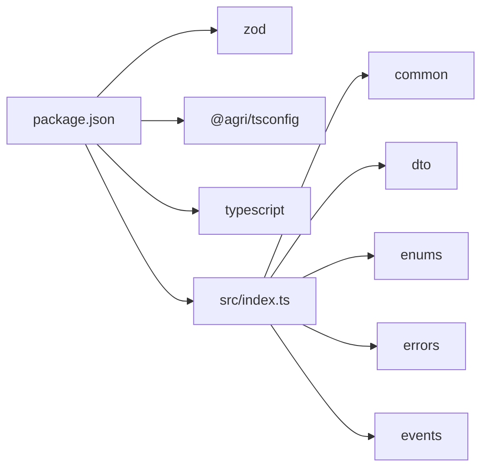

# 契约定义包 (@agri/contracts)

<cite>
**本文引用的文件**   
- [packages/contracts/package.json](file://packages/contracts/package.json)
- [packages/contracts/src/index.ts](file://packages/contracts/src/index.ts)
- [packages/contracts/src/common/api-constant.ts](file://packages/contracts/src/common/api-constant.ts)
- [packages/contracts/src/common/api-response.ts](file://packages/contracts/src/common/api-response.ts)
- [packages/contracts/src/dto/device.dto.ts](file://packages/contracts/src/dto/device.dto.ts)
- [packages/contracts/src/dto/geo.dto.ts](file://packages/contracts/src/dto/geo.dto.ts)
- [packages/contracts/src/dto/plot.dto.ts](file://packages/contracts/src/dto/plot.dto.ts)
- [packages/contracts/src/dto/season.dto.ts](file://packages/contracts/src/dto/season.dto.ts)
</cite>

## 目录
1. [简介](#简介)
2. [项目结构](#项目结构)
3. [核心组件](#核心组件)
4. [架构总览](#架构总览)
5. [详细组件分析](#详细组件分析)
6. [依赖关系分析](#依赖关系分析)
7. [性能与一致性考量](#性能与一致性考量)
8. [故障排查指南](#故障排查指南)
9. [结论](#结论)
10. [附录：使用示例与最佳实践](#附录使用示例与最佳实践)

## 简介
@agri/contracts 是平台微服务间通信的“接口真相来源”，仅定义、不实现。它通过 TypeScript 类型、Zod 校验模式与枚举，统一了 REST 响应信封、分页参数、领域 DTO、错误码与事件等跨服务契约，确保各微服务在请求/响应格式、字段语义和错误处理上保持一致。该包以多导出分区形式暴露能力，便于按需引用并降低耦合。

## 项目结构
该包采用按职责分层的目录组织方式：common（通用常量与响应）、dto（领域数据传输对象）、enums（共享枚举）、errors（错误码与错误体）、events（领域事件）。主入口 index.ts 汇总五个导出分区，package.json 定义了模块导出路径与构建脚本。

**图表来源**
- [packages/contracts/src/index.ts:1-12](file://packages/contracts/src/index.ts#L1-L12)
- [packages/contracts/package.json:1-42](file://packages/contracts/package.json#L1-L42)

**章节来源**
- [packages/contracts/src/index.ts:1-12](file://packages/contracts/src/index.ts#L1-L12)
- [packages/contracts/package.json:1-42](file://packages/contracts/package.json#L1-L42)

## 核心组件
- 统一响应信封 ApiResponse<T>：所有 REST 接口返回同一结构，包含业务状态码、消息、数据、链路追踪 ID 与服务端时间戳。
- 分页查询 PageQuery 与分页结果 PageResult<T>：统一页码、每页大小、排序字段与方向；服务端计算 pages 总数。
- Zod 分页校验 pageQuerySchema：提供默认值与上限约束，供各服务复用。
- 领域 DTO：设备 DeviceBrief、坐标 Coordinate、几何 GeoPolygon、地块 PlotBrief、网格 GridRef、作物季 CropSeasonBrief。
- 通用常量：API 前缀 API_PREFIX、请求头 HEADER_REQUEST_ID、HEADER_TENANT_ID。

**章节来源**
- [packages/contracts/src/common/api-response.ts:1-61](file://packages/contracts/src/common/api-response.ts#L1-L61)
- [packages/contracts/src/common/api-constant.ts:1-9](file://packages/contracts/src/common/api-constant.ts#L1-L9)
- [packages/contracts/src/dto/device.dto.ts:1-15](file://packages/contracts/src/dto/device.dto.ts#L1-L15)
- [packages/contracts/src/dto/geo.dto.ts:1-18](file://packages/contracts/src/dto/geo.dto.ts#L1-L18)
- [packages/contracts/src/dto/plot.dto.ts:1-23](file://packages/contracts/src/dto/plot.dto.ts#L1-L23)
- [packages/contracts/src/dto/season.dto.ts:1-15](file://packages/contracts/src/dto/season.dto.ts#L1-L15)

## 架构总览
@agri/contracts 作为契约层，被网关与各微服务共同消费。网关依据 API_PREFIX 路由，透传 x-request-id 与 x-tenant-id；各服务遵循 ApiResponse 与 PageQuery/PageResult 规范进行入参校验与出参封装；DTO 与枚举保证领域语义一致。

[本图为概念性架构图，未直接映射具体源码文件]

## 详细组件分析

### 统一响应与分页
- ApiResponse<T>：code 为业务状态码，message 为用户提示，data 为业务数据或 null，traceId 用于全链路追踪，timestamp 为服务端毫秒时间戳。
- PageQuery：page 从 1 开始，size 默认 20、上限 200，sortBy 需为白名单字段，order 支持 asc/desc。
- PageResult<T>：items 为当前页数据，total 为总条数，pages 由服务端计算。
- pageQuerySchema：基于 Zod 的校验模式，提供默认值与范围限制，可直接在各服务中复用。

**图表来源**
- [packages/contracts/src/common/api-response.ts:1-61](file://packages/contracts/src/common/api-response.ts#L1-L61)

**章节来源**
- [packages/contracts/src/common/api-response.ts:1-61](file://packages/contracts/src/common/api-response.ts#L1-L61)

### 通用常量与请求头
- API_PREFIX：统一 REST 前缀，网关据此路由。
- HEADER_REQUEST_ID：链路标识，网关生成后透传到下游。
- HEADER_TENANT_ID：租户标识，认证服务签发并透传。

**章节来源**
- [packages/contracts/src/common/api-constant.ts:1-9](file://packages/contracts/src/common/api-constant.ts#L1-L9)

### 领域数据传输对象（DTO）
- DeviceBrief：设备简要信息，包含 deviceId、deviceCode、category、online、lastSeenAt。
- Coordinate：经纬度坐标，lng 经度、lat 纬度。
- GeoPolygon：多边形几何，type 固定为 Polygon，coordinates 为坐标环数组，srid 统一为 4490。
- PlotBrief：地块简要信息，包含 parcelId、parcelCode、parcelName、areaMu、fertilityLevel、status。
- GridRef：网格引用，gridCode、parcelId、rowNo、colNo。
- CropSeasonBrief：作物季简要信息，包含 seasonId、seasonCode、parcelId、cropCode、sowDate、growthStage、status。

**图表来源**
- [packages/contracts/src/dto/device.dto.ts:1-15](file://packages/contracts/src/dto/device.dto.ts#L1-L15)
- [packages/contracts/src/dto/geo.dto.ts:1-18](file://packages/contracts/src/dto/geo.dto.ts#L1-L18)
- [packages/contracts/src/dto/plot.dto.ts:1-23](file://packages/contracts/src/dto/plot.dto.ts#L1-L23)
- [packages/contracts/src/dto/season.dto.ts:1-15](file://packages/contracts/src/dto/season.dto.ts#L1-L15)

**章节来源**
- [packages/contracts/src/dto/device.dto.ts:1-15](file://packages/contracts/src/dto/device.dto.ts#L1-L15)
- [packages/contracts/src/dto/geo.dto.ts:1-18](file://packages/contracts/src/dto/geo.dto.ts#L1-L18)
- [packages/contracts/src/dto/plot.dto.ts:1-23](file://packages/contracts/src/dto/plot.dto.ts#L1-L23)
- [packages/contracts/src/dto/season.dto.ts:1-15](file://packages/contracts/src/dto/season.dto.ts#L1-L15)

## 依赖关系分析
- 运行时依赖：zod 用于运行时校验（如分页参数），提升契约一致性。
- 开发依赖：@agri/tsconfig 与 typescript 用于构建与类型检查。
- 模块导出：package.json 将 common、dto、enums、errors、events 分别暴露为独立分区，便于按需引入。

**图表来源**
- [packages/contracts/package.json:1-42](file://packages/contracts/package.json#L1-L42)
- [packages/contracts/src/index.ts:1-12](file://packages/contracts/src/index.ts#L1-L12)

**章节来源**
- [packages/contracts/package.json:1-42](file://packages/contracts/package.json#L1-L42)
- [packages/contracts/src/index.ts:1-12](file://packages/contracts/src/index.ts#L1-L12)

## 性能与一致性考量
- 分页上限控制：PAGE_MAX_SIZE=200，避免大结果集拖垮服务与前端渲染。
- 默认值与校验：pageQuerySchema 提供默认值与范围校验，减少无效请求与边界分支。
- 统一信封：ApiResponse 减少各服务重复包装逻辑，提高吞吐与可观测性（traceId、timestamp）。
- 类型即契约：TS 类型与 Zod 模式双重保障，编译期与运行期双重校验，降低集成成本。

[本节为通用指导，无需特定文件来源]

## 故障排查指南
- 分页异常：检查 pageQuerySchema 是否被正确应用，确认 sortBy 是否在接口文档白名单内，size 是否超过 200。
- 响应不一致：确认所有服务均返回 ApiResponse 结构，且 code/message/data/traceId/timestamp 字段齐全。
- 链路追踪缺失：确认网关已设置 HEADER_REQUEST_ID 并在响应中回显 traceId。
- 租户上下文丢失：确认认证服务已注入 HEADER_TENANT_ID，下游服务读取并使用。

**章节来源**
- [packages/contracts/src/common/api-response.ts:1-61](file://packages/contracts/src/common/api-response.ts#L1-L61)
- [packages/contracts/src/common/api-constant.ts:1-9](file://packages/contracts/src/common/api-constant.ts#L1-L9)

## 结论
@agri/contracts 通过统一的响应信封、分页模型、领域 DTO 与常量，为平台微服务提供了稳定、可演进、可验证的契约基座。配合 Zod 校验与 TS 类型系统，可在编译期与运行期同时保障一致性，显著降低跨服务协作成本，并为版本治理与向后兼容提供坚实基础。

[本节为总结性内容，无需特定文件来源]

## 附录：使用示例与最佳实践

### 在微服务中引用契约
- 安装依赖：在服务 package.json 中添加对 @agri/contracts 的依赖。
- 导入类型与模式：
  - 导入 ApiResponse、PageQuery、PageResult、pageQuerySchema 用于请求校验与响应封装。
  - 导入 API_PREFIX、HEADER_REQUEST_ID、HEADER_TENANT_ID 用于网关路由与请求头处理。
  - 按需导入 DTO（DeviceBrief、Coordinate、GeoPolygon、PlotBrief、GridRef、CropSeasonBrief）用于接口入参与出参。

参考路径：
- [packages/contracts/src/common/api-response.ts:1-61](file://packages/contracts/src/common/api-response.ts#L1-L61)
- [packages/contracts/src/common/api-constant.ts:1-9](file://packages/contracts/src/common/api-constant.ts#L1-L9)
- [packages/contracts/src/dto/device.dto.ts:1-15](file://packages/contracts/src/dto/device.dto.ts#L1-L15)
- [packages/contracts/src/dto/geo.dto.ts:1-18](file://packages/contracts/src/dto/geo.dto.ts#L1-L18)
- [packages/contracts/src/dto/plot.dto.ts:1-23](file://packages/contracts/src/dto/plot.dto.ts#L1-L23)
- [packages/contracts/src/dto/season.dto.ts:1-15](file://packages/contracts/src/dto/season.dto.ts#L1-L15)

### 契约驱动开发流程
- 设计阶段：先在 @agri/contracts 中定义 DTO、枚举与响应信封，明确字段含义与取值范围。
- 实现阶段：服务实现时严格使用这些类型与 Zod 模式，禁止随意扩展字段。
- 测试阶段：基于 Zod 模式编写单元测试，覆盖边界条件（如 size 超限、sortBy 非法）。
- 发布阶段：任何对外导出的变更都视为平台级接口变更，需评估兼容性并升级版本号。

### 版本管理与向后兼容最佳实践
- 语义化版本：对 @agri/contracts 采用语义化版本管理，破坏性变更必须升 major。
- 新增优先：优先通过新增字段与可选参数扩展，避免修改已有必填字段。
- 弃用策略：对即将废弃的字段保留一段时间，并通过日志与告警提醒迁移。
- 分区导出：利用 package.json 的 exports 分区，逐步拆分与重组导出，降低影响面。
- 下游通知：每次导出变更应同步通知网关与各微服务团队，安排灰度与回滚预案。

参考路径：
- [packages/contracts/package.json:1-42](file://packages/contracts/package.json#L1-L42)
- [packages/contracts/src/index.ts:1-12](file://packages/contracts/src/index.ts#L1-L12)