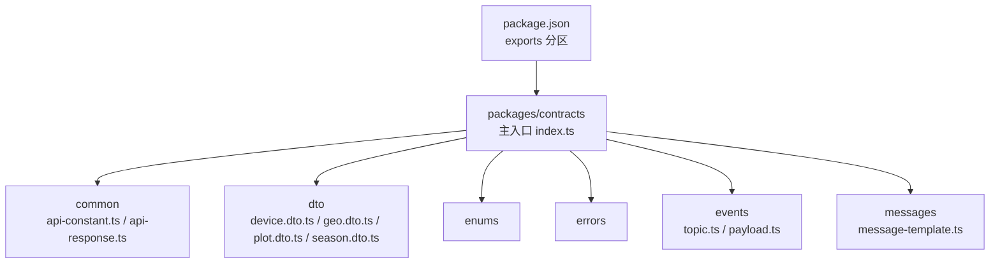
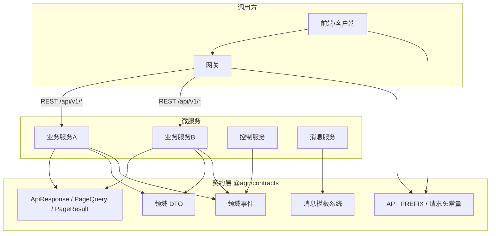
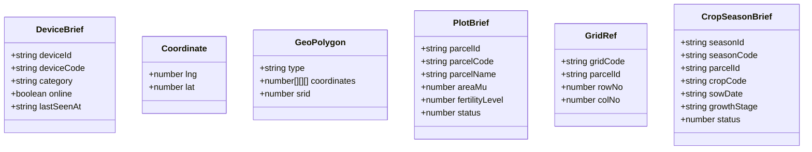
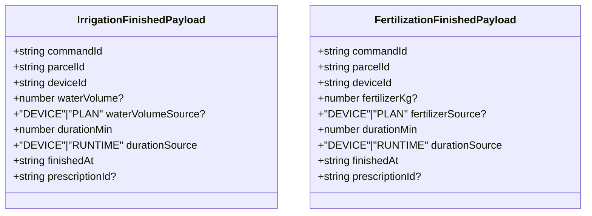
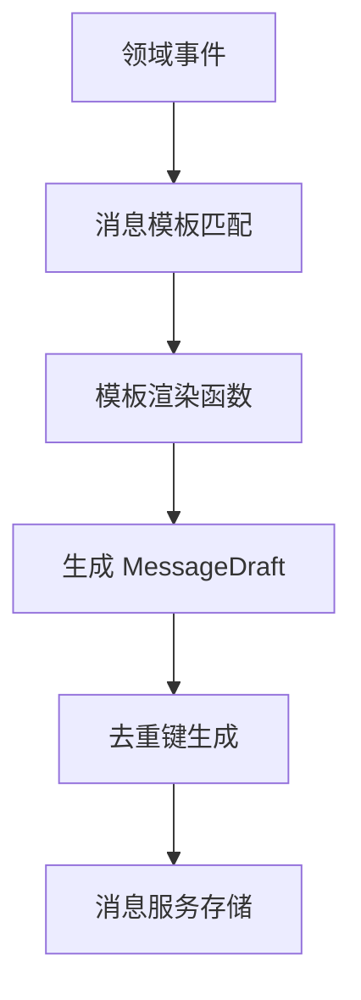
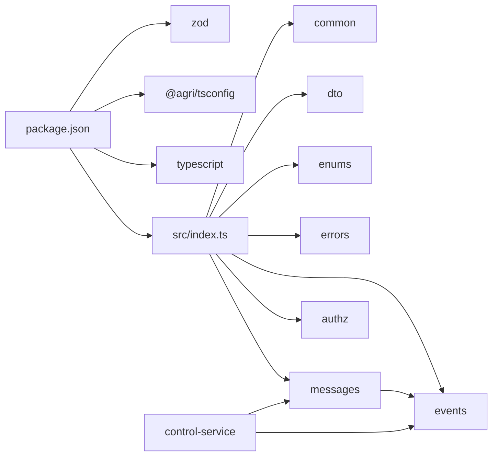

# 契约定义包 (@agri/contracts)

<cite>
**本文引用的文件**   
- [packages/contracts/package.json](file://packages/contracts/package.json)
- [packages/contracts/src/index.ts](file://packages/contracts/src/index.ts)
- [packages/contracts/src/common/api-constant.ts](file://packages/contracts/src/common/api-constant.ts)
- [packages/contracts/src/common/api-response.ts](file://packages/contracts/src/common/api-response.ts)
- [packages/contracts/src/dto/device.dto.ts](file://packages/contracts/src/dto/device.dto.ts)
- [packages/contracts/src/dto/geo.dto.ts](file://packages/contracts/src/dto/geo.dto.ts)
- [packages/contracts/src/dto/plot.dto.ts](file://packages/contracts/src/dto/plot.dto.ts)
- [packages/contracts/src/dto/season.dto.ts](file://packages/contracts/src/dto/season.dto.ts)
- [packages/contracts/src/messages/message-template.ts](file://packages/contracts/src/messages/message-template.ts)
- [packages/contracts/src/messages/index.ts](file://packages/contracts/src/messages/index.ts)
- [packages/contracts/src/events/topic.ts](file://packages/contracts/src/events/topic.ts)
- [packages/contracts/src/events/payload.ts](file://packages/contracts/src/events/payload.ts)
- [apps/control-service/src/command-finished.ts](file://apps/control-service/src/command-finished.ts)
</cite>

## 更新摘要
**已进行的更改**   
- 新增施肥完成事件载荷接口 FertilizationFinishedPayload 的详细说明
- 扩展控制服务完成事件主题枚举，包含 ControlFertilizationFinished
- 更新消息模板系统，添加施肥执行完成的模板处理逻辑
- 完善灌溉与施肥完成事件的对比分析
- 更新使用示例，展示施肥完成事件的处理流程

## 目录
1. [简介](#简介)
2. [项目结构](#项目结构)
3. [核心组件](#核心组件)
4. [架构总览](#架构总览)
5. [详细组件分析](#详细组件分析)
6. [消息模板系统](#消息模板系统)
7. [依赖关系分析](#依赖关系分析)
8. [性能与一致性考量](#性能与一致性考量)
9. [故障排查指南](#故障排查指南)
10. [结论](#结论)
11. [附录：使用示例与最佳实践](#附录使用示例与最佳实践)

## 简介
@agri/contracts 是平台微服务间通信的"接口真相来源"，仅定义、不实现。它通过 TypeScript 类型、Zod 校验模式与枚举，统一了 REST 响应信封、分页参数、领域 DTO、错误码、事件以及**消息模板**等跨服务契约，确保各微服务在请求/响应格式、字段语义、错误处理和消息生成上保持一致。该包以多导出分区形式暴露能力，便于按需引用并降低耦合。

**新增功能**：引入了集中式的消息模板系统，标准化事件到消息的转换过程，提供去重逻辑和统一的文案管理。**特别新增了施肥完成事件支持，完善了水肥一体化作业的事件体系**。

## 项目结构
该包采用按职责分层的目录组织方式：common（通用常量与响应）、dto（领域数据传输对象）、enums（共享枚举）、errors（错误码与错误体）、events（领域事件）、**messages（消息模板）**。主入口 index.ts 汇总六个导出分区，package.json 定义了模块导出路径与构建脚本。

**图表来源**
- [packages/contracts/src/index.ts:1-14](file://packages/contracts/src/index.ts#L1-L14)
- [packages/contracts/package.json:1-50](file://packages/contracts/package.json#L1-L50)

**章节来源**
- [packages/contracts/src/index.ts:1-14](file://packages/contracts/src/index.ts#L1-L14)
- [packages/contracts/package.json:1-50](file://packages/contracts/package.json#L1-L50)

## 核心组件
- **统一响应信封 ApiResponse<T>**：所有 REST 接口返回同一结构，包含业务状态码、消息、数据、链路追踪 ID 与服务端时间戳。
- **分页查询 PageQuery 与分页结果 PageResult<T>**：统一页码、每页大小、排序字段与方向；服务端计算 pages 总数。
- **Zod 分页校验 pageQuerySchema**：提供默认值与上限约束，供各服务复用。
- **领域 DTO**：设备 DeviceBrief、坐标 Coordinate、几何 GeoPolygon、地块 PlotBrief、网格 GridRef、作物季 CropSeasonBrief。
- **通用常量**：API 前缀 API_PREFIX、请求头 HEADER_REQUEST_ID、HEADER_TENANT_ID。
- **消息模板系统**：MessageTemplate、MessageDraft、MessageType、MessageLevel，用于标准化事件到消息的转换。
- **控制完成事件**：IrrigationFinishedPayload 与 FertilizationFinishedPayload，分别表示灌溉与施肥作业的完成状态。

**章节来源**
- [packages/contracts/src/common/api-response.ts:1-61](file://packages/contracts/src/common/api-response.ts#L1-L61)
- [packages/contracts/src/common/api-constant.ts:1-9](file://packages/contracts/src/common/api-constant.ts#L1-L9)
- [packages/contracts/src/dto/device.dto.ts:1-15](file://packages/contracts/src/dto/device.dto.ts#L1-L15)
- [packages/contracts/src/dto/geo.dto.ts:1-18](file://packages/contracts/src/dto/geo.dto.ts#L1-L18)
- [packages/contracts/src/dto/plot.dto.ts:1-23](file://packages/contracts/src/dto/plot.dto.ts#L1-L23)
- [packages/contracts/src/dto/season.dto.ts:1-15](file://packages/contracts/src/dto/season.dto.ts#L1-L15)
- [packages/contracts/src/messages/message-template.ts:1-161](file://packages/contracts/src/messages/message-template.ts#L1-L161)
- [packages/contracts/src/events/payload.ts:104-148](file://packages/contracts/src/events/payload.ts#L104-L148)

## 架构总览
@agri/contracts 作为契约层，被网关与各微服务共同消费。网关依据 API_PREFIX 路由，透传 x-request-id 与 x-tenant-id；各服务遵循 ApiResponse 与 PageQuery/PageResult 规范进行入参校验与出参封装；DTO 与枚举保证领域语义一致。**新增的消息模板系统将事件消费生成的消息文案与去重规则标准化为平台级契约，同时完善了水肥一体化作业的事件处理体系**。

[本图为概念性架构图，未直接映射具体源码文件]

## 详细组件分析

### 统一响应与分页
- ApiResponse<T>：code 为业务状态码，message 为用户提示，data 为业务数据或 null，traceId 用于全链路追踪，timestamp 为服务端毫秒时间戳。
- PageQuery：page 从 1 开始，size 默认 20、上限 200，sortBy 需为白名单字段，order 支持 asc/desc。
- PageResult<T>：items 为当前页数据，total 为总条数，pages 由服务端计算。
- pageQuerySchema：基于 Zod 的校验模式，提供默认值与范围限制，可直接在各服务中复用。

**图表来源**
- [packages/contracts/src/common/api-response.ts:1-61](file://packages/contracts/src/common/api-response.ts#L1-L61)

**章节来源**
- [packages/contracts/src/common/api-response.ts:1-61](file://packages/contracts/src/common/api-response.ts#L1-L61)

### 通用常量与请求头
- API_PREFIX：统一 REST 前缀，网关据此路由。
- HEADER_REQUEST_ID：链路标识，网关生成后透传到下游。
- HEADER_TENANT_ID：租户标识，认证服务签发并透传。

**章节来源**
- [packages/contracts/src/common/api-constant.ts:1-9](file://packages/contracts/src/common/api-constant.ts#L1-L9)

### 领域数据传输对象（DTO）
- DeviceBrief：设备简要信息，包含 deviceId、deviceCode、category、online、lastSeenAt。
- Coordinate：经纬度坐标，lng 经度、lat 纬度。
- GeoPolygon：多边形几何，type 固定为 Polygon，coordinates 为坐标环数组，srid 统一为 4490。
- PlotBrief：地块简要信息，包含 parcelId、parcelCode、parcelName、areaMu、fertilityLevel、status。
- GridRef：网格引用，gridCode、parcelId、rowNo、colNo。
- CropSeasonBrief：作物季简要信息，包含 seasonId、seasonCode、parcelId、cropCode、sowDate、growthStage、status。

**图表来源**
- [packages/contracts/src/dto/device.dto.ts:1-15](file://packages/contracts/src/dto/device.dto.ts#L1-L15)
- [packages/contracts/src/dto/geo.dto.ts:1-18](file://packages/contracts/src/dto/geo.dto.ts#L1-L18)
- [packages/contracts/src/dto/plot.dto.ts:1-23](file://packages/contracts/src/dto/plot.dto.ts#L1-L23)
- [packages/contracts/src/dto/season.dto.ts:1-15](file://packages/contracts/src/dto/season.dto.ts#L1-L15)

**章节来源**
- [packages/contracts/src/dto/device.dto.ts:1-15](file://packages/contracts/src/dto/device.dto.ts#L1-L15)
- [packages/contracts/src/dto/geo.dto.ts:1-18](file://packages/contracts/src/dto/geo.dto.ts#L1-L18)
- [packages/contracts/src/dto/plot.dto.ts:1-23](file://packages/contracts/src/dto/plot.dto.ts#L1-L23)
- [packages/contracts/src/dto/season.dto.ts:1-15](file://packages/contracts/src/dto/season.dto.ts#L1-L15)

### 控制完成事件载荷

#### 灌溉完成载荷 IrrigationFinishedPayload
表示灌溉作业执行的完成状态，包含用水量、持续时间等关键指标：
- commandId：结单的指令标识，用于重复投递的去重处理
- parcelId：指令归属地块，未绑定地块时为空串
- deviceId：执行设备的唯一标识
- waterVolume：用水量（立方米），可选字段，设备未上报时为 undefined
- waterVolumeSource：用水量来源，DEVICE 表示设备实测，PLAN 表示按方案推算
- durationMin：作业持续时长（分钟）
- durationSource：时长来源，DEVICE 表示设备实测，RUNTIME 表示运行时计算
- finishedAt：完成时间戳
- prescriptionId：来源处方标识，人工指令可能缺失

#### 施肥完成载荷 FertilizationFinishedPayload
表示施肥作业执行的完成状态，包含施肥量、持续时间等关键指标：
- commandId：结单的指令标识，用于重复投递的去重处理
- parcelId：指令归属地块，未绑定地块时为空串
- deviceId：执行设备的唯一标识
- fertilizerKg：实际施肥量（千克，氮磷钾合计），可选字段，设备未上报时为 undefined
- fertilizerSource：施肥量来源，DEVICE 表示设备实测，PLAN 表示按配方与面积推算
- durationMin：作业持续时长（分钟）
- durationSource：时长来源，DEVICE 表示设备实测，RUNTIME 表示运行时计算
- finishedAt：完成时间戳
- prescriptionId：来源处方标识，人工指令可能缺失

**图表来源**
- [packages/contracts/src/events/payload.ts:104-148](file://packages/contracts/src/events/payload.ts#L104-L148)

**章节来源**
- [packages/contracts/src/events/payload.ts:104-148](file://packages/contracts/src/events/payload.ts#L104-L148)

## 消息模板系统

### 设计目标
消息模板系统解决了事件消费时消息文案管理和去重逻辑的统一化问题。事件消费生成的消息，其文案与去重规则属于平台级契约而不是某个服务的实现细节：前端展示、运维告警、测试断言都依赖同一套标题与级别。因此模板放在契约包里，只做纯函数渲染，不依赖任何能力包，也不负责落库。

### 核心概念

#### 消息类型与级别
- **MessageType**：消息类型分为 ALERT（告警待处置）和 NOTICE（通知仅提醒）。
- **MessageLevel**：消息级别包括 INFO、WARNING、CRITICAL，用于订阅偏好的最低级别过滤。
- **MESSAGE_LEVEL_RANK**：级别权重映射，INFO=1, WARNING=2, CRITICAL=3。

#### 消息模板上下文
- **MessageTemplateContext**：包含 eventId 和 occurredAt，提供事件标识与发生时间。
- **MessageDraft**：渲染结果，包含 type、level、title、content、plotCode、occurredAt、dedupeKey。

#### 模板接口
- **MessageTemplate<T>**：定义主题、标签、类型和渲染函数的标准接口。
- **buildMessageDraft**：根据主题和载荷渲染消息草稿的核心函数。

**图表来源**
- [packages/contracts/src/messages/message-template.ts:147-161](file://packages/contracts/src/messages/message-template.ts#L147-L161)

### 内置模板

#### 遥测越限告警模板
针对 telemetry.threshold.breached 事件，提供标准化的告警消息生成：
- 自动识别指标中文名（土壤含水率、空气温度等）
- 根据指标类型动态设置级别（风速异常设为 CRITICAL）
- 按「地块 + 指标 + 方向 + 小时」聚合去重，抑制同一场灾害的一小时内刷屏

#### 处方生成通知模板
针对 decision.prescription.issued 事件，提供标准化的通知消息生成：
- 自动识别处方类型中文名（灌溉、施肥、植保）
- 提取首项建议作为详情摘要
- 按事件ID唯一去重，确保每份处方都有独立通知

#### 灌溉执行完成模板
针对 control.irrigation.finished 事件，提供标准化的完成通知：
- 显示设备ID和执行地块
- 智能处理用水量显示（设备实测 vs 方案推算）
- 格式化持续时间显示
- 按 commandId 唯一去重

#### 施肥执行完成模板
针对 control.fertilization.finished 事件，提供标准化的完成通知：
- 显示设备ID和执行地块
- 智能处理施肥量显示（设备实测 vs 配方推算）
- 格式化持续时间显示
- 按 commandId 唯一去重

### 去重策略
消息模板系统实现了多种去重策略：
1. **聚合去重**：对于越限告警，按「事件主题:地块:指标:方向:小时」生成去重键，有效抑制重复告警。
2. **唯一去重**：对于处方通知和控制完成事件，按「事件主题:事件ID」生成去重键，确保每条通知的唯一性。

**章节来源**
- [packages/contracts/src/messages/message-template.ts:1-161](file://packages/contracts/src/messages/message-template.ts#L1-L161)
- [packages/contracts/src/messages/message-template.ts:272-292](file://packages/contracts/src/messages/message-template.ts#L272-L292)
- [packages/contracts/src/events/topic.ts:1-25](file://packages/contracts/src/events/topic.ts#L1-L25)
- [packages/contracts/src/events/payload.ts:104-148](file://packages/contracts/src/events/payload.ts#L104-L148)

## 依赖关系分析
- **运行时依赖**：zod 用于运行时校验（如分页参数），提升契约一致性。
- **开发依赖**：@agri/tsconfig 与 typescript 用于构建与类型检查。
- **模块导出**：package.json 将 common、dto、enums、errors、events、**messages**、authz 分别暴露为独立分区，便于按需引入。
- **消息模板依赖**：消息模板系统依赖于 events 模块中的 EventTopic 常量和 Payload 类型定义。
- **控制服务依赖**：控制服务引用 FertilizationFinishedPayload 和 IrrigationFinishedPayload 类型来构建完成事件。

**图表来源**
- [packages/contracts/package.json:1-50](file://packages/contracts/package.json#L1-L50)
- [packages/contracts/src/index.ts:1-14](file://packages/contracts/src/index.ts#L1-L14)
- [packages/contracts/src/messages/message-template.ts:1-3](file://packages/contracts/src/messages/message-template.ts#L1-L3)
- [apps/control-service/src/command-finished.ts:1-2](file://apps/control-service/src/command-finished.ts#L1-L2)

**章节来源**
- [packages/contracts/package.json:1-50](file://packages/contracts/package.json#L1-L50)
- [packages/contracts/src/index.ts:1-14](file://packages/contracts/src/index.ts#L1-L14)
- [apps/control-service/src/command-finished.ts:1-136](file://apps/control-service/src/command-finished.ts#L1-L136)

## 性能与一致性考量
- **分页上限控制**：PAGE_MAX_SIZE=200，避免大结果集拖垮服务与前端渲染。
- **默认值与校验**：pageQuerySchema 提供默认值与范围校验，减少无效请求与边界分支。
- **统一信封**：ApiResponse 减少各服务重复包装逻辑，提高吞吐与可观测性（traceId、timestamp）。
- **类型即契约**：TS 类型与 Zod 模式双重保障，编译期与运行期双重校验，降低集成成本。
- **消息模板优化**：纯函数渲染无外部依赖，模板匹配使用 switch 语句保证 O(1) 查找性能，去重键生成避免字符串拼接开销。
- **控制事件优化**：灌溉与施肥完成事件采用相同的结构设计，便于统一处理和批量操作。

## 故障排查指南
- **分页异常**：检查 pageQuerySchema 是否被正确应用，确认 sortBy 是否在接口文档白名单内，size 是否超过 200。
- **响应不一致**：确认所有服务均返回 ApiResponse 结构，且 code/message/data/traceId/timestamp 字段齐全。
- **链路追踪缺失**：确认网关已设置 HEADER_REQUEST_ID 并在响应中回显 traceId。
- **租户上下文丢失**：确认认证服务已注入 HEADER_TENANT_ID，下游服务读取并使用。
- **消息模板未生效**：检查事件主题是否在 MESSAGE_TEMPLATES 中注册，确认 buildMessageDraft 返回值不为 null。
- **消息去重异常**：验证 dedupeKey 生成逻辑是否符合预期，检查事件时间和地块标识是否正确传递。
- **施肥完成事件异常**：检查 FertilizationFinishedPayload 字段完整性，确认 fertilizerKg 和 fertilizerSource 字段的取值逻辑。
- **控制命令完成事件缺失**：确认 FINISHED_TOPIC_BY_TYPE 映射中包含 FERTILIZATION 类型，检查 buildFinishedEvent 函数的执行流程。

**章节来源**
- [packages/contracts/src/common/api-response.ts:1-61](file://packages/contracts/src/common/api-response.ts#L1-L61)
- [packages/contracts/src/common/api-constant.ts:1-9](file://packages/contracts/src/common/api-constant.ts#L1-L9)
- [packages/contracts/src/messages/message-template.ts:124-161](file://packages/contracts/src/messages/message-template.ts#L124-L161)
- [packages/contracts/src/messages/message-template.ts:272-292](file://packages/contracts/src/messages/message-template.ts#L272-L292)
- [apps/control-service/src/command-finished.ts:25-29](file://apps/control-service/src/command-finished.ts#L25-L29)

## 结论
@agri/contracts 通过统一的响应信封、分页模型、领域 DTO、常量以及**集中式消息模板系统**，为平台微服务提供了稳定、可演进、可验证的契约基座。配合 Zod 校验与 TS 类型系统，可在编译期与运行期同时保障一致性，显著降低跨服务协作成本，并为版本治理与向后兼容提供坚实基础。**新增的施肥完成事件支持和完善的水肥一体化事件体系进一步增强了平台的农业作业管理能力，确保了灌溉与施肥作业数据的完整性和一致性**。

## 附录：使用示例与最佳实践

### 在微服务中引用契约
- **安装依赖**：在服务 package.json 中添加对 @agri/contracts 的依赖。
- **导入类型与模式**：
  - 导入 ApiResponse、PageQuery、PageResult、pageQuerySchema 用于请求校验与响应封装。
  - 导入 API_PREFIX、HEADER_REQUEST_ID、HEADER_TENANT_ID 用于网关路由与请求头处理。
  - 按需导入 DTO（DeviceBrief、Coordinate、GeoPolygon、PlotBrief、GridRef、CropSeasonBrief）用于接口入参与出参。
  - **导入消息模板相关类型**：MessageTemplate、MessageDraft、MessageType、MessageLevel、buildMessageDraft。
  - **导入控制完成事件类型**：FertilizationFinishedPayload、IrrigationFinishedPayload 用于处理水肥作业完成事件。

参考路径：
- [packages/contracts/src/common/api-response.ts:1-61](file://packages/contracts/src/common/api-response.ts#L1-L61)
- [packages/contracts/src/common/api-constant.ts:1-9](file://packages/contracts/src/common/api-constant.ts#L1-L9)
- [packages/contracts/src/dto/device.dto.ts:1-15](file://packages/contracts/src/dto/device.dto.ts#L1-L15)
- [packages/contracts/src/dto/geo.dto.ts:1-18](file://packages/contracts/src/dto/geo.dto.ts#L1-L18)
- [packages/contracts/src/dto/plot.dto.ts:1-23](file://packages/contracts/src/dto/plot.dto.ts#L1-L23)
- [packages/contracts/src/dto/season.dto.ts:1-15](file://packages/contracts/src/dto/season.dto.ts#L1-L15)
- [packages/contracts/src/messages/message-template.ts:1-161](file://packages/contracts/src/messages/message-template.ts#L1-L161)
- [packages/contracts/src/events/payload.ts:104-148](file://packages/contracts/src/events/payload.ts#L104-L148)

### 契约驱动开发流程
- **设计阶段**：先在 @agri/contracts 中定义 DTO、枚举与响应信封，明确字段含义与取值范围。
- **实现阶段**：服务实现时严格使用这些类型与 Zod 模式，禁止随意扩展字段。
- **测试阶段**：基于 Zod 模式编写单元测试，覆盖边界条件（如 size 超限、sortBy 非法）。
- **发布阶段**：任何对外导出的变更都视为平台级接口变更，需评估兼容性并升级版本号。

### 消息模板集成最佳实践
- **模板注册**：在 MESSAGE_TEMPLATES 中注册新的事件主题对应的模板。
- **去重键设计**：根据业务场景选择合适的去重策略，避免过度聚合导致重要消息丢失。
- **级别配置**：合理设置消息级别，确保关键告警不会被用户偏好过滤掉。
- **文案管理**：使用中文标签和描述，便于前端展示和运维监控。

### 控制完成事件处理最佳实践
- **事件类型映射**：在 FINISHED_TOPIC_BY_TYPE 中登记新的可计量指令类型。
- **数值解析逻辑**：优先使用设备实测值，无法获取时使用方案推算值，两者都不可用时留空。
- **持续时间计算**：优先使用设备上报的持续时间，否则基于时间戳差值计算。
- **处方关联**：自动指令携带处方ID，人工指令可能缺失，需要做空值处理。

### 版本管理与向后兼容最佳实践
- **语义化版本**：对 @agri/contracts 采用语义化版本管理，破坏性变更必须升 major。
- **新增优先**：优先通过新增字段与可选参数扩展，避免修改已有必填字段。
- **弃用策略**：对即将废弃的字段保留一段时间，并通过日志与告警提醒迁移。
- **分区导出**：利用 package.json 的 exports 分区，逐步拆分与重组导出，降低影响面。
- **下游通知**：每次导出变更应同步通知网关与各微服务团队，安排灰度与回滚预案。

参考路径：
- [packages/contracts/package.json:1-50](file://packages/contracts/package.json#L1-L50)
- [packages/contracts/src/index.ts:1-14](file://packages/contracts/src/index.ts#L1-L14)
- [packages/contracts/src/messages/message-template.ts:124-138](file://packages/contracts/src/messages/message-template.ts#L124-L138)
- [apps/control-service/src/command-finished.ts:25-29](file://apps/control-service/src/command-finished.ts#L25-L29)