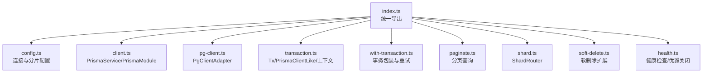
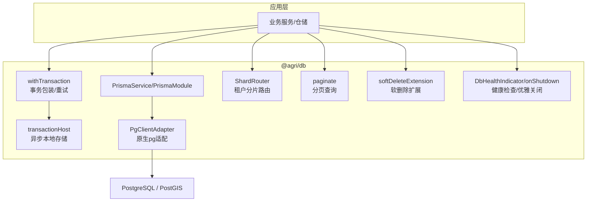
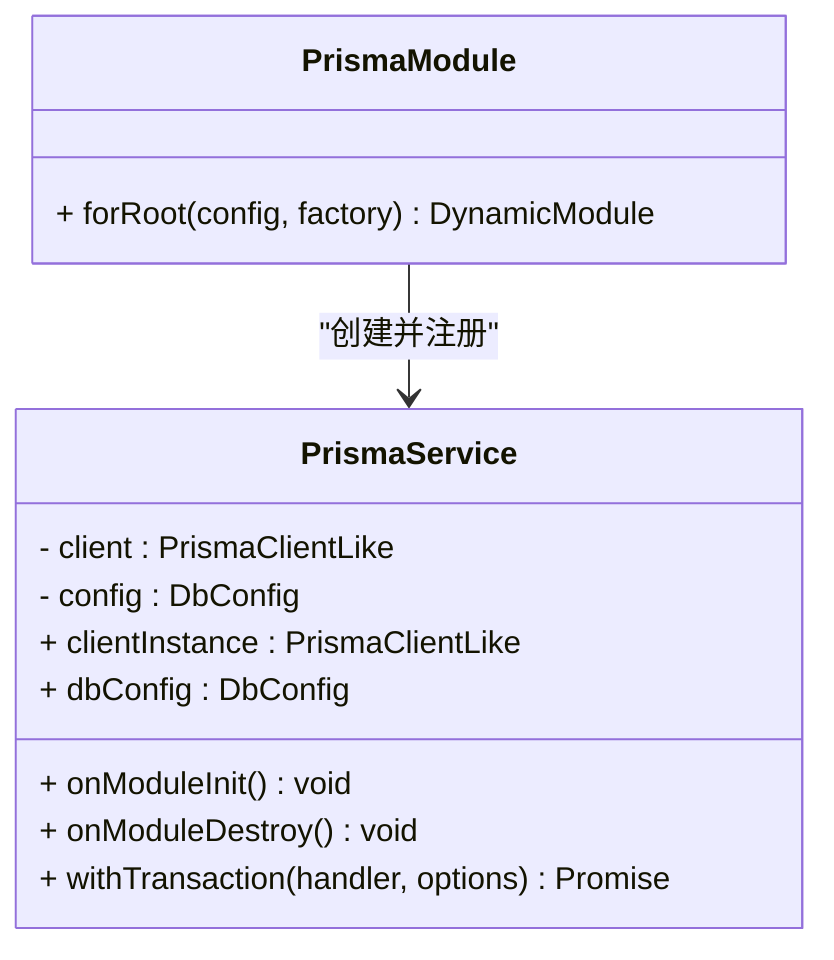
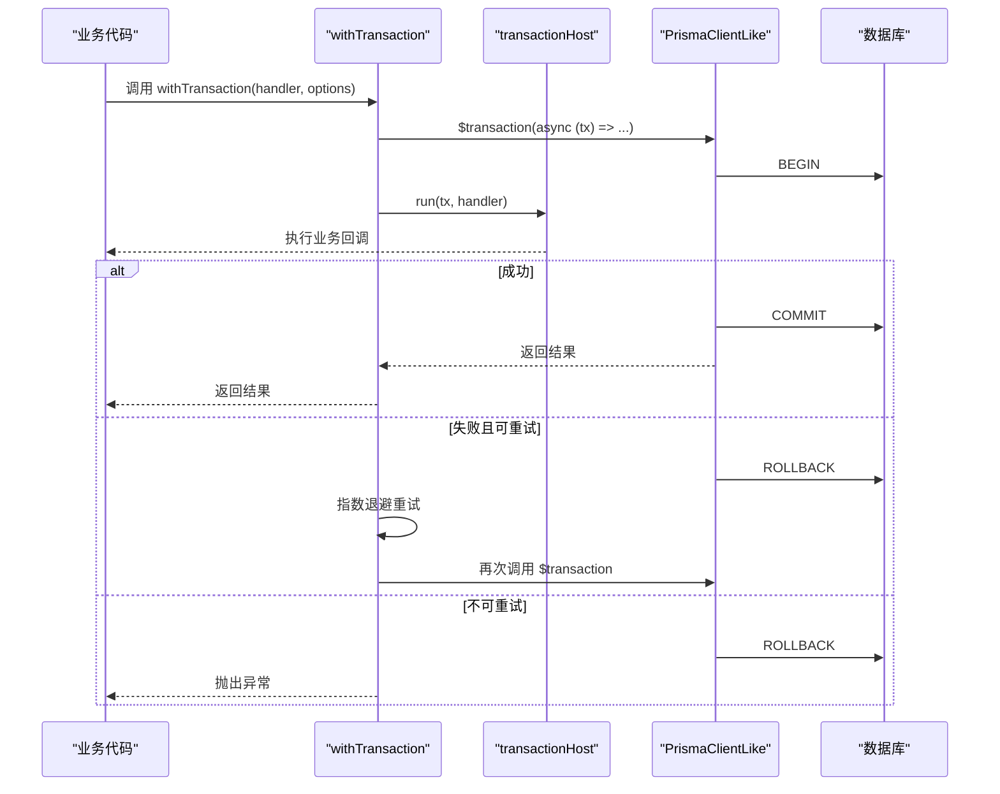
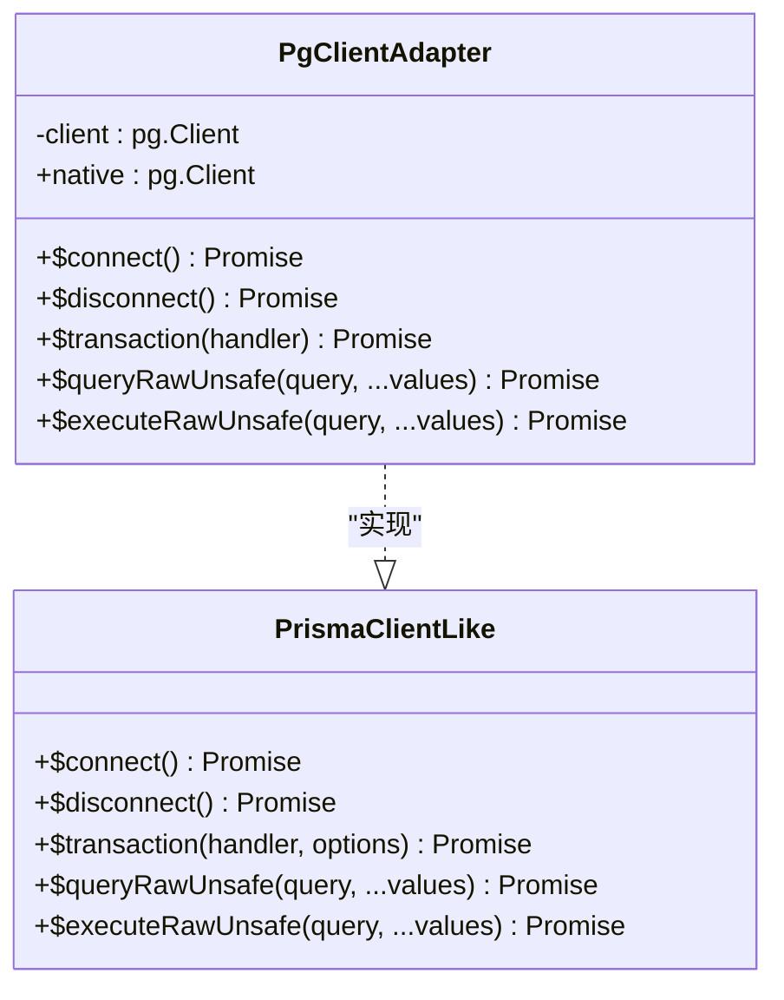
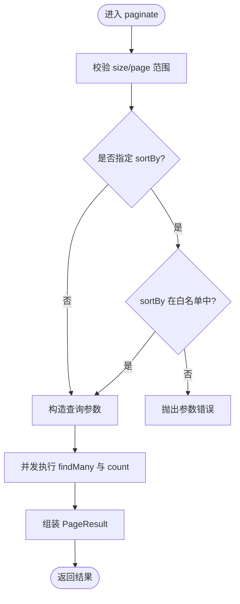
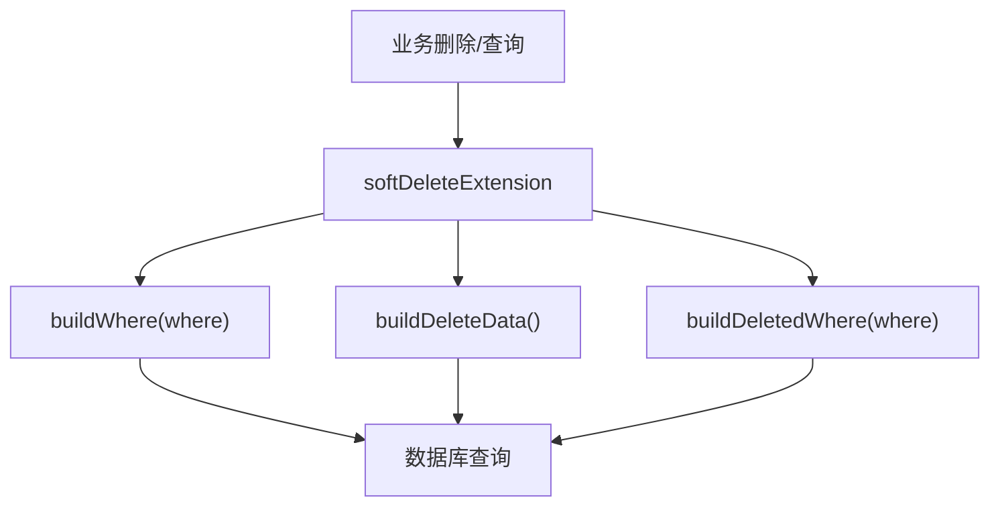
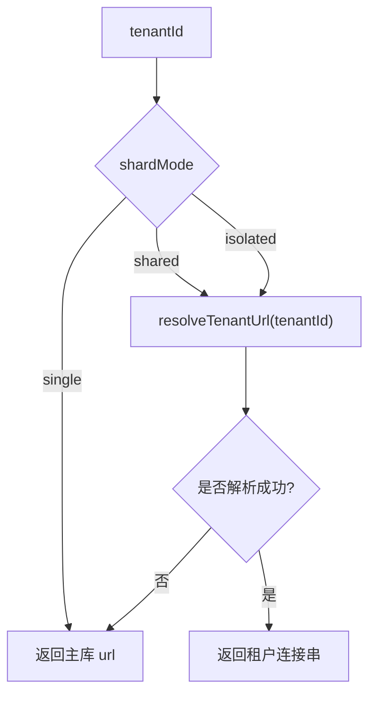
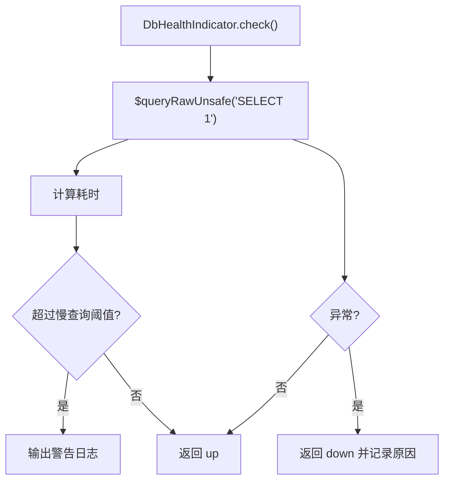
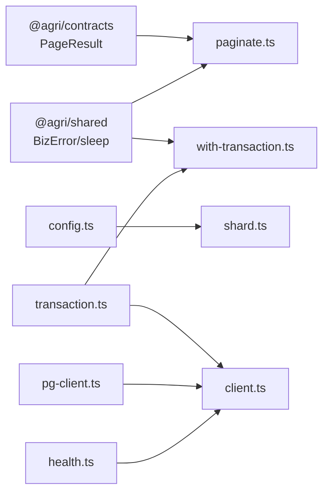

# 数据库封装包 (@agri/db)

<cite>
**本文引用的文件**   
- [packages/db/src/index.ts](file://packages/db/src/index.ts)
- [packages/db/src/config.ts](file://packages/db/src/config.ts)
- [packages/db/src/client.ts](file://packages/db/src/client.ts)
- [packages/db/src/pg-client.ts](file://packages/db/src/pg-client.ts)
- [packages/db/src/transaction.ts](file://packages/db/src/transaction.ts)
- [packages/db/src/with-transaction.ts](file://packages/db/src/with-transaction.ts)
- [packages/db/src/paginate.ts](file://packages/db/src/paginate.ts)
- [packages/db/src/shard.ts](file://packages/db/src/shard.ts)
- [packages/db/src/soft-delete.ts](file://packages/db/src/soft-delete.ts)
- [packages/db/src/health.ts](file://packages/db/src/health.ts)
</cite>

## 目录
1. [简介](#简介)
2. [项目结构](#项目结构)
3. [核心组件](#核心组件)
4. [架构总览](#架构总览)
5. [详细组件分析](#详细组件分析)
6. [依赖关系分析](#依赖关系分析)
7. [性能与可观测性](#性能与可观测性)
8. [故障排查指南](#故障排查指南)
9. [结论](#结论)
10. [附录：使用示例与最佳实践](#附录使用示例与最佳实践)

## 简介
@agri/db 是平台的数据访问封装包，聚焦“连接、事务、分片、分页、软删除与健康检查”，不包含任何业务表模型。它通过统一的客户端契约 PrismaClientLike 抽象底层 ORM 或原生驱动，使仓储层与事务工具复用同一套调用方式；同时提供连接池管理、事务重试、租户分片路由、分页查询、软删除扩展、健康探针与优雅关闭等企业级能力。PostgreSQL 与 PostGIS 的集成通过原生 SQL 通道完成，空间运算可直接下沉到数据库层执行。

## 项目结构
该包采用按职责拆分的模块化组织方式：
- 配置与常量：config.ts
- 客户端生命周期与模块注入：client.ts
- 原生 PostgreSQL 适配器：pg-client.ts
- 事务契约与上下文：transaction.ts
- 事务包装与重试：with-transaction.ts
- 分页查询：paginate.ts
- 租户分片路由：shard.ts
- 软删除扩展：soft-delete.ts
- 健康检查与优雅关闭：health.ts
- 统一导出入口：index.ts

**图示来源**
- [packages/db/src/index.ts:1-15](file://packages/db/src/index.ts#L1-L15)

**章节来源**
- [packages/db/src/index.ts:1-15](file://packages/db/src/index.ts#L1-L15)

## 核心组件
- 配置与默认值：定义 DbConfig、ShardMode、默认连接池大小与慢查询阈值。
- 客户端工厂与服务：createPrismaClient 根据工厂创建客户端；PrismaService 管理连接生命周期；PrismaModule 提供全局注入。
- 原生客户端适配：PgClientAdapter 将 pg.Client 包装为 PrismaClientLike，暴露 $connect/$disconnect/$transaction/$queryRawUnsafe/$executeRawUnsafe。
- 事务体系：Tx/PrismaClientLike 契约、AsyncLocalStorage 承载的事务上下文、model 代理、withTransaction 自动重试。
- 分页：paginate 支持白名单排序、并发取列表与总数。
- 分片：ShardRouter 支持 single/shared/isolated 三种模式。
- 软删除：SOFT_DELETE_FIELD 与 softDeleteExtension 统一未删除过滤与删除改写。
- 健康检查：DbHealthIndicator 探测连通性与延迟；onShutdown 注册优雅关闭钩子。

**章节来源**
- [packages/db/src/config.ts:1-31](file://packages/db/src/config.ts#L1-L31)
- [packages/db/src/client.ts:1-88](file://packages/db/src/client.ts#L1-L88)
- [packages/db/src/pg-client.ts:1-90](file://packages/db/src/pg-client.ts#L1-L90)
- [packages/db/src/transaction.ts:1-73](file://packages/db/src/transaction.ts#L1-L73)
- [packages/db/src/with-transaction.ts:1-99](file://packages/db/src/with-transaction.ts#L1-L99)
- [packages/db/src/paginate.ts:1-67](file://packages/db/src/paginate.ts#L1-L67)
- [packages/db/src/shard.ts:1-53](file://packages/db/src/shard.ts#L1-L53)
- [packages/db/src/soft-delete.ts:1-38](file://packages/db/src/soft-delete.ts#L1-L38)
- [packages/db/src/health.ts:1-80](file://packages/db/src/health.ts#L1-L80)

## 架构总览
下图展示从应用到数据库的调用路径，以及各组件的职责边界。

**图示来源**
- [packages/db/src/client.ts:31-65](file://packages/db/src/client.ts#L31-L65)
- [packages/db/src/with-transaction.ts:52-99](file://packages/db/src/with-transaction.ts#L52-L99)
- [packages/db/src/transaction.ts:62-72](file://packages/db/src/transaction.ts#L62-L72)
- [packages/db/src/pg-client.ts:35-84](file://packages/db/src/pg-client.ts#L35-L84)
- [packages/db/src/shard.ts:10-52](file://packages/db/src/shard.ts#L10-L52)
- [packages/db/src/paginate.ts:37-66](file://packages/db/src/paginate.ts#L37-L66)
- [packages/db/src/soft-delete.ts:23-37](file://packages/db/src/soft-delete.ts#L23-L37)
- [packages/db/src/health.ts:25-55](file://packages/db/src/health.ts#L25-L55)

## 详细组件分析

### 连接池与客户端生命周期
- 配置项 poolSize 用于控制连接池上限，避免多副本下总连接数超过数据库限制。
- createPrismaClient 通过外部传入的工厂函数创建客户端实例，解耦具体 ORM 实现。
- PrismaService 在模块初始化时建立连接，销毁时释放连接，防止连接泄漏。
- PrismaModule.forRoot 以全局模块形式暴露 PRISMA_SERVICE，供其他模块直接注入。

**图示来源**
- [packages/db/src/client.ts:20-25](file://packages/db/src/client.ts#L20-L25)
- [packages/db/src/client.ts:31-65](file://packages/db/src/client.ts#L31-L65)
- [packages/db/src/client.ts:72-87](file://packages/db/src/client.ts#L72-L87)

**章节来源**
- [packages/db/src/config.ts:12-24](file://packages/db/src/config.ts#L12-L24)
- [packages/db/src/client.ts:20-25](file://packages/db/src/client.ts#L20-L25)
- [packages/db/src/client.ts:31-65](file://packages/db/src/client.ts#L31-L65)
- [packages/db/src/client.ts:72-87](file://packages/db/src/client.ts#L72-L87)

### 事务处理机制与重试
- 事务契约：Tx 与 PrismaClientLike 对齐 ORM 常用方法，便于仓储层与事务工具复用。
- 事务上下文：使用 AsyncLocalStorage 保存当前事务，仓储层无需逐层透传 tx。
- withTransaction：支持两种调用形式（显式客户端或默认客户端），对并发冲突、死锁等错误进行指数退避重试。
- 超时控制：可通过 timeoutMs 传递事务超时；PgClientAdapter 内部以 BEGIN/COMMIT/ROLLBACK 实现事务语义。

**图示来源**
- [packages/db/src/with-transaction.ts:52-99](file://packages/db/src/with-transaction.ts#L52-L99)
- [packages/db/src/transaction.ts:62-72](file://packages/db/src/transaction.ts#L62-L72)
- [packages/db/src/pg-client.ts:62-73](file://packages/db/src/pg-client.ts#L62-L73)

**章节来源**
- [packages/db/src/transaction.ts:12-40](file://packages/db/src/transaction.ts#L12-L40)
- [packages/db/src/transaction.ts:45-72](file://packages/db/src/transaction.ts#L45-L72)
- [packages/db/src/with-transaction.ts:13-31](file://packages/db/src/with-transaction.ts#L13-L31)
- [packages/db/src/with-transaction.ts:52-99](file://packages/db/src/with-transaction.ts#L52-L99)
- [packages/db/src/pg-client.ts:62-73](file://packages/db/src/pg-client.ts#L62-L73)

### 查询构建器与 ORM 抽象层
- 本包不引入 ORM 生成类型，而是通过 PrismaClientLike 契约统一抽象底层 ORM 或原生驱动。
- PgClientAdapter 将 pg.Client 包装成 PrismaClientLike，保留 native 属性以便需要流式查询、COPY 等高级特性的场景直接使用。
- 参数转换：toDriverValue 将 bigint 转为字符串、Date 转为 ISO 字符串，确保与 pg 驱动兼容。
- 原生查询：$queryRawUnsafe/$executeRawUnsafe 用于复杂查询、批量维护语句与空间运算下沉。

**图示来源**
- [packages/db/src/transaction.ts:30-40](file://packages/db/src/transaction.ts#L30-L40)
- [packages/db/src/pg-client.ts:35-84](file://packages/db/src/pg-client.ts#L35-L84)

**章节来源**
- [packages/db/src/pg-client.ts:1-21](file://packages/db/src/pg-client.ts#L1-L21)
- [packages/db/src/pg-client.ts:35-84](file://packages/db/src/pg-client.ts#L35-L84)

### CRUD 操作封装与分页查询
- paginate 提供 findMany 与 count 的双路并发查询，返回包含 items、total、page、size、pages 的标准分页结果。
- 排序字段必须命中 allowedSortFields 白名单，避免 SQL 注入与无索引排序。
- 默认页大小为 20，最大页大小为 200，并对 page/size 做边界保护。

**图示来源**
- [packages/db/src/paginate.ts:37-66](file://packages/db/src/paginate.ts#L37-L66)

**章节来源**
- [packages/db/src/paginate.ts:11-25](file://packages/db/src/paginate.ts#L11-L25)
- [packages/db/src/paginate.ts:37-66](file://packages/db/src/paginate.ts#L37-L66)

### 软删除机制
- 统一使用 deletedAt 字段标记软删除，所有查询默认叠加「未删除」条件。
- softDeleteExtension 提供 buildWhere/buildDeleteData/buildDeletedWhere 三个方法，分别用于：
  - 查询时追加未删除过滤
  - 删除时写入删除时间
  - 仅查看已删除数据（回收站）

**图示来源**
- [packages/db/src/soft-delete.ts:23-37](file://packages/db/src/soft-delete.ts#L23-L37)

**章节来源**
- [packages/db/src/soft-delete.ts:1-38](file://packages/db/src/soft-delete.ts#L1-L38)

### 租户分片与数据源解析
- ShardRouter 支持三种模式：
  - single：所有租户共用主库
  - shared：共享库但按租户隔离（由上层决定 schema/tablespace）
  - isolated：每个租户独立连接串
- resolve(tenantId) 返回实际连接串；shardKey(tenantId) 用于连接池复用与观测打点。

**图示来源**
- [packages/db/src/shard.ts:33-51](file://packages/db/src/shard.ts#L33-L51)

**章节来源**
- [packages/db/src/shard.ts:1-53](file://packages/db/src/shard.ts#L1-L53)

### PostgreSQL 与 PostGIS 集成及空间查询优化
- 通过 PgClientAdapter 暴露原生查询接口，业务可直接执行 PostGIS 空间函数与 ST_* 系列算子。
- 建议策略：
  - 将空间计算下沉到数据库层，减少网络传输与序列化开销
  - 使用地理索引（如 GIST）加速空间检索
  - 对大对象或批量写入使用 COPY 或流式查询（通过 native 属性）
- 参数占位符统一使用 $1、$2 …，与 pg 原生语法一致，避免额外改写。

**章节来源**
- [packages/db/src/pg-client.ts:1-14](file://packages/db/src/pg-client.ts#L1-L14)
- [packages/db/src/pg-client.ts:45-52](file://packages/db/src/pg-client.ts#L45-L52)
- [packages/db/src/pg-client.ts:75-83](file://packages/db/src/pg-client.ts#L75-L83)

### 连接重试、超时控制与企业级特性
- 连接重试：withTransaction 对 P2034、40001、40P01、deadlock、serialization 等错误进行指数退避重试。
- 超时控制：支持 timeoutMs 设置事务超时；PgClientAdapter 以 BEGIN/COMMIT/ROLLBACK 包裹事务。
- 健康检查：DbHealthIndicator 执行 SELECT 1 探活，记录延迟与告警；onShutdown 监听 SIGINT/SIGTERM 优雅断开连接。
- 连接串解析：resolveDatabaseUrl 优先读取环境变量，缺省回落到本地开发库。

**图示来源**
- [packages/db/src/health.ts:39-55](file://packages/db/src/health.ts#L39-L55)

**章节来源**
- [packages/db/src/with-transaction.ts:23-31](file://packages/db/src/with-transaction.ts#L23-L31)
- [packages/db/src/with-transaction.ts:82-99](file://packages/db/src/with-transaction.ts#L82-L99)
- [packages/db/src/pg-client.ts:62-73](file://packages/db/src/pg-client.ts#L62-L73)
- [packages/db/src/health.ts:25-55](file://packages/db/src/health.ts#L25-L55)
- [packages/db/src/health.ts:63-79](file://packages/db/src/health.ts#L63-L79)
- [packages/db/src/pg-client.ts:87-89](file://packages/db/src/pg-client.ts#L87-L89)

## 依赖关系分析
- 对外依赖：@nestjs/common（模块与生命周期）、pg（原生驱动）。
- 内部依赖：@agri/contracts（PageResult 类型）、@agri/shared（BizError、sleep）。
- 耦合与内聚：
  - 客户端与事务解耦：通过 PrismaClientLike 契约降低 ORM 版本升级成本
  - 事务上下文与业务逻辑解耦：通过 transactionHost 隐式获取当前事务
  - 分页与模型解耦：通过 PaginateModel 只要求 findMany/count 能力
  - 分片与业务解耦：ShardRouter 仅负责连接串解析与标识

**图示来源**
- [packages/db/src/paginate.ts:1-2](file://packages/db/src/paginate.ts#L1-L2)
- [packages/db/src/with-transaction.ts:1](file://packages/db/src/with-transaction.ts#L1)
- [packages/db/src/config.ts:10-24](file://packages/db/src/config.ts#L10-L24)
- [packages/db/src/shard.ts:1-2](file://packages/db/src/shard.ts#L1-L2)
- [packages/db/src/transaction.ts:1-4](file://packages/db/src/transaction.ts#L1-L4)
- [packages/db/src/client.ts:4-7](file://packages/db/src/client.ts#L4-L7)
- [packages/db/src/pg-client.ts:1-3](file://packages/db/src/pg-client.ts#L1-L3)
- [packages/db/src/health.ts:1](file://packages/db/src/health.ts#L1)

**章节来源**
- [packages/db/src/paginate.ts:1-2](file://packages/db/src/paginate.ts#L1-L2)
- [packages/db/src/with-transaction.ts:1](file://packages/db/src/with-transaction.ts#L1)
- [packages/db/src/config.ts:10-24](file://packages/db/src/config.ts#L10-L24)
- [packages/db/src/shard.ts:1-2](file://packages/db/src/shard.ts#L1-L2)
- [packages/db/src/transaction.ts:1-4](file://packages/db/src/transaction.ts#L1-L4)
- [packages/db/src/client.ts:4-7](file://packages/db/src/client.ts#L4-L7)
- [packages/db/src/pg-client.ts:1-3](file://packages/db/src/pg-client.ts#L1-L3)
- [packages/db/src/health.ts:1](file://packages/db/src/health.ts#L1)

## 性能与可观测性
- 连接池：poolSize 需按容器副本数反推，避免总连接数超过数据库上限。
- 慢查询阈值：DEFAULT_SLOW_QUERY_MS 默认 500ms；DbHealthIndicator 在探测超时时输出告警。
- 事务重试：针对并发冲突与死锁进行指数退避重试，减少瞬时抖动影响。
- 分页并发：findMany 与 count 并行执行，缩短首屏响应时间。
- 空间查询优化：尽量在数据库侧执行空间计算，利用 PostGIS 索引与函数优化。

[本节为通用指导，不直接分析具体文件]

## 故障排查指南
- 未注入客户端工厂：createPrismaClient 会抛出错误，需在服务层注入真实 ORM 客户端工厂。
- 未注册默认客户端：仅传回调形式的 withTransaction 会报错，需先 setDefaultClient。
- 事务回调为空：withTransaction 会抛出错误，请检查调用签名。
- 排序字段不在白名单：paginate 会抛出参数错误，请调整 allowedSortFields。
- 数据库不可达：DbHealthIndicator 返回 down 并记录原因，检查连接串、网络与数据库状态。
- 进程退出连接未释放：确认已调用 onShutdown 或在模块销毁时调用 $disconnect。

**章节来源**
- [packages/db/src/client.ts:20-25](file://packages/db/src/client.ts#L20-L25)
- [packages/db/src/with-transaction.ts:35-43](file://packages/db/src/with-transaction.ts#L35-L43)
- [packages/db/src/with-transaction.ts:75-80](file://packages/db/src/with-transaction.ts#L75-L80)
- [packages/db/src/paginate.ts:46-51](file://packages/db/src/paginate.ts#L46-L51)
- [packages/db/src/health.ts:39-55](file://packages/db/src/health.ts#L39-L55)
- [packages/db/src/health.ts:63-79](file://packages/db/src/health.ts#L63-L79)

## 结论
@agri/db 通过统一的客户端契约、事务上下文、分片路由、分页与软删除扩展，为平台提供了稳定、可扩展且可观测的数据访问基础设施。其设计强调解耦与可替换性，既支持 ORM 也支持原生驱动，便于在不同业务场景中灵活选择实现。结合 PostGIS 的空间能力与连接池、重试、健康检查等企业级特性，能够满足农业平台对数据一致性、可追溯性与高性能的要求。

[本节为总结性内容，不直接分析具体文件]

## 附录：使用示例与最佳实践
以下示例以“如何正确使用”为主，不展示具体代码内容，仅提供关键步骤与对应源码位置，便于读者快速定位实现。

- 初始化与注入
  - 在根模块导入 PrismaModule.forRoot，传入 DbConfig 与客户端工厂。
  - 在业务模块注入 PRISMA_SERVICE，获取 PrismaService 实例。
  - 参考：[packages/db/src/client.ts:72-87](file://packages/db/src/client.ts#L72-L87)、[packages/db/src/client.ts:31-65](file://packages/db/src/client.ts#L31-L65)

- 使用事务
  - 通过 PrismaService.withTransaction 或 withTransaction 包装业务回调。
  - 在回调中使用 transactionHost.run 或直接使用 Tx 执行模型操作。
  - 参考：[packages/db/src/with-transaction.ts:52-99](file://packages/db/src/with-transaction.ts#L52-L99)、[packages/db/src/transaction.ts:62-72](file://packages/db/src/transaction.ts#L62-L72)

- 分页查询
  - 调用 paginate(model, where, options)，确保 sortBy 在 allowedSortFields 中。
  - 参考：[packages/db/src/paginate.ts:37-66](file://packages/db/src/paginate.ts#L37-L66)

- 软删除
  - 查询时使用 softDeleteExtension.buildWhere 叠加未删除条件。
  - 删除时使用 softDeleteExtension.buildDeleteData 写入删除时间。
  - 参考：[packages/db/src/soft-delete.ts:23-37](file://packages/db/src/soft-delete.ts#L23-L37)

- 分片路由
  - 使用 ShardRouter.resolve(tenantId) 获取租户连接串。
  - 使用 shardKey(tenantId) 作为连接池键或观测维度。
  - 参考：[packages/db/src/shard.ts:33-51](file://packages/db/src/shard.ts#L33-L51)

- 原生查询与空间运算
  - 通过 PgClientAdapter.native 获取 pg.Client，执行 PostGIS 空间函数。
  - 使用 $queryRawUnsafe/$executeRawUnsafe 执行复杂查询与批量维护。
  - 参考：[packages/db/src/pg-client.ts:45-52](file://packages/db/src/pg-client.ts#L45-L52)、[packages/db/src/pg-client.ts:75-83](file://packages/db/src/pg-client.ts#L75-L83)

- 健康检查与优雅关闭
  - 使用 DbHealthIndicator.check 进行探活，监控延迟与告警。
  - 使用 onShutdown 注册信号处理器，优雅断开连接。
  - 参考：[packages/db/src/health.ts:39-55](file://packages/db/src/health.ts#L39-L55)、[packages/db/src/health.ts:63-79](file://packages/db/src/health.ts#L63-L79)