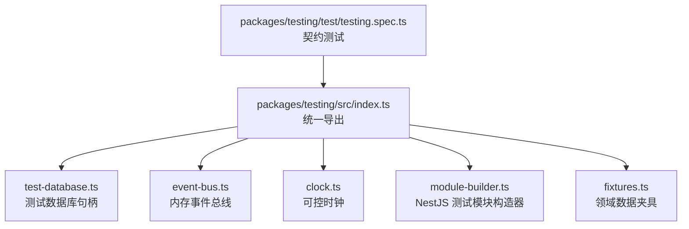
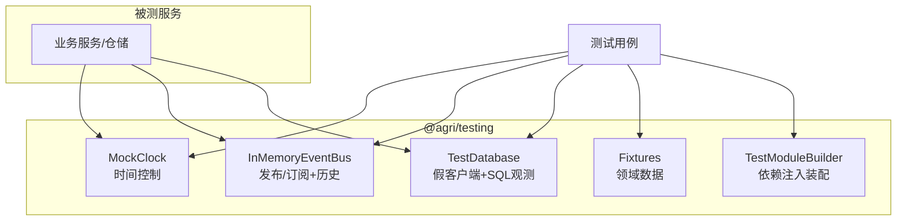
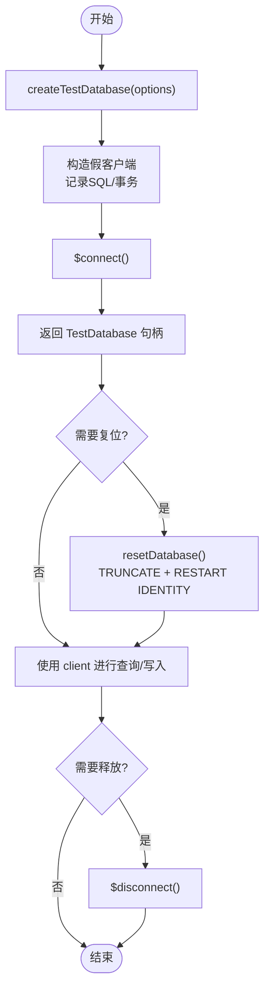
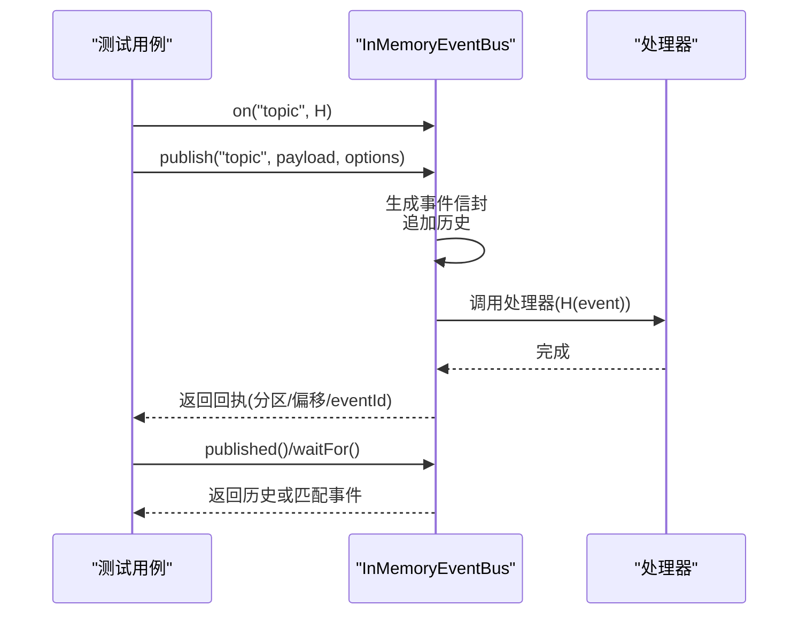
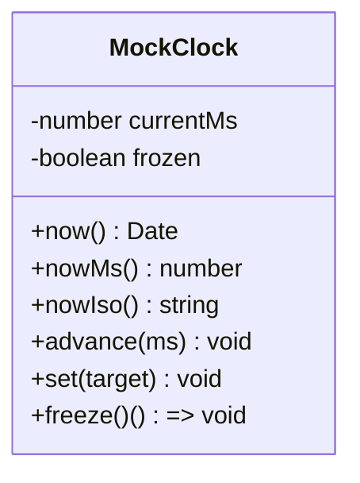
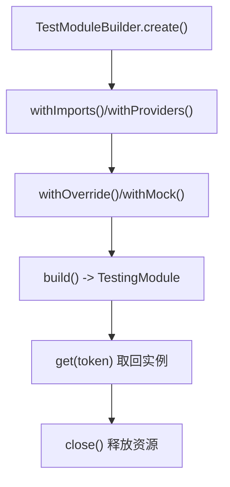
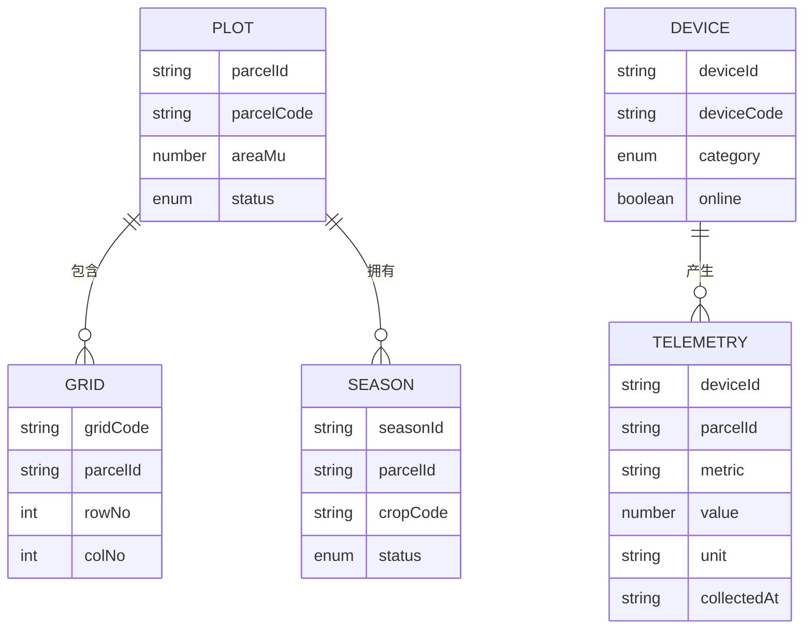
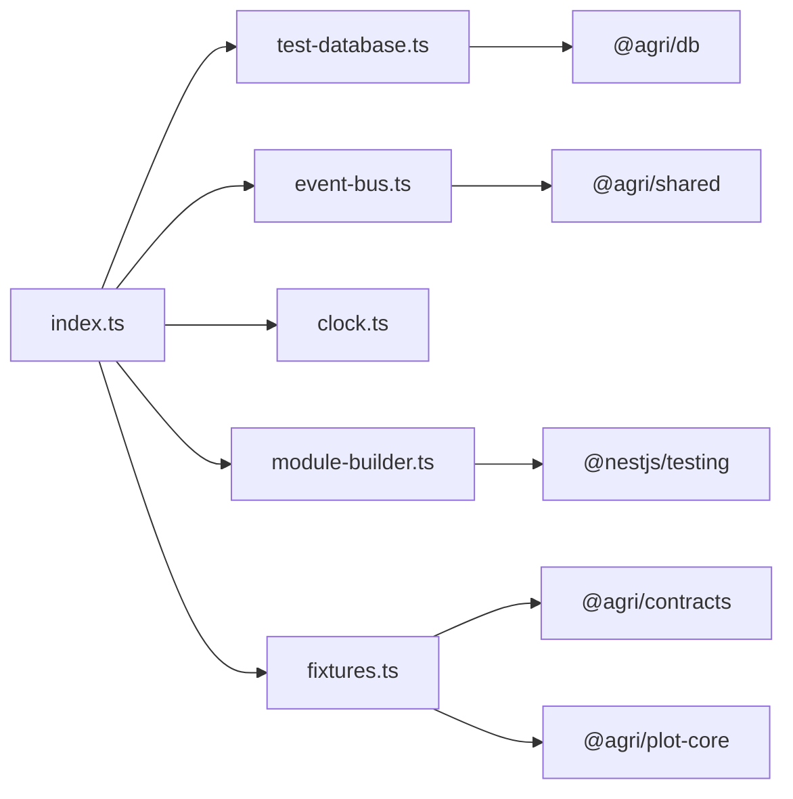

# 测试工具包 (@agri/testing)

<cite>
**本文引用的文件**   
- [packages/testing/package.json](file://packages/testing/package.json)
- [packages/testing/src/index.ts](file://packages/testing/src/index.ts)
- [packages/testing/src/test-database.ts](file://packages/testing/src/test-database.ts)
- [packages/testing/src/fixtures.ts](file://packages/testing/src/fixtures.ts)
- [packages/testing/src/module-builder.ts](file://packages/testing/src/module-builder.ts)
- [packages/testing/src/event-bus.ts](file://packages/testing/src/event-bus.ts)
- [packages/testing/src/clock.ts](file://packages/testing/src/clock.ts)
- [packages/testing/test/testing.spec.ts](file://packages/testing/test/testing.spec.ts)
</cite>

## 目录
1. [简介](#简介)
2. [项目结构](#项目结构)
3. [核心组件](#核心组件)
4. [架构总览](#架构总览)
5. [详细组件分析](#详细组件分析)
6. [依赖关系分析](#依赖关系分析)
7. [性能与稳定性考量](#性能与稳定性考量)
8. [故障排查指南](#故障排查指南)
9. [结论](#结论)
10. [附录：最佳实践清单](#附录最佳实践清单)

## 简介
@agri/testing 是平台级的测试工具包，提供测试数据库句柄、内存事件总线、可控时钟、NestJS 模块构造器以及领域数据夹具。其目标是让单元测试稳定可重复、集成测试贴近真实行为、端到端测试具备清晰的隔离策略；同时通过 Mock 对象与夹具降低外部依赖对用例的干扰，提升可维护性。

该包仅面向测试环境引入，生产代码不应直接依赖它。

**章节来源**
- [packages/testing/package.json:1-31](file://packages/testing/package.json#L1-L31)
- [packages/testing/src/index.ts:1-25](file://packages/testing/src/index.ts#L1-L25)

## 项目结构
测试工具包采用“按能力拆分”的组织方式：每个能力一个源文件，并通过统一入口导出。

**图示来源**
- [packages/testing/src/index.ts:1-25](file://packages/testing/src/index.ts#L1-L25)
- [packages/testing/test/testing.spec.ts:1-90](file://packages/testing/test/testing.spec.ts#L1-L90)

**章节来源**
- [packages/testing/src/index.ts:1-25](file://packages/testing/src/index.ts#L1-L25)

## 核心组件
- 测试数据库：提供假客户端、事务语义观察、默认表清空策略与连接生命周期管理。
- 内存事件总线：实现发布/订阅、历史回放、失败模拟与等待断言。
- 可控时钟：推进时间、冻结全局时间，保证时间相关逻辑确定性。
- 模块构造器：集中声明导入、提供者与依赖覆盖，简化 NestJS 测试装配。
- 数据夹具：为地块、网格、设备、作物季、遥测等实体生成符合业务量纲的默认值。

**章节来源**
- [packages/testing/src/test-database.ts:1-138](file://packages/testing/src/test-database.ts#L1-L138)
- [packages/testing/src/event-bus.ts:1-157](file://packages/testing/src/event-bus.ts#L1-L157)
- [packages/testing/src/clock.ts:1-88](file://packages/testing/src/clock.ts#L1-L88)
- [packages/testing/src/module-builder.ts:1-69](file://packages/testing/src/module-builder.ts#L1-L69)
- [packages/testing/src/fixtures.ts:1-101](file://packages/testing/src/fixtures.ts#L1-L101)

## 架构总览
测试工具包在测试层扮演“基础设施替身”的角色：以最小侵入的方式替换真实数据库、消息中间件、系统时间与模块装配过程，从而让被测代码在受控环境中运行。

**图示来源**
- [packages/testing/src/test-database.ts:1-138](file://packages/testing/src/test-database.ts#L1-L138)
- [packages/testing/src/event-bus.ts:1-157](file://packages/testing/src/event-bus.ts#L1-L157)
- [packages/testing/src/clock.ts:1-88](file://packages/testing/src/clock.ts#L1-L88)
- [packages/testing/src/module-builder.ts:1-69](file://packages/testing/src/module-builder.ts#L1-L69)
- [packages/testing/src/fixtures.ts:1-101](file://packages/testing/src/fixtures.ts#L1-L101)

## 详细组件分析

### 测试数据库：初始化、清理与隔离
- 初始化
  - 通过 createTestDatabase 创建句柄，内部构造假 PrismaClientLike，记录 CONNECT/DISCONNECT/BEGIN/COMMIT/ROLLBACK 等原始 SQL。
  - 支持自定义 url、schema（默认使用进程 PID 命名空间）、poolSize 与待清空表列表。
- 清理与隔离
  - resetDatabase 使用 TRUNCATE ... RESTART IDENTITY CASCADE 清空业务表并重置自增序列。
  - DEFAULT_TEST_TABLES 按外键从子到父排序，避免约束冲突。
  - stopTestDatabase 释放连接，句柄 stopped 标记状态。
- 断言辅助
  - executedSql 数组可用于断言事务边界与关键 SQL 是否执行。

**图示来源**
- [packages/testing/src/test-database.ts:50-118](file://packages/testing/src/test-database.ts#L50-L118)
- [packages/testing/src/test-database.ts:126-137](file://packages/testing/src/test-database.ts#L126-L137)

**章节来源**
- [packages/testing/src/test-database.ts:1-138](file://packages/testing/src/test-database.ts#L1-L138)

### 内存事件总线：Mock 外部消息通道
- 发布订阅
  - on/off 注册与取消主题处理器；publish/publishBatch 自动填充信封字段（eventId、occurredAt、tenantId、traceId 等）。
- 历史与断言
  - published(topic?) 获取已发布事件；waitFor 支持条件等待与超时。
- 可靠性测试
  - failNext 标志用于模拟投递失败后自动复位，便于验证重试或降级逻辑。
- 时间一致性
  - 可选注入 MockClock，使 occurredAt 可预测，避免时间抖动影响断言。

**图示来源**
- [packages/testing/src/event-bus.ts:37-157](file://packages/testing/src/event-bus.ts#L37-L157)

**章节来源**
- [packages/testing/src/event-bus.ts:1-157](file://packages/testing/src/event-bus.ts#L1-L157)

### 可控时钟：时间相关逻辑的可重复性
- 推进与设置
  - advance(ms) 只能向前推进；set(target) 跳转到指定时刻。
- 冻结全局时间
  - freeze() 接管 Date.now，返回恢复函数，确保依赖系统时间的代码也走可控时钟。
- 输出格式
  - now()/nowMs()/nowIso() 提供多种时间访问方式。

**图示来源**
- [packages/testing/src/clock.ts:10-88](file://packages/testing/src/clock.ts#L10-L88)

**章节来源**
- [packages/testing/src/clock.ts:1-88](file://packages/testing/src/clock.ts#L1-L88)

### 模块构造器：NestJS 测试装配与依赖覆盖
- 链式 API
  - withImports/withProviders 追加模块与提供者；withOverride/withMock 集中替换依赖。
- 编译与关闭
  - build() 编译TestingModule；测试结束后应调用 close() 释放资源。
- 错误可见性
  - buildTestModule 暴露底层编译错误，便于定位装配问题。

**图示来源**
- [packages/testing/src/module-builder.ts:11-69](file://packages/testing/src/module-builder.ts#L11-L69)

**章节来源**
- [packages/testing/src/module-builder.ts:1-69](file://packages/testing/src/module-builder.ts#L1-L69)

### 数据夹具：Fixture 设计与复用
- 设计原则
  - 默认值贴近真实场景（如土壤墒情百分比、典型地块编码），避免极端值掩盖单位/量纲问题。
  - 各夹具之间保持关联一致（如 parcelId、parcelCode 在各实体间保持一致）。
- 可用夹具
  - buildPlotCodeFixture、plotFixture、gridFixture、deviceFixture、seasonFixture、telemetryFixture。
- 扩展方式
  - 所有夹具接受 Partial<T> overrides，便于按需覆盖字段。

**图示来源**
- [packages/testing/src/fixtures.ts:13-101](file://packages/testing/src/fixtures.ts#L13-L101)

**章节来源**
- [packages/testing/src/fixtures.ts:1-101](file://packages/testing/src/fixtures.ts#L1-L101)

## 依赖关系分析
- 包内依赖
  - index.ts 作为统一出口，聚合 test-database、event-bus、clock、module-builder、fixtures。
- 外部依赖
  - @nestjs/testing 与 @nestjs/common 用于模块构造与依赖注入。
  - @agri/db 类型定义用于假客户端接口。
  - @agri/shared 提供 ulid 生成。
  - @agri/contracts 与 @agri/plot-core 提供领域常量与地块编码构建。

**图示来源**
- [packages/testing/src/index.ts:1-25](file://packages/testing/src/index.ts#L1-L25)
- [packages/testing/src/event-bus.ts:1-157](file://packages/testing/src/event-bus.ts#L1-L157)
- [packages/testing/src/fixtures.ts:1-101](file://packages/testing/src/fixtures.ts#L1-L101)
- [packages/testing/src/test-database.ts:1-138](file://packages/testing/src/test-database.ts#L1-L138)
- [packages/testing/src/module-builder.ts:1-69](file://packages/testing/src/module-builder.ts#L1-L69)

**章节来源**
- [packages/testing/src/index.ts:1-25](file://packages/testing/src/index.ts#L1-L25)

## 性能与稳定性考量
- 测试数据库
  - 假客户端无真实 I/O，resetDatabase 使用单次 TRUNCATE 批量清空，减少多次删除开销。
  - 建议每个测试文件使用独立 schema，避免跨用例污染。
- 事件总线
  - 内存存储，published 返回浅拷贝，避免外部修改影响内部历史。
  - waitFor 使用短轮询间隔，避免 CPU 占用过高。
- 时钟
  - freeze 接管全局时间需显式恢复，防止泄漏影响其他测试。
- 模块构造
  - 集中 withOverride/withMock，减少分散的 mock 配置，提高可读性与可维护性。

[本节为通用指导，不直接分析具体文件]

## 故障排查指南
- 事务未提交或回滚
  - 检查 executedSql 是否包含 BEGIN/COMMIT/ROLLBACK，确认被测代码是否正确包裹事务。
- 数据未清空
  - 确认 resetDatabase 被调用且 tables 参数包含目标表；核对 DEFAULT_TEST_TABLES 顺序是否符合外键依赖。
- 事件未触发
  - 确认 on 已在 publish 前注册；使用 published 或 waitFor 断言；必要时检查 failNext 是否意外置位。
- 时间不一致
  - 确认使用了 MockClock 或 freezeTime，并在测试结束时调用恢复函数。
- 模块装配失败
  - 使用 buildTestModule 获取底层错误；检查 withOverride/withMock 的 token 是否与 provide 一致。

**章节来源**
- [packages/testing/test/testing.spec.ts:22-88](file://packages/testing/test/testing.spec.ts#L22-L88)

## 结论
@agri/testing 通过统一的测试基础设施，将数据库、消息、时间与模块装配纳入可控范围，帮助团队编写稳定、可重复、易维护的测试。建议在单元测试中优先使用假客户端与内存事件总线；在集成测试中接入真实容器化数据库与消息中间件，以覆盖跨进程顺序与真实 SQL 行为。

[本节为总结性内容，不直接分析具体文件]

## 附录：最佳实践清单
- 异步测试
  - 使用 InMemoryEventBus.waitFor 替代固定延时；必要时结合 MockClock 推进时间。
- 数据库测试
  - 每个用例开始前 resetDatabase；使用独立 schema；断言 executedSql 中的关键语句。
- API 测试
  - 使用 TestModuleBuilder 集中替换仓储、客户端等依赖；对外部 HTTP 调用使用内存事件总线或假客户端。
- 可重复性
  - 冻结时间、固定租户与追踪标识；避免使用随机数或系统时间。
- 隔离性
  - 使用进程级 schema 或测试前清空；避免共享可变状态。
- 可维护性
  - 通过 fixtures 组织领域数据；通过 module builder 集中依赖覆盖；避免在每个测试文件中散落 mock 配置。

[本节为通用指导，不直接分析具体文件]