# 消息队列包 (@agri/mq)

<cite>
**本文引用的文件**   
- [packages/mq/package.json](file://packages/mq/package.json)
- [packages/mq/src/index.ts](file://packages/mq/src/index.ts)
- [packages/mq/src/config.ts](file://packages/mq/src/config.ts)
- [packages/mq/src/types.ts](file://packages/mq/src/types.ts)
- [packages/mq/src/publisher.ts](file://packages/mq/src/publisher.ts)
- [packages/mq/src/subscriber.ts](file://packages/mq/src/subscriber.ts)
- [packages/mq/src/idempotency.ts](file://packages/mq/src/idempotency.ts)
- [packages/mq/src/outbox.ts](file://packages/mq/src/outbox.ts)
- [packages/mq/src/decorators.ts](file://packages/mq/src/decorators.ts)
- [packages/mq/src/module.ts](file://packages/mq/src/module.ts)
- [packages/mq/src/event-bus.ts](file://packages/mq/src/event-bus.ts)
- [infra/postgres/migrations/003_event_bus_messages.sql](file://infra/postgres/migrations/003_event_bus_messages.sql)
</cite>

## 更新摘要
**变更内容**   
- 新增事件总线实现 event-bus.ts，提供可靠的消息传递机制
- 引入事件日志存储层，支持内存和PostgreSQL两种实现
- 增强消费者注册机制，支持按主题订阅和位点管理
- 完善死信队列处理，确保消息的可靠投递
- 扩展Outbox模式支持跨进程消息传递

## 目录
1. [简介](#简介)
2. [项目结构](#项目结构)
3. [核心组件](#核心组件)
4. [架构总览](#架构总览)
5. [详细组件分析](#详细组件分析)
6. [依赖关系分析](#依赖关系分析)
7. [性能与可靠性](#性能与可靠性)
8. [故障排查指南](#故障排查指南)
9. [结论](#结论)
10. [附录：使用示例与最佳实践](#附录使用示例与最佳实践)

## 简介
@agri/mq 是平台级的消息与事件总线封装，提供以下能力：
- **事件发布订阅模式**，统一主题、载荷与信封字段。
- **本地消息表 Outbox 最终一致性方案**，保证业务数据与事件同时成功。
- **幂等去重、指数退避重试与死信处理**，确保"至少一次"投递下的正确性。
- **NestJS 模块装配与装饰器式消费者注册**，降低接入成本。
- **可插拔的消息中间件适配层**，便于对接 Kafka、RabbitMQ 等实现。
- **事件日志传输层**，提供跨进程可靠消息传递，支持多消费者组协调。

该包不直接绑定具体消息中间件，而是通过 EventPublisher/EventSubscriber 契约抽象，由上层服务注入具体实现。新增的事件总线实现了基于数据库的可靠消息传递，解决了跨进程消息传递的可靠性问题。

**章节来源**
- [packages/mq/package.json:1-28](file://packages/mq/package.json#L1-L28)

## 项目结构
本包采用按职责分层的组织方式：
- 配置与类型：config.ts、types.ts
- 发布侧：publisher.ts、module.ts
- 消费侧：subscriber.ts、decorators.ts
- 可靠性：idempotency.ts、outbox.ts
- **事件总线：event-bus.ts**（新增）
- 对外导出：index.ts

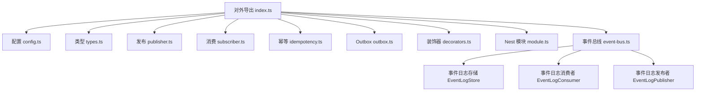

**图表来源**
- [packages/mq/src/index.ts:1-55](file://packages/mq/src/index.ts#L1-L55)
- [packages/mq/src/event-bus.ts:1-330](file://packages/mq/src/event-bus.ts#L1-L330)

**章节来源**
- [packages/mq/src/index.ts:1-55](file://packages/mq/src/index.ts#L1-L55)

## 核心组件
- **MqModule/MqService**：NestJS 模块装配与对外统一入口，暴露 publish/publishBatch/publishWithEnvelope。
- **EventPublisher/EventSubscriber**：消息中间件适配契约，屏蔽底层差异。
- **Publisher 便捷函数**：自动补齐 eventId/version/occurredAt/producer/tenantId/traceId 等信封字段。
- **EventDispatcher**：消费编排，负责反序列化、幂等、重试、死信。
- **IdempotencyGuard**：基于键的幂等去重守卫，默认保留期七天。
- **OutboxService/OutboxStore**：本地消息表与中继分发，保障最终一致。
- **Decorators**：registerHandler/buildHandlers 支持装饰器式消费者注册。
- **EventLogStore**：**新增**事件日志存储接口，支持内存和数据库实现。
- **EventLogConsumer**：**新增**事件日志消费者，按位点轮询主题并交给分发器处理。
- **EventLogPublisher**：**新增**事件日志发布者，将事件写入共享日志表。

**章节来源**
- [packages/mq/src/module.ts:1-114](file://packages/mq/src/module.ts#L1-L114)
- [packages/mq/src/types.ts:1-74](file://packages/mq/src/types.ts#L1-L74)
- [packages/mq/src/publisher.ts:1-74](file://packages/mq/src/publisher.ts#L1-L74)
- [packages/mq/src/subscriber.ts:1-103](file://packages/mq/src/subscriber.ts#L1-L103)
- [packages/mq/src/idempotency.ts:1-84](file://packages/mq/src/idempotency.ts#L1-L84)
- [packages/mq/src/outbox.ts:1-171](file://packages/mq/src/outbox.ts#L1-L171)
- [packages/mq/src/decorators.ts:1-60](file://packages/mq/src/decorators.ts#L1-L60)
- [packages/mq/src/event-bus.ts:1-330](file://packages/mq/src/event-bus.ts#L1-L330)

## 架构总览
整体采用"生产者写本地消息表 + 定时中继投递"的最终一致性模型；消费者侧通过 EventDispatcher 统一编排幂等、重试与死信。**新增的事件总线层**在Outbox和实际消息中间件之间提供了可靠的跨进程消息传递机制。

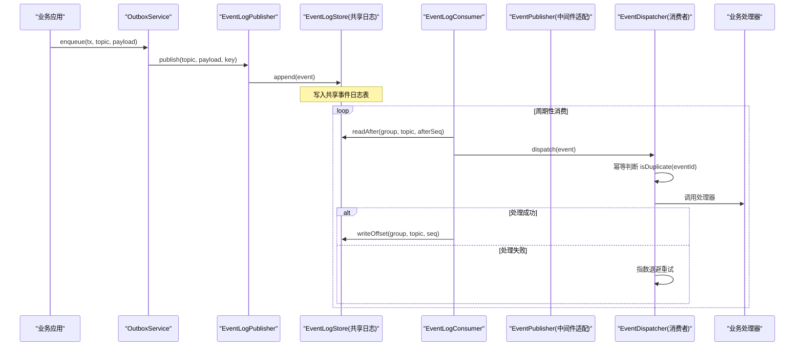

**图表来源**
- [packages/mq/src/outbox.ts:51-137](file://packages/mq/src/outbox.ts#L51-L137)
- [packages/mq/src/event-bus.ts:169-205](file://packages/mq/src/event-bus.ts#L169-L205)
- [packages/mq/src/event-bus.ts:230-329](file://packages/mq/src/event-bus.ts#L230-L329)
- [packages/mq/src/subscriber.ts:26-102](file://packages/mq/src/subscriber.ts#L26-L102)

## 详细组件分析

### 事件总线架构
**新增**事件总线提供了三层架构：
1. **事件日志存储层**：定义 EventLogStore 接口，支持内存和PostgreSQL实现
2. **事件日志发布者**：EventLogPublisher 将事件写入共享日志表
3. **事件日志消费者**：EventLogConsumer 按位点轮询并分发事件

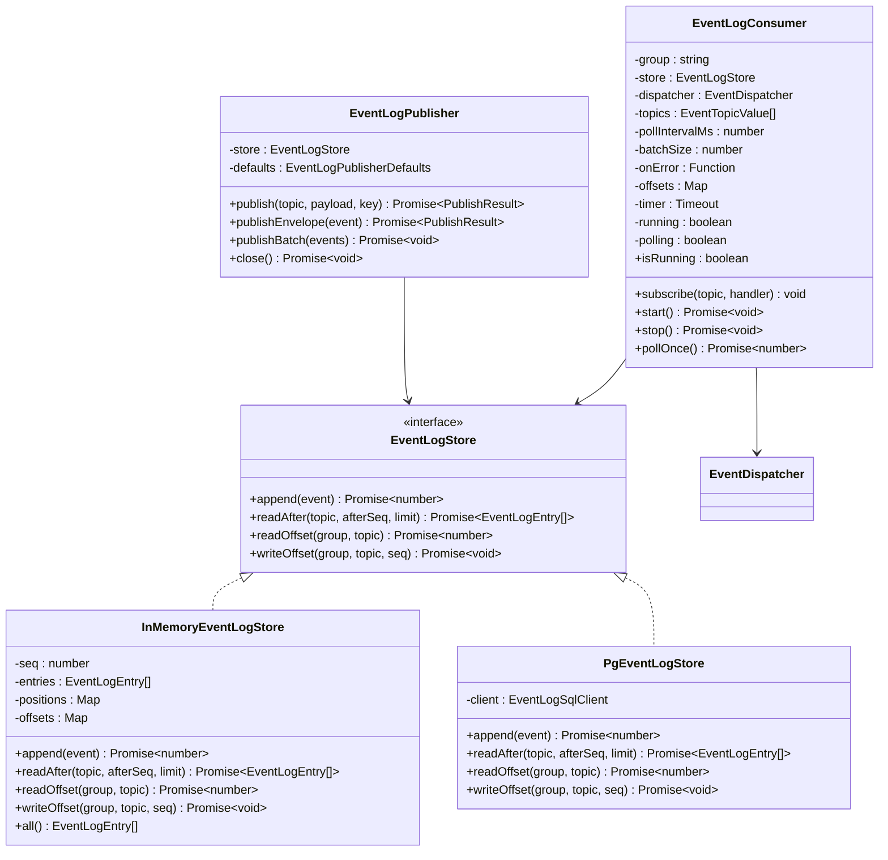

**图表来源**
- [packages/mq/src/event-bus.ts:24-34](file://packages/mq/src/event-bus.ts#L24-L34)
- [packages/mq/src/event-bus.ts:57-91](file://packages/mq/src/event-bus.ts#L57-L91)
- [packages/mq/src/event-bus.ts:94-161](file://packages/mq/src/event-bus.ts#L94-L161)
- [packages/mq/src/event-bus.ts:169-205](file://packages/mq/src/event-bus.ts#L169-L205)
- [packages/mq/src/event-bus.ts:230-329](file://packages/mq/src/event-bus.ts#L230-L329)

**章节来源**
- [packages/mq/src/event-bus.ts:1-330](file://packages/mq/src/event-bus.ts#L1-L330)

### OutboxService 工作流程与生命周期
OutboxService 负责在事务中写入本地消息表，并通过定时器轮询将待投递事件交给 EventPublisher 发送。**现在EventPublisher可以是EventLogPublisher，实现跨进程消息传递**。

- 入队 enqueue：生成唯一 id、填充租户/追踪/生产者信息，持久化到 OutboxStore。
- 中继 relayOnce：拉取待投递记录，逐条调用 publish，成功则标记 publishedAt，失败累计 retryCount 并记录 lastError。
- 调度 start/stop：启动/停止 setInterval 周期执行 relayOnce。
- 直通 publisher：在未启用 Outbox 时可直接使用底层 EventPublisher。

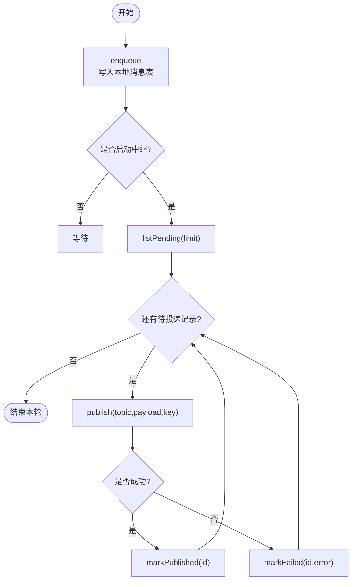

**图表来源**
- [packages/mq/src/outbox.ts:51-137](file://packages/mq/src/outbox.ts#L51-L137)

**章节来源**
- [packages/mq/src/outbox.ts:14-48](file://packages/mq/src/outbox.ts#L14-L48)
- [packages/mq/src/outbox.ts:51-137](file://packages/mq/src/outbox.ts#L51-L137)

### 事件发布与信封构造
publishEvent 自动补齐信封字段（eventId、topic、version、occurredAt、producer、tenantId、traceId），并委托 EventPublisher.publish 进行实际投递。**EventPublisher现在可以是EventLogPublisher，将事件写入共享日志表**。publishEvents 支持批量发布，内部交由 EventPublisher.publishBatch 提升吞吐。

- 分区键 key：建议以地块或设备标识作为分区键，保证同一对象的事件顺序。
- 默认发布器：可通过 setDefaultPublisher 设置全局默认发布器。

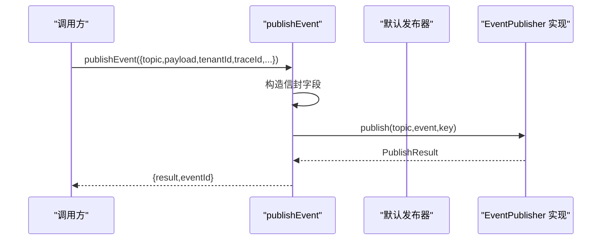

**图表来源**
- [packages/mq/src/publisher.ts:27-57](file://packages/mq/src/publisher.ts#L27-L57)
- [packages/mq/src/types.ts:14-19](file://packages/mq/src/types.ts#L14-L19)

**章节来源**
- [packages/mq/src/publisher.ts:1-74](file://packages/mq/src/publisher.ts#L1-L74)
- [packages/mq/src/types.ts:1-19](file://packages/mq/src/types.ts#L1-L19)

### 事件订阅与消费编排
EventDispatcher 统一管理处理器注册、启动/停止、以及单事件 dispatch 流程：
- subscribe：按主题注册多个处理器，串行执行。
- dispatch：先幂等判断，再依次调用处理器；失败按 RetryPolicy 指数退避重试；超过最大尝试次数后转死信。
- onError：可选回调，用于日志上报。

**EventLogConsumer** 作为新的消费入口，负责从事件日志中读取消息并交给EventDispatcher处理。

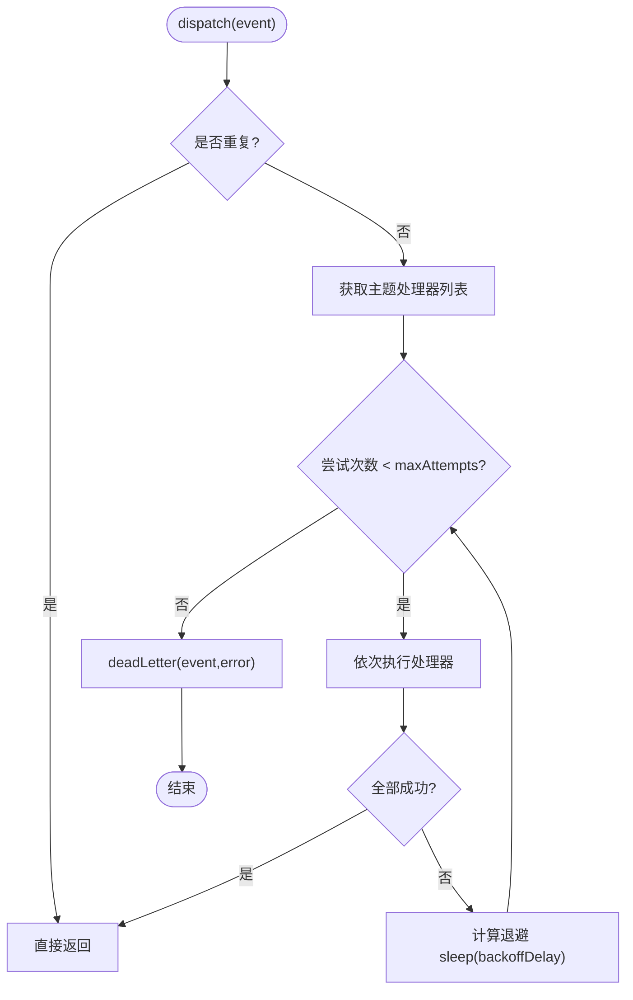

**图表来源**
- [packages/mq/src/subscriber.ts:26-102](file://packages/mq/src/subscriber.ts#L26-L102)
- [packages/mq/src/config.ts:11-52](file://packages/mq/src/config.ts#L11-L52)

**章节来源**
- [packages/mq/src/subscriber.ts:1-103](file://packages/mq/src/subscriber.ts#L1-L103)
- [packages/mq/src/config.ts:1-53](file://packages/mq/src/config.ts#L1-L53)

### 幂等性保证机制
IdempotencyGuard 基于 eventId 做去重：
- isDuplicate：若键已存在则判定为重复；否则原子写入键并设置 TTL，避免并发重复处理。
- DEFAULT_IDEMPOTENCY_TTL_MS：默认保留 7 天，覆盖绝大多数重试与人工补发场景。
- InMemoryIdempotencyStore：内存实现，适合测试与本地开发。

生产环境应替换为 Redis 等具备原子性与过期能力的存储。

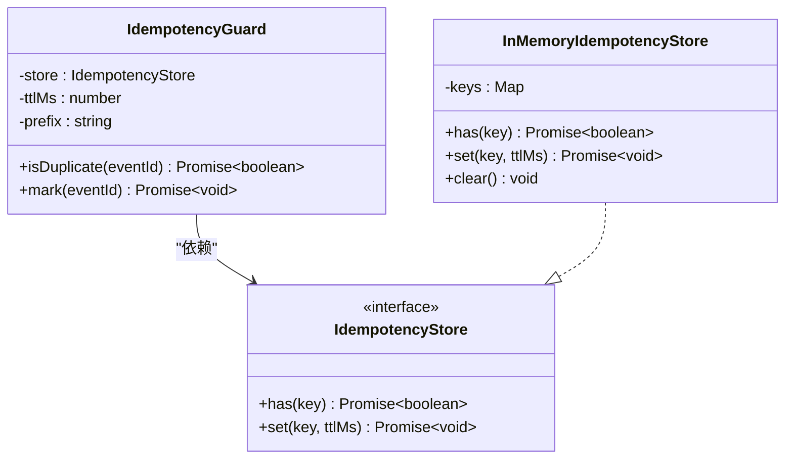

**图表来源**
- [packages/mq/src/idempotency.ts:1-84](file://packages/mq/src/idempotency.ts#L1-L84)

**章节来源**
- [packages/mq/src/idempotency.ts:1-84](file://packages/mq/src/idempotency.ts#L1-L84)

### 重试与死信策略
RetryPolicy 定义最大尝试次数、基础退避时长、退避上限及是否达到上限后转死信。backoffDelay 按指数增长计算下一次等待时间。EventDispatcher 在每次失败后调用 backoffDelay 进行退避，超过最大尝试次数后调用 deadLetter 进行补偿。

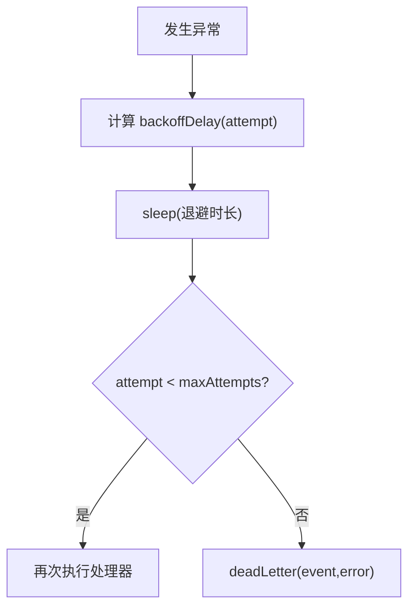

**图表来源**
- [packages/mq/src/config.ts:11-52](file://packages/mq/src/config.ts#L11-L52)
- [packages/mq/src/subscriber.ts:74-101](file://packages/mq/src/subscriber.ts#L74-L101)

**章节来源**
- [packages/mq/src/config.ts:1-53](file://packages/mq/src/config.ts#L1-L53)
- [packages/mq/src/subscriber.ts:1-103](file://packages/mq/src/subscriber.ts#L1-L103)

### 装饰器式消费者注册
registerHandler 将方法声明为某主题的处理器；buildHandlers 将类上所有登记项组装为 EventHandler 映射，供 EventDispatcher 使用。

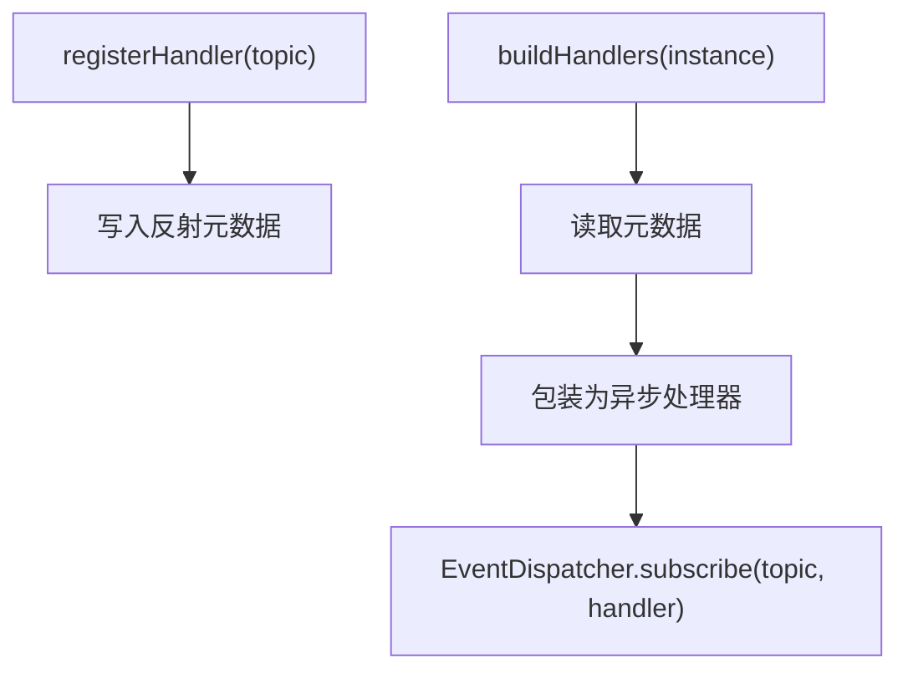

**图表来源**
- [packages/mq/src/decorators.ts:13-59](file://packages/mq/src/decorators.ts#L13-L59)
- [packages/mq/src/subscriber.ts:51-55](file://packages/mq/src/subscriber.ts#L51-L55)

**章节来源**
- [packages/mq/src/decorators.ts:1-60](file://packages/mq/src/decorators.ts#L1-L60)
- [packages/mq/src/subscriber.ts:1-103](file://packages/mq/src/subscriber.ts#L1-L103)

### NestJS 模块装配
MqModule.forRoot 提供 MQ_CONFIG、MQ_PUBLISHER、MqService；forConsumer 用于声明消费主题集合。MqService 对 EventPublisher 进行轻量封装，并提供 publishWithEnvelope 便捷方法。

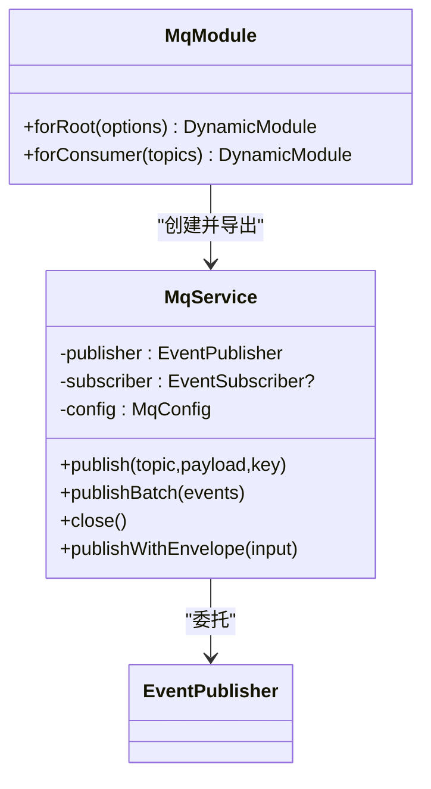

**图表来源**
- [packages/mq/src/module.ts:17-63](file://packages/mq/src/module.ts#L17-L63)
- [packages/mq/src/module.ts:81-113](file://packages/mq/src/module.ts#L81-L113)

**章节来源**
- [packages/mq/src/module.ts:1-114](file://packages/mq/src/module.ts#L1-L114)

## 依赖关系分析
- @agri/contracts：定义 DomainEvent、EventTopicValue 等类型，约束主题与载荷。
- @agri/shared：提供 ulid、sleep 等通用工具。
- @nestjs/common：提供 Injectable、Module 等 DI 能力。

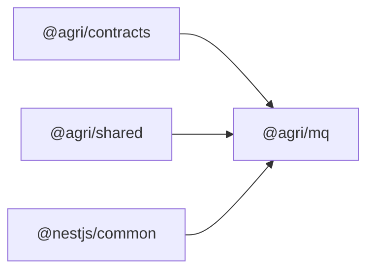

**图表来源**
- [packages/mq/package.json:18-22](file://packages/mq/package.json#L18-L22)

**章节来源**
- [packages/mq/package.json:1-28](file://packages/mq/package.json#L1-L28)

## 性能与可靠性
- **分区键选择**：对同一业务对象（如地块、设备）使用相同 key，保证顺序；不同对象尽量散列，避免热点分区。
- **批量发布**：优先使用 publishEvents/publishBatch 减少网络往返。
- **Outbox 批处理**：relayOnce 支持 limit 控制单轮处理量，避免一次性拉取过多导致延迟。
- **事件日志批处理**：EventLogConsumer 支持 batchSize 配置，控制单次拉取数量。
- **位点管理**：EventLogConsumer 按事件提交位点，崩溃时只重复最后一条，由幂等机制兜底。
- **幂等窗口**：默认 7 天 TTL，兼顾重试与人工补发；可根据业务调整。
- **重试退避**：指数退避降低瞬时压力，配合死信兜底。
- **消费者并行**：同一主题可注册多个处理器，但同主题处理器串行执行，避免乱序；跨主题可水平扩展消费者实例。
- **多消费者组**：通过 group 参数实现消费者组隔离，同组内负载均衡，不同组独立消费。

[本节为通用指导，不涉及具体代码片段]

## 故障排查指南
- 未注册发布器：调用 publishEvent 抛出"未提供发布器，且未注册默认发布器"。检查 setDefaultPublisher 或传入 publisher 参数。
- 订阅方法不存在：装饰器构建处理器时校验方法名，缺失会抛错。检查 registerHandler 与方法签名。
- 幂等键冲突：确认 eventId 唯一性；若使用自定义 IdempotencyStore，检查 has/set 原子性与 TTL 设置。
- 重试风暴：检查 RetryPolicy 的 baseDelayMs/maxDelayMs/maxAttempts 是否合理；必要时调大退避或降低并发。
- 死信堆积：检查 deadLetter 实现是否正确落盘/告警；定位最后错误 lastError 或处理器异常堆栈。
- Outbox 积压：检查 relayOnce 的 limit 与间隔；确认 OutboxStore.listPending/markPublished/markFailed 实现无阻塞。
- **事件日志积压**：检查 EventLogConsumer 的 pollIntervalMs 和 batchSize 配置；确认 EventLogStore 实现无阻塞。
- **位点提交失败**：检查 EventLogStore.writeOffset 实现是否正确；确认数据库连接正常。
- **消费者组冲突**：确认不同服务的 consumer_group 不冲突；同组内消费者负载均衡。

**章节来源**
- [packages/mq/src/publisher.ts:40-57](file://packages/mq/src/publisher.ts#L40-L57)
- [packages/mq/src/decorators.ts:47-59](file://packages/mq/src/decorators.ts#L47-L59)
- [packages/mq/src/subscriber.ts:74-101](file://packages/mq/src/subscriber.ts#L74-L101)
- [packages/mq/src/outbox.ts:99-112](file://packages/mq/src/outbox.ts#L99-L112)
- [packages/mq/src/event-bus.ts:322-328](file://packages/mq/src/event-bus.ts#L322-L328)

## 结论
@agri/mq 通过 Outbox 最终一致性、统一幂等与重试、装饰器式消费者注册与 NestJS 模块装配，为平台提供了稳定、可扩展、可观测的事件驱动基础设施。**新增的事件总线层进一步增强了跨进程消息传递的可靠性**，通过共享事件日志表和消费者组位点管理，确保了消息的可靠投递和有序消费。其关键优势在于：
- 将可靠性关注点集中在包内，业务代码保持简洁。
- 通过契约抽象解耦具体消息中间件，便于多后端切换。
- 提供内存实现与默认策略，快速验证与上线。
- **事件日志层提供跨进程可靠消息传递，支持多消费者组协调**。

[本节为总结性内容，不涉及具体代码片段]

## 附录：使用示例与最佳实践

### 定义事件与主题
- 主题与载荷类型由 @agri/contracts 维护，确保编译期类型安全。
- 建议在业务域内集中定义事件主题常量，避免拼写错误。

**章节来源**
- [packages/mq/src/index.ts:1-55](file://packages/mq/src/index.ts#L1-L55)

### 发布消息
- 使用 publishEvent 自动补齐信封字段，或通过 MqService.publishWithEnvelope 在 Nest 环境中便捷发布。
- 对于高吞吐场景，使用 publishEvents/publishBatch 批量发布。
- 为同一业务对象设置一致的 key，保证顺序。
- **使用 EventLogPublisher 实现跨进程消息传递**，事件会被写入共享日志表。

**章节来源**
- [packages/mq/src/publisher.ts:1-74](file://packages/mq/src/publisher.ts#L1-L74)
- [packages/mq/src/module.ts:53-62](file://packages/mq/src/module.ts#L53-L62)
- [packages/mq/src/event-bus.ts:169-205](file://packages/mq/src/event-bus.ts#L169-L205)

### 消费事件
- 使用 registerHandler 声明处理器，再由 EventDispatcher 统一编排。
- 在 forConsumer 中声明消费的主题集合，便于健康检查与自检。
- 处理器内无需再做幂等判断，由 EventDispatcher 与 IdempotencyGuard 统一处理。
- **使用 EventLogConsumer 启动事件日志消费**，按位点轮询主题并交给分发器处理。

**章节来源**
- [packages/mq/src/decorators.ts:1-60](file://packages/mq/src/decorators.ts#L1-L60)
- [packages/mq/src/subscriber.ts:1-103](file://packages/mq/src/subscriber.ts#L1-L103)
- [packages/mq/src/module.ts:102-113](file://packages/mq/src/module.ts#L102-L113)
- [packages/mq/src/event-bus.ts:230-329](file://packages/mq/src/event-bus.ts#L230-L329)

### 异常处理与死信
- 通过 EventDispatcherOptions.onError 输出日志。
- 配置 RetryPolicy 控制重试行为；达到最大尝试次数后触发 deadLetter 进行补偿。
- 建议在 deadLetter 中将失败事件持久化并告警，便于人工干预。

**章节来源**
- [packages/mq/src/config.ts:11-52](file://packages/mq/src/config.ts#L11-L52)
- [packages/mq/src/subscriber.ts:74-101](file://packages/mq/src/subscriber.ts#L74-L101)

### Outbox 使用要点
- 在业务事务中调用 OutboxService.enqueue 写入本地消息表。
- 启动 OutboxService.start 定期中继投递。
- 生产环境需实现 OutboxStore，使用数据库表承载 OutboxRecord。

**章节来源**
- [packages/mq/src/outbox.ts:14-48](file://packages/mq/src/outbox.ts#L14-L48)
- [packages/mq/src/outbox.ts:51-137](file://packages/mq/src/outbox.ts#L51-L137)

### 事件总线使用要点
- **使用 EventLogPublisher 替代传统消息中间件**，将事件写入共享日志表。
- **使用 EventLogConsumer 启动消费**，配置消费者组和订阅主题。
- **实现 EventLogStore 接口**，支持内存和PostgreSQL两种实现。
- **配置消费者组**，同组内负载均衡，不同组独立消费。
- **监控位点提交**，确保消费进度正常推进。

**章节来源**
- [packages/mq/src/event-bus.ts:1-330](file://packages/mq/src/event-bus.ts#L1-L330)

### 中间件适配方案（Kafka/RabbitMQ）
- 实现 EventPublisher 接口：
  - publish：投递单条事件，返回分区号与位点。
  - publishBatch：批量投递以提升吞吐。
  - close：优雅关闭连接。
- 结合 MqModule.forRoot 注入具体实现，并在服务启动时建立连接。
- 消费者侧可使用 EventDispatcher 管理处理器，或使用第三方消费者客户端拉取消息后交由 EventDispatcher.dispatch 处理。
- **或者直接使用 EventLogPublisher 和 EventLogConsumer**，通过共享数据库表实现跨进程消息传递。

[本节为概念性说明，不涉及具体代码片段]

### 数据库迁移
- **event_log 表**：存储共享事件日志，包含事件ID、主题、版本、时间戳、生产者、租户、追踪ID和负载JSON。
- **event_log_offsets 表**：存储消费者组位点，保证重启后从上次位置续读。
- **索引优化**：针对topic和seq建立复合索引，提高查询性能。

**章节来源**
- [infra/postgres/migrations/003_event_bus_messages.sql:1-62](file://infra/postgres/migrations/003_event_bus_messages.sql#L1-L62)