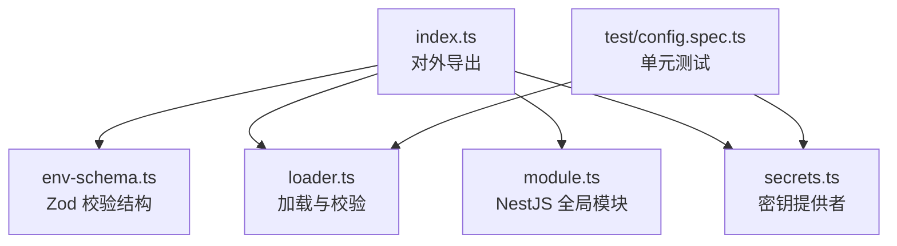
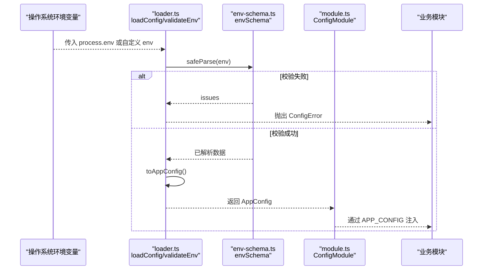
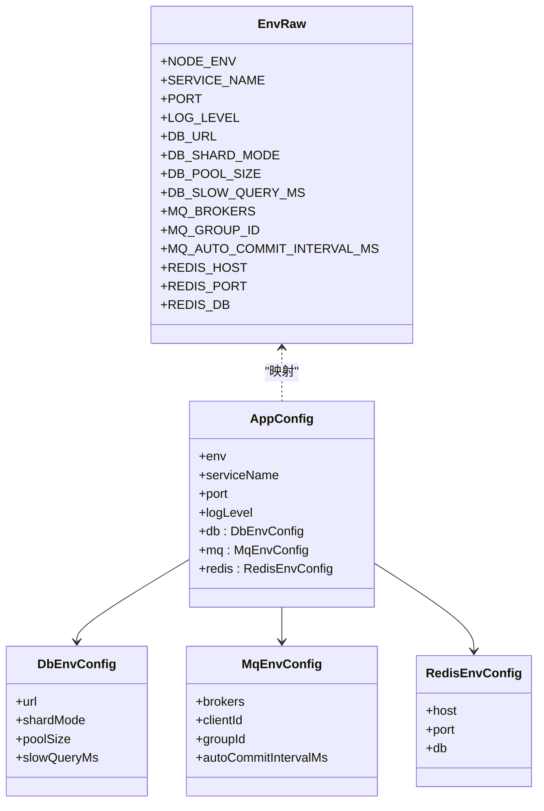
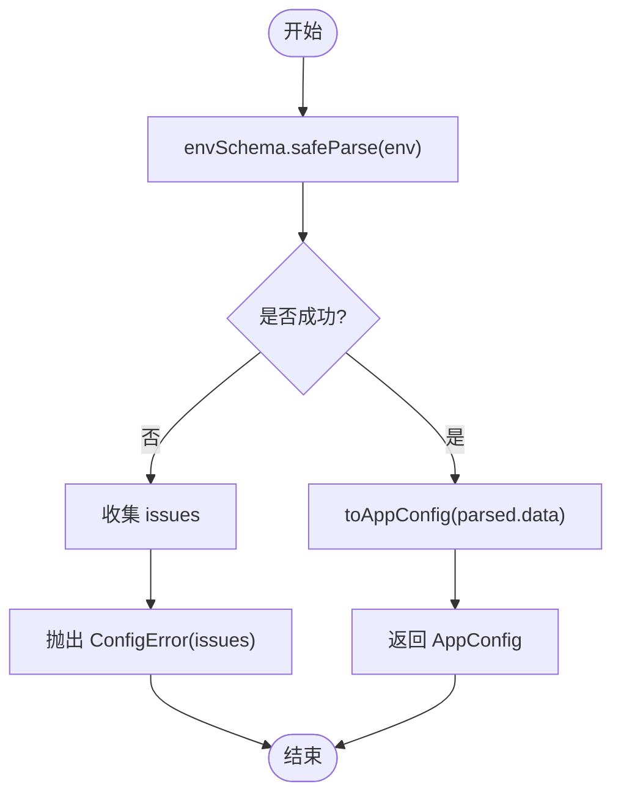
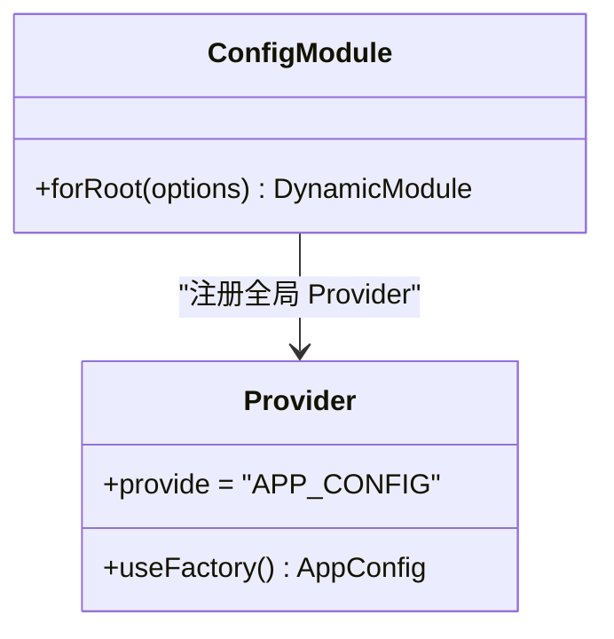
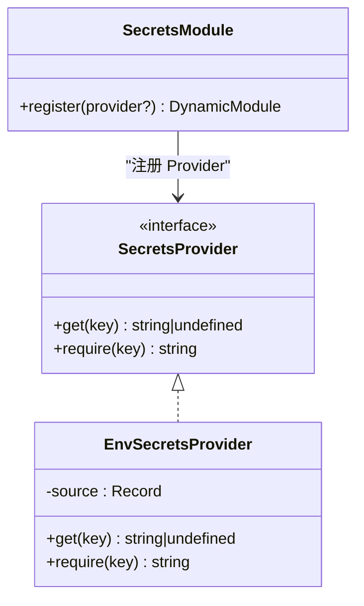
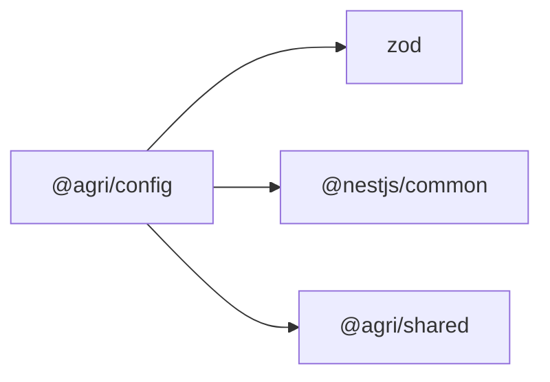

# 配置管理包 (@agri/config)

<cite>
**本文引用的文件**   
- [packages/config/src/index.ts](file://packages/config/src/index.ts)
- [packages/config/src/env-schema.ts](file://packages/config/src/env-schema.ts)
- [packages/config/src/loader.ts](file://packages/config/src/loader.ts)
- [packages/config/src/module.ts](file://packages/config/src/module.ts)
- [packages/config/src/secrets.ts](file://packages/config/src/secrets.ts)
- [packages/config/test/config.spec.ts](file://packages/config/test/config.spec.ts)
- [packages/config/package.json](file://packages/config/package.json)
</cite>

## 目录
1. [简介](#简介)
2. [项目结构](#项目结构)
3. [核心组件](#核心组件)
4. [架构总览](#架构总览)
5. [详细组件分析](#详细组件分析)
6. [依赖关系分析](#依赖关系分析)
7. [性能与可靠性考量](#性能与可靠性考量)
8. [故障排查指南](#故障排查指南)
9. [结论](#结论)
10. [附录：配置字段与环境变量对照](#附录配置字段与环境变量对照)

## 简介
@agri/config 是农艺平台中的统一配置管理包，负责在应用启动期完成环境变量的读取、校验、归并与注入。该包将“配置错误”从运行期的偶发问题转变为启动期的确定性失败，从而降低部署风险。它提供以下能力：
- 基于 Zod 的环境变量声明式校验
- 按域分组的 AppConfig 配置对象
- NestJS 全局模块注入令牌 APP_CONFIG
- 密钥读取契约 SecretsProvider 及默认实现 EnvSecretsProvider
- 启动前预检 validateEnv 与加载 loadConfig 两种模式

该包当前仅支持通过环境变量进行配置；未直接实现 JSON/YAML 配置文件加载与热重载功能。敏感信息通过 SecretsProvider 抽象，默认从环境变量读取。

**章节来源**
- [packages/config/src/index.ts:1-9](file://packages/config/src/index.ts#L1-L9)
- [packages/config/package.json:1-28](file://packages/config/package.json#L1-L28)

## 项目结构
@agri/config 采用“职责单一、入口聚合”的组织方式：
- index.ts：对外导出所有能力
- env-schema.ts：Zod 校验结构与类型定义
- loader.ts：配置加载、校验异常与归并逻辑
- module.ts：NestJS 全局配置模块
- secrets.ts：密钥提供者接口与默认实现
- test/config.spec.ts：覆盖主要行为与边界条件

**图表来源**
- [packages/config/src/index.ts:1-9](file://packages/config/src/index.ts#L1-L9)
- [packages/config/src/env-schema.ts:1-78](file://packages/config/src/env-schema.ts#L1-L78)
- [packages/config/src/loader.ts:1-80](file://packages/config/src/loader.ts#L1-L80)
- [packages/config/src/module.ts:1-41](file://packages/config/src/module.ts#L1-L41)
- [packages/config/src/secrets.ts:1-61](file://packages/config/src/secrets.ts#L1-L61)
- [packages/config/test/config.spec.ts:1-65](file://packages/config/test/config.spec.ts#L1-L65)

**章节来源**
- [packages/config/src/index.ts:1-9](file://packages/config/src/index.ts#L1-L9)
- [packages/config/src/env-schema.ts:1-78](file://packages/config/src/env-schema.ts#L1-L78)
- [packages/config/src/loader.ts:1-80](file://packages/config/src/loader.ts#L1-L80)
- [packages/config/src/module.ts:1-41](file://packages/config/src/module.ts#L1-L41)
- [packages/config/src/secrets.ts:1-61](file://packages/config/src/secrets.ts#L1-L61)
- [packages/config/test/config.spec.ts:1-65](file://packages/config/test/config.spec.ts#L1-L65)

## 核心组件
- 环境变量校验结构 envSchema：集中声明所有环境变量及其约束，作为配置的“唯一真相源”。
- 配置加载器 loadConfig：读取环境变量、执行校验、抛出 ConfigError、返回 AppConfig。
- 预检函数 validateEnv：不抛异常，返回 ok/issues，适合部署前检查。
- NestJS 配置模块 ConfigModule：以全局 Provider 暴露 APP_CONFIG，供业务模块注入。
- 密钥提供者 SecretsProvider 与 EnvSecretsProvider：统一读取密钥，缺失时抛出 ConfigError。

**章节来源**
- [packages/config/src/env-schema.ts:1-78](file://packages/config/src/env-schema.ts#L1-L78)
- [packages/config/src/loader.ts:1-80](file://packages/config/src/loader.ts#L1-L80)
- [packages/config/src/module.ts:1-41](file://packages/config/src/module.ts#L1-L41)
- [packages/config/src/secrets.ts:1-61](file://packages/config/src/secrets.ts#L1-L61)

## 架构总览
下图展示从环境变量到应用配置再到 NestJS 注入的完整流程。

**图表来源**
- [packages/config/src/loader.ts:26-79](file://packages/config/src/loader.ts#L26-L79)
- [packages/config/src/env-schema.ts:10-40](file://packages/config/src/env-schema.ts#L10-L40)
- [packages/config/src/module.ts:27-38](file://packages/config/src/module.ts#L27-L38)

## 详细组件分析

### 环境变量校验结构（env-schema.ts）
- 使用 Zod 定义所有环境变量，包括必填项、枚举值、数值范围与默认值。
- 关键字段：
  - NODE_ENV：development/test/production，默认 development
  - SERVICE_NAME：服务名，最小长度 1，默认 unknown-service
  - PORT：端口号，1-65535，默认 3000
  - LOG_LEVEL：debug/info/warn/error，默认 info
  - DB_URL：数据库连接串，必填
  - DB_SHARD_MODE：single/shared/isolated，默认 single
  - DB_POOL_SIZE：连接池大小，1-200，默认 10
  - DB_SLOW_QUERY_MS：慢查询阈值毫秒，≥1，默认 500
  - MQ_BROKERS：逗号分隔的消息代理列表，必填
  - MQ_GROUP_ID：消费者组，必填
  - MQ_AUTO_COMMIT_INTERVAL_MS：自动提交间隔毫秒，≥100，默认 5000
  - REDIS_HOST/PORT/DB：缓存主机、端口、库号，含默认值

- 类型导出：
  - EnvRaw：环境变量原始结构
  - AppConfig：应用级配置，按域分组为 db/mq/redis
  - DbEnvConfig/MqEnvConfig/RedisEnvConfig：各域配置类型

**图表来源**
- [packages/config/src/env-schema.ts:10-77](file://packages/config/src/env-schema.ts#L10-L77)

**章节来源**
- [packages/config/src/env-schema.ts:1-78](file://packages/config/src/env-schema.ts#L1-L78)

### 配置加载与校验（loader.ts）
- ConfigError：携带 issues 数组，便于向部署人员报告具体缺失或非法项。
- validateEnv：仅校验，返回 { ok, issues }，不抛异常，适合 CI/CD 预检。
- toAppConfig：将 EnvRaw 归并为 AppConfig，处理如 MQ_BROKERS 的分隔与过滤。
- loadConfig：调用 envSchema.safeParse，失败抛 ConfigError，成功返回 AppConfig。

**图表来源**
- [packages/config/src/loader.ts:8-16](file://packages/config/src/loader.ts#L8-L16)
- [packages/config/src/loader.ts:26-35](file://packages/config/src/loader.ts#L26-L35)
- [packages/config/src/loader.ts:38-64](file://packages/config/src/loader.ts#L38-L64)
- [packages/config/src/loader.ts:71-79](file://packages/config/src/loader.ts#L71-L79)

**章节来源**
- [packages/config/src/loader.ts:1-80](file://packages/config/src/loader.ts#L1-L80)

### NestJS 配置模块（module.ts）
- 提供全局 Provider APP_CONFIG，值为 AppConfig。
- forRoot(options)：
  - options.load：允许测试注入固定配置
  - options.env：允许指定环境变量来源，默认 process.env
- 模块标记 @Global()，根模块导入一次即可全局使用。

**图表来源**
- [packages/config/src/module.ts:7-16](file://packages/config/src/module.ts#L7-L16)
- [packages/config/src/module.ts:24-39](file://packages/config/src/module.ts#L24-L39)

**章节来源**
- [packages/config/src/module.ts:1-41](file://packages/config/src/module.ts#L1-L41)

### 密钥提供者（secrets.ts）
- SecretsProvider 接口：
  - get(key)：不存在返回 undefined
  - require(key)：不存在抛出 ConfigError
- EnvSecretsProvider：默认从环境变量读取，空串视为缺失。
- SecretsModule.register(provider)：注册全局 Provider SECRETS_PROVIDER，可替换为外部密钥管理服务。

**图表来源**
- [packages/config/src/secrets.ts:6-12](file://packages/config/src/secrets.ts#L6-L12)
- [packages/config/src/secrets.ts:23-42](file://packages/config/src/secrets.ts#L23-L42)
- [packages/config/src/secrets.ts:44-60](file://packages/config/src/secrets.ts#L44-L60)

**章节来源**
- [packages/config/src/secrets.ts:1-61](file://packages/config/src/secrets.ts#L1-L61)

### 单元测试要点（test/config.spec.ts）
- 验证 FULL_ENV 下 loadConfig 能正确归并 db/mq/redis 等域配置。
- 验证缺少必填项时抛出 ConfigError，且 issues 包含缺失字段名。
- 验证 validateEnv 只汇报结果，不抛异常。
- 验证 EnvSecretsProvider 对空串视为缺失，require 缺失键抛 ConfigError。

**章节来源**
- [packages/config/test/config.spec.ts:1-65](file://packages/config/test/config.spec.ts#L1-L65)

## 依赖关系分析
- 运行时依赖：
  - zod：用于声明式校验
  - @nestjs/common：用于模块与 Provider 机制
  - @agri/shared：工作区共享依赖（本包未直接使用其 API，但存在依赖声明）
- 开发依赖：
  - typescript：编译 TypeScript

**图表来源**
- [packages/config/package.json:18-26](file://packages/config/package.json#L18-L26)

**章节来源**
- [packages/config/package.json:1-28](file://packages/config/package.json#L1-L28)

## 性能与可靠性考量
- 启动期一次性校验：避免运行期因配置错误导致不稳定。
- 数值类型强制转换：使用 z.coerce.number() 减少字符串转数字的错误分支。
- 连接池与慢查询阈值：通过 DB_POOL_SIZE 与 DB_SLOW_QUERY_MS 控制资源与可观测性。
- 消息队列 brokers 分割与过滤：确保空项被剔除，避免无效节点影响吞吐。
- 密钥读取统一出口：通过 SecretsProvider 集中处理缺失与日志脱敏策略。

[本节为通用指导，不直接分析具体文件]

## 故障排查指南
- 启动即报错 ConfigError：
  - 检查缺失或非法的环境变量，查看 issues 中列出的字段路径与原因。
  - 使用 validateEnv 在部署前预检，定位问题后再启动服务。
- 密钥缺失：
  - 确认对应密钥环境变量已设置且非空串。
  - 如需接入外部密钥服务，可通过 SecretsModule.register 替换默认实现。
- 端口或连接数异常：
  - 检查 PORT 是否在合法范围。
  - 根据容器副本数调整 DB_POOL_SIZE，避免超过数据库连接上限。

**章节来源**
- [packages/config/src/loader.ts:8-16](file://packages/config/src/loader.ts#L8-L16)
- [packages/config/src/secrets.ts:35-41](file://packages/config/src/secrets.ts#L35-L41)
- [packages/config/test/config.spec.ts:40-63](file://packages/config/test/config.spec.ts#L40-L63)

## 结论
@agri/config 通过声明式校验与启动期失败策略，显著提升了配置管理的确定性与可维护性。它将环境变量转换为按域分组的 AppConfig，并通过 NestJS 全局模块注入，使业务代码无需关心配置来源细节。密钥读取通过 SecretsProvider 抽象，便于未来接入外部密钥管理系统。当前版本聚焦环境变量，未内置 JSON/YAML 配置文件加载与热重载能力；若需要这些特性，可在现有 loader.ts 基础上扩展多源合并与文件监听逻辑。

[本节为总结性内容，不直接分析具体文件]

## 附录：配置字段与环境变量对照
- 基础信息
  - NODE_ENV → config.env
  - SERVICE_NAME → config.serviceName
  - PORT → config.port
  - LOG_LEVEL → config.logLevel
- 数据库
  - DB_URL → config.db.url
  - DB_SHARD_MODE → config.db.shardMode
  - DB_POOL_SIZE → config.db.poolSize
  - DB_SLOW_QUERY_MS → config.db.slowQueryMs
- 消息总线
  - MQ_BROKERS → config.mq.brokers（逗号分隔）
  - MQ_GROUP_ID → config.mq.groupId
  - MQ_AUTO_COMMIT_INTERVAL_MS → config.mq.autoCommitIntervalMs
  - SERVICE_NAME → config.mq.clientId
- 缓存
  - REDIS_HOST → config.redis.host
  - REDIS_PORT → config.redis.port
  - REDIS_DB → config.redis.db

**章节来源**
- [packages/config/src/env-schema.ts:10-77](file://packages/config/src/env-schema.ts#L10-L77)
- [packages/config/src/loader.ts:38-64](file://packages/config/src/loader.ts#L38-L64)