基于我的分析，我现在了解了更新的内容。让我更新API集成文档以反映smoke testing脚本的undefined字段处理和TypeScript编译修复：

# API集成

<cite>
**本文引用的文件**   
- [apps/web/src/api/index.ts](file://apps/web/src/api/index.ts)
- [apps/web/src/utils/request.ts](file://apps/web/src/utils/request.ts)
- [apps/web/src/types/index.ts](file://apps/web/src/types/index.ts)
- [apps/gateway-service/src/http.ts](file://apps/gateway-service/src/http.ts)
- [apps/auth-service/src/http.ts](file://apps/auth-service/src/http.ts)
- [apps/plot-service/src/http.ts](file://apps/plot-service/src/http.ts)
- [apps/plot-service/src/zone.repository.ts](file://apps/plot-service/src/zone.repository.ts)
- [apps/plot-service/src/infra-line.repository.ts](file://apps/plot-service/src/infra-line.repository.ts)
- [apps/plot-service/src/plot.service.ts](file://apps/plot-service/src/plot.service.ts)
- [apps/operation-service/src/navigation.ts](file://apps/operation-service/src/navigation.ts)
- [apps/operation-service/src/coverage.ts](file://apps/operation-service/src/coverage.ts)
- [apps/operation-service/src/http.ts](file://apps/operation-service/src/http.ts)
- [apps/iot-service/src/http.ts](file://apps/iot-service/src/http.ts)
- [apps/iot-service/src/device.repository.ts](file://apps/iot-service/src/device.repository.ts)
- [packages/shared/src/authz.ts](file://packages/shared/src/authz.ts)
- [packages/shared/src/utils.ts](file://packages/shared/src/utils.ts)
- [packages/contracts/src/dto/geo.dto.ts](file://packages/contracts/src/dto/geo.dto.ts)
- [packages/contracts/src/messages/message-template.ts](file://packages/contracts/src/messages/message-template.ts)
- [packages/contracts/src/index.ts](file://packages/contracts/src/index.ts)
- [packages/tsconfig/base.json](file://packages/tsconfig/base.json)
- [scripts/smoke-command-receipt.mjs](file://scripts/smoke-command-receipt.mjs)
- [scripts/smoke-consumers.mjs](file://scripts/smoke-consumers.mjs)
- [README.md](file://README.md)
- [infra/postgres/migrations/014_iot_devices.sql](file://infra/postgres/migrations/014_iot_devices.sql)
</cite>

## 更新摘要
**变更内容**   
- 增强了smoke测试脚本对undefined字段的处理，改进了控制指令回执链路的健壮性
- 优化了TypeScript编译配置，启用更严格的类型检查选项（noUncheckedIndexedAccess、exactOptionalPropertyTypes）
- 完善了服务间的undefined字段安全访问机制，避免运行时错误
- 改进了命令回执状态机的时间字段处理，确保pendingMin和overdue字段的正确性
- 增强了数据验证逻辑，对可选字段进行更安全的前端和后端处理

## 目录
1. [简介](#简介)
2. [项目结构](#项目结构)
3. [核心组件](#核心组件)
4. [架构总览](#架构总览)
5. [详细组件分析](#详细组件分析)
6. [依赖关系分析](#依赖关系分析)
7. [性能与优化](#性能与优化)
8. [故障排查指南](#故障排查指南)
9. [结论](#结论)
10. [附录：API接口定义与类型契约](#附录api接口定义与类型契约)

## 简介
本文件面向智慧农业平台的前后端集成，聚焦以下目标：
- HTTP请求封装、拦截器配置与错误处理机制
- RESTful API调用规范、参数校验与响应数据格式化
- 认证授权流程、Token管理与会话维护
- 请求重试、超时处理与网络异常恢复策略
- API接口定义、类型安全与Mock数据支持
- 性能优化：请求合并、缓存机制与懒加载

本项目采用前后端分离架构：前端基于Vue3 + Element Plus，通过Axios统一发起HTTP请求；网关服务负责路由转发；认证服务提供登录、鉴权与会话管理；业务服务（如地块服务、IoT设备服务、操作服务）实现领域接口。公共契约包集中定义跨端共享的类型与响应信封。

**更新** 新增了smoke测试脚本的undefined字段处理增强和TypeScript编译配置优化，提升了系统的类型安全性和运行稳定性。

## 项目结构
从API集成视角，关键目录与职责如下：
- apps/web：前端应用，包含请求封装、类型定义与页面逻辑
- apps/gateway-service：网关服务，统一入口、路由转发与透传上下文
- apps/auth-service：认证服务，提供登录、用户信息与登出
- apps/plot-service：地块服务，演示REST接口、分页、错误码、片区管理和基础设施管线
- apps/iot-service：IoT设备服务，提供设备台账管理、控制指令和状态监控
- apps/operation-service：操作服务，提供导航规划和农事任务管理，新增覆盖规划功能
- packages/contracts：公共契约包，定义跨端共享的响应信封、枚举、Geo DTOs和消息模板
- packages/shared：共享工具包，提供权限验证、身份透传等通用功能
- scripts：冒烟测试脚本，用于端到端功能验证
- packages/tsconfig：TypeScript编译配置基座

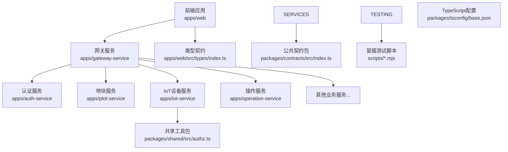

**图示来源**
- [apps/web/src/utils/request.ts:5-11](file://apps/web/src/utils/request.ts#L5-L11)
- [apps/gateway-service/src/http.ts:6-23](file://apps/gateway-service/src/http.ts#L6-L23)
- [apps/auth-service/src/http.ts:14-20](file://apps/auth-service/src/http.ts#L14-L20)
- [apps/plot-service/src/http.ts:40-104](file://apps/plot-service/src/http.ts#L40-L104)
- [apps/iot-service/src/http.ts:39-136](file://apps/iot-service/src/http.ts#L39-L136)
- [apps/operation-service/src/http.ts:44-55](file://apps/operation-service/src/http.ts#L44-L55)
- [packages/contracts/src/index.ts:1-12](file://packages/contracts/src/index.ts#L1-L12)
- [packages/tsconfig/base.json:1-24](file://packages/tsconfig/base.json#L1-L24)

**章节来源**
- [README.md:58-84](file://README.md#L58-L84)

## 核心组件
- 前端请求封装：Axios实例、请求/响应拦截器、通用方法get/post/put/del
- 网关服务：默认路由表、最长前缀匹配、下游转发、错误包装
- 认证服务：登录、获取用户信息、登出、会话存储与过期控制
- IoT设备服务：设备台账CRUD、控制指令下发、状态监控、权限验证
- 业务服务（以地块为例）：统计、边界、CRUD、分页、错误码与traceId透传
- 片区管理服务：片区CRUD、地块归属管理、地图视图聚合
- 基础设施管线管理：管线CRUD、类型分类、几何数据处理、长度自动计算
- **覆盖规划服务**：全地块覆盖式作业规划，自动计算牛耕式作业带路径
- 导航规划服务：路径优化、里程计算、路网吸附
- 消息模板系统：多主题模板、去重键生成、级别过滤
- 类型契约：ApiResponse/PageResult等通用类型，以及领域模型与枚举
- 权限验证：服务侧权限守卫、身份头透传、路径级权限覆盖
- **TypeScript编译配置**：严格模式、空值检查、模块解析等编译选项
- **冒烟测试脚本**：端到端功能验证，包含undefined字段处理增强

**更新** 新增了TypeScript编译配置和冒烟测试脚本相关组件。

**章节来源**
- [apps/web/src/utils/request.ts:5-109](file://apps/web/src/utils/request.ts#L5-L109)
- [apps/gateway-service/src/http.ts:4-40](file://apps/gateway-service/src/http.ts#L4-L40)
- [apps/auth-service/src/http.ts:6-20](file://apps/auth-service/src/http.ts#L6-L20)
- [apps/iot-service/src/http.ts:39-136](file://apps/iot-service/src/http.ts#L39-L136)
- [apps/plot-service/src/http.ts:9-104](file://apps/plot-service/src/http.ts#L9-L104)
- [apps/plot-service/src/plot.service.ts:276-411](file://apps/plot-service/src/plot.service.ts#L276-L411)
- [apps/plot-service/src/zone.repository.ts:14-55](file://apps/plot-service/src/zone.repository.ts#L14-L55)
- [apps/plot-service/src/infra-line.repository.ts:18-46](file://apps/plot-service/src/infra-line.repository.ts#L18-L46)
- [apps/operation-service/src/navigation.ts:16-56](file://apps/operation-service/src/navigation.ts#L16-L56)
- [apps/operation-service/src/coverage.ts:266-356](file://apps/operation-service/src/coverage.ts#L266-L356)
- [packages/shared/src/authz.ts:66-80](file://packages/shared/src/authz.ts#L66-L80)
- [packages/shared/src/utils.ts:29-34](file://packages/shared/src/utils.ts#L29-L34)
- [packages/contracts/src/messages/message-template.ts:62-81](file://packages/contracts/src/messages/message-template.ts#L62-L81)
- [apps/web/src/types/index.ts:1-313](file://apps/web/src/types/index.ts#L1-L313)
- [packages/contracts/src/index.ts:1-12](file://packages/contracts/src/index.ts#L1-L12)
- [packages/tsconfig/base.json:1-24](file://packages/tsconfig/base.json#L1-L24)

## 架构总览
下图展示一次典型API调用的端到端流程：前端通过Axios发起请求，携带Authorization与X-Request-Id；网关根据路径前缀转发到对应服务；认证服务负责鉴权与会话；业务服务返回统一响应信封。

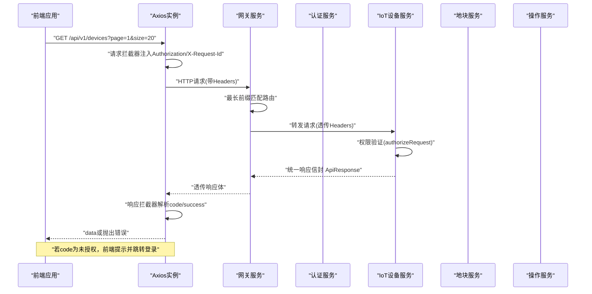

**图示来源**
- [apps/web/src/utils/request.ts:13-35](file://apps/web/src/utils/request.ts#L13-L35)
- [apps/web/src/utils/request.ts:37-86](file://apps/web/src/utils/request.ts#L37-L86)
- [apps/gateway-service/src/http.ts:27-39](file://apps/gateway-service/src/http.ts#L27-L39)
- [apps/iot-service/src/http.ts:47-48](file://apps/iot-service/src/http.ts#L47-L48)

## 详细组件分析

### 前端请求封装与拦截器
- Axios实例配置：基础URL、超时、Content-Type
- 请求拦截器：自动注入Authorization、X-User-Id、X-Request-Id
- 响应拦截器：统一判断code/success，失败时显示消息；对401进行登录过期处理
- 通用方法：get/post/put/del，泛型T保证类型安全


**图示来源**
- [apps/web/src/utils/request.ts:5-11](file://apps/web/src/utils/request.ts#L5-L11)
- [apps/web/src/utils/request.ts:13-35](file://apps/web/src/utils/request.ts#L13-L35)
- [apps/web/src/utils/request.ts:37-86](file://apps/web/src/utils/request.ts#L37-L86)

**章节来源**
- [apps/web/src/utils/request.ts:5-109](file://apps/web/src/utils/request.ts#L5-L109)

### 网关服务路由与转发
- 默认路由表：按前缀映射到各业务服务地址
- 最长前缀优先匹配：避免更具体路径被短前缀抢先匹配
- 透传上下文：Authorization、X-Request-Id、X-Tenant-Id、X-User-Id等
- 错误包装：下游不可用返回GATEWAY-502


**图示来源**
- [apps/gateway-service/src/http.ts:6-23](file://apps/gateway-service/src/http.ts#L6-L23)
- [apps/gateway-service/src/http.ts:27-39](file://apps/gateway-service/src/http.ts#L27-L39)

**章节来源**
- [apps/gateway-service/src/http.ts:4-40](file://apps/gateway-service/src/http.ts#L4-L40)

### 认证服务与Token管理
- 登录：用户名密码校验，生成随机token，写入内存会话Map，设置过期时间
- 用户信息：校验Authorization中的Bearer token，返回脱敏用户信息
- 登出：删除对应token会话
- 鉴权：authorized函数检查token存在性与过期时间

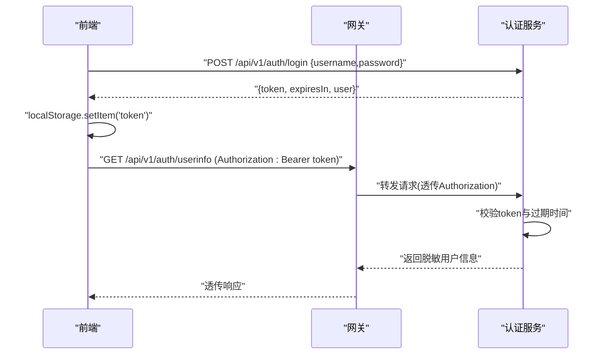

**图示来源**
- [apps/auth-service/src/http.ts:6-20](file://apps/auth-service/src/http.ts#L6-L20)

**章节来源**
- [apps/auth-service/src/http.ts:6-20](file://apps/auth-service/src/http.ts#L6-L20)

### IoT设备管理API
- 健康检查：/health
- 设备列表：/api/v1/devices GET，支持分页、关键词、类型、状态、地块筛选
- 设备详情：/api/v1/devices/{id} GET
- 创建设备：/api/v1/devices POST，支持设备编号、名称、类型、状态、地块绑定
- 更新设备：/api/v1/devices/{id} PUT，支持部分更新，不允许修改设备编号
- 删除设备：/api/v1/devices/{id} DELETE
- 控制指令：/api/v1/devices/{id}/commands POST，异步下发控制命令
- 权限验证：需要device:read和device:control权限

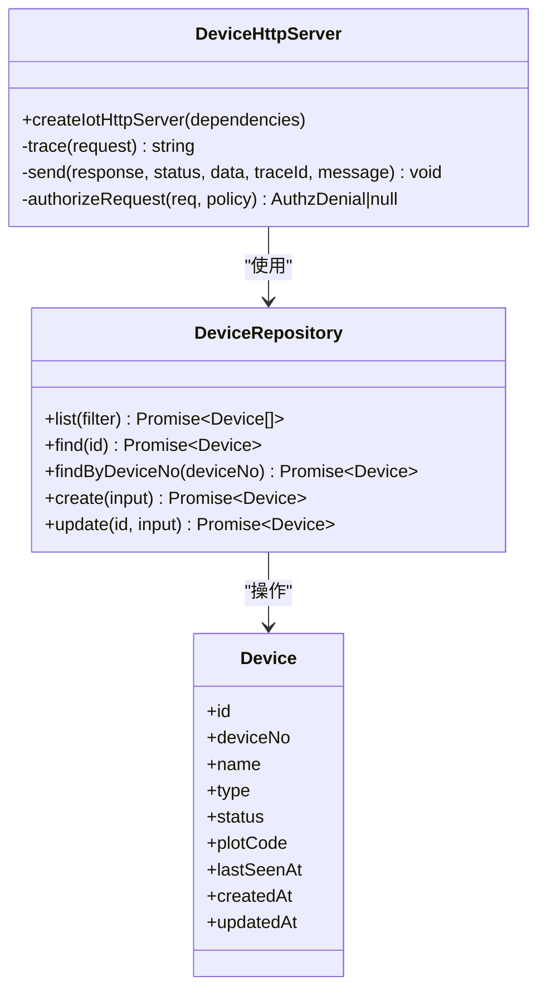

**图示来源**
- [apps/iot-service/src/http.ts:39-136](file://apps/iot-service/src/http.ts#L39-L136)
- [apps/iot-service/src/device.repository.ts:78-86](file://apps/iot-service/src/device.repository.ts#L78-L86)

**章节来源**
- [apps/iot-service/src/http.ts:39-136](file://apps/iot-service/src/http.ts#L39-L136)
- [apps/iot-service/src/device.repository.ts:1-321](file://apps/iot-service/src/device.repository.ts#L1-L321)

### 业务服务接口（以地块为例）
- 健康检查：/health
- 统计接口：/api/v1/plots/stats
- 边界接口：/api/v1/plots/bounds
- 列表接口：/api/v1/plots GET，支持分页与关键词过滤
- 详情接口：/api/v1/plots/{parcelCode}
- 创建接口：/api/v1/plots POST
- 更新接口：/api/v1/plots/{parcelCode} PUT
- 删除接口：/api/v1/plots/{parcelCode} DELETE
- 统一响应：ApiResponse，含code/message/data/traceId/timestamp
- 分页：PageResult，限制每页最大200

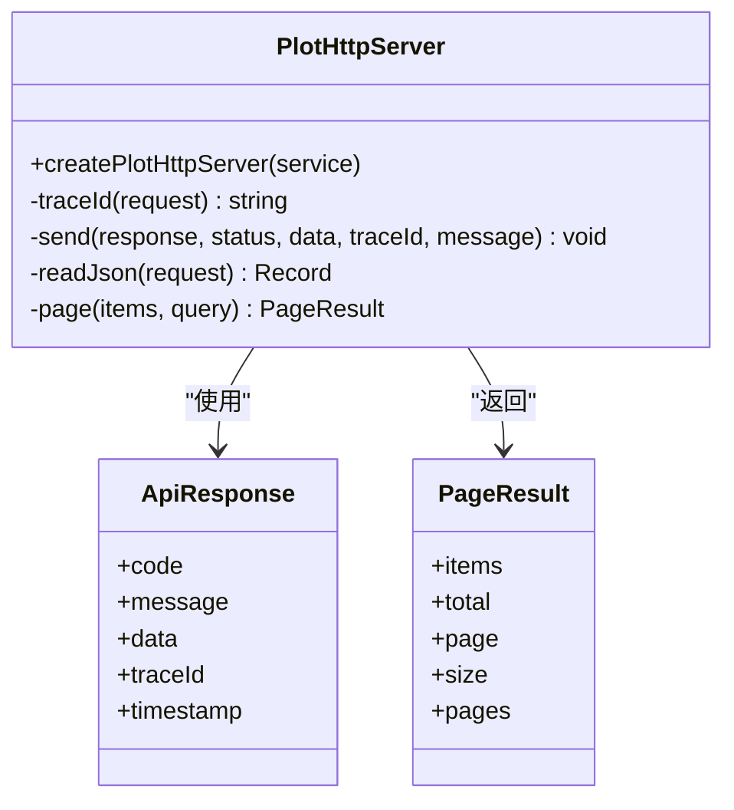

**图示来源**
- [apps/plot-service/src/http.ts:9-38](file://apps/plot-service/src/http.ts#L9-L38)
- [apps/plot-service/src/http.ts:40-104](file://apps/plot-service/src/http.ts#L40-L104)

**章节来源**
- [apps/plot-service/src/http.ts:9-104](file://apps/plot-service/src/http.ts#L9-L104)

### 覆盖规划API
- **覆盖规划接口**：/api/v1/operations/coverage-plan POST，支持全地块覆盖式作业规划
  - 请求体：{ plotCode, boundary, implementWidthM, overlapM?, headingDeg?, speedKmh?, turnSpeedKmh?, start?, areaMu? }
  - 响应：{ planId, plotCode, headingDeg, headingAuto, implementWidthM, overlapM, laneSpacingM, laneCount, turnCount, lanes[], workDistanceM, transferDistanceM, totalDistanceM, durationMin, areaMu, coverageRatio, path, warnings }
  - 业务逻辑：等距布带、蛇形往返、内环跳洞、方向自动挑选、入场里程计算
- **覆盖规划历史接口**：/api/v1/operations/coverage-plans GET，返回最近20条覆盖方案
  - 响应：CoveragePlan[]，按租户隔离存储

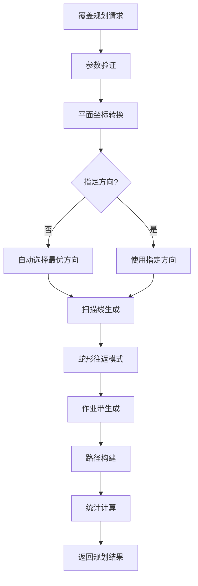

**图示来源**
- [apps/operation-service/src/coverage.ts:266-356](file://apps/operation-service/src/coverage.ts#L266-L356)
- [apps/operation-service/src/http.ts:134-141](file://apps/operation-service/src/http.ts#L134-L141)

**章节来源**
- [apps/operation-service/src/coverage.ts:266-356](file://apps/operation-service/src/coverage.ts#L266-L356)
- [apps/operation-service/src/http.ts:134-141](file://apps/operation-service/src/http.ts#L134-L141)

### Web API客户端扩展
- **覆盖规划方法**：operationApi.planCoverage(data)，调用POST /operations/coverage-plan，返回覆盖规划方案
- **覆盖规划历史方法**：operationApi.getCoveragePlans()，调用GET /operations/coverage-plans，返回最近20条记录
- **类型安全**：使用TypeScript接口确保参数和返回值类型正确
- **数据格式**：支持完整的覆盖规划数据结构，包括作业带、路径、统计信息等

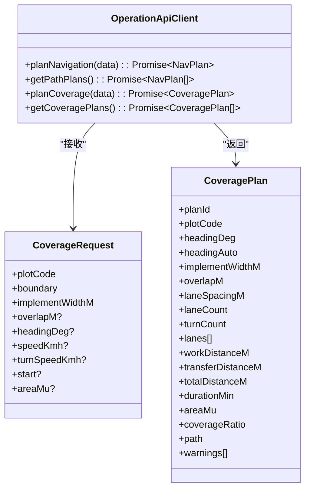

**图示来源**
- [apps/web/src/api/index.ts:702-707](file://apps/web/src/api/index.ts#L702-L707)
- [apps/web/src/api/index.ts:748-791](file://apps/web/src/api/index.ts#L748-L791)

**章节来源**
- [apps/web/src/api/index.ts:702-707](file://apps/web/src/api/index.ts#L702-L707)
- [apps/web/src/api/index.ts:748-791](file://apps/web/src/api/index.ts#L748-L791)

### 地块合并与拆分API
- **合并接口**：/api/v1/plots/merge POST，支持多个地块合并为单个地块
  - 请求体：{ parcelCodes: string[], parcelName?: string, plotType?: string, remark?: string }
  - 响应：{ plot: Plot, sourceCodes: string[] }
  - 业务逻辑：计算源地块顶点凸包作为新边界，自动计算面积，归档源地块
- **拆分接口**：/api/v1/plots/split POST，支持将单个地块拆分为多个子地块
  - 请求体：{ parcelCode: string, pieces: Array<{ parcelName: string; geom: GeoPolygon }>, keepSource?: boolean }
  - 响应：{ plots: Plot[], sourceCode: string, sourceRemoved: boolean, pieceAreaSum: number }
  - 业务逻辑：验证子地块几何有效性，可选保留或归档原地块

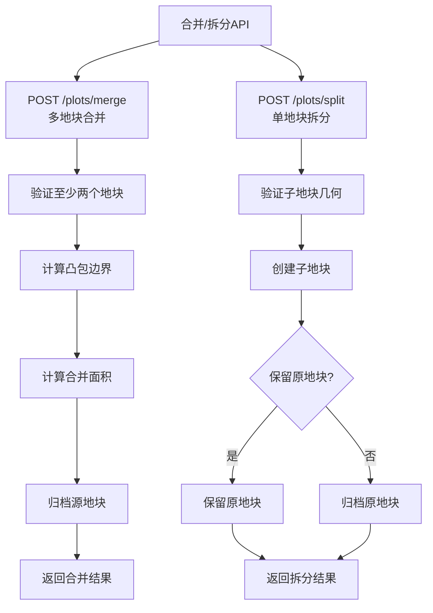

**图示来源**
- [apps/plot-service/src/http.ts:616-680](file://apps/plot-service/src/http.ts#L616-L680)
- [apps/plot-service/src/plot.service.ts:276-411](file://apps/plot-service/src/plot.service.ts#L276-L411)

**章节来源**
- [apps/plot-service/src/http.ts:616-680](file://apps/plot-service/src/http.ts#L616-L680)
- [apps/plot-service/src/plot.service.ts:276-411](file://apps/plot-service/src/plot.service.ts#L276-L411)

### 片区管理API
- 片区列表：/api/v1/zones GET，返回片区台账与统计信息
- 地图视图：/api/v1/zones/map GET，额外返回凸包与中心点
- 片区详情：/api/v1/zones/{zoneCode} GET，返回完整信息
- 创建片区：/api/v1/zones POST，支持几何边界
- 更新片区：/api/v1/zones/{zoneCode} PUT，支持部分更新
- 删除片区：/api/v1/zones/{zoneCode} DELETE，软删除
- 分配地块：/api/v1/zones/{zoneCode}/plots POST，直接修改地块归属
- 移除地块：/api/v1/zones/{zoneCode}/plots/{parcelCode} DELETE

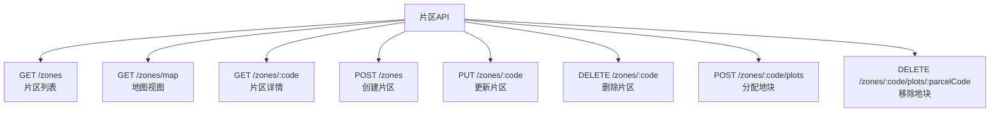

**图示来源**
- [apps/web/src/api/index.ts:149-181](file://apps/web/src/api/index.ts#L149-L181)
- [apps/plot-service/src/http.ts:206-217](file://apps/plot-service/src/http.ts#L206-L217)

**章节来源**
- [apps/web/src/api/index.ts:149-181](file://apps/web/src/api/index.ts#L149-L181)
- [apps/plot-service/src/zone.repository.ts:14-55](file://apps/plot-service/src/zone.repository.ts#L14-L55)

### 基础设施管线API
- 管线列表：/api/v1/plots/infra-lines GET，支持按类型筛选
- 创建管线：/api/v1/plots/infra-lines POST，支持LineString几何，自动计算长度
- 更新管线：/api/v1/plots/infra-lines/{lineCode} PUT，支持部分更新，几何变化时重新计算长度
- 删除管线：/api/v1/plots/infra-lines/{lineCode} DELETE
- 管线类型：IRRIGATION_PIPE（灌水管）、FERTILIZATION_PIPE（施肥管）、ELECTRIC_LINE（电力线）、ROAD（机耕道）、TELECOM（通信线）
- 几何验证：确保LineString至少包含两个坐标点
- 长度计算：根据几何坐标自动估算管线长度

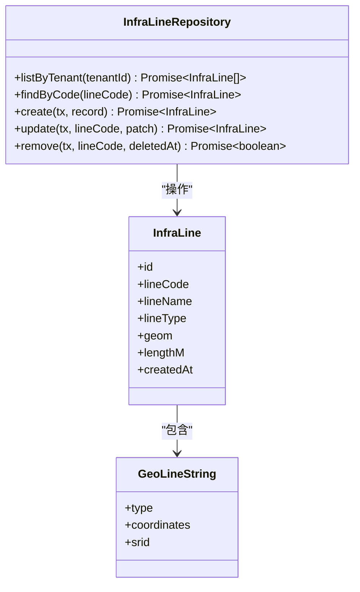

**图示来源**
- [apps/plot-service/src/infra-line.repository.ts:41-46](file://apps/plot-service/src/infra-line.repository.ts#L41-L46)
- [apps/plot-service/src/infra-line.repository.ts:18-30](file://apps/plot-service/src/infra-line.repository.ts#L18-L30)
- [packages/contracts/src/dto/geo.dto.ts:19-27](file://packages/contracts/src/dto/geo.dto.ts#L19-L27)

**章节来源**
- [apps/web/src/api/index.ts:95-118](file://apps/web/src/api/index.ts#L95-L118)
- [apps/plot-service/src/infra-line.repository.ts:18-46](file://apps/plot-service/src/infra-line.repository.ts#L18-L46)

### 导航规划API
- 路径规划：/api/v1/operations/path-plan POST，输入起点、站点和可选路网
- 历史查询：/api/v1/operations/path-plans GET，返回最近20条规划记录
- 算法实现：最近邻排序 + 2-opt优化，支持路网吸附和Dijkstra最短路径
- 距离计算：经纬度坐标转换为米制距离，支持沿路距离估算

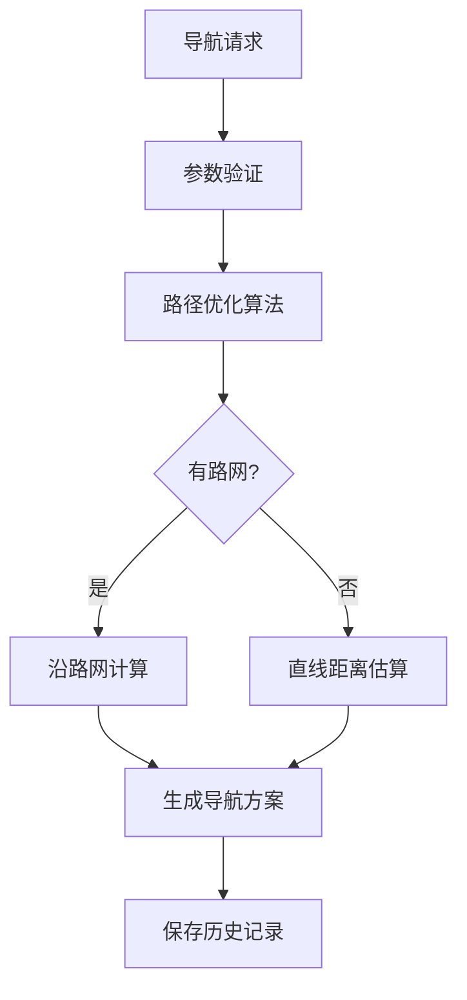

**图示来源**
- [apps/operation-service/src/navigation.ts:318-382](file://apps/operation-service/src/navigation.ts#L318-L382)
- [apps/operation-service/src/http.ts:52-53](file://apps/operation-service/src/http.ts#L52-L53)

**章节来源**
- [apps/web/src/api/index.ts:428-482](file://apps/web/src/api/index.ts#L428-L482)
- [apps/operation-service/src/navigation.ts:16-56](file://apps/operation-service/src/navigation.ts#L16-L56)
- [apps/operation-service/src/http.ts:52-53](file://apps/operation-service/src/http.ts#L52-L53)

### 消息模板系统
- 阈值越限告警：遥测数据超过阈值时生成ALERT级别消息
- 虫情识别告警：根据虫害等级生成不同级别的消息（INFO/WARNING/CRITICAL）
- 处方生成通知：决策系统生成的作业建议通知
- 去重机制：按事件类型、地块、指标和时间维度进行消息去重
- 级别过滤：支持INFO、WARNING、CRITICAL三级消息级别

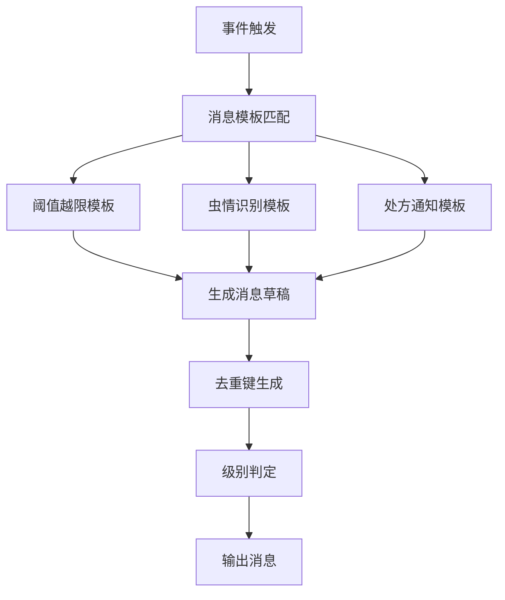

**图示来源**
- [packages/contracts/src/messages/message-template.ts:88-153](file://packages/contracts/src/messages/message-template.ts#L88-L153)
- [packages/contracts/src/messages/message-template.ts:180-195](file://packages/contracts/src/messages/message-template.ts#L180-L195)

**章节来源**
- [packages/contracts/src/messages/message-template.ts:1-196](file://packages/contracts/src/messages/message-template.ts#L1-L196)

### 权限验证与身份透传
- 服务侧权限守卫：基于环境变量AUTH_GUARD_MODE控制是否启用
- 身份头透传：只透传x-user-id、x-permissions、x-tenant-id三个可信头
- 路径级权限覆盖：支持按路径前缀覆盖默认的读写权限
- 公开路径白名单：无需身份即可访问的路径（如登录、设备上报）
- 会话路径白名单：仅需登录、不校验具体权限的路径（如个人信息、退出登录）
- 权限解析：从x-permissions头解析权限列表并进行hasPermission检查

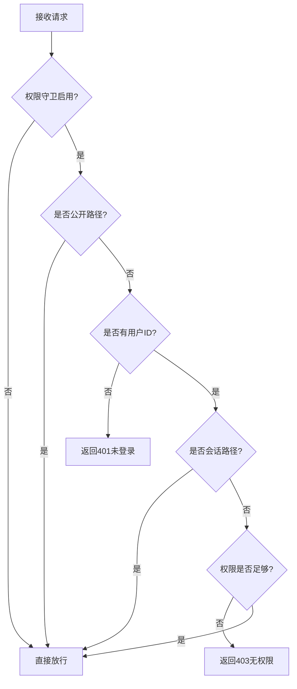

**图示来源**
- [packages/shared/src/authz.ts:66-80](file://packages/shared/src/authz.ts#L66-L80)

**章节来源**
- [packages/shared/src/authz.ts:1-81](file://packages/shared/src/authz.ts#L1-L81)

### TypeScript编译配置与类型安全
- **严格模式**：启用strict选项，确保代码质量
- **空值检查**：noUncheckedIndexedAccess防止数组索引访问时的undefined
- **精确可选属性**：exactOptionalPropertyTypes确保可选属性的精确类型
- **未知捕获变量**：useUnknownInCatchVariables提升错误处理安全性
- **跳过库检查**：skipLibCheck提升编译性能
- **ES模块支持**：module和moduleResolution设置为NodeNext
- **断言工具**：assertDefined函数提供安全的字段验证

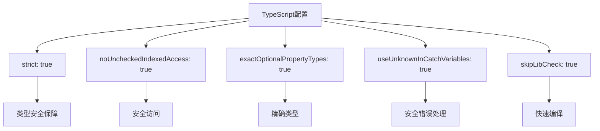

**图示来源**
- [packages/tsconfig/base.json:4-21](file://packages/tsconfig/base.json#L4-L21)
- [packages/shared/src/utils.ts:29-34](file://packages/shared/src/utils.ts#L29-L34)

**章节来源**
- [packages/tsconfig/base.json:1-24](file://packages/tsconfig/base.json#L1-L24)
- [packages/shared/src/utils.ts:29-34](file://packages/shared/src/utils.ts#L29-L34)

### 冒烟测试脚本与undefined字段处理
- **控制指令回执链路**：验证设备回执、结单事件、档案/消息/处方执行回流
- **undefined字段安全处理**：改进receiptText和receiptResult函数的undefined处理
- **时间字段验证**：确保pendingMin和overdue字段的正确性和一致性
- **幂等性保证**：重复操作不会产生副作用
- **数据清理**：测试结束后自动清理临时数据

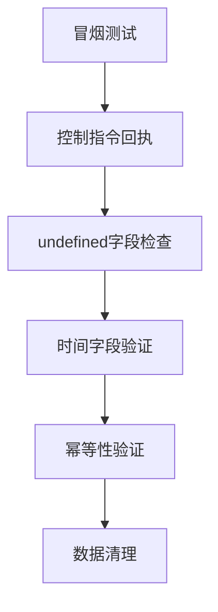

**图示来源**
- [scripts/smoke-command-receipt.mjs:123-133](file://scripts/smoke-command-receipt.mjs#L123-L133)
- [scripts/smoke-consumers.mjs:88-104](file://scripts/smoke-consumers.mjs#L88-L104)

**章节来源**
- [scripts/smoke-command-receipt.mjs:1-439](file://scripts/smoke-command-receipt.mjs#L1-L439)
- [scripts/smoke-consumers.mjs:1-200](file://scripts/smoke-consumers.mjs#L1-L200)

### 类型安全与Mock数据支持
- 类型契约：ApiResponse、PageResult、领域模型与枚举在前端types中集中定义
- 类型安全：Axios泛型T确保返回值类型正确
- Mock建议：在测试或开发阶段，可使用本地JSON或内存数据模拟后端响应，保持与真实接口一致的响应结构

```mermaid
erDiagram
API_RESPONSE {
number|string code
string message
any data
number timestamp
}
PAGE_RESULT {
array items
number total
number page
number size
number pages
}
DEVICE {
string id
string deviceNo
string name
string type
string status
string plotCode
string lastSeenAt
string createdAt
string updatedAt
}
INFRA_LINE {
string id
string lineCode
string lineName
string lineType
object geom
number lengthM
}
NAV_PLAN {
string planId
array order
number distanceM
number durationMin
array legs
object polyline
}
MERGE_RESULT {
object plot
array sourceCodes
}
SPLIT_RESULT {
array plots
string sourceCode
boolean sourceRemoved
number pieceAreaSum
}
COVERAGE_PLAN {
string planId
string plotCode
number headingDeg
boolean headingAuto
number implementWidthM
number overlapM
number laneSpacingM
number laneCount
number turnCount
array lanes
number workDistanceM
number transferDistanceM
number totalDistanceM
number durationMin
number areaMu
number coverageRatio
object path
array warnings
}
```

**图示来源**
- [apps/web/src/types/index.ts:1-313](file://apps/web/src/types/index.ts#L1-L313)
- [apps/web/src/api/index.ts:125-146](file://apps/web/src/api/index.ts#L125-L146)
- [apps/iot-service/src/device.repository.ts:31-44](file://apps/iot-service/src/device.repository.ts#L31-L44)
- [apps/web/src/api/index.ts:771-791](file://apps/web/src/api/index.ts#L771-L791)

**章节来源**
- [apps/web/src/types/index.ts:1-313](file://apps/web/src/types/index.ts#L1-L313)

## 依赖关系分析
- 前端依赖Axios与Element Plus，统一封装请求与错误提示
- 网关服务依赖Node原生http模块与环境变量配置
- 认证服务依赖内存Map存储会话，简单但非持久化
- IoT设备服务依赖设备仓储（内存或SQL实现）和权限验证
- 业务服务依赖公共契约包定义响应信封与分页结构
- **覆盖规划服务依赖几何计算库和数学算法**，用于牛耕式作业带计算
- 公共契约包仅导出类型与枚举，不依赖能力包，便于前后端共享
- 权限验证依赖合约包的权限解析函数
- **TypeScript编译配置**：所有服务继承统一的tsconfig基座，确保编译一致性
- **冒烟测试脚本**：依赖PostgreSQL数据库和服务间HTTP通信

**更新** 新增了TypeScript编译配置和冒烟测试脚本的依赖关系。

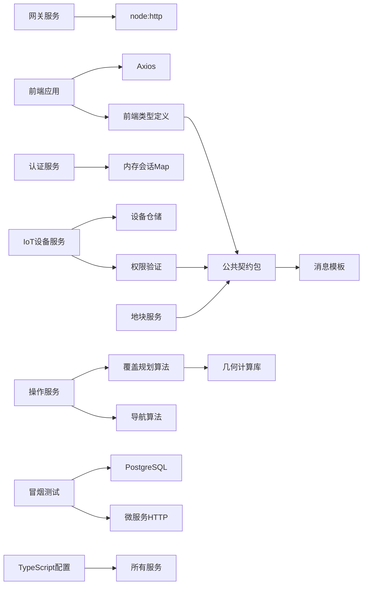

**图示来源**
- [apps/web/src/utils/request.ts:1-11](file://apps/web/src/utils/request.ts#L1-L11)
- [apps/gateway-service/src/http.ts:1-4](file://apps/gateway-service/src/http.ts#L1-L4)
- [apps/auth-service/src/http.ts:6-8](file://apps/auth-service/src/http.ts#L6-L8)
- [apps/iot-service/src/http.ts:1-8](file://apps/iot-service/src/http.ts#L1-L8)
- [apps/plot-service/src/http.ts:4-7](file://apps/plot-service/src/http.ts#L4-L7)
- [apps/operation-service/src/navigation.ts:1-3](file://apps/operation-service/src/navigation.ts#L1-L3)
- [apps/operation-service/src/coverage.ts:1-3](file://apps/operation-service/src/coverage.ts#L1-L3)
- [packages/contracts/src/index.ts:1-12](file://packages/contracts/src/index.ts#L1-L12)
- [packages/shared/src/authz.ts:1-3](file://packages/shared/src/authz.ts#L1-L3)
- [packages/tsconfig/base.json:1-24](file://packages/tsconfig/base.json#L1-L24)
- [scripts/smoke-command-receipt.mjs:1-6](file://scripts/smoke-command-receipt.mjs#L1-L6)

**章节来源**
- [apps/web/src/utils/request.ts:1-11](file://apps/web/src/utils/request.ts#L1-L11)
- [apps/gateway-service/src/http.ts:1-4](file://apps/gateway-service/src/http.ts#L1-L4)
- [apps/auth-service/src/http.ts:6-8](file://apps/auth-service/src/http.ts#L6-L8)
- [apps/iot-service/src/http.ts:1-8](file://apps/iot-service/src/http.ts#L1-L8)
- [apps/plot-service/src/http.ts:4-7](file://apps/plot-service/src/http.ts#L4-L7)
- [apps/operation-service/src/navigation.ts:1-3](file://apps/operation-service/src/navigation.ts#L1-L3)
- [apps/operation-service/src/coverage.ts:1-3](file://apps/operation-service/src/coverage.ts#L1-L3)
- [packages/contracts/src/index.ts:1-12](file://packages/contracts/src/index.ts#L1-L12)
- [packages/shared/src/authz.ts:1-3](file://packages/shared/src/authz.ts#L1-L3)
- [packages/tsconfig/base.json:1-24](file://packages/tsconfig/base.json#L1-L24)

## 性能与优化
- 请求合并：可在Axios层引入轻量队列，将短时间内的重复请求合并，减少带宽与后端压力
- 缓存机制：对只读接口（如地块统计、设备列表）增加浏览器缓存（ETag/Last-Modified）或内存缓存（按URL+参数键）
- 懒加载：路由级与组件级按需加载，减少首屏体积；图表与地图组件按需初始化
- 分页与限流：服务端分页上限200，前端合理设置size；对高频接口做防抖/节流
- 连接复用：Axios默认复用TCP连接，避免频繁握手开销
- 压缩传输：网关与服务端启用gzip/br压缩，降低带宽占用
- 导航优化：使用最近邻+2-opt算法优化路径顺序，减少总行驶距离
- 路网吸附：智能吸附站点到最近路网节点，提高路径精度
- 设备查询优化：设备列表支持多维度筛选，减少前端过滤开销
- 几何计算优化：管线长度自动计算，避免前端重复计算
- **覆盖规划优化**：等距圆柱平面坐标转换，避免经纬度直接计算的精度损失；自动方向选择算法优化总里程；作业带间距自适应调整
- **TypeScript编译优化**：skipLibCheck提升编译速度，isolatedModules支持并行编译
- **测试优化**：冒烟测试使用独立端口和数据隔离，支持并发执行

**更新** 新增了TypeScript编译优化和测试优化相关的考虑。

[本节为通用指导，不直接分析具体文件]

## 故障排查指南
- 未授权（401）：前端拦截器会提示并跳转登录；检查Authorization头是否正确注入，确认token未过期
- 网络错误：无response或request为空时，提示"服务器无响应"；检查网关可达性与DNS解析
- 参数错误（400）：检查请求体是否为JSON对象，字段类型是否符合类型定义
- 资源不存在（404）：检查URL路径与前缀匹配，确认网关路由配置正确
- 服务器内部错误（500）：查看服务日志，定位异常堆栈；必要时开启链路追踪ID（X-Request-Id）
- 导航参数错误：检查start和stops坐标格式，确认站点数量不超过20个
- 管线几何错误：验证LineString坐标数组格式，确保至少包含两个坐标点
- 设备权限错误：检查device:read和device:control权限是否正确授予
- 设备编号冲突：创建设备时deviceNo必须唯一，避免重复编号
- 设备状态无效：设备状态只能是ONLINE或OFFLINE，类型必须是预定义的10种之一
- **覆盖规划参数错误**：plotCode不能为空，boundary需为有效的Polygon几何，implementWidthM需在0~50米之间
- **覆盖规划几何错误**：地块边界顶点不足3个，无法铺作业带；作业带间距不为正；按给定幅宽铺不出任何作业带
- **覆盖规划算法错误**：作业带超过2000条上限；地块边界退化导致无法计算
- **TypeScript编译错误**：检查strictNullChecks和noUncheckedIndexedAccess相关的类型安全问题
- **undefined字段错误**：使用assertDefined函数进行字段验证，避免运行时undefined访问
- **冒烟测试失败**：检查数据库连接、服务端口配置和依赖服务可用性

**更新** 新增了TypeScript编译错误、undefined字段错误和冒烟测试失败的故障排查指导。

**章节来源**
- [apps/web/src/utils/request.ts:37-86](file://apps/web/src/utils/request.ts#L37-L86)
- [apps/gateway-service/src/http.ts:27-39](file://apps/gateway-service/src/http.ts#L27-L39)
- [apps/plot-service/src/http.ts:100-103](file://apps/plot-service/src/http.ts#L100-L103)
- [apps/iot-service/src/http.ts:72-76](file://apps/iot-service/src/http.ts#L72-L76)
- [apps/operation-service/src/navigation.ts:400-447](file://apps/operation-service/src/navigation.ts#L400-L447)
- [apps/operation-service/src/coverage.ts:266-356](file://apps/operation-service/src/coverage.ts#L266-L356)
- [packages/shared/src/utils.ts:29-34](file://packages/shared/src/utils.ts#L29-L34)
- [packages/tsconfig/base.json:4-21](file://packages/tsconfig/base.json#L4-L21)

## 结论
本平台的API集成方案以Axios为中心，结合网关路由转发与统一响应信封，实现了清晰的请求封装、鉴权透传与错误处理。类型契约在前端与后端共享，保障类型安全。当前实现已覆盖认证、路由、分页、设备管理、片区管理、基础设施管线、导航规划、覆盖规划和消息模板等基本功能；**新增的TypeScript编译配置优化和冒烟测试脚本增强进一步提升了系统的类型安全性和测试可靠性**。后续可在此基础上扩展重试、缓存与性能优化策略，以满足更高并发与稳定性要求。

**更新** 新增了TypeScript编译配置优化和冒烟测试脚本的undefined字段处理增强，进一步完善了智慧农业平台的质量保障体系。

[本节为总结性内容，不直接分析具体文件]

## 附录：API接口定义与类型契约

### 认证接口
- POST /api/v1/auth/login
  - 请求体：{ username, password }
  - 响应：{ token, expiresIn, user }
- GET /api/v1/auth/userinfo
  - 头部：Authorization: Bearer <token>
  - 响应：脱敏用户信息
- POST /api/v1/auth/logout
  - 头部：Authorization: Bearer <token>
  - 响应：空数据

**章节来源**
- [apps/auth-service/src/http.ts:14-20](file://apps/auth-service/src/http.ts#L14-L20)

### 网关健康检查
- GET /health
  - 响应：{ code: "OK", data: { status: "ok", service: "gateway" }, timestamp }

**章节来源**
- [apps/gateway-service/src/http.ts:27-33](file://apps/gateway-service/src/http.ts#L27-L33)

### IoT设备管理接口
- GET /api/v1/devices
  - 查询参数：page, size, keyword, type, status, plotCode
  - 响应：PageResult<Device>
- GET /api/v1/devices/{id}
  - 响应：Device
- POST /api/v1/devices
  - 请求体：{ deviceNo, name, type, status, plotCode? }
  - 响应：Device
- PUT /api/v1/devices/{id}
  - 请求体：{ name?, type?, status?, plotCode? }
  - 响应：Device
- DELETE /api/v1/devices/{id}
  - 响应：空数据
- POST /api/v1/devices/{id}/commands
  - 请求体：{ type, parameters? }
  - 响应：{ commandId, deviceId, status: "QUEUED", command }

**更新** 新增设备管理相关接口。

**章节来源**
- [apps/iot-service/src/http.ts:50-130](file://apps/iot-service/src/http.ts#L50-L130)

### 覆盖规划接口
- **POST /api/v1/operations/coverage-plan**
  - 请求体：{ plotCode, boundary, implementWidthM, overlapM?, headingDeg?, speedKmh?, turnSpeedKmh?, start?, areaMu? }
  - 响应：CoveragePlan
  - 说明：全地块覆盖式作业规划，自动计算牛耕式作业带路径
- **GET /api/v1/operations/coverage-plans**
  - 响应：CoveragePlan[]
  - 说明：返回最近20条覆盖方案记录，按租户隔离

**更新** 新增覆盖规划接口。

**章节来源**
- [apps/operation-service/src/http.ts:134-141](file://apps/operation-service/src/http.ts#L134-L141)
- [apps/operation-service/src/coverage.ts:266-356](file://apps/operation-service/src/coverage.ts#L266-L356)

### 地块合并与拆分接口
- **POST /api/v1/plots/merge**
  - 请求体：{ parcelCodes: string[], parcelName?: string, plotType?: string, remark?: string }
  - 响应：{ plot: Plot, sourceCodes: string[] }
  - 说明：合并多个地块为单个地块，自动计算凸包边界和面积，归档源地块
- **POST /api/v1/plots/split**
  - 请求体：{ parcelCode: string, pieces: Array<{ parcelName: string; geom: GeoPolygon }>, keepSource?: boolean }
  - 响应：{ plots: Plot[], sourceCode: string, sourceRemoved: boolean, pieceAreaSum: number }
  - 说明：将单个地块拆分为多个子地块，可选保留或归档原地块

**更新** 新增地块合并与拆分接口。

**章节来源**
- [apps/plot-service/src/http.ts:616-680](file://apps/plot-service/src/http.ts#L616-L680)
- [apps/plot-service/src/plot.service.ts:276-411](file://apps/plot-service/src/plot.service.ts#L276-L411)

### 地块服务接口
- GET /api/v1/plots/stats
  - 响应：{ totalPlots, totalAreaMu, soilTypes[] }
- GET /api/v1/plots/bounds
  - 响应：[{ parcelCode, parcelName, areaMu, geom }]
- GET /api/v1/plots
  - 查询参数：page, size, keyword
  - 响应：PageResult<PlotRecord>
- GET /api/v1/plots/{parcelCode}
  - 响应：PlotRecord
- POST /api/v1/plots
  - 请求体：RegisterPlotInput
  - 响应：PlotRecord
- PUT /api/v1/plots/{parcelCode}
  - 请求体：PlotPatch
  - 响应：PlotRecord
- DELETE /api/v1/plots/{parcelCode}
  - 响应：空数据

**章节来源**
- [apps/plot-service/src/http.ts:45-98](file://apps/plot-service/src/http.ts#L45-L98)

### 片区管理接口
- GET /api/v1/zones
  - 响应：ZoneSummary[]（带地块数与面积汇总）
- GET /api/v1/zones/map
  - 响应：ZoneSummary[]（额外包含凸包与中心点）
- GET /api/v1/zones/{zoneCode}
  - 响应：ZoneSummary（完整信息）
- POST /api/v1/zones
  - 请求体：{ zoneCode?, zoneName, color?, description?, geom? }
  - 响应：PlotZone
- PUT /api/v1/zones/{zoneCode}
  - 请求体：{ zoneName?, color?, description?, geom? }
  - 响应：PlotZone
- DELETE /api/v1/zones/{zoneCode}
  - 响应：空数据
- POST /api/v1/zones/{zoneCode}/plots
  - 请求体：{ parcelCode }
  - 响应：Plot
- DELETE /api/v1/zones/{zoneCode}/plots/{parcelCode}
  - 响应：Plot

**更新** 新增片区管理相关接口。

**章节来源**
- [apps/web/src/api/index.ts:149-181](file://apps/web/src/api/index.ts#L149-L181)

### 基础设施管线接口
- GET /api/v1/plots/infra-lines
  - 查询参数：lineType
  - 响应：InfraLine[]
- POST /api/v1/plots/infra-lines
  - 请求体：{ lineName, lineType, geom, lineCode? }
  - 响应：InfraLine
- PUT /api/v1/plots/infra-lines/{lineCode}
  - 请求体：{ lineName?, lineType?, geom?, lengthM? }
  - 响应：InfraLine
- DELETE /api/v1/plots/infra-lines/{lineCode}
  - 响应：空数据

**更新** 新增基础设施管线相关接口。

**章节来源**
- [apps/web/src/api/index.ts:95-118](file://apps/web/src/api/index.ts#L95-L118)

### 导航规划接口
- POST /api/v1/operations/path-plan
  - 请求体：NavigationRequest
  - 响应：NavPlan
- GET /api/v1/operations/path-plans
  - 响应：NavPlan[]

**更新** 新增导航规划相关接口。

**章节来源**
- [apps/web/src/api/index.ts:428-482](file://apps/web/src/api/index.ts#L428-L482)

### 通用类型
- ApiResponse：code、message、data、traceId、timestamp
- PageResult：items、total、page、size、pages
- 领域模型：Plot、Device、FarmTask、UserInfo等

**更新** 新增了ZoneSummary、InfraLine、NavPlan、CoveragePlan等相关类型。

**章节来源**
- [apps/web/src/types/index.ts:1-313](file://apps/web/src/types/index.ts#L1-L313)
- [packages/contracts/src/index.ts:1-12](file://packages/contracts/src/index.ts#L1-L12)
- [apps/web/src/api/index.ts:125-146](file://apps/web/src/api/index.ts#L125-L146)
- [apps/web/src/api/index.ts:110-118](file://apps/web/src/api/index.ts#L110-L118)
- [apps/web/src/api/index.ts:428-482](file://apps/web/src/api/index.ts#L428-L482)
- [apps/web/src/api/index.ts:748-791](file://apps/web/src/api/index.ts#L748-L791)

### Geo几何类型
- Coordinate：经纬度坐标对象
- GeoPolygon：多边形几何，支持带内环的多边形
- GeoLineString：线状几何，用于管线和道路

**更新** 扩展了Geo几何类型定义。

**章节来源**
- [packages/contracts/src/dto/geo.dto.ts:1-27](file://packages/contracts/src/dto/geo.dto.ts#L1-L27)

### 消息模板类型
- MessageType：消息类型（ALERT/NOTICE）
- MessageLevel：消息级别（INFO/WARNING/CRITICAL）
- MessageDraft：消息草稿对象
- MessageTemplate：消息模板接口

**更新** 新增了消息模板相关类型定义。

**章节来源**
- [packages/contracts/src/messages/message-template.ts:16-81](file://packages/contracts/src/messages/message-template.ts#L16-L81)

### 设备类型枚举
- DEVICE_TYPES：WEATHER_STATION、SOIL_SENSOR、INTEGRATED_STATION、REMOTE_SENSE、INSECT_LAMP、FERTILIZER_VALVE、IRRIGATION_VALVE、IRRIGATION_PUMP、AGRICULTURAL_DRONE、AUTO_TRACTOR
- DEVICE_STATUSES：ONLINE、OFFLINE

**更新** 新增设备类型枚举定义。

**章节来源**
- [apps/iot-service/src/device.repository.ts:12-29](file://apps/iot-service/src/device.repository.ts#L12-L29)

### 地块合并拆分类型
- MergePlotsInput：合并入参，包含源地块编码数组和可选的档案字段
- MergePlotsResult：合并结果，包含新地块记录和源地块编码数组
- SplitPlotPiece：拆分子地块定义，包含名称和几何边界
- SplitPlotInput：拆分入参，包含源地块编码和子地块数组
- SplitPlotResult：拆分结果，包含子地块数组、源地块信息和总面积

**更新** 新增地块合并与拆分相关类型定义。

**章节来源**
- [apps/plot-service/src/plot.service.ts:55-99](file://apps/plot-service/src/plot.service.ts#L55-L99)

### 覆盖规划类型
- CoverageRequest：覆盖规划请求参数，包含地块编码、边界几何、农具幅宽、重叠距离、作业方向、速度等
- CoveragePlan：覆盖规划结果，包含计划ID、作业方向、作业带信息、距离统计、覆盖率、连续路径等
- CoverageLane：作业带定义，包含序号、段落号、坐标点和长度
- CoveragePoint：坐标点定义，包含经度和纬度

**更新** 新增覆盖规划相关类型定义。

**章节来源**
- [apps/operation-service/src/coverage.ts:24-82](file://apps/operation-service/src/coverage.ts#L24-L82)
- [apps/web/src/api/index.ts:748-791](file://apps/web/src/api/index.ts#L748-L791)

### TypeScript编译配置类型
- BaseConfig：基础编译配置，包含target、lib、module等核心选项
- StrictOptions：严格模式选项，包含strict、noUncheckedIndexedAccess等
- ModuleOptions：模块解析选项，包含moduleResolution、esModuleInterop等

**更新** 新增TypeScript编译配置相关类型定义。

**章节来源**
- [packages/tsconfig/base.json:1-24](file://packages/tsconfig/base.json#L1-L24)