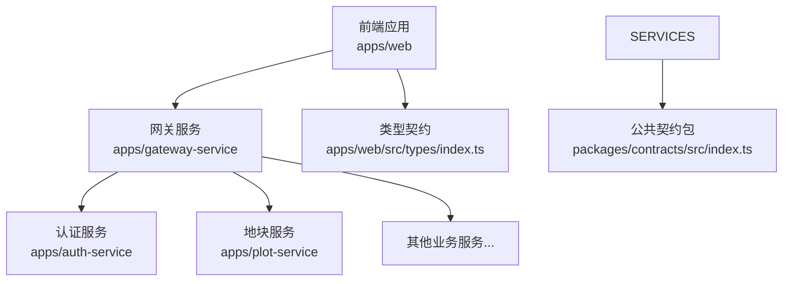
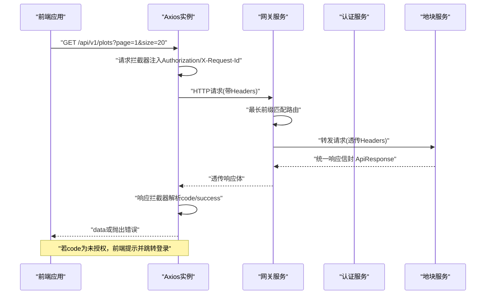
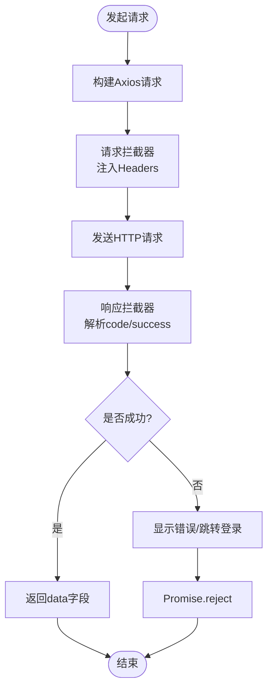
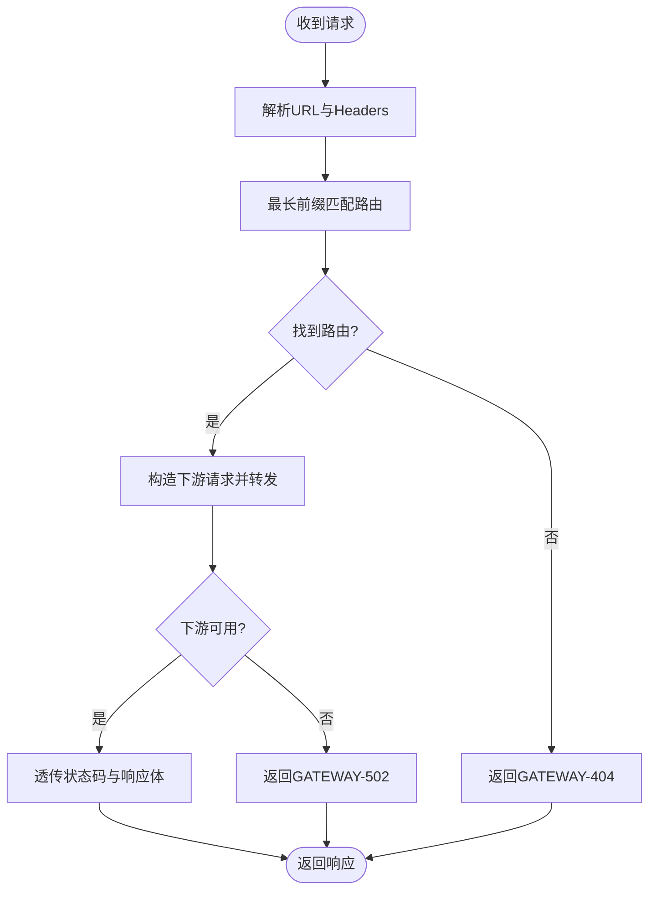
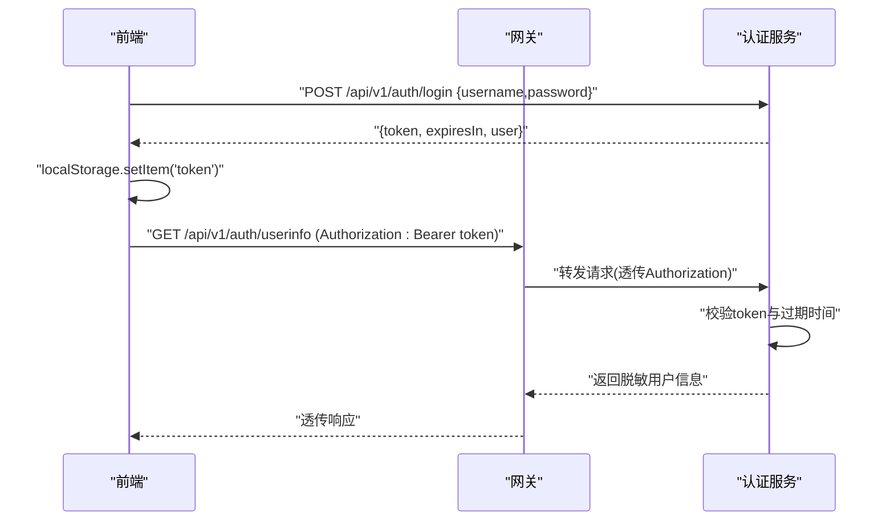
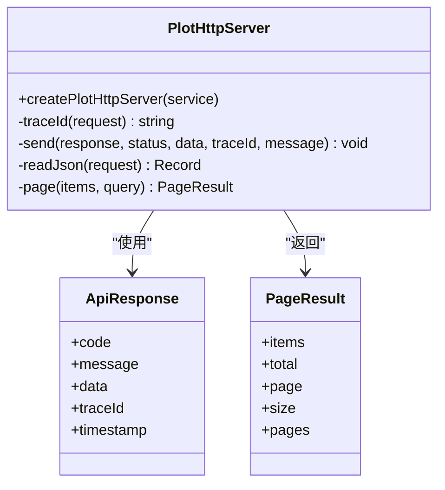
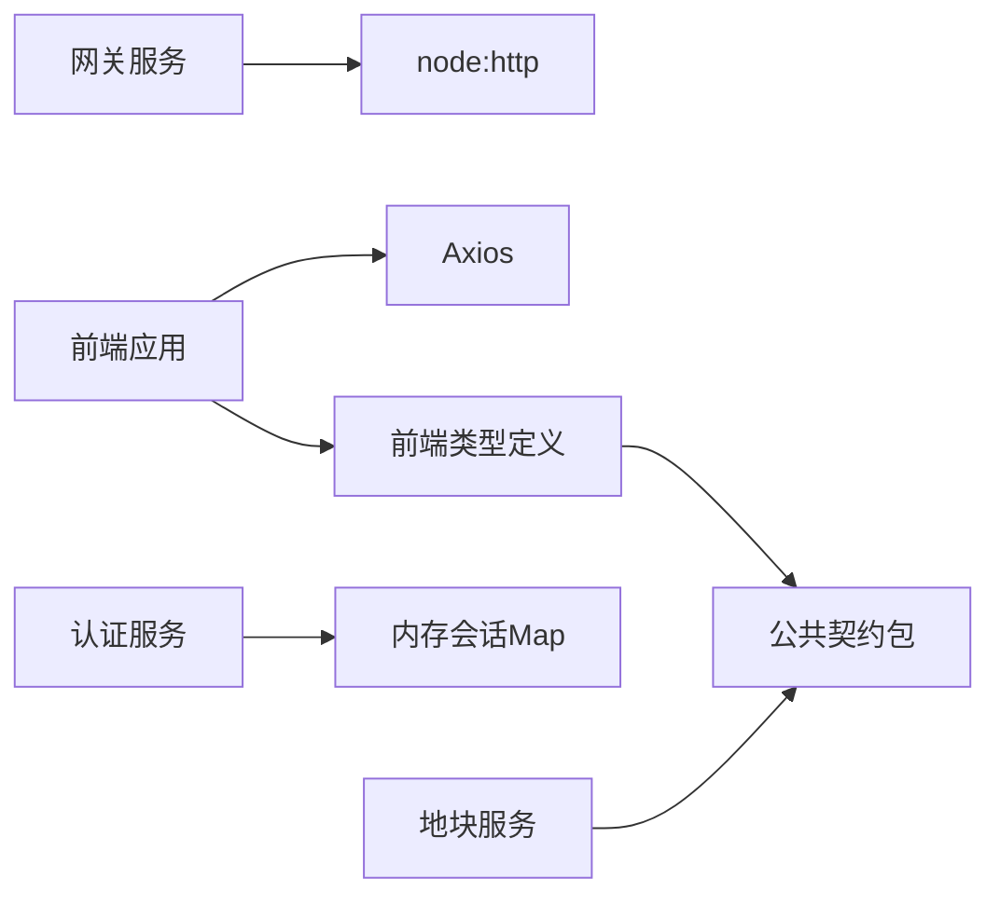

# API集成

<cite>
**本文引用的文件**   
- [apps/web/src/utils/request.ts](file://apps/web/src/utils/request.ts)
- [apps/web/src/types/index.ts](file://apps/web/src/types/index.ts)
- [apps/gateway-service/src/http.ts](file://apps/gateway-service/src/http.ts)
- [apps/auth-service/src/http.ts](file://apps/auth-service/src/http.ts)
- [apps/plot-service/src/http.ts](file://apps/plot-service/src/http.ts)
- [packages/contracts/src/index.ts](file://packages/contracts/src/index.ts)
- [README.md](file://README.md)
</cite>

## 目录
1. [简介](#简介)
2. [项目结构](#项目结构)
3. [核心组件](#核心组件)
4. [架构总览](#架构总览)
5. [详细组件分析](#详细组件分析)
6. [依赖关系分析](#依赖关系分析)
7. [性能与优化](#性能与优化)
8. [故障排查指南](#故障排查指南)
9. [结论](#结论)
10. [附录：API接口定义与类型契约](#附录api接口定义与类型契约)

## 简介
本文件面向智慧农业平台的前后端集成，聚焦以下目标：
- HTTP请求封装、拦截器配置与错误处理机制
- RESTful API调用规范、参数校验与响应数据格式化
- 认证授权流程、Token管理与会话维护
- 请求重试、超时处理与网络异常恢复策略
- API接口定义、类型安全与Mock数据支持
- 性能优化：请求合并、缓存机制与懒加载

本项目采用前后端分离架构：前端基于Vue3 + Element Plus，通过Axios统一发起HTTP请求；网关服务负责路由转发；认证服务提供登录、鉴权与会话管理；业务服务（如地块服务）实现领域接口。公共契约包集中定义跨端共享的类型与响应信封。

## 项目结构
从API集成视角，关键目录与职责如下：
- apps/web：前端应用，包含请求封装、类型定义与页面逻辑
- apps/gateway-service：网关服务，统一入口、路由转发与透传上下文
- apps/auth-service：认证服务，提供登录、用户信息与登出
- apps/plot-service：示例业务服务，演示REST接口、分页与错误码
- packages/contracts：公共契约包，定义跨端共享的响应信封、枚举与DTO



**图示来源**
- [apps/web/src/utils/request.ts:5-11](file://apps/web/src/utils/request.ts#L5-L11)
- [apps/gateway-service/src/http.ts:6-23](file://apps/gateway-service/src/http.ts#L6-L23)
- [apps/auth-service/src/http.ts:14-20](file://apps/auth-service/src/http.ts#L14-L20)
- [apps/plot-service/src/http.ts:40-104](file://apps/plot-service/src/http.ts#L40-L104)
- [packages/contracts/src/index.ts:1-12](file://packages/contracts/src/index.ts#L1-L12)

**章节来源**
- [README.md:58-84](file://README.md#L58-L84)

## 核心组件
- 前端请求封装：Axios实例、请求/响应拦截器、通用方法get/post/put/del
- 网关服务：默认路由表、最长前缀匹配、下游转发、错误包装
- 认证服务：登录、获取用户信息、登出、会话存储与过期控制
- 业务服务（以地块为例）：统计、边界、CRUD、分页、错误码与traceId透传
- 类型契约：ApiResponse/PageResult等通用类型，以及领域模型与枚举

**章节来源**
- [apps/web/src/utils/request.ts:5-109](file://apps/web/src/utils/request.ts#L5-L109)
- [apps/gateway-service/src/http.ts:4-40](file://apps/gateway-service/src/http.ts#L4-L40)
- [apps/auth-service/src/http.ts:6-20](file://apps/auth-service/src/http.ts#L6-L20)
- [apps/plot-service/src/http.ts:9-104](file://apps/plot-service/src/http.ts#L9-L104)
- [apps/web/src/types/index.ts:1-313](file://apps/web/src/types/index.ts#L1-L313)
- [packages/contracts/src/index.ts:1-12](file://packages/contracts/src/index.ts#L1-L12)

## 架构总览
下图展示一次典型API调用的端到端流程：前端通过Axios发起请求，携带Authorization与X-Request-Id；网关根据路径前缀转发到对应服务；认证服务负责鉴权与会话；业务服务返回统一响应信封。



**图示来源**
- [apps/web/src/utils/request.ts:13-35](file://apps/web/src/utils/request.ts#L13-L35)
- [apps/web/src/utils/request.ts:37-86](file://apps/web/src/utils/request.ts#L37-L86)
- [apps/gateway-service/src/http.ts:27-39](file://apps/gateway-service/src/http.ts#L27-L39)
- [apps/plot-service/src/http.ts:16-20](file://apps/plot-service/src/http.ts#L16-L20)

## 详细组件分析

### 前端请求封装与拦截器
- Axios实例配置：基础URL、超时、Content-Type
- 请求拦截器：自动注入Authorization、X-User-Id、X-Request-Id
- 响应拦截器：统一判断code/success，失败时显示消息；对401进行登录过期处理
- 通用方法：get/post/put/del，泛型T保证类型安全



**图示来源**
- [apps/web/src/utils/request.ts:5-11](file://apps/web/src/utils/request.ts#L5-L11)
- [apps/web/src/utils/request.ts:13-35](file://apps/web/src/utils/request.ts#L13-L35)
- [apps/web/src/utils/request.ts:37-86](file://apps/web/src/utils/request.ts#L37-L86)

**章节来源**
- [apps/web/src/utils/request.ts:5-109](file://apps/web/src/utils/request.ts#L5-L109)

### 网关服务路由与转发
- 默认路由表：按前缀映射到各业务服务地址
- 最长前缀优先匹配：避免更具体路径被短前缀抢先匹配
- 透传上下文：Authorization、X-Request-Id、X-Tenant-Id、X-User-Id等
- 错误包装：下游不可用返回GATEWAY-502



**图示来源**
- [apps/gateway-service/src/http.ts:6-23](file://apps/gateway-service/src/http.ts#L6-L23)
- [apps/gateway-service/src/http.ts:27-39](file://apps/gateway-service/src/http.ts#L27-L39)

**章节来源**
- [apps/gateway-service/src/http.ts:4-40](file://apps/gateway-service/src/http.ts#L4-L40)

### 认证服务与Token管理
- 登录：用户名密码校验，生成随机token，写入内存会话Map，设置过期时间
- 用户信息：校验Authorization中的Bearer token，返回脱敏用户信息
- 登出：删除对应token会话
- 鉴权：authorized函数检查token存在性与过期时间



**图示来源**
- [apps/auth-service/src/http.ts:6-20](file://apps/auth-service/src/http.ts#L6-L20)

**章节来源**
- [apps/auth-service/src/http.ts:6-20](file://apps/auth-service/src/http.ts#L6-L20)

### 业务服务接口（以地块为例）
- 健康检查：/health
- 统计接口：/api/v1/plots/stats
- 边界接口：/api/v1/plots/bounds
- 列表接口：/api/v1/plots GET，支持分页与关键词过滤
- 详情接口：/api/v1/plots/{parcelCode}
- 创建接口：/api/v1/plots POST
- 更新接口：/api/v1/plots/{parcelCode} PUT
- 删除接口：/api/v1/plots/{parcelCode} DELETE
- 统一响应：ApiResponse，含code/message/data/traceId/timestamp
- 分页：PageResult，限制每页最大200



**图示来源**
- [apps/plot-service/src/http.ts:9-38](file://apps/plot-service/src/http.ts#L9-L38)
- [apps/plot-service/src/http.ts:40-104](file://apps/plot-service/src/http.ts#L40-L104)

**章节来源**
- [apps/plot-service/src/http.ts:9-104](file://apps/plot-service/src/http.ts#L9-L104)

### 类型安全与Mock数据支持
- 类型契约：ApiResponse、PageResult、领域模型与枚举在前端types中集中定义
- 类型安全：Axios泛型T确保返回值类型正确
- Mock建议：在测试或开发阶段，可使用本地JSON或内存数据模拟后端响应，保持与真实接口一致的响应结构

```mermaid
erDiagram
API_RESPONSE {
number|string code
string message
any data
number timestamp
}
PAGE_RESULT {
array items
number total
number page
number size
number pages
}
PLOT {
string id
string parcelCode
string name
number areaMu
string soilType
string createdAt
string updatedAt
}
DEVICE {
string id
string deviceCode
string name
string type
string status
}
FARM_TASK {
string id
string taskName
string parcelCode
string status
string planStartDate
string planEndDate
}
```

**图示来源**
- [apps/web/src/types/index.ts:1-313](file://apps/web/src/types/index.ts#L1-L313)

**章节来源**
- [apps/web/src/types/index.ts:1-313](file://apps/web/src/types/index.ts#L1-L313)

## 依赖关系分析
- 前端依赖Axios与Element Plus，统一封装请求与错误提示
- 网关服务依赖Node原生http模块与环境变量配置
- 认证服务依赖内存Map存储会话，简单但非持久化
- 业务服务依赖公共契约包定义响应信封与分页结构
- 公共契约包仅导出类型与枚举，不依赖能力包，便于前后端共享



**图示来源**
- [apps/web/src/utils/request.ts:1-11](file://apps/web/src/utils/request.ts#L1-L11)
- [apps/gateway-service/src/http.ts:1-4](file://apps/gateway-service/src/http.ts#L1-L4)
- [apps/auth-service/src/http.ts:6-8](file://apps/auth-service/src/http.ts#L6-L8)
- [apps/plot-service/src/http.ts:4-7](file://apps/plot-service/src/http.ts#L4-L7)
- [packages/contracts/src/index.ts:1-12](file://packages/contracts/src/index.ts#L1-L12)

**章节来源**
- [apps/web/src/utils/request.ts:1-11](file://apps/web/src/utils/request.ts#L1-L11)
- [apps/gateway-service/src/http.ts:1-4](file://apps/gateway-service/src/http.ts#L1-L4)
- [apps/auth-service/src/http.ts:6-8](file://apps/auth-service/src/http.ts#L6-L8)
- [apps/plot-service/src/http.ts:4-7](file://apps/plot-service/src/http.ts#L4-L7)
- [packages/contracts/src/index.ts:1-12](file://packages/contracts/src/index.ts#L1-L12)

## 性能与优化
- 请求合并：可在Axios层引入轻量队列，将短时间内的重复请求合并，减少带宽与后端压力
- 缓存机制：对只读接口（如地块统计、设备列表）增加浏览器缓存（ETag/Last-Modified）或内存缓存（按URL+参数键）
- 懒加载：路由级与组件级按需加载，减少首屏体积；图表与地图组件按需初始化
- 分页与限流：服务端分页上限200，前端合理设置size；对高频接口做防抖/节流
- 连接复用：Axios默认复用TCP连接，避免频繁握手开销
- 压缩传输：网关与服务端启用gzip/br压缩，降低带宽占用

[本节为通用指导，不直接分析具体文件]

## 故障排查指南
- 未授权（401）：前端拦截器会提示并跳转登录；检查Authorization头是否正确注入，确认token未过期
- 网络错误：无response或request为空时，提示“服务器无响应”；检查网关可达性与DNS解析
- 参数错误（400）：检查请求体是否为JSON对象，字段类型是否符合类型定义
- 资源不存在（404）：检查URL路径与前缀匹配，确认网关路由配置正确
- 服务器内部错误（500）：查看服务日志，定位异常堆栈；必要时开启链路追踪ID（X-Request-Id）

**章节来源**
- [apps/web/src/utils/request.ts:37-86](file://apps/web/src/utils/request.ts#L37-L86)
- [apps/gateway-service/src/http.ts:27-39](file://apps/gateway-service/src/http.ts#L27-L39)
- [apps/plot-service/src/http.ts:100-103](file://apps/plot-service/src/http.ts#L100-L103)

## 结论
本平台的API集成方案以Axios为中心，结合网关路由转发与统一响应信封，实现了清晰的请求封装、鉴权透传与错误处理。类型契约在前端与后端共享，保障类型安全。当前实现已覆盖认证、路由、分页与基本错误处理；后续可在此基础上扩展重试、缓存与性能优化策略，以满足更高并发与稳定性要求。

[本节为总结性内容，不直接分析具体文件]

## 附录：API接口定义与类型契约

### 认证接口
- POST /api/v1/auth/login
  - 请求体：{ username, password }
  - 响应：{ token, expiresIn, user }
- GET /api/v1/auth/userinfo
  - 头部：Authorization: Bearer <token>
  - 响应：脱敏用户信息
- POST /api/v1/auth/logout
  - 头部：Authorization: Bearer <token>
  - 响应：空数据

**章节来源**
- [apps/auth-service/src/http.ts:14-20](file://apps/auth-service/src/http.ts#L14-L20)

### 网关健康检查
- GET /health
  - 响应：{ code: "OK", data: { status: "ok", service: "gateway" }, timestamp }

**章节来源**
- [apps/gateway-service/src/http.ts:27-33](file://apps/gateway-service/src/http.ts#L27-L33)

### 地块服务接口
- GET /api/v1/plots/stats
  - 响应：{ totalPlots, totalAreaMu, soilTypes[] }
- GET /api/v1/plots/bounds
  - 响应：[{ parcelCode, parcelName, areaMu, geom }]
- GET /api/v1/plots
  - 查询参数：page, size, keyword
  - 响应：PageResult<PlotRecord>
- GET /api/v1/plots/{parcelCode}
  - 响应：PlotRecord
- POST /api/v1/plots
  - 请求体：RegisterPlotInput
  - 响应：PlotRecord
- PUT /api/v1/plots/{parcelCode}
  - 请求体：PlotPatch
  - 响应：PlotRecord
- DELETE /api/v1/plots/{parcelCode}
  - 响应：空数据

**章节来源**
- [apps/plot-service/src/http.ts:45-98](file://apps/plot-service/src/http.ts#L45-L98)

### 通用类型
- ApiResponse：code、message、data、traceId、timestamp
- PageResult：items、total、page、size、pages
- 领域模型：Plot、Device、FarmTask、UserInfo等

**章节来源**
- [apps/web/src/types/index.ts:1-313](file://apps/web/src/types/index.ts#L1-L313)
- [packages/contracts/src/index.ts:1-12](file://packages/contracts/src/index.ts#L1-L12)