# 前端应用文档

<cite>
**本文引用的文件**   
- [apps/web/package.json](file://apps/web/package.json)
- [apps/web/src/main.ts](file://apps/web/src/main.ts)
- [apps/web/vite.config.ts](file://apps/web/vite.config.ts)
- [apps/web/src/App.vue](file://apps/web/src/App.vue)
- [apps/web/src/router/index.ts](file://apps/web/src/router/index.ts)
- [apps/web/src/layouts/MainLayout.vue](file://apps/web/src/layouts/MainLayout.vue)
- [apps/web/src/views/dashboard/Index.vue](file://apps/web/src/views/dashboard/Index.vue)
- [apps/web/src/views/agro/Index.vue](file://apps/web/src/views/agro/Index.vue)
- [apps/web/src/views/zone/Index.vue](file://apps/web/src/views/zone/Index.vue)
- [apps/web/src/views/irrigation/Index.vue](file://apps/web/src/views/irrigation/Index.vue)
- [apps/web/src/views/farm/Navigation.vue](file://apps/web/src/views/farm/Navigation.vue)
- [apps/web/src/views/plot/List.vue](file://apps/web/src/views/plot/List.vue)
- [apps/web/src/views/device/List.vue](file://apps/web/src/views/device/List.vue)
- [apps/web/src/views/finance/Index.vue](file://apps/web/src/views/finance/Index.vue)
- [apps/web/src/views/system/User.vue](file://apps/web/src/views/system/User.vue)
- [apps/web/src/views/system/Role.vue](file://apps/web/src/views/system/Role.vue)
- [apps/web/src/views/trace/Index.vue](file://apps/web/src/views/trace/Index.vue)
- [apps/web/src/api/index.ts](file://apps/web/src/api/index.ts)
- [apps/web/src/utils/request.ts](file://apps/web/src/utils/request.ts)
- [apps/web/src/types/index.ts](file://apps/web/src/types/index.ts)
- [apps/web/src/stores/index.ts](file://apps/web/src/stores/index.ts)
- [apps/web/src/utils/permission.ts](file://apps/web/src/utils/permission.ts)
</cite>

## 更新摘要
**变更内容**   
- **用户界面现代化改造**：将多个模块的内联表单转换为专用模态对话框，提升用户体验
- **增强表单验证**：新增完善的表单验证规则，包括必填字段、格式校验和业务逻辑验证
- **加载状态优化**：为所有异步操作添加适当的加载状态指示器
- **权限控制强化**：实现基于角色的访问控制，支持细粒度的权限管理
- **交互体验改进**：统一的模态对话框设计，包含确认对话框、错误处理和成功反馈

## 目录
1. [简介](#简介)
2. [项目结构](#项目结构)
3. [核心组件](#核心组件)
4. [架构总览](#架构总览)
5. [详细组件分析](#详细组件分析)
6. [权限控制系统](#权限控制系统)
7. [依赖关系分析](#依赖关系分析)
8. [性能与可维护性](#性能与可维护性)
9. [故障排查指南](#故障排查指南)
10. [结论](#结论)
11. [附录：开发规范与样式定制](#附录开发规范与样式定制)

## 简介
本仓库的前端工程位于 apps/web，采用 Vue3 + Element Plus + Leaflet + ECharts 技术栈，面向智慧农业平台提供多模块管理界面。核心能力包括：
- **数据看板**：天地图底图、地块边界可视化、设备点位标记、运行指标与趋势面板
- **农情监控**：苗情覆盖度监测、虫害识别处理、灾情告警管理、阈值规则配置
- **片区管理**：地块分组管理、地图可视化、凸包计算、成员地块分配
- **灌溉规划**：水肥配比计算、变量灌溉方案、时序排程、累计供水曲线
- **田间导航**：作业站点选择、路线规划、机耕道识别、导航方案展示
- **地块管理**：列表查询、分页、新增/编辑/删除、批量操作
- **设备监控**：设备列表、状态展示、指令下发与刷新
- **财务报表**：投入产出登记、汇总统计
- **溯源管理**：追溯记录查询、新增、详情查看
- **系统管理**：用户信息、角色权限展示
- API 集成：统一的请求封装、鉴权头注入、错误处理与响应解包
- 地图可视化：Leaflet 集成、图层切换、GeoJSON 地块边界渲染

## 项目结构
前端工程以功能域划分视图与路由，使用 Pinia 进行状态管理（当前示例中布局侧边栏折叠等由 store 驱动），Element Plus 提供 UI 组件，Leaflet 负责地图渲染，ECharts 用于图表展示（在部分页面扩展）。

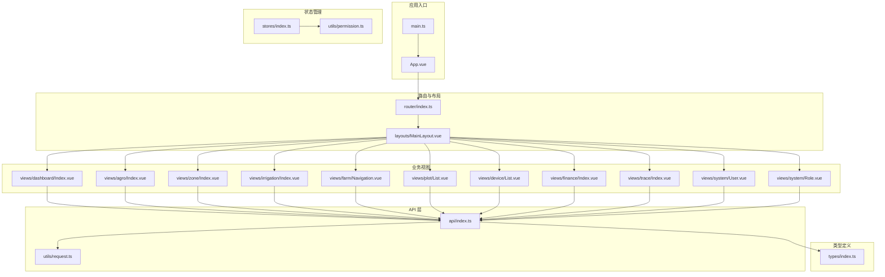

图示来源
- [apps/web/src/main.ts:1-24](file://apps/web/src/main.ts#L1-L24)
- [apps/web/src/App.vue:1-14](file://apps/web/src/App.vue#L1-L14)
- [apps/web/src/router/index.ts:1-210](file://apps/web/src/router/index.ts#L1-L210)
- [apps/web/src/layouts/MainLayout.vue:1-195](file://apps/web/src/layouts/MainLayout.vue#L1-L195)
- [apps/web/src/views/dashboard/Index.vue:1-280](file://apps/web/src/views/dashboard/Index.vue#L1-L280)
- [apps/web/src/views/agro/Index.vue:1-416](file://apps/web/src/views/agro/Index.vue#L1-L416)
- [apps/web/src/views/zone/Index.vue:1-372](file://apps/web/src/views/zone/Index.vue#L1-L372)
- [apps/web/src/views/irrigation/Index.vue:1-197](file://apps/web/src/views/irrigation/Index.vue#L1-L197)
- [apps/web/src/views/farm/Navigation.vue:1-299](file://apps/web/src/views/farm/Navigation.vue#L1-L299)
- [apps/web/src/views/plot/List.vue:1-351](file://apps/web/src/views/plot/List.vue#L1-L351)
- [apps/web/src/views/device/List.vue:1-621](file://apps/web/src/views/device/List.vue#L1-L621)
- [apps/web/src/views/finance/Index.vue:1-202](file://apps/web/src/views/finance/Index.vue#L1-L202)
- [apps/web/src/views/trace/Index.vue:1-162](file://apps/web/src/views/trace/Index.vue#L1-L162)
- [apps/web/src/views/system/User.vue:1-235](file://apps/web/src/views/system/User.vue#L1-L235)
- [apps/web/src/views/system/Role.vue:1-240](file://apps/web/src/views/system/Role.vue#L1-L240)
- [apps/web/src/api/index.ts:1-607](file://apps/web/src/api/index.ts#L1-L607)
- [apps/web/src/utils/request.ts:1-109](file://apps/web/src/utils/request.ts#L1-L109)
- [apps/web/src/types/index.ts:1-313](file://apps/web/src/types/index.ts#L1-L313)
- [apps/web/src/stores/index.ts:1-75](file://apps/web/src/stores/index.ts#L1-L75)
- [apps/web/src/utils/permission.ts:1-30](file://apps/web/src/utils/permission.ts#L1-L30)

章节来源
- [apps/web/package.json:1-37](file://apps/web/package.json#L1-L37)
- [apps/web/src/main.ts:1-24](file://apps/web/src/main.ts#L1-L24)
- [apps/web/vite.config.ts:1-32](file://apps/web/vite.config.ts#L1-L32)

## 核心组件
- 应用初始化与插件注册：Vue3 应用创建、Pinia、Element Plus（含中文语言包）、Leaflet 样式引入、全局图标注册
- 路由与导航守卫：基于 vue-router 的模块化路由、菜单元信息驱动侧边栏、登录态校验与重定向
- 主布局：侧边栏折叠、面包屑、用户下拉菜单、内容区路由出口
- 数据访问层：统一 axios 实例、请求/响应拦截器、通用 get/post/put/del 方法
- API 模块：按领域划分的接口集合（认证、地块、片区、设备、遥测、天气、财务、视频、控制、农事、导航等）
- 类型定义：统一的数据模型、枚举、分页结构、看板统计、遥测告警、灌溉计划、导航方案等
- **权限管理系统**：基于角色的访问控制，支持细粒度权限检查和权限缓存
- **模态对话框系统**：统一的对话框设计模式，包含表单验证、加载状态和错误处理

章节来源
- [apps/web/src/main.ts:1-24](file://apps/web/src/main.ts#L1-L24)
- [apps/web/src/router/index.ts:1-210](file://apps/web/src/router/index.ts#L1-L210)
- [apps/web/src/layouts/MainLayout.vue:1-195](file://apps/web/src/layouts/MainLayout.vue#L1-L195)
- [apps/web/src/utils/request.ts:1-109](file://apps/web/src/utils/request.ts#L1-L109)
- [apps/web/src/api/index.ts:1-607](file://apps/web/src/api/index.ts#L1-L607)
- [apps/web/src/types/index.ts:1-313](file://apps/web/src/types/index.ts#L1-L313)
- [apps/web/src/stores/index.ts:1-75](file://apps/web/src/stores/index.ts#L1-L75)
- [apps/web/src/utils/permission.ts:1-30](file://apps/web/src/utils/permission.ts#L1-L30)

## 架构总览
前端采用"视图层 + 路由层 + 布局层 + API 层 + 工具层 + 类型层 + 权限层"的分层架构。视图层通过 API 层调用后端服务；API 层通过请求封装统一处理鉴权、错误提示与响应解包；类型层为前后端交互提供强类型约束；权限层提供细粒度的访问控制。

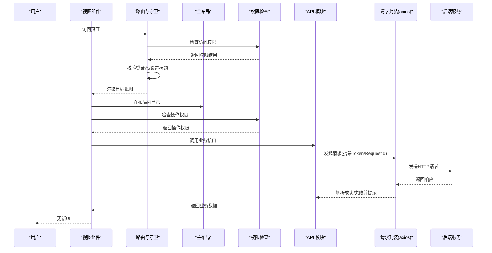

图示来源
- [apps/web/src/router/index.ts:193-207](file://apps/web/src/router/index.ts#L193-L207)
- [apps/web/src/utils/request.ts:13-86](file://apps/web/src/utils/request.ts#L13-L86)
- [apps/web/src/utils/permission.ts:7-11](file://apps/web/src/utils/permission.ts#L7-L11)
- [apps/web/src/stores/index.ts:39-42](file://apps/web/src/stores/index.ts#L39-L42)
- [apps/web/src/api/index.ts:1-607](file://apps/web/src/api/index.ts#L1-L607)

## 详细组件分析

### 仪表盘页面（数据看板）
- 地图可视化：基于 Leaflet 加载天地图瓦片，支持影像/矢量底图切换；设备点位与地块边界作为独立图层，支持显隐控制
- 地块边界渲染：将服务端地块 GeoJSON 转换为 Leaflet Polygon，绑定 Tooltip 显示名称、面积与作物信息；无数据时回退到演示边界
- 指标聚合：根据地块面积计算总量、作物占比；结合设备在线数、遥测告警数量、气象预报摘要形成看板指标
- 趋势面板：预留近 7 日趋势区域，便于接入 ECharts 或 CSS 图形

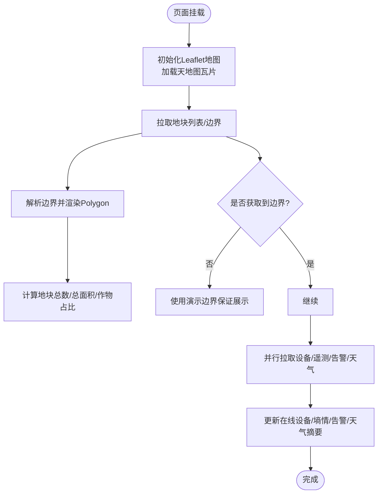

图示来源
- [apps/web/src/views/dashboard/Index.vue:142-150](file://apps/web/src/views/dashboard/Index.vue#L142-L150)
- [apps/web/src/views/dashboard/Index.vue:105-129](file://apps/web/src/views/dashboard/Index.vue#L105-L129)
- [apps/web/src/views/dashboard/Index.vue:152-171](file://apps/web/src/views/dashboard/Index.vue#L152-L171)
- [apps/web/src/views/dashboard/Index.vue:173-189](file://apps/web/src/views/dashboard/Index.vue#L173-L189)
- [apps/web/src/views/dashboard/Index.vue:220-243](file://apps/web/src/views/dashboard/Index.vue#L220-L243)

章节来源
- [apps/web/src/views/dashboard/Index.vue:1-280](file://apps/web/src/views/dashboard/Index.vue#L1-L280)

### 农情监控仪表盘（四情监控）
**现代化改造** 完整的农情监控解决方案，涵盖苗情、虫情、灾情和阈值规则管理，所有操作都通过模态对话框进行。

- **苗情监测**：实时显示土壤含水率、空气温湿度、风速、降雨量、苗情覆盖度等关键指标
- **虫害管理**：支持虫害识别结果登记、置信度评估、处置状态跟踪，通过模态对话框进行登记
- **灾情告警**：分级告警管理（提示/预警/严重），支持告警处理和消息推送
- **阈值规则**：灵活的阈值配置界面，支持高于/低于判定方向，启用/禁用开关控制，通过模态对话框进行编辑

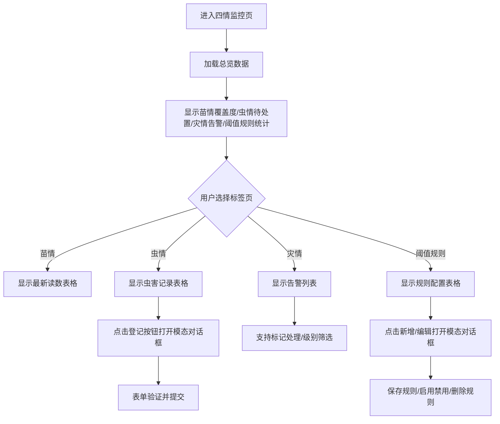

图示来源
- [apps/web/src/views/agro/Index.vue:127-180](file://apps/web/src/views/agro/Index.vue#L127-L180)
- [apps/web/src/views/agro/Index.vue:223-241](file://apps/web/src/views/agro/Index.vue#L223-L241)
- [apps/web/src/views/agro/Index.vue:246-256](file://apps/web/src/views/agro/Index.vue#L246-L256)
- [apps/web/src/views/agro/Index.vue:294-322](file://apps/web/src/views/agro/Index.vue#L294-L322)

章节来源
- [apps/web/src/views/agro/Index.vue:1-416](file://apps/web/src/views/agro/Index.vue#L1-L416)
- [apps/web/src/api/index.ts:328-376](file://apps/web/src/api/index.ts#L328-L376)

### 片区管理页面（地块分组）
**现代化改造** 完整的片区管理解决方案，支持地块分组、地图可视化和凸包计算。

- **片区台账**：左侧列表展示所有片区，支持新建、编辑、删除操作
- **地图可视化**：右侧地图显示片区边界和成员地块，支持天地图底图切换
- **凸包计算**：自动计算成员地块的凸包作为片区边界，无需手动测绘
- **地块分配**：支持将地块划入或移出片区，实时更新地图显示

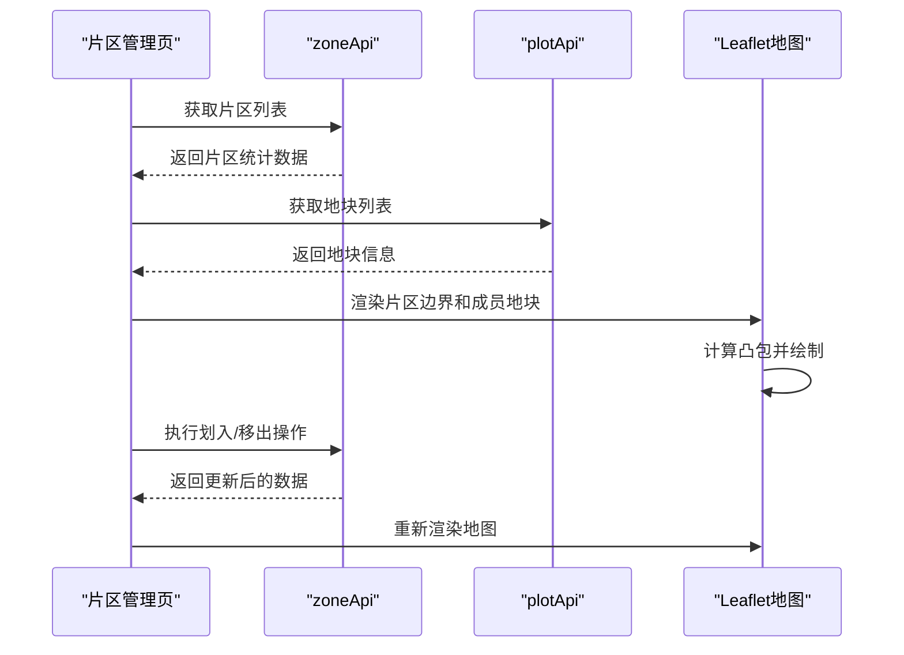

图示来源
- [apps/web/src/views/zone/Index.vue:192-203](file://apps/web/src/views/zone/Index.vue#L192-L203)
- [apps/web/src/views/zone/Index.vue:162-190](file://apps/web/src/views/zone/Index.vue#L162-L190)
- [apps/web/src/views/zone/Index.vue:298-313](file://apps/web/src/views/zone/Index.vue#L298-L313)

章节来源
- [apps/web/src/views/zone/Index.vue:1-372](file://apps/web/src/views/zone/Index.vue#L1-L372)
- [apps/web/src/api/index.ts:148-181](file://apps/web/src/api/index.ts#L148-L181)

### 灌溉规划页面（水肥配比）
**现代化改造** 变量灌溉和水肥配比规划工具，支持方案预演和指令下发。

- **分区管理**：动态添加/删除灌溉分区，设置各分区面积和灌水定额
- **水肥配比**：可选的水肥一体化配置，支持氮磷钾比例和搅拌参数设置
- **方案预演**：实时计算用水量、时长、施肥总量，生成累计供水曲线
- **指令下发**：确认方案后下发灌溉或施肥指令到执行设备

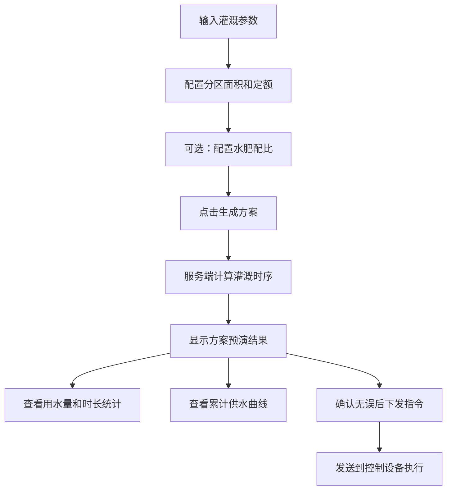

图示来源
- [apps/web/src/views/irrigation/Index.vue:132-151](file://apps/web/src/views/irrigation/Index.vue#L132-L151)
- [apps/web/src/views/irrigation/Index.vue:153-178](file://apps/web/src/views/irrigation/Index.vue#L153-L178)
- [apps/web/src/views/irrigation/Index.vue:109-122](file://apps/web/src/views/irrigation/Index.vue#L109-L122)

章节来源
- [apps/web/src/views/irrigation/Index.vue:1-197](file://apps/web/src/views/irrigation/Index.vue#L1-L197)
- [apps/web/src/api/index.ts:484-517](file://apps/web/src/api/index.ts#L484-L517)

### 田间导航页面（路线规划）
**现代化改造** 智能田间导航系统，支持作业路线规划和机耕道识别。

- **站点选择**：从地块列表中勾选作业站点，支持地图点选起点
- **路线规划**：基于最近邻算法和2-opt优化，生成最优作业顺序
- **机耕道识别**：自动识别机耕道路网，优先沿路行驶减少油耗
- **导航方案**：显示总里程、耗时、分段详情和可视化路线图

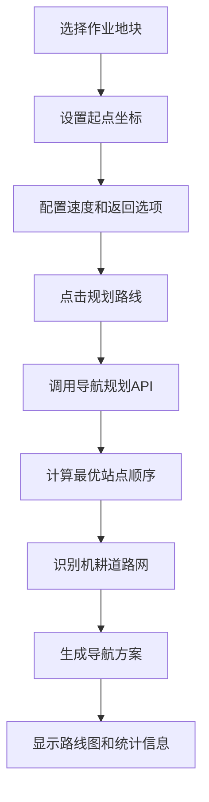

图示来源
- [apps/web/src/views/farm/Navigation.vue:222-247](file://apps/web/src/views/farm/Navigation.vue#L222-L247)
- [apps/web/src/views/farm/Navigation.vue:152-176](file://apps/web/src/views/farm/Navigation.vue#L152-L176)
- [apps/web/src/views/farm/Navigation.vue:178-200](file://apps/web/src/views/farm/Navigation.vue#L178-L200)

章节来源
- [apps/web/src/views/farm/Navigation.vue:1-299](file://apps/web/src/views/farm/Navigation.vue#L1-L299)
- [apps/web/src/api/index.ts:428-482](file://apps/web/src/api/index.ts#L428-L482)

### 地块管理页面（列表）
**现代化改造** 增强的地块管理功能，支持更丰富的筛选和操作。

- 查询与筛选：支持关键词、地块类型、状态、土壤类型、当前作物等多维度筛选
- 表格展示：分页、排序、标签化显示类型与状态
- 操作行为：新增跳转、编辑跳转、详情跳转、单删确认、批量删除
- 数据适配：对后端返回字段进行兼容映射（items/list 兼容）
- 导出功能：支持CSV格式的地块数据导出

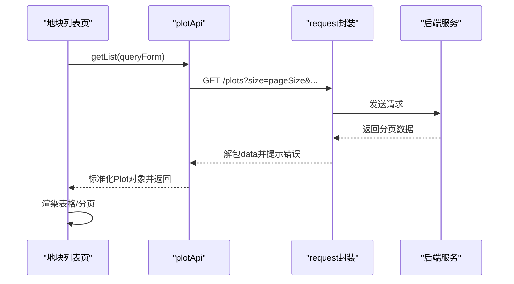

图示来源
- [apps/web/src/views/plot/List.vue:231-242](file://apps/web/src/views/plot/List.vue#L231-L242)
- [apps/web/src/api/index.ts:29-60](file://apps/web/src/api/index.ts#L29-L60)
- [apps/web/src/utils/request.ts:38-56](file://apps/web/src/utils/request.ts#L38-L56)

章节来源
- [apps/web/src/views/plot/List.vue:1-351](file://apps/web/src/views/plot/List.vue#L1-L351)
- [apps/web/src/api/index.ts:29-101](file://apps/web/src/api/index.ts#L29-L101)

### 设备监控页面（列表）
**现代化改造** 完整的设备管理解决方案，所有操作都通过模态对话框进行。

- 设备列表：支持名称/编号搜索、状态筛选
- 状态展示：在线/离线/故障/维护中，带颜色标签
- 交互操作：查看详情弹窗、下发配置指令、刷新设备最新状态
- 数据映射：将后端字段映射为表格列（如 serialNo、plotName、lastReportAt）
- **模态对话框**：包含设备详情、添加设备、设备配置、控制指令等多个专用对话框

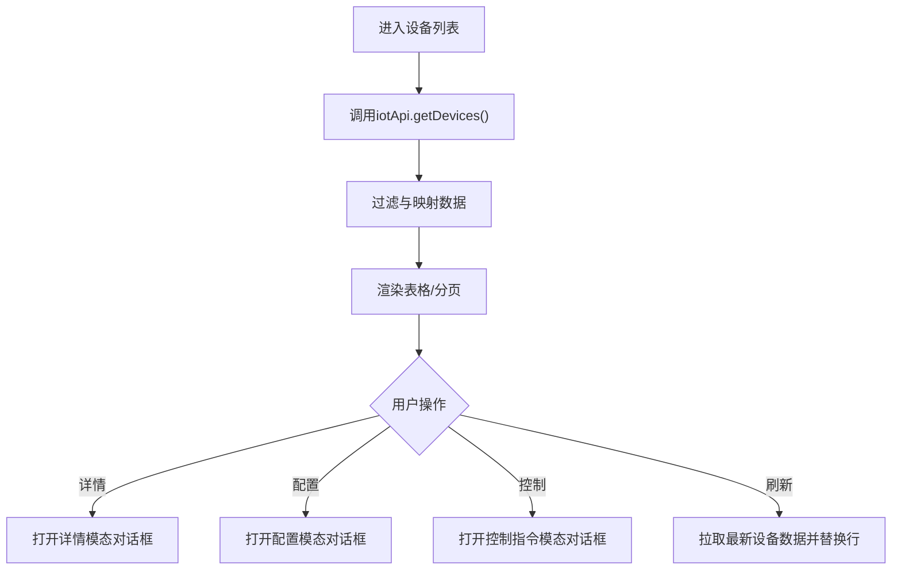

图示来源
- [apps/web/src/views/device/List.vue:77-240](file://apps/web/src/views/device/List.vue#L77-L240)
- [apps/web/src/api/index.ts:157-167](file://apps/web/src/api/index.ts#L157-L167)

章节来源
- [apps/web/src/views/device/List.vue:1-621](file://apps/web/src/views/device/List.vue#L1-L621)
- [apps/web/src/api/index.ts:157-167](file://apps/web/src/api/index.ts#L157-L167)

### 财务报表页面
**现代化改造** 增强的财务管理功能，通过模态对话框进行收支登记。

- 汇总卡片：投入合计、产出合计、利润
- 登记表单：地块编码、类型（投入/产出）、类别、金额、备注
- 数据表格：条目明细、时间格式化
- 并发请求：同时拉取条目与汇总数据
- **模态对话框**：专用的收支登记对话框，包含完整的表单验证

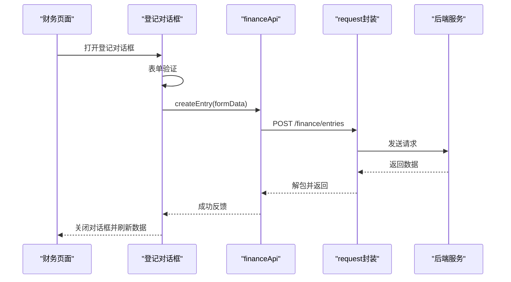

图示来源
- [apps/web/src/views/finance/Index.vue:72-104](file://apps/web/src/views/finance/Index.vue#L72-L104)
- [apps/web/src/views/finance/Index.vue:179-192](file://apps/web/src/views/finance/Index.vue#L179-L192)
- [apps/web/src/api/index.ts:223-233](file://apps/web/src/api/index.ts#L223-L233)

章节来源
- [apps/web/src/views/finance/Index.vue:1-202](file://apps/web/src/views/finance/Index.vue#L1-L202)
- [apps/web/src/api/index.ts:223-233](file://apps/web/src/api/index.ts#L223-L233)

### 溯源管理页面
**新增功能** 完整的溯源档案管理，通过模态对话框进行记录管理。

- 记录查询：支持地块编码、事件类型、关键词、时间范围筛选
- 记录展示：追溯码、地块编码、事件类型、详情、操作人、时间
- **模态对话框**：专用的新增记录对话框，包含完整的表单验证
- 权限控制：基于 trace:write 权限控制新增操作

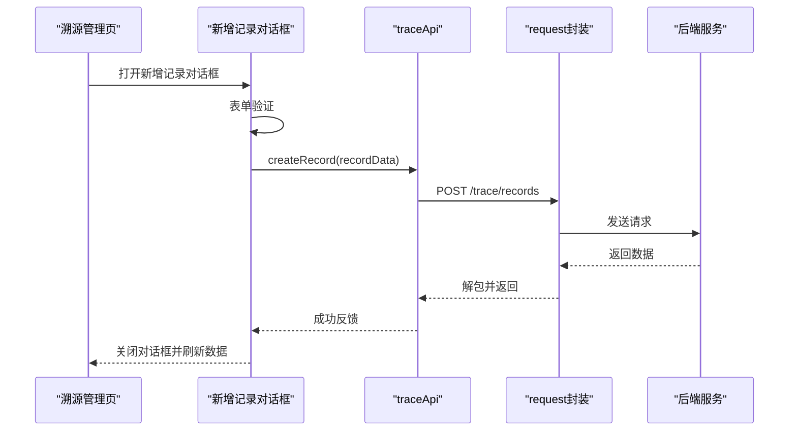

图示来源
- [apps/web/src/views/trace/Index.vue:69-92](file://apps/web/src/views/trace/Index.vue#L69-L92)
- [apps/web/src/views/trace/Index.vue:146-159](file://apps/web/src/views/trace/Index.vue#L146-L159)

章节来源
- [apps/web/src/views/trace/Index.vue:1-162](file://apps/web/src/views/trace/Index.vue#L1-L162)

### 系统管理页面（用户与角色）
**现代化改造** 增强的系统管理功能，通过模态对话框进行用户和角色管理。

- 用户信息：从认证接口获取当前用户信息并展示
- 角色权限：拉取平台角色列表与权限标签
- **模态对话框**：专用的用户编辑对话框和角色编辑对话框
- 权限管理：支持细粒度的权限选择和权限组管理

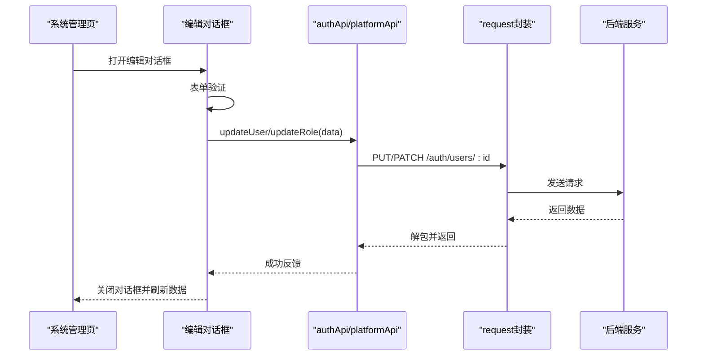

图示来源
- [apps/web/src/views/system/User.vue:71-96](file://apps/web/src/views/system/User.vue#L71-L96)
- [apps/web/src/views/system/Role.vue:79-95](file://apps/web/src/views/system/Role.vue#L79-L95)
- [apps/web/src/views/system/User.vue:186-223](file://apps/web/src/views/system/User.vue#L186-L223)
- [apps/web/src/views/system/Role.vue:224-227](file://apps/web/src/views/system/Role.vue#L224-L227)

章节来源
- [apps/web/src/views/system/User.vue:1-235](file://apps/web/src/views/system/User.vue#L1-L235)
- [apps/web/src/views/system/Role.vue:1-240](file://apps/web/src/views/system/Role.vue#L1-L240)
- [apps/web/src/api/index.ts:13-25](file://apps/web/src/api/index.ts#L13-L25)
- [apps/web/src/api/index.ts:169-173](file://apps/web/src/api/index.ts#L169-L173)

## 权限控制系统
**新增功能** 完整的基于角色的访问控制系统，支持细粒度的权限管理。

- **权限存储**：使用 Pinia Store 管理用户信息和权限状态
- **权限检查**：统一的权限检查函数，支持通配符匹配
- **权限缓存**：本地缓存用户信息和权限，避免频繁请求
- **权限分类**：按功能域组织权限，支持领域级和精确权限
- **前端控制**：基于权限控制按钮显示、表单操作和页面访问

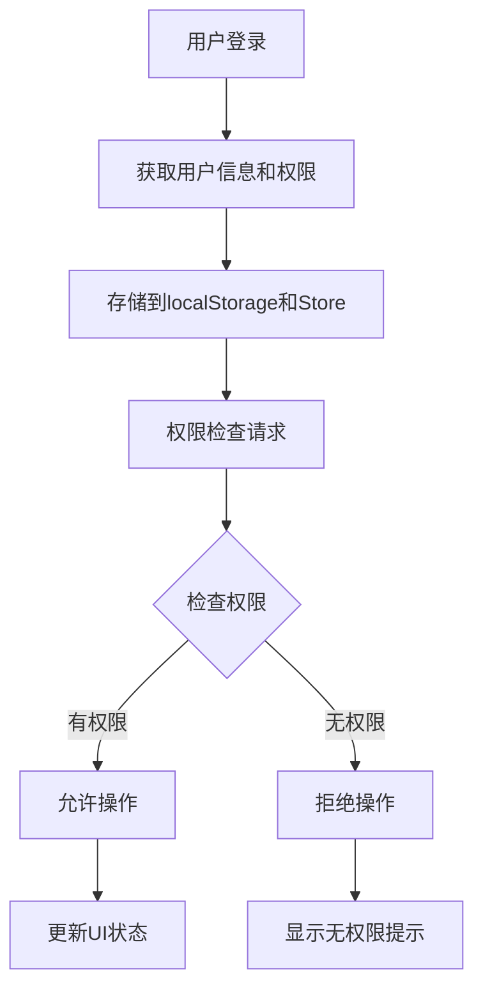

图示来源
- [apps/web/src/stores/index.ts:16-53](file://apps/web/src/stores/index.ts#L16-L53)
- [apps/web/src/utils/permission.ts:7-11](file://apps/web/src/utils/permission.ts#L7-L11)

章节来源
- [apps/web/src/stores/index.ts:1-75](file://apps/web/src/stores/index.ts#L1-L75)
- [apps/web/src/utils/permission.ts:1-30](file://apps/web/src/utils/permission.ts#L1-L30)

## 依赖关系分析
- 构建与开发：Vite 提供开发服务器与代理，端口 3000，代理 /api 与 /api/v1 至本地 8080
- 运行时依赖：Vue3、Element Plus、Leaflet、ECharts、Axios、Dayjs、Pinia、Vue Router、HLS.js
- 插件与工具：@element-plus/icons-vue 图标库、vite-plugin-vue-devtools

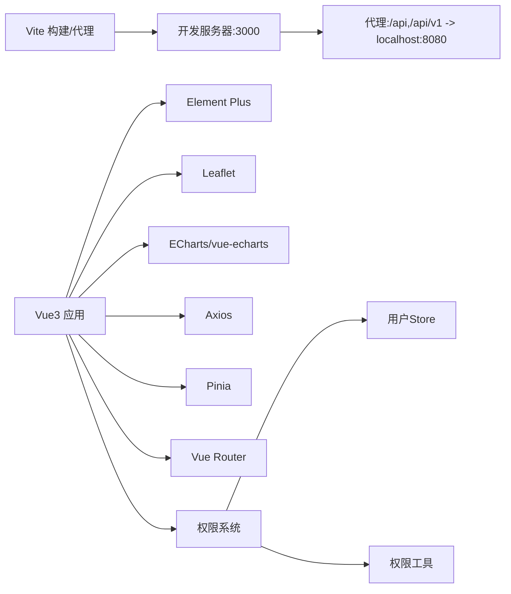

图示来源
- [apps/web/vite.config.ts:16-30](file://apps/web/vite.config.ts#L16-L30)
- [apps/web/package.json:12-25](file://apps/web/package.json#L12-L25)

章节来源
- [apps/web/vite.config.ts:1-32](file://apps/web/vite.config.ts#L1-L32)
- [apps/web/package.json:1-37](file://apps/web/package.json#L1-L37)

## 性能与可维护性
- 地图渲染优化
  - 使用 LayerGroup 管理设备与地块图层，按需添加/移除，避免重复绘制
  - 仅在有效地理范围时使用 fitBounds 自动缩放，减少不必要的重绘
  - 片区管理和导航页面使用独立的地图实例，避免相互干扰
- 数据加载策略
  - 仪表盘并行拉取设备、遥测、告警、天气数据，缩短首屏等待时间
  - 地块边界缺失时降级为演示边界，保障用户体验
  - 四情监控页面一次性加载所有相关数据，减少多次网络请求
- 请求封装
  - 统一超时、鉴权头、RequestId 注入，提升可观测性
  - 响应拦截器统一错误提示与 401 处理，降低各页面重复逻辑
- 类型安全
  - 全量类型定义覆盖分页、实体、看板统计、遥测告警、灌溉计划、导航方案等，减少运行时错误
- 可扩展性
  - API 模块按领域拆分，便于新增服务接口
  - 路由 meta 驱动菜单，新增页面仅需配置路由与元信息
  - 新的业务模块（农情、片区、灌溉、导航）遵循相同的组件结构和API调用模式
- **模态对话框优化**
  - 统一的对话框设计模式，减少重复代码
  - 表单验证集中管理，提高代码复用性
  - 加载状态统一管理，提升用户体验
- **权限控制优化**
  - 权限检查函数统一处理，避免重复逻辑
  - 权限缓存机制减少不必要的请求
  - 细粒度权限控制提升安全性

[本节为通用指导，不直接分析具体文件]

## 故障排查指南
- 网络与鉴权
  - 检查 localStorage 中的 token 是否存在且有效
  - 若出现 401，请求拦截器会提示并引导重新登录
- 代理与跨域
  - 开发环境确保 vite.config.ts 的代理规则正确指向后端地址
  - 生产环境需通过网关或反向代理转发 /api 与 /api/v1
- 地图相关
  - 确认天地图密钥环境变量已配置
  - 检查 Leaflet 样式是否被正确引入
  - 验证 GeoJSON 坐标格式是否正确（经纬度顺序）
- 数据异常
  - 查看控制台错误信息与 ElMessage 提示
  - 核对后端返回结构与 ApiResponse 约定（code/message/data）
  - 检查新接口的数据类型定义是否与后端一致
- 新功能问题
  - 四情监控：检查遥测服务是否正常，阈值规则配置是否完整
  - 片区管理：确认地块边界数据存在，凸包计算逻辑正常
  - 灌溉规划：验证分区面积和定额数据合理性，设备标识正确
  - 田间导航：检查机耕道路网数据，起点坐标有效性
- **权限相关问题**
  - 检查用户权限是否正确配置和缓存
  - 确认权限检查函数调用是否正确
  - 验证权限字符串格式是否符合规范
- **模态对话框问题**
  - 检查表单验证规则是否正确配置
  - 确认对话框状态管理是否正常工作
  - 验证表单提交和数据同步逻辑

章节来源
- [apps/web/src/utils/request.ts:13-86](file://apps/web/src/utils/request.ts#L13-L86)
- [apps/web/vite.config.ts:16-30](file://apps/web/vite.config.ts#L16-L30)
- [apps/web/src/main.ts:6-7](file://apps/web/src/main.ts#L6-L7)
- [apps/web/src/stores/index.ts:39-42](file://apps/web/src/stores/index.ts#L39-L42)
- [apps/web/src/utils/permission.ts:7-11](file://apps/web/src/utils/permission.ts#L7-L11)

## 结论
该前端工程以清晰的分层架构与完善的类型体系支撑了智慧农业平台的多种业务场景。通过统一的请求封装与错误处理、灵活的地图可视化方案以及按领域组织的 API 模块，既保证了开发效率，也提升了可维护性与扩展性。

**现代化改造的价值**：
- **模态对话框系统**提供了统一的交互体验，提升了用户操作的直观性和一致性
- **增强的表单验证**确保了数据的准确性和完整性，减少了用户输入错误
- **完善的权限控制**实现了细粒度的访问控制，提升了系统的安全性
- **优化的加载状态**改善了用户体验，让用户清楚了解操作进度

**新增功能的价值**：
- **农情监控**提供了完整的农业生产监测解决方案，从苗情到灾情的全方位管理
- **片区管理**实现了地块的智能分组和可视化，提升了土地管理效率
- **灌溉规划**支持精准农业的水肥一体化管理，提高资源利用效率
- **田间导航**优化了农机作业路径，降低了作业成本和能耗
- **溯源管理**完善了农产品追溯体系，提升了产品质量管控能力

后续可在图表可视化、实时数据推送、权限控制等方面持续增强，进一步完善智慧农业管理平台的功能体系。

[本节为总结性内容，不直接分析具体文件]

## 附录：开发规范与样式定制
- 组件开发规范
  - 视图组件遵循单一职责，复杂逻辑下沉至 API 层与工具函数
  - 表格类页面统一使用 Element Plus Table/Pagination，保持交互一致
  - 地图相关逻辑集中在视图或专用地图组件，避免散落在多处
  - 新增业务模块应遵循现有组件结构模式，保持一致的开发体验
- **模态对话框开发规范**
  - 使用统一的 el-dialog 组件，保持对话框样式和交互一致
  - 表单验证规则集中定义，使用 FormRules 类型确保类型安全
  - 加载状态统一管理，使用 loading 变量控制按钮状态
  - 错误处理统一使用 ElMessage 提示用户
- **权限控制开发规范**
  - 使用 userStore.hasPermission() 进行权限检查
  - 权限字符串遵循领域:操作的命名规范
  - 敏感操作前进行权限验证，避免越权访问
  - 权限变化时及时更新UI状态
- 样式定制
  - 全局样式入口位于 assets/styles/main.scss，建议在此集中定义主题变量与公共样式
  - 仪表盘深色主题样式通过 scoped SCSS 实现，注意与 Element Plus 默认样式隔离
  - 新功能页面应使用一致的样式类和布局模式
- 响应式设计
  - 仪表盘在小屏下调整侧边面板宽度与隐藏图例，保证可用性
  - 表格与表单在小屏下适当缩减列宽与间距
  - 片区管理和导航页面在小屏下调整为单列布局
- 地图集成要点
  - 在需要地图的页面引入 leaflet/dist/leaflet.css
  - 使用 L.map 初始化地图，L.tileLayer 加载天地图 WMTS 服务
  - 使用 L.polygon/L.layerGroup 渲染地块边界与设备点位，并通过 visibleLayers 控制显隐
  - 多个地图页面应使用独立的地图实例，避免状态冲突
- 新模块开发指导
  - 参考现有模块的结构组织方式
  - 在 API 层添加对应的接口定义和方法
  - 在路由配置中添加新的路由项和权限控制
  - 确保类型定义的完整性和一致性
  - 使用模态对话框进行数据录入和编辑操作
  - 实现完整的表单验证和错误处理

章节来源
- [apps/web/src/assets/styles/main.scss](file://apps/web/src/assets/styles/main.scss)
- [apps/web/src/views/dashboard/Index.vue:252-265](file://apps/web/src/views/dashboard/Index.vue#L252-L265)
- [apps/web/src/main.ts:6-7](file://apps/web/src/main.ts#L6-L7)
- [apps/web/src/views/agro/Index.vue:336-349](file://apps/web/src/views/agro/Index.vue#L336-L349)
- [apps/web/src/views/zone/Index.vue:349-372](file://apps/web/src/views/zone/Index.vue#L349-L372)
- [apps/web/src/views/irrigation/Index.vue:181-197](file://apps/web/src/views/irrigation/Index.vue#L181-L197)
- [apps/web/src/views/farm/Navigation.vue:282-299](file://apps/web/src/views/farm/Navigation.vue#L282-L299)
- [apps/web/src/views/finance/Index.vue:72-104](file://apps/web/src/views/finance/Index.vue#L72-L104)
- [apps/web/src/views/trace/Index.vue:69-92](file://apps/web/src/views/trace/Index.vue#L69-L92)
- [apps/web/src/stores/index.ts:39-42](file://apps/web/src/stores/index.ts#L39-L42)
- [apps/web/src/utils/permission.ts:7-11](file://apps/web/src/utils/permission.ts#L7-L11)