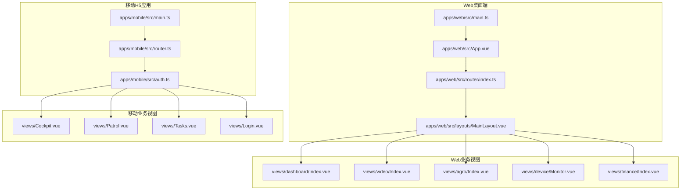
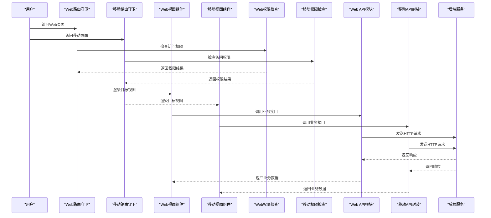
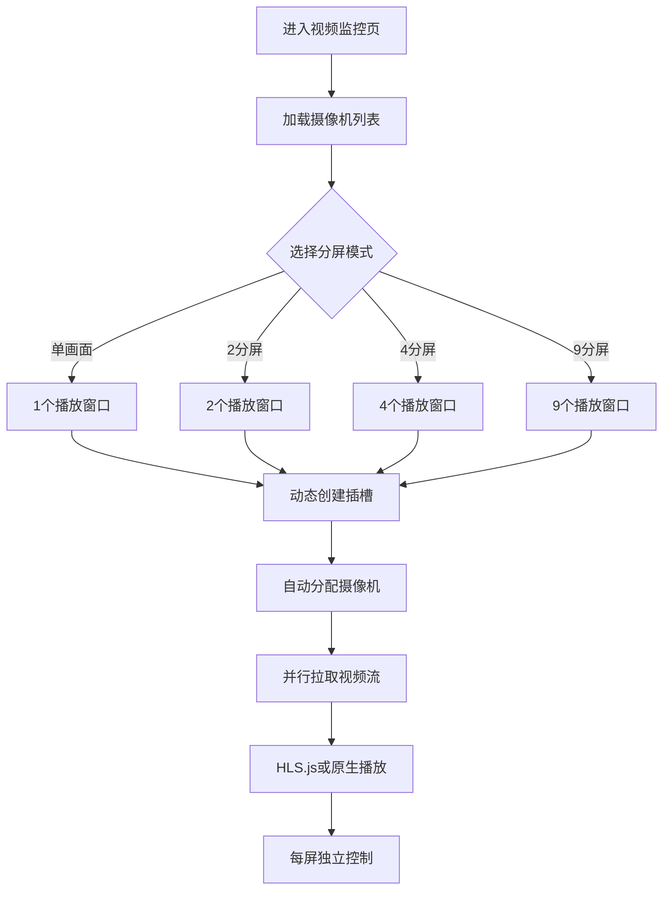
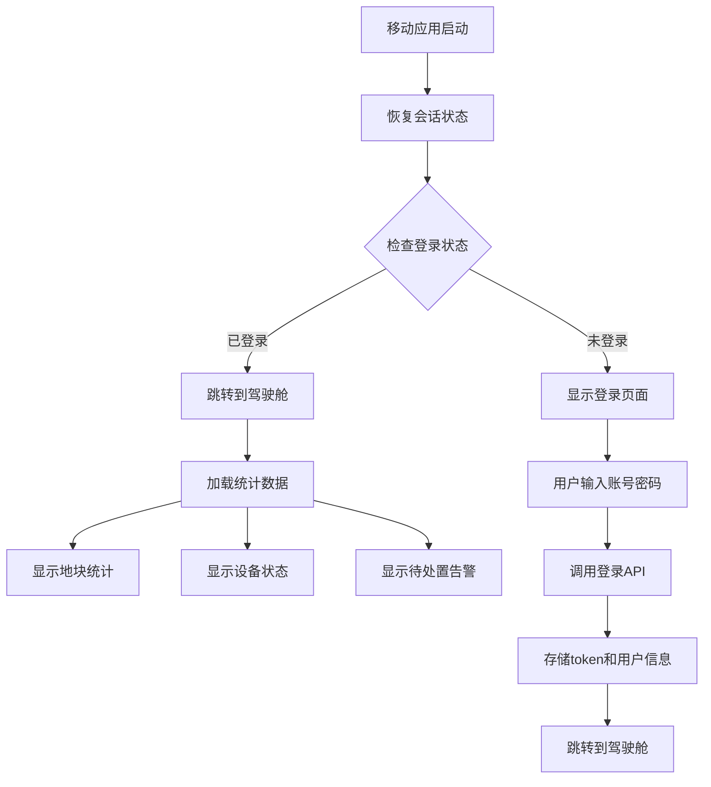
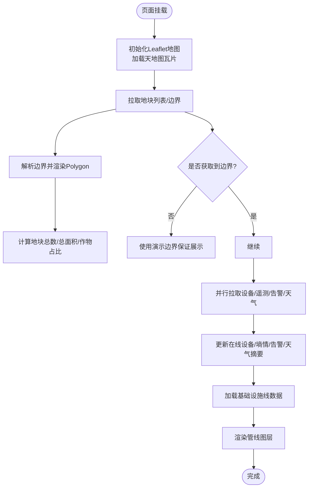
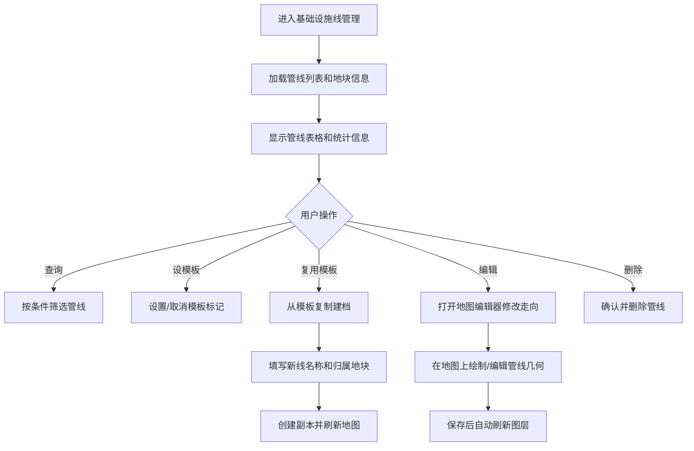
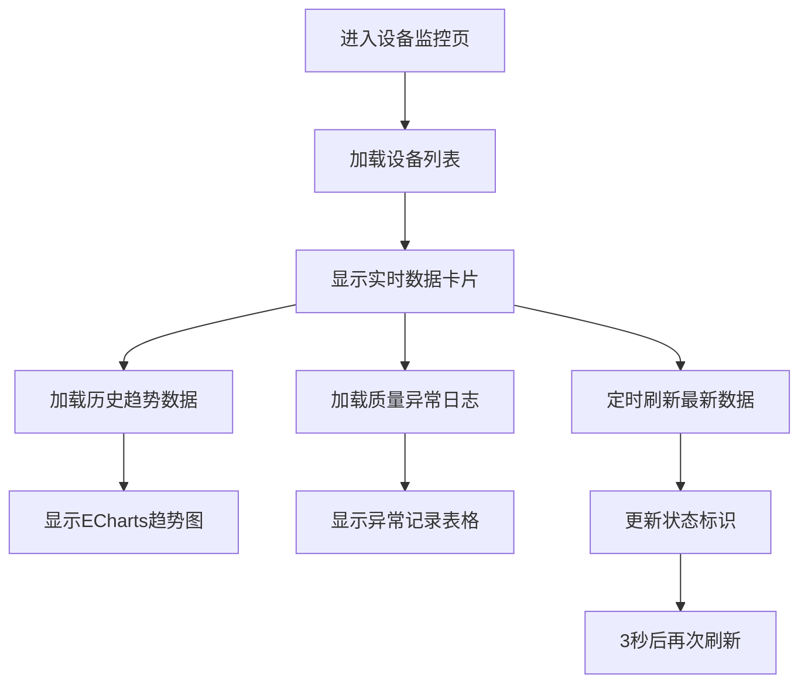
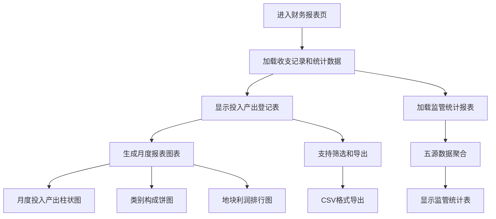
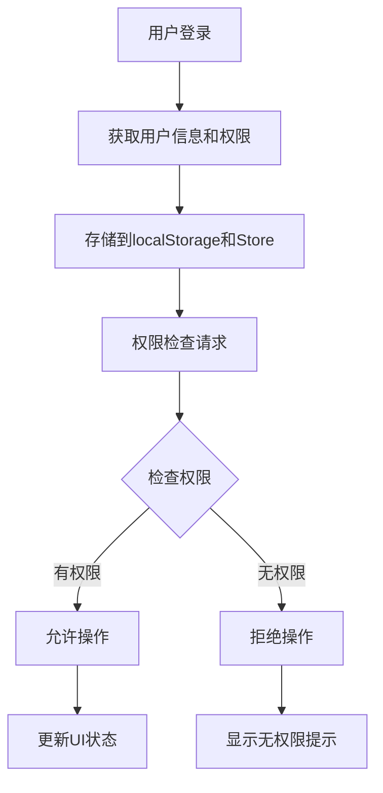
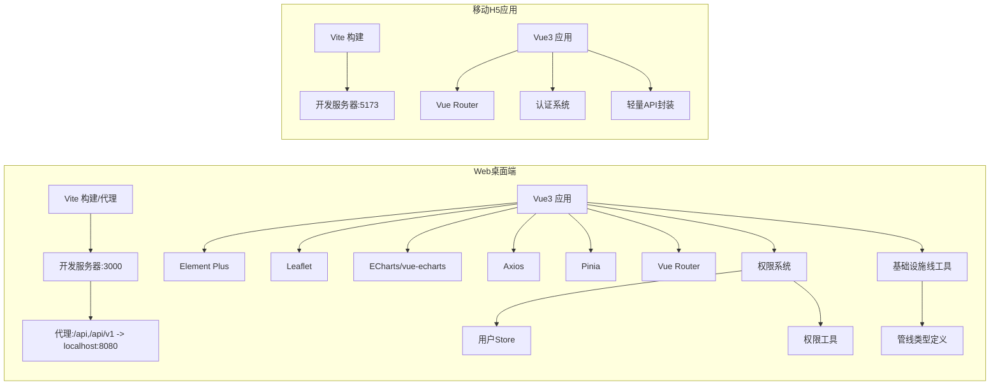

# 前端应用文档

<cite>
**本文引用的文件**   
- [apps/web/package.json](file://apps/web/package.json)
- [apps/web/src/main.ts](file://apps/web/src/main.ts)
- [apps/web/vite.config.ts](file://apps/web/vite.config.ts)
- [apps/web/src/App.vue](file://apps/web/src/App.vue)
- [apps/web/src/router/index.ts](file://apps/web/src/router/index.ts)
- [apps/web/src/layouts/MainLayout.vue](file://apps/web/src/layouts/MainLayout.vue)
- [apps/web/src/views/dashboard/Index.vue](file://apps/web/src/views/dashboard/Index.vue)
- [apps/web/src/views/agro/Index.vue](file://apps/web/src/views/agro/Index.vue)
- [apps/web/src/views/video/Index.vue](file://apps/web/src/views/video/Index.vue)
- [apps/web/src/views/zone/Index.vue](file://apps/web/src/views/zone/Index.vue)
- [apps/web/src/views/irrigation/Index.vue](file://apps/web/src/views/irrigation/Index.vue)
- [apps/web/src/views/farm/Navigation.vue](file://apps/web/src/views/farm/Navigation.vue)
- [apps/web/src/views/plot/List.vue](file://apps/web/src/views/plot/List.vue)
- [apps/web/src/views/device/List.vue](file://apps/web/src/views/device/List.vue)
- [apps/web/src/views/device/Monitor.vue](file://apps/web/src/views/device/Monitor.vue)
- [apps/web/src/views/finance/Index.vue](file://apps/web/src/views/finance/Index.vue)
- [apps/web/src/views/system/User.vue](file://apps/web/src/views/system/User.vue)
- [apps/web/src/views/system/Role.vue](file://apps/web/src/views/system/Role.vue)
- [apps/web/src/views/trace/Index.vue](file://apps/web/src/views/trace/Index.vue)
- [apps/web/src/components/InfraLinePanel.vue](file://apps/web/src/components/InfraLinePanel.vue)
- [apps/web/src/api/index.ts](file://apps/web/src/api/index.ts)
- [apps/web/src/utils/request.ts](file://apps/web/src/utils/request.ts)
- [apps/web/src/types/index.ts](file://apps/web/src/types/index.ts)
- [apps/web/src/stores/index.ts](file://apps/web/src/stores/index.ts)
- [apps/web/src/utils/permission.ts](file://apps/web/src/utils/permission.ts)
- [apps/web/src/utils/infraLine.ts](file://apps/web/src/utils/infraLine.ts)
- [apps/mobile/src/main.ts](file://apps/mobile/src/main.ts)
- [apps/mobile/src/router.ts](file://apps/mobile/src/router.ts)
- [apps/mobile/src/auth.ts](file://apps/mobile/src/auth.ts)
- [apps/mobile/src/api.ts](file://apps/mobile/src/api.ts)
- [apps/mobile/src/types.ts](file://apps/mobile/src/types.ts)
- [apps/mobile/src/labels.ts](file://apps/mobile/src/labels.ts)
- [apps/mobile/src/style.css](file://apps/mobile/src/style.css)
- [apps/mobile/src/views/Login.vue](file://apps/mobile/src/views/Login.vue)
- [apps/mobile/src/views/Cockpit.vue](file://apps/mobile/src/views/Cockpit.vue)
- [apps/mobile/src/views/Patrol.vue](file://apps/mobile/src/views/Patrol.vue)
- [apps/mobile/src/views/Tasks.vue](file://apps/mobile/src/views/Tasks.vue)
</cite>

## 更新摘要
**变更内容**   
- **视频监控界面增强**：新增多屏幕布局支持（1/2/4/9屏）、动态插槽管理、录像留档标签页
- **移动H5应用**：完整的移动端应用，包含认证系统、权限导航和核心业务页面
- **视频播放器优化**：HLS.js动态加载、原生视频源兜底、资源管理优化
- **移动端样式体系**：轻量级CSS架构，适配375px宽度设备

## 目录
1. [简介](#简介)
2. [项目结构](#项目结构)
3. [核心组件](#核心组件)
4. [架构总览](#架构总览)
5. [详细组件分析](#详细组件分析)
6. [权限控制系统](#权限控制系统)
7. [依赖关系分析](#依赖关系分析)
8. [性能与可维护性](#性能与可维护性)
9. [故障排查指南](#故障排查指南)
10. [结论](#结论)
11. [附录：开发规范与样式定制](#附录开发规范与样式定制)

## 简介
本仓库的前端工程包含两个独立应用：
- **Web桌面端**（apps/web）：采用 Vue3 + Element Plus + Leaflet + ECharts 技术栈，面向智慧农业平台提供多模块管理界面
- **移动H5应用**（apps/mobile）：轻量级Vue3应用，专为移动端优化的监控和管理功能

### Web桌面端核心能力
- **四情监控仪表盘**：苗情覆盖度监测、虫害识别处理、灾情告警管理、阈值规则配置
- **生育期时间轴**：地块生长阶段跟踪，计划与实际节点对比分析
- **土壤墒情分析**：分层土壤数据展示，温湿度、EC值、养分含量等指标可视化
- **虫害治理工作流**：虫害识别登记、置信度评估、治理方案制定和农事任务派发
- **灾情管理**：灾害分级上报、处置跟踪和损失评估
- **视频监控管理**：实时监看、录像回放、AI识别事件处理和云台控制
- **基础设施线模板管理**：水线、电线、网线、机耕道的模板化创建、编辑和管理
- **地块管理增强**：批量操作、变更历史追踪和地图可视化
- **片区管理**：地块分组管理、地图可视化、凸包计算、成员地块分配
- **灌溉规划**：水肥配比计算、变量灌溉方案、时序排程、累计供水曲线
- **田间导航**：作业站点选择、路线规划、机耕道识别、导航方案展示
- **设备监控**：设备列表、状态展示、指令下发与刷新、遥测数据可视化
- **财务报表**：投入产出登记、汇总统计、监管统计报表、多维度数据分析
- **溯源管理**：追溯记录查询、新增、详情查看
- **系统管理**：用户信息、角色权限展示

### 移动H5应用核心能力
- **身份认证**：与桌面端同一套账号体系，独立的会话管理
- **权限导航**：基于角色的访问控制和路由守卫
- **驾驶舱仪表板**：地块统计、设备在线状态、待处置告警聚合
- **巡田记录**：地块事件记录、筛选查询、分页加载
- **任务回执**：农事任务状态管理、作业结果提交、版本冲突处理

## 项目结构
前端工程以功能域划分视图与路由，使用 Pinia 进行状态管理（当前示例中布局侧边栏折叠等由 store 驱动），Element Plus 提供 UI 组件，Leaflet 负责地图渲染，ECharts 用于图表展示（在部分页面扩展）。

图示来源
- [apps/web/src/main.ts:1-24](file://apps/web/src/main.ts#L1-L24)
- [apps/mobile/src/main.ts:1-6](file://apps/mobile/src/main.ts#L1-L6)
- [apps/web/src/router/index.ts:1-210](file://apps/web/src/router/index.ts#L1-L210)
- [apps/mobile/src/router.ts:1-23](file://apps/mobile/src/router.ts#L1-L23)

章节来源
- [apps/web/package.json:1-37](file://apps/web/package.json#L1-L37)
- [apps/mobile/package.json:1-22](file://apps/mobile/package.json#L1-L22)
- [apps/web/src/main.ts:1-24](file://apps/web/src/main.ts#L1-L24)
- [apps/mobile/src/main.ts:1-6](file://apps/mobile/src/main.ts#L1-L6)
- [apps/web/vite.config.ts:1-32](file://apps/web/vite.config.ts#L1-L32)

## 核心组件
- **Web桌面端**：
  - 应用初始化与插件注册：Vue3 应用创建、Pinia、Element Plus（含中文语言包）、Leaflet 样式引入、全局图标注册
  - 路由与导航守卫：基于 vue-router 的模块化路由、菜单元信息驱动侧边栏、登录态校验与重定向
  - 主布局：侧边栏折叠、面包屑、用户下拉菜单、内容区路由出口
  - 数据访问层：统一 axios 实例、请求/响应拦截器、通用 get/post/put/del 方法
  - API 模块：按领域划分的接口集合（认证、地块、片区、设备、遥测、天气、财务、视频、控制、农事、导航、基础设施线等）
  - 类型定义：统一的数据模型、枚举、分页结构、看板统计、遥测告警、灌溉计划、导航方案、基础设施线等
  - **权限管理系统**：基于角色的访问控制，支持细粒度的权限检查和权限缓存
  - **模态对话框系统**：统一的对话框设计模式，包含表单验证、加载状态和错误处理
  - **基础设施线管理工具**：管线分类、颜色映射、模板管理等工具函数

- **移动H5应用**：
  - 轻量级应用初始化：Vue3 + Vue Router，无UI库依赖
  - 会话管理：独立的本地存储键，与桌面端互不干扰
  - 权限检查：与桌面端 checkPermission 同口径的权限判定逻辑
  - 轻量API封装：原生fetch封装，统一的错误处理和401处理
  - 移动端样式体系：375px宽度适配，轻量CSS架构

章节来源
- [apps/web/src/main.ts:1-24](file://apps/web/src/main.ts#L1-L24)
- [apps/mobile/src/main.ts:1-6](file://apps/mobile/src/main.ts#L1-L6)
- [apps/web/src/router/index.ts:1-210](file://apps/web/src/router/index.ts#L1-L210)
- [apps/mobile/src/router.ts:1-23](file://apps/mobile/src/router.ts#L1-L23)
- [apps/web/src/layouts/MainLayout.vue:1-195](file://apps/web/src/layouts/MainLayout.vue#L1-L195)
- [apps/mobile/src/auth.ts:1-38](file://apps/mobile/src/auth.ts#L1-L38)
- [apps/web/src/utils/request.ts:1-109](file://apps/web/src/utils/request.ts#L1-L109)
- [apps/mobile/src/api.ts:1-86](file://apps/mobile/src/api.ts#L1-L86)

## 架构总览
前端采用双应用架构：Web桌面端采用"视图层 + 路由层 + 布局层 + API 层 + 工具层 + 类型层 + 权限层"的分层架构；移动H5应用采用轻量级的"视图层 + 路由层 + 认证层 + API层"架构。

图示来源
- [apps/web/src/router/index.ts:193-207](file://apps/web/src/router/index.ts#L193-L207)
- [apps/mobile/src/router.ts:17-21](file://apps/mobile/src/router.ts#L17-L21)
- [apps/web/src/utils/request.ts:13-86](file://apps/web/src/utils/request.ts#L13-L86)
- [apps/mobile/src/api.ts:39-59](file://apps/mobile/src/api.ts#L39-L59)

## 详细组件分析

### 视频监控界面增强
**全新功能** 增强的视频监控界面，支持多屏幕布局和录像留档管理。

- **多屏幕布局**：支持1/2/4/9分屏显示，每屏独立换台、截图、云台控制和全屏
- **动态插槽管理**：根据分屏数动态创建插槽，自动分配摄像机到各屏幕
- **录像留档标签页**：AI识别事件、告警联动、人工补登的录像片段管理
- **视频播放器优化**：HLS.js动态加载、原生视频源兜底、资源管理优化
- **云台控制**：方向控制、缩放控制、速度调节、指令历史记录
- **AI识别事件**：事件类型白名单、置信度显示、转发状态管理

图示来源
- [apps/web/src/views/video/Index.vue:27-36](file://apps/web/src/views/video/Index.vue#L27-L36)
- [apps/web/src/views/video/Index.vue:40-85](file://apps/web/src/views/video/Index.vue#L40-L85)
- [apps/web/src/views/video/Index.vue:402-431](file://apps/web/src/views/video/Index.vue#L402-L431)

章节来源
- [apps/web/src/views/video/Index.vue:1-963](file://apps/web/src/views/video/Index.vue#L1-L963)

### 移动H5应用
**全新功能** 完整的移动端应用，提供轻量级的监控和管理功能。

- **身份认证系统**：与桌面端同一套账号体系，独立的会话管理和本地存储
- **权限导航**：基于角色的访问控制和路由守卫，未登录自动跳转登录页
- **驾驶舱仪表板**：地块统计、设备在线状态、待处置告警聚合展示
- **巡田记录管理**：地块事件记录、筛选查询、分页加载、权限控制的新增功能
- **任务回执系统**：农事任务状态管理、作业结果提交、版本冲突处理
- **轻量样式体系**：375px宽度适配，自定义CSS架构，无第三方UI库依赖

图示来源
- [apps/mobile/src/auth.ts:8-18](file://apps/mobile/src/auth.ts#L8-L18)
- [apps/mobile/src/router.ts:17-21](file://apps/mobile/src/router.ts#L17-L21)
- [apps/mobile/src/views/Cockpit.vue:67-87](file://apps/mobile/src/views/Cockpit.vue#L67-L87)

章节来源
- [apps/mobile/src/main.ts:1-6](file://apps/mobile/src/main.ts#L1-L6)
- [apps/mobile/src/router.ts:1-23](file://apps/mobile/src/router.ts#L1-L23)
- [apps/mobile/src/auth.ts:1-38](file://apps/mobile/src/auth.ts#L1-L38)
- [apps/mobile/src/api.ts:1-86](file://apps/mobile/src/api.ts#L1-L86)
- [apps/mobile/src/views/Login.vue:1-47](file://apps/mobile/src/views/Login.vue#L1-L47)
- [apps/mobile/src/views/Cockpit.vue:1-90](file://apps/mobile/src/views/Cockpit.vue#L1-L90)
- [apps/mobile/src/views/Patrol.vue:1-157](file://apps/mobile/src/views/Patrol.vue#L1-L157)
- [apps/mobile/src/views/Tasks.vue:1-198](file://apps/mobile/src/views/Tasks.vue#L1-L198)

### 仪表盘页面（数据看板）
**增强功能** 增强的仪表盘功能，支持基础设施线管理和更丰富的运营指标展示。

- 地图可视化：基于 Leaflet 加载天地图瓦片，支持影像/矢量底图切换；设备点位与地块边界作为独立图层，支持显隐控制
- 基础设施线管理：集成管线图层管理，支持水线、电线、网线的分类显示和模板管理
- 地块边界渲染：将服务端地块 GeoJSON 转换为 Leaflet Polygon，绑定 Tooltip 显示名称、面积与作物信息；无数据时回退到演示边界
- 指标聚合：根据地块面积计算总量、作物占比；结合设备在线数、遥测告警数量、气象预报摘要形成看板指标
- 趋势面板：预留近 7 日趋势区域，便于接入 ECharts 或 CSS 图形
- 快捷入口：高频业务一键直达，复用既有浮层面板；权限过滤与左侧菜单同口径

图示来源
- [apps/web/src/views/dashboard/Index.vue:142-150](file://apps/web/src/views/dashboard/Index.vue#L142-L150)
- [apps/web/src/views/dashboard/Index.vue:105-129](file://apps/web/src/views/dashboard/Index.vue#L105-L129)
- [apps/web/src/views/dashboard/Index.vue:152-171](file://apps/web/src/views/dashboard/Index.vue#L152-L171)
- [apps/web/src/views/dashboard/Index.vue:173-189](file://apps/web/src/views/dashboard/Index.vue#L173-L189)
- [apps/web/src/views/dashboard/Index.vue:220-243](file://apps/web/src/views/dashboard/Index.vue#L220-L243)
- [apps/web/src/views/dashboard/Index.vue:780-800](file://apps/web/src/views/dashboard/Index.vue#L780-L800)

章节来源
- [apps/web/src/views/dashboard/Index.vue:1-1303](file://apps/web/src/views/dashboard/Index.vue#L1-L1303)

### 基础设施线模板管理界面
**全新功能** 完整的基础设施线管理系统，支持水线、电线、网线、机耕道的模板化管理。

- **管线分类管理**：支持水线（灌水管/施肥管）、电线（电力线）、网线（通信线）、机耕道的分类管理
- **模板功能**：支持将管线设为模板，从模板快速复制建档，模板副本不再保持模板身份
- **台账属性管理**：支持宽度、限速、适用机型等台账属性的登记和管理
- **批量操作**：支持批量删除、批量设模板等操作
- **地图集成**：与一张图地图深度集成，支持定位、编辑、删除等操作
- **筛选查询**：支持按分类、名称、归属地块、状态、模板、适用机型等多维度筛选

图示来源
- [apps/web/src/components/InfraLinePanel.vue:127-184](file://apps/web/src/components/InfraLinePanel.vue#L127-L184)
- [apps/web/src/components/InfraLinePanel.vue:196-252](file://apps/web/src/components/InfraLinePanel.vue#L196-L252)
- [apps/web/src/utils/infraLine.ts:4-86](file://apps/web/src/utils/infraLine.ts#L4-L86)

章节来源
- [apps/web/src/components/InfraLinePanel.vue:1-268](file://apps/web/src/components/InfraLinePanel.vue#L1-L268)
- [apps/web/src/utils/infraLine.ts:1-86](file://apps/web/src/utils/infraLine.ts#L1-L86)
- [apps/web/src/api/index.ts:155-172](file://apps/web/src/api/index.ts#L155-L172)

### 设备监控遥测可视化
**增强功能** 完善的设备监控和遥测数据可视化功能。

- **实时数据卡片**：显示空气温度、湿度、土壤湿度、pH值、EC值、光照强度、CO₂浓度、风速、降雨量等关键指标
- **历史趋势图**：基于 ECharts 的历史数据趋势图，支持多指标切换和设备选择
- **质量异常日志**：显示超量程、连续不变、时间戳异常等可疑读数留痕
- **设备选择**：支持设备列表选择和默认设备设置
- **实时更新**：定时刷新最新数据，3秒间隔自动更新
- **异常状态标识**：根据质量标志自动标记正常、预警、异常状态

图示来源
- [apps/web/src/views/device/Monitor.vue:80-100](file://apps/web/src/views/device/Monitor.vue#L80-L100)
- [apps/web/src/views/device/Monitor.vue:119-152](file://apps/web/src/views/device/Monitor.vue#L119-L152)
- [apps/web/src/views/device/Monitor.vue:160-186](file://apps/web/src/views/device/Monitor.vue#L160-L186)

章节来源
- [apps/web/src/views/device/Monitor.vue:1-240](file://apps/web/src/views/device/Monitor.vue#L1-L240)

### 财务报表分析
**增强功能** 增强的财务分析功能和监管统计报表。

- **投入产出登记**：支持投入产出的录入、编辑、删除操作
- **月度报表**：月度投入产出柱状图、类别构成饼图、地块利润排行图
- **监管统计报表**：五源前端聚合（地块/农事任务/虫情/灾情/收支），全量口径不随筛选联动
- **多维度筛选**：支持地块编码、类型、类别、产季、关键词、登记时间等多维度筛选
- **CSV导出**：支持监管统计报表和收支记录的CSV格式导出
- **实时统计**：投入合计、产出合计、利润等关键指标的实时统计

图示来源
- [apps/web/src/views/finance/Index.vue:151-210](file://apps/web/src/views/finance/Index.vue#L151-L210)
- [apps/web/src/views/finance/Index.vue:246-299](file://apps/web/src/views/finance/Index.vue#L246-L299)
- [apps/web/src/views/finance/Index.vue:301-318](file://apps/web/src/views/finance/Index.vue#L301-L318)

章节来源
- [apps/web/src/views/finance/Index.vue:1-371](file://apps/web/src/views/finance/Index.vue#L1-L371)

### 其他页面组件
- **四情监控仪表盘**：完整的农业生产监控解决方案，涵盖苗情监测、虫害管理、灾情告警和阈值规则配置
- **视频监控管理页面**：完整的视频监控系统，支持实时监看、录像回放、AI识别事件处理和云台控制
- **地块管理页面**：增强的地块管理功能，支持批量操作和更丰富的筛选条件
- **片区管理页面**：完整的片区管理解决方案，支持地块分组、地图可视化和凸包计算
- **灌溉规划页面**：变量灌溉和水肥配比规划工具，支持方案预演和指令下发
- **田间导航页面**：智能田间导航系统，支持作业路线规划和机耕道识别
- **系统管理页面**：增强的系统管理功能，通过模态对话框进行用户和角色管理

章节来源
- [apps/web/src/views/agro/Index.vue:1-1325](file://apps/web/src/views/agro/Index.vue#L1-L1325)
- [apps/web/src/views/video/Index.vue:1-963](file://apps/web/src/views/video/Index.vue#L1-L963)
- [apps/web/src/views/plot/List.vue:1-370](file://apps/web/src/views/plot/List.vue#L1-L370)
- [apps/web/src/views/zone/Index.vue:1-372](file://apps/web/src/views/zone/Index.vue#L1-L372)
- [apps/web/src/views/irrigation/Index.vue:1-197](file://apps/web/src/views/irrigation/Index.vue#L1-L197)
- [apps/web/src/views/farm/Navigation.vue:1-299](file://apps/web/src/views/farm/Navigation.vue#L1-L299)
- [apps/web/src/views/system/User.vue:1-235](file://apps/web/src/views/system/User.vue#L1-L235)
- [apps/web/src/views/system/Role.vue:1-240](file://apps/web/src/views/system/Role.vue#L1-L240)

## 权限控制系统
**增强功能** 完整的基于角色的访问控制系统，支持细粒度的权限管理。

- **权限存储**：使用 Pinia Store 管理用户信息和权限状态
- **权限检查**：统一的权限检查函数，支持通配符匹配
- **权限缓存**：本地缓存用户信息和权限，避免频繁请求
- **权限分类**：按功能域组织权限，支持领域级和精确权限
- **前端控制**：基于权限控制按钮显示、表单操作和页面访问

图示来源
- [apps/web/src/stores/index.ts:16-53](file://apps/web/src/stores/index.ts#L16-L53)
- [apps/web/src/utils/permission.ts:7-11](file://apps/web/src/utils/permission.ts#L7-L11)

章节来源
- [apps/web/src/stores/index.ts:1-75](file://apps/web/src/stores/index.ts#L1-L75)
- [apps/web/src/utils/permission.ts:1-30](file://apps/web/src/utils/permission.ts#L1-L30)

## 依赖关系分析
- **Web桌面端构建与开发**：Vite 提供开发服务器与代理，端口 3000，代理 /api 与 /api/v1 至本地 8080
- **移动H5应用构建与开发**：Vite 提供开发服务器，端口 5173，直接连接后端API
- **运行时依赖**：
  - Web桌面端：Vue3、Element Plus、Leaflet、ECharts、Axios、Dayjs、Pinia、Vue Router、HLS.js
  - 移动H5应用：Vue3、Vue Router（无UI库依赖）
- **插件与工具**：@element-plus/icons-vue 图标库、vite-plugin-vue-devtools

图示来源
- [apps/web/vite.config.ts:16-30](file://apps/web/vite.config.ts#L16-L30)
- [apps/web/package.json:12-25](file://apps/web/package.json#L12-L25)
- [apps/mobile/package.json:12-21](file://apps/mobile/package.json#L12-L21)
- [apps/web/src/utils/infraLine.ts:1-86](file://apps/web/src/utils/infraLine.ts#L1-L86)

章节来源
- [apps/web/vite.config.ts:1-32](file://apps/web/vite.config.ts#L1-L32)
- [apps/mobile/package.json:1-22](file://apps/mobile/package.json#L1-L22)
- [apps/web/package.json:1-37](file://apps/web/package.json#L1-L37)

## 性能与可维护性
- **地图渲染优化**
  - 使用 LayerGroup 管理设备与地块图层，按需添加/移除，避免重复绘制
  - 仅在有效地理范围时使用 fitBounds 自动缩放，减少不必要的重绘
  - 片区管理和导航页面使用独立的地图实例，避免相互干扰
  - 基础设施线图层按分类管理，支持动态显示/隐藏
- **数据加载策略**
  - 仪表盘并行拉取设备、遥测、告警、天气数据，缩短首屏等待时间
  - 地块边界缺失时降级为演示边界，保障用户体验
  - 四情监控页面一次性加载所有相关数据，减少多次网络请求
  - 基础设施线数据与地块数据并行加载，提升加载效率
- **请求封装**
  - 统一超时、鉴权头、RequestId 注入，提升可观测性
  - 响应拦截器统一错误提示与 401 处理，降低各页面重复逻辑
- **类型安全**
  - 全量类型定义覆盖分页、实体、看板统计、遥测告警、灌溉计划、导航方案、基础设施线等，减少运行时错误
- **可扩展性**
  - API 模块按领域拆分，便于新增服务接口
  - 路由 meta 驱动菜单，新增页面仅需配置路由与元信息
  - 新的业务模块（农情、片区、灌溉、导航）遵循相同的组件结构和API调用模式
  - 基础设施线工具函数提供统一的管线分类、颜色映射、模板管理等功能
- **模态对话框优化**
  - 统一的对话框设计模式，减少重复代码
  - 表单验证集中管理，提高代码复用性
  - 加载状态统一管理，提升用户体验
- **权限控制优化**
  - 权限检查函数统一处理，避免重复逻辑
  - 权限缓存机制减少不必要的请求
  - 细粒度权限控制提升安全性
- **视频播放优化**
  - HLS.js动态加载，按需引入减少初始包体积
  - 原生视频源兜底，提升兼容性
  - 播放器资源管理，及时释放内存
- **遥测数据优化**
  - 定时刷新机制，3秒间隔自动更新最新数据
  - 历史数据序列优化，支持跨天时间轴显示
  - 质量异常日志过滤和分类显示
- **移动应用优化**
  - 轻量级CSS架构，无第三方UI库依赖，减少包体积
  - 独立的会话管理，与桌面端互不干扰
  - 轻量API封装，原生fetch实现，减少依赖
  - 移动端样式适配，375px宽度优化

[本节为通用指导，不直接分析具体文件]

## 故障排查指南
- **网络与鉴权**
  - 检查 localStorage 中的 token 是否存在且有效
  - 若出现 401，请求拦截器会提示并引导重新登录
- **代理与跨域**
  - 开发环境确保 vite.config.ts 的代理规则正确指向后端地址
  - 生产环境需通过网关或反向代理转发 /api 与 /api/v1
- **地图相关**
  - 确认天地图密钥环境变量已配置
  - 检查 Leaflet 样式是否被正确引入
  - 验证 GeoJSON 坐标格式是否正确（经纬度顺序）
  - 检查基础设施线图层是否正确加载和显示
- **数据异常**
  - 查看控制台错误信息与 ElMessage 提示
  - 核对后端返回结构与 ApiResponse 约定（code/message/data）
  - 检查新接口的数据类型定义是否与后端一致
- **新功能问题**
  - 四情监控：检查遥测服务是否正常，阈值规则配置是否完整
  - 片区管理：确认地块边界数据存在，凸包计算逻辑正常
  - 灌溉规划：验证分区面积和定额数据合理性，设备标识正确
  - 田间导航：检查机耕道路网数据，起点坐标有效性
  - 视频监控：检查HLS.js加载状态，视频流地址有效性
  - 虫害治理：确认治理状态流转逻辑，农事任务派发是否正常
  - 基础设施线：检查管线数据完整性，模板功能是否正常
  - 设备监控：确认遥测数据接口正常，历史数据加载成功
  - 财务报表：验证财务数据接口，监管统计报表聚合逻辑
- **权限相关问题**
  - 检查用户权限是否正确配置和缓存
  - 确认权限检查函数调用是否正确
  - 验证权限字符串格式是否符合规范
- **模态对话框问题**
  - 检查表单验证规则是否正确配置
  - 确认对话框状态管理是否正常工作
  - 验证表单提交和数据同步逻辑
- **移动应用问题**
  - 检查移动端API基础路径配置（VITE_API_BASE_URL）
  - 确认移动端会话存储键（TOKEN_KEY, USER_KEY）正确
  - 验证移动端权限检查逻辑与桌面端一致性
  - 检查移动端样式适配在不同设备上的表现

章节来源
- [apps/web/src/utils/request.ts:13-86](file://apps/web/src/utils/request.ts#L13-L86)
- [apps/web/vite.config.ts:16-30](file://apps/web/vite.config.ts#L16-L30)
- [apps/mobile/src/api.ts:4-6](file://apps/mobile/src/api.ts#L4-L6)
- [apps/mobile/src/auth.ts:9-16](file://apps/mobile/src/auth.ts#L9-L16)
- [apps/web/src/main.ts:6-7](file://apps/web/src/main.ts#L6-L7)
- [apps/web/src/stores/index.ts:39-42](file://apps/web/src/stores/index.ts#L39-L42)
- [apps/web/src/utils/permission.ts:7-11](file://apps/web/src/utils/permission.ts#L7-L11)

## 结论
该前端工程以清晰的双应用架构与完善的类型体系支撑了智慧农业平台的多种业务场景。Web桌面端通过统一的请求封装与错误处理、灵活的地图可视化方案以及按领域组织的 API 模块，既保证了开发效率，也提升了可维护性与扩展性。移动H5应用则提供了轻量级的移动端解决方案，专注于核心的监控和管理功能。

**现代化改造的价值**：
- **模态对话框系统**提供了统一的交互体验，提升了用户操作的直观性和一致性
- **增强的表单验证**确保了数据的准确性和完整性，减少了用户输入错误
- **完善的权限控制**实现了细粒度的访问控制，提升了系统的安全性
- **优化的加载状态**改善了用户体验，让用户清楚了解操作进度

**新增功能的价值**：
- **视频监控界面增强**提供了多屏幕布局和录像留档管理，大幅提升了视频监控的效率和实用性
- **移动H5应用**提供了轻量级的移动端解决方案，让农场管理人员可以随时随地查看数据和执行业务操作
- **基础设施线模板管理**提供了完整的管线管理系统，支持模板化创建和批量操作，大幅提升了管线管理效率
- **仪表盘运营指标增强**强化了运营数据的可视化展示，支持多源数据聚合和实时监控
- **设备监控遥测可视化**完善了设备监控功能，支持历史趋势分析和异常日志追踪
- **财务报表分析增强**提供了全面的财务分析能力，支持监管统计报表和多维度数据分析
- **地图可视化增强**集成了管线图层管理，支持与一张图地图的深度集成

后续可在图表可视化、实时数据推送、权限控制等方面持续增强，进一步完善智慧农业管理平台的功能体系。

[本节为总结性内容，不直接分析具体文件]

## 附录：开发规范与样式定制
- **组件开发规范**
  - 视图组件遵循单一职责，复杂逻辑下沉至 API 层与工具函数
  - 表格类页面统一使用 Element Plus Table/Pagination，保持交互一致
  - 地图相关逻辑集中在视图或专用地图组件，避免散落在多处
  - 新增业务模块应遵循现有组件结构模式，保持一致的开发体验
  - 基础设施线管理遵循统一的管线分类、颜色映射和模板管理规范
- **移动应用开发规范**
  - 使用轻量级CSS架构，避免引入第三方UI库
  - 遵循375px宽度适配规范，确保移动端显示效果
  - 使用统一的toast提示组件，保持交互一致性
  - 权限检查与桌面端保持一致的命名规范和逻辑
- **模态对话框开发规范**
  - 使用统一的 el-dialog 组件，保持对话框样式和交互一致
  - 表单验证规则集中定义，使用 FormRules 类型确保类型安全
  - 加载状态统一管理，使用 loading 变量控制按钮状态
  - 错误处理统一使用 ElMessage 提示用户
- **权限控制开发规范**
  - 使用 userStore.hasPermission() 进行权限检查
  - 权限字符串遵循领域:操作的命名规范
  - 敏感操作前进行权限验证，避免越权访问
  - 权限变化时及时更新UI状态
- **样式定制**
  - 全局样式入口位于 assets/styles/main.scss，建议在此集中定义主题变量与公共样式
  - 仪表盘深色主题样式通过 scoped SCSS 实现，注意与 Element Plus 默认样式隔离
  - 新功能页面应使用一致的样式类和布局模式
  - 移动应用使用独立的style.css，不依赖桌面端的样式体系
- **响应式设计**
  - 仪表盘在小屏下调整侧边面板宽度与隐藏图例，保证可用性
  - 表格与表单在小屏下适当缩减列宽与间距
  - 片区管理和导航页面在小屏下调整为单列布局
- **地图集成要点**
  - 在需要地图的页面引入 leaflet/dist/leaflet.css
  - 使用 L.map 初始化地图，L.tileLayer 加载天地图 WMTS 服务
  - 使用 L.polygon/L.layerGroup 渲染地块边界与设备点位，并通过 visibleLayers 控制显隐
  - 多个地图页面应使用独立的地图实例，避免状态冲突
  - 基础设施线图层按分类管理，支持动态显示/隐藏和模板标记
- **视频播放集成要点**
  - 使用 HLS.js 动态加载，支持HLS流媒体播放
  - 原生视频源兜底，提升浏览器兼容性
  - 合理管理播放器资源，及时销毁避免内存泄漏
  - 支持全屏模式和截图功能
- **遥测数据集成要点**
  - 使用 ECharts 进行历史数据趋势图展示
  - 定时刷新机制，支持3秒间隔自动更新
  - 质量异常日志分类显示，支持异常标记过滤
  - 跨天时间轴显示，正确处理UTC时间转换
- **新模块开发指导**
  - 参考现有模块的结构组织方式
  - 在 API 层添加对应的接口定义和方法
  - 在路由配置中添加新的路由项和权限控制
  - 确保类型定义的完整性和一致性
  - 使用模态对话框进行数据录入和编辑操作
  - 实现完整的表单验证和错误处理
  - 对于复杂业务流程，考虑使用步骤条或多步骤对话框
  - 对于基础设施线等复杂功能，使用工具函数提供统一的分类、颜色、模板管理
- **移动应用样式规范**
  - 使用CSS变量定义主题色，保持视觉一致性
  - 遵循移动端最佳实践，如触摸目标大小、字体大小等
  - 使用flexbox和grid布局，确保不同设备的适配性
  - 避免使用过大的图片和复杂的动画，保持性能
  - 使用语义化的类名，便于维护和扩展

章节来源
- [apps/web/src/assets/styles/main.scss](file://apps/web/src/assets/styles/main.scss)
- [apps/web/src/views/dashboard/Index.vue:252-265](file://apps/web/src/views/dashboard/Index.vue#L252-L265)
- [apps/mobile/src/style.css:1-143](file://apps/mobile/src/style.css#L1-L143)
- [apps/web/src/main.ts:6-7](file://apps/web/src/main.ts#L6-L7)
- [apps/web/src/views/agro/Index.vue:336-349](file://apps/web/src/views/agro/Index.vue#L336-L349)
- [apps/web/src/views/zone/Index.vue:349-372](file://apps/web/src/views/zone/Index.vue#L349-L372)
- [apps/web/src/views/irrigation/Index.vue:181-197](file://apps/web/src/views/irrigation/Index.vue#L181-L197)
- [apps/web/src/views/farm/Navigation.vue:282-299](file://apps/web/src/views/farm/Navigation.vue#L282-L299)
- [apps/web/src/views/finance/Index.vue:72-104](file://apps/web/src/views/finance/Index.vue#L72-L104)
- [apps/web/src/views/trace/Index.vue:69-92](file://apps/web/src/views/trace/Index.vue#L69-92)
- [apps/web/src/views/video/Index.vue:307-345](file://apps/web/src/views/video/Index.vue#L307-L345)
- [apps/web/src/views/device/Monitor.vue:213-240](file://apps/web/src/views/device/Monitor.vue#L213-L240)
- [apps/web/src/components/InfraLinePanel.vue:260-268](file://apps/web/src/components/InfraLinePanel.vue#L260-L268)
- [apps/web/src/stores/index.ts:39-42](file://apps/web/src/stores/index.ts#L39-L42)
- [apps/web/src/utils/permission.ts:7-11](file://apps/web/src/utils/permission.ts#L7-L11)
- [apps/web/src/utils/infraLine.ts:4-86](file://apps/web/src/utils/infraLine.ts#L4-L86)