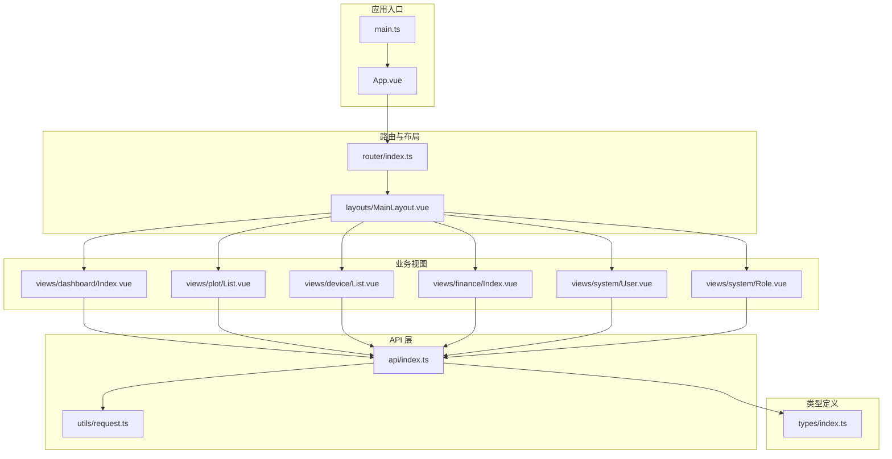
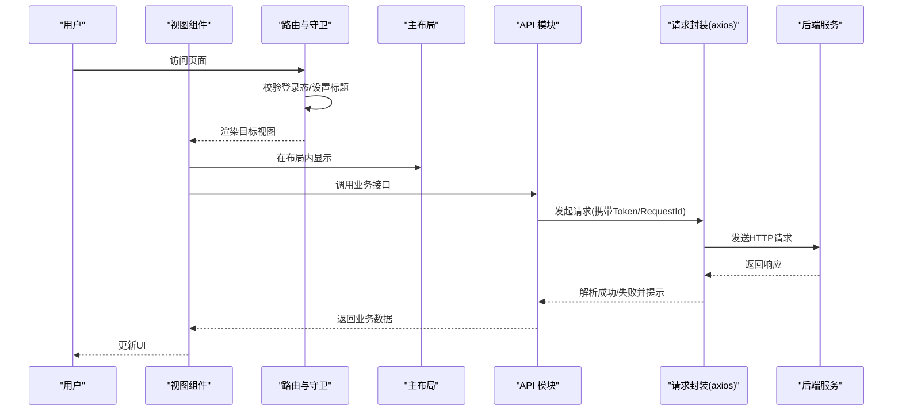
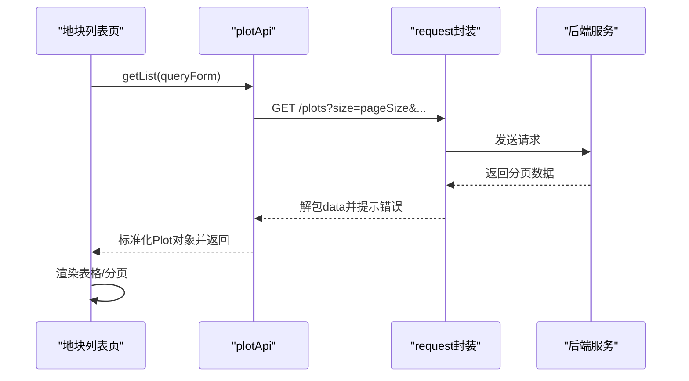
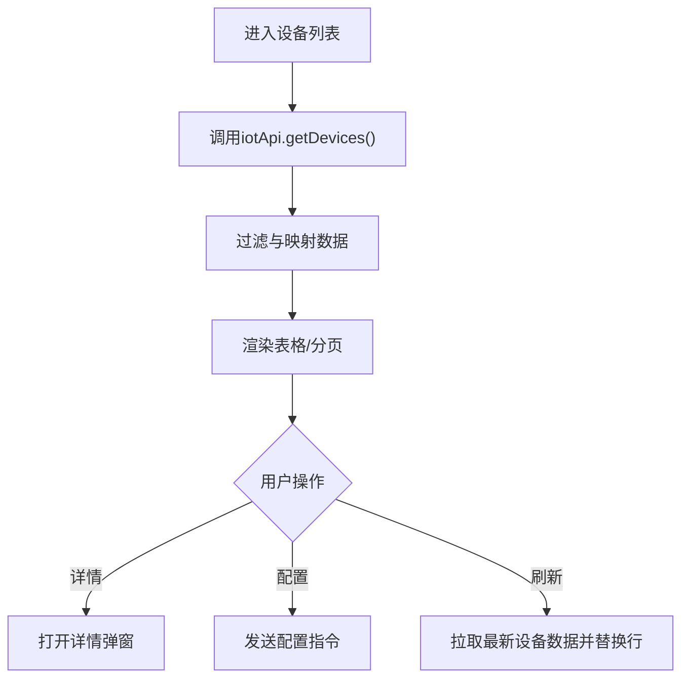
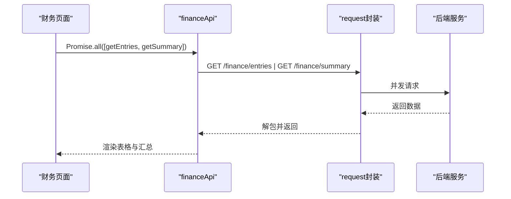
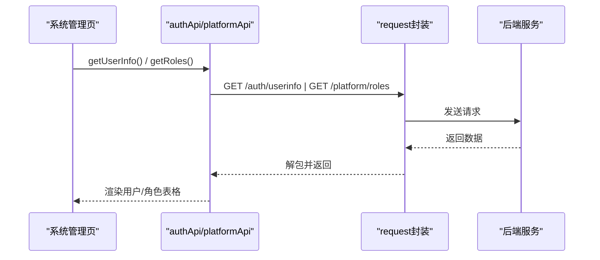
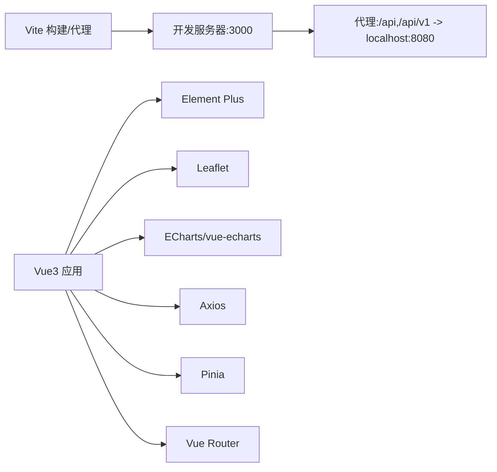

# 前端应用文档

<cite>
**本文引用的文件**   
- [apps/web/package.json](file://apps/web/package.json)
- [apps/web/src/main.ts](file://apps/web/src/main.ts)
- [apps/web/vite.config.ts](file://apps/web/vite.config.ts)
- [apps/web/src/App.vue](file://apps/web/src/App.vue)
- [apps/web/src/router/index.ts](file://apps/web/src/router/index.ts)
- [apps/web/src/layouts/MainLayout.vue](file://apps/web/src/layouts/MainLayout.vue)
- [apps/web/src/views/dashboard/Index.vue](file://apps/web/src/views/dashboard/Index.vue)
- [apps/web/src/views/plot/List.vue](file://apps/web/src/views/plot/List.vue)
- [apps/web/src/views/device/List.vue](file://apps/web/src/views/device/List.vue)
- [apps/web/src/views/finance/Index.vue](file://apps/web/src/views/finance/Index.vue)
- [apps/web/src/views/system/User.vue](file://apps/web/src/views/system/User.vue)
- [apps/web/src/views/system/Role.vue](file://apps/web/src/views/system/Role.vue)
- [apps/web/src/api/index.ts](file://apps/web/src/api/index.ts)
- [apps/web/src/utils/request.ts](file://apps/web/src/utils/request.ts)
- [apps/web/src/types/index.ts](file://apps/web/src/types/index.ts)
</cite>

## 目录
1. [简介](#简介)
2. [项目结构](#项目结构)
3. [核心组件](#核心组件)
4. [架构总览](#架构总览)
5. [详细组件分析](#详细组件分析)
6. [依赖关系分析](#依赖关系分析)
7. [性能与可维护性](#性能与可维护性)
8. [故障排查指南](#故障排查指南)
9. [结论](#结论)
10. [附录：开发规范与样式定制](#附录开发规范与样式定制)

## 简介
本仓库的前端工程位于 apps/web，采用 Vue3 + Element Plus + Leaflet + ECharts 技术栈，面向智慧农业平台提供多模块管理界面。核心能力包括：
- 仪表盘：天地图底图、地块边界可视化、设备点位标记、运行指标与趋势面板
- 地块管理：列表查询、分页、新增/编辑/删除、批量操作
- 设备监控：设备列表、状态展示、指令下发与刷新
- 财务报表：投入产出登记、汇总统计
- 系统管理：用户信息、角色权限展示
- API 集成：统一的请求封装、鉴权头注入、错误处理与响应解包
- 地图可视化：Leaflet 集成、图层切换、GeoJSON 地块边界渲染

## 项目结构
前端工程以功能域划分视图与路由，使用 Pinia 进行状态管理（当前示例中布局侧边栏折叠等由 store 驱动），Element Plus 提供 UI 组件，Leaflet 负责地图渲染，ECharts 用于图表展示（在部分页面扩展）。

图示来源
- [apps/web/src/main.ts:1-24](file://apps/web/src/main.ts#L1-L24)
- [apps/web/src/App.vue:1-14](file://apps/web/src/App.vue#L1-L14)
- [apps/web/src/router/index.ts:1-157](file://apps/web/src/router/index.ts#L1-L157)
- [apps/web/src/layouts/MainLayout.vue:1-195](file://apps/web/src/layouts/MainLayout.vue#L1-L195)
- [apps/web/src/views/dashboard/Index.vue:1-280](file://apps/web/src/views/dashboard/Index.vue#L1-L280)
- [apps/web/src/views/plot/List.vue:1-272](file://apps/web/src/views/plot/List.vue#L1-L272)
- [apps/web/src/views/device/List.vue:1-132](file://apps/web/src/views/device/List.vue#L1-L132)
- [apps/web/src/views/finance/Index.vue:1-47](file://apps/web/src/views/finance/Index.vue#L1-L47)
- [apps/web/src/views/system/User.vue:1-38](file://apps/web/src/views/system/User.vue#L1-L38)
- [apps/web/src/views/system/Role.vue:1-24](file://apps/web/src/views/system/Role.vue#L1-L24)
- [apps/web/src/api/index.ts:1-263](file://apps/web/src/api/index.ts#L1-L263)
- [apps/web/src/utils/request.ts:1-109](file://apps/web/src/utils/request.ts#L1-L109)
- [apps/web/src/types/index.ts:1-313](file://apps/web/src/types/index.ts#L1-L313)

章节来源
- [apps/web/package.json:1-37](file://apps/web/package.json#L1-L37)
- [apps/web/src/main.ts:1-24](file://apps/web/src/main.ts#L1-L24)
- [apps/web/vite.config.ts:1-32](file://apps/web/vite.config.ts#L1-L32)

## 核心组件
- 应用初始化与插件注册：Vue3 应用创建、Pinia、Element Plus（含中文语言包）、Leaflet 样式引入、全局图标注册
- 路由与导航守卫：基于 vue-router 的模块化路由、菜单元信息驱动侧边栏、登录态校验与重定向
- 主布局：侧边栏折叠、面包屑、用户下拉菜单、内容区路由出口
- 数据访问层：统一 axios 实例、请求/响应拦截器、通用 get/post/put/del 方法
- API 模块：按领域划分的接口集合（认证、地块、设备、遥测、天气、财务、视频、控制等）
- 类型定义：统一的数据模型、枚举、分页结构、看板统计、遥测告警等

章节来源
- [apps/web/src/main.ts:1-24](file://apps/web/src/main.ts#L1-L24)
- [apps/web/src/router/index.ts:1-157](file://apps/web/src/router/index.ts#L1-L157)
- [apps/web/src/layouts/MainLayout.vue:1-195](file://apps/web/src/layouts/MainLayout.vue#L1-L195)
- [apps/web/src/utils/request.ts:1-109](file://apps/web/src/utils/request.ts#L1-L109)
- [apps/web/src/api/index.ts:1-263](file://apps/web/src/api/index.ts#L1-L263)
- [apps/web/src/types/index.ts:1-313](file://apps/web/src/types/index.ts#L1-L313)

## 架构总览
前端采用“视图层 + 路由层 + 布局层 + API 层 + 工具层 + 类型层”的分层架构。视图层通过 API 层调用后端服务；API 层通过请求封装统一处理鉴权、错误提示与响应解包；类型层为前后端交互提供强类型约束。

图示来源
- [apps/web/src/router/index.ts:146-154](file://apps/web/src/router/index.ts#L146-L154)
- [apps/web/src/utils/request.ts:13-86](file://apps/web/src/utils/request.ts#L13-L86)
- [apps/web/src/api/index.ts:1-263](file://apps/web/src/api/index.ts#L1-L263)

## 详细组件分析

### 仪表盘页面（数据看板）
- 地图可视化：基于 Leaflet 加载天地图瓦片，支持影像/矢量底图切换；设备点位与地块边界作为独立图层，支持显隐控制
- 地块边界渲染：将服务端地块 GeoJSON 转换为 Leaflet Polygon，绑定 Tooltip 显示名称、面积与作物信息；无数据时回退到演示边界
- 指标聚合：根据地块面积计算总量、作物占比；结合设备在线数、遥测告警数量、气象预报摘要形成看板指标
- 趋势面板：预留近 7 日趋势区域，便于接入 ECharts 或 CSS 图形

图示来源
- [apps/web/src/views/dashboard/Index.vue:142-150](file://apps/web/src/views/dashboard/Index.vue#L142-L150)
- [apps/web/src/views/dashboard/Index.vue:105-129](file://apps/web/src/views/dashboard/Index.vue#L105-L129)
- [apps/web/src/views/dashboard/Index.vue:152-171](file://apps/web/src/views/dashboard/Index.vue#L152-L171)
- [apps/web/src/views/dashboard/Index.vue:173-189](file://apps/web/src/views/dashboard/Index.vue#L173-L189)
- [apps/web/src/views/dashboard/Index.vue:220-243](file://apps/web/src/views/dashboard/Index.vue#L220-L243)

章节来源
- [apps/web/src/views/dashboard/Index.vue:1-280](file://apps/web/src/views/dashboard/Index.vue#L1-L280)

### 地块管理页面（列表）
- 查询与筛选：支持关键词、地块类型、状态筛选，重置后重新拉取
- 表格展示：分页、排序、标签化显示类型与状态
- 操作行为：新增跳转、编辑跳转、详情跳转、单删确认、批量删除
- 数据适配：对后端返回字段进行兼容映射（items/list 兼容）

图示来源
- [apps/web/src/views/plot/List.vue:201-212](file://apps/web/src/views/plot/List.vue#L201-L212)
- [apps/web/src/api/index.ts:29-60](file://apps/web/src/api/index.ts#L29-L60)
- [apps/web/src/utils/request.ts:38-56](file://apps/web/src/utils/request.ts#L38-L56)

章节来源
- [apps/web/src/views/plot/List.vue:1-272](file://apps/web/src/views/plot/List.vue#L1-L272)
- [apps/web/src/api/index.ts:29-101](file://apps/web/src/api/index.ts#L29-L101)

### 设备监控页面（列表）
- 设备列表：支持名称/编号搜索、状态筛选
- 状态展示：在线/离线/故障/维护中，带颜色标签
- 交互操作：查看详情弹窗、下发配置指令、刷新设备最新状态
- 数据映射：将后端字段映射为表格列（如 serialNo、plotName、lastReportAt）

图示来源
- [apps/web/src/views/device/List.vue:95-126](file://apps/web/src/views/device/List.vue#L95-L126)
- [apps/web/src/api/index.ts:157-167](file://apps/web/src/api/index.ts#L157-L167)

章节来源
- [apps/web/src/views/device/List.vue:1-132](file://apps/web/src/views/device/List.vue#L1-L132)
- [apps/web/src/api/index.ts:157-167](file://apps/web/src/api/index.ts#L157-L167)

### 财务报表页面
- 汇总卡片：投入合计、产出合计、利润
- 登记表单：地块编码、类型（投入/产出）、类别、金额、备注
- 数据表格：条目明细、时间格式化
- 并发请求：同时拉取条目与汇总数据

图示来源
- [apps/web/src/views/finance/Index.vue:37-39](file://apps/web/src/views/finance/Index.vue#L37-L39)
- [apps/web/src/api/index.ts:223-233](file://apps/web/src/api/index.ts#L223-L233)

章节来源
- [apps/web/src/views/finance/Index.vue:1-47](file://apps/web/src/views/finance/Index.vue#L1-L47)
- [apps/web/src/api/index.ts:223-233](file://apps/web/src/api/index.ts#L223-L233)

### 系统管理页面（用户与角色）
- 用户信息：从认证接口获取当前用户信息并展示
- 角色权限：拉取平台角色列表与权限标签

图示来源
- [apps/web/src/views/system/User.vue:31-35](file://apps/web/src/views/system/User.vue#L31-L35)
- [apps/web/src/views/system/Role.vue:18-18](file://apps/web/src/views/system/Role.vue#L18-L18)
- [apps/web/src/api/index.ts:13-25](file://apps/web/src/api/index.ts#L13-L25)
- [apps/web/src/api/index.ts:169-173](file://apps/web/src/api/index.ts#L169-L173)

章节来源
- [apps/web/src/views/system/User.vue:1-38](file://apps/web/src/views/system/User.vue#L1-L38)
- [apps/web/src/views/system/Role.vue:1-24](file://apps/web/src/views/system/Role.vue#L1-L24)
- [apps/web/src/api/index.ts:13-25](file://apps/web/src/api/index.ts#L13-L25)
- [apps/web/src/api/index.ts:169-173](file://apps/web/src/api/index.ts#L169-L173)

## 依赖关系分析
- 构建与开发：Vite 提供开发服务器与代理，端口 3000，代理 /api 与 /api/v1 至本地 8080
- 运行时依赖：Vue3、Element Plus、Leaflet、ECharts、Axios、Dayjs、Pinia、Vue Router、HLS.js
- 插件与工具：@element-plus/icons-vue 图标库、vite-plugin-vue-devtools

图示来源
- [apps/web/vite.config.ts:16-30](file://apps/web/vite.config.ts#L16-L30)
- [apps/web/package.json:12-25](file://apps/web/package.json#L12-L25)

章节来源
- [apps/web/vite.config.ts:1-32](file://apps/web/vite.config.ts#L1-L32)
- [apps/web/package.json:1-37](file://apps/web/package.json#L1-L37)

## 性能与可维护性
- 地图渲染优化
  - 使用 LayerGroup 管理设备与地块图层，按需添加/移除，避免重复绘制
  - 仅在有效地理范围时使用 fitBounds 自动缩放，减少不必要的重绘
- 数据加载策略
  - 仪表盘并行拉取设备、遥测、告警、天气数据，缩短首屏等待时间
  - 地块边界缺失时降级为演示边界，保障用户体验
- 请求封装
  - 统一超时、鉴权头、RequestId 注入，提升可观测性
  - 响应拦截器统一错误提示与 401 处理，降低各页面重复逻辑
- 类型安全
  - 全量类型定义覆盖分页、实体、看板统计、遥测告警等，减少运行时错误
- 可扩展性
  - API 模块按领域拆分，便于新增服务接口
  - 路由 meta 驱动菜单，新增页面仅需配置路由与元信息

[本节为通用指导，不直接分析具体文件]

## 故障排查指南
- 网络与鉴权
  - 检查 localStorage 中的 token 是否存在且有效
  - 若出现 401，请求拦截器会提示并引导重新登录
- 代理与跨域
  - 开发环境确保 vite.config.ts 的代理规则正确指向后端地址
  - 生产环境需通过网关或反向代理转发 /api 与 /api/v1
- 地图相关
  - 确认天地图密钥环境变量已配置
  - 检查 Leaflet 样式是否被正确引入
- 数据异常
  - 查看控制台错误信息与 ElMessage 提示
  - 核对后端返回结构与 ApiResponse 约定（code/message/data）

章节来源
- [apps/web/src/utils/request.ts:13-86](file://apps/web/src/utils/request.ts#L13-L86)
- [apps/web/vite.config.ts:16-30](file://apps/web/vite.config.ts#L16-L30)
- [apps/web/src/main.ts:6-7](file://apps/web/src/main.ts#L6-L7)

## 结论
该前端工程以清晰的分层架构与完善的类型体系支撑了智慧农业平台的多种业务场景。通过统一的请求封装与错误处理、灵活的地图可视化方案以及按领域组织的 API 模块，既保证了开发效率，也提升了可维护性与扩展性。后续可在图表可视化、实时数据推送、权限控制等方面持续增强。

[本节为总结性内容，不直接分析具体文件]

## 附录：开发规范与样式定制
- 组件开发规范
  - 视图组件遵循单一职责，复杂逻辑下沉至 API 层与工具函数
  - 表格类页面统一使用 Element Plus Table/Pagination，保持交互一致
  - 地图相关逻辑集中在视图或专用地图组件，避免散落在多处
- 样式定制
  - 全局样式入口位于 assets/styles/main.scss，建议在此集中定义主题变量与公共样式
  - 仪表盘深色主题样式通过 scoped SCSS 实现，注意与 Element Plus 默认样式隔离
- 响应式设计
  - 仪表盘在小屏下调整侧边面板宽度与隐藏图例，保证可用性
  - 表格与表单在小屏下适当缩减列宽与间距
- 地图集成要点
  - 在需要地图的页面引入 leaflet/dist/leaflet.css
  - 使用 L.map 初始化地图，L.tileLayer 加载天地图 WMTS 服务
  - 使用 L.polygon/L.layerGroup 渲染地块边界与设备点位，并通过 visibleLayers 控制显隐

章节来源
- [apps/web/src/assets/styles/main.scss](file://apps/web/src/assets/styles/main.scss)
- [apps/web/src/views/dashboard/Index.vue:252-265](file://apps/web/src/views/dashboard/Index.vue#L252-L265)
- [apps/web/src/main.ts:6-7](file://apps/web/src/main.ts#L6-L7)