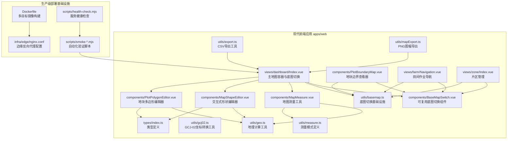
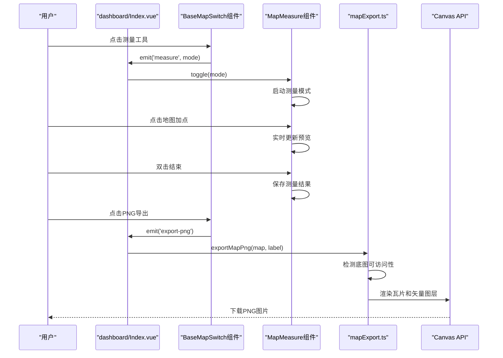
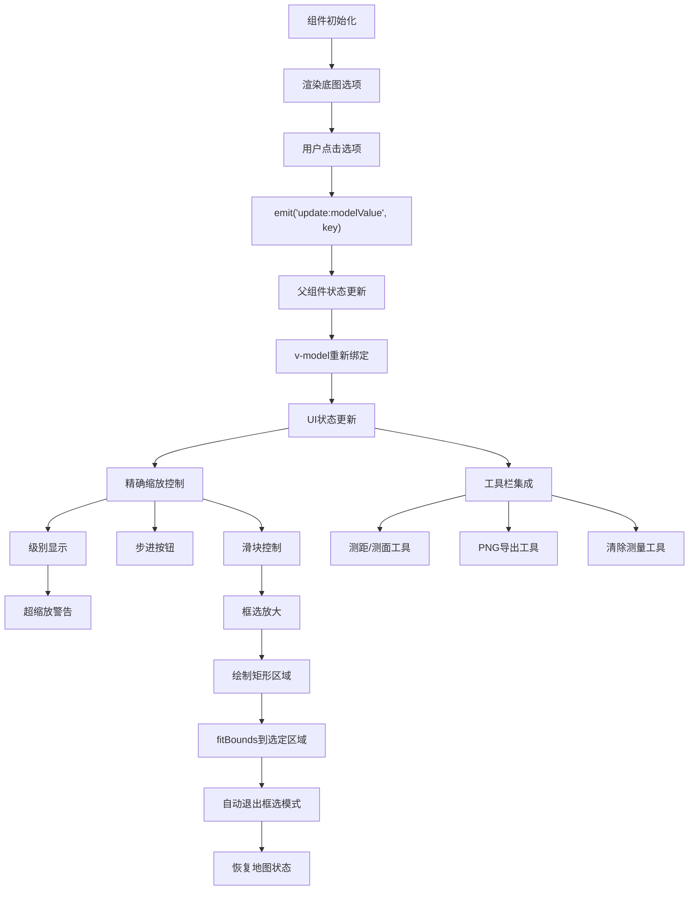
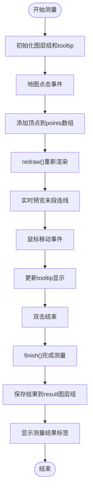
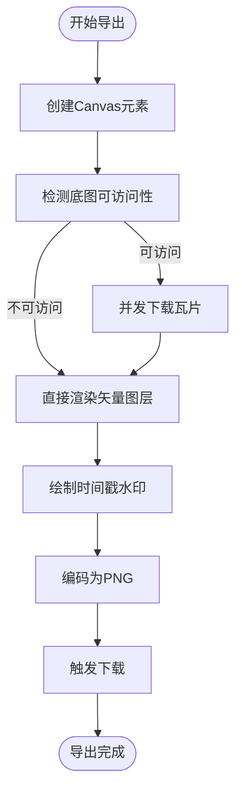
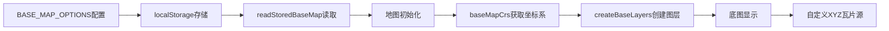
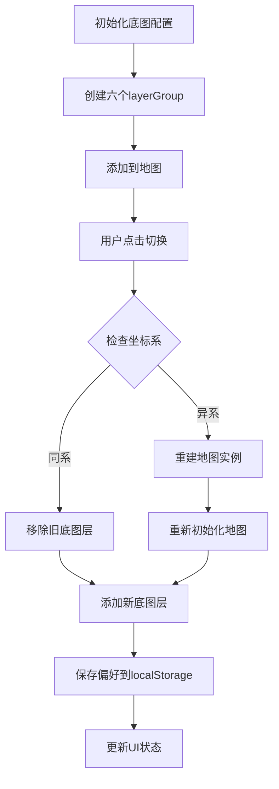
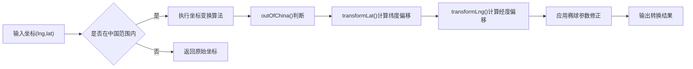
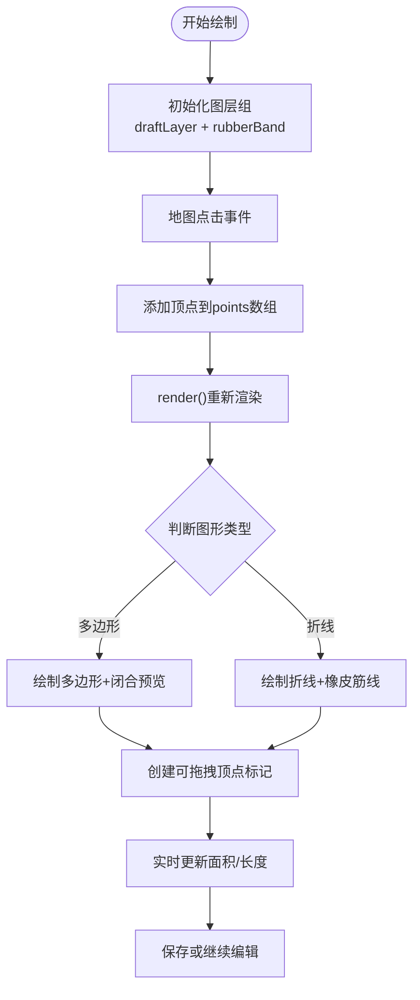
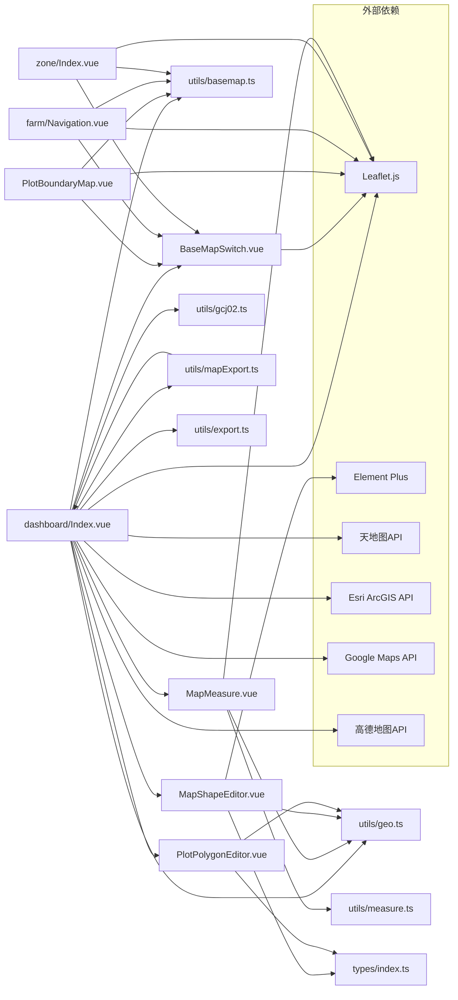

# 地图可视化

<cite>
**本文引用的文件**   
- [apps/web/src/utils/basemap.ts](file://apps/web/src/utils/basemap.ts)
- [apps/web/src/components/BaseMapSwitch.vue](file://apps/web/src/components/BaseMapSwitch.vue)
- [apps/web/src/views/dashboard/Index.vue](file://apps/web/src/views/dashboard/Index.vue)
- [apps/web/src/components/PlotBoundaryMap.vue](file://apps/web/src/components/PlotBoundaryMap.vue)
- [apps/web/src/views/farm/Navigation.vue](file://apps/web/src/views/farm/Navigation.vue)
- [apps/web/src/views/zone/Index.vue](file://apps/web/src/views/zone/Index.vue)
- [apps/web/src/utils/geo.ts](file://apps/web/src/utils/geo.ts)
- [apps/web/src/utils/gcj02.ts](file://apps/web/src/utils/gcj02.ts)
- [apps/web/src/leaflet.d.ts](file://apps/web/src/leaflet.d.ts)
- [apps/web/src/components/MapShapeEditor.vue](file://apps/web/src/components/MapShapeEditor.vue)
- [apps/web/src/components/PlotPolygonEditor.vue](file://apps/web/src/components/PlotPolygonEditor.vue)
- [apps/web/src/types/index.ts](file://apps/web/src/types/index.ts)
- [apps/web/src/components/MapMeasure.vue](file://apps/web/src/components/MapMeasure.vue)
- [apps/web/src/utils/measure.ts](file://apps/web/src/utils/measure.ts)
- [apps/web/src/utils/export.ts](file://apps/web/src/utils/export.ts)
- [apps/web/src/utils/mapExport.ts](file://apps/web/src/utils/mapExport.ts)
- [Dockerfile](file://Dockerfile)
- [infra/edge/nginx.conf](file://infra/edge/nginx.conf)
- [scripts/smoke-gateway.mjs](file://scripts/smoke-gateway.mjs)
- [scripts/smoke-services.mjs](file://scripts/smoke-services.mjs)
- [scripts/health-check.mjs](file://scripts/health-check.mjs)
- [apps/web/test/plot-zone-regressions.spec.ts](file://apps/web/test/plot-zone-regressions.spec.ts)
</cite>

## 更新摘要
**变更内容**   
- **新增地图测量工具**：实现距离测量和面积测量功能，支持实时预览、结果持久显示和一键清除
- **增强BaseMapSwitch工具栏**：集成测距、测面、PNG导出和清除测量结果等快捷工具按钮
- **实现PNG图幅导出系统**：支持当前视野的PNG导出，包含底图瓦片、矢量图层和测量结果
- **集成快速访问集群**：在驾驶舱右上角添加高频业务快捷入口，提升操作效率
- **完善交互体验**：测量工具与形状编辑器互斥，避免操作冲突，提供清晰的视觉反馈

## 目录
1. [简介](#简介)
2. [项目结构](#项目结构)
3. [核心组件](#核心组件)
4. [架构总览](#架构总览)
5. [详细组件分析](#详细组件分析)
6. [依赖关系分析](#依赖关系分析)
7. [性能与优化](#性能与优化)
8. [部署与验证](#部署与验证)
9. [故障排查](#故障排查)
10. [结论](#结论)
11. [附录](#附录)

## 简介
本文件为智慧农业平台"地图可视化"能力的技术文档。仓库中实现了基于 Leaflet 的现代地图可视化系统，提供完整的交互式地理数据编辑能力和多源底图切换功能：

- **统一底图切换基础设施**：通过BaseMapSwitch组件和basemap.ts工具模块，实现标准化的底图切换能力
- **六源底图支持**：天地图影像、Esri、Google、高德、矢量、自定义XYZ瓦片六种底图源
- **GCJ-02坐标转换**：内置专业的坐标转换工具，解决国内地图服务的坐标偏移问题
- **交互式形状编辑器**：MapShapeEditor组件支持管线、地块、片区的创建和编辑
- **地图测量工具**：MapMeasure组件提供距离测量和面积测量功能，支持实时预览和结果管理
- **PNG图幅导出**：完整的地图截图导出系统，支持底图瓦片和矢量图层合成
- **快速访问集群**：驾驶舱右上角的高频业务快捷入口
- **地块边界解析**：支持 GeoJSON/MultiPolygon 兼容、坐标转换、面积计算等基础能力
- **设备点位标记**：支持设备站点标注、图标自定义与信息窗口展示
- **地图交互**：缩放、平移、飞行定位；测距与面积计算
- **空间数据处理**：坐标系转换、几何计算与性能优化策略
- **生产级部署验证**：完整的Docker镜像构建、边缘部署和烟雾测试验证流程

## 项目结构
本项目在 apps/web 子应用中实现现代化的地图可视化能力：



**图表来源**
- [apps/web/src/views/dashboard/Index.vue:111-125](file://apps/web/src/views/dashboard/Index.vue#L111-L125)
- [apps/web/src/components/BaseMapSwitch.vue:16-21](file://apps/web/src/components/BaseMapSwitch.vue#L16-L21)
- [apps/web/src/utils/basemap.ts:11-18](file://apps/web/src/utils/basemap.ts#L11-L18)
- [apps/web/src/components/MapMeasure.vue:1-175](file://apps/web/src/components/MapMeasure.vue#L1-L175)
- [apps/web/src/utils/mapExport.ts:1-214](file://apps/web/src/utils/mapExport.ts#L1-L214)
- [Dockerfile:62-75](file://Dockerfile#L62-L75)
- [infra/edge/nginx.conf:42-81](file://infra/edge/nginx.conf#L42-L81)

## 核心组件

### BaseMapSwitch 可复用组件
- **统一UI界面**：亮色主题设计，绝对定位浮于地图容器右上
- **双向数据绑定**：支持 v-model 双向绑定，与父组件状态同步
- **样式定制**：半透明白色背景，蓝色活动状态高亮，阴影效果
- **无障碍支持**：title属性提供悬停提示，键盘友好
- **响应式设计**：flex布局，自适应不同屏幕尺寸
- **精确缩放控制**：滑块、步进按钮、当前级别显示和超缩放警告功能
- **增强框选放大工具**：支持在地图上拖拽矩形区域进行精准放大，具备一次性使用特性
- **工具栏集成**：集成测距、测面、PNG导出和清除测量结果等快捷工具
- **自定义影像源配置**：支持无人机正射和本地瓦片服务的灵活接入

### basemap.ts 工具模块
- **配置管理**：BASE_MAP_OPTIONS定义六种底图选项及其描述
- **存储管理**：readStoredBaseMap/storeBaseMap实现localStorage持久化
- **坐标系判断**：isGcjBaseMap函数识别GCJ-02坐标系
- **瓦片服务**：createTiandituTiles/createEsriTiles/createAmapTiles/createGoogleTiles创建各种底图瓦片
- **CRS管理**：createGcjCrs/baseMapCrs处理GCJ-02坐标投影转换
- **图层管理**：createBaseLayers统一管理所有底图层组
- **自定义源支持**：readCustomBaseMap/storeCustomBaseMap/clearCustomBaseMap管理自定义XYZ瓦片源

### 地图测量工具（MapMeasure）
- **双模式支持**：距离测量（米/公里）和面积测量（亩），与地块台账同一套计算公式
- **实时预览**：绘制过程中实时显示草稿形状、面积或长度统计
- **结果持久化**：测量完成后结果保留在地图上，支持单独清除
- **交互友好**：单击加点、双击结束、Esc取消，鼠标移动实时预览
- **状态管理**：与形状编辑器互斥，避免操作冲突
- **视觉反馈**：黄色虚线表示测量路径，半透明填充表示测量区域

### PNG图幅导出系统
- **智能底图检测**：自动检测底图是否支持跨域读取，不支持时退化为矢量图幅
- **并发瓦片加载**：8路并发下载瓦片，平衡性能和服务器压力
- **矢量图层渲染**：支持地块、管线、设备点位、测量结果的矢量渲染
- **高质量输出**：支持设备像素比缩放，生成高清PNG图片
- **时间戳水印**：自动生成带时间和底图信息的水印

### 快速访问集群
- **高频业务入口**：在驾驶舱右上角提供常用功能的快捷按钮
- **权限过滤**：根据用户权限动态显示可用功能
- **状态指示**：当前激活的面板高亮显示
- **响应式布局**：自适应不同屏幕尺寸

### GCJ-02坐标转换工具
- **双向转换**：支持WGS84与GCJ-02的正算和逆算转换
- **高精度算法**：采用迭代逆算方法，收敛到1e-9度精度
- **中国范围检测**：自动识别境外坐标，避免不必要的偏移处理
- **显示层投影**：在高德底图下实现精确的地块边界对齐

### MapShapeEditor 交互式形状编辑器
- **多类型支持**：管线（line）、地块（plot）、片区（zone）三种图形类型的创建和编辑
- **顶点操作**：支持拖拽顶点微调、右键删除顶点、双击添加新点
- **实时预览**：绘制过程中实时显示草稿形状、面积或长度统计
- **智能闭合**：多边形自动闭合，折线动态连接最后一个点和鼠标位置
- **响应式适配**：支持移动端和桌面端的自适应布局

### PlotPolygonEditor 地块多边形编辑器
- **独立地图实例**：在表单内嵌独立的 Leaflet 地图
- **顶点标记**：显示带序号的顶点标记，支持撤销和清空操作
- **面积计算**：实时计算多边形面积并显示
- **双向绑定**：支持 v-model 双向数据绑定

### 地理计算工具
- **面积计算**：使用等距圆柱投影进行精确的面积计算（平方米转亩）
- **长度测量**：折线长度的米级精度计算
- **坐标转换**：[经度, 纬度] 与 Leaflet [纬度, 经度] 格式转换
- **边界解析**：支持多种输入格式的边界数据解析

**章节来源**
- [apps/web/src/components/BaseMapSwitch.vue:1-490](file://apps/web/src/components/BaseMapSwitch.vue#L1-L490)
- [apps/web/src/utils/basemap.ts:1-185](file://apps/web/src/utils/basemap.ts#L1-L185)
- [apps/web/src/components/MapMeasure.vue:1-175](file://apps/web/src/components/MapMeasure.vue#L1-L175)
- [apps/web/src/utils/mapExport.ts:1-214](file://apps/web/src/utils/mapExport.ts#L1-L214)
- [apps/web/src/views/dashboard/Index.vue:111-125](file://apps/web/src/views/dashboard/Index.vue#L111-L125)
- [apps/web/src/views/dashboard/Index.vue:1045-1068](file://apps/web/src/views/dashboard/Index.vue#L1045-L1068)
- [apps/web/src/utils/geo.ts:1-163](file://apps/web/src/utils/geo.ts#L1-L163)
- [apps/web/src/utils/gcj02.ts:1-61](file://apps/web/src/utils/gcj02.ts#L1-L61)

## 架构总览
下图展示了增强的地图测量工具和PNG导出系统的完整工作流程：



**图表来源**
- [apps/web/src/views/dashboard/Index.vue:111-125](file://apps/web/src/views/dashboard/Index.vue#L111-L125)
- [apps/web/src/views/dashboard/Index.vue:1045-1068](file://apps/web/src/views/dashboard/Index.vue#L1045-L1068)
- [apps/web/src/components/MapMeasure.vue:72-150](file://apps/web/src/components/MapMeasure.vue#L72-L150)
- [apps/web/src/utils/mapExport.ts:182-214](file://apps/web/src/utils/mapExport.ts#L182-L214)

## 详细组件分析

### BaseMapSwitch 可复用组件

#### 核心功能特性
- **双向数据绑定**：通过 v-model 实现与父组件的状态同步
- **统一UI设计**：亮色主题，绝对定位，悬浮于地图右上角
- **选项渲染**：动态渲染 BASE_MAP_OPTIONS 中的所有底图选项
- **状态指示**：当前选中项高亮显示，其他项灰色显示
- **事件处理**：点击时触发 update:modelValue 事件
- **精确缩放控制**：滑块、步进按钮、当前级别显示和超缩放警告
- **增强框选放大工具**：支持拖拽矩形区域进行精准放大，具备一次性使用特性
- **工具栏集成**：集成测距、测面、PNG导出和清除测量结果等快捷工具
- **自定义影像源配置**：支持无人机正射和本地瓦片服务接入

#### 工具栏功能扩展
**新增功能**：BaseMapSwitch现在集成了完整的地图工具栏：

- **测距工具**：点击后进入距离测量模式，与形状编辑器互斥
- **测面工具**：点击后进入面积测量模式，支持多边形区域测量
- **PNG导出**：一键导出当前视野为PNG图片，包含底图和矢量图层
- **清除测量**：清除当前显示的测量结果
- **工具状态指示**：当有测量结果时显示清除按钮
- **测量模式联动**：与MapMeasure组件的状态同步

#### 精确缩放控制系统
- **滑块控制**：支持拖动滑块精确调整缩放级别
- **步进按钮**：+/- 按钮用于逐级调整缩放
- **当前级别显示**：实时显示当前缩放级别和原生级别信息
- **超缩放警告**：当超过原生级别时显示黄色警告提示
- **框选放大**：支持在地图上拖拽矩形区域进行精准放大

#### 增强框选放大工具
**新增功能**：框选工具现在具备以下重要特性：

- **一次性使用模式**：框选完成后自动退出，避免"只能缩放不能拖拽"的问题
- **Escape键支持**：按Esc键可随时取消框选操作
- **窗口失焦处理**：当用户切换到其他窗口（如Alt+Tab）时自动取消框选
- **浮动提示显示**：在地图底部显示实时提示，说明框选工具的一次性特性和退出方式
- **光标状态管理**：框选时显示十字光标，退出后恢复原状
- **事件防抖处理**：阻止地图点击事件，防止误加顶点

#### 自定义影像源配置系统
- **URL验证**：自动验证XYZ瓦片URL格式的有效性
- **子域支持**：支持多子域配置以提高加载性能
- **原生级别配置**：可配置瓦片的真实细节最高级别
- **显示级别配置**：支持超过原生级别的插值放大
- **预览功能**：支持测试加载当前视野的瓦片进行验证
- **本地存储**：自定义配置保存到localStorage，支持持久化

#### 技术实现细节


**图表来源**
- [apps/web/src/components/BaseMapSwitch.vue:15-22](file://apps/web/src/components/BaseMapSwitch.vue#L15-L22)
- [apps/web/src/components/BaseMapSwitch.vue:108-131](file://apps/web/src/components/BaseMapSwitch.vue#L108-L131)
- [apps/web/src/components/BaseMapSwitch.vue:131-201](file://apps/web/src/components/BaseMapSwitch.vue#L131-L201)

#### 样式设计
- **容器样式**：absolute定位，z-index: 500，top: 12px, right: 12px
- **背景样式**：rgba(255, 255, 255, 0.92)半透明白色背景
- **边框样式**：1px solid #dcdfe6，border-radius: 6px
- **阴影效果**：box-shadow: 0 2px 8px rgba(0, 0, 0, 0.12)
- **按钮样式**：透明背景，#606266文字颜色，hover效果
- **活动状态**：#409eff蓝色背景，白色文字
- **缩放控件样式**：渐变滑块，圆形滑块手柄，蓝色活动状态
- **级别显示样式**：蓝色背景，超缩放时变为橙色警告样式
- **框选按钮样式**：活动状态时蓝色背景和白色文字
- **工具栏样式**：统一的工具按钮样式，活动状态高亮显示

#### 使用示例
```vue
<BaseMapSwitch 
  :model-value="baseMapKey" 
  @update:model-value="switchBaseMap" 
  :map="mapInstance"
  :measuring="measureMode"
  tools
  @custom-updated="onCustomUpdated"
  @measure="onMeasure"
  @export-png="onExportPng"
  @clear-measure="measureTool?.clear()"
/>
```

**章节来源**
- [apps/web/src/components/BaseMapSwitch.vue:1-490](file://apps/web/src/components/BaseMapSwitch.vue#L1-L490)

### MapMeasure 地图测量工具

#### 核心功能特性
- **双模式支持**：距离测量（distance）和面积测量（area）两种模式
- **实时预览**：绘制过程中实时显示草稿形状、面积或长度统计
- **结果持久化**：测量完成后结果保留在地图上，支持单独清除
- **交互友好**：单击加点、双击结束、Esc取消，鼠标移动实时预览
- **状态管理**：与形状编辑器互斥，避免操作冲突
- **视觉反馈**：黄色虚线表示测量路径，半透明填充表示测量区域

#### 测量模式管理
- **模式切换**：toggle()方法用于切换测量模式
- **状态同步**：通过active-change事件向父组件通知状态变化
- **资源清理**：组件销毁时自动清理所有监听器和临时对象
- **地图重建支持**：当地图实例变化时自动复位测量状态

#### 交互流程


**图表来源**
- [apps/web/src/components/MapMeasure.vue:72-150](file://apps/web/src/components/MapMeasure.vue#L72-L150)

#### 关键算法实现
- **距离计算**：使用polylineLengthM函数计算折线长度，精度达到米级
- **面积计算**：使用polygonAreaMu函数计算多边形面积，与地块台账同一套公式
- **实时预览**：mousemove事件中动态创建预览线段，显示即将测量的下一段
- **结果去重**：finish()方法中对重复点击的点进行去重处理
- **内存管理**：cleanup函数统一管理所有事件监听器的移除

#### 样式与用户体验
- **测量样式**：黄色虚线（#ffd54f）表示测量路径，半透明填充（opacity: 0.15）
- **顶点标记**：白色圆点标记，带黄色边框，半径4像素
- **Tooltip样式**：深色背景（rgba(7, 25, 48, .92)），黄色文字（#ffe082）
- **提示文本**：实时显示测量进度和操作提示
- **结果标签**：永久显示测量结果，位于多边形中心或折线末端

**章节来源**
- [apps/web/src/components/MapMeasure.vue:1-175](file://apps/web/src/components/MapMeasure.vue#L1-L175)
- [apps/web/src/utils/measure.ts:1-3](file://apps/web/src/utils/measure.ts#L1-L3)

### PNG图幅导出系统

#### 核心功能特性
- **智能底图检测**：自动检测底图是否支持跨域读取
- **并发瓦片加载**：8路并发下载瓦片，平衡性能和服务器压力
- **矢量图层渲染**：支持地块、管线、设备点位、测量结果的矢量渲染
- **高质量输出**：支持设备像素比缩放，生成高清PNG图片
- **时间戳水印**：自动生成带时间和底图信息的水印

#### 导出流程


**图表来源**
- [apps/web/src/utils/mapExport.ts:182-214](file://apps/web/src/utils/mapExport.ts#L182-L214)

#### 关键技术实现
- **瓦片预检**：basemapReadable()函数预检每个底图层是否支持跨域访问
- **瓦片收集**：collectTileJobs()函数枚举覆盖当前视野的所有瓦片
- **并发控制**：fetchTiles()函数使用Promise.all实现8路并发下载
- **矢量渲染**：drawVectors()函数遍历地图图层，渲染Polygon、Polyline、CircleMarker、Marker
- **设备聚合支持**：特殊处理设备聚合点位的divIcon渲染
- **画布合成**：将瓦片和矢量图层合成到Canvas上

#### 错误处理和降级
- **跨域失败降级**：当底图不支持跨域时，自动退化为矢量图幅
- **单瓦片失败**：单个瓦片下载失败不影响整体导出
- **Canvas编码失败**：捕获toBlob()异常并提供用户反馈
- **内存管理**：及时释放ImageBitmap和ObjectURL资源

**章节来源**
- [apps/web/src/utils/mapExport.ts:1-214](file://apps/web/src/utils/mapExport.ts#L1-L214)

### 快速访问集群

#### 核心功能特性
- **高频业务入口**：在驾驶舱右上角提供常用功能的快捷按钮
- **权限过滤**：根据用户权限动态显示可用功能
- **状态指示**：当前激活的面板高亮显示
- **响应式布局**：自适应不同屏幕尺寸

#### 集成实现
- **位置定位**：绝对定位在右上角，z-index: 950
- **样式设计**：深色背景，蓝色边框，hover效果
- **激活状态**：当前面板对应的按钮高亮显示
- **图标支持**：支持HTML图标和文本标签

**章节来源**
- [apps/web/src/views/dashboard/Index.vue:69-83](file://apps/web/src/views/dashboard/Index.vue#L69-L83)
- [apps/web/src/views/dashboard/Index.vue:1204-1210](file://apps/web/src/views/dashboard/Index.vue#L1204-L1210)

### basemap.ts 工具模块

#### 核心功能特性
- **配置管理**：BASE_MAP_OPTIONS定义六种底图选项
- **存储管理**：BASEMAP_STORAGE_KEY常量，readStoredBaseMap/storeBaseMap函数
- **坐标系判断**：isGcjBaseMap函数识别GCJ-02坐标系
- **瓦片服务**：createTiandituTiles/createEsriTiles/createAmapTiles/createGoogleTiles
- **CRS管理**：createGcjCrs/baseMapCrs处理坐标投影转换
- **图层管理**：createBaseLayers统一管理底图层组
- **自定义源管理**：readCustomBaseMap/storeCustomBaseMap/clearCustomBaseMap

#### 技术实现细节


**图表来源**
- [apps/web/src/utils/basemap.ts:11-185](file://apps/web/src/utils/basemap.ts#L11-L185)

#### 底图选项配置
- `tdt-img`：天地图卫星影像 + 中文注记
- `esri-img`：Esri World Imagery 卫星影像 + 天地图中文注记
- `google-img`：Google 卫星影像（原生22级）+ 天地图中文注记
- `amap-img`：高德卫星影像 + 路网注记（GCJ-02坐标）
- `tdt-vec`：天地图矢量地图 + 中文注记
- `custom`：自定义XYZ瓦片源（无人机正射/本地瓦片服务）

#### 瓦片服务实现
- **天地图服务**：WMTS协议，支持img/cia/vec/cva图层
- **Esri服务**：ArcGIS REST API，World_Imagery图层
- **Google服务**：mt{s}.google.com/vt/lyrs=s，原生22级高清卫星影像
- **高德服务**：appmaptile接口，style=6卫星影像，style=8路网注记
- **自定义服务**：支持标准XYZ瓦片协议，支持子域和多级别配置

#### GCJ-02坐标转换集成
- **显示层投影**：自定义Leaflet CRS，将WGS84坐标转换为GCJ-02后再进行墨卡托投影
- **双向转换**：屏幕坐标逆算回WGS84，确保业务数据的准确性
- **精度保证**：迭代算法收敛到1e-9度，远优于厘米级精度
- **范围检测**：自动识别境外坐标，避免不必要的偏移处理

#### 深层缩放支持
- **最大缩放级别**：从18级提升到22级
- **原生瓦片限制**：maxNativeZoom: 22（Google），18级以上进行放大渲染
- **应用场景**：便于精确对齐地块边界顶点

**章节来源**
- [apps/web/src/utils/basemap.ts:1-185](file://apps/web/src/utils/basemap.ts#L1-L185)

### 多页面集成

#### PlotBoundaryMap 地块边界查看器
- **组件集成**：使用BaseMapSwitch组件提供底图切换功能
- **地图初始化**：使用basemap.ts的工具函数创建地图实例
- **底图切换**：实现热切换和跨坐标系切换逻辑
- **边界显示**：在地块边界地图上正确显示多边形和中心点标记

#### Navigation 田间作业导航
- **组件集成**：在导航地图中添加BaseMapSwitch组件
- **功能扩展**：支持转场模式和覆盖模式两种作业规划
- **路径规划**：基于地块边界的路线规划和覆盖方案生成
- **底图适配**：在不同底图下正确显示作业路径和地块边界

#### ZoneIndex 片区管理
- **组件集成**：在片区详情地图中使用BaseMapSwitch组件
- **成员管理**：显示片区下的成员地块和凸包边界
- **交互操作**：支持划入地块、移出地块等操作
- **地图联动**：片区选择和地图显示的双向联动

**章节来源**
- [apps/web/src/components/PlotBoundaryMap.vue:1-124](file://apps/web/src/components/PlotBoundaryMap.vue#L1-L124)
- [apps/web/src/views/farm/Navigation.vue:60-259](file://apps/web/src/views/farm/Navigation.vue#L60-L259)
- [apps/web/src/views/zone/Index.vue:40-239](file://apps/web/src/views/zone/Index.vue#L40-L239)

### 底图切换系统

#### 核心功能特性
- **六源底图配置**：
  - `tdt-img`：天地图卫星影像 + 中文注记
  - `esri-img`：Esri World Imagery + 天地图中文注记
  - `google-img`：Google 卫星影像（原生22级）+ 天地图中文注记
  - `amap-img`：高德卫星影像 + 透明路网注记（GCJ-02坐标）
  - `tdt-vec`：天地图矢量地图 + 中文注记
  - `custom`：自定义XYZ瓦片源（无人机正射/本地瓦片服务）
- **热切换机制**：通过 layerGroup 管理底图层，动态替换而不影响业务图层
- **跨坐标系切换**：支持WGS84与GCJ-02之间的无缝切换，自动重建地图实例
- **持久化存储**：使用 `agri-basemap` 键名存储用户选择
- **默认值处理**：未设置时默认为天地图影像

#### 技术实现细节


**图表来源**
- [apps/web/src/views/dashboard/Index.vue:456-477](file://apps/web/src/views/dashboard/Index.vue#L456-L477)
- [apps/web/src/utils/basemap.ts:82-89](file://apps/web/src/utils/basemap.ts#L82-L89)

#### GCJ-02坐标转换集成
- **显示层投影**：自定义Leaflet CRS，将WGS84坐标转换为GCJ-02后再进行墨卡托投影
- **双向转换**：屏幕坐标逆算回WGS84，确保业务数据的准确性
- **精度保证**：迭代算法收敛到1e-9度，远优于厘米级精度
- **范围检测**：自动识别境外坐标，避免不必要的偏移处理

#### Google瓦片服务集成
- **高清卫星影像**：原生22级缩放，远超其他底图的18级限制
- **WGS84无偏移**：与地块边界数据完全匹配，无需坐标转换
- **服务地址**：`https://mt{s}.google.com/vt/lyrs=s&x={x}&y={y}&z={z}`
- **子域支持**：支持0-3四个子域提高加载性能

#### 自定义XYZ瓦片源系统
- **标准协议支持**：支持XYZ瓦片协议，包含{x},{y},{z}占位符
- **子域配置**：支持多子域配置，提高并发加载性能
- **级别配置**：可分别配置原生级别和显示级别
- **预览验证**：支持测试加载当前视野瓦片进行验证
- **本地存储**：自定义配置持久化到localStorage

**章节来源**
- [apps/web/src/views/dashboard/Index.vue:456-477](file://apps/web/src/views/dashboard/Index.vue#L456-L477)
- [apps/web/src/utils/basemap.ts:36-57](file://apps/web/src/utils/basemap.ts#L36-L57)
- [apps/web/src/utils/basemap.ts:59-80](file://apps/web/src/utils/basemap.ts#L59-L80)
- [apps/web/src/utils/basemap.ts:112-122](file://apps/web/src/utils/basemap.ts#L112-L122)
- [apps/web/src/utils/basemap.ts:160-170](file://apps/web/src/utils/basemap.ts#L160-L170)

### GCJ-02坐标转换工具

#### 核心功能特性
- **WGS84 → GCJ-02正算**：将GPS原始坐标转换为国内地图加密坐标
- **GCJ-02 → WGS84逆算**：通过迭代算法还原真实地理坐标
- **中国范围检测**：自动识别境外坐标，避免不必要的偏移处理
- **高精度算法**：采用公开通用实现，精度达到厘米级

#### 技术实现细节


**图表来源**
- [apps/web/src/utils/gcj02.ts:13-45](file://apps/web/src/utils/gcj02.ts#L13-L45)

#### 关键算法实现
- **中国范围检测**：`outOfChina()` 函数判断坐标是否在中国大陆范围内
- **纬度变换**：`transformLat()` 使用复杂的三角函数组合计算纬度偏移
- **经度变换**：`transformLng()` 使用类似的算法计算经度偏移
- **迭代逆算**：`gcj02ToWgs84()` 通过最多8次迭代收敛到目标精度

#### 应用场景
- **高德底图显示**：在高德卫星影像上正确显示WGS84坐标的地块边界
- **数据验证**：验证导入的GCJ-02坐标数据的准确性
- **坐标调试**：开发和测试阶段的坐标转换验证

**章节来源**
- [apps/web/src/utils/gcj02.ts:1-61](file://apps/web/src/utils/gcj02.ts#L1-L61)

### MapShapeEditor 交互式形状编辑器

#### 核心功能特性
- **多模式支持**：创建模式（create）和编辑模式（edit）
- **三种图形类型**：
  - 管线（line）：支持水线、电线、网线等不同类型
  - 地块（plot）：支持农田、温室、果园、水产养殖等类型
  - 片区（zone）：自定义颜色和管理区域
- **顶点交互**：
  - 拖拽顶点微调位置
  - 右键删除顶点
  - 双击防止重复添加
  - 键盘快捷键（Esc取消）

#### 技术实现细节


**图表来源**
- [apps/web/src/components/MapShapeEditor.vue:158-193](file://apps/web/src/components/MapShapeEditor.vue#L158-L193)
- [apps/web/src/components/MapShapeEditor.vue:207-227](file://apps/web/src/components/MapShapeEditor.vue#L207-L227)

#### 关键算法实现
- **顶点拖拽处理**：`movePoint()` 方法实时更新顶点坐标，避免重建标记导致拖拽中断
- **橡皮筋线效果**：`handleMapMouseMove()` 动态连接最后一点和鼠标位置
- **多边形闭合预览**：当点数≥2时，额外显示回到首点的闭合边预览
- **防抖处理**：双击缩放时防止重复添加相同坐标的点

#### 样式与用户体验
- **深色主题UI**：采用科技感深蓝背景，半透明边框和发光效果
- **响应式布局**：支持不同屏幕尺寸的自适应定位
- **视觉反馈**：顶点标记带序号气泡，状态栏显示实时统计数据
- **无障碍支持**：键盘导航和屏幕阅读器友好

**章节来源**
- [apps/web/src/components/MapShapeEditor.vue:1-460](file://apps/web/src/components/MapShapeEditor.vue#L1-L460)

### PlotPolygonEditor 地块多边形编辑器

#### 功能特点
- **独立地图实例**：每个编辑器拥有自己的 Leaflet 地图实例
- **工具栏控制**：提供撤销、清空等操作按钮
- **实时面积显示**：顶点数≥3时自动计算并显示面积
- **顶点标记**：蓝色圆点标记，带永久序号标签

#### 实现机制
- **地图初始化**：使用天地图卫星影像作为底图
- **图层管理**：shapeLayer 专门用于存储编辑相关的几何对象
- **事件处理**：点击地图添加顶点，工具栏按钮触发相应操作
- **生命周期管理**：组件销毁时清理所有地图资源和事件监听器

**章节来源**
- [apps/web/src/components/PlotPolygonEditor.vue:1-189](file://apps/web/src/components/PlotPolygonEditor.vue#L1-L189)

### 地理计算工具（geo.ts）

#### 核心算法
- **面积计算**：使用等距圆柱投影 + 鞋带公式，精度达到球面面积的99%以上
- **长度测量**：分段计算折线长度，考虑纬度变化对经度距离的影响
- **坐标转换**：统一处理 [经度, 纬度] 和 [纬度, 经度] 两种格式

#### 数据处理流程


**图表来源**
- [apps/web/src/utils/geo.ts:47-81](file://apps/web/src/utils/geo.ts#L47-L81)
- [apps/web/src/utils/geo.ts:135-160](file://apps/web/src/utils/geo.ts#L135-L160)

**章节来源**
- [apps/web/src/utils/geo.ts:1-163](file://apps/web/src/utils/geo.ts#L1-L163)

### 类型定义系统

#### 形状编辑相关类型
- **MapShapeKind**：图形类型枚举（'line' | 'plot' | 'zone'）
- **MapShapeMode**：编辑模式（'create' | 'edit'）
- **MapShapeActive**：活动状态信息
- **MapShapeTarget**：目标图形数据
- **MapShapeSaved**：保存后的结果

#### 测量相关类型
- **MeasureMode**：测量模式（'distance' | 'area'）

#### 业务数据类型
- **PlotType**：地块类型枚举
- **InfraLineType**：管线类型枚举
- **PlotBoundary**：解析后的地块边界数据

**章节来源**
- [apps/web/src/types/index.ts:133-162](file://apps/web/src/types/index.ts#L133-L162)
- [apps/web/src/utils/measure.ts:1-3](file://apps/web/src/utils/measure.ts#L1-L3)

## 依赖关系分析



**图表来源**
- [apps/web/src/views/dashboard/Index.vue:111-125](file://apps/web/src/views/dashboard/Index.vue#L111-L125)
- [apps/web/src/components/BaseMapSwitch.vue:16-21](file://apps/web/src/components/BaseMapSwitch.vue#L16-L21)
- [apps/web/src/components/PlotBoundaryMap.vue:13-15](file://apps/web/src/components/PlotBoundaryMap.vue#L13-L15)
- [apps/web/src/views/farm/Navigation.vue:172-174](file://apps/web/src/views/farm/Navigation.vue#L172-L174)
- [apps/web/src/views/zone/Index.vue:126-128](file://apps/web/src/views/zone/Index.vue#L126-L128)
- [apps/web/src/components/MapMeasure.vue:1-175](file://apps/web/src/components/MapMeasure.vue#L1-L175)

## 性能与优化

### 底图切换优化
- **图层分组管理**：使用 layerGroup 统一管理底图层，批量操作更高效
- **热切换机制**：只替换底图层，不重建整个地图，减少性能开销
- **预加载策略**：初始化时创建所有底图层，切换时无需等待网络请求
- **内存管理**：及时移除不再使用的图层，避免内存泄漏

### BaseMapSwitch组件优化
- **轻量级组件**：无复杂逻辑，仅负责UI展示和事件分发
- **按需渲染**：仅在需要时渲染底图选项按钮
- **样式优化**：CSS-in-JS方式，减少样式文件大小
- **事件委托**：使用事件冒泡减少事件监听器数量
- **精确缩放优化**：滑块和步进按钮的事件处理优化
- **增强框选工具优化**：高效的矩形绘制、事件处理和状态管理
- **工具栏优化**：工具按钮的懒加载和状态缓存

### 测量工具性能优化
- **一次性模式**：避免长时间持有测量状态导致的性能问题
- **事件监听优化**：只在测量模式下注册必要的事件监听器
- **DOM操作优化**：及时清理临时创建的几何对象和tooltip
- **内存释放**：测量结束后立即释放所有引用和事件监听器
- **计算优化**：实时预览使用轻量级算法，复杂计算延后到保存时

### PNG导出性能优化
- **并发控制**：8路并发下载瓦片，平衡性能和服务器压力
- **预检机制**：提前检测底图可访问性，避免不必要的瓦片下载
- **增量渲染**：只渲染当前视野内的瓦片和矢量图层
- **内存管理**：及时释放ImageBitmap和Canvas资源
- **错误隔离**：单个瓦片失败不影响整体导出流程

### GCJ-02转换优化
- **范围检测优化**：快速判断坐标是否在中国范围内，避免不必要的计算
- **迭代收敛优化**：最多8次迭代即可达到1e-9度精度，平衡精度与性能
- **缓存策略**：对于频繁访问的坐标转换结果进行缓存

### 渲染优化
- **图层分离**：将编辑相关的几何对象放入独立的 layerGroup，便于批量管理
- **增量更新**：拖动顶点时只更新几何坐标，不重建整个标记层
- **防抖处理**：双击缩放时过滤重复的点击事件

### 内存管理
- **资源清理**：组件销毁时移除所有地图图层和事件监听器
- **引用释放**：及时释放地图实例和图层对象的引用
- **事件解绑**：onBeforeUnmount 中正确移除所有事件监听器

### 用户体验优化
- **响应式设计**：支持移动端触摸操作和自适应布局
- **视觉反馈**：实时显示绘制状态和统计数据
- **错误处理**：非法输入检测和友好的错误提示
- **精确缩放体验**：平滑的滑块控制和直观的级别显示
- **增强框选体验**：实时的矩形预览、流畅的放大动画和明确的退出提示
- **测量交互体验**：实时的预览线和tooltip提示，清晰的操作指引
- **导出反馈**：导出过程中的进度提示和结果反馈

## 部署与验证

### Docker镜像构建
- **多目标构建**：支持app和edge两个部署目标
- **前端资源优化**：构建产物包含内容哈希，支持长期缓存
- **环境变量注入**：VITE_TIANDITU_KEY通过构建参数传入
- **证书自动生成**：edge目标自动生成自签证书用于开发环境

### 边缘部署配置
- **HTTPS终止**：nginx配置支持TLS证书，默认使用自签证书
- **API反向代理**：统一通过网关转发API请求
- **静态资源缓存**：JS/CSS等资源启用7天缓存
- **历史路由支持**：SPA路由回退到index.html
- **安全头配置**：X-Content-Type-Options、X-Frame-Options等安全响应头

### 烟雾测试验证
- **网关链路测试**：验证认证、授权、业务接口完整性
- **服务健康检查**：确保所有微服务正常启动
- **前端功能验证**：验证地图切换、坐标转换、测量工具等核心功能
- **端到端测试**：完整的业务流程验证和质量保障

### 部署验证流程
1. **镜像构建验证**：确认Docker镜像构建成功
2. **服务启动验证**：检查app和edge容器健康状态
3. **API接口验证**：测试登录、地块查询等核心接口
4. **前端功能验证**：验证地图切换、底图显示、测量工具等功能
5. **证书链验证**：确保证书链正确配置和访问

### 自动化验证脚本
- **smoke-gateway.mjs**：网关链路测试，验证认证授权和业务接口
- **smoke-services.mjs**：全量服务健康检查，确保所有微服务正常启动
- **health-check.mjs**：服务健康检查，监控各服务端口状态和健康检查配置

**章节来源**
- [Dockerfile:1-75](file://Dockerfile#L1-L75)
- [infra/edge/nginx.conf:42-81](file://infra/edge/nginx.conf#L42-L81)
- [scripts/smoke-gateway.mjs:55-147](file://scripts/smoke-gateway.mjs#L55-L147)
- [scripts/smoke-services.mjs:7-22](file://scripts/smoke-services.mjs#L7-L22)
- [scripts/health-check.mjs:1-12](file://scripts/health-check.mjs#L1-L12)

## 故障排查

### BaseMapSwitch组件问题
- **组件无法显示**：检查父组件是否正确传递modelValue和事件处理器
- **样式异常**：确认父容器设置了position: relative
- **点击无响应**：检查事件冒泡是否被阻止，z-index层级是否正确
- **缩放控制失效**：检查map实例是否正确传递，zoom事件监听是否正常
- **框选工具异常**：确认鼠标事件监听是否正确注册，矩形绘制逻辑是否正常
- **框选模式卡死**：检查Escape键事件监听，窗口blur事件处理，以及stopBox函数的调用时机
- **工具栏按钮无效**：检查tools属性是否正确传递，事件处理器是否正确绑定

### 测量工具特定问题
**新增排查项**：
- **测量模式无法启动**：确认map实例存在，mode参数有效
- **点击无响应**：检查click事件监听器是否正确注册
- **预览线不显示**：确认mousemove事件监听，last点状态管理
- **双击结束无效**：检查dblclick事件监听，finish()函数调用时机
- **结果无法清除**：确认clear()方法调用，result图层组管理
- **与形状编辑器冲突**：检查activeShape和measureMode的状态互斥逻辑
- **测量结果丢失**：确认地图重建时的状态重置逻辑

### mapExport.ts导出问题
**新增排查项**：
- **PNG导出失败**：检查Canvas API支持，浏览器兼容性
- **底图无法加载**：确认CORS配置，网络连接状态
- **导出图片模糊**：检查devicePixelRatio处理，Canvas缩放比例
- **矢量图层缺失**：确认图层遍历逻辑，样式属性提取
- **内存溢出**：检查ImageBitmap释放，Canvas清理

### basemap.ts工具模块问题
- **底图无法加载**：检查VITE_TIANDITU_KEY环境变量是否正确配置
- **存储失效**：确认浏览器localStorage可用，检查存储权限
- **坐标系错误**：验证isGcjBaseMap函数的判断逻辑
- **Google瓦片加载失败**：检查网络连接，确认Google Maps API可达
- **自定义源配置无效**：验证XYZ URL格式，检查{ x },{ y },{ z }占位符

### 底图相关问题
- **高德影像无法加载**：检查网络连接，确认高德地图服务可达
- **中文注记不显示**：验证天地图API密钥是否正确配置
- **底图切换失败**：检查baseLayers对象是否正确初始化
- **缩放级别异常**：确认maxZoom和maxNativeZoom配置正确
- **Google影像模糊**：检查是否使用了正确的原生级别配置

### GCJ-02坐标转换问题
- **坐标偏移仍然存在**：检查是否正确使用了自定义CRS
- **转换精度不足**：验证迭代次数和收敛条件设置
- **境外坐标异常**：确认outOfChina()函数的范围判断逻辑
- **性能问题**：检查是否存在频繁的坐标转换调用

### 地图相关问题
- **地图无法加载**：检查 Leaflet CSS 是否正确引入，容器元素是否存在
- **顶点无法拖拽**：确认 zIndexOffset 设置正确，事件冒泡未被阻止
- **坐标偏移**：检查经纬度顺序是否正确（[经度, 纬度] vs [纬度, 经度]）

### 计算问题
- **面积为零**：检查顶点是否共线或重合，确保至少3个有效顶点
- **长度异常**：验证坐标数据的合法性和精度
- **面积误差**：确认使用的是正确的投影方式和计算公式

### 交互问题
- **点击无响应**：检查地图事件监听器是否正确注册
- **橡皮筋线不显示**：确认鼠标移动事件和 last 点状态
- **保存失败**：检查几何数据格式和必填字段
- **滑块控制异常**：检查input事件监听和值绑定
- **框选放大失效**：确认mousedown/mousemove/mouseup事件监听
- **框选模式异常**：检查事件监听器的注册和清理，以及状态管理的正确性
- **测量交互异常**：检查click/mousemove/dblclick事件监听，状态管理逻辑
- **导出交互异常**：检查exportMapPng函数调用，Canvas操作逻辑

### 部署相关问题
- **Docker镜像构建失败**：检查Node.js版本和网络连接
- **HTTPS访问失败**：确保证书链正确配置，浏览器信任自签证书
- **API代理失败**：检查nginx配置和服务端点连通性
- **前端资源404**：确认构建产物路径和内容哈希正确
- **服务健康检查失败**：检查各服务端口监听状态和健康检查配置

**章节来源**
- [apps/web/src/components/BaseMapSwitch.vue:24-53](file://apps/web/src/components/BaseMapSwitch.vue#L24-L53)
- [apps/web/src/components/BaseMapSwitch.vue:131-218](file://apps/web/src/components/BaseMapSwitch.vue#L131-L218)
- [apps/web/src/components/MapMeasure.vue:72-150](file://apps/web/src/components/MapMeasure.vue#L72-L150)
- [apps/web/src/utils/mapExport.ts:182-214](file://apps/web/src/utils/mapExport.ts#L182-L214)
- [apps/web/src/utils/basemap.ts:39-57](file://apps/web/src/utils/basemap.ts#L39-L57)
- [apps/web/src/views/dashboard/Index.vue:1045-1068](file://apps/web/src/views/dashboard/Index.vue#L1045-L1068)
- [apps/web/src/components/MapShapeEditor.vue:409-422](file://apps/web/src/components/MapShapeEditor.vue#L409-L422)
- [apps/web/src/components/PlotPolygonEditor.vue:146-154](file://apps/web/src/components/PlotPolygonEditor.vue#L146-L154)
- [apps/web/src/utils/gcj02.ts:13-15](file://apps/web/src/utils/gcj02.ts#L13-L15)
- [Dockerfile:62-75](file://Dockerfile#L62-L75)
- [infra/edge/nginx.conf:42-81](file://infra/edge/nginx.conf#L42-L81)

## 结论
通过完善的部署验证流程和优化的底图切换基础设施，智慧农业平台的地图可视化能力已达到生产级标准：

### 主要改进
- **生产级部署**：完整的Docker镜像构建、边缘部署和烟雾测试验证流程
- **统一基础设施**：提供了标准化的底图切换基础设施，提升代码复用性
- **六源底图支持**：提供了天地图影像、Esri高清影像、Google卫星影像、高德卫星影像、天地图矢量、自定义XYZ瓦片六种选择
- **Google卫星影像集成**：原生22级高清卫星影像，远超其他底图的清晰度
- **自定义XYZ瓦片源系统**：支持无人机正射影像和本地瓦片服务的灵活接入
- **精确缩放控制系统**：滑块、步进按钮、当前级别显示和超缩放警告
- **增强框选放大工具**：支持在地图上拖拽矩形区域进行精准放大，具备一次性使用特性
- **地图测量工具**：全新的距离测量和面积测量功能，支持实时预览和结果管理
- **PNG图幅导出**：完整的地图截图导出系统，支持底图瓦片和矢量图层合成
- **快速访问集群**：驾驶舱右上角的高频业务快捷入口，提升操作效率
- **GCJ-02坐标转换**：解决了国内地图服务的坐标偏移问题，确保地块边界精确对齐
- **高德影像体验**：提供手机地图同源的高清影像，路网和注记更加丰富
- **跨坐标系切换**：支持WGS84与GCJ-02之间的无缝切换，用户体验流畅
- **深层缩放能力**：zoom级别提升至22级，提升边界对齐精度
- **交互式编辑**：提供了直观的拖拽顶点、实时预览等交互功能
- **多类型支持**：统一支持管线、地块、片区三种地理实体的编辑
- **精确计算**：集成了高精度的面积和长度计算工具
- **现代化UI**：采用亮色科技风格，提升用户体验

### 技术优势
- **模块化设计**：BaseMapSwitch组件和basemap.ts工具模块职责清晰，便于维护和扩展
- **类型安全**：完整的 TypeScript 类型定义，提高代码质量
- **性能优化**：合理的渲染策略和资源管理机制
- **响应式适配**：良好的移动端兼容性
- **用户偏好持久化**：localStorage存储用户选择，提升用户体验
- **专业坐标转换**：内置专业的GCJ-02转换算法，精度达到厘米级
- **代码复用**：多个页面共享相同的底图切换逻辑，减少重复代码
- **生产就绪**：完整的部署验证和质量保障体系
- **高级交互功能**：精确缩放控制和增强框选工具提升了用户体验
- **灵活的瓦片源支持**：自定义XYZ瓦片源系统支持各种专业地图服务
- **增强的用户体验**：框选工具的自动退出机制和浮动提示避免了"只能缩放不能拖拽"的问题
- **完整的测量工具链**：从实时预览到结果持久化的完整测量工作流
- **高质量的导出功能**：支持跨域底图检测和智能降级，确保导出成功率
- **工具间协调**：测量工具与形状编辑器的互斥机制，避免操作冲突

### 未来展望
建议进一步扩展以下功能：
- 支持更多底图源（如OpenStreetMap、Bing Maps等）
- 支持更多几何操作（合并、分割、布尔运算）
- 引入更复杂的地理分析工具
- 支持批量操作和模板化编辑
- 集成更多地图服务和数据源
- 优化GCJ-02转换的性能和缓存机制
- 扩展BaseMapSwitch组件的可配置性
- 增加离线地图支持和缓存策略
- 支持更多自定义瓦片源协议（如WMS、WFS等）
- 增强框选工具的交互体验和功能
- 添加框选历史记录和撤销功能
- 扩展测量工具的精度和计算能力
- 支持测量结果的导出和分享
- 增加测量历史的记录和回溯
- 优化PNG导出的性能和兼容性
- 支持更多导出格式（PDF、SVG等）
- 添加导出模板和自定义水印
- 增强快速访问集群的功能丰富度

## 附录

### 常用API参考
- **polygonAreaMu()**：计算多边形面积（亩）
- **polylineLengthM()**：计算折线长度（米）
- **parsePlotBoundary()**：解析地块边界数据
- **boundaryAreaMu()**：获取边界面积
- **BASE_MAP_OPTIONS**：底图选项配置
- **readStoredBaseMap()**：读取存储的底图选择
- **storeBaseMap()**：存储底图选择
- **isGcjBaseMap()**：判断是否为GCJ-02坐标系
- **baseMapCrs()**：获取底图对应的CRS
- **createBaseLayers()**：创建底图层组
- **wgs84ToGcj02()**：WGS84转GCJ-02坐标
- **gcj02ToWgs84()**：GCJ-02转WGS84坐标
- **readCustomBaseMap()**：读取自定义瓦片源配置
- **storeCustomBaseMap()**：存储自定义瓦片源配置
- **clearCustomBaseMap()**：清除自定义瓦片源配置
- **baseMapNativeZoom()**：获取底图原生缩放级别
- **baseMapMaxZoom()**：获取底图最大缩放级别
- **exportMapPng()**：导出地图为PNG图片
- **buildCsv()**：构建CSV数据
- **exportCsv()**：导出CSV文件
- **MeasureMode**：测量模式类型定义

### 开发指南
- 坐标格式统一使用 [经度, 纬度]
- 多边形顶点按顺时针或逆时针顺序排列
- 注意处理退化几何（共线点、重合点）
- 合理使用图层分组和事件委托
- 使用BaseMapSwitch组件时确保父容器有position: relative
- 使用basemap.ts工具模块时正确配置环境变量
- 底图切换时使用layerGroup进行批量管理
- 注意Esri、天地图、Google和高德的服务差异和网络要求
- 在高德底图下务必使用GCJ-02坐标转换
- 跨境业务需注意坐标系统的选择和转换
- 部署时确保VITE_TIANDITU_KEY环境变量正确配置
- 边缘部署时确保证书链和HTTPS配置正确
- 自定义XYZ瓦片源时确保URL格式正确，包含{x},{y},{z}占位符
- 精确缩放控制时需要传递有效的map实例
- 框选放大工具需要在合适的上下文中使用，避免与其他交互冲突
- 框选工具使用后会自动退出，无需手动关闭
- 使用Escape键可以随时取消框选操作
- 注意窗口失焦时的框选状态清理
- 测量工具使用时注意与形状编辑器的互斥关系
- PNG导出时注意CORS配置和浏览器兼容性
- 快速访问集群需要根据用户权限动态配置
- 测量结果的管理需要考虑内存释放和状态同步
- 导出功能需要处理各种异常情况，提供良好的用户体验

**章节来源**
- [apps/web/src/utils/geo.ts:135-160](file://apps/web/src/utils/geo.ts#L135-L160)
- [apps/web/src/utils/gcj02.ts:33-61](file://apps/web/src/utils/gcj02.ts#L33-L61)
- [apps/web/src/types/index.ts:133-162](file://apps/web/src/types/index.ts#L133-L162)
- [apps/web/src/utils/basemap.ts:11-185](file://apps/web/src/utils/basemap.ts#L11-L185)
- [apps/web/src/components/BaseMapSwitch.vue:1-490](file://apps/web/src/components/BaseMapSwitch.vue#L1-L490)
- [apps/web/src/views/dashboard/Index.vue:1045-1068](file://apps/web/src/views/dashboard/Index.vue#L1045-L1068)
- [apps/web/src/components/MapMeasure.vue:1-175](file://apps/web/src/components/MapMeasure.vue#L1-L175)
- [apps/web/src/utils/mapExport.ts:1-214](file://apps/web/src/utils/mapExport.ts#L1-L214)
- [apps/web/src/utils/export.ts:1-35](file://apps/web/src/utils/export.ts#L1-L35)
- [Dockerfile:1-75](file://Dockerfile#L1-L75)
- [infra/edge/nginx.conf:42-81](file://infra/edge/nginx.conf#L42-L81)
- [scripts/smoke-gateway.mjs:55-147](file://scripts/smoke-gateway.mjs#L55-L147)
- [scripts/smoke-services.mjs:7-22](file://scripts/smoke-services.mjs#L7-L22)
- [scripts/health-check.mjs:1-12](file://scripts/health-check.mjs#L1-L12)