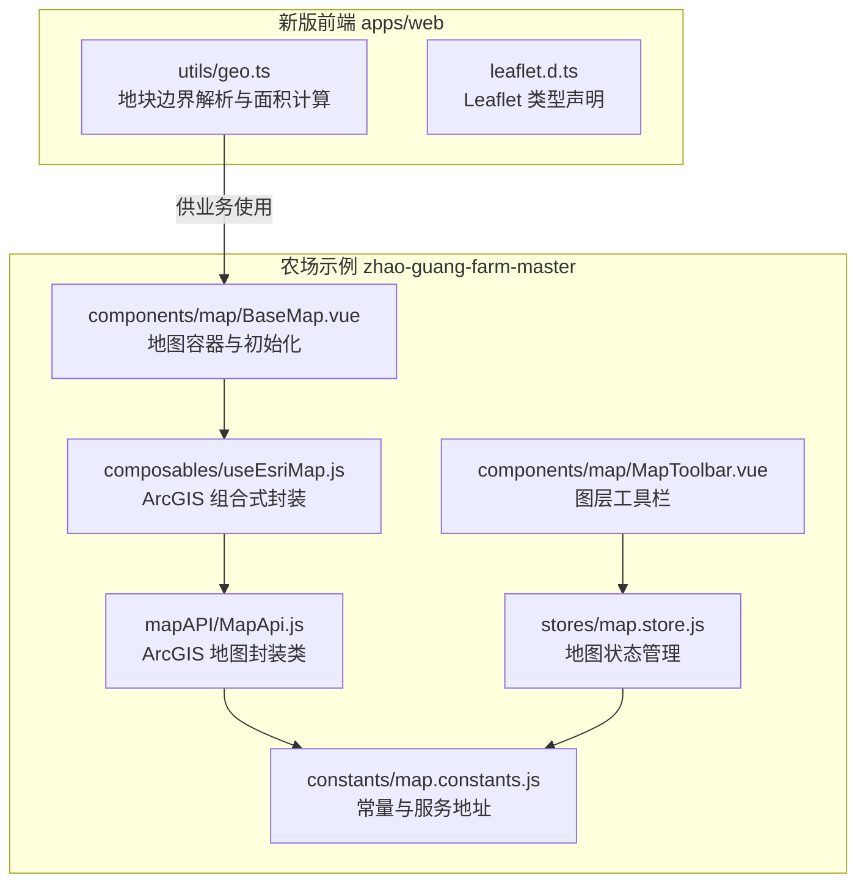
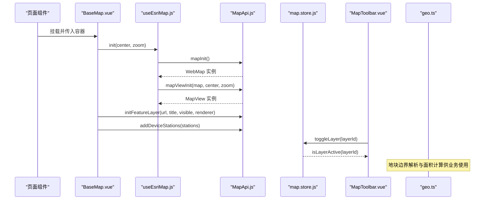
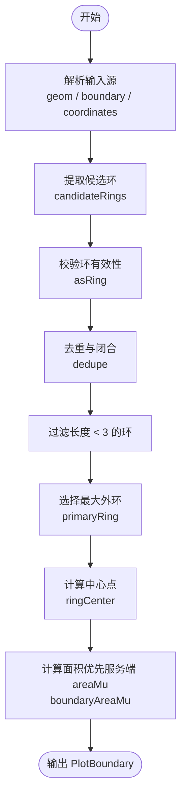
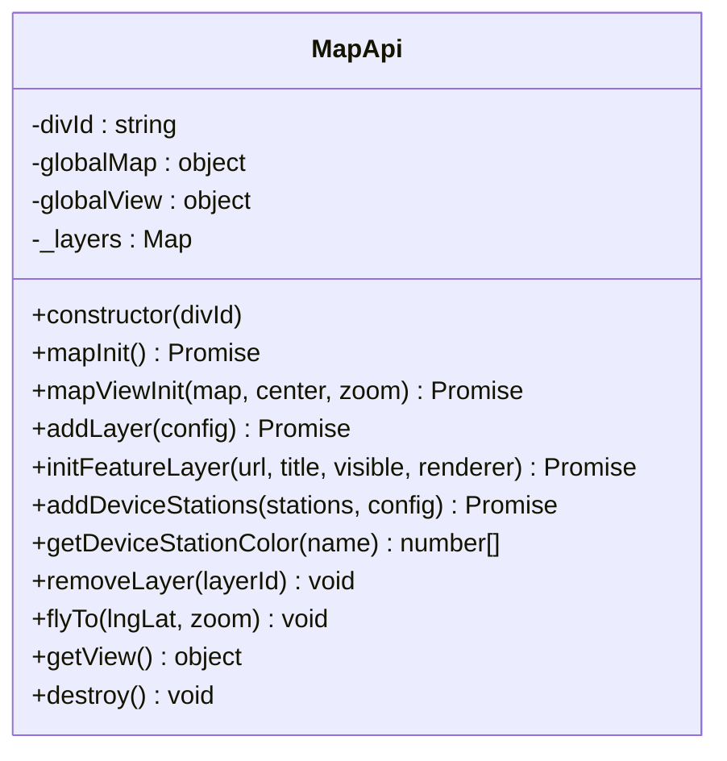
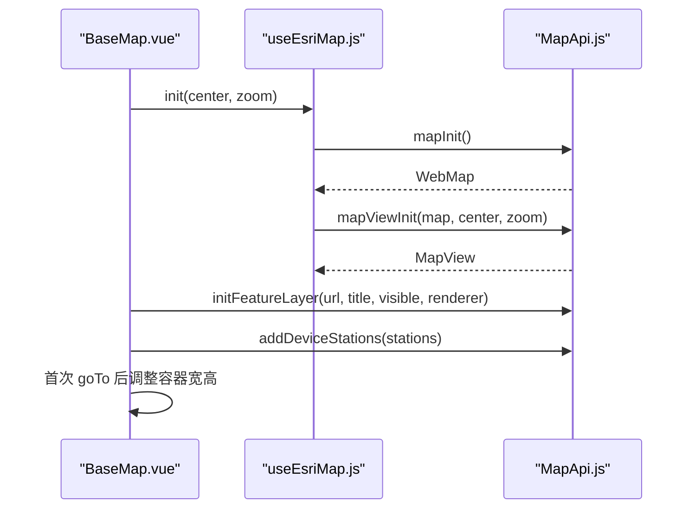
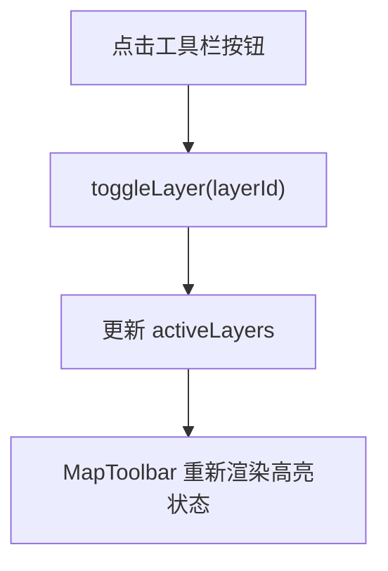
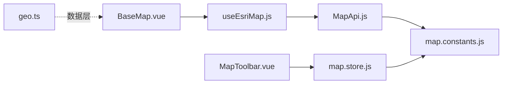

# 地图可视化

<cite>
**本文引用的文件**   
- [apps/web/src/utils/geo.ts](file://apps/web/src/utils/geo.ts)
- [apps/web/src/leaflet.d.ts](file://apps/web/src/leaflet.d.ts)
- [zhao-guang-farm-master/src/components/map/BaseMap.vue](file://zhao-guang-farm-master/src/components/map/BaseMap.vue)
- [zhao-guang-farm-master/src/components/map/MapToolbar.vue](file://zhao-guang-farm-master/src/components/map/MapToolbar.vue)
- [zhao-guang-farm-master/src/composables/useEsriMap.js](file://zhao-guang-farm-master/src/composables/useEsriMap.js)
- [zhao-guang-farm-master/src/mapAPI/MapApi.js](file://zhao-guang-farm-master/src/mapAPI/MapApi.js)
- [zhao-guang-farm-master/src/stores/map.store.js](file://zhao-guang-farm-master/src/stores/map.store.js)
- [zhao-guang-farm-master/src/constants/map.constants.js](file://zhao-guang-farm-master/src/constants/map.constants.js)
</cite>

## 目录
1. [简介](#简介)
2. [项目结构](#项目结构)
3. [核心组件](#核心组件)
4. [架构总览](#架构总览)
5. [详细组件分析](#详细组件分析)
6. [依赖关系分析](#依赖关系分析)
7. [性能与优化](#性能与优化)
8. [故障排查](#故障排查)
9. [结论](#结论)
10. [附录](#附录)

## 简介
本文件为智慧农业平台“地图可视化”能力的技术文档。仓库中实际实现了两套地图能力：
- 新版前端（apps/web）：基于 Leaflet 的类型声明与地块边界解析工具，提供 GeoJSON/MultiPolygon 兼容、坐标转换、面积计算等基础能力。
- 旧版农场示例（zhao-guang-farm-master）：基于 ArcGIS JS API 的完整地图实现，包含底图加载、设备点位标记、信息窗口、图层管理与交互控制。

本文同时覆盖以下目标：
- Leaflet 集成配置与基础地图服务说明（类型声明与数据层）。
- 地块边界绘制、多边形数据处理与地理坐标转换。
- 设备点位标记、图标自定义与信息窗口展示（ArcGIS 侧）。
- 地图交互：缩放、平移、飞行定位；测距与面积计算（Leaflet 数据层 + 算法）。
- 空间数据格式处理、坐标系转换与性能优化策略。
- 地图样式定制、图层管理与响应式适配方案。

## 项目结构
本项目在两个子应用中分别实现地图相关能力：
- apps/web：轻量级前端，提供 Leaflet 类型定义与地块边界解析工具。
- zhao-guang-farm-master：完整的 ArcGIS 地图应用，包含地图初始化、图层管理、设备站点标注、工具栏与状态管理。

图表来源
- [zhao-guang-farm-master/src/components/map/BaseMap.vue:1-182](file://zhao-guang-farm-master/src/components/map/BaseMap.vue#L1-L182)
- [zhao-guang-farm-master/src/components/map/MapToolbar.vue:1-73](file://zhao-guang-farm-master/src/components/map/MapToolbar.vue#L1-L73)
- [zhao-guang-farm-master/src/composables/useEsriMap.js:1-70](file://zhao-guang-farm-master/src/composables/useEsriMap.js#L1-L70)
- [zhao-guang-farm-master/src/mapAPI/MapApi.js:1-295](file://zhao-guang-farm-master/src/mapAPI/MapApi.js#L1-L295)
- [zhao-guang-farm-master/src/stores/map.store.js:1-54](file://zhao-guang-farm-master/src/stores/map.store.js#L1-L54)
- [zhao-guang-farm-master/src/constants/map.constants.js:1-55](file://zhao-guang-farm-master/src/constants/map.constants.js#L1-L55)
- [apps/web/src/utils/geo.ts:1-131](file://apps/web/src/utils/geo.ts#L1-L131)
- [apps/web/src/leaflet.d.ts:1-6](file://apps/web/src/leaflet.d.ts#L1-L6)

章节来源
- [zhao-guang-farm-master/src/components/map/BaseMap.vue:1-182](file://zhao-guang-farm-master/src/components/map/BaseMap.vue#L1-L182)
- [zhao-guang-farm-master/src/mapAPI/MapApi.js:1-295](file://zhao-guang-farm-master/src/mapAPI/MapApi.js#L1-L295)
- [apps/web/src/utils/geo.ts:1-131](file://apps/web/src/utils/geo.ts#L1-L131)

## 核心组件
- 地块边界解析与面积计算（Leaflet 数据层）
  - 支持 GeoJSON Polygon/MultiPolygon 与历史数组格式。
  - 自动剔除退化边界、去重首尾点、选择最大外环。
  - 将原始 [经度, 纬度] 转换为 Leaflet 使用的 [纬度, 经度]。
  - 提供面积估算（平方米转亩），优先使用服务端面积字段。
- ArcGIS 地图封装（ArcGIS 侧）
  - 动态加载 SDK、暗色主题与天地图 WMTS 底图。
  - 创建 WebMap 与 MapView，支持缩放按钮位置调整。
  - 动态添加 TileLayer、FeatureLayer、GraphicsLayer。
  - 设备站点标注：点符号、文本标签、信息窗口模板。
  - 图层增删、飞行定位、视图获取与资源销毁。
- 地图状态与工具栏
  - 维护中心坐标、缩放级别、激活图层集合与选中地块 ID。
  - 工具栏按钮切换图层显示状态。

章节来源
- [apps/web/src/utils/geo.ts:1-131](file://apps/web/src/utils/geo.ts#L1-L131)
- [zhao-guang-farm-master/src/mapAPI/MapApi.js:1-295](file://zhao-guang-farm-master/src/mapAPI/MapApi.js#L1-L295)
- [zhao-guang-farm-master/src/stores/map.store.js:1-54](file://zhao-guang-farm-master/src/stores/map.store.js#L1-L54)
- [zhao-guang-farm-master/src/components/map/MapToolbar.vue:1-73](file://zhao-guang-farm-master/src/components/map/MapToolbar.vue#L1-L73)

## 架构总览
下图展示了从页面到地图渲染与数据处理的调用链：BaseMap 通过 useEsriMap 调用 MapApi，MapApi 负责 SDK 加载、底图与业务图层管理；Store 与 Toolbar 协同完成图层开关；Leaflet 数据层 geo.ts 提供地块边界解析与面积计算。

图表来源
- [zhao-guang-farm-master/src/components/map/BaseMap.vue:81-144](file://zhao-guang-farm-master/src/components/map/BaseMap.vue#L81-L144)
- [zhao-guang-farm-master/src/composables/useEsriMap.js:14-68](file://zhao-guang-farm-master/src/composables/useEsriMap.js#L14-L68)
- [zhao-guang-farm-master/src/mapAPI/MapApi.js:36-110](file://zhao-guang-farm-master/src/mapAPI/MapApi.js#L36-L110)
- [zhao-guang-farm-master/src/mapAPI/MapApi.js:142-214](file://zhao-guang-farm-master/src/mapAPI/MapApi.js#L142-L214)
- [zhao-guang-farm-master/src/stores/map.store.js:22-35](file://zhao-guang-farm-master/src/stores/map.store.js#L22-L35)
- [zhao-guang-farm-master/src/components/map/MapToolbar.vue:23-28](file://zhao-guang-farm-master/src/components/map/MapToolbar.vue#L23-L28)
- [apps/web/src/utils/geo.ts:90-128](file://apps/web/src/utils/geo.ts#L90-L128)

## 详细组件分析

### Leaflet 地块边界解析与面积计算（apps/web）
- 数据结构
  - PlotBoundary：包含名称、地块编码、Leaflet 坐标环、中心点、面积（亩）、作物信息等。
  - Ring：[经度, 纬度] 的点数组。
- 关键流程
  - candidateRings：从多种输入（字符串 JSON、数组、对象）中提取候选环。
  - asRing：校验点数组合法性。
  - dedupe：去除重复点并闭合环时移除首尾重复点。
  - primaryRing：选择面积最大的外环，避免内环或顺序异常导致翻转。
  - ringCenter：计算环的中心点。
  - parsePlotBoundary：统一解析入口，兼容 geom/boundary/coordinates 字段，输出标准 PlotBoundary。
  - boundaryAreaMu：若未提供面积，则根据坐标环估算面积（平方度→平方米→亩）。
- 复杂度与性能
  - 解析过程对每个环进行线性扫描，时间复杂度 O(N)，N 为点数。
  - 去重与闭合操作为常数开销，整体适合批量解析多个地块。
- 错误处理
  - 非法输入返回空环或 null，过滤掉长度小于 3 的退化环。
  - JSON 解析失败捕获并忽略。

图表来源
- [apps/web/src/utils/geo.ts:17-45](file://apps/web/src/utils/geo.ts#L17-L45)
- [apps/web/src/utils/geo.ts:47-57](file://apps/web/src/utils/geo.ts#L47-L57)
- [apps/web/src/utils/geo.ts:59-88](file://apps/web/src/utils/geo.ts#L59-L88)
- [apps/web/src/utils/geo.ts:90-128](file://apps/web/src/utils/geo.ts#L90-L128)

章节来源
- [apps/web/src/utils/geo.ts:1-131](file://apps/web/src/utils/geo.ts#L1-L131)

### ArcGIS 地图封装类（MapApi）
- 职责
  - 动态加载 ArcGIS JS SDK 与暗色主题 CSS。
  - 构建天地图卫星影像与注记底图（WMTS）。
  - 创建 WebMap 与 MapView，设置初始中心与缩放。
  - 动态添加 TileLayer、FeatureLayer、GraphicsLayer。
  - 设备站点标注：点符号、文本标签、信息窗口模板。
  - 图层增删、飞行定位、视图获取与资源销毁。
- 关键点
  - 天地图 token 通过环境变量注入，避免硬编码。
  - 设备站点颜色按设备名称分类。
  - GraphicsLayer 用于叠加设备点位与标签。
  - FeatureLayer 支持服务端样式与自定义 renderer。
  - destroy 方法释放 MapView 与图层引用。

图表来源
- [zhao-guang-farm-master/src/mapAPI/MapApi.js:20-295](file://zhao-guang-farm-master/src/mapAPI/MapApi.js#L20-L295)

章节来源
- [zhao-guang-farm-master/src/mapAPI/MapApi.js:1-295](file://zhao-guang-farm-master/src/mapAPI/MapApi.js#L1-L295)

### 地图容器与初始化（BaseMap.vue）
- 职责
  - 提供地图容器 DOM，并通过 useEsriMap 初始化地图。
  - 加载 FeatureLayer（赵光项目地），并在加载完成后覆盖 renderer 以稳定样式。
  - 添加设备站点图层，并在首次定位后调整容器宽高比。
  - 暴露 addLayer、removeLayer、flyTo、getView 给父组件。
- 样式
  - 隐藏默认版权角标与 UI 控件，由自定义工具栏接管。
  - 确保 esri-view 容器宽高 100%。

图表来源
- [zhao-guang-farm-master/src/components/map/BaseMap.vue:81-144](file://zhao-guang-farm-master/src/components/map/BaseMap.vue#L81-L144)
- [zhao-guang-farm-master/src/composables/useEsriMap.js:23-36](file://zhao-guang-farm-master/src/composables/useEsriMap.js#L23-L36)
- [zhao-guang-farm-master/src/mapAPI/MapApi.js:36-110](file://zhao-guang-farm-master/src/mapAPI/MapApi.js#L36-L110)

章节来源
- [zhao-guang-farm-master/src/components/map/BaseMap.vue:1-182](file://zhao-guang-farm-master/src/components/map/BaseMap.vue#L1-L182)

### 图层工具栏与状态管理（MapToolbar.vue 与 map.store.js）
- MapToolbar.vue
  - 渲染图层按钮列表，点击触发 store.toggleLayer。
  - 高亮当前激活图层。
- map.store.js
  - 维护 activeLayers、center、zoom、selectedPlotId。
  - 提供 toggleLayer、isLayerActive、selectPlot、getState 等方法。

图表来源
- [zhao-guang-farm-master/src/components/map/MapToolbar.vue:23-28](file://zhao-guang-farm-master/src/components/map/MapToolbar.vue#L23-L28)
- [zhao-guang-farm-master/src/stores/map.store.js:22-35](file://zhao-guang-farm-master/src/stores/map.store.js#L22-L35)

章节来源
- [zhao-guang-farm-master/src/components/map/MapToolbar.vue:1-73](file://zhao-guang-farm-master/src/components/map/MapToolbar.vue#L1-L73)
- [zhao-guang-farm-master/src/stores/map.store.js:1-54](file://zhao-guang-farm-master/src/stores/map.store.js#L1-L54)

### 常量与服务地址（map.constants.js）
- 地图默认中心与缩放级别。
- ArcGIS JS SDK CDN 与暗色主题 CSS 地址。
- 天地图 WMTS 子域与图层 URL（img/cia/vec/cva）。
- 业务图层 ID 常量（basemap、label、plot、device、track、heatmap、grade、harvest）。

章节来源
- [zhao-guang-farm-master/src/constants/map.constants.js:1-55](file://zhao-guang-farm-master/src/constants/map.constants.js#L1-L55)

## 依赖关系分析
- BaseMap.vue 依赖 useEsriMap.js 与 MapApi.js。
- useEsriMap.js 依赖 MapApi.js 与 map.constants.js。
- MapApi.js 依赖 map.constants.js（SDK URL、CSS、天地图服务）。
- MapToolbar.vue 依赖 map.store.js 与 map.constants.js。
- map.store.js 依赖 map.constants.js。
- apps/web 的 geo.ts 独立于 ArcGIS 体系，提供通用地块边界解析与面积计算。

图表来源
- [zhao-guang-farm-master/src/components/map/BaseMap.vue:1-182](file://zhao-guang-farm-master/src/components/map/BaseMap.vue#L1-L182)
- [zhao-guang-farm-master/src/composables/useEsriMap.js:1-70](file://zhao-guang-farm-master/src/composables/useEsriMap.js#L1-L70)
- [zhao-guang-farm-master/src/mapAPI/MapApi.js:1-295](file://zhao-guang-farm-master/src/mapAPI/MapApi.js#L1-L295)
- [zhao-guang-farm-master/src/stores/map.store.js:1-54](file://zhao-guang-farm-master/src/stores/map.store.js#L1-L54)
- [zhao-guang-farm-master/src/constants/map.constants.js:1-55](file://zhao-guang-farm-master/src/constants/map.constants.js#L1-L55)
- [apps/web/src/utils/geo.ts:1-131](file://apps/web/src/utils/geo.ts#L1-L131)

章节来源
- [zhao-guang-farm-master/src/components/map/BaseMap.vue:1-182](file://zhao-guang-farm-master/src/components/map/BaseMap.vue#L1-L182)
- [zhao-guang-farm-master/src/composables/useEsriMap.js:1-70](file://zhao-guang-farm-master/src/composables/useEsriMap.js#L1-L70)
- [zhao-guang-farm-master/src/mapAPI/MapApi.js:1-295](file://zhao-guang-farm-master/src/mapAPI/MapApi.js#L1-L295)
- [zhao-guang-farm-master/src/stores/map.store.js:1-54](file://zhao-guang-farm-master/src/stores/map.store.js#L1-L54)
- [zhao-guang-farm-master/src/constants/map.constants.js:1-55](file://zhao-guang-farm-master/src/constants/map.constants.js#L1-L55)
- [apps/web/src/utils/geo.ts:1-131](file://apps/web/src/utils/geo.ts#L1-L131)

## 性能与优化
- 图层管理
  - 使用 GraphicsLayer 聚合设备点位与标签，减少多次渲染开销。
  - 通过 removeLayer 与 destroy 释放 MapView 与图层引用，避免内存泄漏。
- 底图加载
  - 天地图 WMTS 使用多子域负载均衡，提升瓦片请求吞吐。
  - 暗色主题 CSS 按需加载，避免阻塞主线程。
- 数据解析
  - 地块边界解析采用线性扫描与去重，避免复杂几何库依赖。
  - 面积计算优先使用服务端 areaMu，减少客户端计算压力。
- 响应式适配
  - BaseMap 确保 esri-view 容器宽高 100%，并在首次定位后调整 aspectRatio，保证不同屏幕比例下的正确渲染。
- 交互体验
  - flyTo 使用缓动动画，提升视觉流畅性。
  - 工具栏按钮高亮反馈，增强用户感知。

[本节为通用指导，不直接分析具体文件]

## 故障排查
- 地图初始化失败
  - 检查容器元素是否存在且具备 id。
  - 确认 ArcGIS SDK CDN 与 CSS 地址可访问。
  - 查看控制台错误日志（BaseMap.vue 与 MapApi.js 的错误捕获）。
- 图层加载失败
  - 检查 FeatureLayer 或 TileLayer 的 URL 是否有效。
  - 确认天地图 token 已正确注入环境变量。
- 设备站点未显示
  - 检查 stations 数据是否为空或坐标无效。
  - 确认 GraphicsLayer 已添加到地图且可见。
- 面积计算异常
  - 检查输入的坐标环是否合法（长度≥3、无重复点）。
  - 若服务端 areaMu 缺失，客户端估算可能因投影近似存在误差。

章节来源
- [zhao-guang-farm-master/src/components/map/BaseMap.vue:140-144](file://zhao-guang-farm-master/src/components/map/BaseMap.vue#L140-L144)
- [zhao-guang-farm-master/src/mapAPI/MapApi.js:36-80](file://zhao-guang-farm-master/src/mapAPI/MapApi.js#L36-L80)
- [zhao-guang-farm-master/src/mapAPI/MapApi.js:142-214](file://zhao-guang-farm-master/src/mapAPI/MapApi.js#L142-L214)
- [apps/web/src/utils/geo.ts:90-128](file://apps/web/src/utils/geo.ts#L90-L128)

## 结论
本项目在新旧两套前端中分别实现了地图可视化能力：
- 新版 Leaflet 数据层提供了健壮的地块边界解析与面积计算工具，便于跨框架复用。
- 旧版 ArcGIS 地图应用提供了完整的地图初始化、图层管理、设备标注与信息窗口展示，满足智慧农业平台的可视化需求。
建议在生产环境中：
- 统一坐标系与投影策略，明确 WGS84 与业务坐标系的转换规则。
- 引入更完善的测距与面积计算工具（如 turf.js），提升精度与功能丰富度。
- 完善错误监控与日志上报，提升问题定位效率。
- 针对大规模点位与多边形数据进行虚拟化与分块加载，优化渲染性能。

[本节为总结性内容，不直接分析具体文件]

## 附录
- Leaflet 类型声明
  - apps/web/src/leaflet.d.ts 定义了 Leaflet 模块的 TS 类型，便于在 TypeScript 项目中安全使用。
- 常量与服务地址
  - map.constants.js 集中管理地图默认参数、ArcGIS SDK 与天地图服务地址，便于环境隔离与替换。

章节来源
- [apps/web/src/leaflet.d.ts:1-6](file://apps/web/src/leaflet.d.ts#L1-L6)
- [zhao-guang-farm-master/src/constants/map.constants.js:1-55](file://zhao-guang-farm-master/src/constants/map.constants.js#L1-L55)