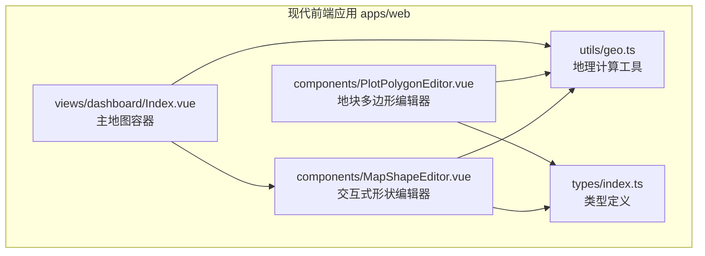
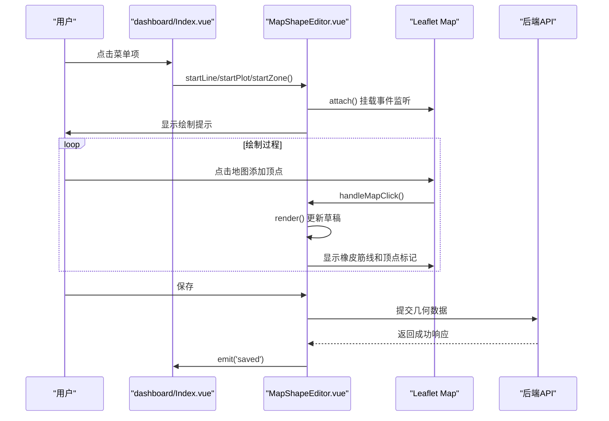
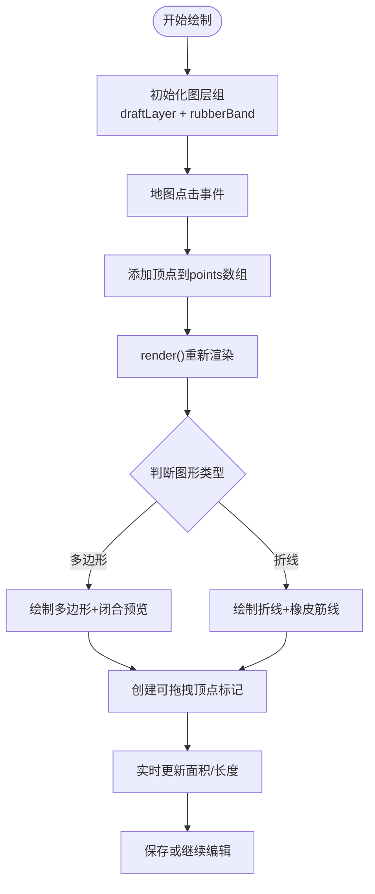
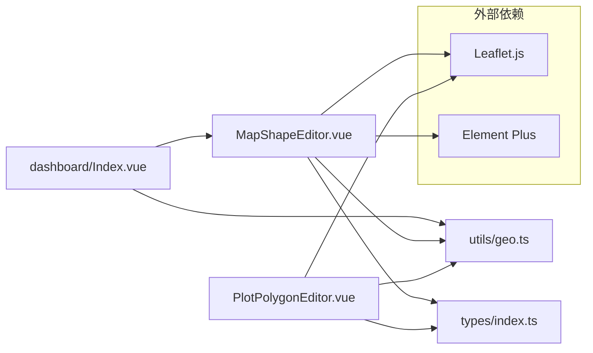

# 地图可视化

<cite>
**本文引用的文件**   
- [apps/web/src/utils/geo.ts](file://apps/web/src/utils/geo.ts)
- [apps/web/src/leaflet.d.ts](file://apps/web/src/leaflet.d.ts)
- [apps/web/src/components/MapShapeEditor.vue](file://apps/web/src/components/MapShapeEditor.vue)
- [apps/web/src/components/PlotPolygonEditor.vue](file://apps/web/src/components/PlotPolygonEditor.vue)
- [apps/web/src/views/dashboard/Index.vue](file://apps/web/src/views/dashboard/Index.vue)
- [apps/web/src/types/index.ts](file://apps/web/src/types/index.ts)
</cite>

## 更新摘要
**变更内容**   
- 新增 MapShapeEditor 交互式多边形编辑组件，支持拖拽顶点操作和实时坐标更新
- 增强地块边界绘制、管线绘制和片区范围编辑功能
- 集成实时面积计算和长度测量工具
- 完善地图交互体验，包括右键删除顶点、撤销操作等

## 目录
1. [简介](#简介)
2. [项目结构](#项目结构)
3. [核心组件](#核心组件)
4. [架构总览](#架构总览)
5. [详细组件分析](#详细组件分析)
6. [依赖关系分析](#依赖关系分析)
7. [性能与优化](#性能与优化)
8. [故障排查](#故障排查)
9. [结论](#结论)
10. [附录](#附录)

## 简介
本文件为智慧农业平台"地图可视化"能力的技术文档。仓库中实现了基于 Leaflet 的现代地图可视化系统，提供完整的交互式地理数据编辑能力：

- **交互式形状编辑器**：新增的 MapShapeEditor 组件支持管线、地块、片区的创建和编辑，提供拖拽顶点、实时预览、自动闭合等功能
- **地块边界解析**：支持 GeoJSON/MultiPolygon 兼容、坐标转换、面积计算等基础能力
- **设备点位标记**：支持设备站点标注、图标自定义与信息窗口展示
- **地图交互**：缩放、平移、飞行定位；测距与面积计算
- **空间数据处理**：坐标系转换、几何计算与性能优化策略

## 项目结构
本项目在 apps/web 子应用中实现现代化的地图可视化能力：

**图表来源**
- [apps/web/src/components/MapShapeEditor.vue:1-460](file://apps/web/src/components/MapShapeEditor.vue#L1-L460)
- [apps/web/src/components/PlotPolygonEditor.vue:1-189](file://apps/web/src/components/PlotPolygonEditor.vue#L1-L189)
- [apps/web/src/views/dashboard/Index.vue:90-98](file://apps/web/src/views/dashboard/Index.vue#L90-L98)
- [apps/web/src/utils/geo.ts:1-163](file://apps/web/src/utils/geo.ts#L1-L163)
- [apps/web/src/types/index.ts:133-162](file://apps/web/src/types/index.ts#L133-L162)

## 核心组件

### MapShapeEditor 交互式形状编辑器（新增）
- **多类型支持**：管线（line）、地块（plot）、片区（zone）三种图形类型的创建和编辑
- **顶点操作**：支持拖拽顶点微调、右键删除顶点、双击添加新点
- **实时预览**：绘制过程中实时显示草稿形状、面积或长度统计
- **智能闭合**：多边形自动闭合，折线动态连接最后一个点和鼠标位置
- **响应式适配**：支持移动端和桌面端的自适应布局

### PlotPolygonEditor 地块多边形编辑器
- **独立地图实例**：在表单内嵌独立的 Leaflet 地图
- **顶点标记**：显示带序号的顶点标记，支持撤销和清空操作
- **面积计算**：实时计算多边形面积并显示
- **双向绑定**：支持 v-model 双向数据绑定

### 地理计算工具
- **面积计算**：使用等距圆柱投影进行精确的面积计算（平方米转亩）
- **长度测量**：折线长度的米级精度计算
- **坐标转换**：[经度, 纬度] 与 Leaflet [纬度, 经度] 格式转换
- **边界解析**：支持多种输入格式的边界数据解析

**章节来源**
- [apps/web/src/components/MapShapeEditor.vue:1-460](file://apps/web/src/components/MapShapeEditor.vue#L1-L460)
- [apps/web/src/components/PlotPolygonEditor.vue:1-189](file://apps/web/src/components/PlotPolygonEditor.vue#L1-L189)
- [apps/web/src/utils/geo.ts:1-163](file://apps/web/src/utils/geo.ts#L1-L163)

## 架构总览
下图展示了交互式形状编辑器的完整工作流程：

**图表来源**
- [apps/web/src/views/dashboard/Index.vue:90-98](file://apps/web/src/views/dashboard/Index.vue#L90-L98)
- [apps/web/src/components/MapShapeEditor.vue:274-331](file://apps/web/src/components/MapShapeEditor.vue#L274-L331)
- [apps/web/src/components/MapShapeEditor.vue:341-407](file://apps/web/src/components/MapShapeEditor.vue#L341-L407)

## 详细组件分析

### MapShapeEditor 交互式形状编辑器（重点更新）

#### 核心功能特性
- **多模式支持**：创建模式（create）和编辑模式（edit）
- **三种图形类型**：
  - 管线（line）：支持水线、电线、网线等不同类型
  - 地块（plot）：支持农田、温室、果园、水产养殖等类型
  - 片区（zone）：自定义颜色和管理区域
- **顶点交互**：
  - 拖拽顶点微调位置
  - 右键删除顶点
  - 双击防止重复添加
  - 键盘快捷键（Esc取消）

#### 技术实现细节

**图表来源**
- [apps/web/src/components/MapShapeEditor.vue:158-193](file://apps/web/src/components/MapShapeEditor.vue#L158-L193)
- [apps/web/src/components/MapShapeEditor.vue:207-227](file://apps/web/src/components/MapShapeEditor.vue#L207-L227)

#### 关键算法实现
- **顶点拖拽处理**：`movePoint()` 方法实时更新顶点坐标，避免重建标记导致拖拽中断
- **橡皮筋线效果**：`handleMapMouseMove()` 动态连接最后一点和鼠标位置
- **多边形闭合预览**：当点数≥2时，额外显示回到首点的闭合边预览
- **防抖处理**：双击缩放时防止重复添加相同坐标的点

#### 样式与用户体验
- **深色主题UI**：采用科技感深蓝背景，半透明边框和发光效果
- **响应式布局**：支持不同屏幕尺寸的自适应定位
- **视觉反馈**：顶点标记带序号气泡，状态栏显示实时统计数据
- **无障碍支持**：键盘导航和屏幕阅读器友好

**章节来源**
- [apps/web/src/components/MapShapeEditor.vue:1-460](file://apps/web/src/components/MapShapeEditor.vue#L1-L460)

### PlotPolygonEditor 地块多边形编辑器

#### 功能特点
- **独立地图实例**：每个编辑器拥有自己的 Leaflet 地图实例
- **工具栏控制**：提供撤销、清空等操作按钮
- **实时面积显示**：顶点数≥3时自动计算并显示面积
- **顶点标记**：蓝色圆点标记，带永久序号标签

#### 实现机制
- **地图初始化**：使用天地图卫星影像作为底图
- **图层管理**：shapeLayer 专门用于存储编辑相关的几何对象
- **事件处理**：点击地图添加顶点，工具栏按钮触发相应操作
- **生命周期管理**：组件销毁时清理所有地图资源和事件监听器

**章节来源**
- [apps/web/src/components/PlotPolygonEditor.vue:1-189](file://apps/web/src/components/PlotPolygonEditor.vue#L1-L189)

### 地理计算工具（geo.ts）

#### 核心算法
- **面积计算**：使用等距圆柱投影 + 鞋带公式，精度达到球面面积的99%以上
- **长度测量**：分段计算折线长度，考虑纬度变化对经度距离的影响
- **坐标转换**：统一处理 [经度, 纬度] 和 [纬度, 经度] 两种格式

#### 数据处理流程

**图表来源**
- [apps/web/src/utils/geo.ts:47-81](file://apps/web/src/utils/geo.ts#L47-L81)
- [apps/web/src/utils/geo.ts:135-160](file://apps/web/src/utils/geo.ts#L135-L160)

**章节来源**
- [apps/web/src/utils/geo.ts:1-163](file://apps/web/src/utils/geo.ts#L1-L163)

### 类型定义系统

#### 形状编辑相关类型
- **MapShapeKind**：图形类型枚举（'line' | 'plot' | 'zone'）
- **MapShapeMode**：编辑模式（'create' | 'edit'）
- **MapShapeActive**：活动状态信息
- **MapShapeTarget**：目标图形数据
- **MapShapeSaved**：保存后的结果

#### 业务数据类型
- **PlotType**：地块类型枚举
- **InfraLineType**：管线类型枚举
- **PlotBoundary**：解析后的地块边界数据

**章节来源**
- [apps/web/src/types/index.ts:133-162](file://apps/web/src/types/index.ts#L133-L162)

## 依赖关系分析

**图表来源**
- [apps/web/src/views/dashboard/Index.vue:172](file://apps/web/src/views/dashboard/Index.vue#L172)
- [apps/web/src/components/MapShapeEditor.vue:54-64](file://apps/web/src/components/MapShapeEditor.vue#L54-L64)
- [apps/web/src/components/PlotPolygonEditor.vue:16-19](file://apps/web/src/components/PlotPolygonEditor.vue#L16-L19)

## 性能与优化

### 渲染优化
- **图层分离**：将编辑相关的几何对象放入独立的 layerGroup，便于批量管理
- **增量更新**：拖动顶点时只更新几何坐标，不重建整个标记层
- **防抖处理**：双击缩放时过滤重复的点击事件

### 内存管理
- **资源清理**：组件销毁时移除所有地图图层和事件监听器
- **引用释放**：及时释放地图实例和图层对象的引用
- **事件解绑**：onBeforeUnmount 中正确移除所有事件监听器

### 计算优化
- **局部投影**：面积计算前先平移到环中心，减少大坐标值带来的精度损失
- **缓存策略**：优先使用服务端提供的面积字段，避免重复计算
- **增量计算**：实时预览时使用轻量级算法，复杂计算延后到保存时

### 用户体验优化
- **响应式设计**：支持移动端触摸操作和自适应布局
- **视觉反馈**：实时显示绘制状态和统计数据
- **错误处理**：非法输入检测和友好的错误提示

## 故障排查

### 地图相关问题
- **地图无法加载**：检查 Leaflet CSS 是否正确引入，容器元素是否存在
- **顶点无法拖拽**：确认 zIndexOffset 设置正确，事件冒泡未被阻止
- **坐标偏移**：检查经纬度顺序是否正确（[经度, 纬度] vs [纬度, 经度]）

### 计算问题
- **面积为零**：检查顶点是否共线或重合，确保至少3个有效顶点
- **长度异常**：验证坐标数据的合法性和精度
- **面积误差**：确认使用的是正确的投影方式和计算公式

### 交互问题
- **点击无响应**：检查地图事件监听器是否正确注册
- **橡皮筋线不显示**：确认鼠标移动事件和 last 点状态
- **保存失败**：检查几何数据格式和必填字段

**章节来源**
- [apps/web/src/components/MapShapeEditor.vue:409-422](file://apps/web/src/components/MapShapeEditor.vue#L409-L422)
- [apps/web/src/components/PlotPolygonEditor.vue:146-154](file://apps/web/src/components/PlotPolygonEditor.vue#L146-L154)

## 结论
通过新增的 MapShapeEditor 组件，智慧农业平台的地图可视化能力得到了显著增强：

### 主要改进
- **交互式编辑**：提供了直观的拖拽顶点、实时预览等交互功能
- **多类型支持**：统一支持管线、地块、片区三种地理实体的编辑
- **精确计算**：集成了高精度的面积和长度计算工具
- **现代化UI**：采用深色科技风格，提升用户体验

### 技术优势
- **模块化设计**：各组件职责清晰，便于维护和扩展
- **类型安全**：完整的 TypeScript 类型定义，提高代码质量
- **性能优化**：合理的渲染策略和资源管理机制
- **响应式适配**：良好的移动端兼容性

### 未来展望
建议进一步扩展以下功能：
- 支持更多几何操作（合并、分割、布尔运算）
- 引入更复杂的地理分析工具
- 支持批量操作和模板化编辑
- 集成更多地图服务和数据源

## 附录

### 常用API参考
- **polygonAreaMu()**：计算多边形面积（亩）
- **polylineLengthM()**：计算折线长度（米）
- **parsePlotBoundary()**：解析地块边界数据
- **boundaryAreaMu()**：获取边界面积

### 开发指南
- 坐标格式统一使用 [经度, 纬度]
- 多边形顶点按顺时针或逆时针顺序排列
- 注意处理退化几何（共线点、重合点）
- 合理使用图层分组和事件委托

**章节来源**
- [apps/web/src/utils/geo.ts:135-160](file://apps/web/src/utils/geo.ts#L135-L160)
- [apps/web/src/types/index.ts:133-162](file://apps/web/src/types/index.ts#L133-L162)