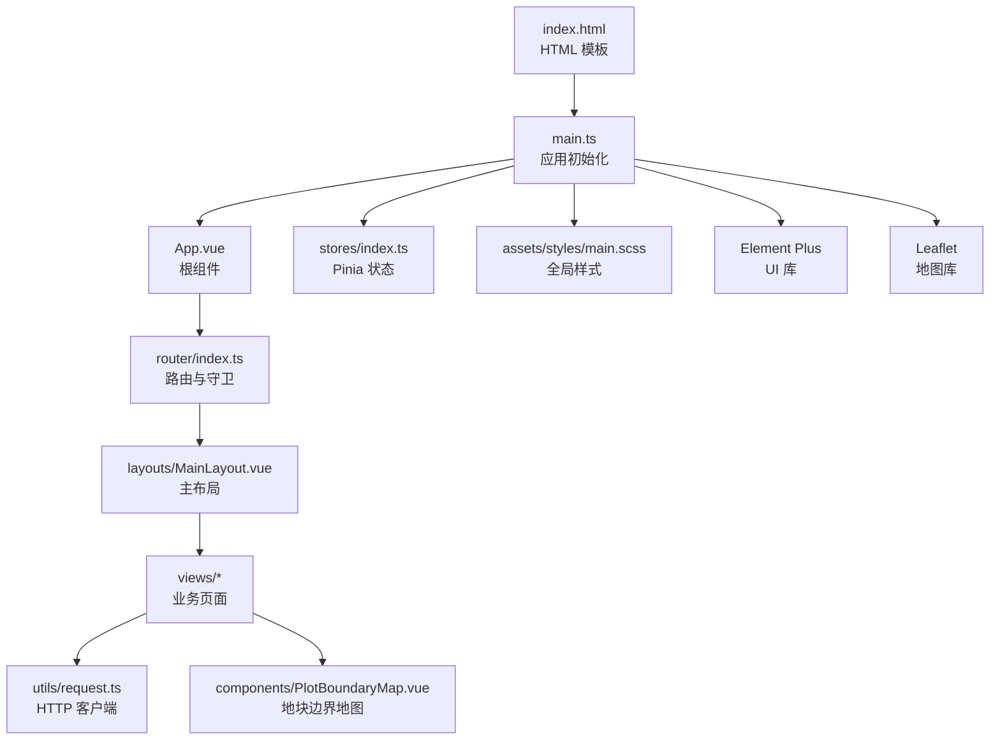
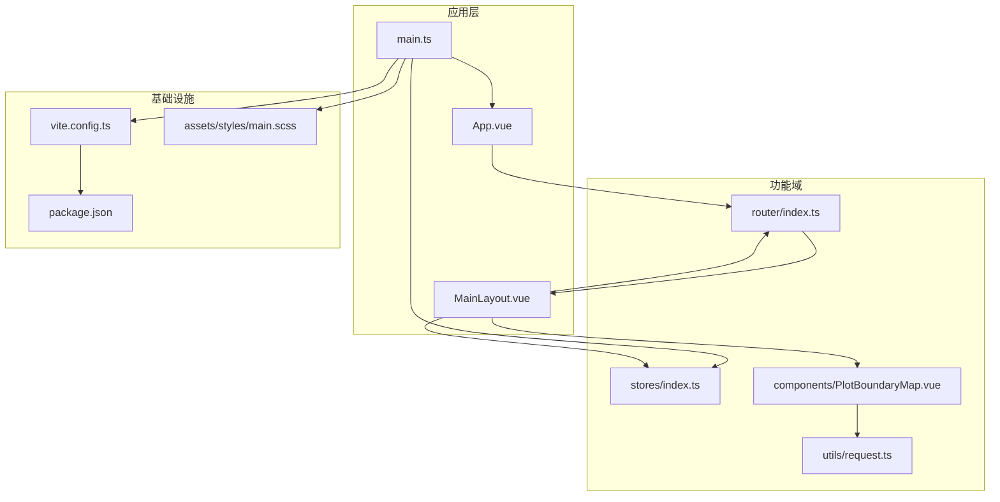
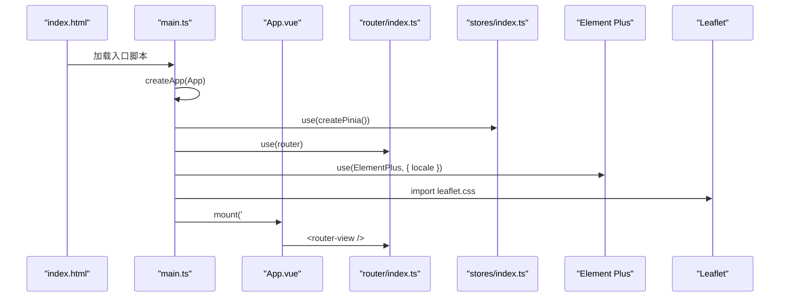
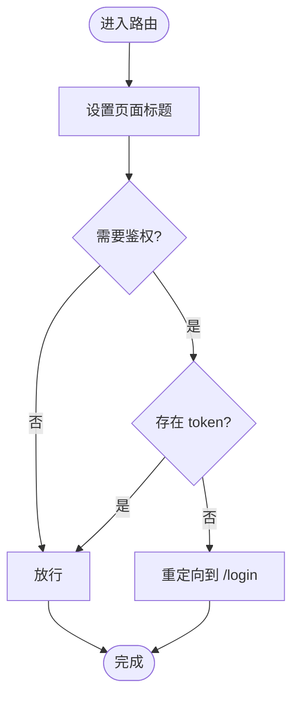
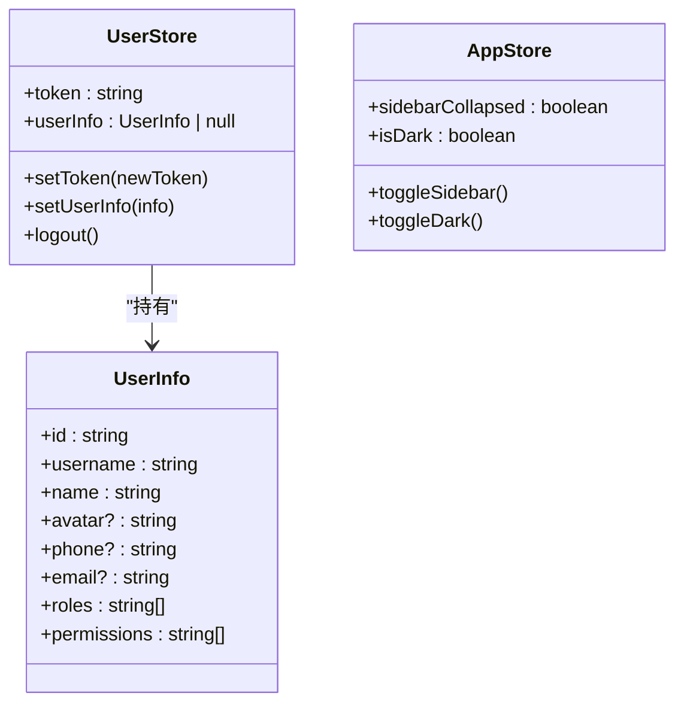
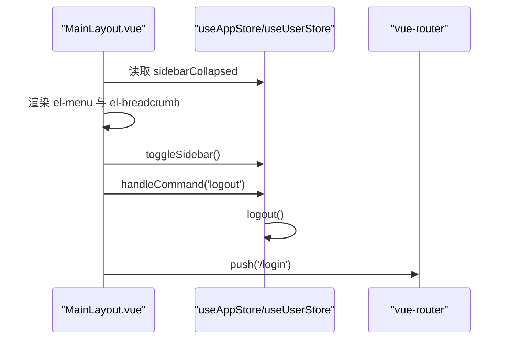
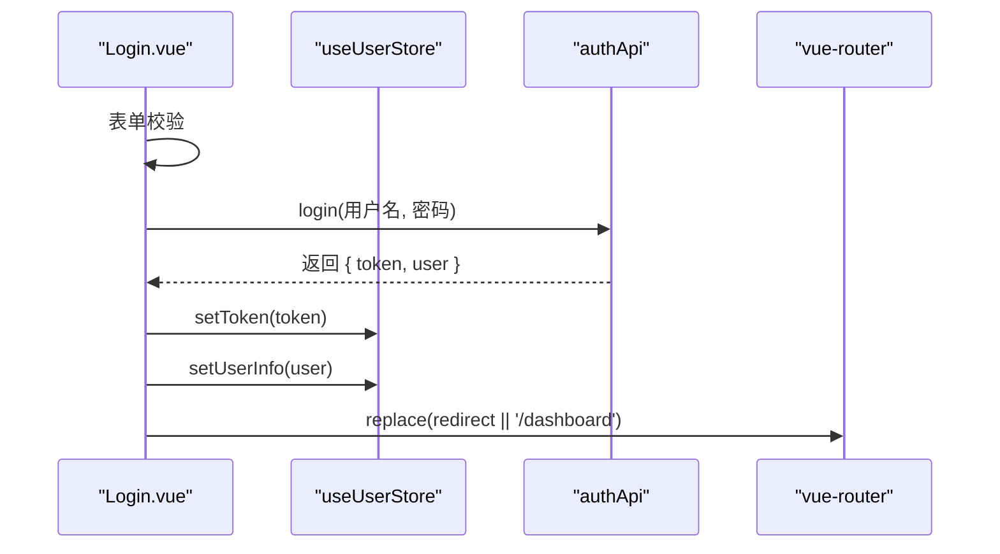
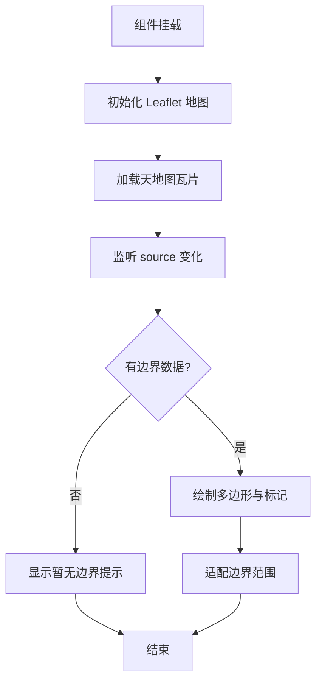
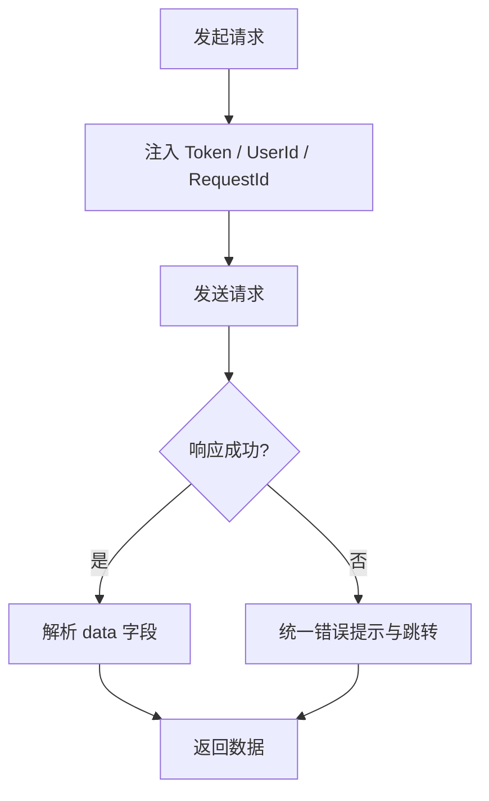
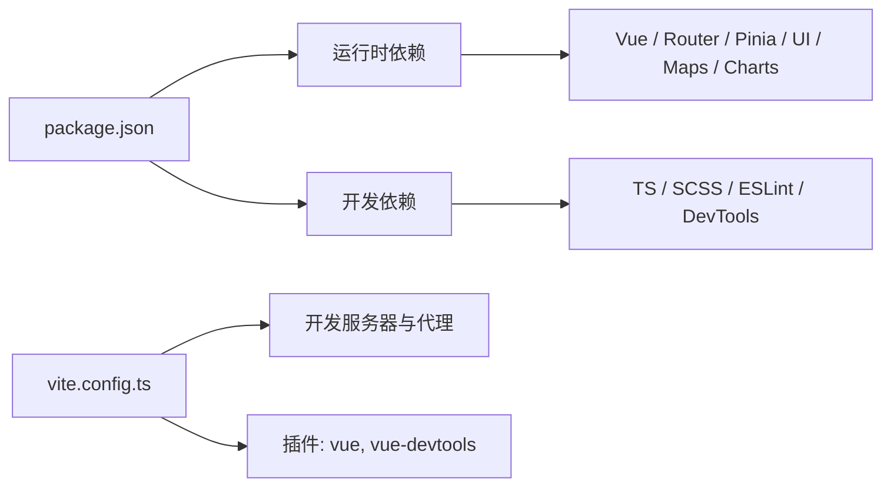

# 应用架构

<cite>
**本文引用的文件**   
- [apps/web/package.json](file://apps/web/package.json)
- [apps/web/vite.config.ts](file://apps/web/vite.config.ts)
- [apps/web/index.html](file://apps/web/index.html)
- [apps/web/src/main.ts](file://apps/web/src/main.ts)
- [apps/web/src/App.vue](file://apps/web/src/App.vue)
- [apps/web/src/router/index.ts](file://apps/web/src/router/index.ts)
- [apps/web/src/stores/index.ts](file://apps/web/src/stores/index.ts)
- [apps/web/src/layouts/MainLayout.vue](file://apps/web/src/layouts/MainLayout.vue)
- [apps/web/src/views/system/Login.vue](file://apps/web/src/views/system/Login.vue)
- [apps/web/src/utils/request.ts](file://apps/web/src/utils/request.ts)
- [apps/web/src/components/PlotBoundaryMap.vue](file://apps/web/src/components/PlotBoundaryMap.vue)
- [apps/web/src/assets/styles/main.scss](file://apps/web/src/assets/styles/main.scss)
</cite>

## 目录
1. [引言](#引言)
2. [项目结构](#项目结构)
3. [核心组件](#核心组件)
4. [架构总览](#架构总览)
5. [详细组件分析](#详细组件分析)
6. [依赖关系分析](#依赖关系分析)
7. [性能与可维护性](#性能与可维护性)
8. [故障排查指南](#故障排查指南)
9. [结论](#结论)
10. [附录：开发环境与构建配置](#附录开发环境与构建配置)

## 引言
本文件面向智慧农业平台前端工程，系统性梳理基于 Vue3 + Element Plus + Leaflet + ECharts 的技术选型、应用初始化流程、状态管理、路由与权限控制、组件注册与全局样式组织，以及 Vite 开发与构建配置。文档同时给出模块划分原则、依赖注入机制说明、目录结构与文件组织规范，帮助团队在统一架构下高效协作与扩展。

## 项目结构
前端工程位于 apps/web 子包，采用典型的前端分层结构：入口与根组件、布局容器、视图页面、路由、状态管理、工具函数、通用组件与全局样式。关键目录与职责如下：
- src/main.ts：应用启动、插件挂载、全局样式引入
- src/App.vue：根组件，承载路由出口
- src/layouts：布局层（侧边栏、头部、面包屑等）
- src/views：业务页面（按领域分目录）
- src/router：路由定义与守卫
- src/stores：Pinia 状态管理
- src/components：通用或领域内复用组件
- src/utils：工具函数与网络请求封装
- src/assets/styles：全局样式与主题变量
- index.html：HTML 模板与脚本入口

图表来源
- [apps/web/index.html:1-14](file://apps/web/index.html#L1-L14)
- [apps/web/src/main.ts:1-24](file://apps/web/src/main.ts#L1-L24)
- [apps/web/src/App.vue:1-14](file://apps/web/src/App.vue#L1-L14)
- [apps/web/src/router/index.ts:1-157](file://apps/web/src/router/index.ts#L1-L157)
- [apps/web/src/layouts/MainLayout.vue:1-195](file://apps/web/src/layouts/MainLayout.vue#L1-L195)
- [apps/web/src/stores/index.ts:1-65](file://apps/web/src/stores/index.ts#L1-L65)
- [apps/web/src/assets/styles/main.scss:1-357](file://apps/web/src/assets/styles/main.scss#L1-L357)
- [apps/web/src/utils/request.ts:1-109](file://apps/web/src/utils/request.ts#L1-L109)
- [apps/web/src/components/PlotBoundaryMap.vue:1-88](file://apps/web/src/components/PlotBoundaryMap.vue#L1-L88)

章节来源
- [apps/web/index.html:1-14](file://apps/web/index.html#L1-L14)
- [apps/web/src/main.ts:1-24](file://apps/web/src/main.ts#L1-L24)
- [apps/web/src/App.vue:1-14](file://apps/web/src/App.vue#L1-L14)

## 核心组件
本节聚焦应用初始化、UI 框架集成、地图与图表能力、状态管理与路由体系。

- 应用初始化与插件挂载
  - 创建 Vue 应用实例，注册 Pinia、Router、Element Plus（含中文语言包），并导入全局样式与 Leaflet 样式。
  - 批量注册 Element Plus 图标组件，避免按需注册的复杂配置。
- UI 与主题
  - 通过 Element Plus 提供基础组件与表单、表格、消息等交互能力；通过 SCSS 变量与覆盖规则统一主题风格。
- 地图与可视化
  - Leaflet 用于地块边界展示与瓦片地图加载；ECharts 通过 vue-echarts 集成到业务图表中。
- 状态管理
  - Pinia 提供用户信息与界面状态（侧边栏折叠、深色模式）的集中式存储，并与 localStorage 持久化。
- 路由与权限
  - 使用 vue-router 定义模块化路由，结合 meta 字段实现标题设置与登录鉴权拦截。

章节来源
- [apps/web/src/main.ts:1-24](file://apps/web/src/main.ts#L1-L24)
- [apps/web/src/assets/styles/main.scss:1-357](file://apps/web/src/assets/styles/main.scss#L1-L357)
- [apps/web/src/stores/index.ts:1-65](file://apps/web/src/stores/index.ts#L1-L65)
- [apps/web/src/router/index.ts:1-157](file://apps/web/src/router/index.ts#L1-L157)

## 架构总览
整体架构遵循“入口 -> 根组件 -> 布局 -> 视图”的分层模型，并通过 Pinia 进行跨组件状态共享，通过 Router 驱动页面切换，通过 Axios 封装统一访问后端接口。

图表来源
- [apps/web/src/main.ts:1-24](file://apps/web/src/main.ts#L1-L24)
- [apps/web/src/App.vue:1-14](file://apps/web/src/App.vue#L1-L14)
- [apps/web/src/router/index.ts:1-157](file://apps/web/src/router/index.ts#L1-L157)
- [apps/web/src/layouts/MainLayout.vue:1-195](file://apps/web/src/layouts/MainLayout.vue#L1-L195)
- [apps/web/src/stores/index.ts:1-65](file://apps/web/src/stores/index.ts#L1-L65)
- [apps/web/src/utils/request.ts:1-109](file://apps/web/src/utils/request.ts#L1-L109)
- [apps/web/src/components/PlotBoundaryMap.vue:1-88](file://apps/web/src/components/PlotBoundaryMap.vue#L1-L88)
- [apps/web/vite.config.ts:1-32](file://apps/web/vite.config.ts#L1-L32)
- [apps/web/package.json:1-37](file://apps/web/package.json#L1-L37)
- [apps/web/src/assets/styles/main.scss:1-357](file://apps/web/src/assets/styles/main.scss#L1-L357)

## 详细组件分析

### 应用初始化与插件集成
- 初始化流程
  - 创建 Vue 应用实例，挂载 Pinia、Router、Element Plus（中文语言包）。
  - 批量注册 Element Plus 图标组件，确保菜单与按钮图标可用。
  - 引入全局样式与 Leaflet 样式，保证地图与 UI 一致性。
- 关键点
  - 通过 app.use 完成依赖注入，顺序为：Pinia -> Router -> Element Plus。
  - 全局样式在 main.ts 中统一引入，便于主题与重置样式生效。

图表来源
- [apps/web/index.html:1-14](file://apps/web/index.html#L1-L14)
- [apps/web/src/main.ts:1-24](file://apps/web/src/main.ts#L1-L24)
- [apps/web/src/App.vue:1-14](file://apps/web/src/App.vue#L1-L14)
- [apps/web/src/router/index.ts:1-157](file://apps/web/src/router/index.ts#L1-L157)
- [apps/web/src/stores/index.ts:1-65](file://apps/web/src/stores/index.ts#L1-L65)

章节来源
- [apps/web/src/main.ts:1-24](file://apps/web/src/main.ts#L1-L24)

### 路由与导航
- 路由结构
  - 登录页独立于主布局，其他页面均嵌套在主布局下，支持多级菜单与重定向。
  - 每个路由携带 meta.title 与可选 icon，供布局动态渲染菜单与面包屑。
- 权限控制
  - beforeEach 守卫根据 meta.requiresAuth 与本地 token 决定是否跳转登录页。
  - 未登录访问受保护路由时自动重定向至 /login。
- 动态标题
  - 进入路由时更新 document.title，提升用户体验。

图表来源
- [apps/web/src/router/index.ts:146-154](file://apps/web/src/router/index.ts#L146-L154)

章节来源
- [apps/web/src/router/index.ts:1-157](file://apps/web/src/router/index.ts#L1-L157)

### 状态管理（Pinia）
- 用户状态
  - 保存 token 与 userInfo，并提供 setToken、setUserInfo、logout 方法，与 localStorage 同步。
- 应用状态
  - 侧边栏折叠与深色模式开关，提供 toggleSidebar、toggleDark 方法。
- 使用方式
  - 在布局与视图中通过 useUserStore/useAppStore 获取状态与方法，实现跨组件数据共享。

图表来源
- [apps/web/src/stores/index.ts:1-65](file://apps/web/src/stores/index.ts#L1-L65)

章节来源
- [apps/web/src/stores/index.ts:1-65](file://apps/web/src/stores/index.ts#L1-L65)

### 主布局与导航
- 布局结构
  - 左侧侧边栏：根据路由元信息动态生成菜单，支持折叠与展开。
  - 顶部头部：包含折叠按钮、面包屑、用户下拉菜单。
  - 内容区域：通过 router-view 渲染当前路由页面。
- 交互逻辑
  - 折叠状态由 AppStore 管理。
  - 用户下拉菜单触发登出，调用 userStore.logout 后跳转登录页。

图表来源
- [apps/web/src/layouts/MainLayout.vue:1-195](file://apps/web/src/layouts/MainLayout.vue#L1-L195)
- [apps/web/src/stores/index.ts:1-65](file://apps/web/src/stores/index.ts#L1-L65)
- [apps/web/src/router/index.ts:1-157](file://apps/web/src/router/index.ts#L1-L157)

章节来源
- [apps/web/src/layouts/MainLayout.vue:1-195](file://apps/web/src/layouts/MainLayout.vue#L1-L195)

### 登录流程
- 表单校验
  - 使用 Element Plus Form 校验用户名与密码必填。
- 登录动作
  - 调用 authApi.login，成功后将 token 与用户信息写入 store 与 localStorage。
  - 根据当前路由 query.redirect 或默认 /dashboard 跳转。
- 错误处理
  - 捕获异常并提示失败原因。

图表来源
- [apps/web/src/views/system/Login.vue:1-154](file://apps/web/src/views/system/Login.vue#L1-L154)
- [apps/web/src/stores/index.ts:1-65](file://apps/web/src/stores/index.ts#L1-L65)

章节来源
- [apps/web/src/views/system/Login.vue:1-154](file://apps/web/src/views/system/Login.vue#L1-L154)

### 地图组件（地块边界）
- 功能概述
  - 基于 Leaflet 渲染天地图瓦片，绘制地块多边形边界与中心标记，显示面积与名称提示。
  - 当无边界数据时，保留提示文案并居中展示，避免空白画布。
- 生命周期
  - onMounted 初始化地图与图层；onBeforeUnmount 清理图层与地图实例，防止内存泄漏。
  - watch source 变化以重新渲染边界。

图表来源
- [apps/web/src/components/PlotBoundaryMap.vue:1-88](file://apps/web/src/components/PlotBoundaryMap.vue#L1-L88)

章节来源
- [apps/web/src/components/PlotBoundaryMap.vue:1-88](file://apps/web/src/components/PlotBoundaryMap.vue#L1-L88)

### HTTP 客户端与错误处理
- 基础配置
  - 使用 axios.create 创建实例，设置 baseURL、超时与默认头。
- 请求拦截器
  - 从 localStorage 注入 Authorization 与 X-User-Id，生成 X-Request-Id 用于链路追踪。
- 响应拦截器
  - 统一解析 ApiResponse，对非成功码进行 ElMessage 提示。
  - 对 401 场景弹出确认框并跳转登录页。
  - 对常见 HTTP 状态码映射为用户友好的错误消息。

图表来源
- [apps/web/src/utils/request.ts:1-109](file://apps/web/src/utils/request.ts#L1-L109)

章节来源
- [apps/web/src/utils/request.ts:1-109](file://apps/web/src/utils/request.ts#L1-L109)

### 全局样式与主题
- 样式组织
  - 通过 SCSS 变量统一管理颜色、字号、间距与布局尺寸。
  - 覆盖 Element Plus 默认样式，保持视觉一致性与品牌感。
- 常用样式类
  - 布局容器、侧边栏、头部、标签页、统计卡片、图表容器、表单与分页等。
- 滚动条美化
  - 自定义 WebKit 滚动条样式，提升细节体验。

章节来源
- [apps/web/src/assets/styles/main.scss:1-357](file://apps/web/src/assets/styles/main.scss#L1-L357)

## 依赖关系分析
- 运行时依赖
  - Vue3、Vue Router、Pinia、Element Plus、Axios、Leaflet、ECharts、HLS.js、Dayjs、lodash-es。
- 开发依赖
  - Vite、TypeScript、SCSS、Vitest（工作区）、ESLint、Vue DevTools、vue-tsc。
- 构建与开发服务器
  - Vite 作为构建与开发服务器，启用 Vue 插件与 DevTools。
  - 开发代理将 /api 与 /api/v1 转发到后端服务。

图表来源
- [apps/web/package.json:1-37](file://apps/web/package.json#L1-L37)
- [apps/web/vite.config.ts:1-32](file://apps/web/vite.config.ts#L1-L32)

章节来源
- [apps/web/package.json:1-37](file://apps/web/package.json#L1-L37)
- [apps/web/vite.config.ts:1-32](file://apps/web/vite.config.ts#L1-L32)

## 性能与可维护性
- 代码分割与懒加载
  - 路由组件采用动态 import，减少首屏体积，提升加载速度。
- 资源优化
  - 按需引入 Element Plus 图标（已批量注册），避免重复打包。
  - Leaflet 仅在地图相关组件中初始化与销毁，降低常驻开销。
- 状态与副作用
  - 使用 Pinia 管理跨组件状态，避免 prop drilling。
  - 地图组件在卸载时清理图层与地图实例，防止内存泄漏。
- 可维护性
  - 路由 meta 驱动菜单与面包屑，新增页面仅需声明路由与元信息。
  - 全局样式与主题变量集中管理，便于统一调整。

[本节为通用建议，不直接分析具体文件]

## 故障排查指南
- 登录后仍被重定向到登录页
  - 检查 localStorage 是否写入 token，以及路由守卫是否正确判断 requiresAuth。
  - 参考：[apps/web/src/router/index.ts:146-154](file://apps/web/src/router/index.ts#L146-L154)
- 地图组件空白或报错
  - 确认 Leaflet CSS 已引入，且组件挂载后正确初始化与销毁。
  - 参考：[apps/web/src/components/PlotBoundaryMap.vue:61-78](file://apps/web/src/components/PlotBoundaryMap.vue#L61-L78)
- 网络请求失败或 401
  - 检查请求拦截器是否正确注入 Authorization，服务端返回码是否被统一处理。
  - 参考：[apps/web/src/utils/request.ts:14-86](file://apps/web/src/utils/request.ts#L14-L86)
- 样式错乱或主题不一致
  - 确认全局样式 main.scss 已引入，Element Plus 样式未被覆盖冲突。
  - 参考：[apps/web/src/assets/styles/main.scss:1-357](file://apps/web/src/assets/styles/main.scss#L1-L357)

章节来源
- [apps/web/src/router/index.ts:146-154](file://apps/web/src/router/index.ts#L146-L154)
- [apps/web/src/components/PlotBoundaryMap.vue:61-78](file://apps/web/src/components/PlotBoundaryMap.vue#L61-L78)
- [apps/web/src/utils/request.ts:14-86](file://apps/web/src/utils/request.ts#L14-L86)
- [apps/web/src/assets/styles/main.scss:1-357](file://apps/web/src/assets/styles/main.scss#L1-L357)

## 结论
该前端工程以 Vue3 为核心，结合 Element Plus、Leaflet 与 ECharts 构建了可扩展的智慧农业管理平台。通过 Pinia 进行状态管理、vue-router 进行路由与权限控制、Axios 封装统一网络请求，配合 Vite 的开发与构建能力，形成了清晰的分层架构与良好的可维护性。建议在后续迭代中继续遵循现有模块划分与文件组织规范，逐步完善业务页面与可视化能力。

[本节为总结性内容，不直接分析具体文件]

## 附录：开发环境与构建配置
- 开发环境
  - 端口：3000
  - 代理：/api 与 /api/v1 转发至 http://localhost:8080
  - 路径别名：@ 指向 src
- 构建命令
  - dev：启动开发服务器
  - build：类型检查 + 生产构建
  - preview：预览构建产物
- 环境变量
  - VITE_API_BASE_URL：API 基础地址（默认 /api/v1）
  - VITE_TIANDITU_KEY：天地图密钥（地图组件使用）

章节来源
- [apps/web/vite.config.ts:1-32](file://apps/web/vite.config.ts#L1-L32)
- [apps/web/package.json:6-11](file://apps/web/package.json#L6-L11)
- [apps/web/src/components/PlotBoundaryMap.vue:23-29](file://apps/web/src/components/PlotBoundaryMap.vue#L23-L29)
- [apps/web/src/utils/request.ts:5-11](file://apps/web/src/utils/request.ts#L5-L11)