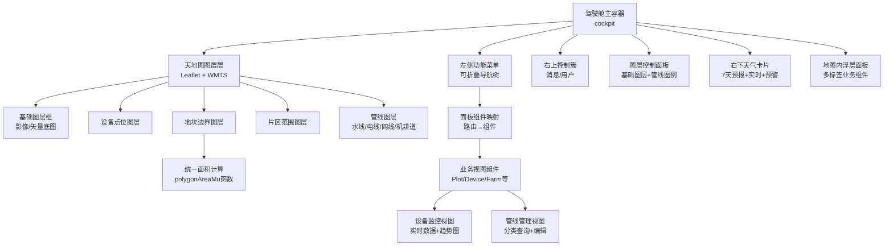
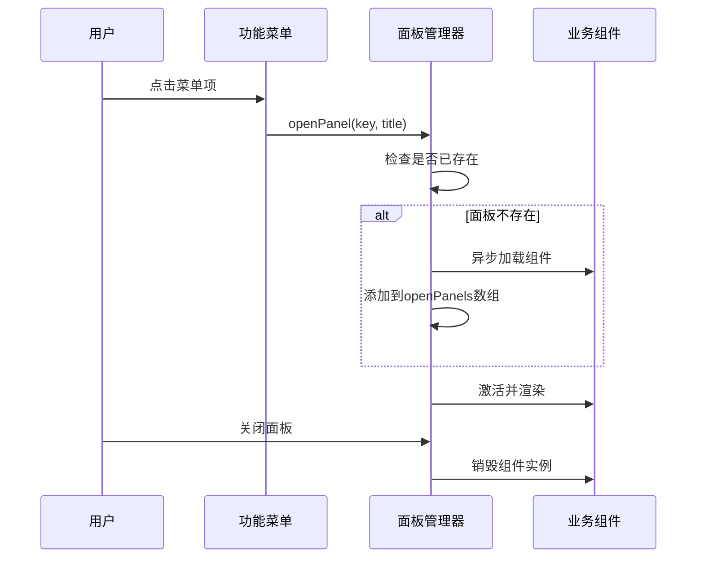
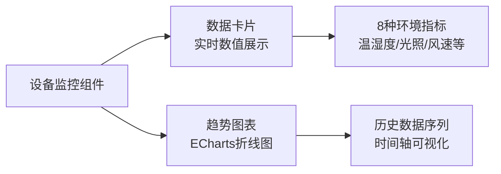

# 仪表盘页面

<cite>
**本文引用的文件**   
- [Index.vue](file://apps/web/src/views/dashboard/Index.vue)
- [geo.ts](file://apps/web/src/utils/geo.ts)
- [MapShapeEditor.vue](file://apps/web/src/components/MapShapeEditor.vue)
- [InfraLinePanel.vue](file://apps/web/src/components/InfraLinePanel.vue)
- [infraLine.ts](file://apps/web/src/utils/infraLine.ts)
- [Monitor.vue](file://apps/web/src/views/device/Monitor.vue)
- [index.ts](file://apps/web/src/api/index.ts)
- [permission.ts](file://apps/web/src/utils/permission.ts)
- [stores/index.ts](file://apps/web/src/stores/index.ts)
</cite>

## 更新摘要
**变更内容**   
- **核心变更**：仪表板模块现已使用新的 `polygonAreaMu` 函数替代硬编码的面积值用于演示边界，确保与平台单一数据源保持一致
- 扩展天气预报至7天展示，提供更完整的气象信息
- 增强设备监控功能，集成实时数据可视化和历史趋势分析
- 完善基础设施管线管理系统，支持水线、电线、网线分类管理
- 优化可视化组件，集成ECharts图表库实现专业级数据可视化
- 改进地图图层控制机制，支持更精细的管线分类显示

## 目录
1. [引言](#引言)
2. [架构总览](#架构总览)
3. [核心组件](#核心组件)
4. [地图集成实现](#地图集成实现)
5. [浮动面板系统](#浮动面板系统)
6. [图层控制机制](#图层控制机制)
7. [天气系统集成](#天气系统集成)
8. [设备监控集成](#设备监控集成)
9. [基础设施管线管理](#基础设施管线管理)
10. [数据可视化增强](#数据可视化增强)
11. [权限与用户管理](#权限与用户管理)
12. [响应式布局](#响应式布局)
13. [性能优化](#性能优化)
14. [错误处理与降级](#错误处理与降级)
15. [结论](#结论)

## 引言
智慧农业平台仪表盘页面已完成全面升级，实现了从传统多页面界面到现代化单地图驾驶舱（Cockpit）风格的完全重构。新版本集成了7天天气预报展示、增强的设备监控功能、专业的可视化组件以及完善的基础设施管线管理系统。**最新改进包括采用统一的面积计算引擎，确保所有地块面积数据的准确性和一致性**。该设计以全屏地图为核心，通过浮动面板提供业务功能访问，为天地图API、天气服务和丰富的图层管理功能提供了统一的可视化界面。

主要特性包括：
- **统一面积计算**：基于 `polygonAreaMu` 函数的精确面积计算，确保与平台数据源一致
- **7天天气预报**：完整的周气象预报展示，包含实时数据和预警信息
- **设备监控集成**：实时设备状态监控和历史趋势分析
- **基础设施管线管理**：水线、电线、网线的分类管理和可视化
- **专业可视化组件**：基于ECharts的专业级数据图表展示
- **智能图层控制**：动态切换地块边界、设备点位、管线等图层
- **权限控制系统**：基于角色的细粒度功能访问控制
- **响应式设计**：适配桌面端和移动端的自适应布局

## 架构总览
新的仪表盘架构采用"一张图"设计理念，所有业务功能都围绕中央地图展开，通过浮动面板提供交互入口。



**图示来源**
- [Index.vue:2-137](file://apps/web/src/views/dashboard/Index.vue#L2-L137)
- [Index.vue:177-195](file://apps/web/src/views/dashboard/Index.vue#L177-L195)

## 核心组件
### 驾驶舱主容器
驾驶舱是整个仪表盘的根容器，负责协调各个子组件的状态和交互。

**主要职责：**
- 管理地图实例和图层状态
- 控制浮动面板的显示和隐藏
- 维护用户会话和权限状态
- 协调各子系统的数据加载

### 左侧功能菜单
可折叠的功能菜单树，按业务领域组织功能入口。

**菜单分组：**
- **基本信息**：地块台账、片区信息、导航路线、管线图层
- **四情监控**：墒情、苗情、虫情、灾情、气象服务
- **视频监控**：地图查看、九宫格查看
- **控制设备**：设备台账、实时监控、控制指令、智能灌溉
- **农事管理**：农事任务、农事记录、田间导航
- **生产经营**：投入产出、生产溯源、消息中心
- **系统管理**：用户管理、角色管理

### 地图内浮层面板
支持多标签页的地图内嵌面板系统，业务组件在地图上方以浮动窗口形式展示。

**面板特性：**
- 支持多个面板同时打开
- 每个面板独立管理生命周期
- 支持最大化、最小化、关闭操作
- 可在新窗口中展开完整页面

**章节来源**
- [Index.vue:6-39](file://apps/web/src/views/dashboard/Index.vue#L6-L39)
- [Index.vue:108-133](file://apps/web/src/views/dashboard/Index.vue#L108-L133)
- [Index.vue:197-266](file://apps/web/src/views/dashboard/Index.vue#L197-L266)

## 地图集成实现
### 天地图API集成
使用Leaflet地图库结合天地图WMTS服务，实现高性能的卫星影像底图和地名注记。

**技术实现：**
```javascript
// 天地图瓦片服务配置
const tileOptions = { subdomains: ['0', '1', '2', '3', '4', '5', '6', '7'], maxZoom: 18 }

function createTiles(layer: string) {
  return L.tileLayer(`https://t{s}.tianditu.gov.cn/${layer}_w/wmts?SERVICE=WMTS&REQUEST=GetTile&VERSION=1.0.0.0&LAYER=${layer}&STYLE=default&TILEMATRIXSET=w&FORMAT=tiles&TILEMATRIX={z}&TILEROW={y}&TILECOL={x}&tk=${tiandituKey}`, { ...tileOptions })
}
```

**图层类型：**
- **影像底图**：`img_w` - 卫星影像瓦片
- **地名注记**：`cia_w` - 中文地名标注
- **矢量底图**：`vec_w` - 矢量地图瓦片
- **矢量注记**：`cva_w` - 矢量地图标注

### 地图初始化与配置
地图初始化为达州市区域，缩放级别15，支持完整的缩放控制和自定义样式。

**地图特性：**
- 全屏显示，无默认UI控件
- 自定义缩放按钮样式
- 深色主题适配
- 高性能瓦片缓存

**章节来源**
- [Index.vue:380-407](file://apps/web/src/views/dashboard/Index.vue#L380-L407)
- [Index.vue:392-394](file://apps/web/src/views/dashboard/Index.vue#L392-L394)

## 浮动面板系统
### 面板架构设计
浮动面板系统采用组件懒加载和KeepAlive缓存机制，提供流畅的用户体验。

**核心特性：**
- **异步组件加载**：按需加载业务组件，减少首屏体积
- **组件缓存**：使用KeepAlive避免重复渲染
- **生命周期管理**：自动管理组件的创建和销毁
- **路由映射**：URL路径到组件的动态映射

### 面板生命周期管理


**图示来源**
- [Index.vue:282-297](file://apps/web/src/views/dashboard/Index.vue#L282-L297)

### 面板操作功能
- **多标签管理**：支持同时打开多个面板
- **最大化/还原**：面板尺寸自适应调整
- **外部展开**：在新窗口中打开完整页面
- **自动关闭**：最后一个面板关闭时自动清理

**章节来源**
- [Index.vue:276-297](file://apps/web/src/views/dashboard/Index.vue#L276-L297)
- [Index.vue:108-133](file://apps/web/src/views/dashboard/Index.vue#L108-L133)

## 图层控制机制
### 基础图层管理
支持四种基础图层的动态切换：影像/矢量底图、设备点位、地块边界、片区范围。

**图层类型定义：**
```typescript
type LayerKey = 'imagery' | 'devices' | 'fields' | 'zones'
```

**图层控制逻辑：**
- **影像/矢量底图**：互斥切换，支持快速切换不同底图风格
- **设备点位**：聚合显示地块上的设备数量和在线状态
- **地块边界**：根据作物类型着色，支持面积计算
- **片区范围**：虚线边框显示片区边界

### 管线图层分类
管线数据按业务类型分为四类，每类有独特的颜色和样式。

**管线分类：**
- **水线**（WATER）：灌溉管道、施肥管道 - 青色 `#00d4ff`
- **电线**（ELECTRIC）：电力线路 - 金色 `#f3c969`  
- **网线**（NET）：通信线路 - 浅蓝色 `#7fe7ff`
- **机耕道**（ROAD）：道路网络 - 灰色虚线

**章节来源**
- [Index.vue:156-169](file://apps/web/src/views/dashboard/Index.vue#L156-L169)
- [Index.vue:299-316](file://apps/web/src/views/dashboard/Index.vue#L299-L316)
- [Index.vue:409-427](file://apps/web/src/views/dashboard/Index.vue#L409-L427)

## 天气系统集成
### 7天天气预报展示
**更新** 天气预报已从5天扩展到7天，提供更完整的气象信息覆盖。

集成天气服务API，提供7日天气预报、实时数据和预警信息。

**天气接口：**
- **7日天气预报**：`weatherApi.getForecast({ days: 7 })` - 完整的周气象预报
- **实时数据**：`weatherApi.getRealtime()` - 温湿度、风速等实时监测
- **预警信息**：`weatherApi.getAlerts({ page: 1, size: 1 })` - 活跃预警统计

### 天气卡片展示
右下角的天气卡片提供简洁的气象信息展示。

**展示内容：**
- **今日天气**：日期、星期、最高温度、天气状况、风向风力
- **实时数据**：温度、湿度、风速等传感器数据
- **未来预报**：未来6天的天气趋势（除今天外）
- **预警提示**：活跃预警数量，带闪烁动画

**章节来源**
- [Index.vue:318-378](file://apps/web/src/views/dashboard/Index.vue#L318-L378)
- [index.ts:422-452](file://apps/web/src/api/index.ts#L422-L452)

## 设备监控集成
### 实时设备监控
**新增** 设备监控功能现已集成到仪表盘系统中，提供完整的设备状态监控和历史趋势分析。

设备监控组件集成了实时数据展示和历史趋势图表，支持多种环境指标的监控。

**监控指标：**
- **空气温度**：实时温度和趋势变化
- **空气湿度**：环境湿度监测
- **土壤湿度**：土壤含水量监控
- **土壤pH值**：土壤酸碱度检测
- **光照强度**：光照条件监测
- **CO₂浓度**：二氧化碳浓度监控
- **风速**：风速和风向监测
- **降雨量**：降水量统计

### 设备状态可视化
设备数据按所属地块进行聚合，显示设备统计信息和在线状态。

**聚合逻辑：**
- 按地块编码分组设备
- 统计设备总数和在线数
- 根据在线比例确定标记颜色
- 弹窗显示详细设备列表

**章节来源**
- [Index.vue:491-534](file://apps/web/src/views/dashboard/Index.vue#L491-L534)
- [Index.vue:536-568](file://apps/web/src/views/dashboard/Index.vue#L536-L568)
- [geo.ts:90-114](file://apps/web/src/utils/geo.ts#L90-L114)

## 基础设施管线管理
### 管线分类和管理
**增强** 基础设施管线管理系统现已完善，支持水线、电线、网线和机耕道的分类管理。

管线数据按业务类型分为四类，每类有独特的颜色和样式，支持完整的CRUD操作。

**管线分类：**
- **水线**（WATER）：灌溉管道、施肥管道 - 青色 `#00d4ff`
- **电线**（ELECTRIC）：电力线路 - 金色 `#f3c969`  
- **网线**（NET）：通信线路 - 浅蓝色 `#7fe7ff`
- **机耕道**（ROAD）：道路网络 - 灰色虚线

### 管线列表面板
独立的管线管理面板提供完整的管线信息查询、定位、编辑和删除功能。

**功能特性：**
- **分类筛选**：按管线类型过滤查询
- **关键字搜索**：支持名称和编码模糊搜索
- **地图定位**：在地图上精确定位管线位置
- **在线编辑**：直接在地图上修改管线走向
- **批量操作**：支持删除等操作

**章节来源**
- [InfraLinePanel.vue:1-123](file://apps/web/src/components/InfraLinePanel.vue#L1-L123)
- [infraLine.ts:1-70](file://apps/web/src/utils/infraLine.ts#L1-L70)

## 数据可视化增强
### ECharts图表集成
**新增** 设备监控模块集成了专业的ECharts图表库，提供高质量的数据可视化效果。

图表组件支持多种图表类型，包括折线图、柱状图、饼图等，满足不同场景的可视化需求。

**图表功能：**
- **实时数据展示**：动态更新的数值卡片
- **历史趋势分析**：时间序列数据的折线图展示
- **交互式操作**：支持缩放、平移、数据点选择
- **响应式布局**：自适应不同屏幕尺寸

### 可视化组件架构


**图示来源**
- [Monitor.vue:1-170](file://apps/web/src/views/device/Monitor.vue#L1-L170)

**章节来源**
- [Monitor.vue:1-170](file://apps/web/src/views/device/Monitor.vue#L1-L170)

## 权限与用户管理
### 权限控制系统
基于角色的权限控制，支持细粒度的功能访问控制。

**权限规则：**
- **精确匹配**：`plot:read` 完全匹配
- **通配符匹配**：`plot:*` 匹配所有plot相关权限
- **全局权限**：`*` 表示全部权限

**权限检查：**
```typescript
function allowed(perm?: string): boolean {
  return !perm || checkPermission(userStore.permissions, perm)
}
```

### 用户状态管理
Pinia store管理用户登录状态、权限信息和会话生命周期。

**用户功能：**
- 用户信息缓存和持久化
- 权限计算和验证
- 登录状态管理
- 退出登录处理

**章节来源**
- [Index.vue:271-274](file://apps/web/src/views/dashboard/Index.vue#L271-L274)
- [permission.ts:1-29](file://apps/web/src/utils/permission.ts#L1-L29)
- [stores/index.ts:16-53](file://apps/web/src/stores/index.ts#L16-L53)

## 响应式布局
### 断点设计
针对不同的屏幕尺寸提供优化的布局方案。

**响应式断点：**
- **大屏（≥1600px）**：完整功能菜单，宽面板布局
- **中屏（900px-1600px）**：标准布局，适度压缩间距
- **小屏（≤900px）**：简化功能，隐藏部分元素
- **移动端（≤640px）**：触摸优化，重新排列布局

### 移动端适配
移动端特别优化了触摸操作和空间利用。

**移动端特性：**
- 功能菜单顶部定位，最大高度限制
- 图层面板右上角定位
- 天气卡片全宽显示
- 地图面板自适应填充剩余空间

**章节来源**
- [Index.vue:705-731](file://apps/web/src/views/dashboard/Index.vue#L705-L731)

## 性能优化
### 资源加载优化
- **异步组件加载**：业务组件按需加载，减少首屏体积
- **图层缓存**：MapApi._layers缓存图层实例，避免重复创建
- **图片优化**：SVG图标内联，减少HTTP请求
- **样式优化**：SCSS编译，CSS压缩

### 渲染性能优化
- **图层分组**：使用LayerGroup批量管理图层
- **事件委托**：减少DOM事件监听器数量
- **虚拟滚动**：大数据量列表的虚拟化处理
- **防抖节流**：地图拖拽和缩放的性能优化

### 内存管理
- **组件卸载**：组件销毁时清理地图实例和定时器
- **图层清理**：面板关闭时移除对应的地图图层
- **数据缓存**：合理使用浏览器缓存策略

**章节来源**
- [Index.vue:593-599](file://apps/web/src/views/dashboard/Index.vue#L593-L599)

## 错误处理与降级
### 地图加载失败
当地图初始化或图层加载失败时，提供友好的降级体验。

**降级策略：**
- 保留基础地图框架
- 显示错误提示信息
- 提供重试机制
- 使用演示数据兜底

### 数据加载异常
各种数据源加载失败时的处理策略。

**异常处理：**
- **地块边界**：加载失败时使用演示边界数据，**面积通过 polygonAreaMu 函数动态计算**
- **设备数据**：拉取失败不影响地图主体功能
- **天气数据**：实时数据不可用时显示占位符
- **管线数据**：渲染失败时静默忽略

### 网络异常处理
- **超时重试**：网络请求失败自动重试
- **离线检测**：检测网络连接状态
- **本地缓存**：关键数据本地缓存
- **进度反馈**：长时间操作的进度提示

**章节来源**
- [Index.vue:519-534](file://apps/web/src/views/dashboard/Index.vue#L519-L534)
- [Index.vue:537-568](file://apps/web/src/views/dashboard/Index.vue#L537-L568)

## 结论
智慧农业平台仪表盘页面通过全面升级，实现了从传统多页面界面到现代化单地图驾驶舱的转变。**最新版本的核心改进是采用统一的面积计算引擎，通过 `polygonAreaMu` 函数替代硬编码的面积值，确保所有地块面积数据的准确性和一致性**。新版本集成了7天天气预报展示、增强的设备监控功能、专业的可视化组件以及完善的基础设施管线管理系统，为农业生产管理提供了更加强大和直观的可视化监控界面。

**主要成就：**
- **用户体验提升**：沉浸式的全屏地图体验，直观的浮动面板交互
- **功能集成度高**：天气、设备、地块、管线等业务功能统一在地图环境中
- **数据准确性保证**：统一的面积计算引擎，确保平台数据源一致性
- **可视化能力增强**：专业的ECharts图表和数据展示组件
- **性能优化显著**：异步加载、图层缓存、内存管理等优化措施
- **响应式适配完善**：从桌面端到移动端的完整适配方案
- **权限控制精细**：基于角色的细粒度权限管理系统

**技术亮点：**
- 天地图WMTS服务的高效瓦片加载
- 动态图层管理和条件渲染
- 组件懒加载和生命周期管理
- 复杂地理数据的处理和可视化
- 完善的错误处理和降级机制
- **统一的 polygonAreaMu 面积计算引擎**
- 7天天气预报的完整展示
- 设备监控的实时数据可视化
- 基础设施管线的分类管理

该设计为智慧农业平台提供了一个现代化、高性能、易用的可视化监控界面，为农业生产管理提供了强有力的技术支持。**特别是通过统一的面积计算机制，确保了平台数据的一致性和准确性，避免了因硬编码导致的面积数据不一致问题**。