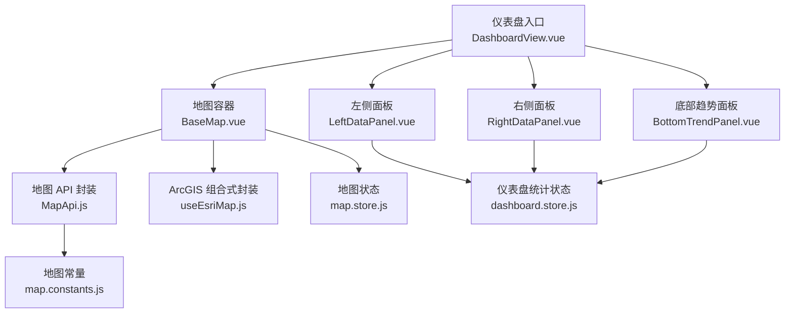
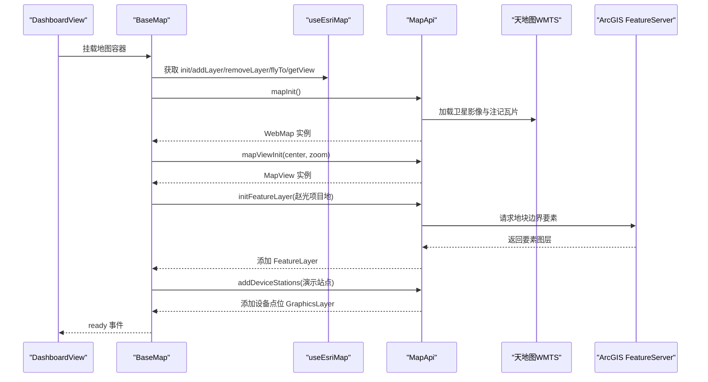
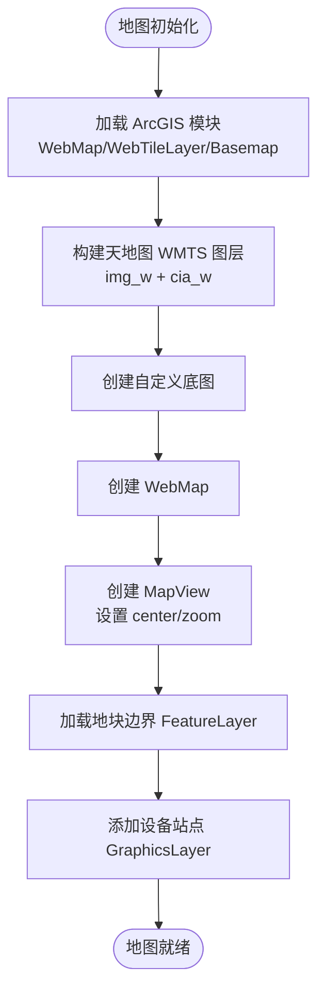
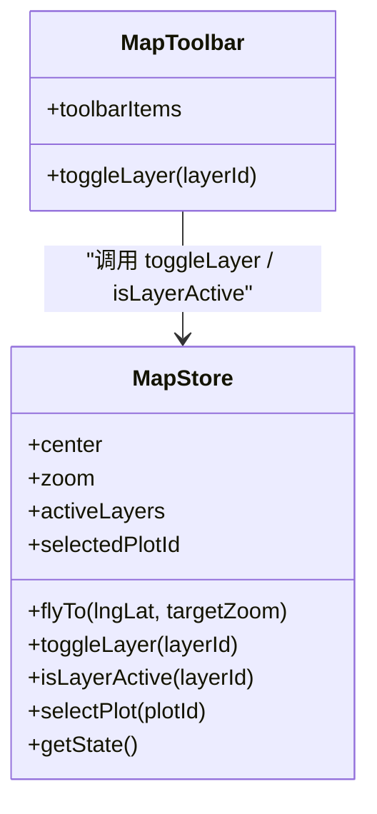
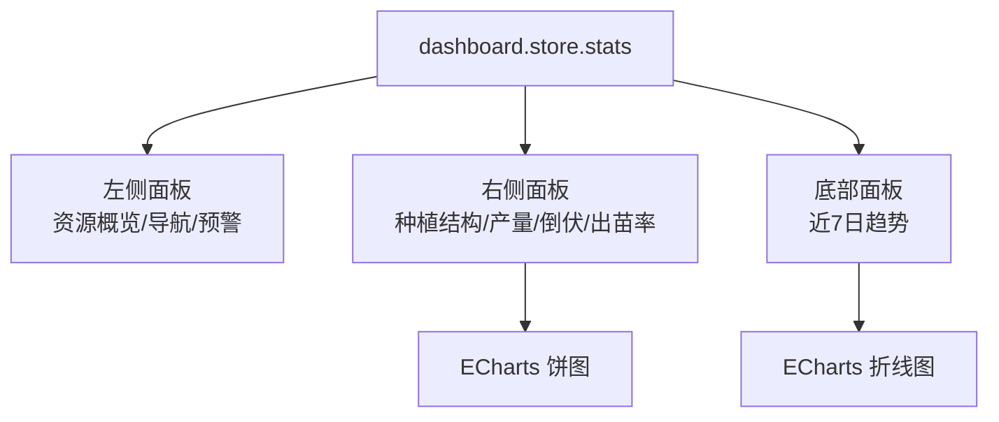
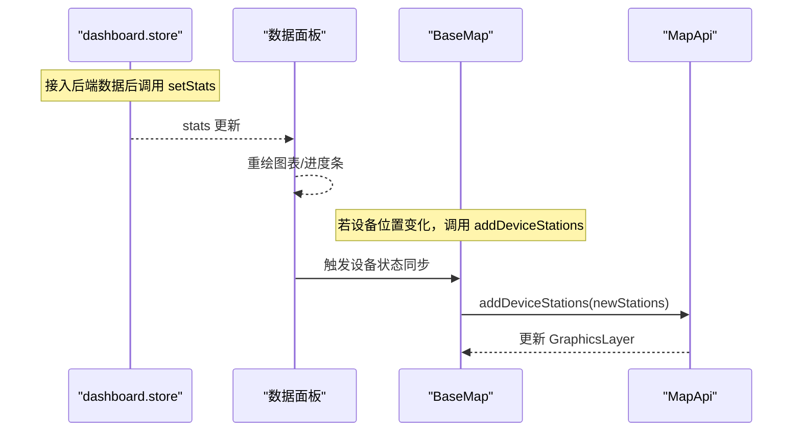
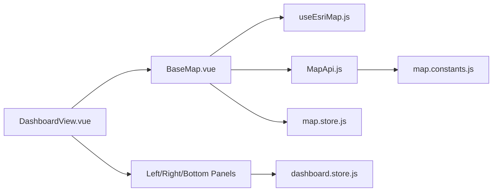

# 仪表盘页面

<cite>
**本文引用的文件**   
- [DashboardView.vue](file://zhao-guang-farm-master/src/views/dashboard/DashboardView.vue)
- [BaseMap.vue](file://zhao-guang-farm-master/src/components/map/BaseMap.vue)
- [MapToolbar.vue](file://zhao-guang-farm-master/src/components/map/MapToolbar.vue)
- [LeftDataPanel.vue](file://zhao-guang-farm-master/src/views/dashboard/components/LeftDataPanel.vue)
- [RightDataPanel.vue](file://zhao-guang-farm-master/src/views/dashboard/components/RightDataPanel.vue)
- [BottomTrendPanel.vue](file://zhao-guang-farm-master/src/views/dashboard/components/BottomTrendPanel.vue)
- [dashboard.store.js](file://zhao-guang-farm-master/src/stores/dashboard.store.js)
- [map.store.js](file://zhao-guang-farm-master/src/stores/map.store.js)
- [useEsriMap.js](file://zhao-guang-farm-master/src/composables/useEsriMap.js)
- [MapApi.js](file://zhao-guang-farm-master/src/mapAPI/MapApi.js)
- [map.constants.js](file://zhao-guang-farm-master/src/constants/map.constants.js)
</cite>

## 目录
1. [引言](#引言)
2. [项目结构](#项目结构)
3. [核心组件](#核心组件)
4. [架构总览](#架构总览)
5. [详细组件分析](#详细组件分析)
6. [依赖关系分析](#依赖关系分析)
7. [性能与优化](#性能与优化)
8. [错误处理与降级策略](#错误处理与降级策略)
9. [结论](#结论)

## 引言
本文件面向智慧农业平台的“仪表盘页面”，聚焦以下目标：
- 地图集成实现：基于 ArcGIS JS SDK 与天地图 WMTS 服务，完成卫星影像底图、地名注记、地块边界 FeatureLayer、设备点位等图层加载与交互。
- 图层控制机制：通过工具栏按钮切换“地块边界、设备点位、农机轨迹、热力分析”等业务图层，状态由 Pinia store 管理。
- 数据面板设计：左侧展示全域基础资源概览与子系统导航；右侧展示种植结构、产量预估、倒伏情况、出苗率等指标；底部展示近 7 日农情趋势折线图。
- 实时数据更新机制：当前以演示数据为主，预留 loading、lastUpdated 字段，便于接入 WebSocket 或定时轮询进行地块边界渲染、设备状态同步、土壤墒情显示和气象信息集成。
- 响应式布局与性能优化：全屏地图叠加半透明面板，图表按需初始化与销毁，避免内存泄漏。
- 错误处理与降级：地图初始化失败、图层加载失败时记录日志并保留基础视图；演示数据兜底保证界面可用。

## 项目结构
仪表盘页面位于前端工程 zhao-guang-farm-master 的 dashboard 视图下，采用 Vue 单文件组件组织，配合 Pinia 状态管理与 ECharts 图表库。

**图示来源**
- [DashboardView.vue:1-40](file://zhao-guang-farm-master/src/views/dashboard/DashboardView.vue#L1-L40)
- [BaseMap.vue:10-154](file://zhao-guang-farm-master/src/components/map/BaseMap.vue#L10-L154)
- [MapApi.js:20-110](file://zhao-guang-farm-master/src/mapAPI/MapApi.js#L20-L110)
- [useEsriMap.js:14-68](file://zhao-guang-farm-master/src/composables/useEsriMap.js#L14-L68)
- [map.store.js:6-52](file://zhao-guang-farm-master/src/stores/map.store.js#L6-L52)
- [dashboard.store.js:18-36](file://zhao-guang-farm-master/src/stores/dashboard.store.js#L18-L36)
- [map.constants.js:4-54](file://zhao-guang-farm-master/src/constants/map.constants.js#L4-L54)

**章节来源**
- [DashboardView.vue:1-40](file://zhao-guang-farm-master/src/views/dashboard/DashboardView.vue#L1-L40)
- [map.constants.js:4-54](file://zhao-guang-farm-master/src/constants/map.constants.js#L4-L54)

## 核心组件
- 仪表盘入口 DashboardView.vue：负责整体布局（全屏地图 + 左/右/底面板），注入演示统计数据，挂载地图与工具栏插槽。
- 地图容器 BaseMap.vue：初始化 ArcGIS 地图、加载天地图底图与注记、加载地块边界 FeatureLayer、添加设备站点 GraphicLayer，暴露 addLayer/removeLayer/flyTo/getView 方法。
- 地图工具栏 MapToolbar.vue：提供“地块边界、设备点位、农机轨迹、热力分析”图层开关，状态由 map.store.js 管理。
- 左侧面板 LeftDataPanel.vue：子系统导航、全域基础资源概览（总面积、大豆面积、玉米面积、在线设备数）、预警提示。
- 右侧面板 RightDataPanel.vue：种植结构饼图、产量预估、倒伏面积与占比、全域出苗率进度条。
- 底部趋势面板 BottomTrendPanel.vue：近 7 日农情趋势折线图（大豆出苗率、玉米出苗率、长势指数）。
- 状态管理：
  - dashboard.store.js：汇总统计数据、加载状态、最后更新时间。
  - map.store.js：地图中心坐标、缩放级别、激活图层集合、选中地块 id。
- 地图能力封装：
  - MapApi.js：ArcGIS JS SDK 动态加载、天地图 WMTS 底图、MapView 创建、业务图层增删、设备站点标注、飞行定位、FeatureLayer 初始化。
  - useEsriMap.js：Vue 组合式封装，统一 init/addLayer/removeLayer/flyTo/getView 接口，并在组件卸载时清理资源。
- 常量配置：map.constants.js：默认中心、缩放、ArcGIS CDN、暗色主题 CSS、天地图子域与 WMTS 地址、业务图层 ID。

**章节来源**
- [DashboardView.vue:1-40](file://zhao-guang-farm-master/src/views/dashboard/DashboardView.vue#L1-L40)
- [BaseMap.vue:10-154](file://zhao-guang-farm-master/src/components/map/BaseMap.vue#L10-L154)
- [MapToolbar.vue:17-28](file://zhao-guang-farm-master/src/components/map/MapToolbar.vue#L17-L28)
- [LeftDataPanel.vue:1-85](file://zhao-guang-farm-master/src/views/dashboard/components/LeftDataPanel.vue#L1-L85)
- [RightDataPanel.vue:1-82](file://zhao-guang-farm-master/src/views/dashboard/components/RightDataPanel.vue#L1-L82)
- [BottomTrendPanel.vue:1-60](file://zhao-guang-farm-master/src/views/dashboard/components/BottomTrendPanel.vue#L1-L60)
- [dashboard.store.js:18-36](file://zhao-guang-farm-master/src/stores/dashboard.store.js#L18-L36)
- [map.store.js:6-52](file://zhao-guang-farm-master/src/stores/map.store.js#L6-L52)
- [MapApi.js:20-295](file://zhao-guang-farm-master/src/mapAPI/MapApi.js#L20-L295)
- [useEsriMap.js:14-68](file://zhao-guang-farm-master/src/composables/useEsriMap.js#L14-L68)
- [map.constants.js:4-54](file://zhao-guang-farm-master/src/constants/map.constants.js#L4-L54)

## 架构总览
仪表盘页面采用“地图为底 + 面板叠加”的全屏布局，数据流从 Pinia store 驱动 UI 展示，地图层通过 MapApi 调用 ArcGIS JS SDK 与天地图 WMTS 服务。

**图示来源**
- [DashboardView.vue:28-40](file://zhao-guang-farm-master/src/views/dashboard/DashboardView.vue#L28-L40)
- [BaseMap.vue:81-142](file://zhao-guang-farm-master/src/components/map/BaseMap.vue#L81-L142)
- [MapApi.js:36-110](file://zhao-guang-farm-master/src/mapAPI/MapApi.js#L36-L110)
- [MapApi.js:272-281](file://zhao-guang-farm-master/src/mapAPI/MapApi.js#L272-L281)

## 详细组件分析

### 地图集成与天地图 API 调用
- 天地图底图：通过 MapApi.mapInit 使用 esri-loader 动态加载 WebTileLayer，分别加载卫星影像 img_w 与中文注记 cia_w，组合为自定义 Basemap。
- 天地图 Token：从环境变量 VITE_TIANDITU_TOKEN 读取，避免硬编码。
- 子域负载均衡：TIANDITU_SUBDOMAINS 提供多个子域，提升瓦片加载性能。
- ArcGIS 地图与视图：创建 WebMap 与 MapView，设置初始中心与缩放，移动缩放控件到右下角。
- 地块边界：通过 initFeatureLayer 加载远程 FeatureServer，覆盖服务端 drawingInfo 以确保样式一致。
- 设备站点：addDeviceStations 将演示站点转换为 Point 与 TextSymbol，添加到 GraphicsLayer，支持弹窗展示站点编号、经纬度等信息。

**图示来源**
- [MapApi.js:36-110](file://zhao-guang-farm-master/src/mapAPI/MapApi.js#L36-L110)
- [MapApi.js:142-214](file://zhao-guang-farm-master/src/mapAPI/MapApi.js#L142-L214)
- [BaseMap.vue:81-142](file://zhao-guang-farm-master/src/components/map/BaseMap.vue#L81-L142)

**章节来源**
- [MapApi.js:36-110](file://zhao-guang-farm-master/src/mapAPI/MapApi.js#L36-L110)
- [MapApi.js:142-214](file://zhao-guang-farm-master/src/mapAPI/MapApi.js#L142-L214)
- [map.constants.js:15-42](file://zhao-guang-farm-master/src/constants/map.constants.js#L15-L42)
- [BaseMap.vue:81-142](file://zhao-guang-farm-master/src/components/map/BaseMap.vue#L81-L142)

### 图层控制与切换机制
- 工具栏项：包含“地块边界、设备点位、农机轨迹、热力分析”，每个按钮绑定 layerId。
- 状态管理：map.store.js 维护 activeLayers 列表，toggleLayer 切换显隐，isLayerActive 判断激活状态。
- 视觉反馈：MapToolbar 根据 isLayerActive 切换按钮高亮样式。
- 扩展点：可通过扩展 toolbarItems 与 LAYER_IDS 增加新图层（如成熟度等级、收获进度）。

**图示来源**
- [MapToolbar.vue:17-28](file://zhao-guang-farm-master/src/components/map/MapToolbar.vue#L17-L28)
- [map.store.js:6-52](file://zhao-guang-farm-master/src/stores/map.store.js#L6-L52)

**章节来源**
- [MapToolbar.vue:17-28](file://zhao-guang-farm-master/src/components/map/MapToolbar.vue#L17-L28)
- [map.store.js:6-52](file://zhao-guang-farm-master/src/stores/map.store.js#L6-L52)
- [map.constants.js:44-54](file://zhao-guang-farm-master/src/constants/map.constants.js#L44-L54)

### 数据面板设计与指标展示
- 左侧面板：
  - 子系统导航：跳转至农场、苗情、草情、花荚、长势、倒伏、成熟度、产量等页面。
  - 全域基础资源概览：总耕地面积、大豆面积、玉米面积、在线设备数（deviceCount - deviceOffline）。
  - 预警提示：alertCount > 0 显示待处理预警数量，否则显示暂无预警。
- 右侧面板：
  - 种植结构：ECharts 饼图，按 stats.soyAcreage 与 stats.cornAcreage 计算占比。
  - 产量预估：总产量（吨）与平均亩产（kg/亩），后者由 totalYield * 1000 / totalAcreage 计算。
  - 倒伏情况：倒伏面积（亩）与占比（lodgingArea / totalAcreage * 100%）。
  - 全域出苗率：百分比数值与进度条动画。
- 底部趋势面板：
  - 近 7 日日期标签自动生成。
  - 三条系列：大豆出苗率、玉米出苗率、长势指数，使用 ECharts 折线图渲染。

**图示来源**
- [LeftDataPanel.vue:11-85](file://zhao-guang-farm-master/src/views/dashboard/components/LeftDataPanel.vue#L11-L85)
- [RightDataPanel.vue:13-82](file://zhao-guang-farm-master/src/views/dashboard/components/RightDataPanel.vue#L13-L82)
- [BottomTrendPanel.vue:7-60](file://zhao-guang-farm-master/src/views/dashboard/components/BottomTrendPanel.vue#L7-L60)
- [dashboard.store.js:6-16](file://zhao-guang-farm-master/src/stores/dashboard.store.js#L6-L16)

**章节来源**
- [LeftDataPanel.vue:11-85](file://zhao-guang-farm-master/src/views/dashboard/components/LeftDataPanel.vue#L11-L85)
- [RightDataPanel.vue:13-82](file://zhao-guang-farm-master/src/views/dashboard/components/RightDataPanel.vue#L13-L82)
- [BottomTrendPanel.vue:7-60](file://zhao-guang-farm-master/src/views/dashboard/components/BottomTrendPanel.vue#L7-L60)
- [dashboard.store.js:6-16](file://zhao-guang-farm-master/src/stores/dashboard.store.js#L6-L16)

### 实时数据更新机制（可扩展）
当前实现以演示数据为主，但已预留扩展点：
- dashboard.store.js 提供 setStats、setLoading、lastUpdated，便于接入后端数据后刷新指标。
- BaseMap.vue 中 viewMapFun 在 FeatureLayer 加载完成后执行 flyTo，可结合实时数据更新后重新定位。
- MapApi.addDeviceStations 支持传入站点数组，后续可替换为 WebSocket 推送的设备状态，动态更新点位颜色与弹窗内容。
- 土壤墒情与气象信息：可在右侧面板新增数据卡片，订阅传感器数据流，实时更新数值与图表。

**图示来源**
- [dashboard.store.js:25-36](file://zhao-guang-farm-master/src/stores/dashboard.store.js#L25-L36)
- [BaseMap.vue:56-79](file://zhao-guang-farm-master/src/components/map/BaseMap.vue#L56-L79)
- [MapApi.js:142-214](file://zhao-guang-farm-master/src/mapAPI/MapApi.js#L142-L214)

**章节来源**
- [dashboard.store.js:25-36](file://zhao-guang-farm-master/src/stores/dashboard.store.js#L25-L36)
- [BaseMap.vue:56-79](file://zhao-guang-farm-master/src/components/map/BaseMap.vue#L56-L79)
- [MapApi.js:142-214](file://zhao-guang-farm-master/src/mapAPI/MapApi.js#L142-L214)

### 地图工具栏功能
- 按钮组：地块边界、设备点位、农机轨迹、热力分析。
- 交互逻辑：点击按钮调用 mapStore.toggleLayer，切换 activeLayers 中的 layerId。
- 样式反馈：激活态按钮边框与背景高亮，图标与文字保持可读性。
- 扩展建议：可增加“影像底图、矢量底图”切换，对应 LAYER_IDS.basemap 与 LAYER_IDS.label。

**章节来源**
- [MapToolbar.vue:17-28](file://zhao-guang-farm-master/src/components/map/MapToolbar.vue#L17-L28)
- [map.store.js:22-35](file://zhao-guang-farm-master/src/stores/map.store.js#L22-L35)

### 响应式布局适配
- 全屏地图：BaseMap 容器 width/height 100%，隐藏 ArcGIS 默认 UI 与版权角标，使用自定义工具栏。
- 面板布局：左侧固定宽度，右侧固定宽度，底部横条，均使用绝对定位叠加于地图之上，带半透明背景与模糊效果。
- 图表容器：ECharts 图表 div 宽高 100%，在 onMounted 初始化，onBeforeUnmount 销毁实例，避免内存泄漏。
- 视口适配：地图初始中心与缩放针对农场范围设定，必要时可根据设备尺寸调整 zoom 与 center。

**章节来源**
- [BaseMap.vue:157-180](file://zhao-guang-farm-master/src/components/map/BaseMap.vue#L157-L180)
- [DashboardView.vue:43-103](file://zhao-guang-farm-master/src/views/dashboard/DashboardView.vue#L43-L103)
- [RightDataPanel.vue:36-45](file://zhao-guang-farm-master/src/views/dashboard/components/RightDataPanel.vue#L36-L45)
- [BottomTrendPanel.vue:34-43](file://zhao-guang-farm-master/src/views/dashboard/components/BottomTrendPanel.vue#L34-L43)

### 性能优化策略
- 动态模块加载：esri-loader 按需加载 ArcGIS 模块，减少首屏体积。
- 图层缓存：MapApi._layers 使用 Map 缓存图层实例，避免重复添加。
- 样式覆盖：FeatureLayer 加载后覆盖 renderer，防止服务端 drawingInfo 反复覆盖导致重绘。
- 视图优化：首次 goTo 后移除 aspectRatio，设置宽高 100%，确保渲染稳定。
- 图表生命周期：ECharts 实例在组件卸载时 dispose，释放内存。
- 工具栏与面板：使用 backdrop-filter 与半透明背景，降低复杂 UI 对地图渲染的影响。

**章节来源**
- [MapApi.js:116-134](file://zhao-guang-farm-master/src/mapAPI/MapApi.js#L116-L134)
- [BaseMap.vue:116-137](file://zhao-guang-farm-master/src/components/map/BaseMap.vue#L116-L137)
- [BaseMap.vue:56-79](file://zhao-guang-farm-master/src/components/map/BaseMap.vue#L56-L79)
- [RightDataPanel.vue:36-45](file://zhao-guang-farm-master/src/views/dashboard/components/RightDataPanel.vue#L36-L45)
- [BottomTrendPanel.vue:34-43](file://zhao-guang-farm-master/src/views/dashboard/components/BottomTrendPanel.vue#L34-L43)

## 依赖关系分析
仪表盘页面依赖如下模块与外部服务：
- Vue 组件：DashboardView、BaseMap、MapToolbar、LeftDataPanel、RightDataPanel、BottomTrendPanel。
- 状态管理：Pinia store（dashboard.store.js、map.store.js）。
- 地图能力：ArcGIS JS SDK（通过 esri-loader 动态加载）、天地图 WMTS 服务。
- 图表库：ECharts。
- 常量配置：map.constants.js 提供默认中心、缩放、CDN、主题、天地图子域与 WMTS 地址、图层 ID。

**图示来源**
- [DashboardView.vue:1-40](file://zhao-guang-farm-master/src/views/dashboard/DashboardView.vue#L1-L40)
- [BaseMap.vue:10-154](file://zhao-guang-farm-master/src/components/map/BaseMap.vue#L10-L154)
- [useEsriMap.js:14-68](file://zhao-guang-farm-master/src/composables/useEsriMap.js#L14-L68)
- [MapApi.js:20-110](file://zhao-guang-farm-master/src/mapAPI/MapApi.js#L20-L110)
- [map.constants.js:4-54](file://zhao-guang-farm-master/src/constants/map.constants.js#L4-L54)
- [dashboard.store.js:18-36](file://zhao-guang-farm-master/src/stores/dashboard.store.js#L18-L36)
- [map.store.js:6-52](file://zhao-guang-farm-master/src/stores/map.store.js#L6-L52)

**章节来源**
- [DashboardView.vue:1-40](file://zhao-guang-farm-master/src/views/dashboard/DashboardView.vue#L1-L40)
- [BaseMap.vue:10-154](file://zhao-guang-farm-master/src/components/map/BaseMap.vue#L10-L154)
- [useEsriMap.js:14-68](file://zhao-guang-farm-master/src/composables/useEsriMap.js#L14-L68)
- [MapApi.js:20-110](file://zhao-guang-farm-master/src/mapAPI/MapApi.js#L20-L110)
- [map.constants.js:4-54](file://zhao-guang-farm-master/src/constants/map.constants.js#L4-L54)
- [dashboard.store.js:18-36](file://zhao-guang-farm-master/src/stores/dashboard.store.js#L18-L36)
- [map.store.js:6-52](file://zhao-guang-farm-master/src/stores/map.store.js#L6-L52)

## 性能与优化
- 首屏优化：仅加载必要 ArcGIS 模块，延迟非关键资源。
- 图层管理：使用 MapApi._layers 缓存图层，避免重复创建与内存增长。
- 渲染稳定性：首次 goTo 后调整容器宽高，避免比例导致的渲染异常。
- 图表生命周期：ECharts 实例在组件卸载时销毁，防止内存泄漏。
- UI 性能：面板使用 backdrop-filter 与半透明背景，减少复杂绘制开销。
- 可扩展性：store 提供 loading 与 lastUpdated，便于接入增量更新与时间戳展示。

[本节为通用指导，不直接分析具体文件]

## 错误处理与降级策略
- 地图初始化失败：BaseMap.vue 捕获异常并输出日志，同时保留基础 DOM 结构，避免白屏。
- 图层加载失败：initFeatureLayer 与 addDeviceStations 的 Promise reject 分支记录错误，不影响其他图层渲染。
- 视图定位失败：viewMapFun 内部 catch 打印错误，保证后续流程继续。
- 组件卸载保护：isUnmounted 标志位与 onBeforeUnmount 清理，防止异步回调在卸载后操作 DOM。
- 演示数据兜底：DashboardView.vue 在 mounted 阶段写入演示 stats，确保面板始终有数据展示。
- 环境配置缺失：VITE_TIANDITU_TOKEN 为空时仍可运行（天地图服务可能受限），建议生产环境配置 token。

**章节来源**
- [BaseMap.vue:135-142](file://zhao-guang-farm-master/src/components/map/BaseMap.vue#L135-L142)
- [BaseMap.vue:146-151](file://zhao-guang-farm-master/src/components/map/BaseMap.vue#L146-L151)
- [BaseMap.vue:56-79](file://zhao-guang-farm-master/src/components/map/BaseMap.vue#L56-L79)
- [DashboardView.vue:13-23](file://zhao-guang-farm-master/src/views/dashboard/DashboardView.vue#L13-L23)
- [MapApi.js:36-80](file://zhao-guang-farm-master/src/mapAPI/MapApi.js#L36-L80)
- [MapApi.js:142-214](file://zhao-guang-farm-master/src/mapAPI/MapApi.js#L142-L214)

## 结论
仪表盘页面以全屏地图为核心，结合天地图 WMTS 与 ArcGIS JS SDK，实现了卫星影像底图、地名注记、地块边界与设备点位的可视化。通过 MapToolbar 与 map.store.js 实现图层切换，左侧/右侧/底部面板展示全域资源概览、运行状态与农情趋势。当前以演示数据为主，预留了数据更新接口与错误处理机制，便于后续接入实时数据源与后端服务。建议在生产环境中配置天地图 token，完善图层控制扩展点，并持续优化图表与地图渲染性能。