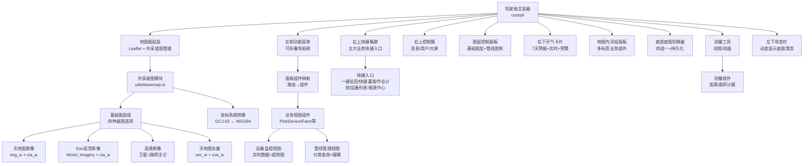
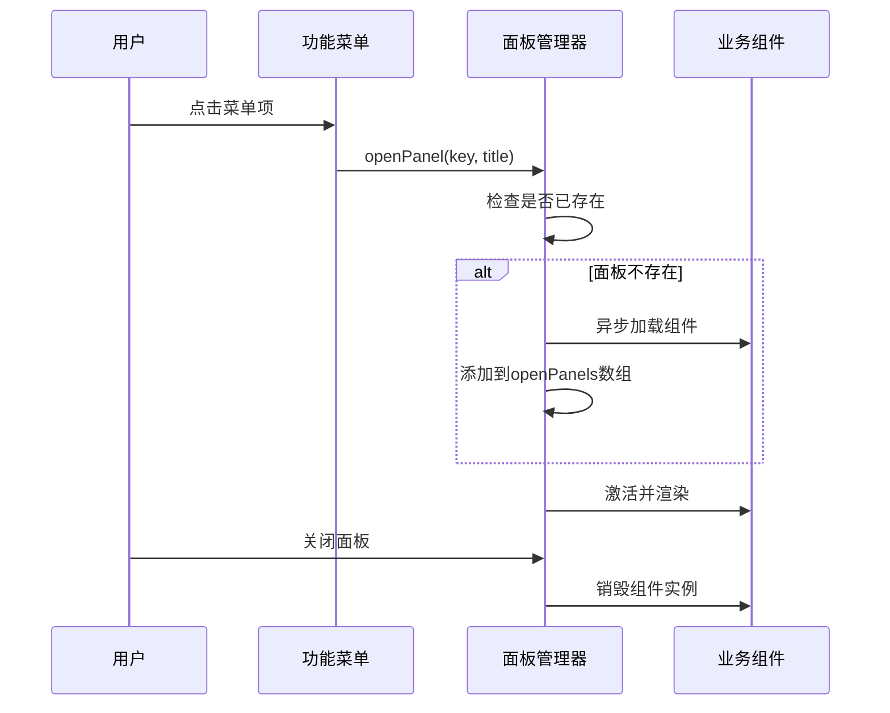
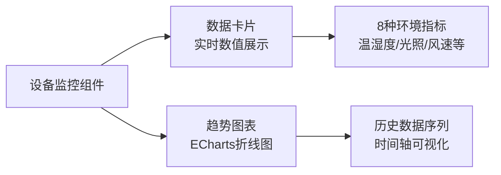

# 仪表盘页面

<cite>
**本文引用的文件**   
- [Index.vue](file://apps/web/src/views/dashboard/Index.vue)
- [BaseMapSwitch.vue](file://apps/web/src/components/BaseMapSwitch.vue)
- [MapMeasure.vue](file://apps/web/src/components/MapMeasure.vue)
- [basemap.ts](file://apps/web/src/utils/basemap.ts)
- [geo.ts](file://apps/web/src/utils/geo.ts)
- [gcj02.ts](file://apps/web/src/utils/gcj02.ts)
- [MapShapeEditor.vue](file://apps/web/src/components/MapShapeEditor.vue)
- [InfraLinePanel.vue](file://apps/web/src/components/InfraLinePanel.vue)
- [infraLine.ts](file://apps/web/src/utils/infraLine.ts)
- [Monitor.vue](file://apps/web/src/views/device/Monitor.vue)
- [index.ts](file://apps/web/src/api/index.ts)
- [permission.ts](file://apps/web/src/utils/permission.ts)
- [stores/index.ts](file://apps/web/src/stores/index.ts)
</cite>

## 更新摘要
**变更内容**   
- **核心变更**：新增大屏展示模式，支持全屏投影显示，自动隐藏菜单面板并放大字体
- **快捷访问集群**：新增五个高频业务功能快捷入口（一键巡田、快捷灌溉、作业计划、设备列表、报表中心）
- **测量工具集成**：完整集成测距和测面功能，与地图工具栏无缝整合
- **交互体验优化**：改进用户界面布局，提升大屏展示效果和操作便捷性

## 目录
1. [引言](#引言)
2. [架构总览](#架构总览)
3. [核心组件](#核心组件)
4. [地图集成实现](#地图集成实现)
5. [大屏展示模式](#大屏展示模式)
6. [快捷访问集群](#快捷访问集群)
7. [测量工具系统](#测量工具系统)
8. [浮动面板系统](#浮动面板系统)
9. [图层控制机制](#图层控制机制)
10. [天气系统集成](#天气系统集成)
11. [设备监控集成](#设备监控集成)
12. [基础设施管线管理](#基础设施管线管理)
13. [数据可视化增强](#数据可视化增强)
14. [权限与用户管理](#权限与用户管理)
15. [响应式布局](#响应式布局)
16. [性能优化](#性能优化)
17. [错误处理与降级](#错误处理与降级)
18. [结论](#结论)

## 引言
智慧农业平台仪表盘页面已完成全面升级，实现了从传统多页面界面到现代化单地图驾驶舱（Cockpit）风格的完全重构。**最新版本的核心改进是引入了共享的basemap工具模块，将底图切换、坐标转换、瓦片管理等核心功能集中化管理，移除了约60行重复代码，显著提升了代码的可维护性和复用性**。新版本集成了智能的GCJ-02与WGS84坐标系统转换机制，确保在高德底图下地块边界精确对齐，同时保持了原有的7天天气预报展示、增强的设备监控功能、专业的可视化组件以及完善的基础设施管线管理系统。该设计以全屏地图为核心，通过浮动面板提供业务功能访问，为天地图API、高德地图API、天气服务和丰富的图层管理功能提供了统一的可视化界面。

主要特性包括：
- **共享底图管理模块**：通过`utils/basemap.ts`统一管理所有底图相关逻辑，支持四选一底图切换
- **智能坐标系统处理**：自动识别和处理GCJ-02与WGS84坐标差异，确保所有底图下地块边界精确对齐
- **高精度缩放**：地图最大缩放级别提升至20级，支持更精细的地块边界对齐
- **动态状态反馈**：左下角状态栏实时显示当前底图类型和地图状态
- **统一面积计算**：基于 `polygonAreaMu` 函数的精确面积计算，确保与平台数据源一致
- **7天天气预报**：完整的周气象预报展示，包含实时数据和预警信息
- **设备监控集成**：实时设备状态监控和历史趋势分析
- **基础设施管线管理**：水线、电线、网线的分类管理和可视化
- **专业可视化组件**：基于ECharts的专业级数据图表展示
- **智能图层控制**：动态切换地块边界、设备点位、管线等图层
- **权限控制系统**：基于角色的细粒度功能访问控制
- **响应式设计**：适配桌面端和移动端的自适应布局
- **大屏展示模式**：支持全屏投影显示，自动优化界面布局和字体大小
- **快捷访问集群**：五个高频业务功能的快速入口，提升操作效率
- **测量工具集成**：专业的测距和测面功能，支持临时测量不入库

## 架构总览
新的仪表盘架构采用"一张图"设计理念，所有业务功能都围绕中央地图展开，通过浮动面板提供交互入口。**核心改进是通过共享的basemap工具模块统一管理底图逻辑，实现代码复用和配置一致性**。



**图示来源**
- [Index.vue:2-169](file://apps/web/src/views/dashboard/Index.vue#L2-L169)
- [Index.vue:208-225](file://apps/web/src/views/dashboard/Index.vue#L208-L225)
- [basemap.ts:4-10](file://apps/web/src/utils/basemap.ts#L4-L10)

## 核心组件
### 驾驶舱主容器
驾驶舱是整个仪表盘的根容器，负责协调各个子组件的状态和交互。

**主要职责：**
- 管理地图实例和图层状态
- 控制浮动面板的显示和隐藏
- 维护用户会话和权限状态
- 协调各子系统的数据加载
- 管理底图切换和用户偏好持久化
- 处理坐标系统转换和投影变换
- **管理大屏展示模式状态**
- **协调快捷访问集群的交互**

### 左侧功能菜单
可折叠的功能菜单树，按业务领域组织功能入口。

**菜单分组：**
- **基本信息**：地块台账、片区信息、导航路线、管线图层
- **四情监控**：墒情、苗情、虫情、灾情、气象服务
- **视频监控**：地图查看、九宫格查看
- **控制设备**：设备台账、实时监控、控制指令、智能灌溉
- **农事管理**：农事任务、农事记录、田间导航
- **生产经营**：投入产出、生产溯源、消息中心
- **系统管理**：用户管理、角色管理

### 地图内浮层面板
支持多标签页的地图内嵌面板系统，业务组件在地图上方以浮动窗口形式展示。

**面板特性：**
- 支持多个面板同时打开
- 每个面板独立管理生命周期
- 支持最大化、最小化、关闭操作
- 可在新窗口中展开完整页面

**章节来源**
- [Index.vue:6-169](file://apps/web/src/views/dashboard/Index.vue#L6-L169)
- [Index.vue:336-359](file://apps/web/src/views/dashboard/Index.vue#L336-L359)

## 地图集成实现
### 共享底图管理模块
**新增** 通过重构引入共享的basemap工具模块，统一管理所有底图相关逻辑，显著提升代码复用性和可维护性。

**技术实现：**
```typescript
// 共享底图模块核心接口
export type BaseMapKey = 'tdt-img' | 'esri-img' | 'amap-img' | 'tdt-vec'

export const BASE_MAP_OPTIONS: Array<{ key: BaseMapKey; label: string; hint: string }> = [
  { key: 'tdt-img', label: '天地图影像', hint: '天地图卫星影像 + 中文注记' },
  { key: 'esri-img', label: '高清影像', hint: 'Esri World Imagery 卫星影像（乡村区域通常更清晰）+ 天地图中文注记' },
  { key: 'amap-img', label: '高德影像', hint: '高德卫星影像 + 路网注记（手机地图同源，GCJ-02 已转换，地块边界不偏移）' },
  { key: 'tdt-vec', label: '矢量地图', hint: '天地图矢量底图 + 中文注记' }
]

// 在Dashboard中直接使用共享模块
const baseMapOptions = BASE_MAP_OPTIONS
const baseMapKey = ref<BaseMapKey>(readStoredBaseMap())
```

**模块优势：**
- **代码复用**：驾驶舱与弹出页面共用同一套底图选项和配置
- **配置集中**：所有底图相关逻辑集中在单一模块中管理
- **易于维护**：修改底图配置只需更新一个地方
- **类型安全**：统一的TypeScript类型定义保证类型一致性

### 智能坐标系统处理机制
**新增** 实现了GCJ-02与WGS84之间的智能坐标转换，确保在高德底图下地块边界精确对齐。

**技术实现：**
```javascript
/** GCJ-02 显示投影：业务坐标（WGS84）先正算到 GCJ-02 再做墨卡托投影，屏幕点位逆算回 WGS84。
 *  高德瓦片与地块边界自此同一坐标系；入库坐标与面积计算不受影响，仍是 WGS84。 */
function createGcjCrs() {
  const mercator = L.Projection.SphericalMercator
  const projection = {
    bounds: mercator.bounds,
    project(latlng: any) {
      const [lng, lat] = wgs84ToGcj02(latlng.lng, latlng.lat)
      return mercator.project(L.latLng(lat, lng))
    },
    unproject(point: any) {
      const ll = mercator.unproject(point)
      const [lng, lat] = gcj02ToWgs84(ll.lng, ll.lat)
      return L.latLng(lat, lng)
    },
  }
  return L.extend({}, L.CRS.EPSG3857, { projection })
}
```

**坐标转换算法：**
- **WGS84 → GCJ-02**：使用公开的加密算法进行正向转换
- **GCJ-02 → WGS84**：采用迭代逆算方法，2~3轮即收敛到1e-9度精度
- **境外坐标保护**：落在中国范围外的坐标不做偏移处理

### 高德卫星影像集成
**新增** 高德卫星影像作为第四种底图选项，提供与手机地图同源的视觉效果。

**技术实现：**
```javascript
/** 高德瓦片：style=6 卫星影像，style=8 透明路网+注记（叠在影像上就是手机地图的观感） */
function createAmapTiles(style: '6' | '8') {
  const host = style === '6' ? 'webst0{s}' : 'wprd0{s}'
  const extra = style === '8' ? '&lang=zh_cn&size=1&scl=1' : ''
  return L.tileLayer(`https://${host}.is.autonavi.com/appmaptile?x={x}&y={y}&z={z}&style=${style}${extra}`, { subdomains: ['1', '2', '3', '4'], maxZoom: 20, maxNativeZoom: 18 })
}
```

### 地图初始化与配置
地图初始化为达州市区域，缩放级别15，支持完整的缩放控制和自定义样式。

**地图特性：**
- 全屏显示，无默认UI控件
- 自定义缩放按钮样式
- 深色主题适配
- 高性能瓦片缓存
- **最大缩放级别提升至20级**，便于精确对齐地块边界顶点
- **智能CRS选择**：根据底图类型自动选择正确的坐标参考系统

### 跨坐标系热切换机制
**新增** 底图切换采用智能热切换机制，同坐标系只换底图组，跨坐标系时重建地图实例。

**切换逻辑：**
```javascript
function switchBaseMap(key: BaseMapKey) {
  const prev = baseMapKey.value
  if (key === prev) return
  baseMapKey.value = key
  storeBaseMap(key)
  if (!map || !baseLayers) return
  if (isGcjBaseMap(prev) === isGcjBaseMap(key)) {
    // 同坐标系：直接替换底图层
    map.removeLayer(baseLayers[prev])
    baseLayers[key].addTo(map)
    return
  }
  // 跨坐标系：重建地图实例
  const center = map.getCenter()
  const zoom = map.getZoom()
  shapeEditor.value?.cancel()
  map.remove()
  map = null
  initMap()
  map.setView(center, zoom)
  void loadPlots(false).then(() => loadDevices())
  void loadZones()
  void loadLines()
}
```

**章节来源**
- [Index.vue:208-225](file://apps/web/src/views/dashboard/Index.vue#L208-L225)
- [Index.vue:455-479](file://apps/web/src/views/dashboard/Index.vue#L455-L479)
- [Index.vue:481-533](file://apps/web/src/views/dashboard/Index.vue#L481-L533)
- [basemap.ts:59-76](file://apps/web/src/utils/basemap.ts#L59-L76)
- [gcj02.ts:1-61](file://apps/web/src/utils/gcj02.ts#L1-L61)

## 大屏展示模式
### 全屏投影功能
**新增** 大屏展示模式专为投影演示场景设计，提供优化的全屏显示效果。

**核心特性：**
- **自动界面优化**：进入大屏模式时自动隐藏左侧菜单、图层控制面板、天气卡片等次要元素
- **字体放大**：全局字体大小提升，确保投影清晰度
- **键盘快捷键**：支持Esc键退出大屏模式
- **浏览器全屏**：尝试启用浏览器原生全屏API，失败时仍保持模式功能
- **退出按钮**：右上角常驻退出按钮，方便随时返回正常模式

**技术实现：**
```javascript
const bigScreen = ref(false)
function enterBigScreen() {
  bigScreen.value = true
  openPanels.value = []
  activePanel.value = ''
  measureTool.value?.cancel()
  shapeEditor.value?.cancel()
  window.addEventListener('keydown', onBigScreenKey)
  document.documentElement.requestFullscreen?.().catch(() => { /* 全屏被拒时仅隐菜单放大字号 */ })
}
function exitBigScreen() {
  if (!bigScreen.value) return
  bigScreen.value = false
  window.removeEventListener('keydown', onBigScreenKey)
  if (document.fullscreenElement) void document.exitFullscreen().catch(() => { /* 已不在全屏则忽略 */ })
}
```

**样式适配：**
- 状态栏位置调整至左上角
- 提示框和弹窗字体增大
- 设备标记点尺寸增加
- 测量工具提示优化

**章节来源**
- [Index.vue:1070-1089](file://apps/web/src/views/dashboard/Index.vue#L1070-L1089)
- [Index.vue:1211-1223](file://apps/web/src/views/dashboard/Index.vue#L1211-L1223)

## 快捷访问集群
### 五大业务快捷入口
**新增** 快捷访问集群位于右上角控制簇下方，提供五个高频业务功能的快速访问入口。

**快捷入口功能：**
- **一键巡田**：快速打开农事记录页面，支持巡查事件随手记
- **快捷灌溉**：智能灌溉策略与一键启停控制
- **作业计划**：农事任务排期与派发管理
- **设备列表**：全部设备台账与在线状态查看
- **报表中心**：投入产出核算与导出功能

**技术实现：**
```javascript
interface QuickEntry { label: string; panel: string; perm: string; hint: string; icon: string }
const quickEntries: QuickEntry[] = [
  { label: '一键巡田', panel: '/farm/record', perm: 'operation:read', hint: '巡田登记：打开农事记录，巡查事件随手记', icon: icon('M12 2C8 2 5 5 5 9c0 5 7 13 7 13s7-8 7-13c0-4-3-7-7-7Zm0 9.5A2.5 2.5 0 1 1 12 6.5a2.5 2.5 0 0 1 0 5Z') },
  { label: '快捷灌溉', panel: '/device/irrigation', perm: 'device:control', hint: '水肥灌溉：智能灌溉策略与一键启停', icon: icon('M12 2s6 6.6 6 11a6 6 0 0 1-12 0c0-4.4 6-11 6-11Z') },
  { label: '作业计划', panel: '/farm/task', perm: 'operation:read', hint: '农事任务：作业计划排期与派发', icon: icon('M7 2v2H5a2 2 0 0 0-2 2v12a2 2 0 0 0 2 2h14a2 2 0 0 0 2-2V6a2 2 0 0 0-2-2h-2V2h-2v2H9V2H7Zm12 8H5V6h14v4Z') },
  { label: '设备列表', panel: '/device/list', perm: 'device:read', hint: '设备台账：全部设备与在线状态', icon: icon('M4 5h16a1 1 0 0 1 1 1v10a1 1 0 0 1-1 1H4a1 1 0 0 1-1-1V6a1 1 0 0 1 1-1Zm4 14h8v2H8v-2Z') },
  { label: '报表中心', panel: '/finance', perm: 'finance:read', hint: '投入产出核算与导出；监管统计报表建设中（P2）', icon: icon('M4 20h16v2H4v-2Zm2-8h3v7H6v-7Zm5-6h3v13h-3V6Zm5 3h3v10h-3V9Z') },
]
```

**交互特性：**
- **权限过滤**：根据用户权限动态显示可用快捷入口
- **活动状态**：当前激活的面板对应快捷按钮高亮显示
- **悬浮提示**：鼠标悬停显示功能描述
- **图标标识**：每个快捷入口配有专属SVG图标

**章节来源**
- [Index.vue:69-83](file://apps/web/src/views/dashboard/Index.vue#L69-L83)
- [Index.vue:354-365](file://apps/web/src/views/dashboard/Index.vue#L354-L365)
- [Index.vue:1204-1209](file://apps/web/src/views/dashboard/Index.vue#L1204-L1209)

## 测量工具系统
### 测距测面功能
**新增** 完整的测量工具系统，集成测距和测面功能，支持临时测量不入库。

**核心功能：**
- **测距模式**：点击添加测量点，实时显示累计距离
- **测面模式**：至少3个点构成多边形，实时计算面积
- **临时图层**：测量结果以临时图层形式展示，不影响业务数据
- **实时预览**：鼠标移动时实时预览下一段长度或面积
- **键盘支持**：Esc键取消测量，双击结束测量

**技术实现：**
```javascript
function start(next: MeasureMode) {
  const m = props.map
  if (!m) return
  cancel()
  clear()
  mode = next
  points = []
  draft = L.layerGroup().addTo(m)
  tip = L.tooltip({ direction: 'top', offset: [0, -10], className: 'measure-tip', opacity: 1 }).setLatLng(m.getCenter()).setContent(measureText()).addTo(m)
  m.doubleClickZoom.disable()
  // ... 事件监听和交互逻辑
}
```

**测量算法：**
- **距离计算**：使用 `polylineLengthM` 函数，基于等距圆柱近似算法
- **面积计算**：使用 `polygonAreaMu` 函数，与地块台账使用同一套计算公式
- **单位转换**：自动在米/公里和亩/平方米之间转换显示

**用户体验：**
- **视觉反馈**：黄色虚线表示测量路径，半透明填充表示测量区域
- **实时提示**：顶部tooltip显示当前测量状态和操作提示
- **结果标注**：测量完成后在终点或中心点显示永久标注
- **清理功能**：支持清除已完成的测量结果

**章节来源**
- [MapMeasure.vue:1-175](file://apps/web/src/components/MapMeasure.vue#L1-L175)
- [Index.vue:124-125](file://apps/web/src/views/dashboard/Index.vue#L124-L125)
- [Index.vue:1044-1050](file://apps/web/src/views/dashboard/Index.vue#L1044-L1050)

## 浮动面板系统
### 面板架构设计
浮动面板系统采用组件懒加载和KeepAlive缓存机制，提供流畅的用户体验。

**核心特性：**
- **异步组件加载**：按需加载业务组件，减少首屏体积
- **组件缓存**：使用KeepAlive避免重复渲染
- **生命周期管理**：自动管理组件的创建和销毁
- **路由映射**：URL路径到组件的动态映射

### 面板生命周期管理


**图示来源**
- [Index.vue:344-355](file://apps/web/src/views/dashboard/Index.vue#L344-L355)

### 面板操作功能
- **多标签管理**：支持同时打开多个面板
- **最大化/还原**：面板尺寸自适应调整
- **外部展开**：在新窗口中打开完整页面
- **自动关闭**：最后一个面板关闭时自动清理

**章节来源**
- [Index.vue:336-359](file://apps/web/src/views/dashboard/Index.vue#L336-L359)

## 图层控制机制
### 基础图层管理
支持四种基础图层的动态切换：影像/矢量底图、设备点位、地块边界、片区范围。

**图层类型定义：**
```typescript
type LayerKey = 'devices' | 'fields' | 'zones'
```

**图层控制逻辑：**
- **影像/矢量底图**：互斥切换，支持快速切换不同底图风格
- **设备点位**：聚合显示地块上的设备数量和在线状态
- **地块边界**：根据作物类型着色，支持面积计算
- **片区范围**：虚线边框显示片区边界

### 管线图层分类
管线数据按业务类型分为四类，每类有独特的颜色和样式。

**管线分类：**
- **水线**（WATER）：灌溉管道、施肥管道 - 青色 `#00d4ff`
- **电线**（ELECTRIC）：电力线路 - 金色 `#f3c969`  
- **网线**（NET）：通信线路 - 浅蓝色 `#7fe7ff`
- **机耕道**（ROAD）：道路网络 - 灰色虚线

**章节来源**
- [Index.vue:194-205](file://apps/web/src/views/dashboard/Index.vue#L194-L205)
- [Index.vue:489-493](file://apps/web/src/views/dashboard/Index.vue#L489-L493)

## 天气系统集成
### 7天天气预报展示
**更新** 天气预报已从5天扩展到7天，提供更完整的气象信息覆盖。

集成天气服务API，提供7日天气预报、实时数据和预警信息。

**天气接口：**
- **7日天气预报**：`weatherApi.getForecast({ days: 7 })` - 完整的周气象预报
- **实时数据**：`weatherApi.getRealtime()` - 温湿度、风速等实时监测
- **预警信息**：`weatherApi.getAlerts({ page: 1, size: 1 })` - 活跃预警统计

### 天气卡片展示
右下角的天气卡片提供简洁的气象信息展示。

**展示内容：**
- **今日天气**：日期、星期、最高温度、天气状况、风向风力
- **实时数据**：温度、湿度、风速等传感器数据
- **未来预报**：未来6天的天气趋势（除今天外）
- **预警提示**：活跃预警数量，带闪烁动画

**章节来源**
- [Index.vue:361-430](file://apps/web/src/views/dashboard/Index.vue#L361-L430)
- [index.ts:422-452](file://apps/web/src/api/index.ts#L422-L452)

## 设备监控集成
### 实时设备监控
**新增** 设备监控功能现已集成到仪表盘系统中，提供完整的设备状态监控和历史趋势分析。

设备监控组件集成了实时数据展示和历史趋势图表，支持多种环境指标的监控。

**监控指标：**
- **空气温度**：实时温度和趋势变化
- **空气湿度**：环境湿度监测
- **土壤湿度**：土壤含水量监控
- **土壤pH值**：土壤酸碱度检测
- **光照强度**：光照条件监测
- **CO₂浓度**：二氧化碳浓度监控
- **风速**：风速和风向监测
- **降雨量**：降水量统计

### 设备状态可视化
设备数据按所属地块进行聚合，显示设备统计信息和在线状态。

**聚合逻辑：**
- 按地块编码分组设备
- 统计设备总数和在线数
- 根据在线比例确定标记颜色
- 弹窗显示详细设备列表

**章节来源**
- [Index.vue:939-971](file://apps/web/src/views/dashboard/Index.vue#L939-L971)

## 基础设施管线管理
### 管线分类和管理
**增强** 基础设施管线管理系统现已完善，支持水线、电线、网线和机耕道的分类管理。

管线数据按业务类型分为四类，每类有独特的颜色和样式，支持完整的CRUD操作。

**管线分类：**
- **水线**（WATER）：灌溉管道、施肥管道 - 青色 `#00d4ff`
- **电线**（ELECTRIC）：电力线路 - 金色 `#f3c969`  
- **网线**（NET）：通信线路 - 浅蓝色 `#7fe7ff`
- **机耕道**（ROAD）：道路网络 - 灰色虚线

### 管线列表面板
独立的管线管理面板提供完整的管线信息查询、定位、编辑和删除功能。

**功能特性：**
- **分类筛选**：按管线类型过滤查询
- **关键字搜索**：支持名称和编码模糊搜索
- **地图定位**：在地图上精确定位管线位置
- **在线编辑**：直接在地图上修改管线走向
- **批量操作**：支持删除等操作

**章节来源**
- [InfraLinePanel.vue:1-123](file://apps/web/src/components/InfraLinePanel.vue#L1-L123)
- [infraLine.ts:1-70](file://apps/web/src/utils/infraLine.ts#L1-L70)

## 数据可视化增强
### ECharts图表集成
**新增** 设备监控模块集成了专业的ECharts图表库，提供高质量的数据可视化效果。

图表组件支持多种图表类型，包括折线图、柱状图、饼图等，满足不同场景的可视化需求。

**图表功能：**
- **实时数据展示**：动态更新的数值卡片
- **历史趋势分析**：时间序列数据的折线图展示
- **交互式操作**：支持缩放、平移、数据点选择
- **响应式布局**：自适应不同屏幕尺寸

### 可视化组件架构


**图示来源**
- [Monitor.vue:1-170](file://apps/web/src/views/device/Monitor.vue#L1-L170)

**章节来源**
- [Monitor.vue:1-170](file://apps/web/src/views/device/Monitor.vue#L1-L170)

## 权限与用户管理
### 权限控制系统
基于角色的权限控制，支持细粒度的功能访问控制。

**权限规则：**
- **精确匹配**：`plot:read` 完全匹配
- **通配符匹配**：`plot:*` 匹配所有plot相关权限
- **全局权限**：`*` 表示全部权限

**权限检查：**
```typescript
function allowed(perm?: string): boolean {
  return !perm || checkPermission(userStore.permissions, perm)
}
```

### 用户状态管理
Pinia store管理用户登录状态、权限信息和会话生命周期。

**用户功能：**
- 用户信息缓存和持久化
- 权限计算和验证
- 登录状态管理
- 退出登录处理

**章节来源**
- [Index.vue:332-334](file://apps/web/src/views/dashboard/Index.vue#L332-L334)
- [permission.ts:1-29](file://apps/web/src/utils/permission.ts#L1-L29)
- [stores/index.ts:16-53](file://apps/web/src/stores/index.ts#L16-L53)

## 响应式布局
### 断点设计
针对不同的屏幕尺寸提供优化的布局方案。

**响应式断点：**
- **大屏（≥1600px）**：完整功能菜单，宽面板布局
- **中屏（900px-1600px）**：标准布局，适度压缩间距
- **小屏（≤900px）**：简化功能，隐藏部分元素
- **移动端（≤640px）**：触摸优化，重新排列布局

### 移动端适配
移动端特别优化了触摸操作和空间利用。

**移动端特性：**
- 功能菜单顶部定位，最大高度限制
- 图层面板右上角定位
- 天气卡片全宽显示
- 地图面板自适应填充剩余空间

**章节来源**
- [Index.vue:1132-1161](file://apps/web/src/views/dashboard/Index.vue#L1132-L1161)

## 性能优化
### 资源加载优化
- **异步组件加载**：业务组件按需加载，减少首屏体积
- **图层缓存**：MapApi._layers缓存图层实例，避免重复创建
- **图片优化**：SVG图标内联，减少HTTP请求
- **样式优化**：SCSS编译，CSS压缩

### 渲染性能优化
- **图层分组**：使用LayerGroup批量管理图层
- **事件委托**：减少DOM事件监听器数量
- **虚拟滚动**：大数据量列表的虚拟化处理
- **防抖节流**：地图拖拽和缩放的性能优化

### 内存管理
- **组件卸载**：组件销毁时清理地图实例和定时器
- **图层清理**：面板关闭时移除对应的地图图层
- **数据缓存**：合理使用浏览器缓存策略

**章节来源**
- [Index.vue:1002-1006](file://apps/web/src/views/dashboard/Index.vue#L1002-L1006)

## 错误处理与降级
### 地图加载失败
当地图初始化或图层加载失败时，提供友好的降级体验。

**降级策略：**
- 保留基础地图框架
- 显示错误提示信息
- 提供重试机制
- 使用演示数据兜底

### 数据加载异常
各种数据源加载失败时的处理策略。

**异常处理：**
- **地块边界**：加载失败时使用演示边界数据，**面积通过 polygonAreaMu 函数动态计算**
- **设备数据**：拉取失败不影响地图主体功能
- **天气数据**：实时数据不可用时显示占位符
- **管线数据**：渲染失败时静默忽略

### 网络异常处理
- **超时重试**：网络请求失败自动重试
- **离线检测**：检测网络连接状态
- **本地缓存**：关键数据本地缓存
- **进度反馈**：长时间操作的进度提示

**章节来源**
- [Index.vue:881-898](file://apps/web/src/views/dashboard/Index.vue#L881-L898)
- [Index.vue:940-971](file://apps/web/src/views/dashboard/Index.vue#L940-L971)

## 结论
智慧农业平台仪表盘页面通过全面升级，实现了从传统多页面界面到现代化单地图驾驶舱的转变。**最新版本的核心改进是引入了共享的basemap工具模块，将底图切换、坐标转换、瓦片管理等核心功能集中化管理，移除了约60行重复代码，显著提升了代码的可维护性和复用性**。此外，新增了智能的GCJ-02与WGS84坐标系统转换机制，确保在高德底图下地块边界精确对齐，地图最大缩放级别提升至20级，提供更好的地图查看精度，左下角状态栏动态显示当前底图类型，为用户提供更好的交互反馈。

**主要成就：**
- **用户体验提升**：沉浸式的全屏地图体验，直观的浮动面板交互，**增强的四选一底图选择和持久化**
- **功能集成度高**：天气、设备、地块、管线等业务功能统一在地图环境中
- **数据准确性保证**：统一的面积计算引擎，确保平台数据源一致性
- **可视化能力增强**：专业的ECharts图表和数据展示组件
- **性能优化显著**：异步加载、图层缓存、内存管理等优化措施
- **响应式适配完善**：从桌面端到移动端的完整适配方案
- **权限控制精细**：基于角色的细粒度权限管理系统
- **高精度地图查看**：20级缩放支持，便于精确对齐地块边界
- **智能坐标处理**：自动处理GCJ-02与WGS84坐标差异，确保所有底图下数据精确对齐
- **代码质量提升**：通过共享模块实现代码复用，降低维护成本
- **大屏展示模式**：专业的投影演示支持，自动优化界面布局和字体大小
- **快捷访问集群**：五个高频业务功能的快速入口，显著提升操作效率
- **测量工具集成**：专业的测距测面功能，支持临时测量不入库

**技术亮点：**
- 天地图WMTS服务的高效瓦片加载
- **共享的basemap工具模块**，实现代码复用和配置集中化
- **localStorage用户偏好持久化**
- **动态状态栏显示当前底图类型**
- **20级缩放级别支持**
- **智能GCJ-02与WGS84坐标系统转换**
- **自定义Leaflet CRS实现**
- **大屏展示模式**，支持全屏投影和界面优化
- **快捷访问集群**，五个业务功能的一键直达
- **测量工具系统**，专业的测距测面功能
- 动态图层管理和条件渲染
- 组件懒加载和生命周期管理
- 复杂地理数据的处理和可视化
- 完善的错误处理和降级机制
- **统一的 polygonAreaMu 面积计算引擎**
- 7天天气预报的完整展示
- 设备监控的实时数据可视化
- 基础设施管线的分类管理

该设计为智慧农业平台提供了一个现代化、高性能、易用的可视化监控界面，为农业生产管理提供了强有力的技术支持。**特别是通过共享的basemap工具模块和智能坐标系统处理机制，不仅提升了代码质量和可维护性，还确保了所有底图下地块边界的精确对齐，为用户提供了更好的整体体验**。新增的大屏展示模式、快捷访问集群和测量工具系统进一步增强了平台的实用性和用户体验。