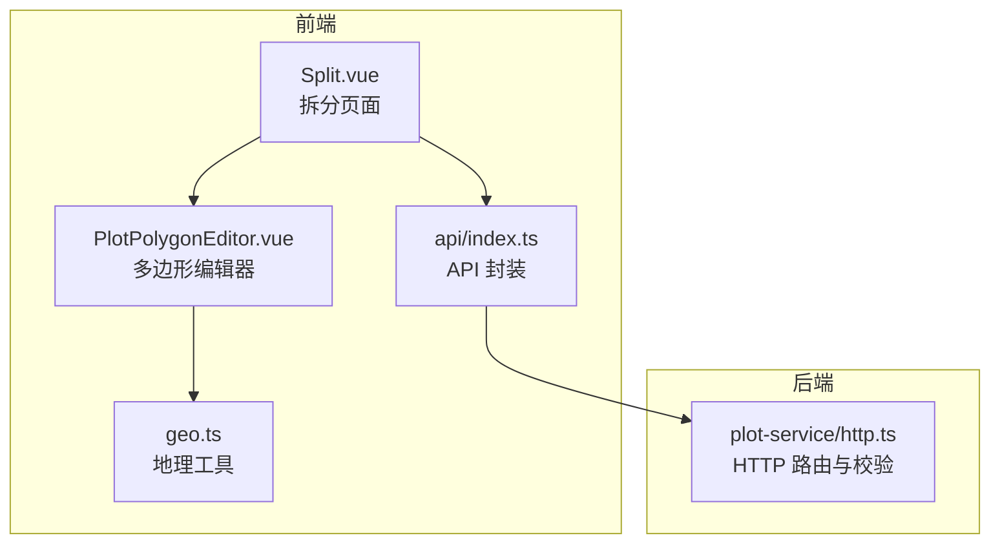
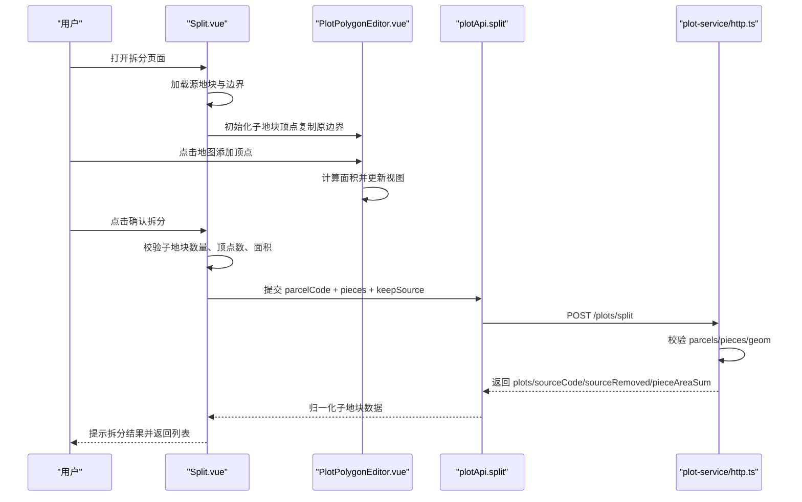
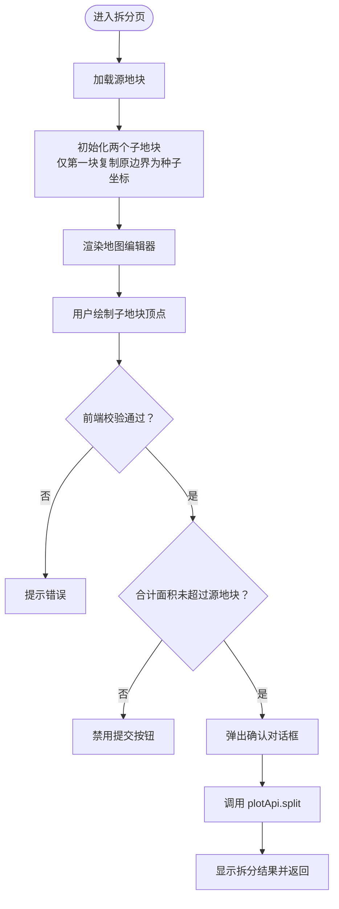
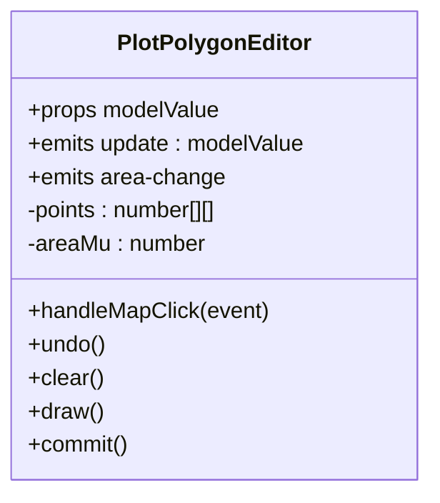
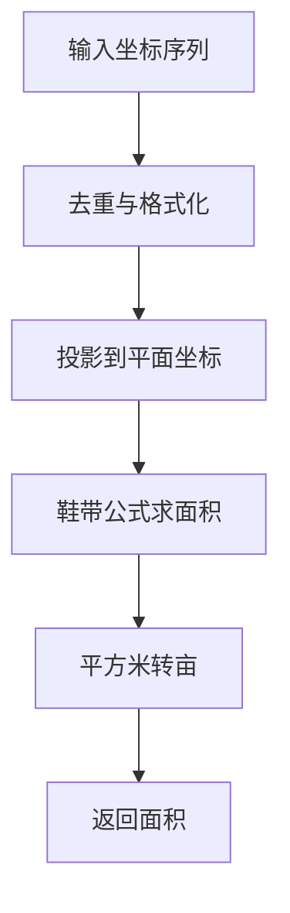
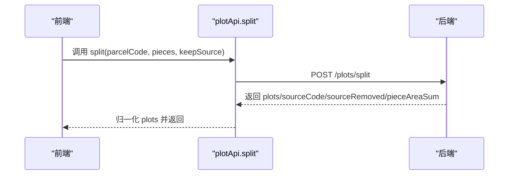
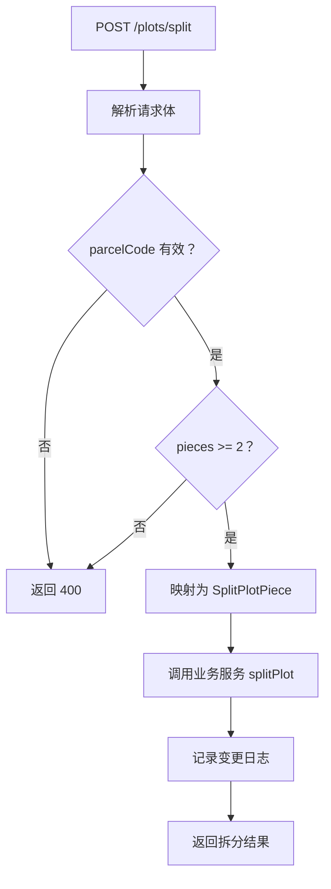
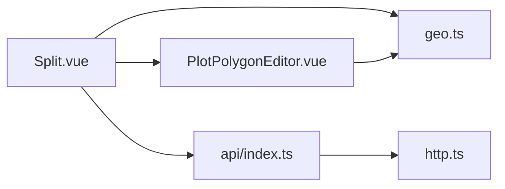

# 地块分割界面

<cite>
**本文引用的文件**   
- [Split.vue](file://apps/web/src/views/plot/Split.vue)
- [PlotPolygonEditor.vue](file://apps/web/src/components/PlotPolygonEditor.vue)
- [geo.ts](file://apps/web/src/utils/geo.ts)
- [api/index.ts](file://apps/web/src/api/index.ts)
- [http.ts](file://apps/plot-service/src/http.ts)
- [plot-split-view.spec.ts](file://apps/web/test/plot-split-view.spec.ts)
</cite>

## 更新摘要
**已进行的变更**   
- 增强了面积守恒验证逻辑，前端现在实现与后端相同的面积守恒规则
- 改进了用户体验：提交按钮在边界重叠或超过源地块面积时自动禁用
- 优化了子地块初始化逻辑：只有第一个子地块接收原始边界参考，避免面积计算错误
- 添加了更详细的用户提示和错误信息

## 目录
1. [简介](#简介)
2. [项目结构定位](#项目结构定位)
3. [核心组件](#核心组件)
4. [架构总览](#架构总览)
5. [详细组件分析](#详细组件分析)
6. [依赖关系分析](#依赖关系分析)
7. [性能与精度特性](#性能与精度特性)
8. [故障排查指南](#故障排查指南)
9. [结论](#结论)

## 简介
本文件聚焦"地块分割界面"的前端实现与后端协作流程，说明用户如何在地图上绘制多个子地块边界、如何校验面积与顶点数量、如何提交拆分请求，以及服务端如何接收并返回拆分结果。文档同时解释面积计算、坐标顺序、地图渲染等关键细节，帮助开发者快速理解从界面到服务端的完整链路。

**更新** 现已增强面积守恒验证和用户交互体验，确保前端与后端使用相同的面积计算逻辑，并提供实时反馈防止无效提交。

## 项目结构定位
地块分割功能由前端页面、地图多边形编辑器、地理工具函数和后端 HTTP 接口共同组成：
- 前端页面负责展示原地块信息、子地块列表、面积汇总与确认拆分操作。
- 地图编辑器负责在 Leaflet 地图上点击添加顶点、撤销、清空、自动闭合与实时面积显示。
- 地理工具函数负责解析边界、计算多边形面积、折线长度、坐标转换等。
- 后端 HTTP 层提供 `/plots/split` 接口，接收子地块几何并调用业务服务完成拆分。

**图表来源** 
- [Split.vue:1-63](file://apps/web/src/views/plot/Split.vue#L1-L63)
- [PlotPolygonEditor.vue:1-13](file://apps/web/src/components/PlotPolygonEditor.vue#L1-L13)
- [geo.ts:1-12](file://apps/web/src/utils/geo.ts#L1-L12)
- [api/index.ts:59-122](file://apps/web/src/api/index.ts#L59-L122)
- [http.ts:615-680](file://apps/plot-service/src/http.ts#L615-L680)

**章节来源**
- [Split.vue:1-63](file://apps/web/src/views/plot/Split.vue#L1-L63)
- [PlotPolygonEditor.vue:1-13](file://apps/web/src/components/PlotPolygonEditor.vue#L1-L13)
- [geo.ts:1-12](file://apps/web/src/utils/geo.ts#L1-L12)
- [api/index.ts:59-122](file://apps/web/src/api/index.ts#L59-L122)
- [http.ts:615-680](file://apps/plot-service/src/http.ts#L615-L680)

## 核心组件
- 拆分页面 `Split.vue`：加载源地块、维护子地块数组、校验边界与面积、弹出确认提示、调用拆分 API。
- 多边形编辑器 `PlotPolygonEditor.vue`：基于 Leaflet 的地图编辑控件，支持点击加顶点、撤销、清空、自动闭合、实时面积。
- 地理工具 `geo.ts`：提供边界解析、主环选择、面积计算、折线长度、GeoJSON 几何构造等能力。
- API 封装 `api/index.ts`：定义 `plotApi.split` 等方法，将前端数据转换为后端期望的几何格式。
- 后端 HTTP `http.ts`：处理 `/plots/split` 请求，校验参数、调用业务服务、记录变更日志并返回拆分结果。

**章节来源**
- [Split.vue:65-193](file://apps/web/src/views/plot/Split.vue#L65-L193)
- [PlotPolygonEditor.vue:15-148](file://apps/web/src/components/PlotPolygonEditor.vue#L15-L148)
- [geo.ts:59-158](file://apps/web/src/utils/geo.ts#L59-L158)
- [api/index.ts:118-122](file://apps/web/src/api/index.ts#L118-L122)
- [http.ts:642-680](file://apps/plot-service/src/http.ts#L642-L680)

## 架构总览
下图展示一次完整的"地块拆分"交互流程：用户在拆分页绘制多个子地块，前端校验通过后调用后端接口，后端返回新地块编码与面积等信息。

**图表来源** 
- [Split.vue:129-188](file://apps/web/src/views/plot/Split.vue#L129-L188)
- [PlotPolygonEditor.vue:103-122](file://apps/web/src/components/PlotPolygonEditor.vue#L103-L122)
- [api/index.ts:118-122](file://apps/web/src/api/index.ts#L118-L122)
- [http.ts:642-680](file://apps/plot-service/src/http.ts#L642-L680)

## 详细组件分析

### 拆分页面 Split.vue
拆分页面承担以下职责：
- 加载源地块信息，包括名称、编码、台账面积与边界几何。
- **更新** 初始化两个子地块，但只将原地块边界作为种子坐标填充到第一个子地块中，避免面积计算错误。
- 维护子地块数组，支持新增、删除当前块、切换活跃块。
- **更新** 对每个子地块进行前端校验：至少两块、每块至少三个顶点、面积为正且不超过原地块面积，同时检查合计面积是否超过源地块。
- **更新** 提交前弹出二次确认，提示子地块名称、面积与原地块归档策略。
- 调用 `plotApi.split`，将子地块名称与几何发送到后端。
- **更新** 当子地块合计面积超过源地块时，自动禁用提交按钮。

**图表来源** 
- [Split.vue:129-188](file://apps/web/src/views/plot/Split.vue#L129-L188)

关键行为说明：
- 子地块数据结构包含名称、坐标数组与面积。
- 面积使用 `polygonAreaMu` 计算，单位亩。
- **更新** 原地块默认整块归档；若勾选保留，则不归档原边界。
- **更新** 拆分成功后返回新地块编码与面积，前端提示并返回上一页。
- **更新** 实现了与服务端相同的面积守恒逻辑，包括两位小数进位和允许 pieces × 0.01 亩的舍入余量。

**章节来源**
- [Split.vue:65-193](file://apps/web/src/views/plot/Split.vue#L65-L193)

### 多边形编辑器 PlotPolygonEditor.vue
该组件是一个可复用的地图多边形绘制控件：
- 使用 Leaflet 创建地图实例，叠加天地图影像与标注图层。
- 监听地图点击事件，将经纬度点加入顶点数组，避免重复点。
- 当顶点数大于等于 3 时绘制多边形，否则绘制折线或点标记。
- 每次修改后重新计算面积，并通过事件向上层组件同步坐标与面积。
- 支持撤销上一点、清空所有顶点。
- 对外暴露 `modelValue` 双向绑定与 `area-change` 事件。

**图表来源** 
- [PlotPolygonEditor.vue:15-148](file://apps/web/src/components/PlotPolygonEditor.vue#L15-L148)

注意：
- Leaflet 内部使用 `[纬度, 经度]`，而表单与后端使用 `[经度, 纬度]`，组件在绘制与提交时做了相应转换。
- 地图容器高度固定为 420px，并在挂载后调整尺寸以避免左上角渲染问题。

**章节来源**
- [PlotPolygonEditor.vue:15-148](file://apps/web/src/components/PlotPolygonEditor.vue#L15-L148)

### 地理工具 geo.ts
地理工具模块提供与边界和面积相关的基础能力：
- `parsePlotBoundary`：兼容多种边界格式，提取主环、中心点、面积与作物信息。
- `ringAreaMu`：基于等距圆柱投影近似计算环面积，单位亩。
- `primaryRing`：选择面积最大的外环，避免内环或洞导致面积异常。
- `polygonAreaMu`：对绘制中的顶点序列计算面积，可不闭合。
- `toPolygonGeom`：将 `[经度, 纬度]` 顶点序列转为 GeoJSON Polygon，srid 为 4490。

**图表来源** 
- [geo.ts:59-86](file://apps/web/src/utils/geo.ts#L59-L86)

关键点：
- 面积计算与数据库迁移脚本保持一致，确保前端预检与后端落库口径一致。
- 坐标顺序严格区分：Leaflet 用 `[lat, lng]`，业务数据用 `[lng, lat]`。

**章节来源**
- [geo.ts:59-158](file://apps/web/src/utils/geo.ts#L59-L158)

### API 封装 api/index.ts
API 层定义了地块相关接口，其中拆分接口如下：
- `plotApi.split`：接收 `parcelCode`、`pieces` 数组与可选 `keepSource`，返回新地块列表、源地块编码、是否移除源地块与子地块面积合计。
- 返回值会经过 `normalizePlot` 归一化，统一字段名与类型。

**图表来源** 
- [api/index.ts:118-122](file://apps/web/src/api/index.ts#L118-L122)

**章节来源**
- [api/index.ts:118-122](file://apps/web/src/api/index.ts#L118-L122)

### 后端 HTTP http.ts
后端 HTTP 层处理 `/plots/split` 请求：
- 校验 `parcelCode` 非空。
- 校验 `pieces` 至少两个子地块。
- 将每个子地块映射为业务对象，包含名称、几何与可选类型/状态。
- 调用业务服务执行拆分，并记录变更日志。
- 返回拆分结果，包括新地块列表、源地块编码、是否移除源地块与子地块面积合计。

**图表来源** 
- [http.ts:642-680](file://apps/plot-service/src/http.ts#L642-L680)

**章节来源**
- [http.ts:642-680](file://apps/plot-service/src/http.ts#L642-L680)

## 依赖关系分析
拆分功能的依赖关系如下：
- `Split.vue` 依赖 `PlotPolygonEditor.vue` 进行地图绘制。
- `Split.vue` 依赖 `geo.ts` 解析边界与计算面积。
- `Split.vue` 依赖 `api/index.ts` 调用后端拆分接口。
- `PlotPolygonEditor.vue` 依赖 `geo.ts` 计算面积。
- `api/index.ts` 依赖后端 HTTP 层 `http.ts` 提供的 `/plots/split` 接口。

**图表来源** 
- [Split.vue:65-193](file://apps/web/src/views/plot/Split.vue#L65-L193)
- [PlotPolygonEditor.vue:15-148](file://apps/web/src/components/PlotPolygonEditor.vue#L15-L148)
- [geo.ts:59-158](file://apps/web/src/utils/geo.ts#L59-L158)
- [api/index.ts:118-122](file://apps/web/src/api/index.ts#L118-L122)
- [http.ts:642-680](file://apps/plot-service/src/http.ts#L642-L680)

**章节来源**
- [Split.vue:65-193](file://apps/web/src/views/plot/Split.vue#L65-L193)
- [PlotPolygonEditor.vue:15-148](file://apps/web/src/components/PlotPolygonEditor.vue#L15-L148)
- [geo.ts:59-158](file://apps/web/src/utils/geo.ts#L59-L158)
- [api/index.ts:118-122](file://apps/web/src/api/index.ts#L118-L122)
- [http.ts:642-680](file://apps/plot-service/src/http.ts#L642-L680)

## 性能与精度特性
- 面积计算采用等距圆柱投影近似，避免直接使用经纬度直接计算导致的误差。
- **更新** 前端与后端使用同一套面积口径，减少"前端放行、后端拒绝"的情况。
- 地图编辑器在每次顶点变化时重新计算面积，保证实时反馈。
- 子地块数量默认为 2，支持动态新增，但删除时至少保留 2 块。
- 坐标精度保留小数点后 6 位，避免浮点误差累积。
- **更新** 实现了精确的面积守恒验证，包括两位小数进位和允许的舍入余量机制。

## 故障排查指南
常见问题与排查建议：
- 子地块不足 2 块：检查是否误删或新增失败。
- 单块顶点少于 3 个：地图绘制需至少 3 个点才能形成多边形。
- 单块面积超过原地块：检查边界是否绘制过大或重叠。
- 面积为 0：检查坐标是否重复或未闭合。
- **更新** 合计面积超过源地块：检查子地块边界是否重叠或超出原地块范围，提交按钮会自动禁用。
- 后端返回 400：检查 `parcelCode` 是否为空、`pieces` 是否至少两个、`geom` 是否为合法 Polygon。
- 地图只渲染左上角：检查容器高度与 `invalidateSize` 调用时机。

**章节来源**
- [Split.vue:116-127](file://apps/web/src/views/plot/Split.vue#L116-L127)
- [PlotPolygonEditor.vue:103-122](file://apps/web/src/components/PlotPolygonEditor.vue#L103-L122)
- [http.ts:642-680](file://apps/plot-service/src/http.ts#L642-L680)

## 结论
地块分割界面通过前端地图编辑器与后端 HTTP 接口协同工作，实现了从边界绘制、面积校验到拆分提交的完整流程。**更新后的版本**显著增强了面积守恒验证逻辑，确保前端与后端使用相同的计算规则，并通过改进的用户体验（如自动禁用提交按钮）提供更好的交互反馈。关键在于坐标顺序、面积计算口径与前后端数据一致性。开发者在使用时应特别注意顶点数量、面积限制与几何合法性，以确保拆分成功并符合业务规则。