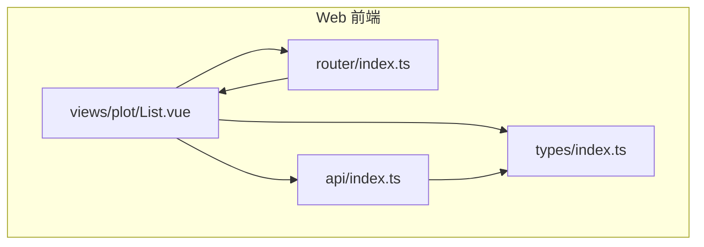
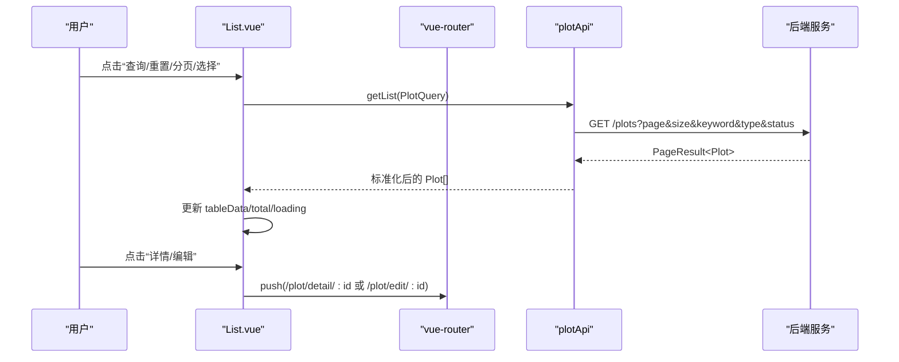
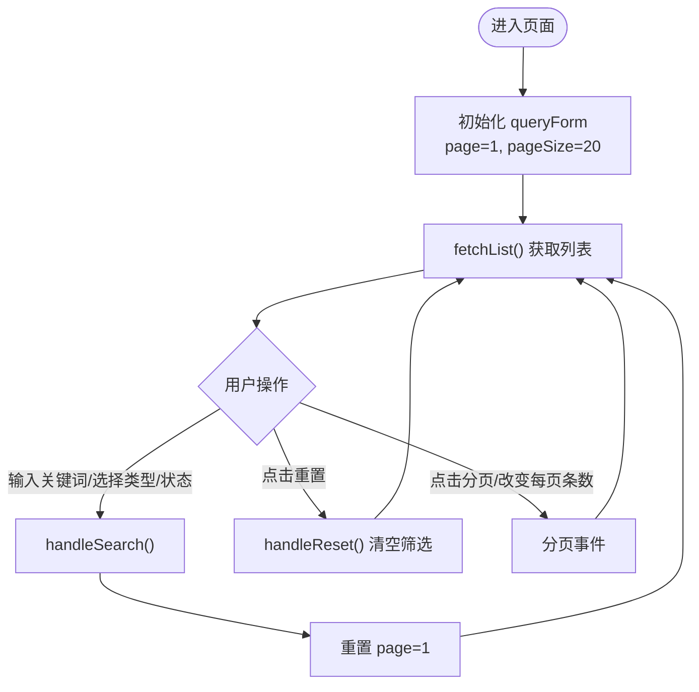
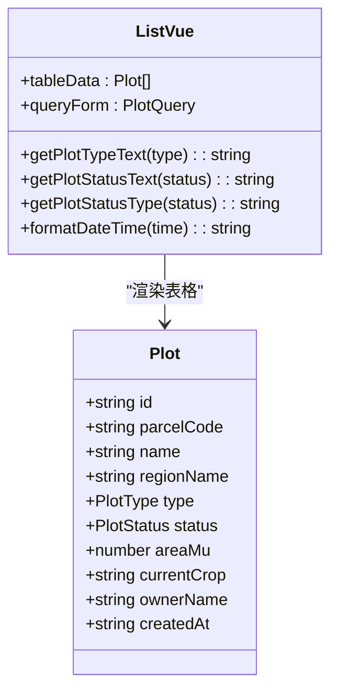
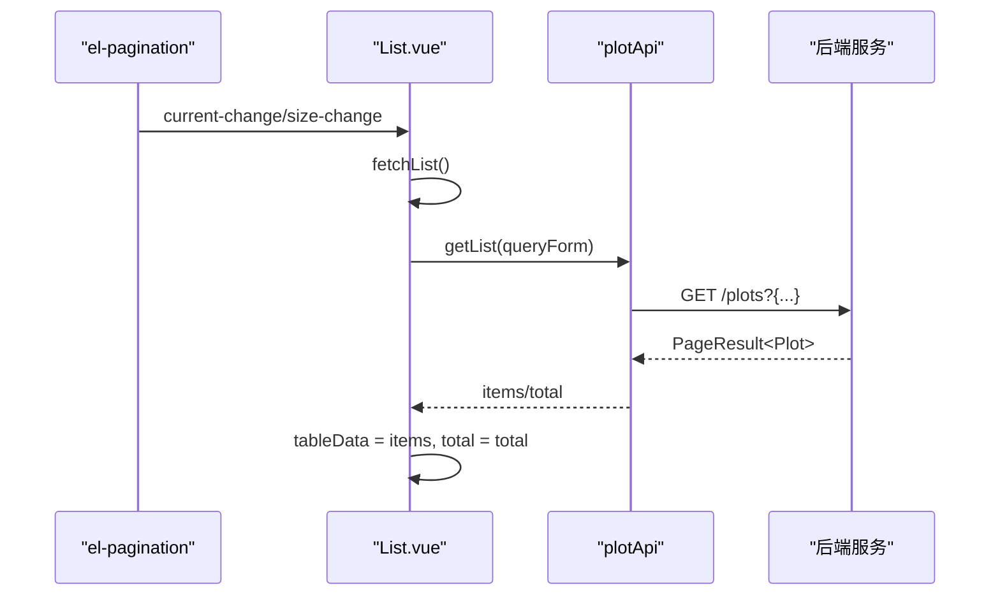
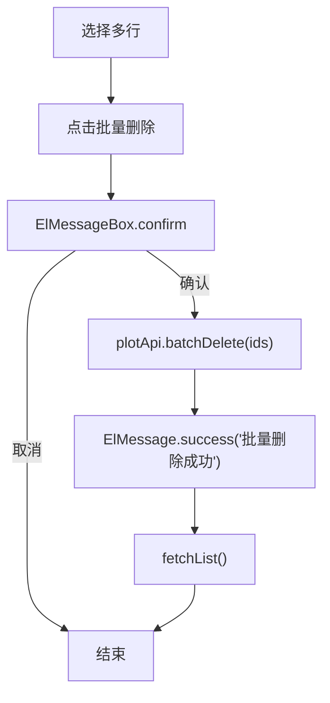
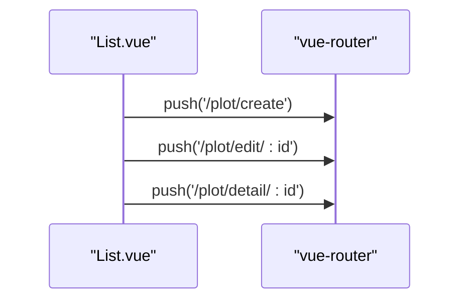
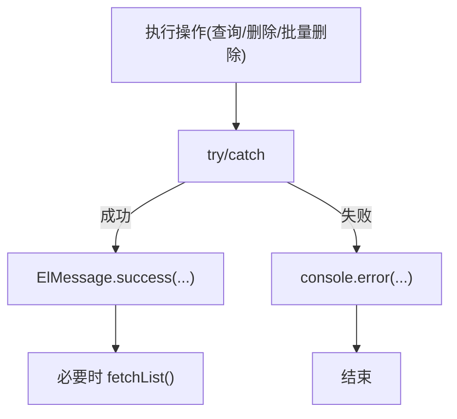
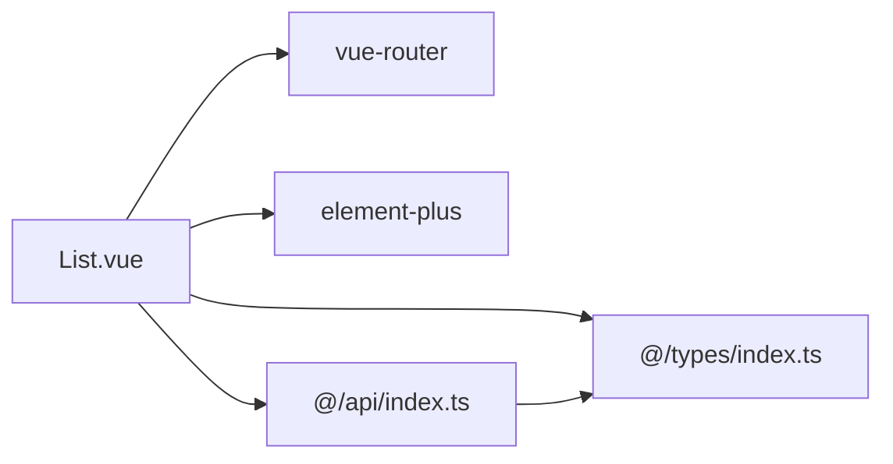

# 地块列表页面

<cite>
**本文引用的文件**   
- [List.vue](file://apps/web/src/views/plot/List.vue)
- [index.ts（路由）](file://apps/web/src/router/index.ts)
- [index.ts（API）](file://apps/web/src/api/index.ts)
- [index.ts（类型定义）](file://apps/web/src/types/index.ts)
</cite>

## 目录
1. [简介](#简介)
2. [项目结构](#项目结构)
3. [核心组件](#核心组件)
4. [架构总览](#架构总览)
5. [详细组件分析](#详细组件分析)
6. [依赖关系分析](#依赖关系分析)
7. [性能与体验优化建议](#性能与体验优化建议)
8. [故障排查指南](#故障排查指南)
9. [结论](#结论)

## 简介
本文件为“地块列表页面”的完整技术文档，面向前端实现与产品使用。内容覆盖：
- 查询表单：关键词搜索、地块类型筛选、状态筛选等逻辑
- 表格展示：基本信息、状态标签渲染、面积格式化、时间格式化
- 分页组件：页码切换、每页条数设置、数据加载机制
- 批量操作：多选删除、导出按钮预留
- 路由跳转：从列表到详情、编辑页面的导航
- 错误处理与用户反馈：统一提示、确认对话框、加载态控制

## 项目结构
该功能位于 Web 应用的前端工程中，采用 Vue 3 + TypeScript + Element Plus 的组合：
- 视图层：地块列表页面在 views/plot/List.vue
- 路由层：路由定义在 router/index.ts，包含列表、新增、编辑、详情等子路由
- API 层：接口封装在 api/index.ts，负责请求转发与数据归一化
- 类型层：枚举与数据结构在 types/index.ts，统一前后端契约

图表来源
- [List.vue:1-272](file://apps/web/src/views/plot/List.vue#L1-L272)
- [index.ts（路由）:1-157](file://apps/web/src/router/index.ts#L1-L157)
- [index.ts（API）:1-263](file://apps/web/src/api/index.ts#L1-L263)
- [index.ts（类型定义）:1-313](file://apps/web/src/types/index.ts#L1-L313)

章节来源
- [List.vue:1-272](file://apps/web/src/views/plot/List.vue#L1-L272)
- [index.ts（路由）:1-157](file://apps/web/src/router/index.ts#L1-L157)
- [index.ts（API）:1-263](file://apps/web/src/api/index.ts#L1-L263)
- [index.ts（类型定义）:1-313](file://apps/web/src/types/index.ts#L1-L313)

## 核心组件
- 查询表单：基于 Element Plus Form，支持关键词、地块类型、地块状态筛选，提供查询与重置
- 工具栏：新增地块、批量删除、导出、刷新
- 数据表格：展示地块编码、名称、区域、类型、状态、面积、作物、负责人、创建时间与操作列
- 分页器：Element Plus Pagination，支持页码与每页条数切换
- 交互与反馈：ElMessage 成功提示、ElMessageBox 确认弹窗、v-loading 加载遮罩
- 路由跳转：通过 vue-router 跳转到详情与编辑页

章节来源
- [List.vue:1-272](file://apps/web/src/views/plot/List.vue#L1-L272)

## 架构总览
下图展示了从用户操作到数据展示的端到端流程：用户在列表页触发查询或分页，组件调用 plotApi.getList，API 层将参数适配并请求后端，返回结果经 normalizePlot 标准化后绑定至表格；同时，分页与筛选条件变化会重新拉取数据。

图表来源
- [List.vue:201-212](file://apps/web/src/views/plot/List.vue#L201-L212)
- [index.ts（API）:29-60](file://apps/web/src/api/index.ts#L29-L60)
- [index.ts（路由）:22-51](file://apps/web/src/router/index.ts#L22-L51)

## 详细组件分析

### 查询表单实现
- 关键词搜索：绑定 queryForm.keyword，提交时重置页码为第 1 页并调用 fetchList
- 地块类型筛选：下拉选项来自 plotTypeOptions，值映射自 PlotType 枚举
- 地块状态筛选：下拉选项来自 plotStatusOptions，值映射自 PlotStatus 枚举
- 查询与重置：handleSearch 与 handleReset 分别清空/保留筛选条件并刷新列表

图表来源
- [List.vue:179-225](file://apps/web/src/views/plot/List.vue#L179-L225)
- [List.vue:201-212](file://apps/web/src/views/plot/List.vue#L201-L212)

章节来源
- [List.vue:5-38](file://apps/web/src/views/plot/List.vue#L5-L38)
- [List.vue:179-225](file://apps/web/src/views/plot/List.vue#L179-L225)

### 表格展示与格式化
- 基本信息列：地块编码、名称、所属区域、负责人、创建时间
- 类型与状态列：使用 getPlotTypeText/getPlotStatusText 进行文本映射，getPlotStatusType 决定标签颜色
- 面积列：areaMu.toFixed(2) 保留两位小数
- 当前作物列：空值显示“-”
- 操作列：详情、编辑、删除（带二次确认）

图表来源
- [List.vue:61-116](file://apps/web/src/views/plot/List.vue#L61-L116)
- [List.vue:143-171](file://apps/web/src/views/plot/List.vue#L143-L171)
- [index.ts（类型定义）:72-96](file://apps/web/src/types/index.ts#L72-L96)

章节来源
- [List.vue:61-116](file://apps/web/src/views/plot/List.vue#L61-L116)
- [List.vue:143-171](file://apps/web/src/views/plot/List.vue#L143-L171)
- [index.ts（类型定义）:72-96](file://apps/web/src/types/index.ts#L72-L96)

### 分页组件与数据加载
- 分页控件：el-pagination 绑定 v-model:current-page 与 v-model:page-size
- 事件处理：@size-change 与 @current-change 均触发 fetchList
- 数据绑定：res.items 或 res.list 作为表格数据，res.total 用于分页总数
- 加载态：loading 在请求前开启，finally 中关闭

图表来源
- [List.vue:118-128](file://apps/web/src/views/plot/List.vue#L118-L128)
- [List.vue:201-212](file://apps/web/src/views/plot/List.vue#L201-L212)
- [index.ts（API）:29-36](file://apps/web/src/api/index.ts#L29-L36)

章节来源
- [List.vue:118-128](file://apps/web/src/views/plot/List.vue#L118-L128)
- [List.vue:201-212](file://apps/web/src/views/plot/List.vue#L201-L212)

### 批量操作功能
- 多选删除：勾选行后，selectedIds 保存选中项 ID；点击批量删除弹出 ElMessageBox 确认框，确认后调用 batchDelete
- 导出：提供导出按钮占位，未实现具体逻辑
- 单删：行内删除按钮使用 el-popconfirm 二次确认，成功后刷新列表

图表来源
- [List.vue:249-266](file://apps/web/src/views/plot/List.vue#L249-L266)
- [index.ts（API）:49-51](file://apps/web/src/api/index.ts#L49-L51)

章节来源
- [List.vue:40-51](file://apps/web/src/views/plot/List.vue#L40-L51)
- [List.vue:249-266](file://apps/web/src/views/plot/List.vue#L249-L266)
- [index.ts（API）:49-51](file://apps/web/src/api/index.ts#L49-L51)

### 路由跳转逻辑
- 新增：router.push('/plot/create')
- 编辑：router.push(`/plot/edit/${id}`)
- 详情：router.push(`/plot/detail/${id}`)
- 路由配置：plot 模块下包含 list、create、edit/:id、detail/:id 子路由

图表来源
- [List.vue:227-237](file://apps/web/src/views/plot/List.vue#L227-L237)
- [index.ts（路由）:22-51](file://apps/web/src/router/index.ts#L22-L51)

章节来源
- [List.vue:227-237](file://apps/web/src/views/plot/List.vue#L227-L237)
- [index.ts（路由）:22-51](file://apps/web/src/router/index.ts#L22-L51)

### 错误处理与用户反馈
- 列表加载失败：catch 分支记录日志，finally 确保 loading 关闭
- 删除失败：catch 分支记录日志
- 批量删除取消：区分 cancel 异常，避免误报
- 成功反馈：删除成功、批量删除成功使用 ElMessage.success 提示
- 全局鉴权：路由守卫根据 token 判断是否跳转登录页

图表来源
- [List.vue:201-212](file://apps/web/src/views/plot/List.vue#L201-L212)
- [List.vue:239-261](file://apps/web/src/views/plot/List.vue#L239-L261)
- [index.ts（路由）:146-154](file://apps/web/src/router/index.ts#L146-L154)

章节来源
- [List.vue:201-212](file://apps/web/src/views/plot/List.vue#L201-L212)
- [List.vue:239-261](file://apps/web/src/views/plot/List.vue#L239-L261)
- [index.ts（路由）:146-154](file://apps/web/src/router/index.ts#L146-L154)

## 依赖关系分析
- 组件依赖：List.vue 依赖 vue-router 进行导航，依赖 element-plus 提供 UI 与交互，依赖 @/api 与 @/types
- API 层职责：plotApi.getList 将前端分页参数 size 转换为后端 size，并对返回数据进行 normalizePlot 标准化
- 类型约束：PlotQuery、Plot、PlotStatus、PlotType 等类型保证前后端字段一致

图表来源
- [List.vue:133-140](file://apps/web/src/views/plot/List.vue#L133-L140)
- [index.ts（API）:29-60](file://apps/web/src/api/index.ts#L29-L60)
- [index.ts（类型定义）:22-36](file://apps/web/src/types/index.ts#L22-L36)

章节来源
- [List.vue:133-140](file://apps/web/src/views/plot/List.vue#L133-L140)
- [index.ts（API）:29-60](file://apps/web/src/api/index.ts#L29-L60)
- [index.ts（类型定义）:22-36](file://apps/web/src/types/index.ts#L22-L36)

## 性能与体验优化建议
- 防抖与节流：对关键词输入可考虑防抖，减少频繁请求
- 分页优化：当筛选条件不变仅翻页时，保持已选行状态
- 缓存策略：对静态字典（类型/状态选项）做本地缓存
- 懒加载：详情页与编辑页按需加载，减少首屏体积
- 错误边界：对关键网络请求增加重试与降级提示

[本节为通用建议，不直接分析具体文件]

## 故障排查指南
- 列表无数据
  - 检查 queryForm 是否正确传递 keyword/type/status
  - 查看控制台是否有网络错误或 catch 日志
  - 确认后端返回的 items/total 字段存在
- 分页无效
  - 确认 el-pagination 绑定了 current-change/size-change 且调用 fetchList
  - 检查 pageSize 与 page 是否被正确更新
- 批量删除不生效
  - 检查 selectedIds 是否为空
  - 确认 ElMessageBox.confirm 返回值未被拦截
- 路由跳转异常
  - 检查路由路径是否与 router/index.ts 配置一致
  - 确认 localStorage.token 是否存在以通过鉴权

章节来源
- [List.vue:201-212](file://apps/web/src/views/plot/List.vue#L201-L212)
- [List.vue:249-266](file://apps/web/src/views/plot/List.vue#L249-L266)
- [index.ts（路由）:146-154](file://apps/web/src/router/index.ts#L146-L154)

## 结论
地块列表页面实现了完整的查询、展示、分页与批量操作能力，并通过统一的 API 层与类型定义保障前后端一致性。结合 Element Plus 的交互组件与 vue-router 的路由管理，提供了良好的用户体验。后续可在输入防抖、缓存与错误边界等方面进一步优化。