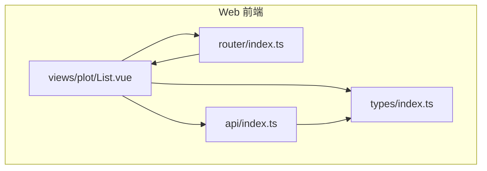
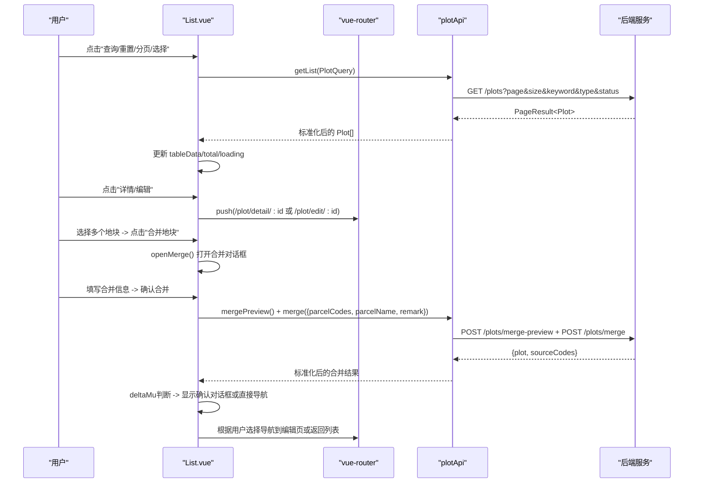
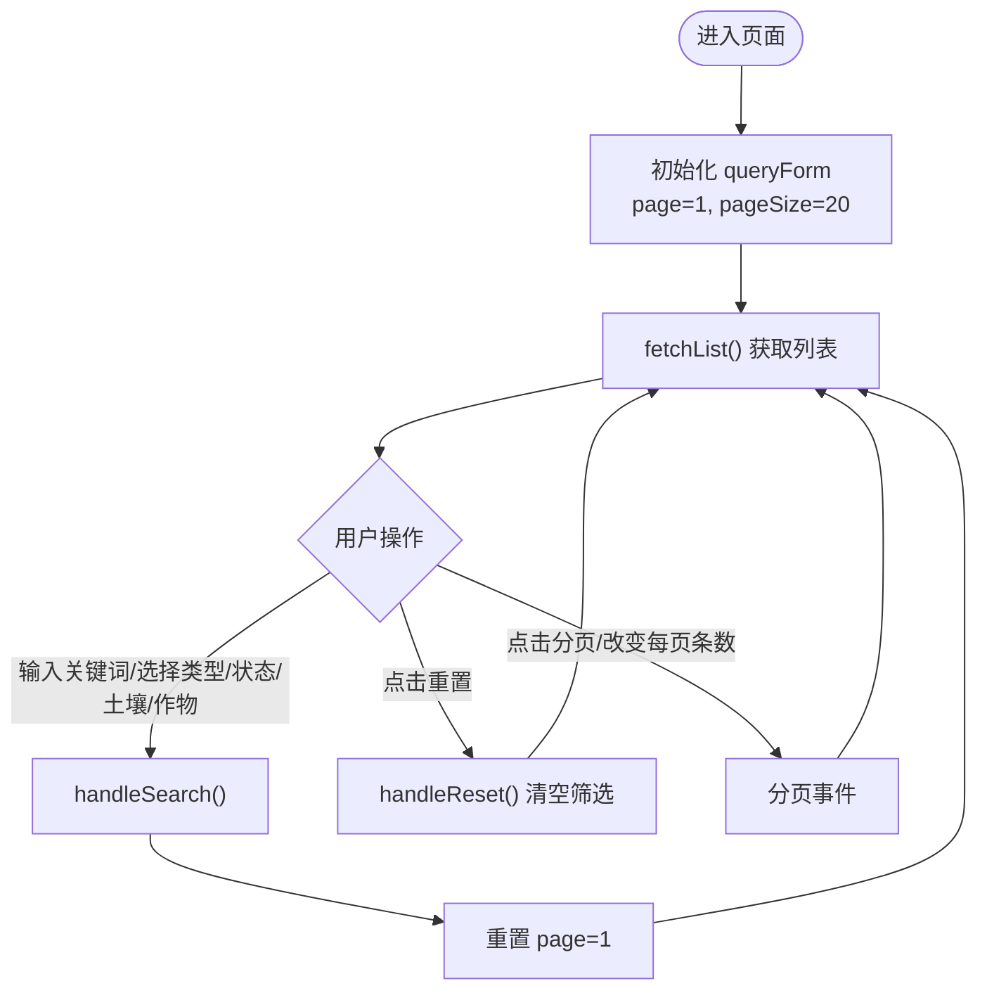
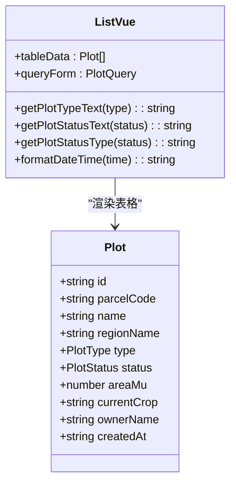
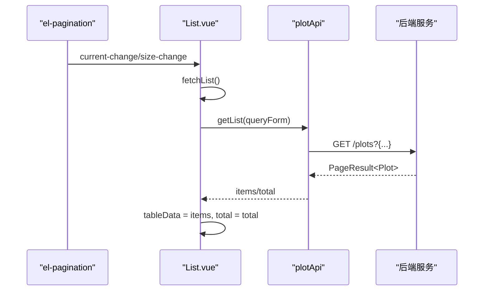
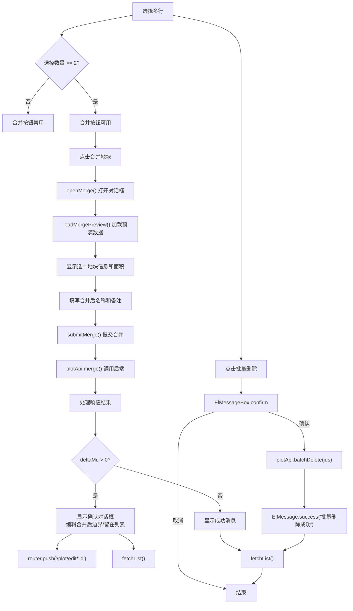
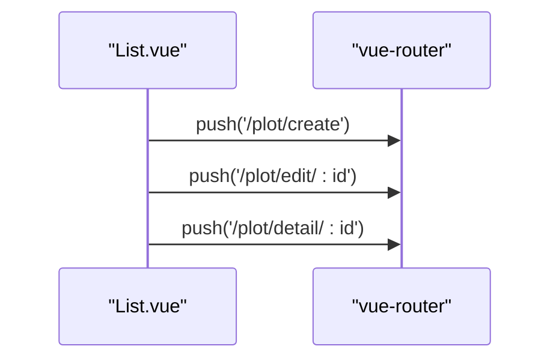
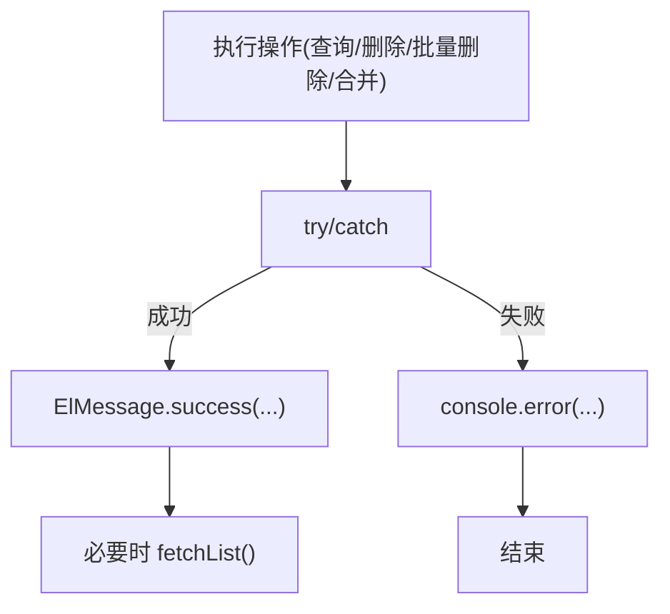
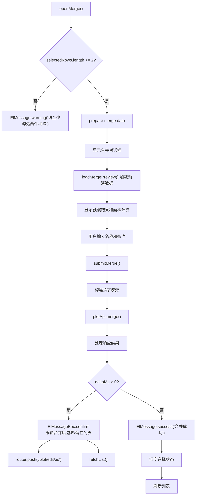
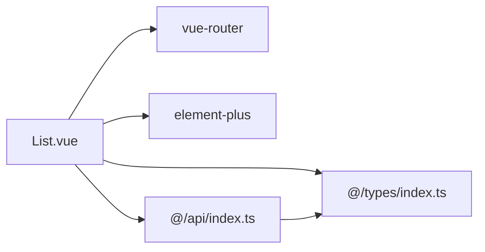

# 地块列表页面

<cite>
**本文引用的文件**   
- [List.vue](file://apps/web/src/views/plot/List.vue)
- [index.ts（路由）](file://apps/web/src/router/index.ts)
- [index.ts（API）](file://apps/web/src/api/index.ts)
- [index.ts（类型定义）](file://apps/web/src/types/index.ts)
</cite>

## 更新摘要
**所做更改**   
- 修复了地块列表页面的TypeScript类型错误，包括merge预览组的显式类型声明和Element Plus API的正确使用
- 更新了合并预览功能的类型安全性，确保groups数组的类型正确性
- 改进了Element Plus组件的API调用方式，提升类型安全性

## 目录
1. [简介](#简介)
2. [项目结构](#项目结构)
3. [核心组件](#核心组件)
4. [架构总览](#架构总览)
5. [详细组件分析](#详细组件分析)
6. [依赖关系分析](#依赖关系分析)
7. [性能与体验优化建议](#性能与体验优化建议)
8. [故障排查指南](#故障排查指南)
9. [结论](#结论)

## 简介
本文件为"地块列表页面"的完整技术文档，面向前端实现与产品使用。内容覆盖：
- 查询表单：关键词搜索、地块类型筛选、状态筛选等逻辑
- 表格展示：基本信息、状态标签渲染、面积格式化、时间格式化
- 分页组件：页码切换、每页条数设置、数据加载机制
- 批量操作：多选删除、导出按钮预留、增强版的地块合并功能
- 路由跳转：从列表到详情、编辑页面的导航
- 错误处理与用户反馈：统一提示、确认对话框、加载态控制

## 项目结构
该功能位于 Web 应用的前端工程中，采用 Vue 3 + TypeScript + Element Plus 的组合：
- 视图层：地块列表页面在 views/plot/List.vue
- 路由层：路由定义在 router/index.ts，包含列表、新增、编辑、详情等子路由
- API 层：接口封装在 api/index.ts，负责请求转发与数据归一化
- 类型层：枚举与数据结构在 types/index.ts，统一前后端契约

图表来源
- [List.vue:1-513](file://apps/web/src/views/plot/List.vue#L1-L513)
- [index.ts（路由）:1-228](file://apps/web/src/router/index.ts#L1-L228)
- [index.ts（API）:1-995](file://apps/web/src/api/index.ts#L1-L995)
- [index.ts（类型定义）:1-519](file://apps/web/src/types/index.ts#L1-L519)

章节来源
- [List.vue:1-513](file://apps/web/src/views/plot/List.vue#L1-L513)
- [index.ts（路由）:1-228](file://apps/web/src/router/index.ts#L1-L228)
- [index.ts（API）:1-995](file://apps/web/src/api/index.ts#L1-L995)
- [index.ts（类型定义）:1-519](file://apps/web/src/types/index.ts#L1-L519)

## 核心组件
- 查询表单：基于 Element Plus Form，支持关键词、地块类型、地块状态、土壤类型、当前作物筛选，提供查询与重置
- 工具栏：新增地块、批量删除、增强版合并地块、导出、刷新
- 数据表格：展示地块编码、名称、区域、类型、状态、面积、作物、负责人、创建时间与操作列
- 分页器：Element Plus Pagination，支持页码与每页条数切换
- 增强版合并对话框：显示选中地块信息、面积计算说明、合并后名称和备注输入，支持凸包预演
- 交互与反馈：ElMessage 成功提示、ElMessageBox 确认弹窗、v-loading 加载遮罩
- 路由跳转：通过 vue-router 跳转到详情与编辑页

章节来源
- [List.vue:1-513](file://apps/web/src/views/plot/List.vue#L1-L513)

## 架构总览
下图展示了从用户操作到数据展示的端到端流程：用户在列表页触发查询或分页，组件调用 plotApi.getList，API 层将参数适配并请求后端，返回结果经 normalizePlot 标准化后绑定至表格；同时，分页与筛选条件变化会重新拉取数据。增强版的合并功能允许用户选择多个地块进行合并操作，并提供凸包预演和智能边界编辑导航。

图表来源
- [List.vue:378-450](file://apps/web/src/views/plot/List.vue#L378-L450)
- [List.vue:399-450](file://apps/web/src/views/plot/List.vue#L399-L450)
- [index.ts（API）:115-135](file://apps/web/src/api/index.ts#L115-L135)
- [index.ts（路由）:32-73](file://apps/web/src/router/index.ts#L32-L73)

## 详细组件分析

### 查询表单实现
- 关键词搜索：绑定 queryForm.keyword，提交时重置页码为第 1 页并调用 fetchList
- 地块类型筛选：下拉选项来自 plotTypeOptions，值映射自 PlotType 枚举
- 地块状态筛选：下拉选项来自 plotStatusOptions，值映射自 PlotStatus 枚举
- 新增土壤类型筛选：下拉选项来自 soilTypeOptions，值映射自 SoilType 枚举
- 新增当前作物筛选：支持按作物名称模糊搜索
- 查询与重置：handleSearch 与 handleReset 分别清空/保留筛选条件并刷新列表

图表来源
- [List.vue:290-316](file://apps/web/src/views/plot/List.vue#L290-L316)
- [List.vue:303-316](file://apps/web/src/views/plot/List.vue#L303-L316)

章节来源
- [List.vue:5-50](file://apps/web/src/views/plot/List.vue#L5-L50)
- [List.vue:290-316](file://apps/web/src/views/plot/List.vue#L290-L316)

### 表格展示与格式化
- 基本信息列：地块编码、名称、所属区域、负责人、创建时间
- 类型与状态列：使用 getPlotTypeText/getPlotStatusText 进行文本映射，getPlotStatusType 决定标签颜色
- 面积列：areaMu.toFixed(2) 保留两位小数
- 当前作物列：空值显示"-"
- 操作列：详情、编辑、删除（带二次确认）

图表来源
- [List.vue:77-136](file://apps/web/src/views/plot/List.vue#L77-L136)
- [List.vue:219-247](file://apps/web/src/views/plot/List.vue#L219-L247)
- [index.ts（类型定义）:72-98](file://apps/web/src/types/index.ts#L72-L98)

章节来源
- [List.vue:77-136](file://apps/web/src/views/plot/List.vue#L77-L136)
- [List.vue:219-247](file://apps/web/src/views/plot/List.vue#L219-L247)
- [index.ts（类型定义）:72-98](file://apps/web/src/types/index.ts#L72-L98)

### 分页组件与数据加载
- 分页控件：el-pagination 绑定 v-model:current-page 与 v-model:page-size
- 事件处理：@size-change 与 @current-change 均触发 fetchList
- 数据绑定：res.items 或 res.list 作为表格数据，res.total 用于分页总数
- 加载态：loading 在请求前开启，finally 中关闭

图表来源
- [List.vue:138-148](file://apps/web/src/views/plot/List.vue#L138-L148)
- [List.vue:290-301](file://apps/web/src/views/plot/List.vue#L290-L301)
- [index.ts（API）:62-74](file://apps/web/src/api/index.ts#L62-L74)

章节来源
- [List.vue:138-148](file://apps/web/src/views/plot/List.vue#L138-L148)
- [List.vue:290-301](file://apps/web/src/views/plot/List.vue#L290-L301)

### 批量操作功能
- 多选删除：勾选行后，selectedCodes 保存选中项 ID；点击批量删除弹出 ElMessageBox 确认框，确认后调用 batchDelete
- 增强版合并地块功能：当选择至少两个地块时，"合并地块"按钮可用，点击后打开合并对话框
- 导出：提供导出按钮，支持导出选中的地块或全部筛选结果
- 单删：行内删除按钮使用 el-popconfirm 二次确认，成功后刷新列表

**增强版合并地块功能详解**：
- 按钮状态：`selectedCodes.length < 2` 时禁用
- 合并对话框：显示警告提示、选中地块列表（含面积）、合并后名称输入、备注输入
- 验证逻辑：至少选择两个地块才能打开合并对话框
- 合并处理：调用 plotApi.merge 接口，源地块自动归档，新地块边界取凸包计算
- 凸包预演：通过 plotApi.mergePreview 提前计算凸包面积和相邻性检查
- 智能导航：当 deltaMu > 0 时，提供确认对话框让用户选择是否直接编辑合并后边界

图表来源
- [List.vue:58-63](file://apps/web/src/views/plot/List.vue#L58-L63)
- [List.vue:151-204](file://apps/web/src/views/plot/List.vue#L151-L204)
- [List.vue:378-450](file://apps/web/src/views/plot/List.vue#L378-L450)
- [index.ts（API）:115-135](file://apps/web/src/api/index.ts#L115-L135)

章节来源
- [List.vue:53-75](file://apps/web/src/views/plot/List.vue#L53-L75)
- [List.vue:151-204](file://apps/web/src/views/plot/List.vue#L151-L204)
- [List.vue:378-450](file://apps/web/src/views/plot/List.vue#L378-L450)
- [index.ts（API）:115-135](file://apps/web/src/api/index.ts#L115-L135)

### 路由跳转逻辑
- 新增：router.push('/plot/create')
- 编辑：router.push(`/plot/edit/${id}`)
- 详情：router.push(`/plot/detail/${id}`)
- 路由配置：plot 模块下包含 list、create、edit/:id、detail/:id 子路由

图表来源
- [List.vue:318-328](file://apps/web/src/views/plot/List.vue#L318-L328)
- [index.ts（路由）:32-73](file://apps/web/src/router/index.ts#L32-L73)

章节来源
- [List.vue:318-328](file://apps/web/src/views/plot/List.vue#L318-L328)
- [index.ts（路由）:32-73](file://apps/web/src/router/index.ts#L32-L73)

### 错误处理与用户反馈
- 列表加载失败：catch 分支记录日志，finally 确保 loading 关闭
- 删除失败：catch 分支记录日志
- 批量删除取消：区分 cancel 异常，避免误报
- 增强版合并失败：catch 分支记录日志，保持对话框状态
- 成功反馈：删除成功、批量删除成功、合并成功使用 ElMessage.success 提示
- 全局鉴权：路由守卫根据 token 判断是否跳转登录页

图表来源
- [List.vue:290-301](file://apps/web/src/views/plot/List.vue#L290-L301)
- [List.vue:330-371](file://apps/web/src/views/plot/List.vue#L330-L371)
- [List.vue:399-450](file://apps/web/src/views/plot/List.vue#L399-L450)
- [index.ts（路由）:211-225](file://apps/web/src/router/index.ts#L211-L225)

章节来源
- [List.vue:290-301](file://apps/web/src/views/plot/List.vue#L290-L301)
- [List.vue:330-371](file://apps/web/src/views/plot/List.vue#L330-L371)
- [List.vue:399-450](file://apps/web/src/views/plot/List.vue#L399-L450)
- [index.ts（路由）:211-225](file://apps/web/src/router/index.ts#L211-L225)

### 增强版合并功能详细实现

#### 合并对话框界面
增强版合并对话框提供了完整的用户界面来管理地块合并操作：
- 警告提示：说明合并后边界取凸包计算，面积为现算值，不相邻地块会框进中间空地
- 源地块列表：显示所有选中地块的名称、编码和面积信息
- 凸包预演区域：显示源面积合计、合并后边界面积（凸包现算）、凸包比源面积和多出的亩数
- 智能提示信息：当 deltaMu > 0 时，提示凹形地块会将中间空地圈入新台账，合并后可手工修改边界
- 表单字段：合并后名称（默认沿用首个地块名称）、备注（可选）
- 操作按钮：取消和确认合并按钮

#### 凸包预演机制
- 预演加载：`loadMergePreview()` 函数调用 `plotApi.mergePreview()` 接口，提前计算凸包相关数据
- 相邻性检查：服务端返回 adjacent 标志和分组信息，告知用户所选地块是否满足相邻要求
- 面积计算：计算源面积合计、凸包面积和差值（deltaMu），用于判断是否需要边界编辑
- 实时反馈：预演结果显示在对话框中，帮助用户做出明智决策

#### 智能导航逻辑
**新增** 当检测到 deltaMu > 0（凸包包含额外空间）时，系统会自动显示确认对话框：
- 确认对话框：显示合并结果信息，包括新地块名称、面积和凸包多出的空地面积
- 两个选项：
  - "编辑合并后边界"：直接导航到编辑页面，用户可以手动调整边界去除多余空地
  - "留在列表"：返回列表页面，保持原有操作流程
- 用户体验优化：避免了用户需要手动查找新地块编码并进入编辑页面的繁琐步骤

#### 合并业务逻辑
- 打开合并：`openMerge()` 函数检查至少选择两个地块，否则显示警告消息
- 数据准备：将选中的地块行复制到 `mergeRows`，重置表单字段
- 提交合并：`submitMerge()` 函数构建请求参数，调用 `plotApi.merge()` 接口
- 结果处理：成功后根据 deltaMu 值决定是否显示确认对话框，然后清空选择状态并刷新列表

#### API 接口设计
增强版合并功能通过两个 API 方法协作：
- **plotApi.mergePreview()**：预演接口，返回凸包预演数据（adjacent、groups、deltaMu、geom 等）
- **plotApi.merge()**：实际合并接口，返回合并后的地块信息和源地块编码列表
- **数据标准化**：返回的地块数据经过 `normalizePlot()` 处理

图表来源
- [List.vue:378-450](file://apps/web/src/views/plot/List.vue#L378-L450)
- [index.ts（API）:115-135](file://apps/web/src/api/index.ts#L115-L135)

**章节来源**
- [List.vue:151-204](file://apps/web/src/views/plot/List.vue#L151-L204)
- [List.vue:378-450](file://apps/web/src/views/plot/List.vue#L378-L450)
- [index.ts（API）:115-135](file://apps/web/src/api/index.ts#L115-L135)

## 依赖关系分析
- 组件依赖：List.vue 依赖 vue-router 进行导航，依赖 element-plus 提供 UI 与交互，依赖 @/api 与 @/types
- API 层职责：plotApi.getList 将前端分页参数 size 转换为后端 size，并对返回数据进行 normalizePlot 标准化；新增 plotApi.mergePreview 和 plotApi.merge 方法处理地块合并预演和实际合并请求
- 类型约束：PlotQuery、Plot、PlotStatus、PlotType 等类型保证前后端字段一致

图表来源
- [List.vue:209-216](file://apps/web/src/views/plot/List.vue#L209-L216)
- [index.ts（API）:62-74](file://apps/web/src/api/index.ts#L62-L74)
- [index.ts（API）:115-135](file://apps/web/src/api/index.ts#L115-L135)
- [index.ts（类型定义）:22-36](file://apps/web/src/types/index.ts#L22-L36)

章节来源
- [List.vue:209-216](file://apps/web/src/views/plot/List.vue#L209-L216)
- [index.ts（API）:62-74](file://apps/web/src/api/index.ts#L62-L74)
- [index.ts（API）:115-135](file://apps/web/src/api/index.ts#L115-L135)
- [index.ts（类型定义）:22-36](file://apps/web/src/types/index.ts#L22-L36)

## 性能与体验优化建议
- 防抖与节流：对关键词输入可考虑防抖，减少频繁请求
- 分页优化：当筛选条件不变仅翻页时，保持已选行状态
- 缓存策略：对静态字典（类型/状态/土壤类型选项）做本地缓存
- 懒加载：详情页与编辑页按需加载，减少首屏体积
- 错误边界：对关键网络请求增加重试与降级提示
- 增强版合并功能优化：考虑对大量地块合并时的性能优化，如分批处理和进度反馈；预演数据的缓存机制

[本节为通用建议，不直接分析具体文件]

## 故障排查指南
- 列表无数据
  - 检查 queryForm 是否正确传递 keyword/type/status/soilType/currentCrop
  - 查看控制台是否有网络错误或 catch 日志
  - 确认后端返回的 items/total 字段存在
- 分页无效
  - 确认 el-pagination 绑定了 current-change/size-change 且调用 fetchList
  - 检查 pageSize 与 page 是否被正确更新
- 批量删除不生效
  - 检查 selectedIds 是否为空
  - 确认 ElMessageBox.confirm 返回值未被拦截
- 增强版合并功能问题
  - 检查是否选择了至少两个地块
  - 确认 plotApi.mergePreview 和 plotApi.merge 接口调用是否正常
  - 查看合并对话框的数据绑定是否正确
  - 检查 deltaMu 值的计算和判断逻辑
  - 确认确认对话框的导航逻辑是否正常工作
- 路由跳转异常
  - 检查路由路径是否与 router/index.ts 配置一致
  - 确认 localStorage.token 是否存在以通过鉴权

章节来源
- [List.vue:290-301](file://apps/web/src/views/plot/List.vue#L290-L301)
- [List.vue:378-450](file://apps/web/src/views/plot/List.vue#L378-L450)
- [index.ts（路由）:211-225](file://apps/web/src/router/index.ts#L211-L225)

## 结论
地块列表页面实现了完整的查询、展示、分页与批量操作能力，并通过统一的 API 层与类型定义保障前后端一致性。增强版的地块合并功能为用户提供了高效的地块整合工具，支持凸包边界计算、面积自动计算和智能边界编辑导航。结合 Element Plus 的交互组件与 vue-router 的路由管理，提供了良好的用户体验。后续可在输入防抖、缓存与错误边界等方面进一步优化。

**TypeScript类型安全改进**：本次更新修复了地块列表页面的TypeScript类型错误，特别是merge预览组的显式类型声明和Element Plus API的正确使用，提升了代码的类型安全性和可维护性。