# 地块管理页面

<cite>
**本文引用的文件**   
- [apps/web/src/views/plot/List.vue](file://apps/web/src/views/plot/List.vue)
- [apps/web/src/views/plot/Detail.vue](file://apps/web/src/views/plot/Detail.vue)
- [apps/web/src/views/plot/Edit.vue](file://apps/web/src/views/plot/Edit.vue)
- [apps/web/src/components/PlotBoundaryMap.vue](file://apps/web/src/components/PlotBoundaryMap.vue)
- [apps/web/src/components/PlotPolygonEditor.vue](file://apps/web/src/components/PlotPolygonEditor.vue)
- [apps/web/src/utils/geo.ts](file://apps/web/src/utils/geo.ts)
- [apps/web/src/api/index.ts](file://apps/web/src/api/index.ts)
- [apps/web/src/types/index.ts](file://apps/web/src/types/index.ts)
- [apps/web/src/utils/index.ts](file://apps/web/src/utils/index.ts)
- [infra/postgres/migrations/015_plot_area_from_boundary.sql](file://infra/postgres/migrations/015_plot_area_from_boundary.sql)
- [packages/shared/src/area.ts](file://packages/shared/src/area.ts)
- [apps/web/test/geo.spec.ts](file://apps/web/test/geo.spec.ts)
</cite>

## 更新摘要
**变更内容**   
- 增强地块编辑界面，当定义边界时禁用手动面积输入
- 优化polygonAreaMu函数使用，提升面积计算准确性
- 完善面积计算验证逻辑，确保数据一致性
- 改进边界绘制体验，提供实时面积反馈和智能校验

## 目录
1. [简介](#简介)
2. [项目结构](#项目结构)
3. [核心组件与职责](#核心组件与职责)
4. [架构总览](#架构总览)
5. [详细组件分析](#详细组件分析)
6. [依赖关系分析](#依赖关系分析)
7. [性能与体验优化建议](#性能与体验优化建议)
8. [故障排查指南](#故障排查指南)
9. [结论](#结论)

## 简介
本文件面向智慧农业平台"地块管理"相关前端页面，系统性说明以下能力：
- 地块列表页的查询、分页、筛选与批量操作实现。
- 地块详情页的信息展示、边界可视化、近期农事活动展示。
- 地块编辑页的表单处理、校验规则、坐标与边界数据流转。
- 地图集成能力：基于 Leaflet 的地块边界渲染、天地图底图加载、坐标转换与面积估算。
- 前后端数据同步机制：API 封装、数据归一化、服务层输入构造与几何坐标转换。
- **新增**：地块面积计算标准化机制，确保前后端使用完全相同的算法，保证数据一致性。
- **增强**：地块编辑界面的智能面积控制，当定义边界时自动禁用手动面积输入，防止数据不一致。

## 项目结构
地块管理功能主要位于 Web 应用的前端代码中，采用 Vue 3 + TypeScript + Element Plus 技术栈，按"视图-组件-工具-API-类型"分层组织：
- 视图层：List.vue、Detail.vue、Edit.vue
- 组件层：PlotBoundaryMap.vue（地块边界地图）、PlotPolygonEditor.vue（多边形编辑器）
- 工具层：geo.ts（坐标与边界解析）、index.ts（通用格式化与工具函数）
- API 层：api/index.ts（统一 HTTP 请求封装与地块接口）
- 类型层：types/index.ts（地块、查询参数、枚举等）
- **新增**：面积计算标准化层，包含前端算法、共享包实现和数据库迁移脚本

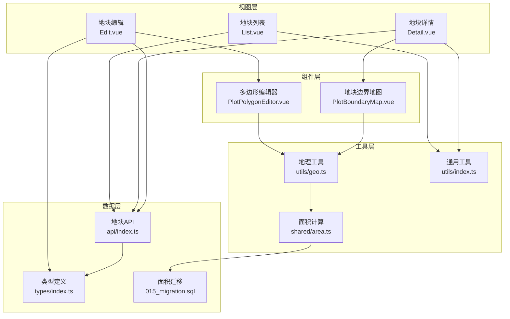

**图表来源**
- [apps/web/src/views/plot/List.vue:1-272](file://apps/web/src/views/plot/List.vue#L1-L272)
- [apps/web/src/views/plot/Detail.vue:1-148](file://apps/web/src/views/plot/Detail.vue#L1-L148)
- [apps/web/src/views/plot/Edit.vue:1-312](file://apps/web/src/views/plot/Edit.vue#L1-L312)
- [apps/web/src/components/PlotBoundaryMap.vue:1-88](file://apps/web/src/components/PlotBoundaryMap.vue#L1-L88)
- [apps/web/src/components/PlotPolygonEditor.vue:1-213](file://apps/web/src/components/PlotPolygonEditor.vue#L1-L213)
- [apps/web/src/utils/geo.ts:1-167](file://apps/web/src/utils/geo.ts#L1-L167)
- [apps/web/src/api/index.ts:1-263](file://apps/web/src/api/index.ts#L1-L263)
- [apps/web/src/types/index.ts:1-313](file://apps/web/src/types/index.ts#L1-L313)
- [apps/web/src/utils/index.ts:1-117](file://apps/web/src/utils/index.ts#L1-L117)
- [infra/postgres/migrations/015_plot_area_from_boundary.sql:1-103](file://infra/postgres/migrations/015_plot_area_from_boundary.sql#L1-L103)
- [packages/shared/src/area.ts:1-74](file://packages/shared/src/area.ts#L1-L74)

**章节来源**
- [apps/web/src/views/plot/List.vue:1-272](file://apps/web/src/views/plot/List.vue#L1-L272)
- [apps/web/src/views/plot/Detail.vue:1-148](file://apps/web/src/views/plot/Detail.vue#L1-L148)
- [apps/web/src/views/plot/Edit.vue:1-312](file://apps/web/src/views/plot/Edit.vue#L1-L312)
- [apps/web/src/components/PlotBoundaryMap.vue:1-88](file://apps/web/src/components/PlotBoundaryMap.vue#L1-L88)
- [apps/web/src/components/PlotPolygonEditor.vue:1-213](file://apps/web/src/components/PlotPolygonEditor.vue#L1-L213)
- [apps/web/src/utils/geo.ts:1-167](file://apps/web/src/utils/geo.ts#L1-L167)
- [apps/web/src/api/index.ts:1-263](file://apps/web/src/api/index.ts#L1-L263)
- [apps/web/src/types/index.ts:1-313](file://apps/web/src/types/index.ts#L1-L313)
- [apps/web/src/utils/index.ts:1-117](file://apps/web/src/utils/index.ts#L1-L117)
- [infra/postgres/migrations/015_plot_area_from_boundary.sql:1-103](file://infra/postgres/migrations/015_plot_area_from_boundary.sql#L1-L103)
- [packages/shared/src/area.ts:1-74](file://packages/shared/src/area.ts#L1-L74)

## 核心组件与职责
- 地块列表（List.vue）
  - 负责查询条件构建、分页展示、筛选过滤、批量删除、导出入口、单条删除与跳转详情/编辑。
- 地块详情（Detail.vue）
  - 负责加载并展示地块基本信息、调用边界地图组件进行可视化、展示近期农事活动（当前为模拟数据）。
- 地块编辑（Edit.vue）
  - 负责新增/编辑表单、行政区级联选择、村组下拉、面积与土壤类型选择、负责人信息、备注、边界绘制入口、表单校验与提交。
  - **增强**：智能面积控制，当检测到边界定义时自动禁用手动面积输入，防止数据不一致。
- 地块边界地图（PlotBoundaryMap.vue）
  - 基于 Leaflet 渲染天地图底图，将后端返回的边界几何转换为可展示的环，计算中心点与面积提示，支持空边界提示。
- 多边形编辑器（PlotPolygonEditor.vue）
  - **新增**：提供交互式多边形绘制功能，支持顶点添加、撤销、清空操作，实时显示顶点数量和面积计算结果。
- 地理工具（geo.ts）
  - 提供边界解析、坐标转换、去重、主外环选择、面积估算等能力。**增强**：优化polygonAreaMu函数使用，提升面积计算准确性。
- API 封装（api/index.ts）
  - 统一 GET/POST/PUT/DELETE 请求，提供地块列表、详情、创建、更新、删除、批量删除、全量边界、统计等接口；包含数据归一化与服务端输入构造。
- 类型定义（types/index.ts）
  - 定义地块、查询参数、表单、枚举、设备、任务、看板统计等类型。
- 通用工具（utils/index.ts）
  - 提供时间格式化、状态文本映射、面积格式化、防抖等工具函数。
- **新增**：面积计算标准化（shared/area.ts）
  - 提供与前端 ringAreaMu 完全一致的面积计算算法，作为后端服务的唯一实现。
- **新增**：数据迁移（015_plot_area_from_boundary.sql）
  - 将现有地块面积统一按边界几何重算，解决演示数据面积不一致问题。

**章节来源**
- [apps/web/src/views/plot/List.vue:1-272](file://apps/web/src/views/plot/List.vue#L1-L272)
- [apps/web/src/views/plot/Detail.vue:1-148](file://apps/web/src/views/plot/Detail.vue#L1-L148)
- [apps/web/src/views/plot/Edit.vue:1-312](file://apps/web/src/views/plot/Edit.vue#L1-L312)
- [apps/web/src/components/PlotBoundaryMap.vue:1-88](file://apps/web/src/components/PlotBoundaryMap.vue#L1-L88)
- [apps/web/src/components/PlotPolygonEditor.vue:1-213](file://apps/web/src/components/PlotPolygonEditor.vue#L1-L213)
- [apps/web/src/utils/geo.ts:1-167](file://apps/web/src/utils/geo.ts#L1-L167)
- [apps/web/src/api/index.ts:1-263](file://apps/web/src/api/index.ts#L1-L263)
- [apps/web/src/types/index.ts:1-313](file://apps/web/src/types/index.ts#L1-L313)
- [apps/web/src/utils/index.ts:1-117](file://apps/web/src/utils/index.ts#L1-L117)
- [packages/shared/src/area.ts:1-74](file://packages/shared/src/area.ts#L1-L74)
- [infra/postgres/migrations/015_plot_area_from_boundary.sql:1-103](file://infra/postgres/migrations/015_plot_area_from_boundary.sql#L1-L103)

## 架构总览
下图展示了从用户交互到数据落库的关键流程，包括列表查询、详情加载、编辑保存、地图渲染与坐标转换，以及**新增的面积计算标准化机制**和**增强的面积控制逻辑**。

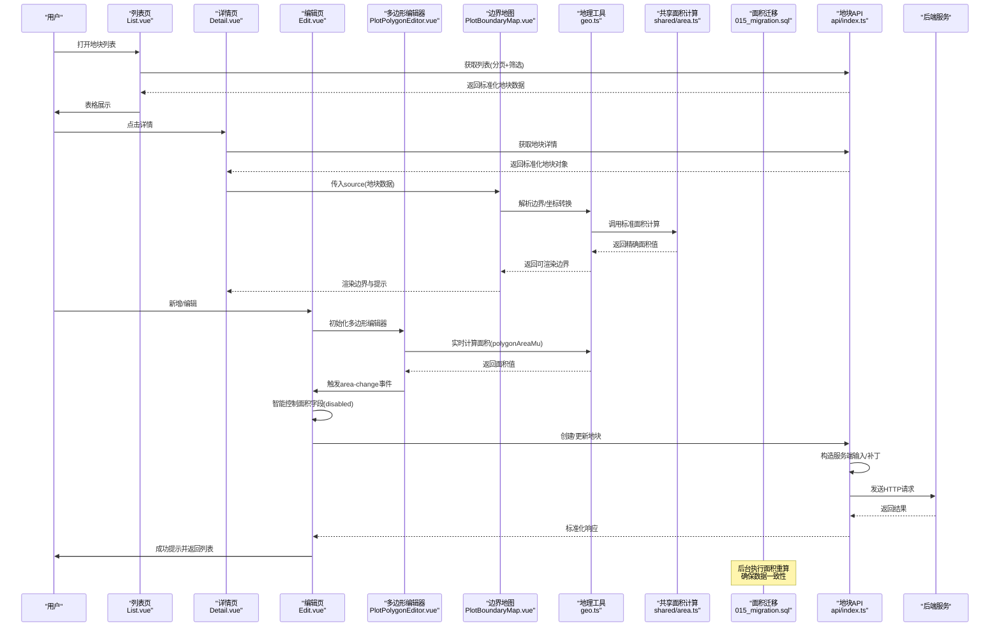

**图表来源**
- [apps/web/src/views/plot/List.vue:201-270](file://apps/web/src/views/plot/List.vue#L201-L270)
- [apps/web/src/views/plot/Detail.vue:104-143](file://apps/web/src/views/plot/Detail.vue#L104-L143)
- [apps/web/src/views/plot/Edit.vue:202-244](file://apps/web/src/views/plot/Edit.vue#L202-L244)
- [apps/web/src/components/PlotBoundaryMap.vue:32-69](file://apps/web/src/components/PlotBoundaryMap.vue#L32-L69)
- [apps/web/src/components/PlotPolygonEditor.vue:96-101](file://apps/web/src/components/PlotPolygonEditor.vue#L96-L101)
- [apps/web/src/utils/geo.ts:67-86](file://apps/web/src/utils/geo.ts#L67-L86)
- [packages/shared/src/area.ts:37-61](file://packages/shared/src/area.ts#L37-L61)
- [infra/postgres/migrations/015_plot_area_from_boundary.sql:22-102](file://infra/postgres/migrations/015_plot_area_from_boundary.sql#L22-L102)
- [apps/web/src/api/index.ts:29-101](file://apps/web/src/api/index.ts#L29-L101)

## 详细组件分析

### 地块列表页（List.vue）
- 查询与筛选
  - 关键词、地块类型、地块状态组合查询，重置时清空筛选条件并回到第一页。
- 分页展示
  - 使用 Element Plus 分页组件，绑定 page/pageSize，触发 fetchList 重新拉取数据。
- 批量操作
  - 多选框收集选中 ID，批量删除前二次确认，成功后刷新列表。
- 单条操作
  - 查看详情、编辑、删除（带确认弹窗），删除后刷新列表。
- 数据流
  - 通过 plotApi.getList 获取 PageResult，兼容 items/list 字段，填充 tableData 与 total。

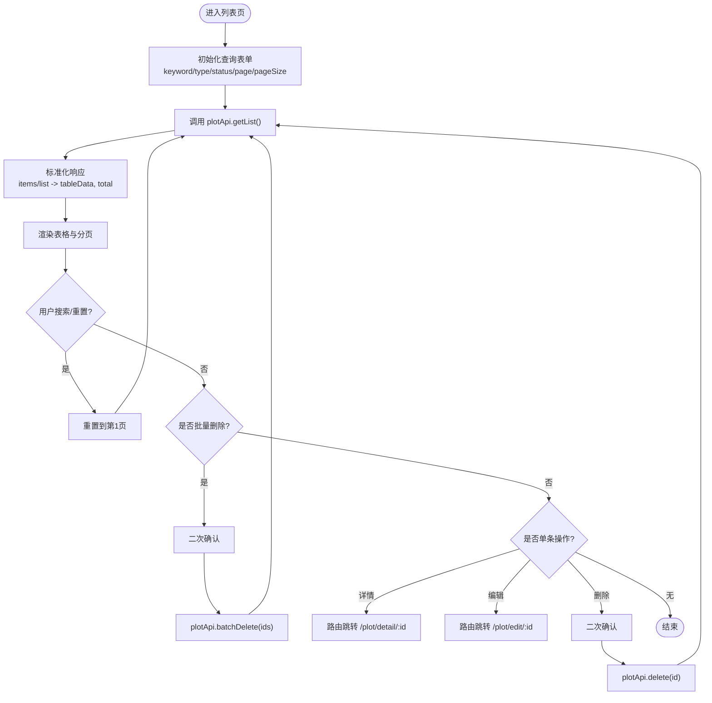

**图表来源**
- [apps/web/src/views/plot/List.vue:201-270](file://apps/web/src/views/plot/List.vue#L201-L270)
- [apps/web/src/api/index.ts:29-55](file://apps/web/src/api/index.ts#L29-L55)

**章节来源**
- [apps/web/src/views/plot/List.vue:1-272](file://apps/web/src/views/plot/List.vue#L1-L272)
- [apps/web/src/api/index.ts:29-55](file://apps/web/src/api/index.ts#L29-L55)

### 地块详情页（Detail.vue）
- 基本信息展示
  - 使用描述列表展示编码、名称、类型、区域、村组、状态、面积、网格编码、土壤类型、作物、负责人、联系方式、创建/更新时间、备注。
- 边界可视化
  - 通过 PlotBoundaryMap 组件传入 source，自动渲染边界多边形与中心标记，显示面积提示。
- 近期农事活动
  - 当前为模拟数据，用于演示任务类型、状态、负责人与时间的展示。
- 导航
  - 返回上一页、跳转到编辑页。

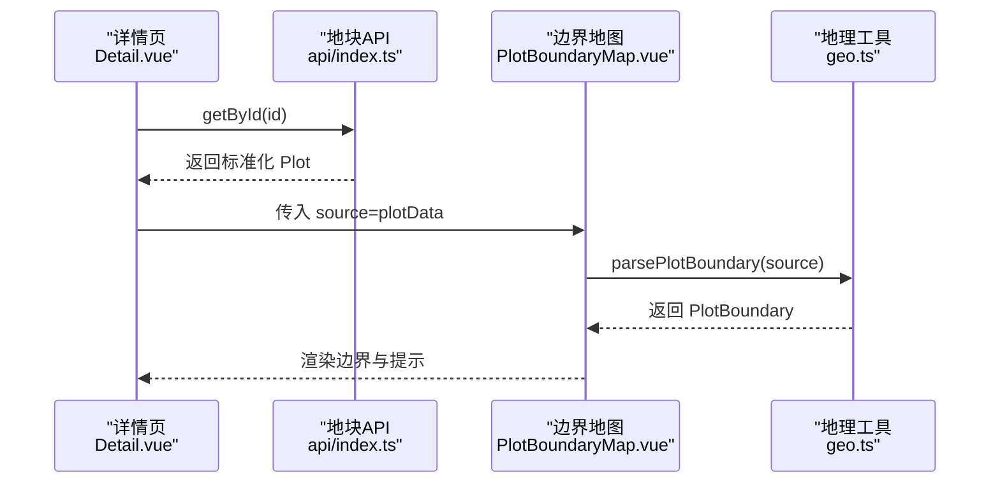

**图表来源**
- [apps/web/src/views/plot/Detail.vue:104-143](file://apps/web/src/views/plot/Detail.vue#L104-L143)
- [apps/web/src/components/PlotBoundaryMap.vue:32-69](file://apps/web/src/components/PlotBoundaryMap.vue#L32-L69)
- [apps/web/src/utils/geo.ts:90-114](file://apps/web/src/utils/geo.ts#L90-L114)
- [apps/web/src/api/index.ts:37-39](file://apps/web/src/api/index.ts#L37-L39)

**章节来源**
- [apps/web/src/views/plot/Detail.vue:1-148](file://apps/web/src/views/plot/Detail.vue#L1-L148)
- [apps/web/src/components/PlotBoundaryMap.vue:1-88](file://apps/web/src/components/PlotBoundaryMap.vue#L1-L88)
- [apps/web/src/utils/geo.ts:90-114](file://apps/web/src/utils/geo.ts#L90-L114)
- [apps/web/src/api/index.ts:37-39](file://apps/web/src/api/index.ts#L37-L39)

### 地块编辑页（Edit.vue）
- 表单字段
  - 地块名称、类型、行政区（级联）、村组、面积、土壤类型、负责人姓名/电话、当前作物、备注。
- 边界绘制
  - 提供"地图绘制"按钮，当前为占位提示，后续可接入高德/百度地图或 Leaflet 绘制。
- 校验规则
  - 必填项：名称、类型、行政区、村组、面积；触发时机为 blur/change。
- 提交逻辑
  - 新增时调用 create，编辑时调用 update；成功后返回上一页。
- 数据回填
  - 编辑模式下根据 id 拉取详情，回填 form 与行政区路径。
- **增强**：智能面积控制
  - 当检测到边界定义（coordinates.length >= 3）时，自动禁用手动面积输入字段
  - 显示提示信息："已绘制边界，面积按边界自动计算，不接受手填"
  - 提交前再次验证并重新计算面积，确保数据一致性

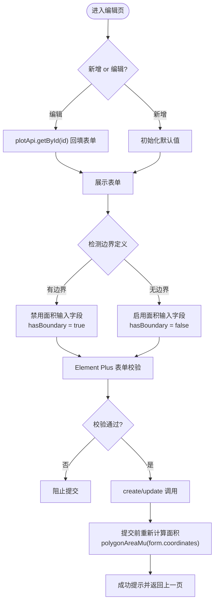

**图表来源**
- [apps/web/src/views/plot/Edit.vue:184-244](file://apps/web/src/views/plot/Edit.vue#L184-L244)
- [apps/web/src/views/plot/Edit.vue:163-164](file://apps/web/src/views/plot/Edit.vue#L163-L164)
- [apps/web/src/views/plot/Edit.vue:247-248](file://apps/web/src/views/plot/Edit.vue#L247-L248)
- [apps/web/src/api/index.ts:40-45](file://apps/web/src/api/index.ts#L40-L45)

**章节来源**
- [apps/web/src/views/plot/Edit.vue:1-312](file://apps/web/src/views/plot/Edit.vue#L1-L312)
- [apps/web/src/api/index.ts:40-45](file://apps/web/src/api/index.ts#L40-L45)

### 多边形编辑器（PlotPolygonEditor.vue）
- 交互式绘制
  - 基于 Leaflet 提供完整的地图绘制功能，支持点击添加顶点、撤销、清空操作。
- 实时反馈
  - 显示顶点数量计数和实时面积计算结果，使用 polygonAreaMu 函数进行精确计算。
- 视觉提示
  - 顶点标记、多边形预览、线段预览（少于3个点时），提供清晰的绘制状态指示。
- 数据同步
  - 双向数据绑定，支持 props.modelValue 初始化和 emit('update:modelValue') 更新。
- 面积事件
  - 通过 'area-change' 事件向父组件传递计算出的面积值，供父组件进行智能控制。

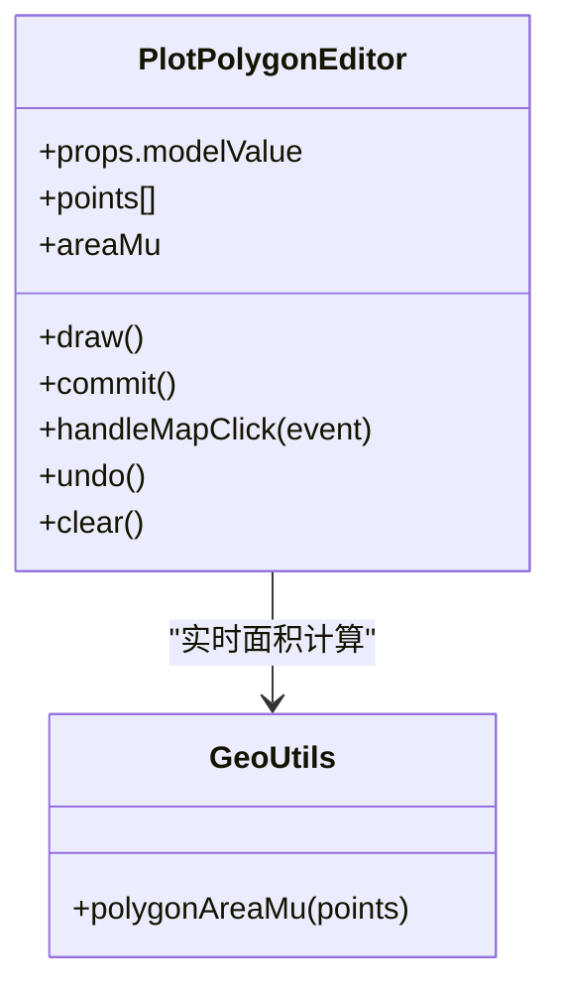

**图表来源**
- [apps/web/src/components/PlotPolygonEditor.vue:23-101](file://apps/web/src/components/PlotPolygonEditor.vue#L23-L101)
- [apps/web/src/utils/geo.ts:154-158](file://apps/web/src/utils/geo.ts#L154-L158)

**章节来源**
- [apps/web/src/components/PlotPolygonEditor.vue:1-213](file://apps/web/src/components/PlotPolygonEditor.vue#L1-L213)
- [apps/web/src/utils/geo.ts:154-158](file://apps/web/src/utils/geo.ts#L154-L158)

### 地块边界地图（PlotBoundaryMap.vue）
- 底图加载
  - 使用 Leaflet 加载天地图 WMTS 图层，支持 img/cia 两种样式。
- 边界渲染
  - 接收 source，调用 geo.parsePlotBoundary 解析出 rings、center、areaMu，渲染 Polygon 与中心标记。
- 空边界处理
  - 当无边界时保留提示文案，避免空白画布。
- 生命周期
  - onMounted 初始化地图与图层，watch source 变化同步渲染，onBeforeUnmount 清理资源。

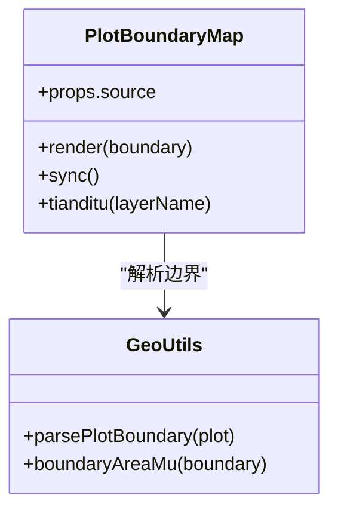

**图表来源**
- [apps/web/src/components/PlotBoundaryMap.vue:23-78](file://apps/web/src/components/PlotBoundaryMap.vue#L23-L78)
- [apps/web/src/utils/geo.ts:90-128](file://apps/web/src/utils/geo.ts#L90-L128)

**章节来源**
- [apps/web/src/components/PlotBoundaryMap.vue:1-88](file://apps/web/src/components/PlotBoundaryMap.vue#L1-L88)
- [apps/web/src/utils/geo.ts:1-167](file://apps/web/src/utils/geo.ts#L1-L167)

### 地理工具与面积计算标准化（geo.ts）
- 边界解析
  - 兼容多种来源：geom/boundary/coordinates，支持字符串 JSON、数组、GeoJSON Polygon/MultiPolygon。
- 坐标转换
  - 将原始 [经度, 纬度] 转换为 Leaflet 使用的 [纬度, 经度]。
- 去重与闭合
  - 去除重复点，必要时移除首尾重复点以保证多边形正确性。
- 主外环选择
  - 选择面积最大的环作为主外环，避免内环或顺序异常导致展示错误。
- 面积估算
  - 若未提供 areaMu，则根据经纬度环近似计算面积（平方度转平方米再转亩）。
- **增强**：面积计算优化
  - polygonAreaMu 函数经过优化，提供更准确的面积计算结果
  - 与 packages/shared/src/area.ts 中的实现完全一致，确保前后端计算结果相同
  - 使用等距圆柱投影鞋带公式，kx=111320·cos(重心纬度)、ky=110540，除以 666.6667 换算亩

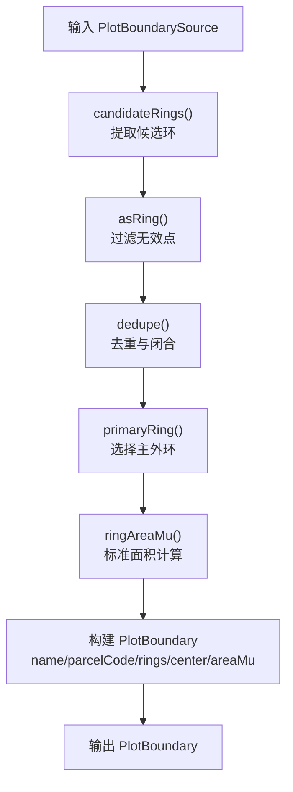

**图表来源**
- [apps/web/src/utils/geo.ts:17-108](file://apps/web/src/utils/geo.ts#L17-L108)
- [apps/web/src/utils/geo.ts:67-86](file://apps/web/src/utils/geo.ts#L67-L86)

**章节来源**
- [apps/web/src/utils/geo.ts:1-167](file://apps/web/src/utils/geo.ts#L1-L167)

### 面积计算标准化机制
**新增**：为确保数据完整性，平台实现了三处面积计算算法的完全一致性：

- 前端实现（apps/web/src/utils/geo.ts）
  - ringAreaMu 函数提供实时预览面积计算
  - polygonAreaMu 函数经过优化，提升计算准确性
  - 使用顶点去重、重心平移、等距圆柱投影鞋带公式
- 共享包实现（packages/shared/src/area.ts）
  - 作为后端服务的唯一面积计算实现
  - 与前端算法逐位一致，由测试用例保证
- 数据库迁移（infra/postgres/migrations/015_plot_area_from_boundary.sql）
  - 将现有地块面积统一按边界几何重算
  - 解决演示数据中手动输入面积与实际边界不匹配的问题

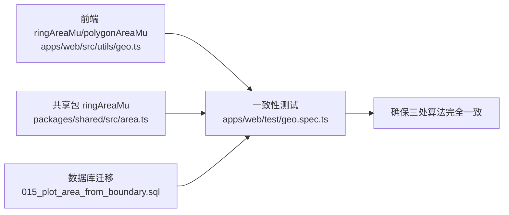

**图表来源**
- [apps/web/src/utils/geo.ts:67-86](file://apps/web/src/utils/geo.ts#L67-L86)
- [apps/web/src/utils/geo.ts:154-158](file://apps/web/src/utils/geo.ts#L154-L158)
- [packages/shared/src/area.ts:37-61](file://packages/shared/src/area.ts#L37-L61)
- [infra/postgres/migrations/015_plot_area_from_boundary.sql:22-102](file://infra/postgres/migrations/015_plot_area_from_boundary.sql#L22-L102)
- [apps/web/test/geo.spec.ts:56-86](file://apps/web/test/geo.spec.ts#L56-L86)

**章节来源**
- [apps/web/src/utils/geo.ts:67-86](file://apps/web/src/utils/geo.ts#L67-L86)
- [apps/web/src/utils/geo.ts:154-158](file://apps/web/src/utils/geo.ts#L154-L158)
- [packages/shared/src/area.ts:1-74](file://packages/shared/src/area.ts#L1-L74)
- [infra/postgres/migrations/015_plot_area_from_boundary.sql:1-103](file://infra/postgres/migrations/015_plot_area_from_boundary.sql#L1-L103)
- [apps/web/test/geo.spec.ts:1-117](file://apps/web/test/geo.spec.ts#L1-L117)

### API 封装与数据同步（api/index.ts）
- 列表与详情
  - getList 将 pageSize 转为 size 参数，并对 items 执行 normalizePlot。
  - getById 直接返回标准化 Plot。
- 创建与更新
  - create/update 分别调用 toPlotServiceInput/toPlotServicePatch，将前端表单转换为服务端输入。
- 批量删除
  - batchDelete 并行调用 delete，全部完成后返回。
- 全量边界与统计
  - getBounds 用于"一张图"场景，getStats 用于看板统计。
- 数据归一化
  - normalizePlot 统一 id/parcelCode/name/areaMu/type/status/createdAt/updatedAt 字段。
- 几何坐标转换
  - coordinatesToGeom 将前端坐标序列转换为 GeoJSON Polygon，确保首尾闭合，设置 srid=4490（CGCS2000）。

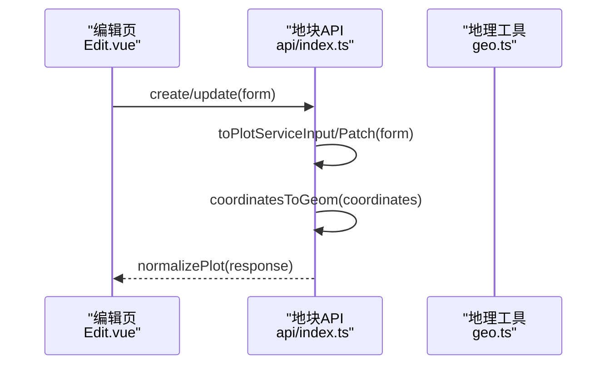

**图表来源**
- [apps/web/src/api/index.ts:62-101](file://apps/web/src/api/index.ts#L62-L101)
- [apps/web/src/views/plot/Edit.vue:202-244](file://apps/web/src/views/plot/Edit.vue#L202-L244)

**章节来源**
- [apps/web/src/api/index.ts:1-263](file://apps/web/src/api/index.ts#L1-L263)

### 类型定义（types/index.ts）
- 地块与查询
  - Plot、PlotQuery、PlotForm 定义了地块实体、查询参数与表单字段。
- 枚举
  - PlotStatus、PlotType、SoilType、DeviceStatus、FarmTaskStatus 等枚举统一了业务状态与类型。
- 其他领域模型
  - Device、FarmTask、DashboardStats、TelemetryHistoryPoint、TelemetryAlert、Camera、Recording 等。

**章节来源**
- [apps/web/src/types/index.ts:1-313](file://apps/web/src/types/index.ts#L1-L313)

### 通用工具（utils/index.ts）
- 时间格式化
  - formatDateTime/formatDate 基于 dayjs 格式化日期时间。
- 状态文本映射
  - getPlotStatusText/getPlotStatusType、getPlotTypeText、getSoilTypeText、getDeviceStatusText/getDeviceStatusType、getTaskStatusText/getTaskStatusType。
- 面积格式化
  - formatArea 将亩数格式化为"X.XX 亩"。
- 其他工具
  - downloadFile、debounce。

**章节来源**
- [apps/web/src/utils/index.ts:1-117](file://apps/web/src/utils/index.ts#L1-L117)

## 依赖关系分析
- 视图层依赖 API 层获取数据，并通过工具层进行展示格式化。
- 地图组件依赖地理工具进行坐标与边界解析。
- API 层依赖类型层进行类型约束，并在内部对数据进行归一化与构造。
- 类型层被多处复用，保证前后端数据结构一致性。
- **新增**：面积计算标准化层确保前端、共享包和数据库迁移使用完全相同的算法。
- **增强**：多边形编辑器与地理工具的紧密集成，提供实时面积计算和智能控制。

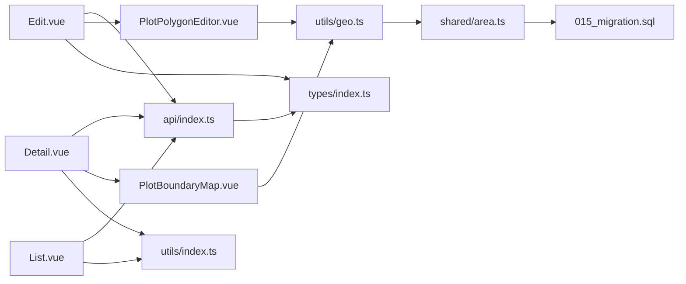

**图表来源**
- [apps/web/src/views/plot/List.vue:1-272](file://apps/web/src/views/plot/List.vue#L1-L272)
- [apps/web/src/views/plot/Detail.vue:1-148](file://apps/web/src/views/plot/Detail.vue#L1-L148)
- [apps/web/src/views/plot/Edit.vue:1-312](file://apps/web/src/views/plot/Edit.vue#L1-L312)
- [apps/web/src/components/PlotBoundaryMap.vue:1-88](file://apps/web/src/components/PlotBoundaryMap.vue#L1-L88)
- [apps/web/src/components/PlotPolygonEditor.vue:1-213](file://apps/web/src/components/PlotPolygonEditor.vue#L1-L213)
- [apps/web/src/utils/geo.ts:1-167](file://apps/web/src/utils/geo.ts#L1-L167)
- [apps/web/src/api/index.ts:1-263](file://apps/web/src/api/index.ts#L1-L263)
- [apps/web/src/types/index.ts:1-313](file://apps/web/src/types/index.ts#L1-L313)
- [apps/web/src/utils/index.ts:1-117](file://apps/web/src/utils/index.ts#L1-L117)
- [packages/shared/src/area.ts:1-74](file://packages/shared/src/area.ts#L1-L74)
- [infra/postgres/migrations/015_plot_area_from_boundary.sql:1-103](file://infra/postgres/migrations/015_plot_area_from_boundary.sql#L1-L103)

**章节来源**
- [apps/web/src/views/plot/List.vue:1-272](file://apps/web/src/views/plot/List.vue#L1-L272)
- [apps/web/src/views/plot/Detail.vue:1-148](file://apps/web/src/views/plot/Detail.vue#L1-L148)
- [apps/web/src/views/plot/Edit.vue:1-312](file://apps/web/src/views/plot/Edit.vue#L1-L312)
- [apps/web/src/components/PlotBoundaryMap.vue:1-88](file://apps/web/src/components/PlotBoundaryMap.vue#L1-L88)
- [apps/web/src/components/PlotPolygonEditor.vue:1-213](file://apps/web/src/components/PlotPolygonEditor.vue#L1-L213)
- [apps/web/src/utils/geo.ts:1-167](file://apps/web/src/utils/geo.ts#L1-L167)
- [apps/web/src/api/index.ts:1-263](file://apps/web/src/api/index.ts#L1-L263)
- [apps/web/src/types/index.ts:1-313](file://apps/web/src/types/index.ts#L1-L313)
- [apps/web/src/utils/index.ts:1-117](file://apps/web/src/utils/index.ts#L1-L117)
- [packages/shared/src/area.ts:1-74](file://packages/shared/src/area.ts#L1-L74)
- [infra/postgres/migrations/015_plot_area_from_boundary.sql:1-103](file://infra/postgres/migrations/015_plot_area_from_boundary.sql#L1-L103)

## 性能与体验优化建议
- 列表分页与筛选
  - 建议在服务端实现 keyword/type/status 的精确/模糊匹配，减少前端过滤开销。
  - 对高频筛选条件增加缓存策略，避免重复请求。
- 地图渲染
  - 当地块数量较多时，建议使用 getBounds 接口一次性加载边界，结合矢量图层聚合与简化算法提升渲染性能。
  - 对边界坐标进行抽稀（如 Douglas-Peucker）以减少点数。
- 数据归一化
  - normalizePlot 已在 API 层集中处理，保持视图层简洁；建议在后端也提供稳定的字段命名，减少前端适配成本。
- 表单体验
  - 在编辑页增加实时面积计算与校验提示，帮助用户快速发现边界异常。
  - 边界绘制完成后即时预览，并提供撤销/重做能力。
- **增强**：面积计算优化
  - 利用已标准化的面积计算算法，在前端绘制时提供实时面积反馈。
  - 考虑对复杂边界进行简化处理，提升计算性能。
  - 智能禁用手动面积输入，防止用户误操作导致数据不一致。
- **新增**：多边形编辑器优化
  - 提供绘制辅助线和对齐功能，提升边界绘制精度。
  - 支持多点同时编辑和批量操作，提升用户体验。

[本节为通用建议，不直接分析具体文件]

## 故障排查指南
- 列表数据为空
  - 检查 plotApi.getList 的请求参数是否正确，确认后端返回的 items/total 字段。
  - 查看 normalizePlot 是否对字段进行了正确映射。
- 详情边界不显示
  - 检查 PlotBoundaryMap 的 source 是否为 null，确认 geo.parsePlotBoundary 是否能解析 geom/boundary/coordinates。
  - 确认天地图 key 配置正确，WMTS 服务可达。
- 编辑提交失败
  - 检查 coordinatesToGeom 生成的 GeoJSON 是否闭合且有效。
  - 确认 toPlotServiceInput/toPlotServicePatch 构造的服务端字段是否符合后端期望。
- 批量删除异常
  - 检查 selectedIds 是否正确收集，确认 Promise.all 的错误处理逻辑。
- **新增**：面积计算不一致
  - 检查前端 ringAreaMu 与共享包 ringAreaMu 是否保持一致。
  - 确认数据库迁移 015 是否已正确执行。
  - 查看测试用例 apps/web/test/geo.spec.ts 是否通过。
- **增强**：面积字段禁用问题
  - 检查 hasBoundary 计算逻辑是否正确（form.coordinates?.length ?? 0) >= 3
  - 确认 PlotPolygonEditor 的 area-change 事件是否正常触发
  - 验证 polygonAreaMu 函数的计算结果是否符合预期

**章节来源**
- [apps/web/src/api/index.ts:29-101](file://apps/web/src/api/index.ts#L29-L101)
- [apps/web/src/components/PlotBoundaryMap.vue:32-78](file://apps/web/src/components/PlotBoundaryMap.vue#L32-L78)
- [apps/web/src/components/PlotPolygonEditor.vue:96-101](file://apps/web/src/components/PlotPolygonEditor.vue#L96-L101)
- [apps/web/src/utils/geo.ts:90-128](file://apps/web/src/utils/geo.ts#L90-L128)
- [apps/web/src/utils/geo.ts:154-158](file://apps/web/src/utils/geo.ts#L154-L158)
- [apps/web/src/views/plot/Edit.vue:163-164](file://apps/web/src/views/plot/Edit.vue#L163-L164)
- [apps/web/src/views/plot/Edit.vue:247-248](file://apps/web/src/views/plot/Edit.vue#L247-L248)
- [apps/web/test/geo.spec.ts:56-86](file://apps/web/test/geo.spec.ts#L56-L86)

## 结论
本方案以清晰的层次划分实现了地块管理的核心功能：列表查询与分页、详情展示与边界可视化、编辑表单与校验、地图集成与坐标转换、以及前后端数据同步。**新增的面积计算标准化机制**确保了前后端使用完全相同的算法，解决了演示数据面积不一致的问题，保证了数据的完整性和一致性。**增强的地块编辑界面**通过智能面积控制和实时面积反馈，进一步提升了用户体验和数据准确性。通过统一的 API 封装与类型定义，以及严格的面积计算算法一致性保证，系统具备了良好的扩展性和可靠性。未来可在边界绘制、空间查询、历史数据与关联设备展示方面进一步扩展，以提升用户体验与业务价值。