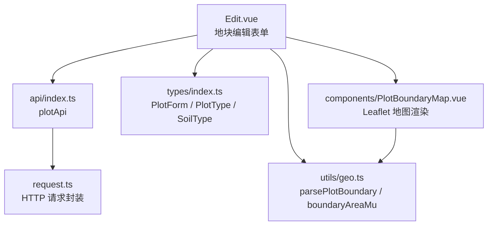
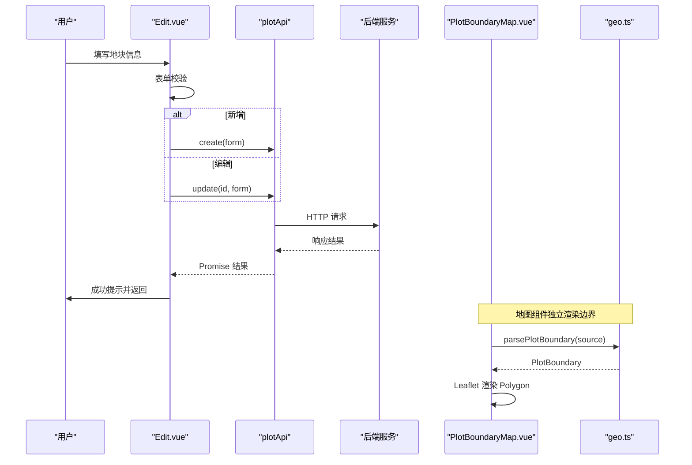
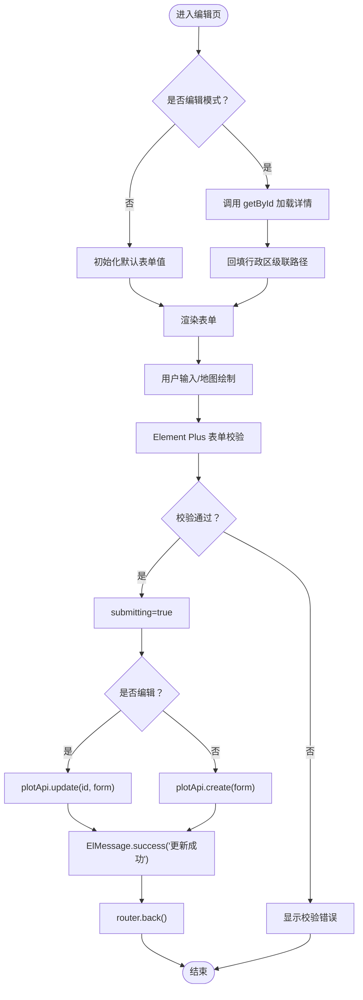
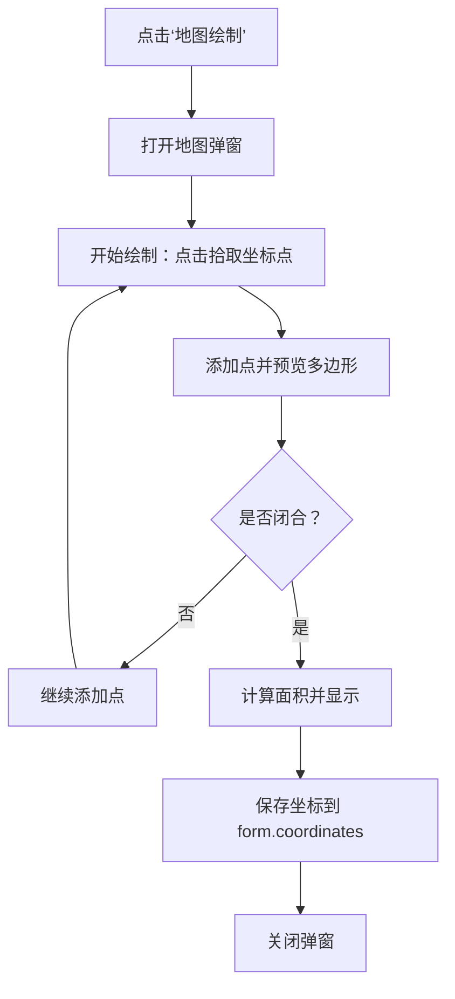
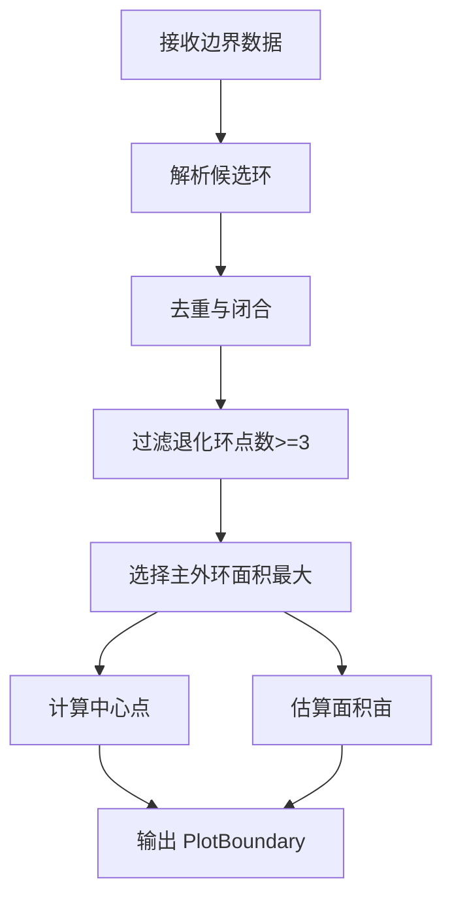
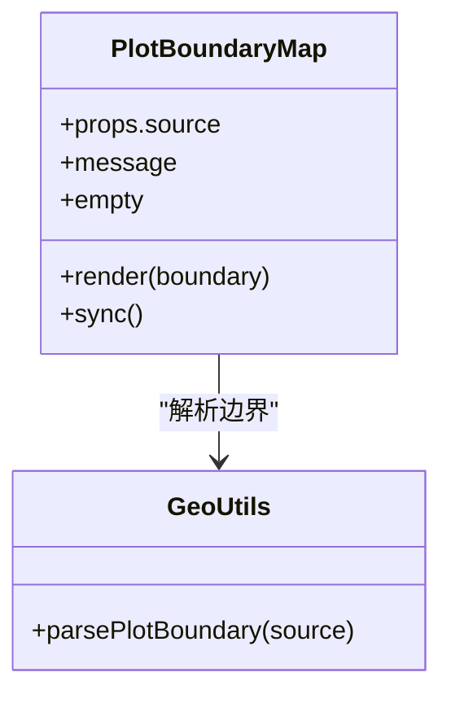
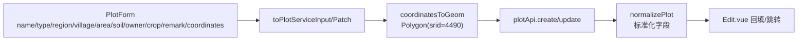
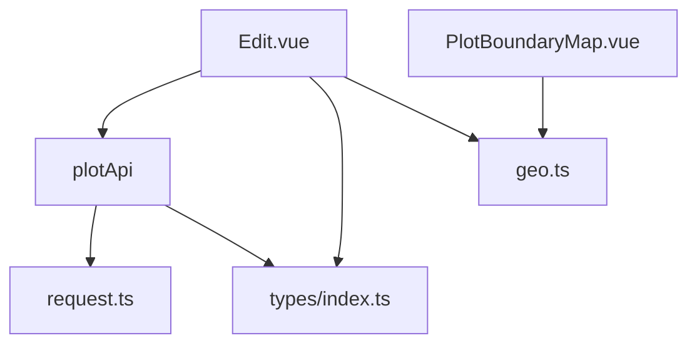

# 地块编辑页面

<cite>
**本文引用的文件**   
- [Edit.vue](file://apps/web/src/views/plot/Edit.vue)
- [PlotBoundaryMap.vue](file://apps/web/src/components/PlotBoundaryMap.vue)
- [geo.ts](file://apps/web/src/utils/geo.ts)
- [index.ts（API）](file://apps/web/src/api/index.ts)
- [index.ts（类型定义）](file://apps/web/src/types/index.ts)
</cite>

## 目录
1. [简介](#简介)
2. [项目结构](#项目结构)
3. [核心组件](#核心组件)
4. [架构总览](#架构总览)
5. [详细组件分析](#详细组件分析)
6. [依赖关系分析](#依赖关系分析)
7. [性能与精度考量](#性能与精度考量)
8. [故障排查指南](#故障排查指南)
9. [结论](#结论)

## 简介
本文件面向“地块编辑页面”的前端实现，系统性说明以下能力：
- 表单处理逻辑：地块信息录入、字段验证、数据绑定、新增与编辑模式切换。
- 地块边界绘制：地图交互、多边形绘制、坐标拾取、面积计算的技术路径与扩展点。
- 坐标转换算法：GeoJSON 到 Leaflet 坐标的转换、退化边界清理、主外环选择与面积估算。
- 表单验证规则：必填项、数值范围、业务字段校验。
- 数据同步机制：前后端数据结构映射、坐标系约定、几何体构造。
- 撤销重做：当前未内置，提供可落地的状态快照方案。
- 保存与取消：提交流程、错误处理、路由返回与状态管理。

## 项目结构
地块编辑相关代码位于前端 Web 应用中，关键文件如下：
- 视图层：`apps/web/src/views/plot/Edit.vue`
- 地图展示组件：`apps/web/src/components/PlotBoundaryMap.vue`
- 地理工具函数：`apps/web/src/utils/geo.ts`
- API 封装：`apps/web/src/api/index.ts`
- 类型定义：`apps/web/src/types/index.ts`

**图表来源**
- [Edit.vue:120-244](file://apps/web/src/views/plot/Edit.vue#L120-L244)
- [index.ts（API）:28-101](file://apps/web/src/api/index.ts#L28-L101)
- [index.ts（类型定义）:71-123](file://apps/web/src/types/index.ts#L71-L123)
- [geo.ts:90-128](file://apps/web/src/utils/geo.ts#L90-L128)
- [PlotBoundaryMap.vue:1-79](file://apps/web/src/components/PlotBoundaryMap.vue#L1-L79)

**章节来源**
- [Edit.vue:1-259](file://apps/web/src/views/plot/Edit.vue#L1-L259)
- [PlotBoundaryMap.vue:1-88](file://apps/web/src/components/PlotBoundaryMap.vue#L1-L88)
- [geo.ts:1-131](file://apps/web/src/utils/geo.ts#L1-L131)
- [index.ts（API）:1-263](file://apps/web/src/api/index.ts#L1-L263)
- [index.ts（类型定义）:1-313](file://apps/web/src/types/index.ts#L1-L313)

## 核心组件
- 地块编辑表单（Edit.vue）
  - 负责地块基础信息录入、行政区与村组联动、面积输入、负责人信息、作物、备注等。
  - 通过 Element Plus 表单进行校验，支持新增与编辑两种模式。
  - 触发“地图绘制”按钮，预留接入实际地图组件的扩展点。
  - 调用 plotApi 完成新增或更新，成功后返回上一页。
- 地块边界地图（PlotBoundaryMap.vue）
  - 基于 Leaflet 加载天地图瓦片，渲染 Polygon 边界与中心标记。
  - 使用 geo.ts 解析后端边界数据，兼容多种坐标格式。
  - 监听 source 变化，自动刷新地图显示。
- 地理工具（geo.ts）
  - 解析多种边界来源（数组、GeoJSON、历史字段），清洗退化边界。
  - 选择主外环，计算中心点与近似亩数。
  - 将经纬度坐标转换为 Leaflet 所需的 [纬度, 经度] 顺序。
- API 封装（api/index.ts）
  - 提供地块增删改查、统计、边界列表等接口。
  - 将前端 PlotForm 转换为服务侧需要的 geom 几何体，并设置 SRID。
- 类型定义（types/index.ts）
  - 定义 Plot、PlotForm、枚举类型等，统一前后端契约。

**章节来源**
- [Edit.vue:120-244](file://apps/web/src/views/plot/Edit.vue#L120-L244)
- [PlotBoundaryMap.vue:1-79](file://apps/web/src/components/PlotBoundaryMap.vue#L1-L79)
- [geo.ts:90-128](file://apps/web/src/utils/geo.ts#L90-L128)
- [index.ts（API）:28-101](file://apps/web/src/api/index.ts#L28-L101)
- [index.ts（类型定义）:71-123](file://apps/web/src/types/index.ts#L71-L123)

## 架构总览
地块编辑页面的整体数据流如下：
- 用户填写表单 → 前端校验 → 调用 plotApi.create/update → 服务端持久化 → 返回成功提示 → 路由返回。
- 地图展示由 PlotBoundaryMap 组件订阅 PlotBoundarySource，通过 geo.ts 解析后渲染。

**图表来源**
- [Edit.vue:202-227](file://apps/web/src/views/plot/Edit.vue#L202-L227)
- [index.ts（API）:37-45](file://apps/web/src/api/index.ts#L37-L45)
- [PlotBoundaryMap.vue:57-69](file://apps/web/src/components/PlotBoundaryMap.vue#L57-L69)
- [geo.ts:90-108](file://apps/web/src/utils/geo.ts#L90-L108)

## 详细组件分析

### 表单处理逻辑（Edit.vue）
- 模式判断
  - 根据路由参数 id 是否存在决定新增或编辑模式。
- 数据绑定
  - 使用 reactive 创建 form，绑定到 Element Plus 表单控件。
  - 行政区级联选择器变更时，回填 regionCode。
- 字段验证
  - 名称、类型、行政区、村组、面积为必填；触发时机分别为 blur/change。
- 地图绘制入口
  - “地图绘制”按钮目前仅提示待接入真实地图组件，后续应打开地图弹窗或抽屉，收集坐标点并写入 form.coordinates。
- 提交流程
  - 先执行表单校验，通过后设置 submitting 状态，调用 plotApi.create 或 update。
  - 成功后显示成功消息并 router.back() 返回。
  - 异常捕获打印错误日志，finally 中重置 submitting。
- 取消操作
  - 直接返回上一页，不提交任何数据。
- 详情加载
  - 编辑模式下，onMounted 调用 getById 获取详情，填充 form 与行政区级联路径。

**图表来源**
- [Edit.vue:132-146](file://apps/web/src/views/plot/Edit.vue#L132-L146)
- [Edit.vue:184-196](file://apps/web/src/views/plot/Edit.vue#L184-L196)
- [Edit.vue:202-227](file://apps/web/src/views/plot/Edit.vue#L202-L227)
- [Edit.vue:229-244](file://apps/web/src/views/plot/Edit.vue#L229-L244)

**章节来源**
- [Edit.vue:120-244](file://apps/web/src/views/plot/Edit.vue#L120-L244)

### 地块边界绘制功能（扩展点）
当前“地图绘制”按钮为占位实现，建议按以下方案落地：
- 交互设计
  - 点击“地图绘制”弹出地图弹窗，包含绘制工具栏（添加点、删除点、闭合多边形、撤销、重做）。
  - 在地图上点击拾取坐标点，实时预览多边形轮廓。
- 坐标规范
  - 前端采集坐标采用 [经度, 纬度] 顺序，提交前保持该顺序，由 api/index.ts 的 coordinatesToGeom 构造 GeoJSON Polygon。
  - 若已有坐标，需确保至少 3 个点且首尾闭合。
- 面积计算
  - 使用 geo.ts 的 boundaryAreaMu 对多边形面积进行估算，单位换算为亩。
  - 可在绘制过程中实时更新 form.areaMu，并与用户手动输入的值进行一致性提示。
- 撤销重做
  - 维护坐标点栈 history[]，每次操作 push/pop，并提供 undo/redo 方法。
  - 限制最大步长，避免内存占用过大。
- 数据回写
  - 绘制完成后将坐标写入 form.coordinates，关闭弹窗并刷新地图预览。

[此图为概念流程图，不直接对应具体源码，故无图表来源]

**章节来源**
- [Edit.vue:198-200](file://apps/web/src/views/plot/Edit.vue#L198-L200)
- [geo.ts:116-128](file://apps/web/src/utils/geo.ts#L116-L128)
- [index.ts（API）:97-101](file://apps/web/src/api/index.ts#L97-L101)

### 坐标转换算法（geo.ts）
- 输入兼容
  - 支持字符串 JSON、数组、对象等多种边界来源，优先读取 geom/boundary/coordinates。
- 坐标顺序转换
  - 原始数据通常为 [经度, 纬度]，转换为 Leaflet 使用的 [纬度, 经度]。
- 去重与闭合
  - 去除重复点，若首尾相同则移除末尾重复点，保证多边形闭合。
- 主外环选择
  - 从多个环中选择面积最大的外环，避免内环或洞导致展示异常。
- 中心点计算
  - 对外环顶点求平均得到中心点，用于标注显示。
- 面积估算
  - 使用平面近似公式结合纬度余弦修正，将平方度换算为平方米再转为亩。

**图表来源**
- [geo.ts:17-45](file://apps/web/src/utils/geo.ts#L17-L45)
- [geo.ts:47-57](file://apps/web/src/utils/geo.ts#L47-L57)
- [geo.ts:59-88](file://apps/web/src/utils/geo.ts#L59-L88)
- [geo.ts:90-108](file://apps/web/src/utils/geo.ts#L90-L108)
- [geo.ts:116-128](file://apps/web/src/utils/geo.ts#L116-L128)

**章节来源**
- [geo.ts:1-131](file://apps/web/src/utils/geo.ts#L1-L131)

### 地图展示组件（PlotBoundaryMap.vue）
- 地图初始化
  - 使用 Leaflet 创建地图实例，加载天地图影像与矢量瓦片。
- 渲染逻辑
  - 当存在边界时，绘制 Polygon 并添加中心标记，自适应缩放至边界范围。
  - 无边界时显示提示信息，避免空白画布。
- 数据同步
  - 监听 props.source 变化，调用 parsePlotBoundary 解析后重新渲染。
- 生命周期
  - onBeforeUnmount 中移除图层与地图实例，防止内存泄漏。

**图表来源**
- [PlotBoundaryMap.vue:32-59](file://apps/web/src/components/PlotBoundaryMap.vue#L32-L59)
- [geo.ts:90-108](file://apps/web/src/utils/geo.ts#L90-L108)

**章节来源**
- [PlotBoundaryMap.vue:1-88](file://apps/web/src/components/PlotBoundaryMap.vue#L1-L88)

### 数据同步机制（前后端一致性）
- 前端提交数据
  - toPlotServiceInput/toPlotServicePatch 将 PlotForm 转换为服务侧字段，包括 region/farm/parcel/geom 等。
  - coordinatesToGeom 将坐标数组转换为 GeoJSON Polygon，并设置 srid=4490（CGCS2000）。
- 后端返回数据
  - normalizePlot 统一 id/parcelCode/name/areaMu/type/status/时间字段，保证前端稳定消费。
- 坐标系约定
  - 前端采集坐标为 [经度, 纬度]，提交时作为 GeoJSON coordinates 的二维数组。
  - 地图展示时通过 geo.ts 转换为 [纬度, 经度]。

**图表来源**
- [index.ts（API）:62-101](file://apps/web/src/api/index.ts#L62-L101)
- [index.ts（类型定义）:110-123](file://apps/web/src/types/index.ts#L110-L123)

**章节来源**
- [index.ts（API）:28-101](file://apps/web/src/api/index.ts#L28-L101)
- [index.ts（类型定义）:71-123](file://apps/web/src/types/index.ts#L71-L123)

### 表单验证规则
- 必填字段
  - 地块名称、地块类型、行政区、村组、面积（亩）。
- 触发时机
  - 文本类字段使用 blur，下拉/级联使用 change。
- 数值范围
  - 面积最小值 0.01，精度保留两位小数。
- 业务规则
  - 行政区与村组联动，确保区域编码有效。
  - 坐标点数量与闭合性建议在地图绘制阶段校验，并在提交前二次检查。

**章节来源**
- [Edit.vue:184-196](file://apps/web/src/views/plot/Edit.vue#L184-L196)
- [Edit.vue:56-74](file://apps/web/src/views/plot/Edit.vue#L56-L74)

### 撤销重做功能（建议实现）
- 数据结构
  - history: PlotBoundarySource[]，记录每次绘制后的边界快照。
  - index: number，当前步骤索引。
- 操作方法
  - addSnapshot(): 将当前边界推入 history，重置 index。
  - undo(): index > 0 时 index--，恢复上一步。
  - redo(): index < length-1 时 index++，恢复下一步。
- 集成位置
  - 在地图绘制弹窗中维护 history，并在关闭弹窗时将最终快照写入 form.coordinates。

[本节为建议实现，不直接分析具体源码，故无章节来源]

### 保存与取消操作
- 保存
  - 校验通过后设置 submitting，调用 plotApi.create/update，成功后提示并返回。
  - 异常捕获打印错误日志，finally 中重置 submitting。
- 取消
  - 直接返回上一页，不提交数据。
- 状态管理
  - 使用本地 ref 控制 loading 状态，避免重复提交。

**章节来源**
- [Edit.vue:202-227](file://apps/web/src/views/plot/Edit.vue#L202-L227)
- [Edit.vue:225-227](file://apps/web/src/views/plot/Edit.vue#L225-L227)

## 依赖关系分析
- Edit.vue 依赖
  - Element Plus 表单与消息提示。
  - plotApi 进行数据通信。
  - types 提供数据结构与枚举。
  - 预留地图绘制扩展点，未来依赖地图 SDK（高德/百度/Leaflet）。
- PlotBoundaryMap.vue 依赖
  - Leaflet 地图库。
  - geo.ts 解析边界数据。
- geo.ts 依赖
  - types/index.ts 中的 Plot 类型用于泛型约束。
- api/index.ts 依赖
  - request.ts 封装 HTTP 请求。
  - types/index.ts 提供类型定义。

**图表来源**
- [Edit.vue:120-244](file://apps/web/src/views/plot/Edit.vue#L120-L244)
- [PlotBoundaryMap.vue:1-79](file://apps/web/src/components/PlotBoundaryMap.vue#L1-L79)
- [geo.ts:1-131](file://apps/web/src/utils/geo.ts#L1-L131)
- [index.ts（API）:1-101](file://apps/web/src/api/index.ts#L1-L101)
- [index.ts（类型定义）:71-123](file://apps/web/src/types/index.ts#L71-L123)

**章节来源**
- [Edit.vue:120-244](file://apps/web/src/views/plot/Edit.vue#L120-L244)
- [PlotBoundaryMap.vue:1-79](file://apps/web/src/components/PlotBoundaryMap.vue#L1-L79)
- [geo.ts:1-131](file://apps/web/src/utils/geo.ts#L1-L131)
- [index.ts（API）:1-101](file://apps/web/src/api/index.ts#L1-L101)
- [index.ts（类型定义）:71-123](file://apps/web/src/types/index.ts#L71-L123)

## 性能与精度考量
- 坐标解析与渲染
  - candidateRings 会递归展开嵌套结构，注意大数据量时的性能开销。
  - dedupe 与 primaryRing 遍历环点，复杂度与顶点数线性相关。
- 面积计算
  - boundaryAreaMu 使用平面近似公式，适合小范围地块；大范围建议使用投影坐标系或专业 GIS 库提升精度。
- 地图渲染
  - 多边形数量较多时，考虑聚合或简化顶点以提升渲染性能。
- 坐标系
  - 提交几何体设置 srid=4490（CGCS2000），确保与后端一致；如需其他坐标系，应在 API 层明确转换策略。

[本节为通用性能讨论，不直接分析具体源码，故无章节来源]

## 故障排查指南
- 地图绘制按钮无效
  - 当前为占位实现，需接入真实地图组件并实现坐标拾取逻辑。
- 坐标无法显示
  - 检查 coordinates 是否为空或点数不足 3；确认首尾闭合。
  - 查看 geo.ts 的 parsePlotBoundary 是否正确解析 geom/boundary/coordinates。
- 面积异常
  - 检查坐标顺序是否为 [经度, 纬度]；确认 areaMu 是否被手动覆盖。
- 提交失败
  - 查看控制台错误日志；确认 regionCode/villageCode 是否符合预期格式。
  - 检查 coordinatesToGeom 生成的 Polygon 是否闭合且点数足够。
- 地图空白
  - 确认天地图密钥配置正确；检查 WMTS 服务是否可达。

**章节来源**
- [Edit.vue:198-200](file://apps/web/src/views/plot/Edit.vue#L198-L200)
- [geo.ts:90-108](file://apps/web/src/utils/geo.ts#L90-L108)
- [index.ts（API）:97-101](file://apps/web/src/api/index.ts#L97-L101)
- [PlotBoundaryMap.vue:23-30](file://apps/web/src/components/PlotBoundaryMap.vue#L23-L30)

## 结论
地块编辑页面已具备完整的表单录入、校验、提交与地图展示能力。当前地图绘制为占位实现，建议尽快接入真实地图 SDK，完善坐标拾取、撤销重做与面积实时计算。通过 geo.ts 的坐标转换与面积估算，以及 api/index.ts 的数据映射，前后端数据保持一致。后续可进一步优化性能与精度，提升用户体验。