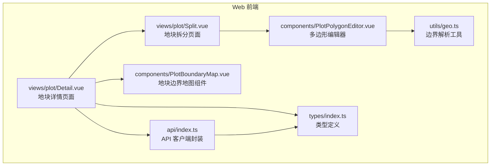
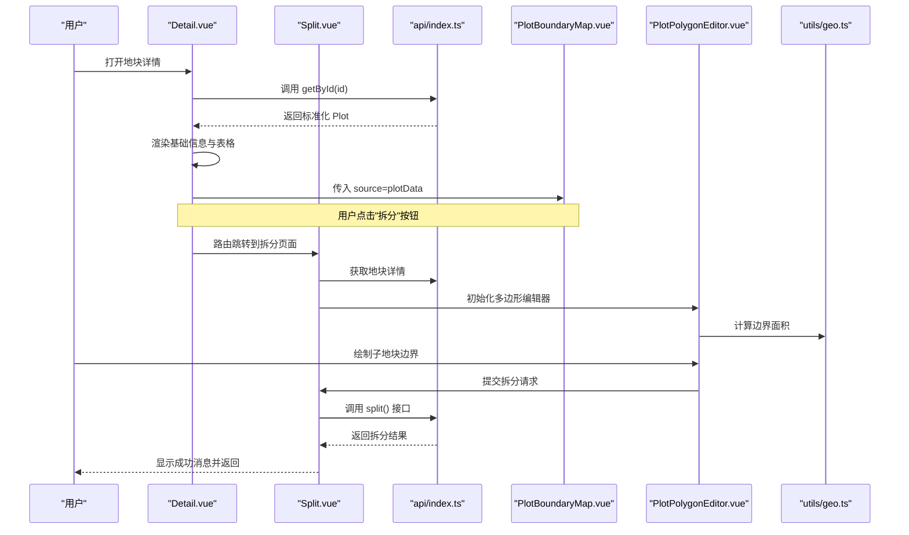
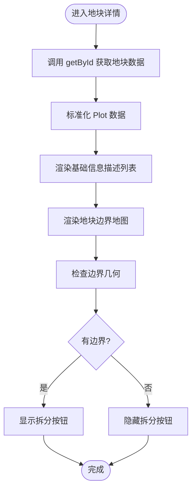
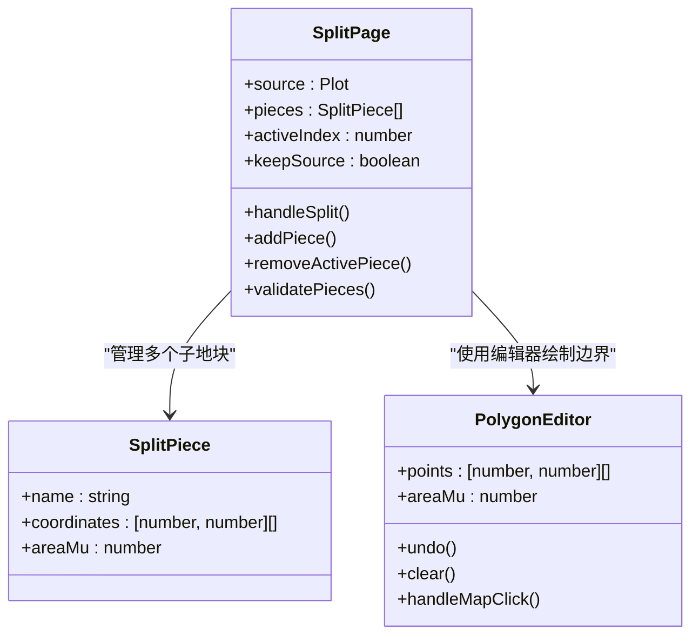
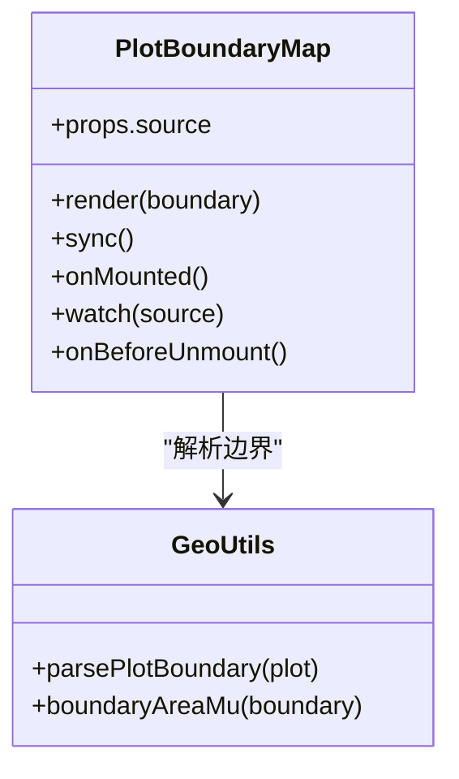
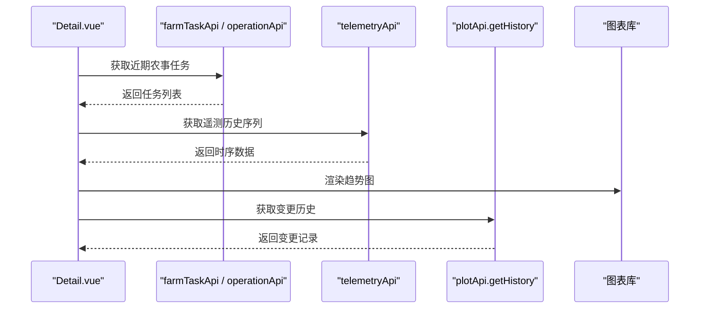
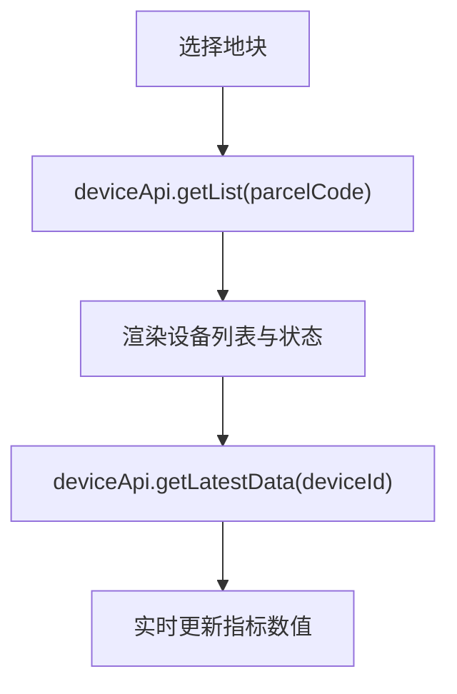
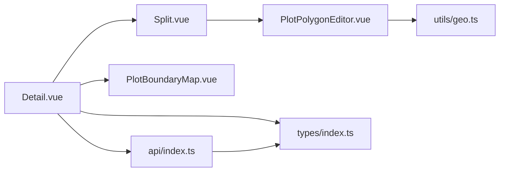

# 地块详情页面

<cite>
**本文引用的文件**   
- [apps/web/src/views/plot/Detail.vue](file://apps/web/src/views/plot/Detail.vue)
- [apps/web/src/views/plot/Split.vue](file://apps/web/src/views/plot/Split.vue)
- [apps/web/src/components/PlotBoundaryMap.vue](file://apps/web/src/components/PlotBoundaryMap.vue)
- [apps/web/src/components/PlotPolygonEditor.vue](file://apps/web/src/components/PlotPolygonEditor.vue)
- [apps/web/src/utils/geo.ts](file://apps/web/src/utils/geo.ts)
- [apps/web/src/api/index.ts](file://apps/web/src/api/index.ts)
- [apps/web/src/types/index.ts](file://apps/web/src/types/index.ts)
</cite>

## 更新摘要
**变更内容**   
- 新增地块拆分功能：在详情页面增加拆分入口，支持将单个地块拆分为多个子地块
- 新增拆分页面：提供交互式地图绘制界面，支持逐块绘制子地块边界
- 增强变更历史：支持合并(MERGE)和拆分(SPLIT)操作的完整记录与展示
- 新增多边形编辑器：独立的地图编辑组件，支持顶点添加、撤销、清空等操作
- 扩展API接口：新增合并(merge)和拆分(split)业务逻辑的API调用

## 目录
1. [简介](#简介)
2. [项目结构](#项目结构)
3. [核心组件](#核心组件)
4. [架构总览](#架构总览)
5. [详细组件分析](#详细组件分析)
6. [依赖关系分析](#依赖关系分析)
7. [性能与缓存策略](#性能与缓存策略)
8. [故障排查指南](#故障排查指南)
9. [结论](#结论)

## 简介
本文件为"地块详情页面"的技术与产品文档，面向前端实现、后端接口与运维人员。内容覆盖：
- 地块基础信息展示：编码、名称、类型、状态、面积、负责人等字段的呈现方式与格式化逻辑。
- 地块边界可视化：地图集成、多边形绘制、坐标点处理、中心点与面积提示。
- **新增**：地块拆分功能：支持将单个地块按用户绘制的边界拆分为多个子地块。
- **新增**：多边形编辑器：交互式地图绘制工具，支持顶点管理、实时面积计算。
- 历史数据展示：种植记录、农事操作、遥测数据的图表化接入点与扩展建议。
- 关联设备展示：设备列表、状态监控、实时数据更新的接入点与扩展建议。
- 数据刷新机制与缓存策略：当前实现与优化建议。
- 用户交互功能：返回按钮、编辑跳转、打印能力扩展建议。

## 项目结构
地块详情页面位于 Web 应用的前端模块中，采用 Vue 3 + TypeScript + Vite 技术栈，使用 Element Plus 进行表单与表格渲染，Leaflet 进行地图渲染。

**图示来源**
- [apps/web/src/views/plot/Detail.vue:1-200](file://apps/web/src/views/plot/Detail.vue#L1-L200)
- [apps/web/src/views/plot/Split.vue:1-278](file://apps/web/src/views/plot/Split.vue#L1-L278)
- [apps/web/src/components/PlotBoundaryMap.vue:1-88](file://apps/web/src/components/PlotBoundaryMap.vue#L1-L88)
- [apps/web/src/components/PlotPolygonEditor.vue:1-213](file://apps/web/src/components/PlotPolygonEditor.vue#L1-L213)
- [apps/web/src/utils/geo.ts:1-131](file://apps/web/src/utils/geo.ts#L1-L131)
- [apps/web/src/api/index.ts:1-902](file://apps/web/src/api/index.ts#L1-L902)
- [apps/web/src/types/index.ts:1-470](file://apps/web/src/types/index.ts#L1-L470)

**章节来源**
- [apps/web/src/views/plot/Detail.vue:1-200](file://apps/web/src/views/plot/Detail.vue#L1-L200)
- [apps/web/src/views/plot/Split.vue:1-278](file://apps/web/src/views/plot/Split.vue#L1-L278)
- [apps/web/src/components/PlotBoundaryMap.vue:1-88](file://apps/web/src/components/PlotBoundaryMap.vue#L1-L88)
- [apps/web/src/components/PlotPolygonEditor.vue:1-213](file://apps/web/src/components/PlotPolygonEditor.vue#L1-L213)
- [apps/web/src/utils/geo.ts:1-131](file://apps/web/src/utils/geo.ts#L1-L131)
- [apps/web/src/api/index.ts:1-902](file://apps/web/src/api/index.ts#L1-L902)
- [apps/web/src/types/index.ts:1-470](file://apps/web/src/types/index.ts#L1-L470)

## 核心组件
- 地块详情页面（Detail.vue）
  - 负责加载并展示地块基础信息、近期农事活动、以及地块边界地图。
  - 提供返回、拆分、编辑跳转等交互。
  - **新增**：拆分入口按钮，带边界几何校验。
- **新增**：地块拆分页面（Split.vue）
  - 提供完整的拆分操作流程，支持多子地块绘制与管理。
  - 实时面积计算与校验，确保子地块总面积不超过原地块。
  - 支持保留或归档原地块的选择。
- 地块边界地图组件（PlotBoundaryMap.vue）
  - 基于 Leaflet 渲染天地图瓦片图层，将地块边界几何转换为多边形并标注中心点与面积。
- **新增**：多边形编辑器（PlotPolygonEditor.vue）
  - 交互式地图绘制工具，支持顶点添加、撤销、清空操作。
  - 实时显示顶点数量和计算面积。
  - 自动闭合多边形，支持不规则边界绘制。
- 地理工具（geo.ts）
  - 解析多种边界格式（GeoJSON Polygon/MultiPolygon、数组、字符串），去重退化环，计算主外环、中心点与面积。
- API 客户端（api/index.ts）
  - 封装地块、设备、任务、遥测等接口调用，并对响应数据进行标准化。
  - **新增**：merge() 和 split() 方法，支持合并与拆分业务逻辑。
- 类型定义（types/index.ts）
  - 统一地块、设备、任务、遥测等数据结构与枚举。
  - **新增**：PlotChangeAction 类型包含 MERGE 和 SPLIT 动作。

**章节来源**
- [apps/web/src/views/plot/Detail.vue:1-200](file://apps/web/src/views/plot/Detail.vue#L1-L200)
- [apps/web/src/views/plot/Split.vue:1-278](file://apps/web/src/views/plot/Split.vue#L1-L278)
- [apps/web/src/components/PlotBoundaryMap.vue:1-88](file://apps/web/src/components/PlotBoundaryMap.vue#L1-L88)
- [apps/web/src/components/PlotPolygonEditor.vue:1-213](file://apps/web/src/components/PlotPolygonEditor.vue#L1-L213)
- [apps/web/src/utils/geo.ts:1-131](file://apps/web/src/utils/geo.ts#L1-L131)
- [apps/web/src/api/index.ts:1-902](file://apps/web/src/api/index.ts#L1-L902)
- [apps/web/src/types/index.ts:1-470](file://apps/web/src/types/index.ts#L1-L470)

## 架构总览
地块详情页面的数据流如下：
- 页面挂载后通过 API 客户端请求地块详情。
- 返回的地块数据经标准化后用于展示基础信息与地图渲染。
- 地图组件接收地块源数据，解析边界并渲染到 Leaflet 地图。
- 近期农事活动目前为模拟数据，可替换为真实任务接口。
- **新增**：拆分流程从详情页面触发，进入专门的拆分页面进行交互式边界绘制。

**图示来源**
- [apps/web/src/views/plot/Detail.vue:184-192](file://apps/web/src/views/plot/Detail.vue#L184-L192)
- [apps/web/src/views/plot/Split.vue:151-188](file://apps/web/src/views/plot/Split.vue#L151-L188)
- [apps/web/src/api/index.ts:114-122](file://apps/web/src/api/index.ts#L114-L122)
- [apps/web/src/components/PlotPolygonEditor.vue:103-110](file://apps/web/src/components/PlotPolygonEditor.vue#L103-L110)

## 详细组件分析

### 地块基础信息展示
- 字段呈现
  - 地块编码、名称、类型、所属区域、村组、状态、面积、网格编码、土壤类型、当前作物、负责人、联系电话、创建时间、更新时间、备注。
  - 类型与状态以标签形式展示，支持不同颜色区分；面积使用格式化函数输出亩单位；时间与备注按空值处理。
- 数据来源
  - 通过 plotApi.getById 获取地块详情，并在页面内直接绑定到描述列表中。
- 交互
  - 返回按钮调用路由后退；编辑按钮跳转到编辑页；**新增**：拆分按钮触发拆分流程。

**图示来源**
- [apps/web/src/views/plot/Detail.vue:16-41](file://apps/web/src/views/plot/Detail.vue#L16-L41)
- [apps/web/src/views/plot/Detail.vue:184-192](file://apps/web/src/views/plot/Detail.vue#L184-L192)
- [apps/web/src/api/index.ts:74-76](file://apps/web/src/api/index.ts#L74-L76)

**章节来源**
- [apps/web/src/views/plot/Detail.vue:16-41](file://apps/web/src/views/plot/Detail.vue#L16-L41)
- [apps/web/src/views/plot/Detail.vue:184-192](file://apps/web/src/views/plot/Detail.vue#L184-L192)
- [apps/web/src/api/index.ts:74-76](file://apps/web/src/api/index.ts#L74-L76)
- [apps/web/src/types/index.ts:72-98](file://apps/web/src/types/index.ts#L72-L98)

### 地块拆分功能
- **新增**：拆分入口
  - 在详情页面顶部工具栏增加"拆分"按钮，仅在存在边界几何时显示。
  - 点击前验证边界几何有效性，无边界时提示用户先去编辑页补画。
- **新增**：拆分页面
  - 提供完整的拆分操作流程，包括子地块命名、边界绘制、面积校验。
  - 支持多子地块管理，可动态添加或删除子地块。
  - 实时显示原地块面积与子地块合计面积对比。
- **新增**：边界绘制
  - 基于 PlotPolygonEditor 组件，支持交互式地图绘制。
  - 自动预填参考边界，用户可在此基础上调整。
  - 实时计算每个子地块的面积，确保不超过原地块面积。
- **新增**：提交验证
  - 至少需要2个子地块，每个子地块至少3个顶点。
  - 单块面积不能超过原地块面积，总面积也不能超过原地块面积。
  - 确认后弹出确认对话框，显示将要归档的原地块信息。

**图示来源**
- [apps/web/src/views/plot/Split.vue:74-98](file://apps/web/src/views/plot/Split.vue#L74-L98)
- [apps/web/src/components/PlotPolygonEditor.vue:21-34](file://apps/web/src/components/PlotPolygonEditor.vue#L21-L34)

**章节来源**
- [apps/web/src/views/plot/Detail.vue:10-12](file://apps/web/src/views/plot/Detail.vue#L10-L12)
- [apps/web/src/views/plot/Detail.vue:184-192](file://apps/web/src/views/plot/Detail.vue#L184-L192)
- [apps/web/src/views/plot/Split.vue:1-278](file://apps/web/src/views/plot/Split.vue#L1-L278)
- [apps/web/src/components/PlotPolygonEditor.vue:1-213](file://apps/web/src/components/PlotPolygonEditor.vue#L1-L213)

### 地块边界可视化
- 地图集成
  - 使用 Leaflet 初始化地图，叠加天地图影像与矢量瓦片图层，支持缩放控制。
- 多边形绘制
  - 将解析后的边界环转换为 Leaflet 多边形，设置描边与填充透明度，提升可视性。
- 坐标点展示
  - 计算边界中心点并添加自定义标记，显示地块名称与面积提示。
- 无边界处理
  - 当服务端无边界时，保留提示文案，避免空白画布，默认居中至参考坐标。

**图示来源**
- [apps/web/src/components/PlotBoundaryMap.vue:32-59](file://apps/web/src/components/PlotBoundaryMap.vue#L32-L59)
- [apps/web/src/utils/geo.ts:90-108](file://apps/web/src/utils/geo.ts#L90-L108)

**章节来源**
- [apps/web/src/components/PlotBoundaryMap.vue:1-88](file://apps/web/src/components/PlotBoundaryMap.vue#L1-L88)
- [apps/web/src/utils/geo.ts:1-131](file://apps/web/src/utils/geo.ts#L1-L131)

### 历史数据展示（种植记录、农事操作、遥测数据）
- 近期农事活动
  - 当前页面使用模拟数据展示任务类型、名称、状态、负责人与开始时间。
  - 可替换为 farmTaskApi.getList 或 operationApi.getTasks 的真实接口，并按 parcelCode 过滤。
- 遥测数据图表化
  - 可使用 telemetryApi.getHistorySeries 获取时序数据，结合 ECharts 或 Chart.js 渲染趋势图。
  - 指标维度包括空气温湿度、土壤温湿度、光照、CO2、风速风向、降雨量、土壤 pH 等。
- 种植记录
  - 可通过 traceApi.getRecords 查询与地块相关的追溯记录，并以表格或时间轴展示。
- **新增**：变更历史
  - 展示地块的完整变更历史，包括建档、修改、合并、拆分等操作记录。
  - 支持不同类型的变更动作，以不同颜色和样式展示。

**图示来源**
- [apps/web/src/api/index.ts:125-142](file://apps/web/src/api/index.ts#L125-L142)
- [apps/web/src/api/index.ts:175-194](file://apps/web/src/api/index.ts#L175-L194)
- [apps/web/src/api/index.ts:235-245](file://apps/web/src/api/index.ts#L235-L245)
- [apps/web/src/api/index.ts:159-162](file://apps/web/src/api/index.ts#L159-L162)

**章节来源**
- [apps/web/src/views/plot/Detail.vue:48-92](file://apps/web/src/views/plot/Detail.vue#L48-L92)
- [apps/web/src/api/index.ts:125-142](file://apps/web/src/api/index.ts#L125-L142)
- [apps/web/src/api/index.ts:175-194](file://apps/web/src/api/index.ts#L175-L194)
- [apps/web/src/api/index.ts:235-245](file://apps/web/src/api/index.ts#L235-L245)
- [apps/web/src/api/index.ts:159-162](file://apps/web/src/api/index.ts#L159-L162)

### 关联设备展示
- 设备列表
  - 使用 deviceApi.getList 获取设备分页数据，可按 parcelCode 过滤。
- 状态监控
  - 设备状态枚举包含离线、在线、故障、维护等，可在表格中以标签展示。
- 实时数据更新
  - 使用 deviceApi.getLatestData 或 telemetryApi.getLatest 拉取最新读数，定时轮询或 WebSocket 推送更新。

**图示来源**
- [apps/web/src/api/index.ts:103-123](file://apps/web/src/api/index.ts#L103-L123)
- [apps/web/src/types/index.ts:125-168](file://apps/web/src/types/index.ts#L125-L168)

**章节来源**
- [apps/web/src/api/index.ts:103-123](file://apps/web/src/api/index.ts#L103-L123)
- [apps/web/src/types/index.ts:125-168](file://apps/web/src/types/index.ts#L125-L168)

### 数据刷新机制与缓存策略
- 当前实现
  - 页面在 onMounted 时加载一次地块详情，未实现自动刷新或缓存。
- 建议方案
  - 引入本地缓存（如 localStorage 或内存缓存），对高频读取的地块详情与遥测历史做短期缓存。
  - 增加手动刷新按钮与定时轮询（例如每 30 秒刷新遥测最新数据）。
  - 对地图边界数据做持久化缓存，减少重复解析与网络请求。

[本节为通用建议，不直接分析具体文件]

### 用户交互功能
- 返回按钮
  - 调用路由后退，便于快速回到上一级页面。
- 编辑按钮
  - 跳转到编辑页，携带地块 ID 参数。
- **新增**：拆分按钮
  - 跳转到拆分页面，携带地块编码参数。
  - 前置验证边界几何，无边界时提示用户先补画。
- 打印功能
  - 当前未实现打印；可借助浏览器 print 或第三方打印库，导出当前视图为 PDF。

**章节来源**
- [apps/web/src/views/plot/Detail.vue:6-16](file://apps/web/src/views/plot/Detail.vue#L6-L16)
- [apps/web/src/views/plot/Detail.vue:176-192](file://apps/web/src/views/plot/Detail.vue#L176-L192)

## 依赖关系分析
- 组件耦合
  - Detail.vue 依赖 api/index.ts 获取数据，依赖 PlotBoundaryMap.vue 渲染地图。
  - **新增**：Detail.vue 依赖 Split.vue 进行拆分操作。
  - **新增**：Split.vue 依赖 PlotPolygonEditor.vue 进行边界绘制。
  - PlotBoundaryMap.vue 依赖 utils/geo.ts 解析边界几何。
  - 所有组件共享 types/index.ts 的类型定义，保证前后端契约一致。
- 外部依赖
  - Leaflet 用于地图渲染。
  - Element Plus 用于 UI 组件（描述列表、标签、表格、按钮）。
  - 天地图瓦片服务作为底图来源。

**图示来源**
- [apps/web/src/views/plot/Detail.vue:106-115](file://apps/web/src/views/plot/Detail.vue#L106-L115)
- [apps/web/src/views/plot/Split.vue:69-72](file://apps/web/src/views/plot/Split.vue#L69-L72)
- [apps/web/src/components/PlotPolygonEditor.vue:17-19](file://apps/web/src/components/PlotPolygonEditor.vue#L17-L19)
- [apps/web/src/components/PlotBoundaryMap.vue:8-12](file://apps/web/src/components/PlotBoundaryMap.vue#L8-L12)
- [apps/web/src/api/index.ts:1-14](file://apps/web/src/api/index.ts#L1-L14)

**章节来源**
- [apps/web/src/views/plot/Detail.vue:106-115](file://apps/web/src/views/plot/Detail.vue#L106-L115)
- [apps/web/src/views/plot/Split.vue:69-72](file://apps/web/src/views/plot/Split.vue#L69-L72)
- [apps/web/src/components/PlotPolygonEditor.vue:17-19](file://apps/web/src/components/PlotPolygonEditor.vue#L17-L19)
- [apps/web/src/components/PlotBoundaryMap.vue:8-12](file://apps/web/src/components/PlotBoundaryMap.vue#L8-L12)
- [apps/web/src/api/index.ts:1-14](file://apps/web/src/api/index.ts#L1-L14)

## 性能与缓存策略
- 地图渲染优化
  - 仅在存在边界时绘制多边形；无边界时仅显示提示，避免无效渲染。
  - 使用 layerGroup 管理图层，及时移除旧图层，防止内存泄漏。
- 数据加载优化
  - 对地块详情与遥测历史数据实施缓存，减少重复请求。
  - 对频繁刷新的遥测数据采用增量更新与节流策略。
- 边界解析优化
  - 去重与退化环过滤，确保多边形有效性与渲染性能。
- **新增**：拆分操作优化
  - 子地块边界绘制采用增量更新，避免全量重绘。
  - 面积计算采用缓存机制，避免重复计算。
  - 编辑器实例复用，切换子地块时保持已绘制顶点。

[本节为通用建议，不直接分析具体文件]

## 故障排查指南
- 地图无边界
  - 检查服务端是否返回边界几何；若无，页面会显示提示信息。
  - 确认 geo.ts 的 parsePlotBoundary 能正确解析 coordinates/boundary/geom。
- 地图空白或报错
  - 检查 Leaflet 样式与天地图密钥配置是否正确。
  - 确认 mapEl 引用存在且容器尺寸非零。
- 数据加载失败
  - 查看控制台错误日志，确认 getById 接口返回状态与数据格式。
  - 校验 normalizePlot 是否对缺失字段做了兼容处理。
- 农事任务为空
  - 当前为模拟数据；如需真实数据，请替换为任务接口并传入 parcelCode 过滤条件。
- **新增**：拆分功能问题
  - 拆分按钮不显示：检查地块是否有有效的边界几何。
  - 拆分页面无法加载：确认路由参数传递正确，地块ID有效。
  - 边界绘制异常：检查经纬度坐标格式，确保为 [经度, 纬度] 顺序。
  - 面积校验失败：确认子地块边界不重叠，总面积不超过原地块面积。
  - 拆分提交失败：检查 GeoJSON 格式是否正确，坐标环是否闭合。

**章节来源**
- [apps/web/src/components/PlotBoundaryMap.vue:32-59](file://apps/web/src/components/PlotBoundaryMap.vue#L32-L59)
- [apps/web/src/utils/geo.ts:90-108](file://apps/web/src/utils/geo.ts#L90-L108)
- [apps/web/src/views/plot/Detail.vue:104-131](file://apps/web/src/views/plot/Detail.vue#L104-L131)
- [apps/web/src/api/index.ts:62-75](file://apps/web/src/api/index.ts#L62-L75)
- [apps/web/src/views/plot/Split.vue:116-127](file://apps/web/src/views/plot/Split.vue#L116-L127)

## 结论
地块详情页面已具备完整的基础信息展示、边界可视化与基础交互能力。**新增的拆分功能**为用户提供了灵活的地块分割能力，支持交互式边界绘制与实时面积校验。历史数据与设备监控的图表化与实时化可通过现有 API 客户端无缝接入。建议在后续迭代中完善数据刷新与缓存策略，增强用户体验与系统性能。

**主要改进**：
- 完善了地块生命周期管理，支持从单一地块到多个子地块的灵活转换
- 增强了用户交互体验，提供直观的地图绘制工具
- 强化了数据完整性校验，确保业务逻辑的正确性
- 扩展了变更历史追踪，支持合并与拆分操作的完整审计