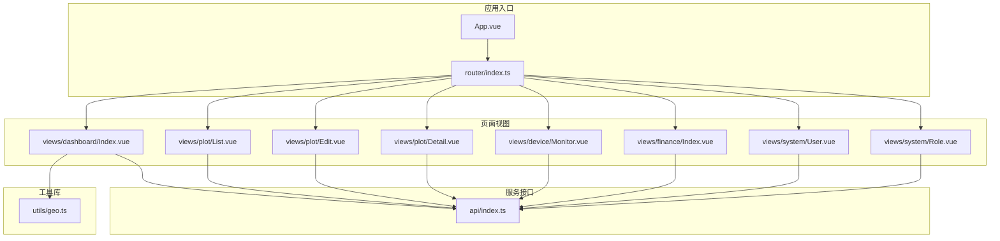
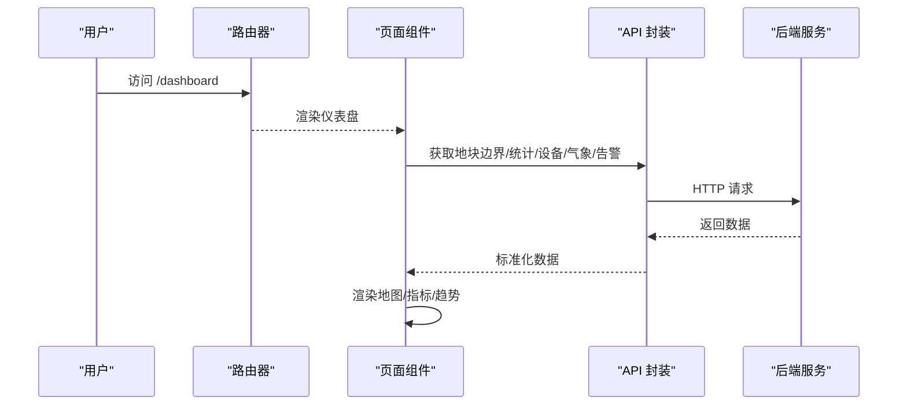
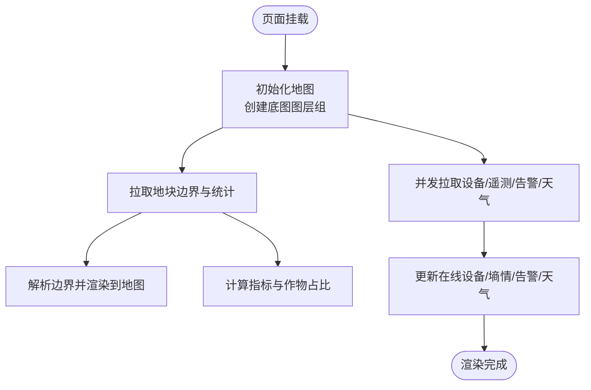
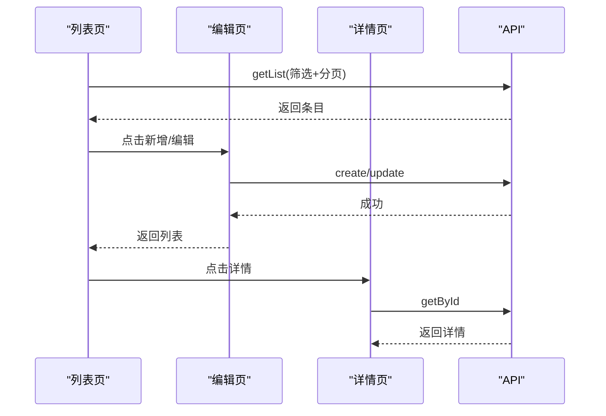
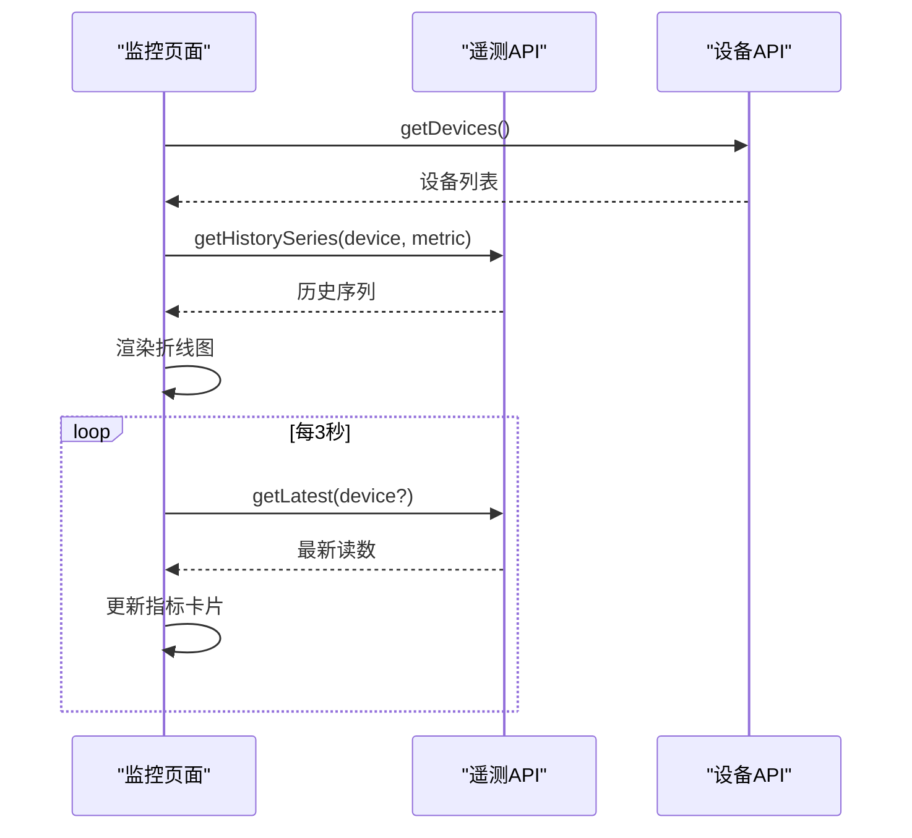
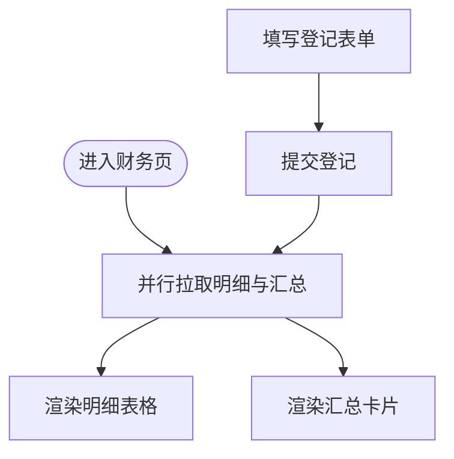
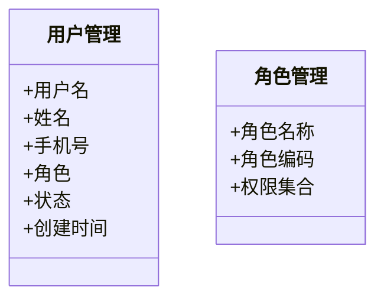
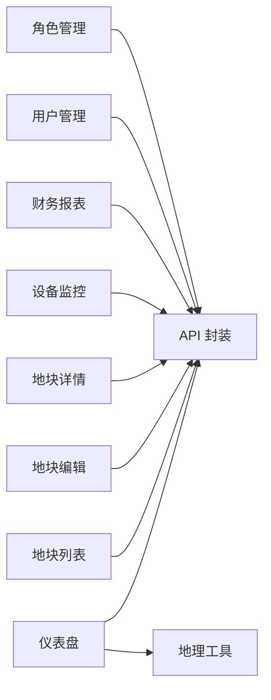

# 核心页面

<cite>
**本文引用的文件**   
- [apps/web/src/router/index.ts](file://apps/web/src/router/index.ts)
- [apps/web/src/stores/index.ts](file://apps/web/src/stores/index.ts)
- [apps/web/src/views/dashboard/Index.vue](file://apps/web/src/views/dashboard/Index.vue)
- [apps/web/src/views/plot/List.vue](file://apps/web/src/views/plot/List.vue)
- [apps/web/src/views/plot/Edit.vue](file://apps/web/src/views/plot/Edit.vue)
- [apps/web/src/views/plot/Detail.vue](file://apps/web/src/views/plot/Detail.vue)
- [apps/web/src/views/device/Monitor.vue](file://apps/web/src/views/device/Monitor.vue)
- [apps/web/src/views/finance/Index.vue](file://apps/web/src/views/finance/Index.vue)
- [apps/web/src/views/system/User.vue](file://apps/web/src/views/system/User.vue)
- [apps/web/src/views/system/Role.vue](file://apps/web/src/views/system/Role.vue)
- [apps/web/src/api/index.ts](file://apps/web/src/api/index.ts)
- [apps/web/src/utils/geo.ts](file://apps/web/src/utils/geo.ts)
</cite>

## 目录
1. [引言](#引言)
2. [项目结构](#项目结构)
3. [核心组件](#核心组件)
4. [架构总览](#架构总览)
5. [详细组件分析](#详细组件分析)
6. [依赖分析](#依赖分析)
7. [性能考虑](#性能考虑)
8. [故障排查指南](#故障排查指南)
9. [结论](#结论)

## 引言
本文件面向智慧农业平台的前端核心页面，聚焦以下能力：
- 仪表盘：数据展示、地图集成与实时数据更新机制
- 地块管理：CRUD 操作、地图边界绘制与数据筛选
- 设备监控：状态展示、控制指令下发与实时监控
- 财务报表：数据统计、图表可视化与导出
- 系统管理：用户权限管理与角色配置
- 跨页面导航、数据传递与状态同步方案

## 项目结构
前端采用 Vue 3 + TypeScript + Vite，路由集中定义在 router，页面按业务域划分到 views 子目录，API 封装在 api/index.ts，全局状态使用 Pinia。

**图示来源**
- [apps/web/src/router/index.ts:1-157](file://apps/web/src/router/index.ts#L1-L157)
- [apps/web/src/views/dashboard/Index.vue:1-280](file://apps/web/src/views/dashboard/Index.vue#L1-L280)
- [apps/web/src/api/index.ts:1-263](file://apps/web/src/api/index.ts#L1-L263)
- [apps/web/src/utils/geo.ts:1-131](file://apps/web/src/utils/geo.ts#L1-L131)

**章节来源**
- [apps/web/src/router/index.ts:1-157](file://apps/web/src/router/index.ts#L1-L157)

## 核心组件
- 路由与鉴权守卫：统一设置标题、未登录跳转登录页
- 全局状态：用户信息、主题与侧边栏折叠
- 页面模块：
  - 仪表盘：天地图图层、地块边界渲染、指标面板、趋势图占位
  - 地块管理：列表查询、分页、新增/编辑/删除、详情查看
  - 设备监控：最新读数轮询、历史曲线、设备选择
  - 财务报表：投入产出登记、汇总统计、表格展示
  - 系统管理：当前用户信息、角色权限列表

**章节来源**
- [apps/web/src/router/index.ts:146-154](file://apps/web/src/router/index.ts#L146-L154)
- [apps/web/src/stores/index.ts:1-65](file://apps/web/src/stores/index.ts#L1-L65)

## 架构总览
前端通过 API 层访问后端微服务；仪表盘同时集成 Leaflet 地图与天气/遥测/告警等数据源；地块边界解析由 geo 工具完成；设备监控使用 ECharts 展示历史曲线并定时刷新最新值。

**图示来源**
- [apps/web/src/router/index.ts:1-157](file://apps/web/src/router/index.ts#L1-L157)
- [apps/web/src/views/dashboard/Index.vue:173-248](file://apps/web/src/views/dashboard/Index.vue#L173-L248)
- [apps/web/src/api/index.ts:28-60](file://apps/web/src/api/index.ts#L28-L60)

## 详细组件分析

### 仪表盘（Dashboard）
- 数据展示
  - 左侧面板：地块数量、总面积、在线设备数、待处理预警
  - 运行状态：在线/离线设备、土壤墒情、气象站状态
  - 右侧面板：作物面积占比、产量预估、倒伏关注
  - 底部趋势：近 7 日出苗率与长势指数（占位图形）
- 地图集成
  - 基于 Leaflet 加载天地图瓦片（矢量/影像切换）
  - 设备点位与地块边界图层可独立开关
  - 无服务端边界时回退为演示多边形
- 实时数据更新
  - 并发拉取设备列表、最新遥测、告警、天气预报
  - 根据设备状态计算在线/离线计数
  - 将土壤湿度、告警数量、天气摘要写入面板

**图示来源**
- [apps/web/src/views/dashboard/Index.vue:142-149](file://apps/web/src/views/dashboard/Index.vue#L142-L149)
- [apps/web/src/views/dashboard/Index.vue:173-248](file://apps/web/src/views/dashboard/Index.vue#L173-L248)
- [apps/web/src/utils/geo.ts:90-114](file://apps/web/src/utils/geo.ts#L90-L114)

**章节来源**
- [apps/web/src/views/dashboard/Index.vue:1-280](file://apps/web/src/views/dashboard/Index.vue#L1-L280)
- [apps/web/src/utils/geo.ts:1-131](file://apps/web/src/utils/geo.ts#L1-L131)
- [apps/web/src/api/index.ts:28-60](file://apps/web/src/api/index.ts#L28-L60)

### 地块管理（Plot List/Edit/Detail）
- 列表页
  - 支持关键词、类型、状态筛选与分页
  - 支持批量删除、导出按钮（未实现具体导出逻辑）
  - 行内操作：详情、编辑、删除
- 新增/编辑
  - 表单校验：名称、类型、行政区、村组、面积必填
  - 行政区级联选择与村组下拉
  - 地块边界“地图绘制”预留入口（提示接入实际地图）
  - 提交调用 create/update，成功后返回上一页
- 详情页
  - 展示地块基础信息与最近农事活动
  - 集成地块边界地图组件
  - 支持跳转到编辑页

**图示来源**
- [apps/web/src/views/plot/List.vue:201-266](file://apps/web/src/views/plot/List.vue#L201-L266)
- [apps/web/src/views/plot/Edit.vue:202-244](file://apps/web/src/views/plot/Edit.vue#L202-L244)
- [apps/web/src/views/plot/Detail.vue:104-143](file://apps/web/src/views/plot/Detail.vue#L104-L143)
- [apps/web/src/api/index.ts:28-60](file://apps/web/src/api/index.ts#L28-L60)

**章节来源**
- [apps/web/src/views/plot/List.vue:1-272](file://apps/web/src/views/plot/List.vue#L1-L272)
- [apps/web/src/views/plot/Edit.vue:1-259](file://apps/web/src/views/plot/Edit.vue#L1-L259)
- [apps/web/src/views/plot/Detail.vue:1-148](file://apps/web/src/views/plot/Detail.vue#L1-L148)
- [apps/web/src/api/index.ts:28-60](file://apps/web/src/api/index.ts#L28-L60)

### 设备监控（Device Monitor）
- 状态展示
  - 顶部卡片展示空气温度/湿度、土壤湿度/pH、光照、CO₂、风速、降雨量
  - 每条指标显示单位与状态（正常/预警/异常）
- 实时监控
  - 每 3 秒轮询最新遥测，填充指标卡片
  - 设备列表来自设备接口，默认选中示例设备
- 历史趋势
  - 支持选择指标与设备，拉取时间序列并渲染折线图
  - 无数据时显示空状态提示

**图示来源**
- [apps/web/src/views/device/Monitor.vue:82-128](file://apps/web/src/views/device/Monitor.vue#L82-L128)
- [apps/web/src/api/index.ts:157-194](file://apps/web/src/api/index.ts#L157-L194)

**章节来源**
- [apps/web/src/views/device/Monitor.vue:1-137](file://apps/web/src/views/device/Monitor.vue#L1-L137)
- [apps/web/src/api/index.ts:157-194](file://apps/web/src/api/index.ts#L157-L194)

### 财务报表（Finance）
- 统计概览
  - 投入合计、产出合计、利润三项关键指标
- 数据登记
  - 表单包含地块编码、类型（投入/产出）、类别、金额、备注
  - 提交后刷新列表与汇总
- 数据列表
  - 表格展示明细记录，支持按地块编码过滤
  - 提供刷新按钮重新拉取数据

**图示来源**
- [apps/web/src/views/finance/Index.vue:27-39](file://apps/web/src/views/finance/Index.vue#L27-L39)
- [apps/web/src/api/index.ts:223-233](file://apps/web/src/api/index.ts#L223-L233)

**章节来源**
- [apps/web/src/views/finance/Index.vue:1-47](file://apps/web/src/views/finance/Index.vue#L1-L47)
- [apps/web/src/api/index.ts:223-233](file://apps/web/src/api/index.ts#L223-L233)

### 系统管理（System）
- 用户管理
  - 展示当前登录用户信息（用户名、姓名、手机号、角色、状态、创建时间）
  - 数据来源为用户信息接口
- 角色管理
  - 展示角色名称、编码与权限标签集合
  - 数据来源为平台角色接口

**图示来源**
- [apps/web/src/views/system/User.vue:24-36](file://apps/web/src/views/system/User.vue#L24-L36)
- [apps/web/src/views/system/Role.vue:13-18](file://apps/web/src/views/system/Role.vue#L13-L18)
- [apps/web/src/api/index.ts:169-173](file://apps/web/src/api/index.ts#L169-L173)

**章节来源**
- [apps/web/src/views/system/User.vue:1-38](file://apps/web/src/views/system/User.vue#L1-L38)
- [apps/web/src/views/system/Role.vue:1-24](file://apps/web/src/views/system/Role.vue#L1-L24)
- [apps/web/src/api/index.ts:169-173](file://apps/web/src/api/index.ts#L169-L173)

## 依赖分析
- 页面与 API 的耦合关系清晰，所有网络请求集中在 api/index.ts
- 仪表盘对 geo 工具存在强依赖，用于边界解析与面积计算
- 设备监控依赖 ECharts 与遥测接口
- 路由守卫负责鉴权与标题设置

**图示来源**
- [apps/web/src/views/dashboard/Index.vue:42-47](file://apps/web/src/views/dashboard/Index.vue#L42-L47)
- [apps/web/src/api/index.ts:1-263](file://apps/web/src/api/index.ts#L1-L263)
- [apps/web/src/utils/geo.ts:1-131](file://apps/web/src/utils/geo.ts#L1-L131)

**章节来源**
- [apps/web/src/api/index.ts:1-263](file://apps/web/src/api/index.ts#L1-L263)

## 性能考虑
- 仪表盘并发请求：设备、遥测、告警、天气使用 Promise.all 并发拉取，减少首屏等待
- 地图渲染优化：仅在可见图层添加 LayerGroup，避免重复绘制；无边界时使用演示数据保证交互可用
- 设备监控轮询：使用 setInterval 每 3 秒刷新最新读数，并在卸载时清理定时器
- 图表渲染：ECharts 使用 computed 选项，仅在数据变化时重绘
- 列表与分页：后端分页参数在前端映射为 size/page，避免全量加载

[本节为通用指导，不直接分析具体文件]

## 故障排查指南
- 地图无法加载
  - 检查天地图 Key 是否配置正确
  - 确认图层开关状态与 LayerGroup 是否正确添加到地图实例
- 地块边界不显示
  - 检查后端返回的几何字段是否被 geo 工具正确解析
  - 若为空，确认是否回退到演示边界
- 设备监控无数据
  - 确认设备列表是否拉取成功
  - 检查所选设备是否存在该指标的历史序列
- 财务报表统计异常
  - 核对输入金额是否为数字且大于 0
  - 确认明细与汇总接口返回字段一致
- 鉴权失败或跳转登录
  - 检查本地 token 是否存在
  - 确认路由 meta.requiresAuth 配置是否符合预期

**章节来源**
- [apps/web/src/views/dashboard/Index.vue:173-248](file://apps/web/src/views/dashboard/Index.vue#L173-L248)
- [apps/web/src/views/device/Monitor.vue:115-136](file://apps/web/src/views/device/Monitor.vue#L115-L136)
- [apps/web/src/views/finance/Index.vue:37-39](file://apps/web/src/views/finance/Index.vue#L37-L39)
- [apps/web/src/router/index.ts:146-154](file://apps/web/src/router/index.ts#L146-L154)

## 结论
本方案以清晰的页面职责划分与统一的 API 封装为基础，实现了仪表盘的数据聚合与地图可视化、地块管理的完整 CRUD 流程、设备监控的实时与历史趋势展示、财务报表的统计与登记、以及系统管理的用户与角色展示。通过路由守卫与全局状态，保障了鉴权与跨页面状态的一致性。后续可在地图绘制、图表库扩展与导出功能上进一步增强体验与能力。