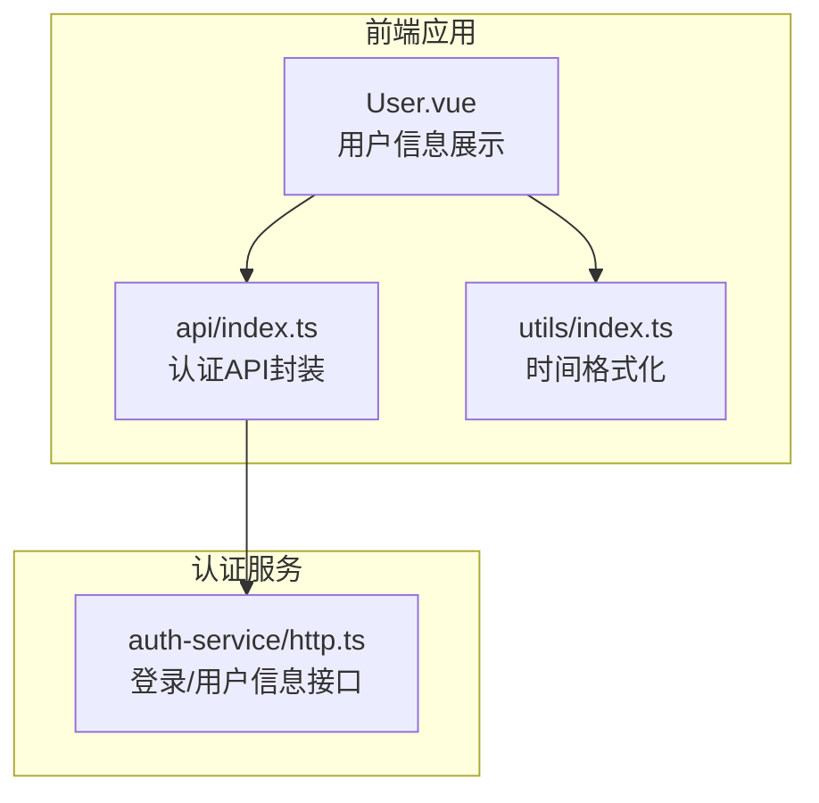
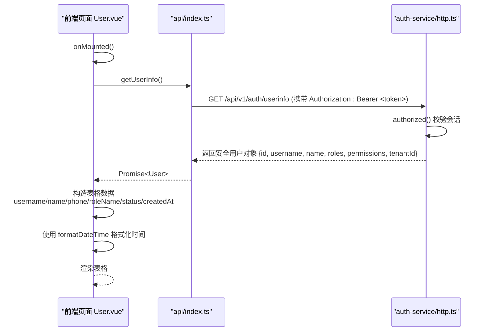
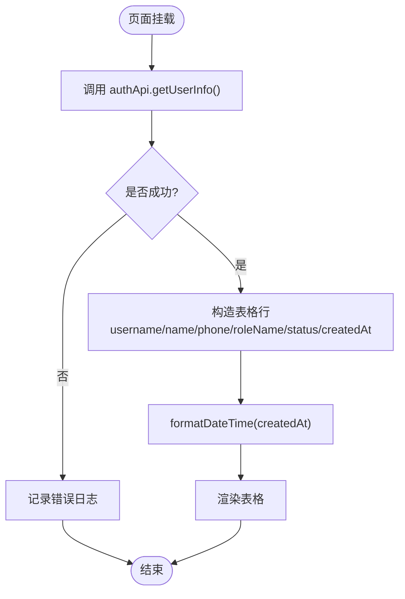
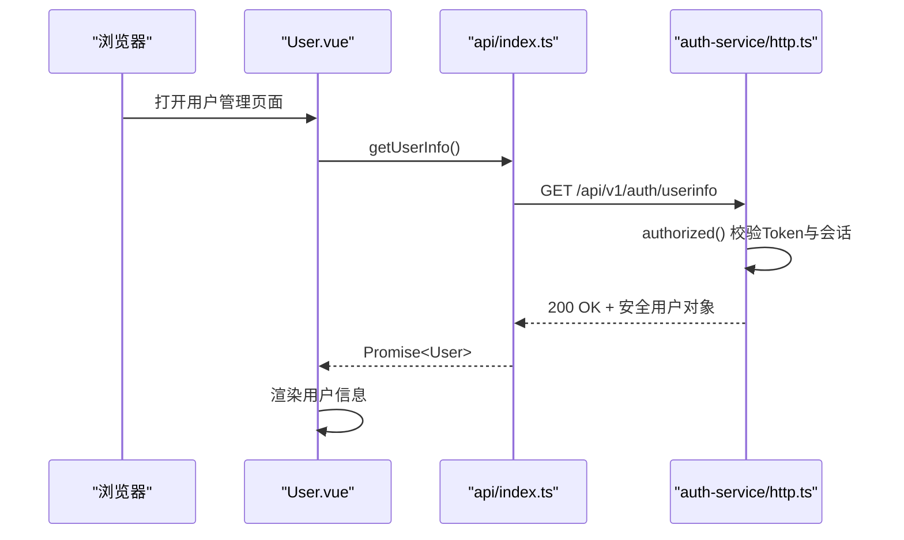
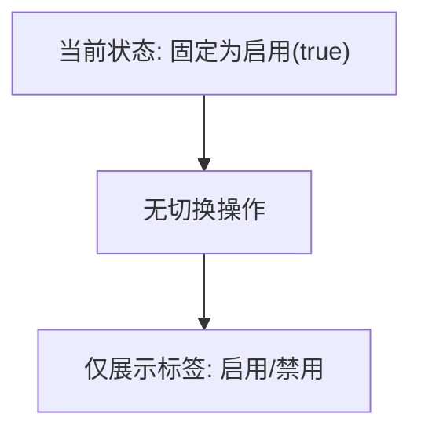
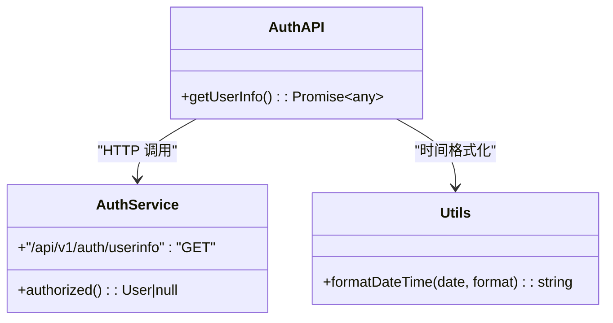
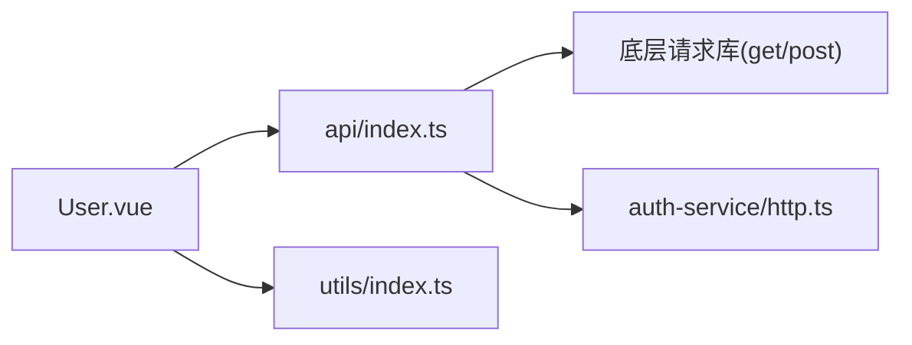

# 用户管理

<cite>
**本文引用的文件**   
- [apps/web/src/views/system/User.vue](file://apps/web/src/views/system/User.vue)
- [apps/web/src/api/index.ts](file://apps/web/src/api/index.ts)
- [apps/auth-service/src/http.ts](file://apps/auth-service/src/http.ts)
- [apps/web/src/utils/index.ts](file://apps/web/src/utils/index.ts)
</cite>

## 目录
1. [简介](#简介)
2. [项目结构](#项目结构)
3. [核心组件](#核心组件)
4. [架构总览](#架构总览)
5. [详细组件分析](#详细组件分析)
6. [依赖分析](#依赖分析)
7. [性能考虑](#性能考虑)
8. [故障排查指南](#故障排查指南)
9. [结论](#结论)
10. [附录](#附录)

## 简介
本章节面向“用户管理”功能，聚焦以下目标：
- 用户信息展示界面：用户名、姓名、手机号、角色和状态等字段的显示逻辑。
- 用户数据获取流程：从认证服务获取用户信息的API调用链路。
- 用户状态管理：启用/禁用状态的切换机制与前端呈现。
- 权限验证与信息格式化：基于令牌鉴权、字段映射与时间格式化。
- 最佳实践与安全建议：针对当前实现的改进方向与注意事项。

## 项目结构
围绕用户管理的前后端关键文件如下：
- 前端页面：apps/web/src/views/system/User.vue
- 前端API封装：apps/web/src/api/index.ts
- 认证服务：apps/auth-service/src/http.ts
- 工具函数（时间格式化）：apps/web/src/utils/index.ts

图示来源
- [apps/web/src/views/system/User.vue:1-38](file://apps/web/src/views/system/User.vue#L1-L38)
- [apps/web/src/api/index.ts:12-26](file://apps/web/src/api/index.ts#L12-L26)
- [apps/auth-service/src/http.ts:14-20](file://apps/auth-service/src/http.ts#L14-L20)
- [apps/web/src/utils/index.ts:4-7](file://apps/web/src/utils/index.ts#L4-L7)

章节来源
- [apps/web/src/views/system/User.vue:1-38](file://apps/web/src/views/system/User.vue#L1-L38)
- [apps/web/src/api/index.ts:12-26](file://apps/web/src/api/index.ts#L12-L26)
- [apps/auth-service/src/http.ts:14-20](file://apps/auth-service/src/http.ts#L14-L20)
- [apps/web/src/utils/index.ts:4-7](file://apps/web/src/utils/index.ts#L4-L7)

## 核心组件
- 用户信息展示页（User.vue）
  - 使用表格展示用户名、姓名、手机号、角色、状态、创建时间。
  - 在页面挂载时调用认证API获取当前用户信息并渲染。
- 认证API封装（api/index.ts）
  - 提供 getUserInfo 方法，请求 /auth/userinfo。
- 认证服务（auth-service/http.ts）
  - 实现 /api/v1/auth/login 与 /api/v1/auth/userinfo。
  - 通过 Bearer Token 校验会话，返回脱敏后的用户信息。
- 工具函数（utils/index.ts）
  - 提供 formatDateTime 用于时间格式化显示。

章节来源
- [apps/web/src/views/system/User.vue:1-38](file://apps/web/src/views/system/User.vue#L1-L38)
- [apps/web/src/api/index.ts:12-26](file://apps/web/src/api/index.ts#L12-L26)
- [apps/auth-service/src/http.ts:14-20](file://apps/auth-service/src/http.ts#L14-L20)
- [apps/web/src/utils/index.ts:4-7](file://apps/web/src/utils/index.ts#L4-L7)

## 架构总览
用户信息展示与获取的整体流程如下：

图示来源
- [apps/web/src/views/system/User.vue:31-36](file://apps/web/src/views/system/User.vue#L31-L36)
- [apps/web/src/api/index.ts:20-22](file://apps/web/src/api/index.ts#L20-L22)
- [apps/auth-service/src/http.ts:16-17](file://apps/auth-service/src/http.ts#L16-L17)
- [apps/web/src/utils/index.ts:4-7](file://apps/web/src/utils/index.ts#L4-L7)

## 详细组件分析

### 用户信息展示界面（User.vue）
- 字段显示逻辑
  - 用户名：直接绑定 user.username。
  - 姓名：绑定 user.name。
  - 手机号：当前固定为占位符“-”，未从后端填充。
  - 角色：将 user.roles 数组以逗号拼接成字符串；若为空则显示“-”。
  - 状态：当前固定为 true（启用），并以标签形式展示“启用/禁用”。
  - 创建时间：使用 formatDateTime 进行格式化，当前固定为“-”。
- 数据加载时机
  - 在 onMounted 生命周期中异步调用 authApi.getUserInfo，成功后构造单行表格数据并渲染。
- 错误处理
  - 捕获异常并输出日志，便于调试。

图示来源
- [apps/web/src/views/system/User.vue:31-36](file://apps/web/src/views/system/User.vue#L31-L36)
- [apps/web/src/utils/index.ts:4-7](file://apps/web/src/utils/index.ts#L4-L7)

章节来源
- [apps/web/src/views/system/User.vue:1-38](file://apps/web/src/views/system/User.vue#L1-L38)

### 用户数据获取流程（认证API与认证服务）
- 前端API封装
  - authApi.getUserInfo 发起 GET /auth/userinfo 请求。
- 认证服务接口
  - /api/v1/auth/userinfo：校验 Authorization 头中的 Bearer Token，若有效则返回安全用户对象（不含密码）。
  - /api/v1/auth/login：用户名密码校验通过后签发 token，并建立会话。
- 鉴权机制
  - authorized() 根据请求头中的 Authorization 解析 token，查找会话并返回对应用户。

图示来源
- [apps/web/src/api/index.ts:20-22](file://apps/web/src/api/index.ts#L20-L22)
- [apps/auth-service/src/http.ts:16-17](file://apps/auth-service/src/http.ts#L16-L17)

章节来源
- [apps/web/src/api/index.ts:12-26](file://apps/web/src/api/index.ts#L12-L26)
- [apps/auth-service/src/http.ts:14-20](file://apps/auth-service/src/http.ts#L14-L20)

### 用户状态管理（启用/禁用）
- 当前实现
  - 状态字段在前端固定为 true（启用），并以标签样式展示“启用/禁用”。
  - 未提供切换按钮或后端接口调用，状态不可编辑。
- 扩展建议
  - 增加状态切换交互（如开关控件）。
  - 对接后端用户更新接口，提交状态变更。
  - 前端在切换后刷新或局部更新状态。

图示来源
- [apps/web/src/views/system/User.vue:9-15](file://apps/web/src/views/system/User.vue#L9-L15)
- [apps/web/src/views/system/User.vue:34](file://apps/web/src/views/system/User.vue#L34)

章节来源
- [apps/web/src/views/system/User.vue:9-15](file://apps/web/src/views/system/User.vue#L9-L15)
- [apps/web/src/views/system/User.vue:34](file://apps/web/src/views/system/User.vue#L34)

### 权限验证与信息格式化
- 权限验证
  - 认证服务通过 Bearer Token 校验会话，未授权返回401。
  - 前端需在请求中携带 Authorization 头（由底层请求库负责注入）。
- 信息格式化
  - 时间字段使用 formatDateTime 统一格式化。
  - 角色字段以数组转字符串方式展示。

图示来源
- [apps/web/src/api/index.ts:20-22](file://apps/web/src/api/index.ts#L20-L22)
- [apps/auth-service/src/http.ts:16-17](file://apps/auth-service/src/http.ts#L16-L17)
- [apps/web/src/utils/index.ts:4-7](file://apps/web/src/utils/index.ts#L4-L7)

章节来源
- [apps/web/src/api/index.ts:20-22](file://apps/web/src/api/index.ts#L20-L22)
- [apps/auth-service/src/http.ts:16-17](file://apps/auth-service/src/http.ts#L16-L17)
- [apps/web/src/utils/index.ts:4-7](file://apps/web/src/utils/index.ts#L4-L7)

## 依赖分析
- 模块耦合关系
  - User.vue 依赖 api/index.ts 的认证API与 utils/index.ts 的时间格式化。
  - api/index.ts 依赖底层请求工具（get/post），并调用认证服务。
  - 认证服务独立运行，提供鉴权与用户信息查询。
- 外部依赖
  - dayjs：时间格式化。
  - Element Plus：表格与标签组件（UI框架）。

图示来源
- [apps/web/src/views/system/User.vue:24-27](file://apps/web/src/views/system/User.vue#L24-L27)
- [apps/web/src/api/index.ts:1-2](file://apps/web/src/api/index.ts#L1-L2)
- [apps/auth-service/src/http.ts:14-20](file://apps/auth-service/src/http.ts#L14-L20)

章节来源
- [apps/web/src/views/system/User.vue:24-27](file://apps/web/src/views/system/User.vue#L24-L27)
- [apps/web/src/api/index.ts:1-2](file://apps/web/src/api/index.ts#L1-L2)
- [apps/auth-service/src/http.ts:14-20](file://apps/auth-service/src/http.ts#L14-L20)

## 性能考虑
- 减少重复请求
  - 用户信息可在登录后缓存至本地存储或全局状态，避免每次进入页面都请求。
- 延迟与防抖
  - 对于频繁触发的操作（如搜索、筛选），建议使用防抖/节流。
- 列表渲染优化
  - 表格数据量较大时，考虑虚拟滚动或分页加载。

[本节为通用指导，不直接分析具体文件]

## 故障排查指南
- 常见问题
  - 401 未授权：检查 Authorization 头是否正确携带，Token 是否过期。
  - 用户信息为空：确认认证服务是否正常返回安全用户对象。
  - 时间显示异常：检查传入日期格式与 formatDateTime 的使用。
- 定位建议
  - 查看浏览器网络面板，确认 /auth/userinfo 的请求与响应。
  - 在 User.vue 的 catch 分支添加更详细的日志输出。

章节来源
- [apps/auth-service/src/http.ts:16-17](file://apps/auth-service/src/http.ts#L16-L17)
- [apps/web/src/views/system/User.vue:35](file://apps/web/src/views/system/User.vue#L35)
- [apps/web/src/utils/index.ts:4-7](file://apps/web/src/utils/index.ts#L4-L7)

## 结论
当前用户管理功能实现了基础的用户信息展示与认证鉴权，具备清晰的职责划分与可维护性。后续可扩展状态编辑、权限控制与数据持久化能力，以提升用户体验与系统安全性。

[本节为总结性内容，不直接分析具体文件]

## 附录
- 字段映射说明
  - 用户名：user.username
  - 姓名：user.name
  - 手机号：当前固定“-”，待后端接入
  - 角色：user.roles 数组转字符串
  - 状态：当前固定 true（启用），待后端接入
  - 创建时间：formatDateTime(user.createdAt)，当前固定“-”

章节来源
- [apps/web/src/views/system/User.vue:34](file://apps/web/src/views/system/User.vue#L34)
- [apps/web/src/utils/index.ts:4-7](file://apps/web/src/utils/index.ts#L4-L7)