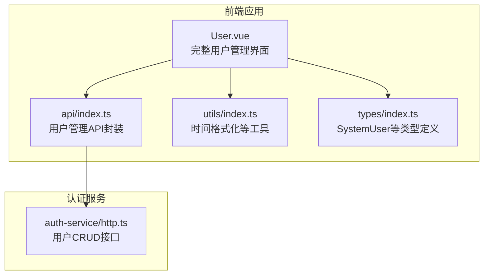
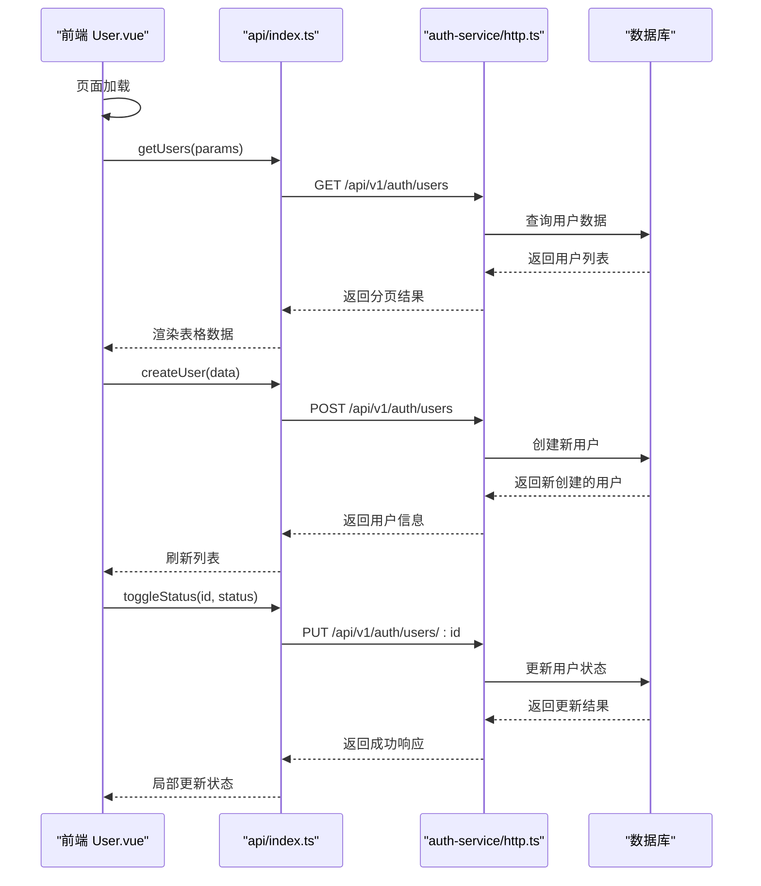
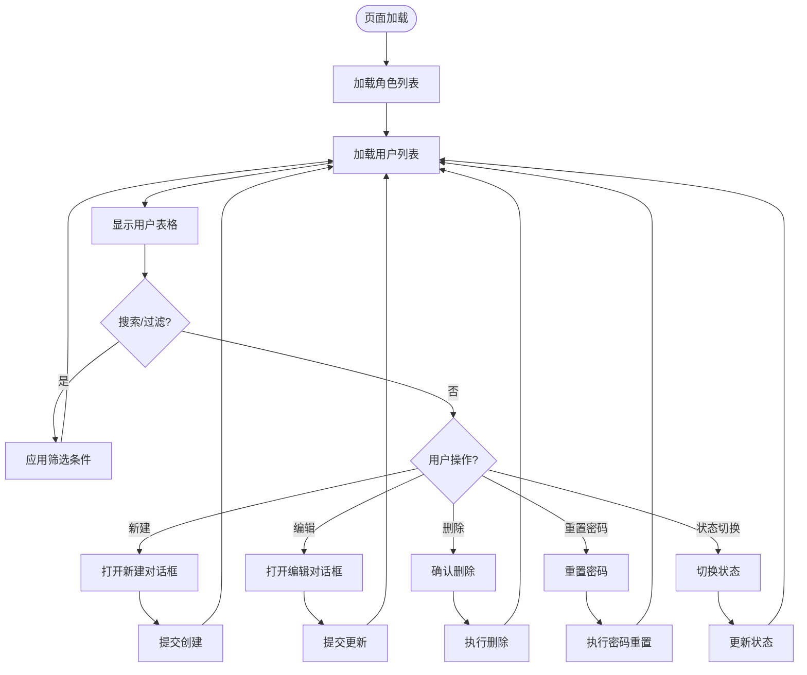
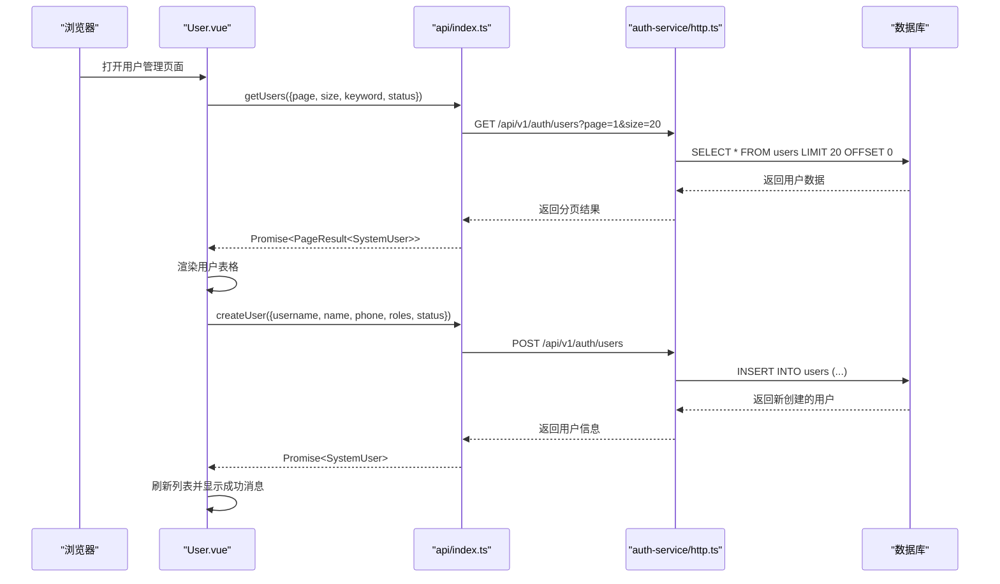
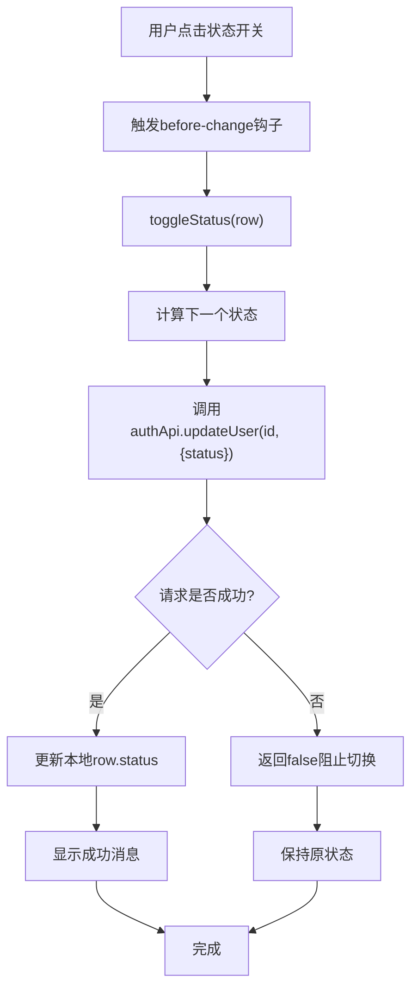
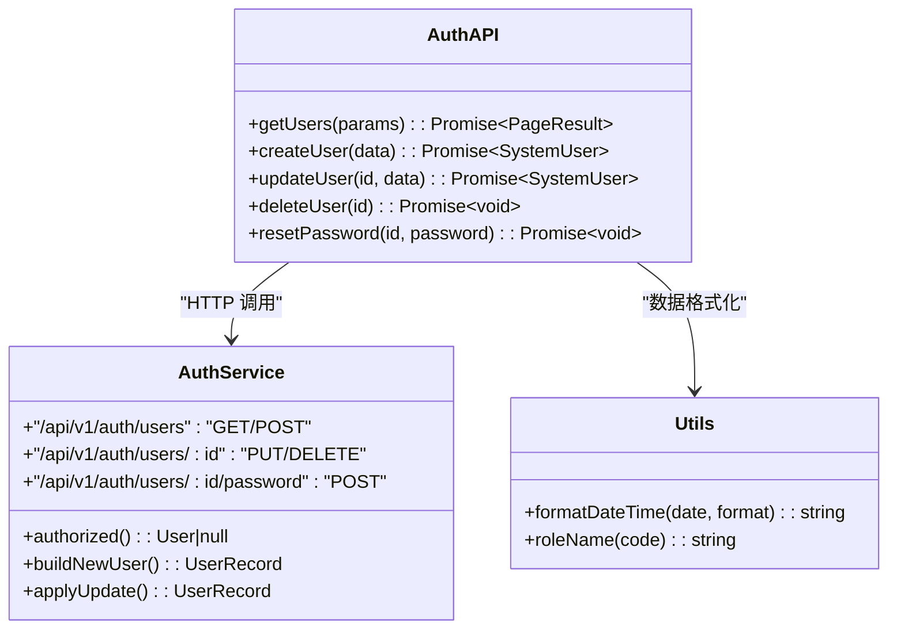
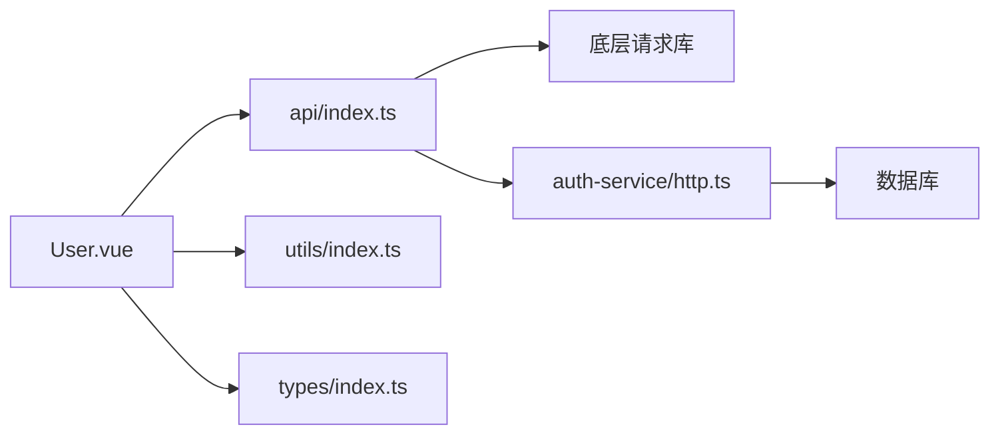

# 用户管理

<cite>
**本文引用的文件**   
- [apps/web/src/views/system/User.vue](file://apps/web/src/views/system/User.vue)
- [apps/web/src/api/index.ts](file://apps/web/src/api/index.ts)
- [apps/auth-service/src/http.ts](file://apps/auth-service/src/http.ts)
- [apps/web/src/utils/index.ts](file://apps/web/src/utils/index.ts)
- [apps/web/src/types/index.ts](file://apps/web/src/types/index.ts)
</cite>

## 更新摘要
**变更内容**   
- 完全重写了Web界面，实现了完整的用户管理CRUD操作
- 新增了搜索和过滤功能（按关键词、状态筛选）
- 实现了角色分配功能（多选角色选择器）
- 添加了状态切换机制（启用/禁用开关控件）
- 集成了密码重置功能
- 支持批量操作和分页显示
- 增强了表单验证和数据校验

## 目录
1. [简介](#简介)
2. [项目结构](#项目结构)
3. [核心组件](#核心组件)
4. [架构总览](#架构总览)
5. [详细组件分析](#详细组件分析)
6. [依赖分析](#依赖分析)
7. [性能考虑](#性能考虑)
8. [故障排查指南](#故障排查指南)
9. [结论](#结论)
10. [附录](#附录)

## 简介
本章节面向"用户管理"功能，聚焦以下目标：
- **完整CRUD操作**：用户信息的创建、读取、更新、删除功能
- **高级搜索过滤**：支持按用户名/姓名/手机号关键词搜索，按状态筛选
- **角色管理系统**：多角色分配与权限控制
- **状态管理机制**：实时启用/禁用状态切换
- **密码管理**：安全重置用户密码功能
- **数据展示优化**：分页显示、表格排序、响应式布局

## 项目结构
围绕用户管理的前后端关键文件如下：
- 前端页面：apps/web/src/views/system/User.vue
- 前端API封装：apps/web/src/api/index.ts
- 认证服务：apps/auth-service/src/http.ts
- 工具函数：apps/web/src/utils/index.ts
- 类型定义：apps/web/src/types/index.ts



**图示来源**
- [apps/web/src/views/system/User.vue:1-266](file://apps/web/src/views/system/User.vue#L1-L266)
- [apps/web/src/api/index.ts:15-44](file://apps/web/src/api/index.ts#L15-L44)
- [apps/auth-service/src/http.ts:198-251](file://apps/auth-service/src/http.ts#L198-L251)
- [apps/web/src/types/index.ts:310-334](file://apps/web/src/types/index.ts#L310-L334)

## 核心组件
- **用户管理主界面（User.vue）**
  - 实现完整的CRUD操作：新建、编辑、删除用户
  - 提供搜索过滤功能：关键词搜索、状态筛选
  - 支持分页显示：可配置每页数量
  - 集成角色管理：多选角色分配
  - 状态切换：实时启用/禁用开关
  - 密码重置：安全的新密码设置

- **用户管理API封装（api/index.ts）**
  - getUsers: 分页查询用户列表
  - createUser: 创建新用户
  - updateUser: 更新用户信息
  - deleteUser: 删除用户
  - resetPassword: 重置用户密码

- **认证服务（auth-service/http.ts）**
  - 实现用户管理的后端接口
  - 提供完整的用户CRUD操作
  - 支持搜索过滤和分页
  - 实现权限控制和数据验证

**章节来源**
- [apps/web/src/views/system/User.vue:1-266](file://apps/web/src/views/system/User.vue#L1-L266)
- [apps/web/src/api/index.ts:15-44](file://apps/web/src/api/index.ts#L15-L44)
- [apps/auth-service/src/http.ts:198-251](file://apps/auth-service/src/http.ts#L198-L251)

## 架构总览
用户管理的整体流程如下：



**图示来源**
- [apps/web/src/views/system/User.vue:149-162](file://apps/web/src/views/system/User.vue#L149-L162)
- [apps/web/src/api/index.ts:29-31](file://apps/web/src/api/index.ts#L29-L31)
- [apps/auth-service/src/http.ts:198-209](file://apps/auth-service/src/http.ts#L198-L209)

## 详细组件分析

### 用户信息展示界面（User.vue）
**更新** 完全重写的用户管理界面，包含完整的CRUD功能

- **搜索过滤功能**
  - 关键词搜索：支持用户名、姓名、手机号的模糊搜索
  - 状态筛选：启用/停用状态过滤
  - 分页控制：支持10/20/50条每页

- **用户列表展示**
  - 用户名、姓名、手机号字段显示
  - 角色标签展示：使用el-tag显示多个角色
  - 状态开关：使用el-switch进行实时状态切换
  - 创建时间格式化显示

- **用户操作功能**
  - 新建用户：弹窗表单，包含用户名、姓名、手机号、初始密码、角色、状态
  - 编辑用户：修改用户基本信息和角色分配
  - 删除用户：确认对话框，防止误删
  - 重置密码：安全的新密码设置



**图示来源**
- [apps/web/src/views/system/User.vue:4-19](file://apps/web/src/views/system/User.vue#L4-L19)
- [apps/web/src/views/system/User.vue:21-56](file://apps/web/src/views/system/User.vue#L21-L56)
- [apps/web/src/views/system/User.vue:71-101](file://apps/web/src/views/system/User.vue#L71-L101)

**章节来源**
- [apps/web/src/views/system/User.vue:1-266](file://apps/web/src/views/system/User.vue#L1-L266)

### 用户数据获取流程（认证API与认证服务）
**更新** 扩展了完整的用户管理API接口

- **前端API封装**
  - getUsers: 支持分页、关键词、状态筛选
  - createUser: 创建新用户，包含完整的字段验证
  - updateUser: 更新用户信息，支持部分字段更新
  - deleteUser: 删除用户，包含安全检查
  - resetPassword: 重置用户密码

- **认证服务接口**
  - GET /api/v1/auth/users: 分页查询用户列表
  - POST /api/v1/auth/users: 创建新用户
  - PUT /api/v1/auth/users/:id: 更新用户信息
  - DELETE /api/v1/auth/users/:id: 删除用户
  - POST /api/v1/auth/users/:id/password: 重置用户密码

- **数据验证与安全**
  - 用户名格式验证：字母开头，3~32位字符
  - 密码强度验证：至少6位字符
  - 内置管理员保护：admin用户不可删除
  - 当前用户保护：不能删除自己



**图示来源**
- [apps/web/src/api/index.ts:29-43](file://apps/web/src/api/index.ts#L29-L43)
- [apps/auth-service/src/http.ts:198-251](file://apps/auth-service/src/http.ts#L198-L251)

**章节来源**
- [apps/web/src/api/index.ts:15-44](file://apps/web/src/api/index.ts#L15-L44)
- [apps/auth-service/src/http.ts:198-251](file://apps/auth-service/src/http.ts#L198-L251)

### 用户状态管理（启用/禁用）
**更新** 实现了实时的状态切换功能

- **状态切换机制**
  - 使用el-switch组件提供直观的开关控件
  - before-change钩子进行异步状态切换
  - 切换成功后立即更新本地状态
  - 失败时自动回滚状态

- **状态显示逻辑**
  - ACTIVE状态：显示为启用，绿色开关
  - DISABLED状态：显示为停用，灰色开关
  - 状态变化时显示相应的成功消息

- **后端状态处理**
  - 状态值验证：仅接受ACTIVE或DISABLED
  - 状态更新：只更新status字段，不影响其他信息
  - 会话管理：停用用户后自动清理其会话



**图示来源**
- [apps/web/src/views/system/User.vue:35-42](file://apps/web/src/views/system/User.vue#L35-L42)
- [apps/web/src/views/system/User.vue:225-235](file://apps/web/src/views/system/User.vue#L225-L235)

**章节来源**
- [apps/web/src/views/system/User.vue:35-42](file://apps/web/src/views/system/User.vue#L35-L42)
- [apps/web/src/views/system/User.vue:225-235](file://apps/web/src/views/system/User.vue#L225-L235)

### 权限验证与信息格式化
**更新** 增强了权限控制和数据格式化功能

- **权限验证机制**
  - 基于Bearer Token的会话验证
  - system:user权限控制用户管理操作
  - 内置管理员保护机制
  - 租户隔离的数据访问控制

- **信息格式化功能**
  - 时间格式化：使用formatDateTime统一处理
  - 角色名称映射：根据角色编码查找对应名称
  - 状态文本转换：ACTIVE→启用，DISABLED→停用
  - 空值处理：未填充字段显示占位符

- **数据验证规则**
  - 用户名格式：字母开头，3~32位字母数字下划线短横线
  - 密码强度：至少6位字符
  - 必填字段验证：用户名、姓名等关键字段
  - 重复检查：用户名唯一性验证



**图示来源**
- [apps/web/src/api/index.ts:29-43](file://apps/web/src/api/index.ts#L29-L43)
- [apps/auth-service/src/http.ts:103-144](file://apps/auth-service/src/http.ts#L103-L144)
- [apps/web/src/utils/index.ts:4-7](file://apps/web/src/utils/index.ts#L4-L7)

**章节来源**
- [apps/web/src/api/index.ts:29-43](file://apps/web/src/api/index.ts#L29-L43)
- [apps/auth-service/src/http.ts:85-101](file://apps/auth-service/src/http.ts#L85-L101)
- [apps/web/src/utils/index.ts:4-7](file://apps/web/src/utils/index.ts#L4-L7)

### 角色管理系统
**新增** 完整的角色分配和管理功能

- **角色选择器**
  - 多选下拉框支持角色分配
  - 支持搜索过滤角色
  - 实时显示已选角色标签
  - 角色名称映射显示

- **角色数据加载**
  - 页面初始化时加载所有可用角色
  - 支持分页加载大量角色数据
  - 错误降级处理：角色加载失败不影响用户列表

- **角色权限关联**
  - 用户角色与平台角色系统对接
  - 支持多角色权限合并
  - 动态权限计算和缓存

**章节来源**
- [apps/web/src/views/system/User.vue:85-89](file://apps/web/src/views/system/User.vue#L85-L89)
- [apps/web/src/views/system/User.vue:140-147](file://apps/web/src/views/system/User.vue#L140-L147)

### 密码重置功能
**新增** 安全的密码重置机制

- **密码重置流程**
  - 弹出确认对话框输入新密码
  - 密码强度验证：至少6位字符
  - 异步密码更新操作
  - 成功后自动失效旧会话

- **安全考虑**
  - 密码加密存储
  - 重置后清理所有活跃会话
  - 操作审计日志记录

**章节来源**
- [apps/web/src/views/system/User.vue:237-246](file://apps/web/src/views/system/User.vue#L237-L246)
- [apps/auth-service/src/http.ts:239-251](file://apps/auth-service/src/http.ts#L239-L251)

## 依赖分析
**更新** 扩展了模块依赖关系

- **模块耦合关系**
  - User.vue 依赖 api/index.ts 的用户管理API
  - User.vue 依赖 utils/index.ts 的时间格式化
  - User.vue 依赖 types/index.ts 的类型定义
  - api/index.ts 依赖底层请求工具和类型定义
  - auth-service 独立运行，提供鉴权与用户管理

- **外部依赖**
  - dayjs：时间格式化
  - Element Plus：UI组件库（表格、表单、对话框等）
  - Vue 3：前端框架
  - TypeScript：类型安全



**图示来源**
- [apps/web/src/views/system/User.vue:106-110](file://apps/web/src/views/system/User.vue#L106-L110)
- [apps/web/src/api/index.ts:1-12](file://apps/web/src/api/index.ts#L1-L12)

**章节来源**
- [apps/web/src/views/system/User.vue:106-110](file://apps/web/src/views/system/User.vue#L106-L110)
- [apps/web/src/api/index.ts:1-12](file://apps/web/src/api/index.ts#L1-L12)

## 性能考虑
**更新** 针对新功能优化的性能策略

- **数据加载优化**
  - 分页加载：默认20条每页，支持自定义大小
  - 懒加载角色：按需加载角色列表
  - 防抖搜索：避免频繁API调用
  - 缓存策略：角色列表缓存减少重复请求

- **交互性能优化**
  - 虚拟滚动：大数据量表格优化
  - 局部更新：状态切换不重新加载整个列表
  - 乐观更新：用户操作即时反馈
  - 错误重试：网络异常自动重试机制

- **内存管理**
  - 及时释放：对话框关闭时清理数据
  - 事件监听：组件卸载时清理事件监听器
  - 大对象处理：避免一次性加载过多数据

## 故障排查指南
**更新** 新增常见问题和解决方案

- **常见问题**
  - 401 未授权：检查Authorization头是否正确携带
  - 403 权限不足：确认用户具有system:user权限
  - 409 冲突：用户名重复或尝试删除admin用户
  - 404 资源不存在：用户ID无效或服务端数据缺失
  - 状态切换失败：检查网络连接和服务端状态

- **调试建议**
  - 查看浏览器网络面板，确认API请求和响应
  - 检查控制台错误日志，定位具体错误位置
  - 验证用户权限和角色配置
  - 测试不同状态下的用户行为

- **性能问题排查**
  - 监控API响应时间，识别慢查询
  - 检查前端渲染性能，特别是大数据量场景
  - 分析内存使用情况，避免内存泄漏
  - 优化数据库查询，添加适当索引

**章节来源**
- [apps/auth-service/src/http.ts:198-251](file://apps/auth-service/src/http.ts#L198-L251)
- [apps/web/src/views/system/User.vue:149-162](file://apps/web/src/views/system/User.vue#L149-L162)

## 结论
用户管理功能已经过完全重写，提供了企业级的用户管理能力。新版本具备完整的CRUD操作、高级搜索过滤、角色管理、状态控制、密码管理等核心功能。系统采用前后端分离架构，具有良好的可扩展性和维护性。通过完善的权限控制、数据验证和安全机制，确保了系统的稳定性和安全性。未来可进一步扩展批量操作、用户导入导出、操作审计等高级功能。

## 附录

### 字段映射说明
**更新** 完整的字段映射和数据处理逻辑

- **用户信息字段**
  - id: 用户唯一标识符
  - username: 用户名（字母开头，3~32位）
  - name: 用户姓名（必填）
  - phone: 手机号码（可选）
  - roles: 角色数组（支持多角色）
  - permissions: 权限数组（系统自动生成）
  - tenantId: 租户标识符
  - status: 用户状态（ACTIVE/DISABLED）
  - createdAt: 创建时间
  - updatedAt: 更新时间

- **搜索过滤参数**
  - page: 页码（默认1）
  - size: 每页数量（默认20，最大200）
  - keyword: 关键词搜索（用户名/姓名/手机号）
  - status: 状态筛选（ACTIVE/DISABLED）

- **表单验证规则**
  - 用户名：正则表达式 /^[a-zA-Z][a-zA-Z0-9_-]{2,31}$/
  - 密码：最少6位字符
  - 姓名：必填字段
  - 角色：至少选择一个角色

**章节来源**
- [apps/web/src/types/index.ts:310-334](file://apps/web/src/types/index.ts#L310-L334)
- [apps/web/src/views/system/User.vue:120-134](file://apps/web/src/views/system/User.vue#L120-L134)
- [apps/auth-service/src/http.ts:103-127](file://apps/auth-service/src/http.ts#L103-L127)

### API接口规范
**新增** 完整的API接口文档

- **用户管理接口**
  - GET /api/v1/auth/users: 分页查询用户列表
  - POST /api/v1/auth/users: 创建新用户
  - PUT /api/v1/auth/users/:id: 更新用户信息
  - DELETE /api/v1/auth/users/:id: 删除用户
  - POST /api/v1/auth/users/:id/password: 重置用户密码

- **请求参数示例**
  ```json
  {
    "username": "john_doe",
    "name": "John Doe", 
    "phone": "13800138000",
    "roles": ["admin", "user"],
    "status": "ACTIVE"
  }
  ```

- **响应数据结构**
  ```json
  {
    "code": "OK",
    "data": {
      "items": [...],
      "total": 100,
      "page": 1,
      "size": 20
    },
    "message": "",
    "timestamp": 1234567890
  }
  ```

**章节来源**
- [apps/web/src/api/index.ts:29-43](file://apps/web/src/api/index.ts#L29-L43)
- [apps/auth-service/src/http.ts:198-251](file://apps/auth-service/src/http.ts#L198-L251)