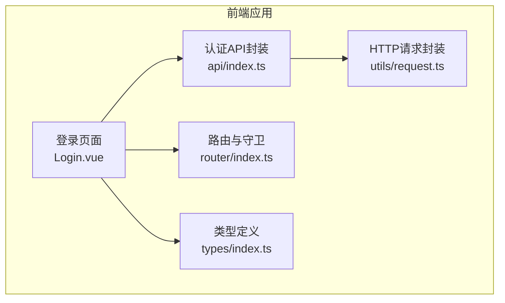
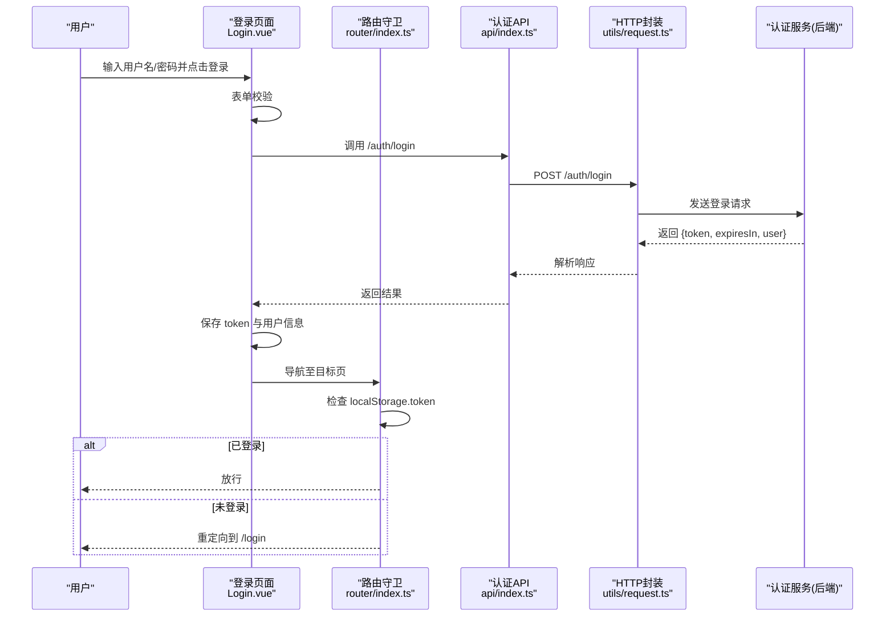
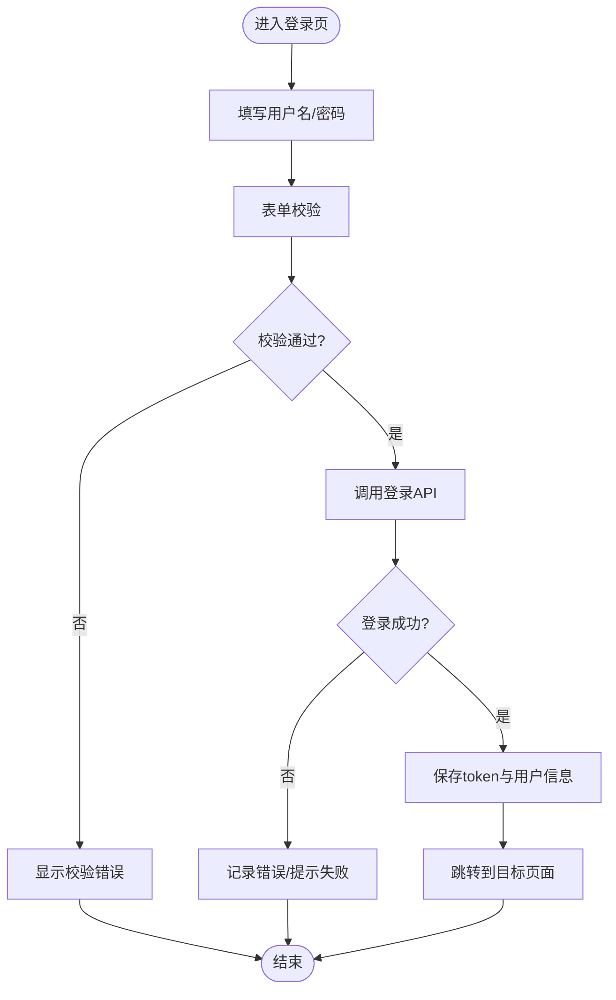
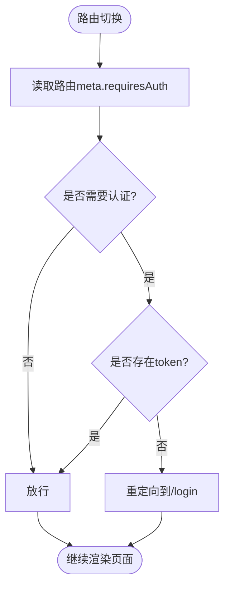
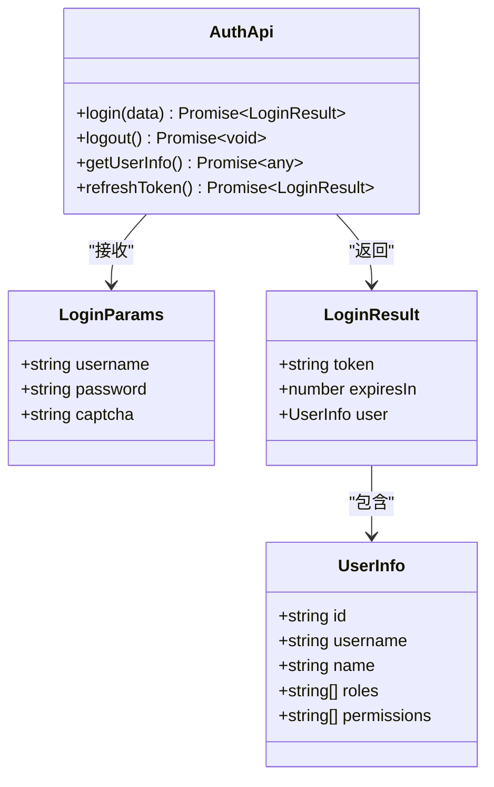
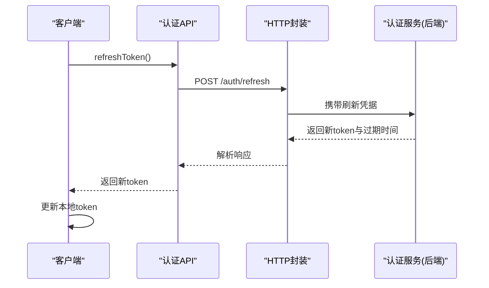
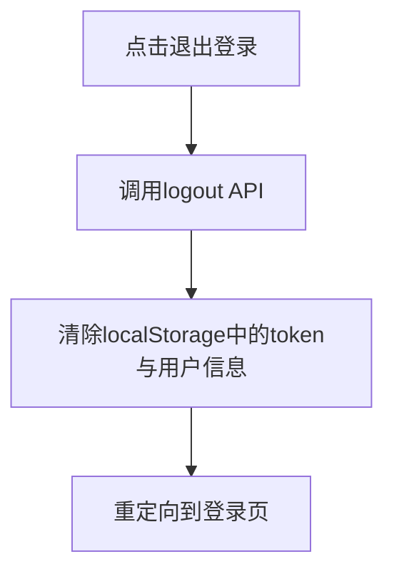
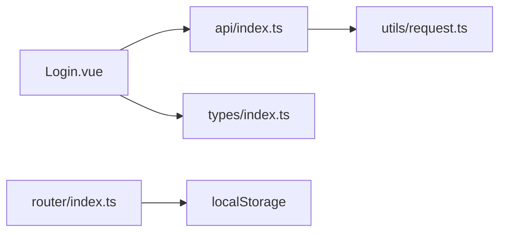

# 登录认证

<cite>
**本文引用的文件**   
- [Login.vue](file://apps/web/src/views/system/Login.vue)
- [index.ts（路由）](file://apps/web/src/router/index.ts)
- [index.ts（API）](file://apps/web/src/api/index.ts)
- [index.ts（类型定义）](file://apps/web/src/types/index.ts)
- [request.ts（请求封装）](file://apps/web/src/utils/request.ts)
</cite>

## 目录
1. [简介](#简介)
2. [项目结构](#项目结构)
3. [核心组件](#核心组件)
4. [架构总览](#架构总览)
5. [详细组件分析](#详细组件分析)
6. [依赖关系分析](#依赖关系分析)
7. [性能与可用性考虑](#性能与可用性考虑)
8. [故障排查指南](#故障排查指南)
9. [结论](#结论)
10. [附录：安全最佳实践](#附录安全最佳实践)

## 简介
本章节面向“登录认证”功能，覆盖前端登录界面设计、表单校验、JWT 令牌认证机制（生成、存储、刷新）、会话管理与安全退出、密码加密存储与传输安全，以及安全最佳实践与常见安全问题防护。文档基于仓库中前端应用（Vue 3 + Element Plus）的登录实现进行说明，并结合通用后端认证模式给出可落地的方案建议。

## 项目结构
登录相关的前端代码主要分布在以下位置：
- 登录页面视图：apps/web/src/views/system/Login.vue
- 路由守卫与鉴权拦截：apps/web/src/router/index.ts
- 认证 API 调用封装：apps/web/src/api/index.ts
- 登录参数与响应类型：apps/web/src/types/index.ts
- HTTP 请求封装（用于统一拦截、携带 Token、错误处理等）：apps/web/src/utils/request.ts

**图示来源** 
- [Login.vue:1-154](file://apps/web/src/views/system/Login.vue#L1-L154)
- [index.ts（路由）:1-157](file://apps/web/src/router/index.ts#L1-L157)
- [index.ts（API）:1-263](file://apps/web/src/api/index.ts#L1-L263)
- [index.ts（类型定义）:228-252](file://apps/web/src/types/index.ts#L228-L252)

**章节来源**
- [Login.vue:1-154](file://apps/web/src/views/system/Login.vue#L1-L154)
- [index.ts（路由）:1-157](file://apps/web/src/router/index.ts#L1-L157)
- [index.ts（API）:1-263](file://apps/web/src/api/index.ts#L1-L263)
- [index.ts（类型定义）:228-252](file://apps/web/src/types/index.ts#L228-L252)

## 核心组件
- 登录页面组件：负责用户名/密码输入、表单校验、提交登录、保存令牌与用户信息、跳转目标页。
- 路由守卫：根据本地是否持有令牌决定访问受保护页面，未登录时重定向到登录页。
- 认证 API：提供登录、登出、获取用户信息、刷新令牌的接口封装。
- 类型定义：定义登录参数、登录响应、用户信息等数据结构。
- 请求封装：统一发起 HTTP 请求，便于后续扩展 Token 注入、刷新策略与错误处理。

**章节来源**
- [Login.vue:55-101](file://apps/web/src/views/system/Login.vue#L55-L101)
- [index.ts（路由）:146-154](file://apps/web/src/router/index.ts#L146-L154)
- [index.ts（API）:12-26](file://apps/web/src/api/index.ts#L12-L26)
- [index.ts（类型定义）:228-252](file://apps/web/src/types/index.ts#L228-L252)

## 架构总览
下图展示从用户交互到服务端认证的端到端流程，包括登录、令牌存储、路由鉴权、刷新令牌与安全退出。

**图示来源** 
- [Login.vue:77-101](file://apps/web/src/views/system/Login.vue#L77-L101)
- [index.ts（路由）:146-154](file://apps/web/src/router/index.ts#L146-L154)
- [index.ts（API）:12-26](file://apps/web/src/api/index.ts#L12-L26)

## 详细组件分析

### 登录页面与交互流程
- 界面元素：包含用户名、密码输入框与登录按钮，支持回车触发登录。
- 表单校验：使用 Element Plus 的表单规则对必填字段进行校验。
- 登录逻辑：
  - 校验通过后调用认证 API 登录。
  - 成功后将 token 和用户信息保存到 store/localStorage。
  - 根据当前路由 query.redirect 或默认首页进行跳转。
- 错误处理：捕获异常并提示失败原因。

**图示来源** 
- [Login.vue:72-101](file://apps/web/src/views/system/Login.vue#L72-L101)

**章节来源**
- [Login.vue:1-154](file://apps/web/src/views/system/Login.vue#L1-L154)

### 路由守卫与访问控制
- 全局前置守卫在每次路由切换前设置页面标题。
- 若目标路由需要认证且本地不存在 token，则强制重定向到登录页。
- 该机制确保未登录用户无法直接访问受保护页面。

**图示来源** 
- [index.ts（路由）:146-154](file://apps/web/src/router/index.ts#L146-L154)

**章节来源**
- [index.ts（路由）:1-157](file://apps/web/src/router/index.ts#L1-L157)

### 认证 API 与数据模型
- 认证 API 暴露登录、登出、获取用户信息、刷新令牌等方法，统一通过 HTTP 封装发起请求。
- 登录参数与响应类型明确定义了 username/password/captcha 与 token/expiresIn/user 等字段。

**图示来源** 
- [index.ts（API）:12-26](file://apps/web/src/api/index.ts#L12-L26)
- [index.ts（类型定义）:228-252](file://apps/web/src/types/index.ts#L228-L252)

**章节来源**
- [index.ts（API）:12-26](file://apps/web/src/api/index.ts#L12-L26)
- [index.ts（类型定义）:228-252](file://apps/web/src/types/index.ts#L228-L252)

### JWT 令牌认证机制（生成、存储、刷新）
- 生成：由后端认证服务在验证用户名/密码后签发 JWT，包含用户标识、角色权限等信息，并返回给前端。
- 存储：前端在登录成功后将 token 保存在本地存储（如 localStorage），并在后续请求中通过请求封装自动附加到请求头。
- 刷新：当 token 过期或鉴权失败时，前端调用刷新接口获取新 token，更新本地存储并重试原请求。

**图示来源** 
- [index.ts（API）:23-25](file://apps/web/src/api/index.ts#L23-L25)

**章节来源**
- [index.ts（API）:12-26](file://apps/web/src/api/index.ts#L12-L26)

### 会话管理与安全退出
- 会话管理：通过本地存储维护 token 与用户信息；路由守卫依据 token 存在性判断会话状态。
- 安全退出：调用登出接口通知后端失效会话（可选），然后清除本地 token 与用户信息，并跳转回登录页。

**图示来源** 
- [index.ts（API）:17-19](file://apps/web/src/api/index.ts#L17-L19)

**章节来源**
- [index.ts（API）:17-19](file://apps/web/src/api/index.ts#L17-L19)

### 密码加密存储与传输安全
- 传输安全：所有认证请求应通过 HTTPS 传输，防止中间人攻击与凭证泄露。
- 存储安全：
  - 不建议在前端明文存储密码；仅存储服务端签发的 token。
  - 如需持久化敏感信息，建议使用更安全的方式（如 HttpOnly Cookie 配合 CSRF 防护）。
- 后端建议：
  - 密码入库采用强哈希算法（如 bcrypt/scrypt/argon2），禁止明文或弱哈希。
  - 使用一次性随机盐值，避免彩虹表攻击。
  - 对登录接口实施速率限制与账户锁定策略。

[本节为通用安全建议，不直接分析具体文件]

## 依赖关系分析
登录功能的关键依赖如下：
- 登录页面依赖认证 API 与类型定义。
- 认证 API 依赖 HTTP 请求封装。
- 路由守卫依赖本地存储以判断登录态。

**图示来源** 
- [Login.vue:55-101](file://apps/web/src/views/system/Login.vue#L55-L101)
- [index.ts（API）:1-26](file://apps/web/src/api/index.ts#L1-L26)
- [index.ts（路由）:146-154](file://apps/web/src/router/index.ts#L146-L154)

**章节来源**
- [Login.vue:55-101](file://apps/web/src/views/system/Login.vue#L55-L101)
- [index.ts（API）:1-26](file://apps/web/src/api/index.ts#L1-L26)
- [index.ts（路由）:146-154](file://apps/web/src/router/index.ts#L146-L154)

## 性能与可用性考虑
- 登录按钮防重复提交：在请求期间禁用按钮并显示加载状态，避免并发请求。
- 表单校验即时反馈：在失焦或提交时进行校验，提升用户体验。
- 网络超时与重试：在 HTTP 封装层配置合理超时与重试策略，提高稳定性。
- 令牌刷新优化：仅在鉴权失败或接近过期时刷新，减少不必要的刷新请求。

[本节为通用优化建议，不直接分析具体文件]

## 故障排查指南
- 登录失败：
  - 检查用户名/密码是否正确。
  - 查看浏览器控制台错误信息与网络面板请求/响应。
  - 确认后端认证接口是否正常返回。
- 登录后仍被重定向到登录页：
  - 检查本地存储是否成功写入 token。
  - 检查路由守卫逻辑是否正确读取 token。
- 刷新令牌失败：
  - 检查刷新接口是否可用。
  - 确认刷新凭据是否有效（如 refresh_token 或会话状态）。
- 安全退出后仍可访问受保护页面：
  - 检查是否清除了本地 token。
  - 检查路由守卫是否生效。

**章节来源**
- [Login.vue:96-101](file://apps/web/src/views/system/Login.vue#L96-L101)
- [index.ts（路由）:146-154](file://apps/web/src/router/index.ts#L146-L154)

## 结论
本项目的前端登录认证实现了基础的表单校验、JWT 令牌存储与路由鉴权，并通过 API 封装预留了刷新令牌与安全退出的能力。结合后端的安全实践（HTTPS、强哈希、速率限制、CSRF/XSS 防护），可构建一个健壮且安全的认证体系。建议在后续迭代中完善令牌刷新策略、错误提示与审计日志，进一步提升安全性与用户体验。

[本节为总结性内容，不直接分析具体文件]

## 附录：安全最佳实践
- 传输安全
  - 全站启用 HTTPS，禁用不安全连接。
  - 严格校验证书，避免中间人攻击。
- 密码安全
  - 后端使用强哈希算法（bcrypt/scrypt/argon2）加盐存储。
  - 禁止在前端明文存储密码；仅存储服务端颁发的 token。
- 令牌安全
  - 使用短生命周期 access_token 与长生命周期 refresh_token。
  - 将 token 存储在安全位置（优先 HttpOnly Cookie），避免 XSS 窃取。
  - 实现令牌刷新与失效机制，及时撤销泄露的令牌。
- 会话与会话固定
  - 登录成功后绑定会话上下文，防止会话劫持。
  - 注销时同步使服务端会话失效。
- 输入校验与输出编码
  - 前后端均对用户输入进行严格校验与过滤。
  - 对输出内容进行 HTML/JS 编码，防范 XSS。
- 防暴力破解
  - 对登录接口实施速率限制与账户锁定策略。
  - 引入验证码或二次验证（如 TOTP、短信验证码）。
- 跨站请求伪造（CSRF）
  - 使用 SameSite Cookie 与 CSRF Token 双重防护。
  - 对敏感操作要求显式确认与额外验证。
- 安全头部
  - 设置 Content-Security-Policy、X-Frame-Options、X-Content-Type-Options 等安全响应头。
- 审计与监控
  - 记录登录成功/失败、令牌刷新、登出等关键事件。
  - 对异常行为进行告警与封禁。

[本节为通用安全建议，不直接分析具体文件]