# 系统管理页面

<cite>
**本文引用的文件**   
- [apps/web/src/views/system/Login.vue](file://apps/web/src/views/system/Login.vue)
- [apps/web/src/views/system/User.vue](file://apps/web/src/views/system/User.vue)
- [apps/web/src/views/system/Role.vue](file://apps/web/src/views/system/Role.vue)
- [apps/web/src/views/message/Index.vue](file://apps/web/src/views/message/Index.vue)
- [apps/web/src/views/device/Commands.vue](file://apps/web/src/views/device/Commands.vue)
- [apps/web/src/views/dashboard/Index.vue](file://apps/web/src/views/dashboard/Index.vue)
- [apps/web/src/api/index.ts](file://apps/web/src/api/index.ts)
- [apps/web/src/stores/index.ts](file://apps/web/src/stores/index.ts)
- [apps/web/src/router/index.ts](file://apps/web/src/router/index.ts)
- [apps/web/src/utils/request.ts](file://apps/web/src/utils/request.ts)
- [apps/auth-service/src/main.ts](file://apps/auth-service/src/main.ts)
- [apps/message-service/src/http.ts](file://apps/message-service/src/http.ts)
- [apps/iot-service/src/http.ts](file://apps/iot-service/src/http.ts)
</cite>

## 更新摘要
**变更内容**   
- 新增消息中心功能模块，支持系统通知的查看、管理和订阅偏好配置
- 新增设备命令接口，支持向IoT设备发送控制指令和指令状态跟踪
- 增强仪表板组件，集成地图可视化、实时数据和多维度数据分析
- 扩展API接口定义，包含消息管理和设备控制相关的新接口

## 目录
1. [简介](#简介)
2. [项目结构](#项目结构)
3. [核心组件](#核心组件)
4. [架构总览](#架构总览)
5. [详细组件分析](#详细组件分析)
6. [依赖关系分析](#依赖关系分析)
7. [性能考虑](#性能考虑)
8. [故障排查指南](#故障排查指南)
9. [结论](#结论)

## 简介
本文件面向智慧农业平台的"系统管理"相关前端页面与认证授权流程，覆盖以下能力：
- 用户管理：用户信息查看、状态展示（启用/禁用）、基础字段展示。
- 角色与权限：角色列表、角色编码、权限点集合展示；为后续RBAC扩展提供数据基础。
- 登录认证：用户名/密码登录、JWT令牌持久化、请求头注入、会话控制与过期处理。
- **新增消息中心**：系统通知的查看、筛选、批量操作和订阅偏好管理。
- **新增设备命令**：IoT设备控制指令的查询、状态跟踪和来源管理。
- **增强仪表板**：集成天地图可视化、实时设备监控、农情分析和趋势图表。
- 系统配置与监控：当前实现以接口层为主，预留平台能力入口（如角色查询），日志与监控建议通过网关或后端服务统一接入。
- 审计与安全：基于请求ID追踪、鉴权拦截、错误码统一处理，便于审计与排障。

## 项目结构
系统管理相关的前端代码集中在 apps/web 子应用内，主要涉及：
- 视图层：Login.vue、User.vue、Role.vue、message/Index.vue、device/Commands.vue、dashboard/Index.vue
- 路由层：router/index.ts（含系统管理路由与全局鉴权守卫）
- API层：api/index.ts（封装认证、平台、消息、设备等接口）
- 状态层：stores/index.ts（用户信息与Token存储）
- HTTP层：utils/request.ts（Axios封装、拦截器、错误处理）
- 后端服务：auth-service/src/main.ts（认证服务HTTP启动入口）、message-service（消息服务）、iot-service（物联网服务）

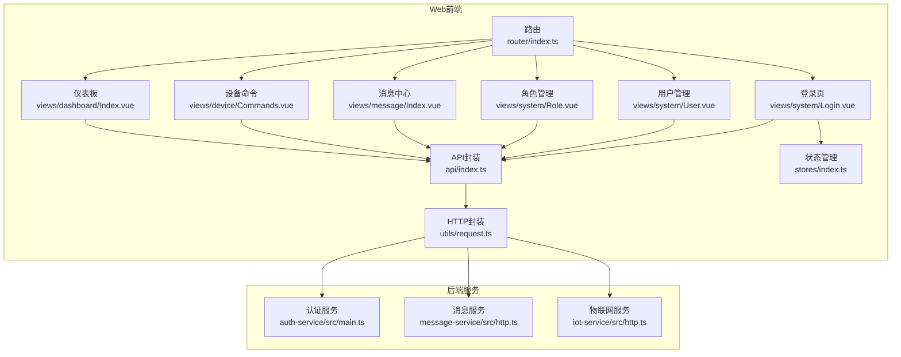

**图表来源**
- [apps/web/src/router/index.ts:112-147](file://apps/web/src/router/index.ts#L112-L147)
- [apps/web/src/views/message/Index.vue:1-390](file://apps/web/src/views/message/Index.vue#L1-L390)
- [apps/web/src/views/device/Commands.vue:1-135](file://apps/web/src/views/device/Commands.vue#L1-L135)
- [apps/web/src/views/dashboard/Index.vue:1-280](file://apps/web/src/views/dashboard/Index.vue#L1-L280)

## 核心组件
- 登录认证
  - 表单校验与提交：用户名/密码必填校验，提交后调用认证接口获取令牌与用户信息。
  - 令牌与用户信息持久化：将token与userInfo写入localStorage，并在后续请求中自动注入Authorization与X-User-Id。
  - 路由守卫：未携带token访问受保护页面时重定向至登录页。
- 用户管理
  - 展示当前登录用户的基本信息（用户名、姓名、手机号、角色、状态、创建时间）。
  - 状态以标签形式显示"启用/禁用"。
- 角色管理
  - 展示角色名称、角色编码与权限点集合（以标签形式呈现）。
  - 通过平台接口获取角色列表。
- **消息中心**
  - 消息列表展示：支持按类型（告警/通知）、状态（已读/未读）、地块编码和关键词筛选。
  - 批量操作：支持批量标记已读、单条消息快速标记。
  - 订阅偏好管理：可配置不同消息来源的接收开关和最低级别过滤。
  - 手动通知创建：支持创建不同类型和级别的通知消息。
- **设备命令**
  - 指令列表展示：显示设备编号、地块编码、指令类型、来源、状态等详细信息。
  - 指令来源区分：自动指令（事件触发）与人工指令（手动下发）的区别标识。
  - 分页查询：支持按地块编码和指令来源进行分页查询。
- **仪表板增强**
  - 天地图集成：支持影像底图和矢量底图切换，设备点位和地块边界图层控制。
  - 实时数据监控：在线设备数量、土壤墒情、气象站状态等关键指标展示。
  - 农情分析：作物面积占比、产量预估、倒伏面积统计等分析维度。
  - 趋势图表：近7日农情趋势可视化展示。
- HTTP与错误处理
  - 统一请求拦截：注入Authorization、X-User-Id、X-Request-Id。
  - 统一响应拦截：业务code非成功时提示错误；401触发重新登录流程。
  - 网络错误分类提示：400/401/403/404/500等。

**章节来源**
- [apps/web/src/views/system/Login.vue:55-101](file://apps/web/src/views/system/Login.vue#L55-L101)
- [apps/web/src/stores/index.ts:15-43](file://apps/web/src/stores/index.ts#L15-L43)
- [apps/web/src/router/index.ts:146-154](file://apps/web/src/router/index.ts#L146-L154)
- [apps/web/src/views/system/User.vue:24-36](file://apps/web/src/views/system/User.vue#L24-L36)
- [apps/web/src/views/system/Role.vue:13-19](file://apps/web/src/views/system/Role.vue#L13-L19)
- [apps/web/src/views/message/Index.vue:170-360](file://apps/web/src/views/message/Index.vue#L170-L360)
- [apps/web/src/views/device/Commands.vue:71-121](file://apps/web/src/views/device/Commands.vue#L71-L121)
- [apps/web/src/views/dashboard/Index.vue:42-249](file://apps/web/src/views/dashboard/Index.vue#L42-L249)
- [apps/web/src/utils/request.ts:13-35](file://apps/web/src/utils/request.ts#L13-L35)
- [apps/web/src/utils/request.ts:37-86](file://apps/web/src/utils/request.ts#L37-L86)

## 架构总览
系统管理功能在前端通过Vue Router进行页面导航，使用Pinia维护用户状态，Axios封装统一发起HTTP请求，最终由认证服务处理登录与鉴权。新增的消息中心和设备命令功能通过独立的后端服务提供API支持。

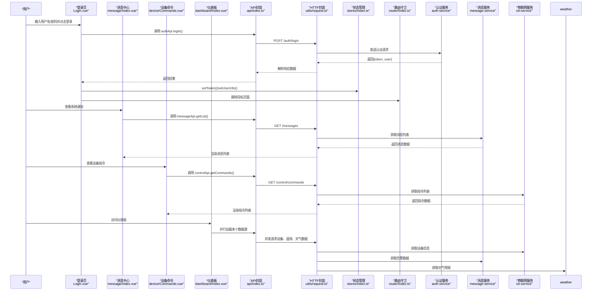

**图表来源**
- [apps/web/src/views/system/Login.vue:77-101](file://apps/web/src/views/system/Login.vue#L77-L101)
- [apps/web/src/views/message/Index.vue:282-293](file://apps/web/src/views/message/Index.vue#L282-L293)
- [apps/web/src/views/device/Commands.vue:93-107](file://apps/web/src/views/device/Commands.vue#L93-L107)
- [apps/web/src/views/dashboard/Index.vue:220-243](file://apps/web/src/views/dashboard/Index.vue#L220-L243)

## 详细组件分析

### 登录认证流程
- 表单校验：username/password必填。
- 登录调用：authApi.login(data) -> POST /auth/login。
- 本地持久化：setToken(token)、setUserInfo(user)。
- 路由跳转：根据redirect参数或默认/dashboard跳转。
- 安全机制：
  - 请求拦截器在Authorization头附加Bearer token。
  - 响应拦截器对401进行统一处理，弹出确认框并跳转登录。
  - 路由守卫在未登录时强制跳转到/login。

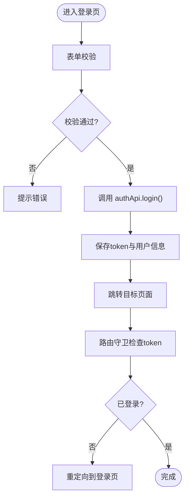

**图表来源**
- [apps/web/src/views/system/Login.vue:72-101](file://apps/web/src/views/system/Login.vue#L72-L101)
- [apps/web/src/api/index.ts:12-26](file://apps/web/src/api/index.ts#L12-L26)
- [apps/web/src/stores/index.ts:15-43](file://apps/web/src/stores/index.ts#L15-L43)
- [apps/web/src/router/index.ts:146-154](file://apps/web/src/router/index.ts#L146-L154)
- [apps/web/src/utils/request.ts:37-86](file://apps/web/src/utils/request.ts#L37-L86)

**章节来源**
- [apps/web/src/views/system/Login.vue:55-101](file://apps/web/src/views/system/Login.vue#L55-L101)
- [apps/web/src/api/index.ts:12-26](file://apps/web/src/api/index.ts#L12-L26)
- [apps/web/src/stores/index.ts:15-43](file://apps/web/src/stores/index.ts#L15-L43)
- [apps/web/src/router/index.ts:146-154](file://apps/web/src/router/index.ts#L146-L154)
- [apps/web/src/utils/request.ts:13-35](file://apps/web/src/utils/request.ts#L13-L35)
- [apps/web/src/utils/request.ts:37-86](file://apps/web/src/utils/request.ts#L37-L86)

### 用户管理页面
- 数据加载：onMounted时调用authApi.getUserInfo()获取当前用户信息。
- 数据映射：将后端用户对象映射为表格所需字段（用户名、姓名、手机号、角色、状态、创建时间）。
- 状态展示：status为布尔值，true显示"启用"，false显示"禁用"。

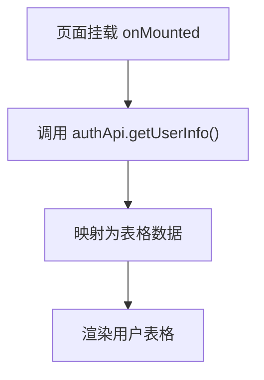

**图表来源**
- [apps/web/src/views/system/User.vue:31-36](file://apps/web/src/views/system/User.vue#L31-L36)
- [apps/web/src/api/index.ts:12-26](file://apps/web/src/api/index.ts#L12-L26)

**章节来源**
- [apps/web/src/views/system/User.vue:1-38](file://apps/web/src/views/system/User.vue#L1-L38)
- [apps/web/src/api/index.ts:12-26](file://apps/web/src/api/index.ts#L12-L26)

### 角色管理页面
- 数据加载：onMounted时调用platformApi.getRoles()获取角色列表。
- 数据展示：角色名称、角色编码、权限点集合（以标签形式展示）。
- 扩展性：该页面可作为RBAC模型的前端展示层，后续可对接角色编辑、权限分配等接口。

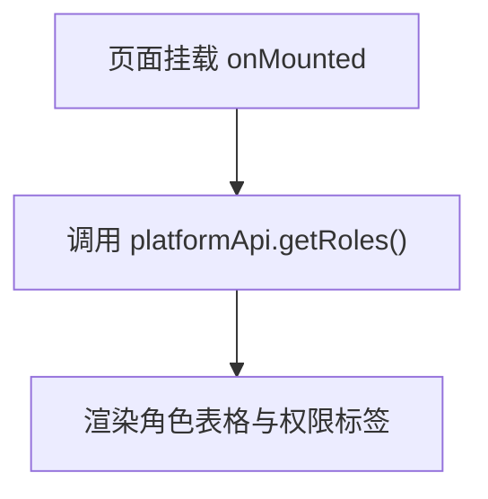

**图表来源**
- [apps/web/src/views/system/Role.vue:13-19](file://apps/web/src/views/system/Role.vue#L13-L19)
- [apps/web/src/api/index.ts:169-173](file://apps/web/src/api/index.ts#L169-L173)

**章节来源**
- [apps/web/src/views/system/Role.vue:1-24](file://apps/web/src/views/system/Role.vue#L1-L24)
- [apps/web/src/api/index.ts:169-173](file://apps/web/src/api/index.ts#L169-L173)

### 消息中心功能
**新增功能** - 系统通知的统一管理中心

- **消息筛选与查询**
  - 支持按消息类型（告警/通知）筛选
  - 支持按阅读状态（已读/未读）筛选
  - 支持按地块编码和关键词搜索
  - 分页展示，支持自定义每页数量

- **消息操作功能**
  - 单条消息快速标记已读
  - 批量选中未读消息进行批量标记
  - 未读消息计数实时更新
  - 消息级别标签显示（提示/警告/严重）

- **订阅偏好管理**
  - 按消息来源模板配置接收开关
  - 设置最低接收级别过滤
  - 批量保存偏好设置
  - 关闭订阅后事件不再写入消息中心

- **手动通知创建**
  - 支持创建通知和告警两类消息
  - 支持设置消息级别和关联地块
  - 表单验证和错误提示

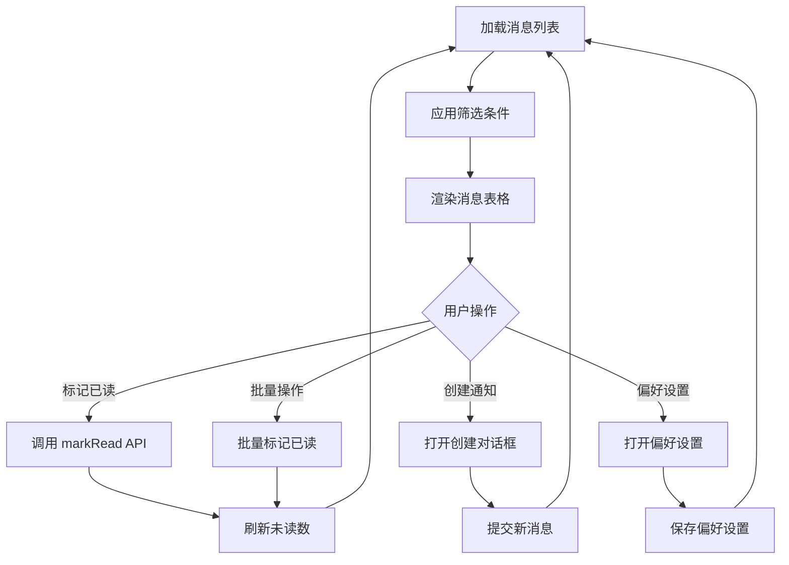

**图表来源**
- [apps/web/src/views/message/Index.vue:282-357](file://apps/web/src/views/message/Index.vue#L282-L357)
- [apps/web/src/api/index.ts:308-329](file://apps/web/src/api/index.ts#L308-L329)

**章节来源**
- [apps/web/src/views/message/Index.vue:1-390](file://apps/web/src/views/message/Index.vue#L1-L390)
- [apps/web/src/api/index.ts:308-329](file://apps/web/src/api/index.ts#L308-L329)

### 设备命令接口
**新增功能** - IoT设备控制指令的管理界面

- **指令列表展示**
  - 显示设备编号、地块编码、指令类型
  - 指令来源标识（自动EVENT/人工MANUAL）
  - 指令状态标签（待处理/执行中/已完成/失败）
  - 指令缘由和操作人信息
  - 来源事件ID显示（自动指令）

- **查询与筛选**
  - 按地块编码筛选
  - 按指令来源筛选（自动/人工）
  - 分页查询支持

- **指令类型识别**
  - 自动指令：由越限或处方事件生成
  - 人工指令：需二次确认后下达
  - 重复投递去重：避免同一事件的重复指令

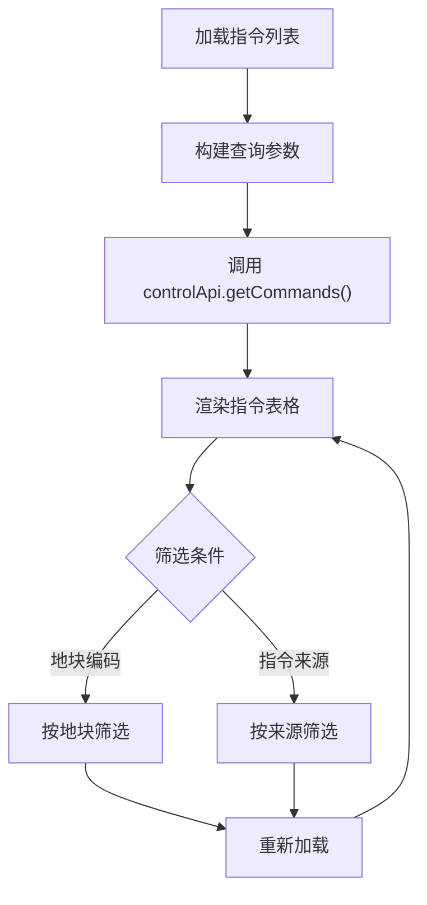

**图表来源**
- [apps/web/src/views/device/Commands.vue:93-118](file://apps/web/src/views/device/Commands.vue#L93-L118)
- [apps/web/src/api/index.ts:248-255](file://apps/web/src/api/index.ts#L248-L255)

**章节来源**
- [apps/web/src/views/device/Commands.vue:1-135](file://apps/web/src/views/device/Commands.vue#L1-L135)
- [apps/web/src/api/index.ts:248-255](file://apps/web/src/api/index.ts#L248-L255)

### 仪表板增强组件
**增强功能** - 集成的数据可视化和实时监控面板

- **天地图集成**
  - 支持影像底图和矢量底图切换
  - 设备点位图层控制
  - 地块边界多边形展示
  - 动态缩放和平移控制

- **实时数据监控**
  - 在线设备数量统计
  - 土壤墒情实时显示
  - 气象站状态监控
  - 待处理预警数量

- **农情分析面板**
  - 作物面积占比条形图
  - 年度产量预估统计
  - 倒伏面积警示展示
  - 多维度数据分析

- **趋势图表**
  - 近7日农情趋势可视化
  - 大豆出苗率、玉米出苗率、长势指数
  - 交互式图表展示

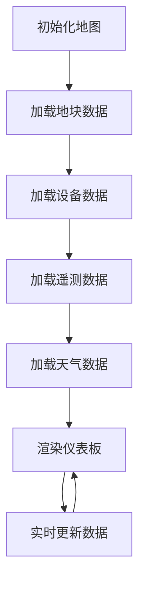

**图表来源**
- [apps/web/src/views/dashboard/Index.vue:142-249](file://apps/web/src/views/dashboard/Index.vue#L142-L249)
- [apps/web/src/api/index.ts:178-188](file://apps/web/src/api/index.ts#L178-L188)

**章节来源**
- [apps/web/src/views/dashboard/Index.vue:1-280](file://apps/web/src/views/dashboard/Index.vue#L1-L280)
- [apps/web/src/api/index.ts:178-188](file://apps/web/src/api/index.ts#L178-L188)

### 路由与鉴权
- 系统管理路由：/system/user、/system/role分别对应用户管理与角色管理页面。
- **新增消息中心路由**：/message对应消息中心页面，需要message:read权限。
- **新增设备命令路由**：/device/commands对应设备命令页面，需要device:read权限。
- 全局鉴权：beforeEach中检查localStorage中的token，若缺失且页面requiresAuth不为false，则重定向到/login。

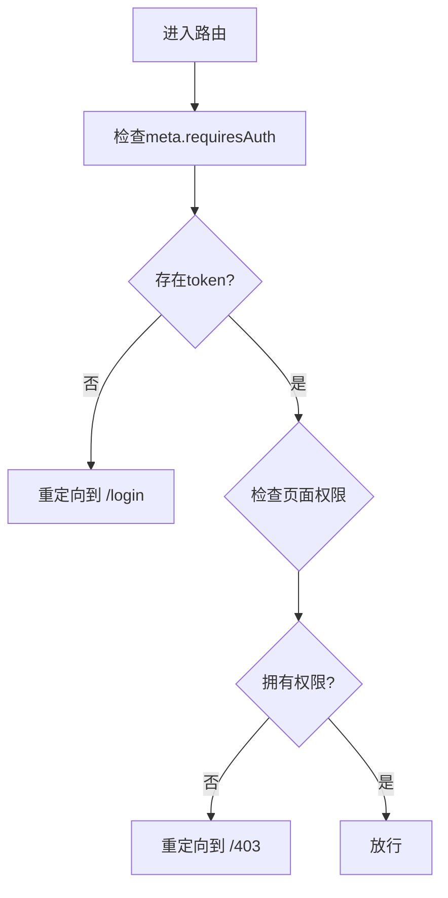

**图表来源**
- [apps/web/src/router/index.ts:112-147](file://apps/web/src/router/index.ts#L112-L147)
- [apps/web/src/router/index.ts:169-183](file://apps/web/src/router/index.ts#L169-L183)

**章节来源**
- [apps/web/src/router/index.ts:112-147](file://apps/web/src/router/index.ts#L112-L147)
- [apps/web/src/router/index.ts:169-183](file://apps/web/src/router/index.ts#L169-L183)

### 状态管理与令牌持久化
- useUserStore：维护token与userInfo，并提供setToken、setUserInfo、logout方法。
- 持久化：token与userInfo均写入localStorage，保证刷新后仍保持登录态。
- 登出：清空token与userInfo，移除localStorage对应项。

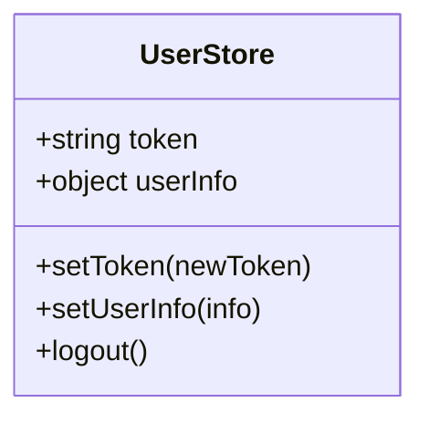

**图表来源**
- [apps/web/src/stores/index.ts:15-43](file://apps/web/src/stores/index.ts#L15-L43)

**章节来源**
- [apps/web/src/stores/index.ts:1-43](file://apps/web/src/stores/index.ts#L1-L43)

### HTTP封装与安全验证
- 请求拦截：
  - 注入Authorization: Bearer token。
  - 注入X-User-Id（从userInfo解析）。
  - 注入X-Request-Id用于链路追踪。
- 响应拦截：
  - 业务code非成功时提示错误消息。
  - 401场景弹窗确认并跳转登录。
  - 网络错误按HTTP状态码分类提示。

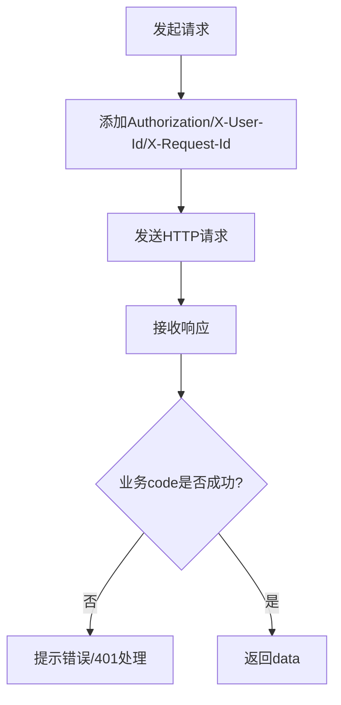

**图表来源**
- [apps/web/src/utils/request.ts:13-35](file://apps/web/src/utils/request.ts#L13-L35)
- [apps/web/src/utils/request.ts:37-86](file://apps/web/src/utils/request.ts#L37-L86)

**章节来源**
- [apps/web/src/utils/request.ts:1-109](file://apps/web/src/utils/request.ts#L1-L109)

## 依赖关系分析
- 视图依赖API：Login.vue、User.vue、Role.vue分别依赖authApi与platformApi；message/Index.vue依赖messageApi；device/Commands.vue依赖controlApi；dashboard/Index.vue依赖iotApi、telemetryApi、weatherApi等。
- API依赖HTTP封装：所有API调用通过utils/request.ts的get/post等方法发起。
- 状态依赖LocalStorage：useUserStore读写localStorage，影响全局登录态。
- 路由依赖全局守卫：router.beforeEach统一鉴权。
- **新增服务依赖**：消息中心依赖message-service后端服务；设备命令依赖iot-service和control-service后端服务。

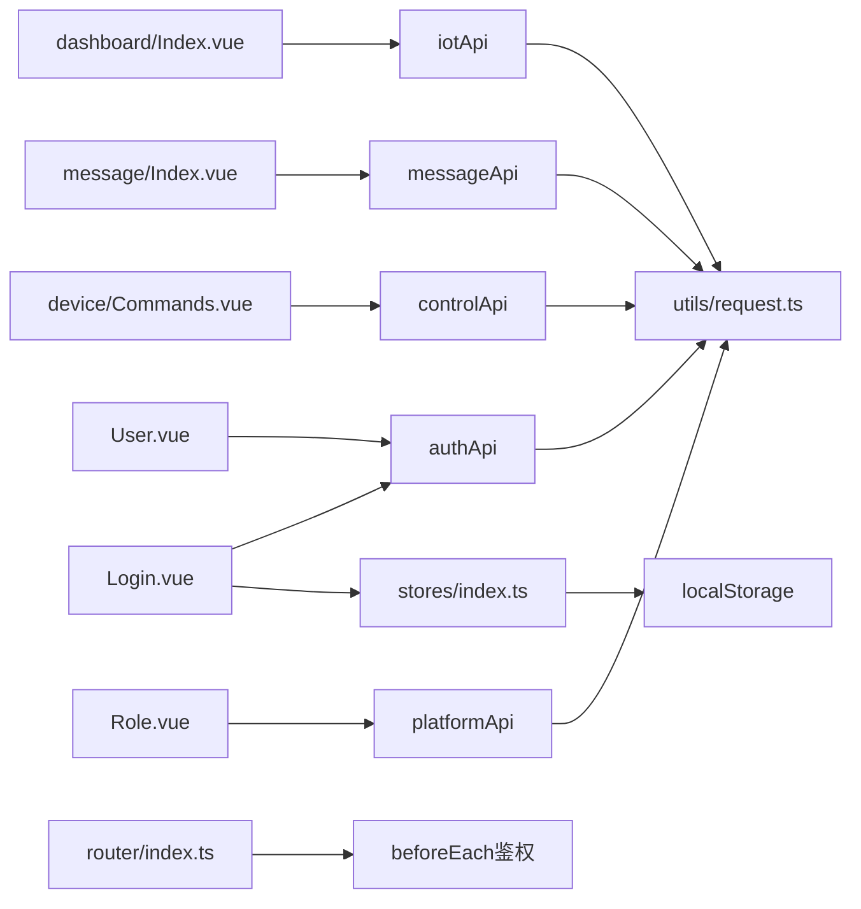

**图表来源**
- [apps/web/src/views/system/Login.vue:55-101](file://apps/web/src/views/system/Login.vue#L55-L101)
- [apps/web/src/views/system/User.vue:24-36](file://apps/web/src/views/system/User.vue#L24-L36)
- [apps/web/src/views/system/Role.vue:13-19](file://apps/web/src/views/system/Role.vue#L13-L19)
- [apps/web/src/views/message/Index.vue:170-360](file://apps/web/src/views/message/Index.vue#L170-L360)
- [apps/web/src/views/device/Commands.vue:71-121](file://apps/web/src/views/device/Commands.vue#L71-L121)
- [apps/web/src/views/dashboard/Index.vue:42-249](file://apps/web/src/views/dashboard/Index.vue#L42-L249)
- [apps/web/src/api/index.ts:12-26](file://apps/web/src/api/index.ts#L12-L26)
- [apps/web/src/api/index.ts:169-173](file://apps/web/src/api/index.ts#L169-L173)
- [apps/web/src/api/index.ts:308-329](file://apps/web/src/api/index.ts#L308-L329)
- [apps/web/src/api/index.ts:248-255](file://apps/web/src/api/index.ts#L248-L255)
- [apps/web/src/utils/request.ts:1-109](file://apps/web/src/utils/request.ts#L1-L109)
- [apps/web/src/stores/index.ts:15-43](file://apps/web/src/stores/index.ts#L15-L43)
- [apps/web/src/router/index.ts:146-154](file://apps/web/src/router/index.ts#L146-L154)

**章节来源**
- [apps/web/src/views/system/Login.vue:55-101](file://apps/web/src/views/system/Login.vue#L55-L101)
- [apps/web/src/views/system/User.vue:24-36](file://apps/web/src/views/system/User.vue#L24-L36)
- [apps/web/src/views/system/Role.vue:13-19](file://apps/web/src/views/system/Role.vue#L13-L19)
- [apps/web/src/views/message/Index.vue:170-360](file://apps/web/src/views/message/Index.vue#L170-L360)
- [apps/web/src/views/device/Commands.vue:71-121](file://apps/web/src/views/device/Commands.vue#L71-L121)
- [apps/web/src/views/dashboard/Index.vue:42-249](file://apps/web/src/views/dashboard/Index.vue#L42-L249)
- [apps/web/src/api/index.ts:12-26](file://apps/web/src/api/index.ts#L12-L26)
- [apps/web/src/api/index.ts:169-173](file://apps/web/src/api/index.ts#L169-L173)
- [apps/web/src/api/index.ts:308-329](file://apps/web/src/api/index.ts#L308-L329)
- [apps/web/src/api/index.ts:248-255](file://apps/web/src/api/index.ts#L248-L255)
- [apps/web/src/utils/request.ts:1-109](file://apps/web/src/utils/request.ts#L1-L109)
- [apps/web/src/stores/index.ts:15-43](file://apps/web/src/stores/index.ts#L15-L43)
- [apps/web/src/router/index.ts:146-154](file://apps/web/src/router/index.ts#L146-L154)

## 性能考虑
- 减少重复请求：用户信息仅在登录后拉取一次，避免频繁调用getUserInfo。
- 懒加载路由：系统管理子路由按需加载，降低首屏体积。
- 列表分页：角色列表、消息列表、指令列表可通过分页参数优化大数据量场景。
- 缓存策略：可在HTTP层增加短期缓存（如相同参数的GET请求）以减少网络开销。
- **并发加载**：仪表板组件使用Promise.all并行加载设备、遥测、天气等多源数据，提升加载性能。
- **地图优化**：天地图瓦片缓存和图层按需加载，减少内存占用。

## 故障排查指南
- 登录失败
  - 检查表单校验规则是否正确。
  - 检查后端/auth/login接口是否正常返回token与user。
  - 查看控制台错误与网络面板请求详情。
- 401未授权
  - 确认localStorage中存在token。
  - 检查请求拦截器是否正确注入Authorization头。
  - 响应拦截器会弹窗提示并跳转登录，确认后重新登录。
- 页面无法访问
  - 检查路由守卫是否被token缺失拦截。
  - 确认目标路由的meta.requiresAuth设置。
  - 检查页面权限配置是否正确。
- 用户/角色数据为空
  - 检查authApi.getUserInfo与platformApi.getRoles接口是否返回有效数据。
  - 查看网络面板是否有跨域或鉴权问题。
- **消息中心问题**
  - 检查messageApi接口调用是否正常。
  - 确认消息服务后端是否正常运行。
  - 验证订阅偏好配置是否正确。
- **设备命令问题**
  - 检查controlApi.getCommands接口调用。
  - 确认设备服务和控制服务状态。
  - 验证设备权限配置。
- **仪表板加载问题**
  - 检查天地图API密钥配置。
  - 验证各数据源接口可用性。
  - 查看浏览器控制台错误信息。

**章节来源**
- [apps/web/src/utils/request.ts:37-86](file://apps/web/src/utils/request.ts#L37-L86)
- [apps/web/src/router/index.ts:146-154](file://apps/web/src/router/index.ts#L146-L154)
- [apps/web/src/views/system/User.vue:31-36](file://apps/web/src/views/system/User.vue#L31-L36)
- [apps/web/src/views/system/Role.vue:13-19](file://apps/web/src/views/system/Role.vue#L13-L19)
- [apps/web/src/views/message/Index.vue:282-357](file://apps/web/src/views/message/Index.vue#L282-L357)
- [apps/web/src/views/device/Commands.vue:93-118](file://apps/web/src/views/device/Commands.vue#L93-L118)
- [apps/web/src/views/dashboard/Index.vue:220-243](file://apps/web/src/views/dashboard/Index.vue#L220-L243)

## 结论
当前系统管理页面实现了基础的登录认证、用户信息展示与角色权限展示能力，并通过统一的HTTP封装与路由守卫保障安全性与一致性。**新增的消息中心功能**提供了完整的系统通知管理能力，**设备命令接口**支持IoT设备的远程控制，**增强的仪表板组件**集成了丰富的数据可视化和实时监控功能。

后续可扩展：
- 用户管理：新增/编辑/删除用户、批量操作、状态切换。
- 角色与权限：完善RBAC模型，支持角色编辑、权限点勾选与分配。
- 消息中心：支持消息模板管理、定时通知、多渠道推送。
- 设备控制：完善设备命令下发、执行状态监控、远程控制界面。
- 系统配置：参数设置、日志管理、系统监控等模块接入。
- 审计与安全：全链路审计日志、敏感操作二次确认、细粒度权限控制。
- 仪表板增强：更多维度的数据分析、自定义报表、移动端适配。