# 系统管理页面

<cite>
**本文引用的文件**   
- [apps/web/src/views/system/Login.vue](file://apps/web/src/views/system/Login.vue)
- [apps/web/src/views/system/User.vue](file://apps/web/src/views/system/User.vue)
- [apps/web/src/views/system/Role.vue](file://apps/web/src/views/system/Role.vue)
- [apps/web/src/views/system/Backup.vue](file://apps/web/src/views/system/Backup.vue)
- [apps/web/src/views/system/DataCatalog.vue](file://apps/web/src/views/system/DataCatalog.vue)
- [apps/web/src/views/message/Index.vue](file://apps/web/src/views/message/Index.vue)
- [apps/web/src/views/device/Commands.vue](file://apps/web/src/views/device/Commands.vue)
- [apps/web/src/views/dashboard/Index.vue](file://apps/web/src/views/dashboard/Index.vue)
- [apps/web/src/api/index.ts](file://apps/web/src/api/index.ts)
- [apps/web/src/stores/index.ts](file://apps/web/src/stores/index.ts)
- [apps/web/src/router/index.ts](file://apps/web/src/router/index.ts)
- [apps/web/src/utils/request.ts](file://apps/web/src/utils/request.ts)
- [apps/web/src/types/index.ts](file://apps/web/src/types/index.ts)
- [apps/platform-service/src/backup.ts](file://apps/platform-service/src/backup.ts)
- [apps/platform-service/src/http.ts](file://apps/platform-service/src/http.ts)
- [apps/platform-service/src/data-catalog.repository.ts](file://apps/platform-service/src/data-catalog.repository.ts)
- [apps/message-service/src/http.ts](file://apps/message-service/src/http.ts)
- [apps/message-service/src/message.repository.ts](file://apps/message-service/src/message.repository.ts)
- [infra/postgres/migrations/041_message_ignored.sql](file://infra/postgres/migrations/041_message_ignored.sql)
- [infra/postgres/migrations/058_data_catalog.sql](file://infra/postgres/migrations/058_data_catalog.sql)
</cite>

## 更新摘要
**变更内容**   
- **增强数据目录管理界面**：新增双标签页设计，支持资产目录和数据字典的独立管理
- **改进搜索和筛选能力**：支持关键词搜索、分类筛选、所属资产筛选等高级查询功能
- **完整CRUD操作**：实现数据资产和数据字典的创建、读取、更新、删除操作
- **权限控制集成**：使用 `system:data` 权限码进行访问控制
- **五类数据分类标准**：基础空间（SPATIAL）、设备台账（DEVICE）、实时感知（TELEMETRY）、业务过程（BUSINESS）、统计分析（STATS）
- **表单验证机制**：严格的输入验证，包括资产编码格式、指标键格式等规则检查

## 目录
1. [简介](#简介)
2. [项目结构](#项目结构)
3. [核心组件](#核心组件)
4. [架构总览](#架构总览)
5. [详细组件分析](#详细组件分析)
6. [依赖关系分析](#依赖关系分析)
7. [性能考虑](#性能考虑)
8. [故障排查指南](#故障排查指南)
9. [结论](#结论)

## 简介
本文件面向智慧农业平台的"系统管理"相关前端页面与认证授权流程，覆盖以下能力：
- 用户管理：用户信息查看、状态展示（启用/禁用）、基础字段展示。
- 角色与权限：角色列表、角色编码、权限点集合展示；为后续RBAC扩展提供数据基础。
- **系统备份管理**：支持全量、代码、数据库备份创建，备份清单管理，备份详情查看，备份恢复操作，备份删除功能，以及备份下载功能。
- **数据目录管理**：**全新增的数据资产管理功能**，采用双标签页设计，支持数据资产登记、编辑、删除，以及数据字典条目管理，包含五类数据分类标准和严格的表单验证机制。
- 登录认证：用户名/密码登录、JWT令牌持久化、请求头注入、会话控制与过期处理。
- 消息中心增强：系统通知的查看、筛选、批量操作、订阅偏好配置，新增忽略处置功能，允许用户标记消息为已忽略同时保持审计追踪访问。
- 设备命令：IoT设备控制指令的查询、状态跟踪和来源管理。
- 仪表板增强：集成天地图可视化、实时设备监控、农情分析和趋势图表。
- 系统配置与监控：当前实现以接口层为主，预留平台能力入口（如角色查询），日志与监控建议通过网关或后端服务统一接入。
- 审计与安全：基于请求ID追踪、鉴权拦截、错误码统一处理，便于审计与排障。

## 项目结构
系统管理相关的前端代码集中在 apps/web 子应用内，主要涉及：
- 视图层：Login.vue、User.vue、Role.vue、Backup.vue、**DataCatalog.vue**、message/Index.vue、device/Commands.vue、dashboard/Index.vue
- 路由层：router/index.ts（含系统管理路由与全局鉴权守卫）
- API层：api/index.ts（封装认证、平台、消息、设备等接口）
- 状态层：stores/index.ts（用户信息与Token存储）
- HTTP层：utils/request.ts（Axios封装、拦截器、错误处理）
- 类型定义：types/index.ts（包含备份相关类型定义及**数据目录类型定义**）
- 后端服务：platform-service/src/backup.ts（备份管理逻辑）、platform-service/src/http.ts（HTTP接口）、**platform-service/src/data-catalog.repository.ts（数据目录管理）**、auth-service（认证服务）、message-service（消息服务）、iot-service（物联网服务）

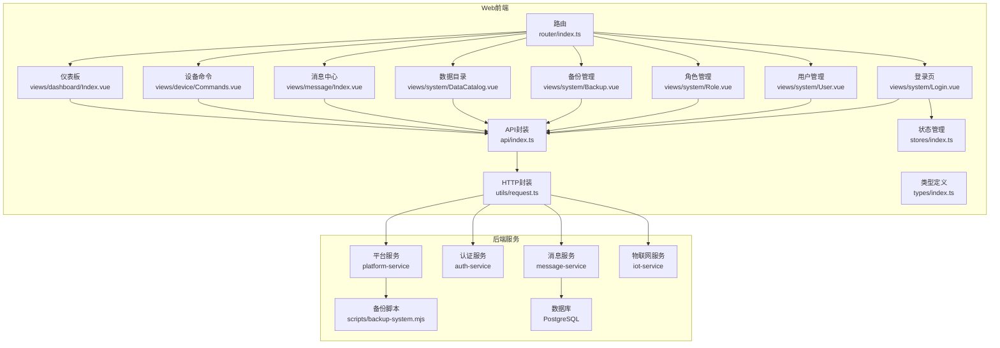

**图表来源**
- [apps/web/src/router/index.ts:194-199](file://apps/web/src/router/index.ts#L194-L199)
- [apps/web/src/views/system/DataCatalog.vue:1-443](file://apps/web/src/views/system/DataCatalog.vue#L1-L443)
- [apps/platform-service/src/data-catalog.repository.ts:1-338](file://apps/platform-service/src/data-catalog.repository.ts#L1-L338)

## 核心组件
- 登录认证
  - 表单校验与提交：用户名/密码必填校验，提交后调用认证接口获取令牌与用户信息。
  - 令牌与用户信息持久化：将token与userInfo写入localStorage，并在后续请求中自动注入Authorization与X-User-Id。
  - 路由守卫：未携带token访问受保护页面时重定向至登录页。
- 用户管理
  - 展示当前登录用户的基本信息（用户名、姓名、手机号、角色、状态、创建时间）。
  - 状态以标签形式显示"启用/禁用"。
- 角色管理
  - 展示角色名称、角色编码与权限点集合（以标签形式呈现）。
  - 通过平台接口获取角色列表。
- **系统备份管理**
  - 备份创建：支持全量备份、仅代码备份、仅数据库备份三种模式。
  - 备份参数配置：保留份数设置、敏感配置包含选项。
  - 备份清单管理：查看备份列表、备份详情、备份大小和内容组成。
  - 备份下载功能：支持整包tar.gz下载和单个分片文件下载，使用saveBlob工具函数实现跨浏览器兼容的文件保存。
  - 文件大小格式化：改进的文件大小显示，支持B、KB、MB、GB单位自动转换。
  - SHA-256校验：显示备份分片的SHA-256哈希值，确保文件完整性。
  - 备份恢复：支持从指定备份恢复数据库或代码，可指定目标库名或恢复目录。
  - 备份删除：安全删除不需要的备份记录。
- **数据目录管理** **全新增强**
  - **双标签页界面设计**：资产目录和数据字典两个独立的管理标签页，切换时自动加载对应数据。
  - **数据资产CRUD操作**：支持数据资产的创建、编辑、删除操作，包含资产编码、名称、分类、描述、来源服务、存储、更新频率、地块关联等字段。
  - **数据字典管理**：支持字典条目的创建、编辑、删除，包含指标键、名称、口径定义、单位、数据类型、来源、更新频率等属性。
  - **五类数据分类标准**：基础空间（SPATIAL）、设备台账（DEVICE）、实时感知（TELEMETRY）、业务过程（BUSINESS）、统计分析（STATS）。
  - **高级筛选功能**：支持按关键词、分类、所属资产进行精确筛选，提升查找效率。
  - **分页加载**：完善的分页功能，支持自定义每页数量（10、20、50条）。
  - **严格表单验证**：资产编码格式验证（小写字母开头，3~64位）、指标键格式验证（字母开头，1~64位）等规则检查。
  - **关联关系管理**：资产与字典的关联关系管理，防止删除有依赖的资产。
- 消息中心增强
  - 消息列表展示：支持按类型（告警/通知）、状态（已读/未读）、地块编码和关键词筛选。
  - 忽略处置功能：新增忽略功能，允许用户标记消息为已忽略，同时保持审计追踪访问。
  - 批量操作：支持批量标记已读、单条消息快速标记。
  - 订阅偏好管理：可配置不同消息来源的接收开关和最低级别过滤。
  - 手动通知创建：支持创建不同类型和级别的通知消息。
  - 忽略状态显示：已忽略消息显示特殊标签，不影响未读计数。
- 设备命令
  - 指令列表展示：显示设备编号、地块编码、指令类型、来源、状态等详细信息。
  - 指令来源区分：自动指令（事件触发）与人工指令（手动下发）的区别标识。
  - 分页查询：支持按地块编码和指令来源进行分页查询。
- 仪表板增强
  - 天地图集成：支持影像底图和矢量底图切换，设备点位和地块边界图层控制。
  - 实时数据监控：在线设备数量、土壤墒情、气象站状态等关键指标展示。
  - 农情分析：作物面积占比、产量预估、倒伏面积统计等分析维度。
  - 趋势图表：近7日农情趋势可视化展示。
  - **数据目录集成**：在系统管理菜单中新增数据目录入口，需要system:data权限。
- HTTP与错误处理
  - 统一请求拦截：注入Authorization、X-User-Id、X-Request-Id。
  - 统一响应拦截：业务code非成功时提示错误；401触发重新登录流程。
  - 网络错误分类提示：400/401/403/404/500等。

**章节来源**
- [apps/web/src/views/system/Login.vue:55-101](file://apps/web/src/views/system/Login.vue#L55-L101)
- [apps/web/src/stores/index.ts:15-43](file://apps/web/src/stores/index.ts#L15-L43)
- [apps/web/src/router/index.ts:146-154](file://apps/web/src/router/index.ts#L146-L154)
- [apps/web/src/views/system/User.vue:24-36](file://apps/web/src/views/system/User.vue#L24-L36)
- [apps/web/src/views/system/Role.vue:13-19](file://apps/web/src/views/system/Role.vue#L13-L19)
- [apps/web/src/views/system/Backup.vue:143-261](file://apps/web/src/views/system/Backup.vue#L143-L261)
- [apps/web/src/views/system/DataCatalog.vue:1-443](file://apps/web/src/views/system/DataCatalog.vue#L1-L443)
- [apps/web/src/views/message/Index.vue:170-360](file://apps/web/src/views/message/Index.vue#L170-L360)
- [apps/web/src/views/device/Commands.vue:71-121](file://apps/web/src/views/device/Commands.vue#L71-L121)
- [apps/web/src/views/dashboard/Index.vue:42-249](file://apps/web/src/views/dashboard/Index.vue#L42-L249)
- [apps/web/src/utils/request.ts:13-35](file://apps/web/src/utils/request.ts#L13-L35)
- [apps/web/src/utils/request.ts:37-86](file://apps/web/src/utils/request.ts#L37-L86)

## 架构总览
系统管理功能在前端通过Vue Router进行页面导航，使用Pinia维护用户状态，Axios封装统一发起HTTP请求，最终由认证服务处理登录与鉴权。**全新的数据目录管理功能**通过platform-service的data-catalog.repository.ts提供服务，支持数据资产和数据字典的完整生命周期管理，采用双标签页界面设计，提供增强的搜索和筛选能力。**系统备份管理功能**通过platform-service提供服务，集成备份脚本执行和文件系统操作。**消息中心的忽略处置功能**通过message-service提供，支持消息状态的独立管理。

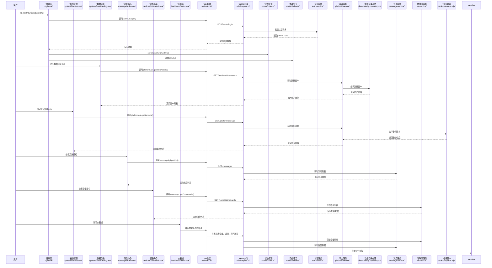

**图表来源**
- [apps/web/src/views/system/Login.vue:77-101](file://apps/web/src/views/system/Login.vue#L77-L101)
- [apps/web/src/views/system/DataCatalog.vue:266-280](file://apps/web/src/views/system/DataCatalog.vue#L266-L280)
- [apps/web/src/views/system/Backup.vue:132-166](file://apps/web/src/views/system/Backup.vue#L132-L166)
- [apps/web/src/views/message/Index.vue:282-293](file://apps/web/src/views/message/Index.vue#L282-L293)
- [apps/web/src/views/device/Commands.vue:93-107](file://apps/web/src/views/device/Commands.vue#L93-L107)
- [apps/web/src/views/dashboard/Index.vue:220-243](file://apps/web/src/views/dashboard/Index.vue#L220-L243)

## 详细组件分析

### 登录认证流程
- 表单校验：username/password必填。
- 登录调用：authApi.login(data) -> POST /auth/login。
- 本地持久化：setToken(token)、setUserInfo(user)。
- 路由跳转：根据redirect参数或默认/dashboard跳转。
- 安全机制：
  - 请求拦截器在Authorization头附加Bearer token。
  - 响应拦截器对401进行统一处理，弹出确认框并跳转登录。
  - 路由守卫在未登录时强制跳转到/login。

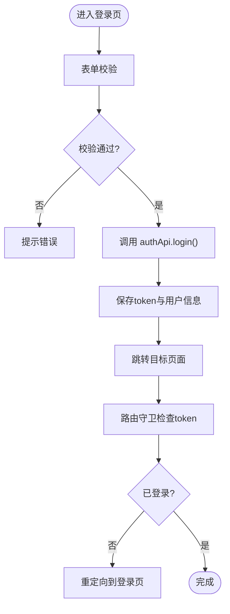

**图表来源**
- [apps/web/src/views/system/Login.vue:72-101](file://apps/web/src/views/system/Login.vue#L72-L101)
- [apps/web/src/api/index.ts:12-26](file://apps/web/src/api/index.ts#L12-L26)
- [apps/web/src/stores/index.ts:15-43](file://apps/web/src/stores/index.ts#L15-L43)
- [apps/web/src/router/index.ts:146-154](file://apps/web/src/router/index.ts#L146-L154)
- [apps/web/src/utils/request.ts:37-86](file://apps/web/src/utils/request.ts#L37-L86)

**章节来源**
- [apps/web/src/views/system/Login.vue:55-101](file://apps/web/src/views/system/Login.vue#L55-L101)
- [apps/web/src/api/index.ts:12-26](file://apps/web/src/api/index.ts#L12-L26)
- [apps/web/src/stores/index.ts:15-43](file://apps/web/src/stores/index.ts#L15-L43)
- [apps/web/src/router/index.ts:146-154](file://apps/web/src/router/index.ts#L146-L154)
- [apps/web/src/utils/request.ts:13-35](file://apps/web/src/utils/request.ts#L13-L35)
- [apps/web/src/utils/request.ts:37-86](file://apps/web/src/utils/request.ts#L37-L86)

### 用户管理页面
- 数据加载：onMounted时调用authApi.getUserInfo()获取当前用户信息。
- 数据映射：将后端用户对象映射为表格所需字段（用户名、姓名、手机号、角色、状态、创建时间）。
- 状态展示：status为布尔值，true显示"启用"，false显示"禁用"。

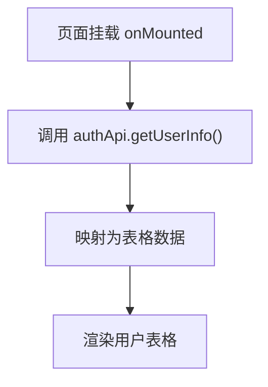

**图表来源**
- [apps/web/src/views/system/User.vue:31-36](file://apps/web/src/views/system/User.vue#L31-L36)
- [apps/web/src/api/index.ts:12-26](file://apps/web/src/api/index.ts#L12-L26)

**章节来源**
- [apps/web/src/views/system/User.vue:1-38](file://apps/web/src/views/system/User.vue#L1-L38)
- [apps/web/src/api/index.ts:12-26](file://apps/web/src/api/index.ts#L12-L26)

### 角色管理页面
- 数据加载：onMounted时调用platformApi.getRoles()获取角色列表。
- 数据展示：角色名称、角色编码、权限点集合（以标签形式展示）。
- 扩展性：该页面可作为RBAC模型的前端展示层，后续可对接角色编辑、权限分配等接口。

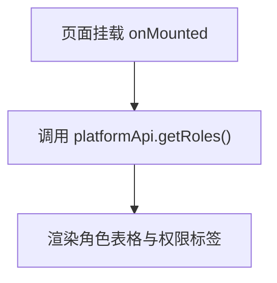

**图表来源**
- [apps/web/src/views/system/Role.vue:13-19](file://apps/web/src/views/system/Role.vue#L13-L19)
- [apps/web/src/api/index.ts:169-173](file://apps/web/src/api/index.ts#L169-L173)

**章节来源**
- [apps/web/src/views/system/Role.vue:1-24](file://apps/web/src/views/system/Role.vue#L1-L24)
- [apps/web/src/api/index.ts:169-173](file://apps/web/src/api/index.ts#L169-L173)

### 系统备份管理功能
- **备份创建与管理**
  - 支持三种备份模式：全量备份（代码+数据库+配置）、仅代码备份、仅数据库备份
  - 备份参数配置：保留份数设置（1-100）、敏感配置包含选项
  - 备份执行状态监控：长耗时操作支持超时配置（300秒）
  - 备份结果反馈：成功/失败状态提示，错误信息显示

- **备份清单管理**
  - 备份列表展示：显示备份编号、创建时间、Git提交信息、代码方式、内容组成、数据库信息
  - 备份详情查看：展示备份分片信息、文件大小、SHA-256校验值、分支信息等
  - 备份内容预览：显示备份包含的代码、配置、数据库等各部分信息

- **备份下载功能**
  - 整包下载：支持下载完整的tar.gz备份文件，使用saveBlob工具函数实现跨浏览器兼容
  - 分片下载：支持单独下载备份中的特定分片文件
  - 文件名处理：自动为整包下载生成有意义的文件名（backup-{id}.tar.gz）
  - 下载状态反馈：显示下载开始的成功提示

- **文件大小格式化**
  - 智能单位转换：自动在B、KB、MB、GB之间转换
  - 精度控制：大单位显示一位小数，字节单位显示整数
  - 空值处理：正确处理0字节和null值的情况

- **SHA-256校验显示**
  - 完整性验证：显示每个备份分片的SHA-256哈希值
  - 安全保证：确保备份文件的完整性和真实性
  - 溢出处理：长哈希值使用tooltip显示避免布局问题

- **备份恢复操作**
  - 选择性恢复：支持仅恢复数据库或仅恢复代码
  - 目标配置：数据库恢复可指定目标库名，代码恢复可指定目标目录
  - 安全确认：恢复前二次确认，防止误操作
  - 恢复状态监控：长耗时操作支持超时配置

- **备份清理维护**
  - 备份删除：支持删除不需要的备份记录
  - 自动清理：备份脚本自动清理超出保留份数的旧备份
  - 路径安全：防止路径穿越攻击的安全验证

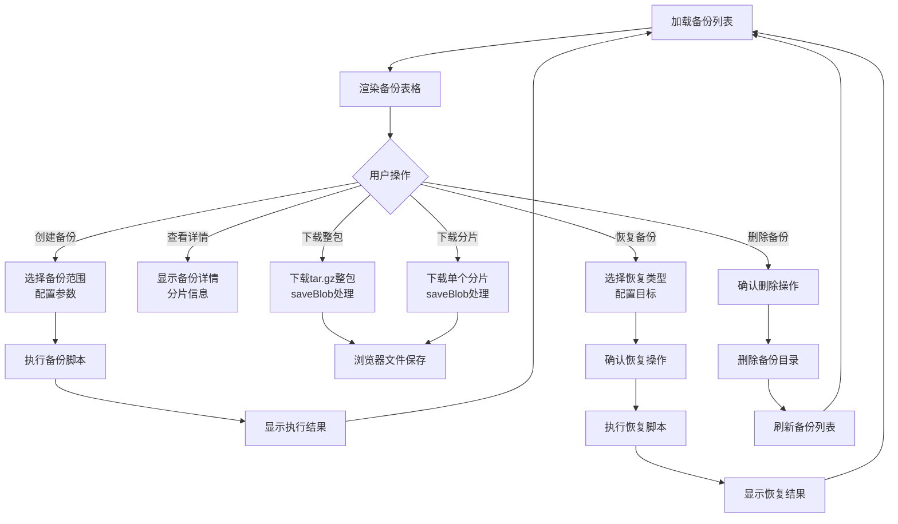

**图表来源**
- [apps/web/src/views/system/Backup.vue:143-261](file://apps/web/src/views/system/Backup.vue#L143-L261)
- [apps/platform-service/src/backup.ts:137-159](file://apps/platform-service/src/backup.ts#L137-L159)

**章节来源**
- [apps/web/src/views/system/Backup.vue:1-274](file://apps/web/src/views/system/Backup.vue#L1-L274)
- [apps/platform-service/src/backup.ts:1-160](file://apps/platform-service/src/backup.ts#L1-L160)
- [scripts/backup-system.mjs:297-339](file://scripts/backup-system.mjs#L297-L339)

### 数据目录管理功能 **全新增强**
- **双标签页界面设计**
  - 资产目录标签：管理数据资产的基本信息和元数据
  - 数据字典标签：管理具体的数据指标定义和口径说明
  - 标签切换时自动加载对应数据，提升用户体验

- **数据资产管理**
  - **资产登记**：支持创建新的数据资产，包含资产编码、名称、分类、描述、来源服务、存储类型、更新频率、地块关联等字段
  - **资产编辑**：支持修改现有资产信息，资产编码不可修改以保证引用一致性
  - **资产删除**：安全删除机制，当资产下仍有字典条目时禁止删除，防止数据引用断裂
  - **资产分类**：严格遵循五类数据分类标准（SPATIAL、DEVICE、TELEMETRY、BUSINESS、STATS）
  - **资产筛选**：支持按关键词搜索和分类筛选，提高查找效率

- **数据字典管理**
  - **字典条目创建**：为数据资产添加具体的指标定义，包含指标键、名称、口径定义、单位、数据类型、数据来源、更新频率等
  - **字典条目编辑**：支持修改现有指标定义，指标键不可修改以保持数据一致性
  - **字典条目删除**：安全的删除操作，带确认提示
  - **资产关联**：字典条目必须关联到具体资产，支持按所属资产筛选
  - **指标键验证**：严格的格式验证，确保指标键的唯一性和规范性

- **高级查询功能**
  - **关键词搜索**：支持在资产名称、编码、说明中进行模糊搜索
  - **分类筛选**：按五类数据分类进行精确筛选
  - **资产关联筛选**：按所属资产筛选对应的字典条目
  - **分页加载**：支持自定义每页数量，提升大数据量场景下的性能

- **表单验证机制**
  - **资产编码验证**：小写字母开头，3~64位，只允许字母、数字和下划线
  - **指标键验证**：字母开头，1~64位，只允许字母、数字和下划线
  - **必填字段验证**：关键字段如名称、分类等的必填检查
  - **实时反馈**：表单验证错误即时提示，提升用户体验

- **权限控制**
  - **权限码**：system:data
  - **菜单集成**：在仪表板的系统管理菜单中提供入口
  - **路由保护**：通过路由守卫进行权限验证

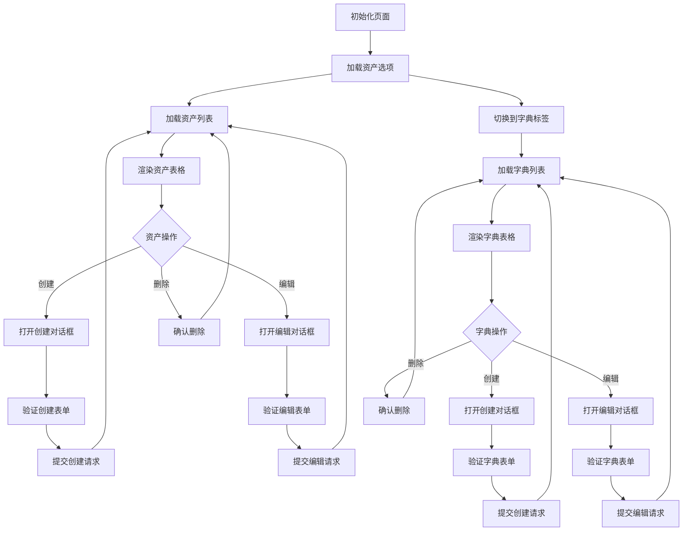

**图表来源**
- [apps/web/src/views/system/DataCatalog.vue:266-443](file://apps/web/src/views/system/DataCatalog.vue#L266-L443)
- [apps/web/src/api/index.ts:440-453](file://apps/web/src/api/index.ts#L440-L453)

**章节来源**
- [apps/web/src/views/system/DataCatalog.vue:1-443](file://apps/web/src/views/system/DataCatalog.vue#L1-L443)
- [apps/web/src/api/index.ts:440-453](file://apps/web/src/api/index.ts#L440-L453)
- [apps/web/src/types/index.ts:544-574](file://apps/web/src/types/index.ts#L544-L574)
- [apps/platform-service/src/data-catalog.repository.ts:1-338](file://apps/platform-service/src/data-catalog.repository.ts#L1-L338)

### 消息中心功能
- **消息筛选与查询**
  - 支持按消息类型（告警/通知）筛选
  - 支持按阅读状态（已读/未读）筛选
  - 新增忽略状态筛选：支持按忽略状态筛选消息
  - 支持按地块编码和关键词搜索
  - 分页展示，支持自定义每页数量

- **消息操作功能**
  - 单条消息快速标记已读
  - 忽略处置功能：允许用户标记消息为已忽略，同时保持审计追踪访问
  - 批量选中未读消息进行批量标记
  - 未读消息计数实时更新，忽略的消息不计入未读计数
  - 消息级别标签显示（提示/警告/严重）
  - 忽略状态显示：已忽略消息显示特殊标签，操作列显示"-"表示已完成

- **订阅偏好管理**
  - 按消息来源模板配置接收开关
  - 设置最低接收级别过滤
  - 批量保存偏好设置
  - 关闭订阅后事件不再写入消息中心

- **手动通知创建**
  - 支持创建通知和告警两类消息
  - 支持设置消息级别和关联地块
  - 表单验证和错误提示

- **忽略处置机制**
  - 数据库支持：新增ignored字段，与is_read字段独立管理
  - 业务逻辑：忽略即确认无需处置，顺带标已读，未读角标不再为它计数
  - 审计追踪：忽略的记录保留可回查，ignored=true可单独查询
  - 前端交互：忽略前需要用户确认，忽略后消息从待办列表移除但可回查

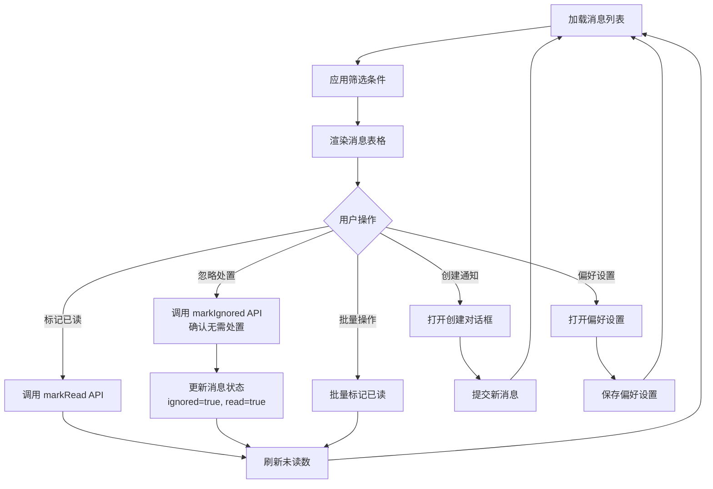

**图表来源**
- [apps/web/src/views/message/Index.vue:282-357](file://apps/web/src/views/message/Index.vue#L282-L357)
- [apps/web/src/api/index.ts:308-329](file://apps/web/src/api/index.ts#L308-L329)

**章节来源**
- [apps/web/src/views/message/Index.vue:1-443](file://apps/web/src/views/message/Index.vue#L1-L443)
- [apps/web/src/api/index.ts:308-329](file://apps/web/src/api/index.ts#L308-L329)
- [apps/message-service/src/http.ts:197-208](file://apps/message-service/src/http.ts#L197-L208)
- [apps/message-service/src/message.repository.ts:202-217](file://apps/message-service/src/message.repository.ts#L202-L217)
- [infra/postgres/migrations/041_message_ignored.sql:1-6](file://infra/postgres/migrations/041_message_ignored.sql#L1-L6)

### 设备命令接口
- **指令列表展示**
  - 显示设备编号、地块编码、指令类型
  - 指令来源标识（自动EVENT/人工MANUAL）
  - 指令状态标签（待处理/执行中/已完成/失败）
  - 指令缘由和操作人信息
  - 来源事件ID显示（自动指令）

- **查询与筛选**
  - 按地块编码筛选
  - 按指令来源筛选（自动/人工）
  - 分页查询支持

- **指令类型识别**
  - 自动指令：由越限或处方事件生成
  - 人工指令：需二次确认后下达
  - 重复投递去重：避免同一事件的重复指令

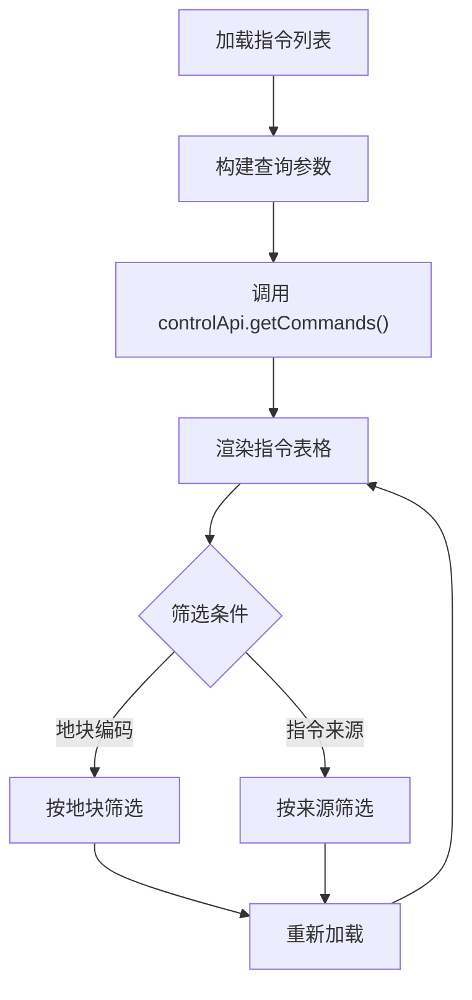

**图表来源**
- [apps/web/src/views/device/Commands.vue:93-118](file://apps/web/src/views/device/Commands.vue#L93-L118)
- [apps/web/src/api/index.ts:248-255](file://apps/web/src/api/index.ts#L248-L255)

**章节来源**
- [apps/web/src/views/device/Commands.vue:1-135](file://apps/web/src/views/device/Commands.vue#L1-L135)
- [apps/web/src/api/index.ts:248-255](file://apps/web/src/api/index.ts#L248-L255)

### 仪表板增强组件
- **天地图集成**
  - 支持影像底图和矢量底图切换
  - 设备点位图层控制
  - 地块边界多边形展示
  - 动态缩放和平移控制

- **实时数据监控**
  - 在线设备数量统计
  - 土壤墒情实时显示
  - 气象站状态监控
  - 待处理预警数量

- **农情分析面板**
  - 作物面积占比条形图
  - 年度产量预估统计
  - 倒伏面积警示展示
  - 多维度数据分析

- **趋势图表**
  - 近7日农情趋势可视化
  - 大豆出苗率、玉米出苗率、长势指数
  - 交互式图表展示

- **数据目录集成**
  - 在系统管理菜单中新增数据目录入口
  - 需要system:data权限才能访问
  - 与仪表板其他功能无缝集成

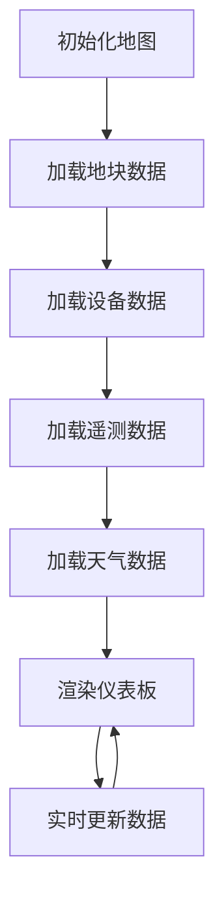

**图表来源**
- [apps/web/src/views/dashboard/Index.vue:142-249](file://apps/web/src/views/dashboard/Index.vue#L142-L249)
- [apps/web/src/api/index.ts:178-188](file://apps/web/src/api/index.ts#L178-L188)

**章节来源**
- [apps/web/src/views/dashboard/Index.vue:1-280](file://apps/web/src/views/dashboard/Index.vue#L1-L280)
- [apps/web/src/api/index.ts:178-188](file://apps/web/src/api/index.ts#L178-L188)

### 路由与鉴权
- 系统管理路由：/system/user、/system/role、/system/backup、**/system/data-catalog**分别对用户管理、角色管理、备份管理和数据目录管理页面。
- 消息中心路由：/message对应消息中心页面，需要message:read权限。
- 设备命令路由：/device/commands对应设备命令页面，需要device:read权限。
- 全局鉴权：beforeEach中检查localStorage中的token，若缺失且页面requiresAuth不为false，则重定向到/login。
- 权限控制：备份管理页面需要system:backup权限，**数据目录管理页面需要system:data权限**，其他页面保持原有权限控制。

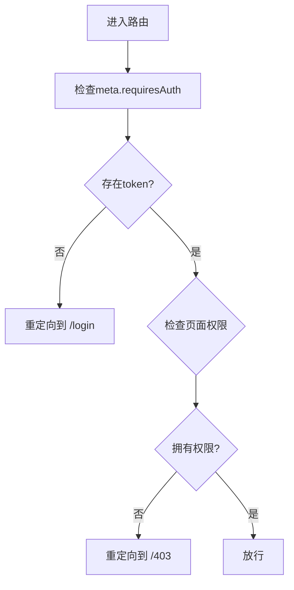

**图表来源**
- [apps/web/src/router/index.ts:112-147](file://apps/web/src/router/index.ts#L112-L147)
- [apps/web/src/router/index.ts:194-199](file://apps/web/src/router/index.ts#L194-L199)
- [apps/web/src/router/index.ts:169-183](file://apps/web/src/router/index.ts#L169-L183)

**章节来源**
- [apps/web/src/router/index.ts:112-147](file://apps/web/src/router/index.ts#L112-L147)
- [apps/web/src/router/index.ts:194-199](file://apps/web/src/router/index.ts#L194-L199)
- [apps/web/src/router/index.ts:169-183](file://apps/web/src/router/index.ts#L169-L183)

### 状态管理与令牌持久化
- useUserStore：维护token与userInfo，并提供setToken、setUserInfo、logout方法。
- 持久化：token与userInfo均写入localStorage，保证刷新后仍保持登录态。
- 登出：清空token与userInfo，移除localStorage对应项。

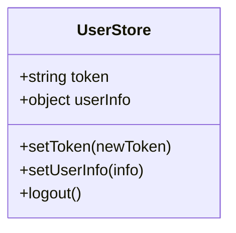

**图表来源**
- [apps/web/src/stores/index.ts:15-43](file://apps/web/src/stores/index.ts#L15-L43)

**章节来源**
- [apps/web/src/stores/index.ts:1-43](file://apps/web/src/stores/index.ts#L1-L43)

### HTTP封装与安全验证
- 请求拦截：
  - 注入Authorization: Bearer token。
  - 注入X-User-Id（从userInfo解析）。
  - 注入X-Request-Id用于链路追踪。
- 响应拦截：
  - 业务code非成功时提示错误消息。
  - 401场景弹窗确认并跳转登录。
  - 网络错误按HTTP状态码分类提示。

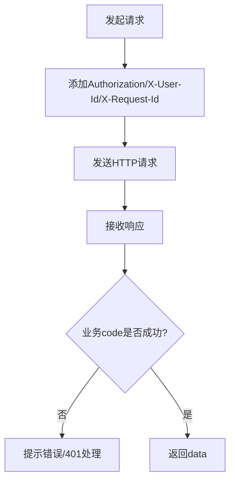

**图表来源**
- [apps/web/src/utils/request.ts:13-35](file://apps/web/src/utils/request.ts#L13-L35)
- [apps/web/src/utils/request.ts:37-86](file://apps/web/src/utils/request.ts#L37-L86)

**章节来源**
- [apps/web/src/utils/request.ts:1-109](file://apps/web/src/utils/request.ts#L1-L109)

## 依赖关系分析
- 视图依赖API：Login.vue、User.vue、Role.vue、Backup.vue、**DataCatalog.vue**分别依赖authApi与platformApi；message/Index.vue依赖messageApi；device/Commands.vue依赖controlApi；dashboard/Index.vue依赖iotApi、telemetryApi、weatherApi等。
- API依赖HTTP封装：所有API调用通过utils/request.ts的get/post等方法发起。
- 状态依赖LocalStorage：useUserStore读写localStorage，影响全局登录态。
- 路由依赖全局守卫：router.beforeEach统一鉴权。
- **新增服务依赖**：备份管理依赖platform-service后端服务和backup-system.mjs脚本；**数据目录管理依赖platform-service的data-catalog.repository.ts**；消息中心依赖message-service后端服务；设备命令依赖iot-service和control-service后端服务。

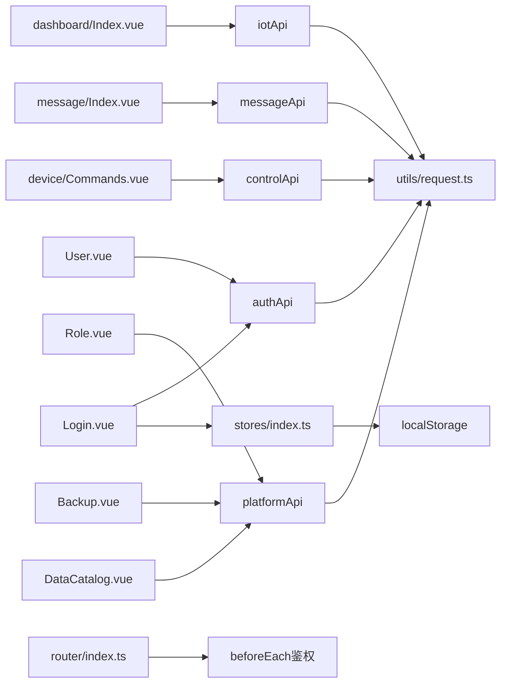

**图表来源**
- [apps/web/src/views/system/Login.vue:55-101](file://apps/web/src/views/system/Login.vue#L55-L101)
- [apps/web/src/views/system/User.vue:24-36](file://apps/web/src/views/system/User.vue#L24-L36)
- [apps/web/src/views/system/Role.vue:13-19](file://apps/web/src/views/system/Role.vue#L13-L19)
- [apps/web/src/views/system/Backup.vue:132-166](file://apps/web/src/views/system/Backup.vue#L132-L166)
- [apps/web/src/views/system/DataCatalog.vue:266-443](file://apps/web/src/views/system/DataCatalog.vue#L266-L443)
- [apps/web/src/views/message/Index.vue:170-360](file://apps/web/src/views/message/Index.vue#L170-L360)
- [apps/web/src/views/device/Commands.vue:71-121](file://apps/web/src/views/device/Commands.vue#L71-L121)
- [apps/web/src/views/dashboard/Index.vue:42-249](file://apps/web/src/views/dashboard/Index.vue#L42-L249)
- [apps/web/src/api/index.ts:12-26](file://apps/web/src/api/index.ts#L12-L26)
- [apps/web/src/api/index.ts:169-173](file://apps/web/src/api/index.ts#L169-L173)
- [apps/web/src/api/index.ts:422-441](file://apps/web/src/api/index.ts#L422-L441)
- [apps/web/src/api/index.ts:308-329](file://apps/web/src/api/index.ts#L308-L329)
- [apps/web/src/api/index.ts:248-255](file://apps/web/src/api/index.ts#L248-L255)
- [apps/web/src/utils/request.ts:1-109](file://apps/web/src/utils/request.ts#L1-L109)
- [apps/web/src/stores/index.ts:15-43](file://apps/web/src/stores/index.ts#L15-L43)
- [apps/web/src/router/index.ts:146-154](file://apps/web/src/router/index.ts#L146-L154)

**章节来源**
- [apps/web/src/views/system/Login.vue:55-101](file://apps/web/src/views/system/Login.vue#L55-L101)
- [apps/web/src/views/system/User.vue:24-36](file://apps/web/src/views/system/User.vue#L24-L36)
- [apps/web/src/views/system/Role.vue:13-19](file://apps/web/src/views/system/Role.vue#L13-L19)
- [apps/web/src/views/system/Backup.vue:132-166](file://apps/web/src/views/system/Backup.vue#L132-L166)
- [apps/web/src/views/system/DataCatalog.vue:266-443](file://apps/web/src/views/system/DataCatalog.vue#L266-L443)
- [apps/web/src/views/message/Index.vue:170-360](file://apps/web/src/views/message/Index.vue#L170-L360)
- [apps/web/src/views/device/Commands.vue:71-121](file://apps/web/src/views/device/Commands.vue#L71-L121)
- [apps/web/src/views/dashboard/Index.vue:42-249](file://apps/web/src/views/dashboard/Index.vue#L42-L249)
- [apps/web/src/api/index.ts:12-26](file://apps/web/src/api/index.ts#L12-L26)
- [apps/web/src/api/index.ts:169-173](file://apps/web/src/api/index.ts#L169-L173)
- [apps/web/src/api/index.ts:422-441](file://apps/web/src/api/index.ts#L422-L441)
- [apps/web/src/api/index.ts:308-329](file://apps/web/src/api/index.ts#L308-L329)
- [apps/web/src/api/index.ts:248-255](file://apps/web/src/api/index.ts#L248-L255)
- [apps/web/src/utils/request.ts:1-109](file://apps/web/src/utils/request.ts#L1-L109)
- [apps/web/src/stores/index.ts:15-43](file://apps/web/src/stores/index.ts#L15-L43)
- [apps/web/src/router/index.ts:146-154](file://apps/web/src/router/index.ts#L146-L154)

## 性能考虑
- 减少重复请求：用户信息仅在登录后拉取一次，避免频繁调用getUserInfo。
- 懒加载路由：系统管理子路由按需加载，降低首屏体积。
- 列表分页：角色列表、消息列表、指令列表、**数据资产和字典列表**可通过分页参数优化大数据量场景。
- 缓存策略：可在HTTP层增加短期缓存（如相同参数的GET请求）以减少网络开销。
- 并发加载：仪表板组件使用Promise.all并行加载设备、遥测、天气等多源数据，提升加载性能。
- 地图优化：天地图瓦片缓存和图层按需加载，减少内存占用。
- 备份操作优化：备份和恢复操作支持超时配置，避免长时间阻塞；备份清单异步加载，不影响主界面响应。
- 下载性能优化：使用Blob流式下载，避免大文件内存占用；文件名直接指定，不依赖响应头。
- 消息查询优化：忽略状态筛选在服务端进行，减少数据传输量；未读计数独立计算，不影响列表性能。
- **数据目录优化**：资产选项一次性加载，避免重复请求；字典筛选与服务端联动，减少数据传输；双标签页设计提升用户体验。

## 故障排查指南
- 登录失败
  - 检查表单校验规则是否正确。
  - 检查后端/auth/login接口是否正常返回token与user。
  - 查看控制台错误与网络面板请求详情。
- 401未授权
  - 确认localStorage中存在token。
  - 检查请求拦截器是否正确注入Authorization头。
  - 响应拦截器会弹窗提示并跳转登录，确认后重新登录。
- 页面无法访问
  - 检查路由守卫是否被token缺失拦截。
  - 确认目标路由的meta.requiresAuth设置。
  - 检查页面权限配置是否正确。
- 用户/角色数据为空
  - 检查authApi.getUserInfo与platformApi.getRoles接口是否返回有效数据。
  - 查看网络面板是否有跨域或鉴权问题。
- 备份管理问题
  - 检查platformApi.getBackups接口调用是否正常。
  - 确认platform-service后端服务是否正常运行。
  - 验证system:backup权限配置是否正确。
  - 检查备份脚本执行权限和环境变量配置。
  - 查看备份目录权限和磁盘空间。
  - 下载功能问题：检查downloadBackup和downloadBackupPart接口调用，确认Blob响应类型配置正确。
  - 文件大小显示问题：检查formatBytes函数调用，确认bytes值为数字类型。
  - SHA-256显示问题：确认manifest.json中包含sha256字段，检查show-overflow-tooltip属性。
- **数据目录管理问题** **新增**
  - 检查platformApi.getDataAssets、createDataAsset、updateDataAsset、deleteDataAsset接口调用是否正常。
  - 确认platform-service后端服务是否正常运行。
  - 验证system:data权限配置是否正确。
  - 检查数据目录仓储data-catalog.repository.ts是否正常工作。
  - 验证数据资产分类白名单配置（SPATIAL、DEVICE、TELEMETRY、BUSINESS、STATS）。
  - 检查数据库迁移058_data_catalog.sql是否已应用。
  - 资产编码格式验证失败：检查正则表达式匹配规则（小写字母开头，3~64位）。
  - 指标键格式验证失败：检查指标键命名规范（字母开头，1~64位）。
  - 资产删除失败：检查是否存在关联的字典条目，需要先清理依赖。
  - 双标签页切换问题：检查onTabChange函数逻辑，确认字典数据懒加载机制。
  - 筛选功能异常：检查关键词搜索、分类筛选、所属资产筛选的实现逻辑。
- 消息中心问题
  - 检查messageApi接口调用是否正常。
  - 确认消息服务后端是否正常运行。
  - 验证订阅偏好配置是否正确。
  - 忽略功能问题：检查markIgnored接口调用，确认ignored字段正确设置。
  - 忽略状态显示问题：确认消息记录包含ignored字段，检查前端状态判断逻辑。
  - 未读计数问题：确认忽略的消息不计入未读计数，检查unreadCount查询逻辑。
- 设备命令问题
  - 检查controlApi.getCommands接口调用。
  - 确认设备服务和控制服务状态。
  - 验证设备权限配置。
- 仪表板加载问题
  - 检查天地图API密钥配置。
  - 验证各数据源接口可用性。
  - 查看浏览器控制台错误信息。

**章节来源**
- [apps/web/src/utils/request.ts:37-86](file://apps/web/src/utils/request.ts#L37-L86)
- [apps/web/src/router/index.ts:146-154](file://apps/web/src/router/index.ts#L146-L154)
- [apps/web/src/views/system/User.vue:31-36](file://apps/web/src/views/system/User.vue#L31-L36)
- [apps/web/src/views/system/Role.vue:13-19](file://apps/web/src/views/system/Role.vue#L13-L19)
- [apps/web/src/views/system/Backup.vue:132-166](file://apps/web/src/views/system/Backup.vue#L132-L166)
- [apps/web/src/views/system/DataCatalog.vue:337-437](file://apps/web/src/views/system/DataCatalog.vue#L337-L437)
- [apps/web/src/views/message/Index.vue:282-357](file://apps/web/src/views/message/Index.vue#L282-L357)
- [apps/web/src/views/device/Commands.vue:93-118](file://apps/web/src/views/device/Commands.vue#L93-L118)
- [apps/web/src/views/dashboard/Index.vue:220-243](file://apps/web/src/views/dashboard/Index.vue#L220-L243)

## 结论
当前系统管理页面实现了基础的登录认证、用户信息展示与角色权限展示能力，并通过统一的HTTP封装与路由守卫保障安全性与一致性。**新增的系统备份管理功能**提供了完整的系统备份与恢复管理能力，支持多种备份模式和恢复选项。**增强的消息中心功能**新增了忽略处置功能，允许用户标记消息为已忽略同时保持审计追踪访问，**设备命令接口**支持IoT设备的远程控制，**增强的仪表板组件**集成了丰富的数据可视化和实时监控功能。

**最新增强功能**包括：
- **数据目录管理功能**：**全新增的双标签页设计**，支持数据资产和数据字典的完整CRUD操作，包含五类数据分类标准和严格的表单验证机制，提供增强的搜索和筛选能力。
- **备份下载功能**：支持整包tar.gz下载和单个分片文件下载，使用saveBlob工具函数实现跨浏览器兼容的文件保存。
- **文件大小格式化**：改进的智能单位转换，支持B、KB、MB、GB自动转换。
- **SHA-256校验显示**：显示备份分片的完整性校验值，确保文件安全。
- **消息忽略处置功能**：新增ignored字段和markIgnored接口，支持消息的忽略状态管理，同时保持审计追踪。

**数据目录管理的核心特性**：
- **双标签页界面**：资产目录和数据字典独立管理，提升用户体验
- **五类数据分类**：标准化数据分类（SPATIAL、DEVICE、TELEMETRY、BUSINESS、STATS）
- **完整CRUD操作**：支持数据资产和数据字典的创建、读取、更新、删除
- **高级筛选**：关键词搜索、分类筛选、所属资产筛选等功能
- **严格验证**：资产编码和指标键格式验证，确保数据质量
- **权限控制**：使用system:data权限码进行访问控制

后续可扩展：
- 用户管理：新增/编辑/删除用户、批量操作、状态切换。
- 角色与权限：完善RBAC模型，支持角色编辑、权限点勾选与分配。
- **系统备份管理**：支持定时备份任务、备份上传下载、备份版本对比、增量备份等功能。
- **数据目录管理**：支持数据血缘分析、数据质量监控、数据资产图谱、批量导入导出、数据字典版本管理等高级功能。
- **消息中心**：支持消息模板管理、定时通知、多渠道推送、忽略状态批量管理。
- 设备控制：完善设备命令下发、执行状态监控、远程控制界面。
- 系统配置：参数设置、日志管理、系统监控等模块接入。
- 审计与安全：全链路审计日志、敏感操作二次确认、细粒度权限控制。
- 仪表板增强：更多维度的数据分析、自定义报表、移动端适配。