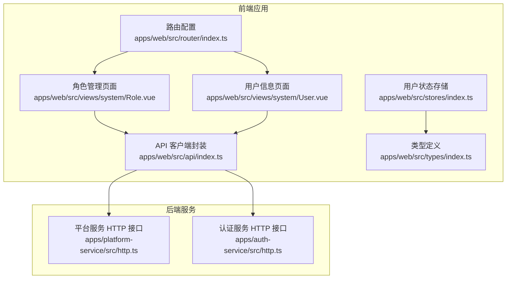
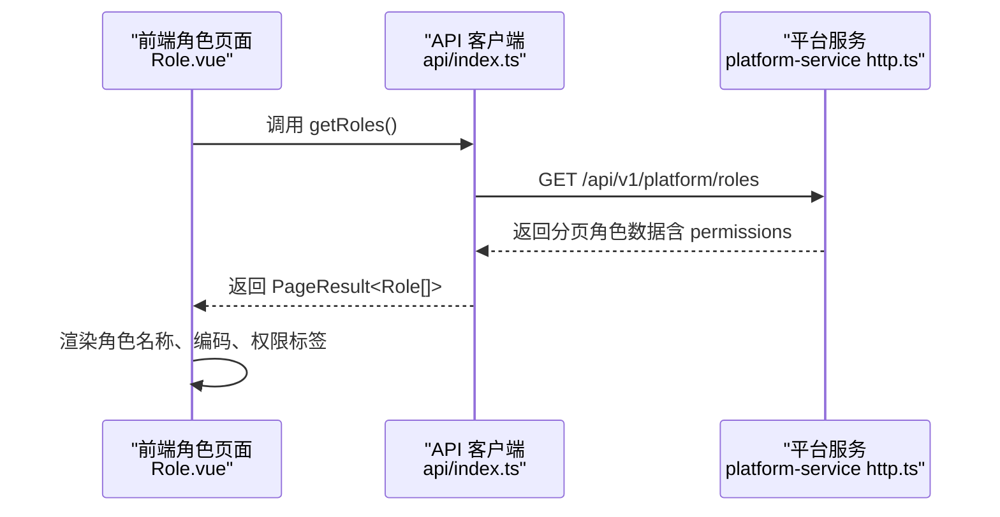
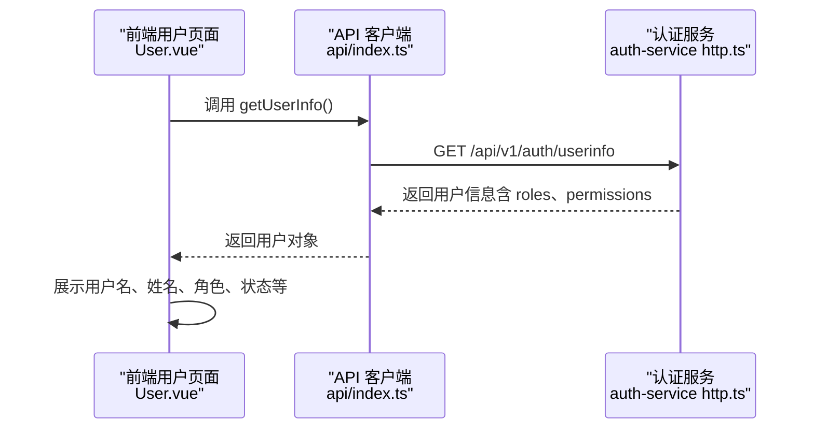
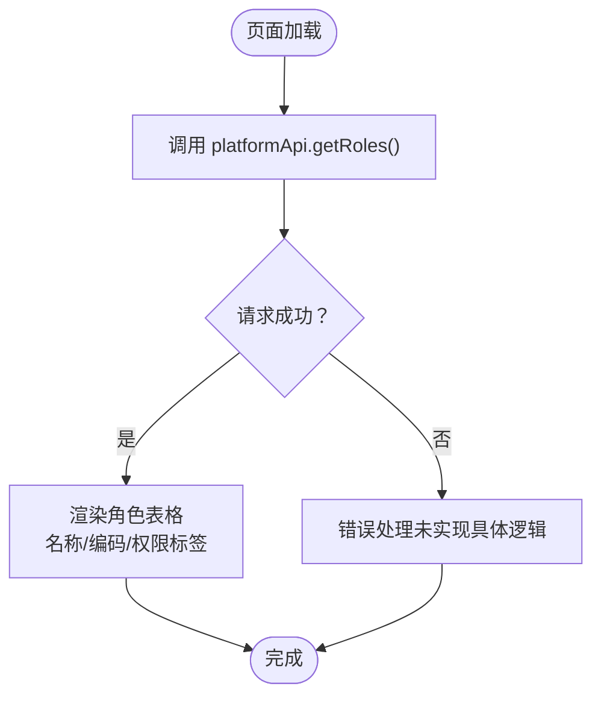
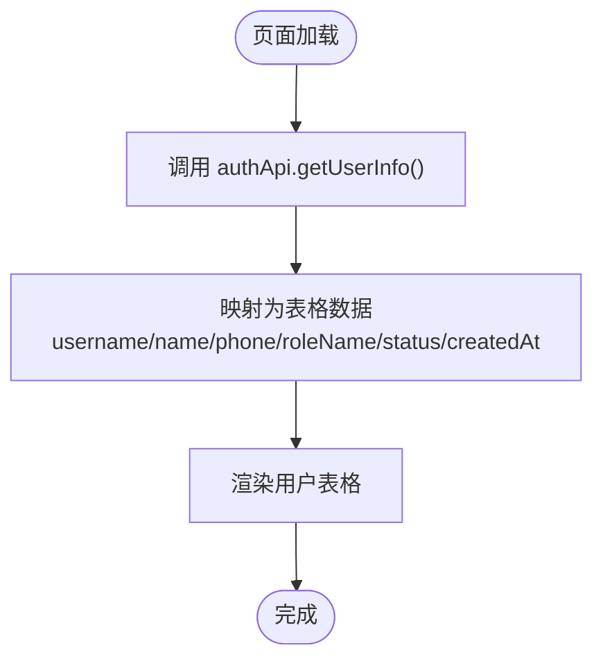
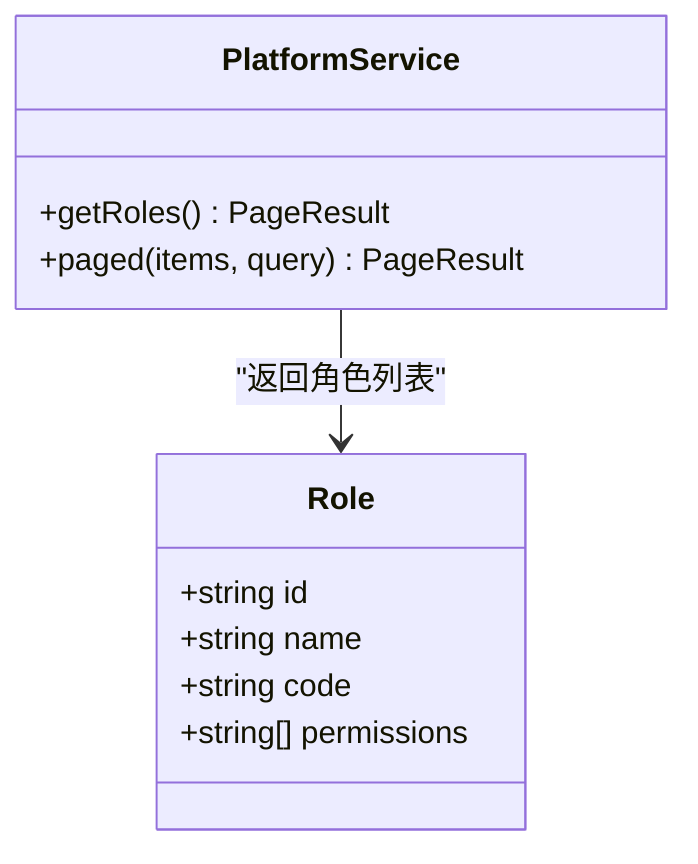
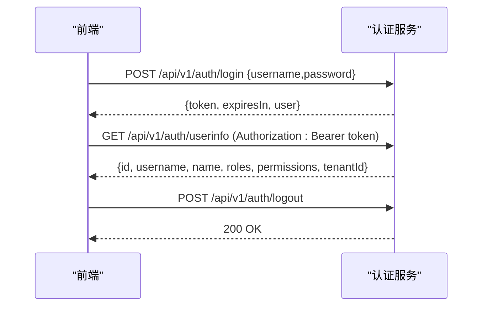
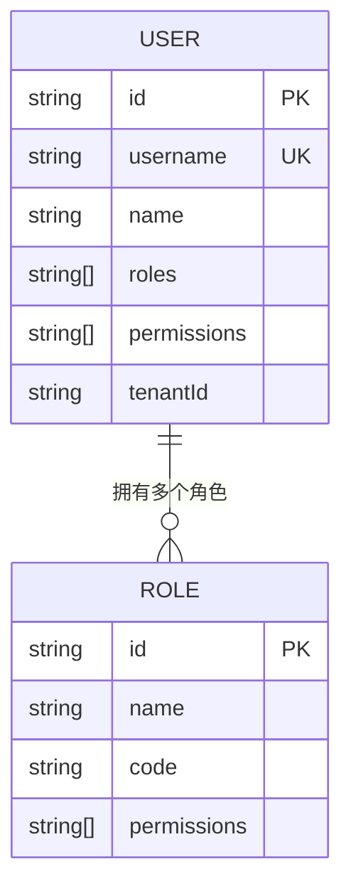
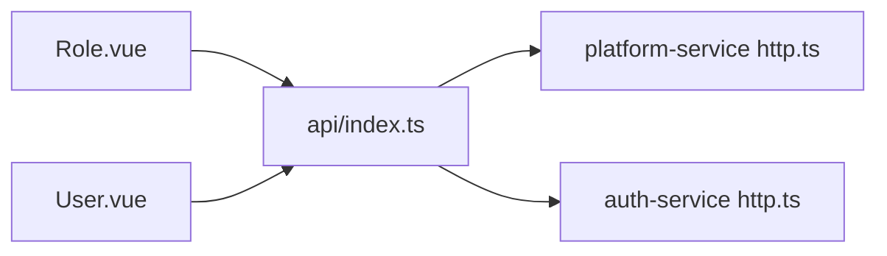

# 角色管理

<cite>
**本文引用的文件**   
- [Role.vue](file://apps/web/src/views/system/Role.vue)
- [User.vue](file://apps/web/src/views/system/User.vue)
- [index.ts（路由）](file://apps/web/src/router/index.ts)
- [index.ts（API 客户端）](file://apps/web/src/api/index.ts)
- [index.ts（用户状态存储）](file://apps/web/src/stores/index.ts)
- [index.ts（类型定义）](file://apps/web/src/types/index.ts)
- [http.ts（平台服务）](file://apps/platform-service/src/http.ts)
- [http.ts（认证服务）](file://apps/auth-service/src/http.ts)
</cite>

## 目录
1. [简介](#简介)
2. [项目结构中的角色相关位置](#项目结构中的角色相关位置)
3. [核心组件与职责](#核心组件与职责)
4. [架构总览：前端、平台服务与认证服务](#架构总览前端平台服务与认证服务)
5. [详细组件分析](#详细组件分析)
6. [RBAC 模型在系统中的实现方式](#rbac-模型在系统中的实现方式)
7. [角色权限配置与继承关系说明](#角色权限配置与继承关系说明)
8. [角色与用户的关联管理机制](#角色与用户的关联管理机制)
9. [依赖关系分析](#依赖关系分析)
10. [性能与可扩展性考虑](#性能与可扩展性考虑)
11. [故障排查指南](#故障排查指南)
12. [最佳实践与安全策略](#最佳实践与安全策略)
13. [结论](#结论)

## 简介
本章节面向“角色管理”功能，覆盖以下目标：
- 说明角色定义与管理界面：当前系统中角色的展示、查询能力。
- 解释 RBAC（基于角色的访问控制）模型在系统中的实现方式。
- 详细说明角色权限配置：权限点分配现状、继承关系现状与扩展建议。
- 说明角色与用户的关联管理机制：当前用户信息中如何携带角色与权限。
- 提供角色权限设计的最佳实践和安全策略：面向后续完善权限体系时的建议。

## 项目结构中的角色相关位置
角色管理在前端表现为系统管理下的“角色管理”页面；后端由平台服务提供角色列表接口；认证服务负责登录鉴权并返回用户角色与权限。

**图表来源**
- [index.ts（路由）:112-130](file://apps/web/src/router/index.ts#L112-L130)
- [Role.vue:1-24](file://apps/web/src/views/system/Role.vue#L1-L24)
- [User.vue:1-38](file://apps/web/src/views/system/User.vue#L1-L38)
- [index.ts（API 客户端）:169-173](file://apps/web/src/api/index.ts#L169-L173)
- [http.ts（平台服务）:17-21](file://apps/platform-service/src/http.ts#L17-L21)
- [http.ts（认证服务）:14-18](file://apps/auth-service/src/http.ts#L14-L18)

**章节来源**
- [index.ts（路由）:112-130](file://apps/web/src/router/index.ts#L112-L130)
- [Role.vue:1-24](file://apps/web/src/views/system/Role.vue#L1-L24)
- [User.vue:1-38](file://apps/web/src/views/system/User.vue#L1-L38)
- [index.ts（API 客户端）:169-173](file://apps/web/src/api/index.ts#L169-L173)
- [http.ts（平台服务）:17-21](file://apps/platform-service/src/http.ts#L17-L21)
- [http.ts（认证服务）:14-18](file://apps/auth-service/src/http.ts#L14-L18)

## 核心组件与职责
- 角色管理页面：负责从平台服务获取角色列表，并以表格形式展示角色名称、编码和权限集合。
- 用户信息页面：负责从认证服务获取当前用户信息，并在页面中展示用户名、姓名、角色等字段。
- API 客户端：封装对平台服务和认证服务的请求，包括获取角色列表和用户信息。
- 平台服务：提供角色分页查询接口，返回包含权限数组的角色数据。
- 认证服务：提供登录、获取用户信息、登出接口，返回的用户对象包含角色数组和权限数组。
- 用户状态存储：维护登录态 token 和用户信息，其中用户信息包含 roles 与 permissions。
- 类型定义：统一描述 UserInfo、MenuItem 等类型，其中 UserInfo 包含 roles 与 permissions。

**章节来源**
- [Role.vue:1-24](file://apps/web/src/views/system/Role.vue#L1-L24)
- [User.vue:1-38](file://apps/web/src/views/system/User.vue#L1-L38)
- [index.ts（API 客户端）:169-173](file://apps/web/src/api/index.ts#L169-L173)
- [http.ts（平台服务）:6-10](file://apps/platform-service/src/http.ts#L6-L10)
- [http.ts（认证服务）:6-7](file://apps/auth-service/src/http.ts#L6-L7)
- [index.ts（用户状态存储）:4-13](file://apps/web/src/stores/index.ts#L4-L13)
- [index.ts（类型定义）:228-238](file://apps/web/src/types/index.ts#L228-L238)

## 架构总览：前端、平台服务与认证服务
角色管理涉及两条主要链路：
- 角色列表查询链路：前端角色页面调用平台服务接口，获取角色分页数据。
- 用户信息与权限链路：前端用户页面调用认证服务接口，获取当前用户及其角色、权限。

**图表来源**
- [Role.vue:13-18](file://apps/web/src/views/system/Role.vue#L13-L18)
- [index.ts（API 客户端）:169-173](file://apps/web/src/api/index.ts#L169-L173)
- [http.ts（平台服务）:17-21](file://apps/platform-service/src/http.ts#L17-L21)

**图表来源**
- [User.vue:24-36](file://apps/web/src/views/system/User.vue#L24-L36)
- [index.ts（API 客户端）:13-26](file://apps/web/src/api/index.ts#L13-L26)
- [http.ts（认证服务）:14-18](file://apps/auth-service/src/http.ts#L14-L18)

## 详细组件分析

### 角色管理页面（Role.vue）
- 功能要点：
  - 使用 Element Plus 表格展示角色列表。
  - 列包括角色名称、角色编码、权限集合。
  - 通过 platformApi.getRoles 获取分页数据，并将 items 渲染到表格。
- 交互流程：
  - 页面挂载时发起请求，设置 loading 状态。
  - 成功后将 roles 赋值给响应式变量，触发视图更新。
- 权限展示：
  - 每个角色的 permissions 以标签形式展示，便于直观查看该角色拥有的权限点。

**图表来源**
- [Role.vue:1-24](file://apps/web/src/views/system/Role.vue#L1-L24)
- [index.ts（API 客户端）:169-173](file://apps/web/src/api/index.ts#L169-L173)

**章节来源**
- [Role.vue:1-24](file://apps/web/src/views/system/Role.vue#L1-L24)
- [index.ts（API 客户端）:169-173](file://apps/web/src/api/index.ts#L169-L173)

### 用户信息页面（User.vue）
- 功能要点：
  - 展示当前用户的基本信息：用户名、姓名、手机号、角色、状态、创建时间。
  - 通过 authApi.getUserInfo 获取用户信息，并将 roles 拼接为字符串显示。
- 权限体现：
  - 虽然页面未直接展示 permissions，但用户对象中包含 permissions 字段，可用于后续权限控制。

**图表来源**
- [User.vue:24-36](file://apps/web/src/views/system/User.vue#L24-L36)
- [index.ts（API 客户端）:13-26](file://apps/web/src/api/index.ts#L13-L26)

**章节来源**
- [User.vue:1-38](file://apps/web/src/views/system/User.vue#L1-L38)
- [index.ts（API 客户端）:13-26](file://apps/web/src/api/index.ts#L13-L26)

### 平台服务（platform-service http.ts）
- 角色数据结构：
  - Role 包含 id、name、code、permissions。
  - 预置了管理员角色（拥有通配权限）和农技人员角色（具备若干只读权限）。
- 接口行为：
  - GET /api/v1/platform/roles 返回分页角色数据。
  - paged 函数根据 page 与 size 参数进行分页切片。

**图表来源**
- [http.ts（平台服务）:6-10](file://apps/platform-service/src/http.ts#L6-L10)
- [http.ts（平台服务）:15-21](file://apps/platform-service/src/http.ts#L15-L21)

**章节来源**
- [http.ts（平台服务）:6-10](file://apps/platform-service/src/http.ts#L6-L10)
- [http.ts（平台服务）:15-21](file://apps/platform-service/src/http.ts#L15-L21)

### 认证服务（auth-service http.ts）
- 用户数据结构：
  - User 包含 id、username、password、name、roles、permissions、tenantId。
  - 预置管理员用户，其 roles 为 ["admin"]，permissions 为 ["*"]。
- 接口行为：
  - POST /api/v1/auth/login：校验用户名密码，生成会话 token。
  - GET /api/v1/auth/userinfo：验证 token 后返回用户信息（不含 password）。
  - POST /api/v1/auth/logout：销毁 token。

**图表来源**
- [http.ts（认证服务）:6-7](file://apps/auth-service/src/http.ts#L6-L7)
- [http.ts（认证服务）:14-18](file://apps/auth-service/src/http.ts#L14-L18)

**章节来源**
- [http.ts（认证服务）:6-7](file://apps/auth-service/src/http.ts#L6-L7)
- [http.ts（认证服务）:14-18](file://apps/auth-service/src/http.ts#L14-L18)

### 路由与菜单（router/index.ts）
- 系统管理模块下包含“用户管理”和“角色管理”两个子路由。
- 角色管理路由指向 Role.vue，用户管理路由指向 User.vue。
- 全局守卫仅做基础登录态检查，未实现基于角色或权限的路由级控制。

**章节来源**
- [index.ts（路由）:112-130](file://apps/web/src/router/index.ts#L112-L130)
- [index.ts（路由）:146-154](file://apps/web/src/router/index.ts#L146-L154)

### 用户状态存储（stores/index.ts）
- UserInfo 类型包含 roles 与 permissions。
- useUserStore 维护 token 与 userInfo，并提供 setToken、setUserInfo、logout 等方法。
- 当前未实现基于 roles/permissions 的权限判断方法，但已预留数据结构。

**章节来源**
- [index.ts（用户状态存储）:4-13](file://apps/web/src/stores/index.ts#L4-L13)
- [index.ts（用户状态存储）:15-43](file://apps/web/src/stores/index.ts#L15-L43)

### 类型定义（types/index.ts）
- UserInfo 包含 roles 与 permissions，用于前后端一致的类型契约。
- MenuItem 支持 meta.roles，可用于未来菜单级权限控制。

**章节来源**
- [index.ts（类型定义）:228-238](file://apps/web/src/types/index.ts#L228-L238)
- [index.ts（类型定义）:297-311](file://apps/web/src/types/index.ts#L297-L311)

## RBAC 模型在系统中的实现方式
当前系统的 RBAC 实现处于“基础可用”阶段：
- 角色维度：
  - 平台服务定义了 Role 实体，包含权限数组 permissions。
  - 角色列表接口返回角色及其权限集合。
- 用户维度：
  - 认证服务定义了 User 实体，包含 roles 与 permissions。
  - 登录后返回的用户对象同时携带角色与权限，便于前端进行权限判断。
- 权限粒度：
  - 权限以字符串标识，例如 dashboard:read、telemetry:read、decision:read。
  - 管理员角色使用通配符 "*" 表示所有权限。

**图表来源**
- [http.ts（认证服务）:6-7](file://apps/auth-service/src/http.ts#L6-L7)
- [http.ts（平台服务）:6-10](file://apps/platform-service/src/http.ts#L6-L10)

**章节来源**
- [http.ts（认证服务）:6-7](file://apps/auth-service/src/http.ts#L6-L7)
- [http.ts（平台服务）:6-10](file://apps/platform-service/src/http.ts#L6-L10)
- [index.ts（类型定义）:228-238](file://apps/web/src/types/index.ts#L228-L238)

## 角色权限配置与继承关系说明
- 当前权限配置：
  - 平台服务预置了两个角色：
    - 平台管理员：permissions 为 ["*"]。
    - 农技人员：permissions 为 ["dashboard:read", "telemetry:read", "decision:read"]。
- 权限继承关系：
  - 当前代码未实现显式的角色继承机制（如父角色权限自动继承到子角色）。
  - 管理员角色通过通配符权限模拟“超级权限”，并非通过继承关系实现。
- 扩展建议：
  - 引入角色层级结构（parentRoleId），在服务端计算权限闭包。
  - 提供权限合并算法，避免重复授权导致的数据冗余。
  - 在 API 层增加权限校验中间件，确保资源访问受控。

**章节来源**
- [http.ts（平台服务）:6-10](file://apps/platform-service/src/http.ts#L6-L10)

## 角色与用户的关联管理机制
- 当前机制：
  - 用户对象包含 roles 数组，表示用户被赋予的角色编码。
  - 用户对象也包含 permissions 数组，表示用户最终生效的权限集合。
  - 前端用户页面将 roles 拼接为字符串展示，便于查看用户角色。
- 关联方式：
  - 认证服务返回的用户数据中直接携带 roles 与 permissions，无需额外查询角色表。
  - 平台服务提供角色列表，供管理员查看角色及其权限。
- 改进方向：
  - 明确角色与用户的关联表（user_role），支持多对多关系。
  - 提供用户角色分配接口，允许管理员为用户动态分配或移除角色。
  - 在用户信息接口中返回角色详情（而非仅编码），便于前端展示更丰富的角色信息。

**章节来源**
- [http.ts（认证服务）:6-7](file://apps/auth-service/src/http.ts#L6-L7)
- [User.vue:24-36](file://apps/web/src/views/system/User.vue#L24-L36)
- [http.ts（平台服务）:6-10](file://apps/platform-service/src/http.ts#L6-L10)

## 依赖关系分析
前端与后端之间的依赖关系如下：
- 前端角色页面依赖 API 客户端的 getRoles 方法。
- API 客户端依赖平台服务的角色列表接口。
- 前端用户页面依赖 API 客户端的 getUserInfo 方法。
- API 客户端依赖认证服务的用户信息接口。

**图表来源**
- [Role.vue:13-18](file://apps/web/src/views/system/Role.vue#L13-L18)
- [User.vue:24-36](file://apps/web/src/views/system/User.vue#L24-L36)
- [index.ts（API 客户端）:13-26](file://apps/web/src/api/index.ts#L13-L26)
- [index.ts（API 客户端）:169-173](file://apps/web/src/api/index.ts#L169-L173)
- [http.ts（平台服务）:17-21](file://apps/platform-service/src/http.ts#L17-L21)
- [http.ts（认证服务）:14-18](file://apps/auth-service/src/http.ts#L14-L18)

**章节来源**
- [Role.vue:13-18](file://apps/web/src/views/system/Role.vue#L13-L18)
- [User.vue:24-36](file://apps/web/src/views/system/User.vue#L24-L36)
- [index.ts（API 客户端）:13-26](file://apps/web/src/api/index.ts#L13-L26)
- [index.ts（API 客户端）:169-173](file://apps/web/src/api/index.ts#L169-L173)
- [http.ts（平台服务）:17-21](file://apps/platform-service/src/http.ts#L17-L21)
- [http.ts（认证服务）:14-18](file://apps/auth-service/src/http.ts#L14-L18)

## 性能与可扩展性考虑
- 分页查询：
  - 平台服务已实现分页，前端可合理设置 page 与 size，避免一次性加载过多数据。
- 权限缓存：
  - 建议在用户登录后缓存 permissions，减少频繁权限判断开销。
- 权限计算：
  - 若引入角色继承，应在服务端计算最终权限集合并缓存，避免每次请求都进行复杂计算。
- 接口扩展：
  - 建议新增角色 CRUD 接口，保持前后端职责清晰，便于后续扩展权限矩阵。

[本节为通用指导，不直接分析具体文件]

## 故障排查指南
- 角色列表为空：
  - 检查平台服务是否返回空数组。
  - 确认前端是否正确调用 platformApi.getRoles。
- 用户信息缺失角色或权限：
  - 检查认证服务返回的用户对象是否包含 roles 与 permissions。
  - 确认登录流程是否正确获取并保存 token。
- 权限控制未生效：
  - 当前路由守卫未实现基于角色或权限的控制，需在前端增加权限判断逻辑。
  - 在后端增加接口级权限校验，防止越权访问。

**章节来源**
- [Role.vue:13-18](file://apps/web/src/views/system/Role.vue#L13-L18)
- [User.vue:24-36](file://apps/web/src/views/system/User.vue#L24-L36)
- [index.ts（路由）:146-154](file://apps/web/src/router/index.ts#L146-L154)

## 最佳实践与安全策略
- 权限设计：
  - 采用最小权限原则，为每个角色分配必要的最小权限集合。
  - 避免直接使用通配符权限，仅在极少数超级管理员场景使用。
- 角色继承：
  - 若需要继承，应明确继承规则，避免循环继承和权限爆炸。
- 审计与日志：
  - 记录角色与权限变更操作，便于审计与追溯。
- 安全策略：
  - 对所有敏感接口进行服务端权限校验，不能仅依赖前端控制。
  - 对用户输入进行严格校验，防止注入攻击。
  - 定期审查角色权限，清理不再使用的权限点。

[本节为通用指导，不直接分析具体文件]

## 结论
当前系统的角色管理功能已具备基础能力：
- 前端可展示角色列表与用户信息。
- 平台服务提供角色分页接口，认证服务返回用户角色与权限。
- RBAC 模型初步落地，但尚未实现完整的角色 CRUD、权限继承与细粒度权限控制。
后续建议：
- 完善角色管理界面，支持角色的创建、编辑、删除。
- 引入角色继承与权限矩阵，提升权限管理的灵活性与可维护性。
- 加强前后端权限校验，确保系统安全性与一致性。

[本节为总结性内容，不直接分析具体文件]