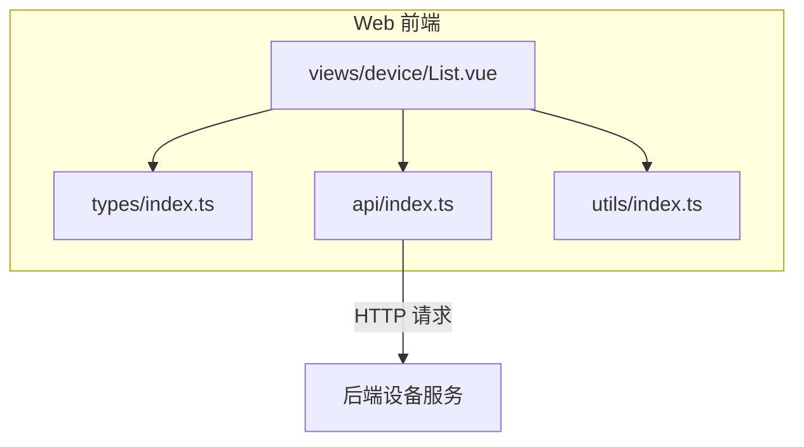
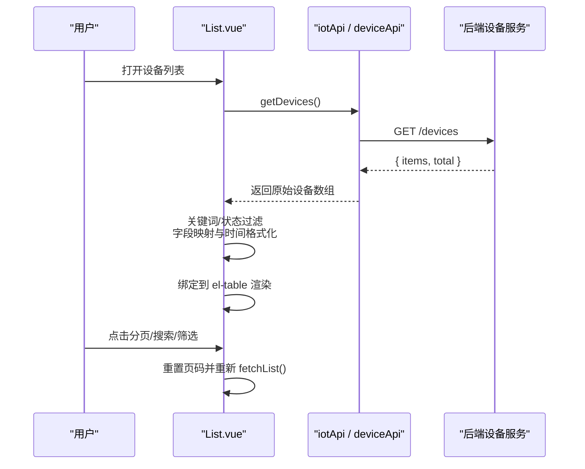
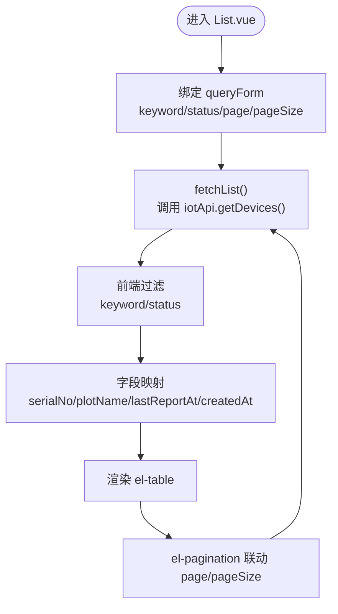
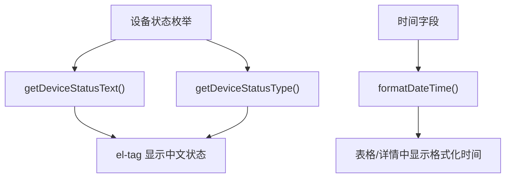
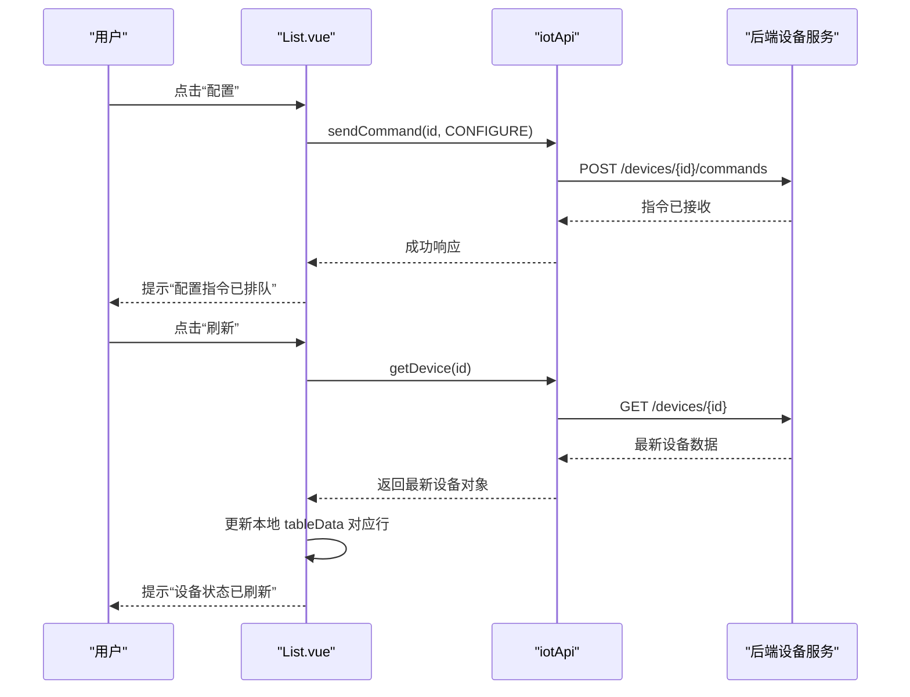
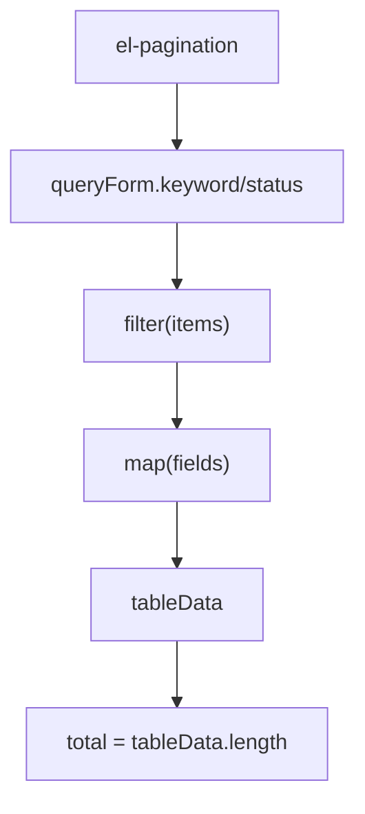
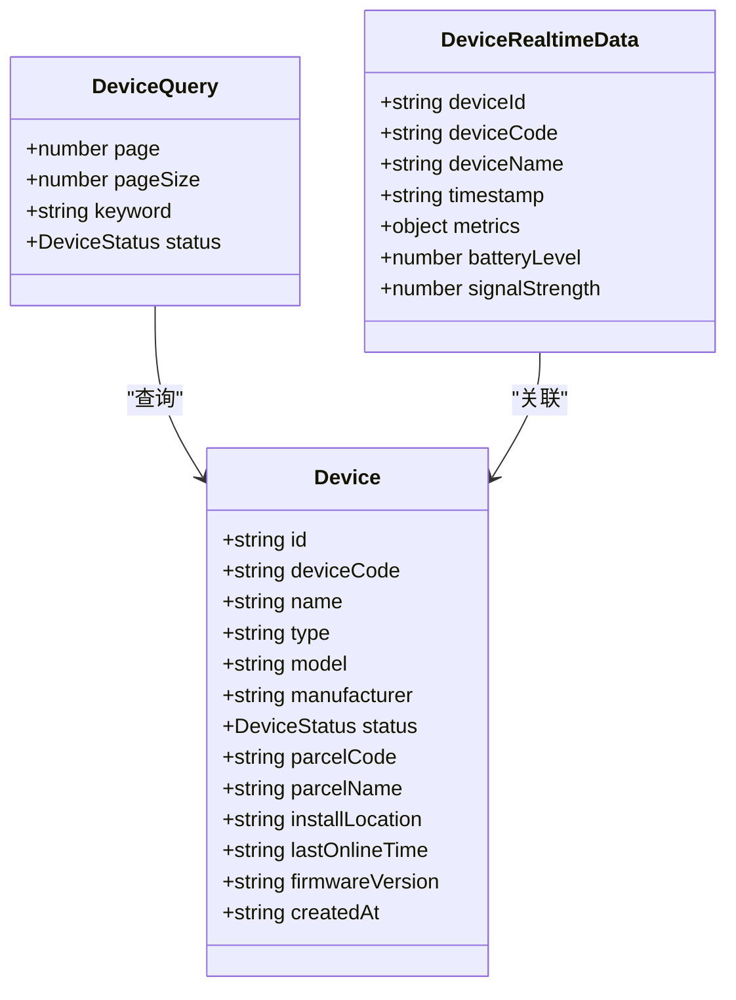

# 设备列表页面

<cite>
**本文引用的文件**   
- [List.vue](file://apps/web/src/views/device/List.vue)
- [index.ts（类型定义）](file://apps/web/src/types/index.ts)
- [index.ts（API 封装）](file://apps/web/src/api/index.ts)
- [index.ts（工具函数）](file://apps/web/src/utils/index.ts)
</cite>

## 目录
1. [简介](#简介)
2. [项目结构定位](#项目结构定位)
3. [核心功能总览](#核心功能总览)
4. [架构与数据流](#架构与数据流)
5. [组件详细分析](#组件详细分析)
6. [设备数据模型](#设备数据模型)
7. [API 接口说明](#api-接口说明)
8. [用户交互流程](#用户交互流程)
9. [性能与可维护性建议](#性能与可维护性建议)
10. [常见问题排查](#常见问题排查)
11. [结论](#结论)

## 简介
本页面为智慧农业平台的“设备列表”管理界面，提供设备信息的统一查看、筛选、分页展示以及基础操作能力。当前实现聚焦于：
- 设备信息查询与筛选（按名称/编号关键词、按状态）
- 设备状态标签展示（在线、离线、故障、维护中）
- 表格字段映射与时间格式化
- 基础操作按钮（查看详情、配置参数、刷新状态）
- 前端本地过滤与分页控件联动

该页面基于 Vue 3 + TypeScript + Element Plus 构建，通过统一的 API 层访问后端设备服务。

## 项目结构定位
设备列表页面位于前端 Web 应用的设备模块下，采用单文件组件组织方式：
- 视图层：`apps/web/src/views/device/List.vue`
- 类型定义：`apps/web/src/types/index.ts`
- API 封装：`apps/web/src/api/index.ts`
- 工具函数：`apps/web/src/utils/index.ts`



**图表来源**
- [List.vue:1-132](file://apps/web/src/views/device/List.vue#L1-L132)
- [index.ts（类型定义）:125-148](file://apps/web/src/types/index.ts#L125-L148)
- [index.ts（API 封装）:103-167](file://apps/web/src/api/index.ts#L103-L167)
- [index.ts（工具函数）:54-72](file://apps/web/src/utils/index.ts#L54-L72)

**章节来源**
- [List.vue:1-132](file://apps/web/src/views/device/List.vue#L1-L132)
- [index.ts（类型定义）:125-148](file://apps/web/src/types/index.ts#L125-L148)
- [index.ts（API 封装）:103-167](file://apps/web/src/api/index.ts#L103-L167)
- [index.ts（工具函数）:54-72](file://apps/web/src/utils/index.ts#L54-L72)

## 核心功能总览
- 搜索与筛选
  - 关键词：支持设备名称或编号模糊匹配
  - 状态：支持在线、离线、故障、维护中四类筛选
- 表格渲染
  - 设备编号、设备名称、所属地块、状态标签、最后上报时间、安装时间
  - 时间字段统一格式化
- 操作按钮
  - 详情：弹出设备详情对话框
  - 配置：下发配置指令
  - 刷新：拉取最新设备信息并更新行数据
- 分页
  - 使用分页控件控制页码与每页条数
  - 当前实现为前端本地过滤后计算总数

## 架构与数据流
设备列表页面的数据获取与渲染流程如下：



**图表来源**
- [List.vue:95-130](file://apps/web/src/views/device/List.vue#L95-L130)
- [index.ts（API 封装）:157-167](file://apps/web/src/api/index.ts#L157-L167)

**章节来源**
- [List.vue:95-130](file://apps/web/src/views/device/List.vue#L95-L130)
- [index.ts（API 封装）:157-167](file://apps/web/src/api/index.ts#L157-L167)

## 组件详细分析

### 模板结构与数据绑定
- 搜索栏
  - 关键词输入框绑定 `queryForm.keyword`
  - 状态下拉框绑定 `queryForm.status`
  - 查询按钮触发 `handleSearch()`
- 表格列
  - 设备编号：绑定 `serialNo`（由 `deviceNo` 映射）
  - 设备名称：绑定 `name`
  - 所属地块：绑定 `plotName`（由 `plotCode` 映射，空值显示 `-`）
  - 状态：使用 `getDeviceStatusType` 和 `getDeviceStatusText` 渲染标签
  - 最后上报时间：绑定 `lastReportAt`（由 `lastSeenAt` 映射），并通过 `formatDateTime` 格式化
  - 安装时间：绑定 `createdAt`（当前映射为 `lastSeenAt`）
- 操作列
  - 详情：调用 `showDetail(row)`
  - 配置：调用 `configure(row)`
  - 刷新：调用 `refreshDevice(row)`
- 分页控件
  - 双向绑定 `queryForm.page` 与 `queryForm.pageSize`
  - 总数 `total` 由过滤后的结果长度决定



**图表来源**
- [List.vue:5-60](file://apps/web/src/views/device/List.vue#L5-L60)
- [List.vue:88-116](file://apps/web/src/views/device/List.vue#L88-L116)

**章节来源**
- [List.vue:5-60](file://apps/web/src/views/device/List.vue#L5-L60)
- [List.vue:88-116](file://apps/web/src/views/device/List.vue#L88-L116)

### 状态展示与时间格式化
- 状态文本与标签类型
  - 使用 `getDeviceStatusText` 将枚举转为中文文本
  - 使用 `getDeviceStatusType` 将枚举转为 Element Plus 的 tag 类型
- 时间格式化
  - 使用 `formatDateTime` 将时间字符串格式化为 `YYYY-MM-DD HH:mm:ss`



**图表来源**
- [index.ts（工具函数）:54-72](file://apps/web/src/utils/index.ts#L54-L72)
- [index.ts（工具函数）:4-7](file://apps/web/src/utils/index.ts#L4-L7)

**章节来源**
- [index.ts（工具函数）:54-72](file://apps/web/src/utils/index.ts#L54-L72)
- [index.ts（工具函数）:4-7](file://apps/web/src/utils/index.ts#L4-L7)

### 操作按钮交互逻辑
- 查看详情
  - 将选中行赋值给 `selectedDevice`，并打开详情对话框
  - 详情对话框展示设备编号、名称、类型、状态、所属地块、最后在线时间等
- 配置参数
  - 调用 `iotApi.sendCommand(id, { type: 'CONFIGURE', parameters })`
  - 成功后提示“配置指令已排队”
- 刷新状态
  - 调用 `iotApi.getDevice(id)` 获取最新设备信息
  - 在本地表格数据中找到对应行并替换，同时完成字段映射
  - 成功后提示“设备状态已刷新”



**图表来源**
- [List.vue:118-126](file://apps/web/src/views/device/List.vue#L118-L126)
- [index.ts（API 封装）:157-167](file://apps/web/src/api/index.ts#L157-L167)

**章节来源**
- [List.vue:118-126](file://apps/web/src/views/device/List.vue#L118-L126)
- [index.ts（API 封装）:157-167](file://apps/web/src/api/index.ts#L157-L167)

### 分页加载与搜索过滤
- 分页
  - 使用 `el-pagination` 双向绑定 `queryForm.page` 与 `queryForm.pageSize`
  - 当前实现中，`total` 为过滤后的本地数据长度，未与服务端分页参数联动
- 搜索过滤
  - 关键词：对 `name` 与 `deviceNo` 进行包含匹配
  - 状态：精确匹配 `status`
- 注意
  - 当前分页控件存在但实际未与服务端分页参数联动，属于“占位式分页”
  - 如需服务端分页，需调整 `fetchList` 以传递 `page` 与 `pageSize`，并使用返回的 `total`



**图表来源**
- [List.vue:95-116](file://apps/web/src/views/device/List.vue#L95-L116)
- [List.vue:53-60](file://apps/web/src/views/device/List.vue#L53-L60)

**章节来源**
- [List.vue:95-116](file://apps/web/src/views/device/List.vue#L95-L116)
- [List.vue:53-60](file://apps/web/src/views/device/List.vue#L53-L60)

## 设备数据模型
- 设备实体
  - 关键字段包括：设备标识、设备编码、名称、类型、型号、制造商、状态、地块编码/名称、安装位置、最后在线时间、固件版本、创建时间
- 设备查询参数
  - 支持分页、关键词、状态筛选
- 实时遥测数据
  - 包含设备标识、时间戳、指标集合（温湿度、光照、CO2、风速风向、降雨、土壤 pH 等）、电量、信号强度



**图表来源**
- [index.ts（类型定义）:125-168](file://apps/web/src/types/index.ts#L125-L168)

**章节来源**
- [index.ts（类型定义）:125-168](file://apps/web/src/types/index.ts#L125-L168)

## API 接口说明
- 设备相关 API（通用）
  - 获取设备列表：GET `/devices`
  - 获取设备详情：GET `/devices/{id}`
  - 创建设备：POST `/devices`
  - 更新设备：PUT `/devices/{id}`
  - 删除设备：DELETE `/devices/{id}`
  - 获取最新遥测数据：GET `/devices/{id}/latest-data`
- IoT 专用 API（设备列表页面使用）
  - 获取设备列表：GET `/devices`，返回 `{ items, total }`
  - 获取单个设备：GET `/devices/{id}`
  - 发送设备指令：POST `/devices/{id}/commands`

```mermaid
graph LR
Client["前端 List.vue"] --> IOT["iotApi"]
IOT --> |GET /devices| Backend["设备服务"]
IOT --> |GET /devices/{id}| Backend
IOT --> |POST /devices/{id}/commands| Backend
```

**图表来源**
- [index.ts（API 封装）:103-123](file://apps/web/src/api/index.ts#L103-L123)
- [index.ts（API 封装）:157-167](file://apps/web/src/api/index.ts#L157-L167)

**章节来源**
- [index.ts（API 封装）:103-123](file://apps/web/src/api/index.ts#L103-L123)
- [index.ts（API 封装）:157-167](file://apps/web/src/api/index.ts#L157-L167)

## 用户交互流程

### 设备注册
- 当前页面未提供设备注册表单入口
- 可通过“添加设备”按钮预留扩展点，后续对接 `deviceApi.create` 或 `iotApi` 新增接口

### 设备查询与筛选
- 关键词：支持设备名称或编号模糊匹配
- 状态：支持在线、离线、故障、维护中四类筛选
- 点击“查询”后重置页码并重新加载数据

### 设备状态展示
- 使用标签组件展示状态，颜色由状态类型映射决定
- 状态枚举与文本映射集中管理，便于扩展与维护

### 设备分类管理
- 当前页面未提供设备分类管理功能
- 可在后续扩展“类型/厂商/型号”等维度筛选，并在表格中增加相应列

## 性能与可维护性建议
- 分页优化
  - 当前分页为前端本地过滤，大数据量时会影响性能
  - 建议改为服务端分页，将 `page` 与 `pageSize` 传递给后端，并使用返回的 `total`
- 搜索优化
  - 关键词搜索建议加入防抖，避免频繁触发
- 字段映射
  - 建议在 API 层统一做字段归一化，减少视图层映射逻辑
- 错误处理
  - 当前错误仅打印日志，建议结合用户反馈提示失败原因
- 可测试性
  - 将过滤与映射逻辑抽离为独立函数，便于单元测试

[本节为通用建议，不直接分析具体文件]

## 常见问题排查
- 表格无数据
  - 检查 `iotApi.getDevices` 是否返回空数组
  - 确认关键词与状态筛选条件是否正确
- 状态标签显示异常
  - 检查 `DeviceStatus` 枚举是否与后端一致
  - 确认 `getDeviceStatusText` 与 `getDeviceStatusType` 映射完整
- 时间显示不正确
  - 检查传入时间是否为有效字符串或 Date 对象
  - 确认 `formatDateTime` 的格式是否符合预期
- 分页无效
  - 当前实现为前端本地分页，若期望服务端分页，需调整 `fetchList` 与 API 调用
- 配置/刷新失败
  - 检查网络请求与后端接口可用性
  - 查看控制台错误日志定位问题

**章节来源**
- [List.vue:95-130](file://apps/web/src/views/device/List.vue#L95-L130)
- [index.ts（工具函数）:54-72](file://apps/web/src/utils/index.ts#L54-L72)

## 结论
设备列表页面实现了设备信息的统一展示、基础筛选与常用操作，具备较好的可扩展性。当前实现以本地过滤为主，适合中小规模数据场景；未来可逐步引入服务端分页、更丰富的筛选维度与更完善的错误提示机制，以提升用户体验与系统性能。

[本节为总结性内容，不直接分析具体文件]