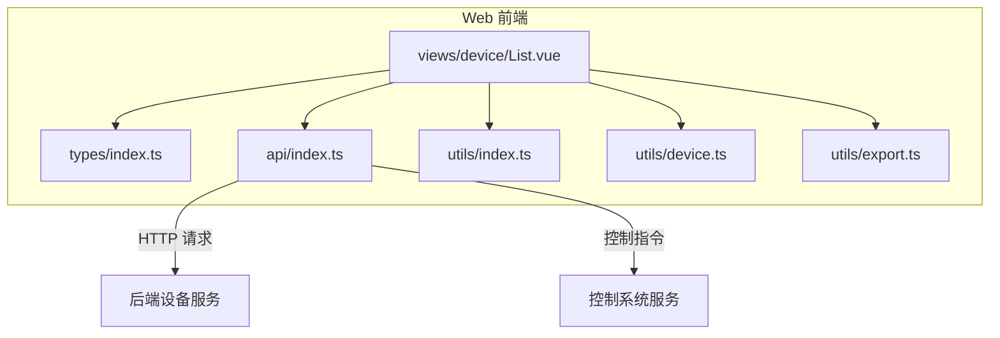
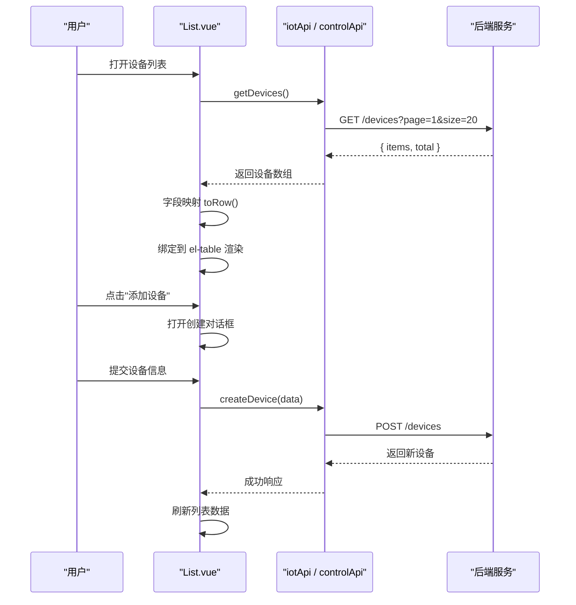
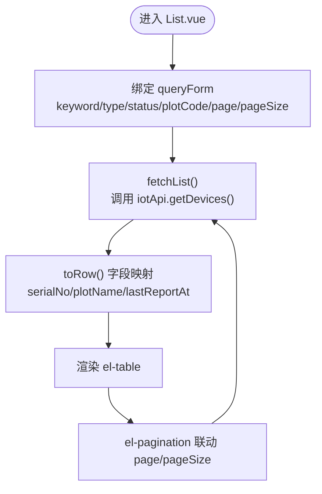
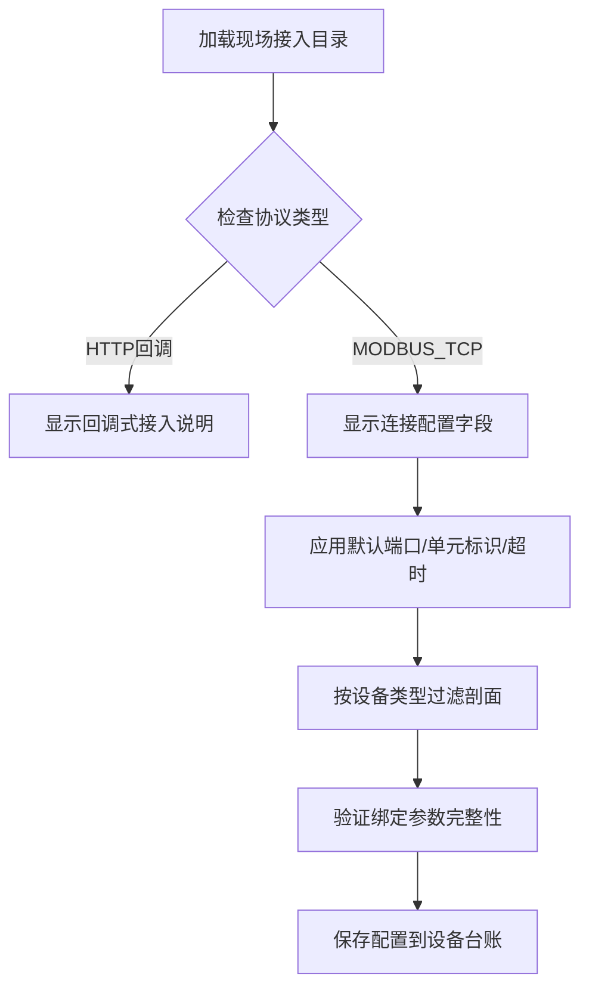
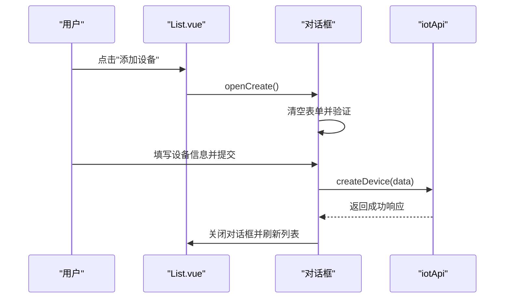
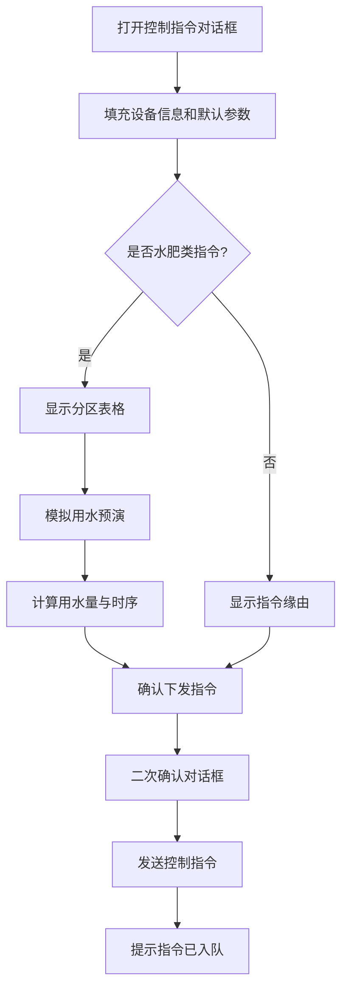
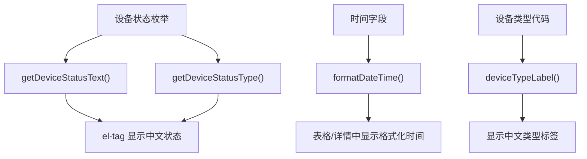
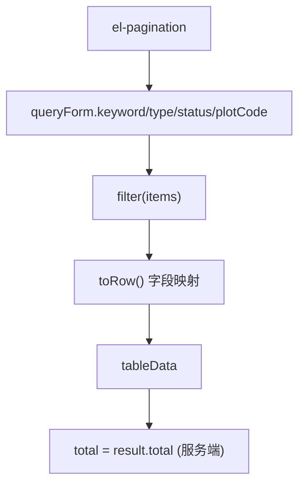
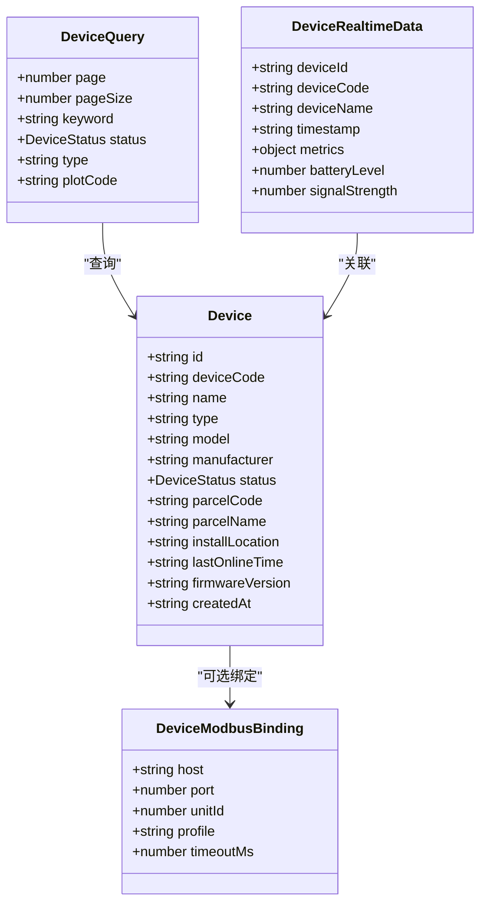
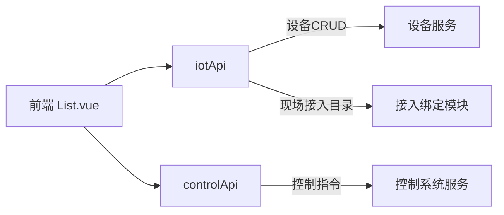

# 设备列表页面

<cite>
**本文引用的文件**   
- [List.vue](file://apps/web/src/views/device/List.vue)
- [index.ts（类型定义）](file://apps/web/src/types/index.ts)
- [index.ts（API 封装）](file://apps/web/src/api/index.ts)
- [index.ts（工具函数）](file://apps/web/src/utils/index.ts)
- [device.ts（设备工具）](file://apps/web/src/utils/device.ts)
- [export.ts（CSV导出工具）](file://apps/web/src/utils/export.ts)
</cite>

## 更新摘要
**变更内容**   
- 新增完整CRUD功能：设备登记（添加）、台账配置（编辑）、设备删除（预留）
- 新增控制指令下发功能：支持灌溉、施肥、播种、除草等指令类型
- 增强搜索筛选：支持设备类型、所属地块等多维度筛选
- 完善权限控制：基于用户权限控制管理功能显示
- 集成控制系统：与control-service集成，支持水肥方案预演和指令入队
- **新增现场接入目录集成**：动态获取协议、剖面配置和默认参数
- **增强配置对话框**：支持Modbus TCP连接配置，动态字段显示和验证
- **改进绑定管理**：智能处理空值和缺省值，避免前后端配置不一致

## 目录
1. [简介](#简介)
2. [项目结构定位](#项目结构定位)
3. [核心功能总览](#核心功能总览)
4. [架构与数据流](#架构与数据流)
5. [组件详细分析](#组件详细分析)
6. [设备数据模型](#设备数据模型)
7. [API 接口说明](#api-接口说明)
8. [用户交互流程](#用户交互流程)
9. [性能与可维护性建议](#性能与可维护性建议)
10. [常见问题排查](#常见问题排查)
11. [结论](#结论)

## 简介
本页面为智慧农业平台的"设备列表"管理界面，提供设备的完整生命周期管理功能。当前实现聚焦于：
- 设备信息查询与多维度筛选（按名称/编号、类型、状态、所属地块）
- 设备CRUD操作：登记新设备、编辑设备台账、查看设备详情
- 设备状态展示（在线、离线、故障、维护中）
- 控制指令下发：支持灌溉、施肥、播种、除草等作业指令
- 水肥方案预演：计算用水量、阀门时序和设备运行时长
- 表格字段映射与时间格式化
- 分页加载与服务端真实分页
- **现场接入目录集成**：动态获取协议配置、寄存器剖面和默认参数
- **智能绑定管理**：自动处理Modbus TCP连接配置，确保前后端一致性

该页面基于 Vue 3 + TypeScript + Element Plus 构建，通过统一的 API 层访问后端设备服务，并与控制系统服务集成。

## 项目结构定位
设备列表页面位于前端 Web 应用的设备模块下，采用单文件组件组织方式：
- 视图层：`apps/web/src/views/device/List.vue`
- 类型定义：`apps/web/src/types/index.ts`
- API 封装：`apps/web/src/api/index.ts`
- 工具函数：`apps/web/src/utils/index.ts`
- 设备工具：`apps/web/src/utils/device.ts`
- CSV导出工具：`apps/web/src/utils/export.ts`

**图表来源**
- [List.vue:1-811](file://apps/web/src/views/device/List.vue#L1-L811)
- [index.ts（类型定义）:199-258](file://apps/web/src/types/index.ts#L199-L258)
- [index.ts（API 封装）:363-383](file://apps/web/src/api/index.ts#L363-L383)
- [device.ts:9-35](file://apps/web/src/utils/device.ts#L9-L35)

**章节来源**
- [List.vue:1-811](file://apps/web/src/views/device/List.vue#L1-L811)
- [index.ts（类型定义）:199-258](file://apps/web/src/types/index.ts#L199-L258)
- [index.ts（API 封装）:363-383](file://apps/web/src/api/index.ts#L363-L383)
- [device.ts:9-35](file://apps/web/src/utils/device.ts#L9-L35)

## 核心功能总览
### 设备信息管理
- **设备查询与筛选**
  - 关键词：支持设备名称或编号模糊匹配
  - 设备类型：支持气象站、墒情传感器、综合监测站等11种设备类型筛选
  - 设备状态：支持在线、离线两类初始状态筛选
  - 所属地块：支持按地块编码精确筛选
- **设备CRUD操作**
  - 登记新设备：填写设备基本信息并创建台账
  - 编辑设备台账：修改设备名称、类型、状态、所属地块
  - 查看设备详情：展示设备完整信息
  - 刷新设备状态：获取最新设备信息并更新行数据

### 现场接入目录集成
- **动态协议配置**
  - 从后端获取支持的协议列表（HTTP回调、MODBUS_TCP轮询等）
  - 根据协议类型动态显示/隐藏连接配置字段
  - 自动应用服务端定义的默认端口、单元标识和超时参数
- **寄存器剖面管理**
  - 按设备类型过滤可用的寄存器剖面
  - 显示累计量读保持寄存器和计量单位信息
  - 支持十六进制地址格式转换（十进制↔十六进制）
- **智能绑定验证**
  - 根据协议要求动态启用必填字段验证
  - 防止不兼容的设备类型与剖面组合
  - 自动清理历史绑定数据当协议切换时

### 控制指令管理
- **指令类型支持**
  - 灌溉：支持分区灌溉，可设置灌水定额和流量
  - 施肥：支持水肥一体化，可设置氮磷钾配比和搅拌参数
  - 播种：基础播种指令
  - 除草：基础除草指令
- **水肥方案预演**
  - 自动计算总用水量和预计时长
  - 生成阀门时序和供水曲线
  - 提供用水预警和参数校验

### 权限控制
- 基于用户权限控制管理功能显示
- 只有具备 `device:control` 权限的用户才能看到添加、配置、控制按钮

## 架构与数据流
设备列表页面的数据获取与渲染流程如下：

**图表来源**
- [List.vue:369-389](file://apps/web/src/views/device/List.vue#L369-L389)
- [List.vue:421-443](file://apps/web/src/views/device/List.vue#L421-L443)
- [index.ts（API 封装）:365-382](file://apps/web/src/api/index.ts#L365-L382)

**章节来源**
- [List.vue:369-389](file://apps/web/src/views/device/List.vue#L369-L389)
- [List.vue:421-443](file://apps/web/src/views/device/List.vue#L421-L443)
- [index.ts（API 封装）:365-382](file://apps/web/src/api/index.ts#L365-L382)

## 组件详细分析

### 模板结构与数据绑定
- **搜索栏**
  - 关键词输入框绑定 `queryForm.keyword`
  - 设备类型下拉框绑定 `queryForm.type`
  - 设备状态下拉框绑定 `queryForm.status`
  - 所属地块输入框绑定 `queryForm.plotCode`
  - 查询按钮触发 `handleSearch()`，重置按钮触发 `handleReset()`
- **表格列**
  - 设备编号：绑定 `serialNo`（由 `deviceNo` 映射）
  - 设备名称：绑定 `name`
  - 所属地块：绑定 `plotName`（由 `plotCode` 映射，空值显示 `-`）
  - 状态：使用 `getDeviceStatusType` 和 `getDeviceStatusText` 渲染标签
  - 最后上报时间：绑定 `lastReportAt`（由 `lastSeenAt` 映射），并通过 `formatDateTime` 格式化
- **操作列**
  - 详情：调用 `showDetail(row)`
  - 配置：调用 `openConfig(row)`（需要权限）
  - 控制：调用 `openCommand(row)`（需要权限）
  - 刷新：调用 `refreshDevice(row)`
- **分页控件**
  - 双向绑定 `queryForm.page` 与 `queryForm.pageSize`
  - 总数 `total` 由服务端返回的真实分页数据决定

**图表来源**
- [List.vue:5-75](file://apps/web/src/views/device/List.vue#L5-L75)
- [List.vue:369-389](file://apps/web/src/views/device/List.vue#L369-L389)

**章节来源**
- [List.vue:5-75](file://apps/web/src/views/device/List.vue#L5-L75)
- [List.vue:369-389](file://apps/web/src/views/device/List.vue#L369-L389)

### 现场接入目录集成

**新增** 现场接入目录是设备配置的核心，它从后端动态获取协议、剖面和默认参数，确保前端与网关配置的一致性。

- **目录加载机制**
  - 页面初始化时调用 `ensureFieldAccess()` 获取完整的接入目录
  - 缓存目录数据，避免重复请求
  - 错误处理：加载失败时记录日志但不影响其他功能
- **协议配置管理**
  - 动态渲染支持的协议选项（HTTP回调、MODBUS_TCP轮询等）
  - 根据 `requiresBinding` 标志决定是否显示连接配置字段
  - 自动应用 `defaultProtocol` 作为默认选择
- **寄存器剖面管理**
  - 按设备类型过滤可用剖面：`profileOptions = catalogue.profiles.filter(item => !configForm.type || item.applicableTypes.includes(configForm.type))`
  - 显示累计量读保持寄存器信息和计量单位
  - 支持十六进制地址格式转换：`hex(value) = '0x' + value.toString(16).toUpperCase().padStart(4, '0')`
- **默认参数应用**
  - 端口、单元标识、超时等参数留空时自动应用服务端默认值
  - 表单提示显示缺省值：`${fieldAccess?.defaults.port ?? ''}`
  - 防止前后端配置不一致导致的连接问题

**图表来源**
- [List.vue:466-499](file://apps/web/src/views/device/List.vue#L466-L499)
- [List.vue:521-544](file://apps/web/src/views/device/List.vue#L521-L544)

**章节来源**
- [List.vue:466-499](file://apps/web/src/views/device/List.vue#L466-L499)
- [List.vue:521-544](file://apps/web/src/views/device/List.vue#L521-L544)

### 设备CRUD功能实现
- **设备登记（添加）**
  - 表单验证：设备名称必填、设备编号格式验证（字母数字连字符，3-32位）、设备类型必填、初始状态必填
  - 提交处理：调用 `iotApi.createDevice()` 创建设备，成功后刷新列表
  - 权限控制：仅当用户具有 `device:control` 权限时显示添加按钮
- **设备台账配置（编辑）**
  - 表单初始化：从选中行填充设备编号（只读）、名称、类型、地块、状态
  - 表单验证：设备名称必填、设备类型必填、在线状态必填
  - 提交处理：调用 `iotApi.updateDevice()` 更新设备，成功后更新本地表格数据
  - 特殊处理：空字符串表示解绑地块，必须原样发送到后端
  - **智能绑定管理**：根据协议类型动态处理绑定参数，空值自动省略不发出去
- **设备详情查看**
  - 弹窗展示：设备编号、名称、类型、状态、所属地块、最后在线时间
  - 类型显示：使用 `deviceTypeLabel()` 将设备类型转换为中文标签
  - **现场接入摘要**：显示地址、端口、单元标识与剖面名的简洁摘要

**图表来源**
- [List.vue:411-443](file://apps/web/src/views/device/List.vue#L411-L443)
- [List.vue:576-631](file://apps/web/src/views/device/List.vue#L576-L631)

**章节来源**
- [List.vue:411-443](file://apps/web/src/views/device/List.vue#L411-L443)
- [List.vue:576-631](file://apps/web/src/views/device/List.vue#L576-L631)

### 控制指令下发功能
- **指令类型支持**
  - 灌溉（IRRIGATION）：支持分区灌溉，可设置灌水定额和流量
  - 施肥（FERTILIZATION）：支持水肥一体化，可设置氮磷钾配比和搅拌参数
  - 播种（SEEDING）：基础播种指令
  - 除草（WEEDING）：基础除草指令
- **水肥方案预演**
  - 自动计算：根据分区面积和目标毫米数计算总用水量和预计时长
  - 阀门时序：生成每个分区的开启时间和持续时间
  - 供水曲线：生成随时间变化的累计供水量曲线
  - 参数校验：确保分区面积大于0，防止无法计算用水量
- **指令确认流程**
  - 二次确认：弹出确认对话框显示指令摘要
  - 指令入队：成功后提示"指令已入队"，可在控制指令页面查看
  - 错误处理：业务参数越界等错误由请求拦截器直接提示

**图表来源**
- [List.vue:635-775](file://apps/web/src/views/device/List.vue#L635-L775)

**章节来源**
- [List.vue:635-775](file://apps/web/src/views/device/List.vue#L635-L775)

### 状态展示与时间格式化
- **状态文本与标签类型**
  - 使用 `getDeviceStatusText` 将枚举转为中文文本
  - 使用 `getDeviceStatusType` 将枚举转为 Element Plus 的 tag 类型
- **时间格式化**
  - 使用 `formatDateTime` 将时间字符串格式化为 `YYYY-MM-DD HH:mm:ss`
- **设备类型标签**
  - 使用 `deviceTypeLabel` 将设备类型代码转换为中文标签
  - 未收录的类型原样显示，便于发现后端新增而前端未同步的类型

**图表来源**
- [index.ts（工具函数）:54-72](file://apps/web/src/utils/index.ts#L54-L72)
- [device.ts:31-34](file://apps/web/src/utils/device.ts#L31-L34)

**章节来源**
- [index.ts（工具函数）:54-72](file://apps/web/src/utils/index.ts#L54-L72)
- [device.ts:31-34](file://apps/web/src/utils/device.ts#L31-L34)

### 分页加载与搜索过滤
- **分页**
  - 使用 `el-pagination` 双向绑定 `queryForm.page` 与 `queryForm.pageSize`
  - 真实服务端分页：传递 `page` 与 `pageSize` 参数，使用返回的 `total`
  - 支持每页条数选择：10、20、50、100条
- **搜索过滤**
  - 关键词：对 `name` 与 `deviceNo` 进行包含匹配
  - 设备类型：精确匹配 `type`
  - 设备状态：精确匹配 `status`
  - 所属地块：精确匹配 `plotCode`
- **数据映射**
  - 使用 `toRow()` 函数统一处理字段映射：`deviceNo` → `serialNo`，`plotCode` → `plotName`，`lastSeenAt` → `lastReportAt`

**图表来源**
- [List.vue:369-389](file://apps/web/src/views/device/List.vue#L369-L389)
- [List.vue:391-403](file://apps/web/src/views/device/List.vue#L391-L403)

**章节来源**
- [List.vue:369-389](file://apps/web/src/views/device/List.vue#L369-L389)
- [List.vue:391-403](file://apps/web/src/views/device/List.vue#L391-L403)

## 设备数据模型
- **设备实体**
  - 关键字段包括：设备标识、设备编码、名称、类型、型号、制造商、状态、地块编码/名称、安装位置、最后在线时间、固件版本、创建时间
- **设备查询参数**
  - 支持分页、关键词、类型、状态、地块编码筛选
- **实时遥测数据**
  - 包含设备标识、时间戳、指标集合（温湿度、光照、CO2、风速风向、降雨、土壤 pH 等）、电量、信号强度
- **现场接入绑定**
  - Modbus TCP连接配置：主机地址、端口、单元标识、寄存器剖面、事务超时
  - 支持可选字段：端口、单元标识、超时可省略，由服务端按默认值补齐

**图表来源**
- [index.ts（类型定义）:199-258](file://apps/web/src/types/index.ts#L199-L258)

**章节来源**
- [index.ts（类型定义）:199-258](file://apps/web/src/types/index.ts#L199-L258)

## API 接口说明
### 设备相关API（通用）
- 获取设备列表：GET `/devices`
- 获取设备详情：GET `/devices/{id}`
- 创建设备：POST `/devices`
- 更新设备：PUT `/devices/{id}`
- 删除设备：DELETE `/devices/{id}`
- 获取最新遥测数据：GET `/devices/{id}/latest-data`

### IoT专用API（设备列表页面使用）
- 获取设备列表：GET `/devices`，返回 `{ items, total, page, size }`
- 获取单个设备：GET `/devices/{id}`
- 创建设备：POST `/devices`，参数包含 `deviceNo`, `name`, `type`, `status`, `plotCode`
- 更新设备：PUT `/devices/{id}`，支持部分字段更新
- **获取现场接入目录**：GET `/devices/field-access`，返回协议、剖面和默认配置

### 控制系统API（控制指令功能）
- 发送控制指令：POST `/control/commands`，需携带 `X-Confirm-Action: CONFIRM` 头
- 构建灌溉方案：POST `/control/irrigation-plans`，用于水肥方案预演

**图表来源**
- [index.ts（API 封装）:363-383](file://apps/web/src/api/index.ts#L363-L383)
- [index.ts（API 封装）:542-554](file://apps/web/src/api/index.ts#L542-L554)

**章节来源**
- [index.ts（API 封装）:363-383](file://apps/web/src/api/index.ts#L363-L383)
- [index.ts（API 封装）:542-554](file://apps/web/src/api/index.ts#L542-L554)

## 用户交互流程

### 设备登记（添加）
- 点击"添加设备"按钮（需要 `device:control` 权限）
- 填写设备名称、设备编号、设备类型、初始状态
- 可选填写所属地块
- 表单验证通过后提交，成功后自动刷新列表

### 设备台账配置（编辑）
- 点击"配置"按钮（需要 `device:control` 权限）
- 修改设备名称、类型、状态、所属地块
- 设备编号不可修改（出厂编号用于关联遥测与控制指令）
- 空字符串表示解绑地块，必须原样发送到后端
- **智能协议配置**：根据选择的协议类型动态显示连接配置字段
- **自动默认值应用**：端口、单元标识、超时等参数留空时自动应用服务端默认值

### 现场接入目录配置
- **协议选择**：系统自动加载支持的协议列表，根据 `requiresBinding` 标志决定是否显示连接配置
- **寄存器剖面选择**：按设备类型过滤可用剖面，显示累计量读保持寄存器信息
- **连接参数配置**：主机地址、端口、单元标识、事务超时等参数，支持留空使用默认值
- **动态验证**：根据协议要求和设备类型进行实时验证，防止不兼容配置

### 控制指令下发
- 点击"控制"按钮（需要 `device:control` 权限）
- 选择指令类型（灌溉、施肥、播种、除草）
- 水肥类指令需要填写分区信息、流量、配比等参数
- 点击"按分区算用水量与阀门时序"进行方案预演
- 确认后二次确认，指令入队后在控制指令页面可查看

### 设备查询与筛选
- 支持多条件组合筛选：关键词、设备类型、设备状态、所属地块
- 点击"查询"后重置页码并重新加载数据
- 点击"重置"清除所有筛选条件

### 设备状态展示
- 使用标签组件展示状态，颜色由状态类型映射决定
- 状态枚举与文本映射集中管理，便于扩展与维护

## 性能与可维护性建议
- **分页优化**
  - 当前已实现真实服务端分页，大数据量场景下性能良好
  - 建议保持当前的分页策略，避免前端本地过滤大量数据
- **搜索优化**
  - 关键词搜索建议加入防抖，避免频繁触发
  - 考虑增加搜索历史记忆功能
- **字段映射**
  - 建议在 API 层统一做字段归一化，减少视图层映射逻辑
  - `toRow()` 函数已集中处理字段映射，便于维护
- **错误处理**
  - 当前错误主要打印日志，建议结合用户反馈提示失败原因
  - 业务错误由请求拦截器直接提示，用户体验较好
- **权限控制**
  - 基于用户权限控制功能显示，安全性较好
  - 建议增加更细粒度的权限控制
- **现场接入目录缓存**
  - 目录数据已在组件内缓存，避免重复请求
  - 建议考虑全局状态管理，跨组件共享目录数据

## 常见问题排查
- **表格无数据**
  - 检查 `iotApi.getDevices` 是否返回空数组
  - 确认关键词与状态筛选条件是否正确
  - 检查网络连接和服务端可用性
- **状态标签显示异常**
  - 检查 `DeviceStatus` 枚举是否与后端一致
  - 确认 `getDeviceStatusText` 与 `getDeviceStatusType` 映射完整
- **时间显示不正确**
  - 检查传入时间是否为有效字符串或 Date 对象
  - 确认 `formatDateTime` 的格式是否符合预期
- **分页无效**
  - 当前已实现真实服务端分页，检查后端是否正确返回 `total` 字段
  - 确认 `page` 与 `pageSize` 参数正确传递给后端
- **配置/刷新失败**
  - 检查网络请求与后端接口可用性
  - 查看控制台错误日志定位问题
- **控制指令下发失败**
  - 检查是否具备 `device:control` 权限
  - 确认水肥类指令的参数完整性（分区面积、目标毫米数等）
  - 查看控制指令服务是否正常运行
- **现场接入目录加载失败**
  - 检查 `/devices/field-access` 接口是否可用
  - 确认后端接入绑定模块是否正常启动
  - 查看浏览器控制台的网络请求和错误日志
- **协议配置字段不显示**
  - 检查选择的协议是否设置了 `requiresBinding: true`
  - 确认设备类型与寄存器剖面是否兼容
  - 查看 `protocolHint` 的计算逻辑是否正确

**章节来源**
- [List.vue:369-389](file://apps/web/src/views/device/List.vue#L369-L389)
- [List.vue:635-775](file://apps/web/src/views/device/List.vue#L635-L775)
- [List.vue:466-499](file://apps/web/src/views/device/List.vue#L466-L499)
- [index.ts（工具函数）:54-72](file://apps/web/src/utils/index.ts#L54-L72)

## 结论
设备列表页面已实现完整的设备管理功能，包括设备登记、台账配置、控制指令下发等核心功能。页面具备良好的可扩展性和可维护性，采用前后端分离的架构设计，支持真实服务端分页和多维度筛选。通过与控制系统服务的集成，实现了水肥方案预演和指令入队等高级功能。**新增的现场接入目录集成功能**显著提升了设备配置的灵活性和准确性，通过动态获取协议配置、寄存器剖面和默认参数，确保了前端与网关配置的一致性。当前实现以用户体验为中心，提供了完善的权限控制和错误处理机制，适合生产环境使用。未来可继续扩展更多设备类型支持和更丰富的控制指令类型。