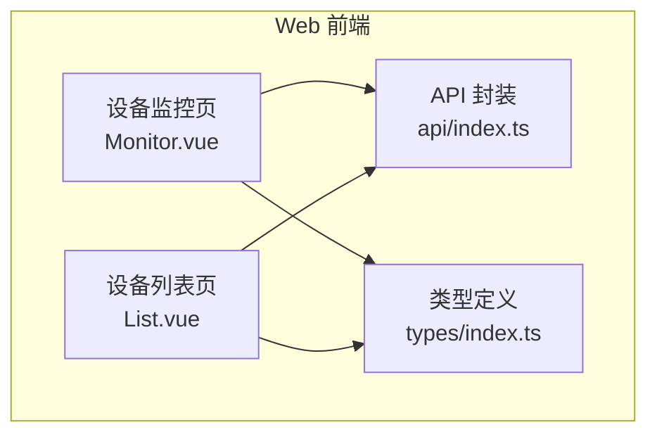
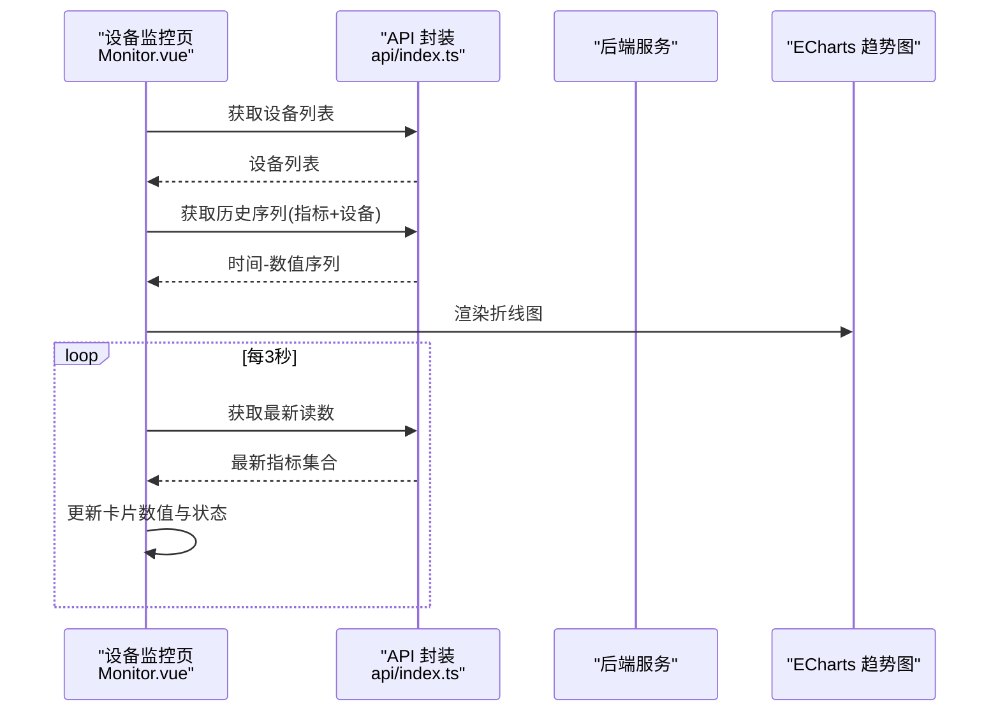
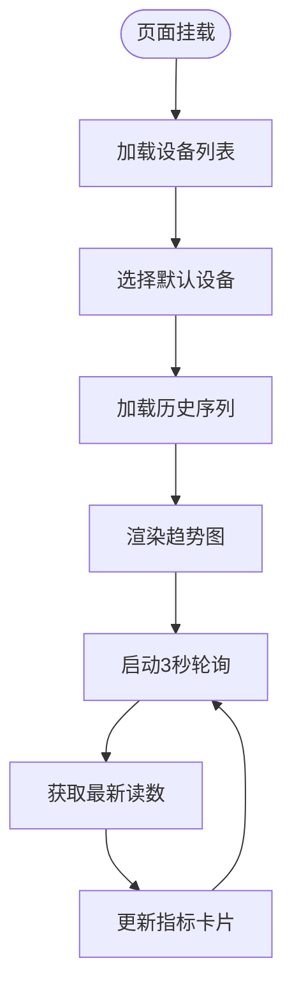
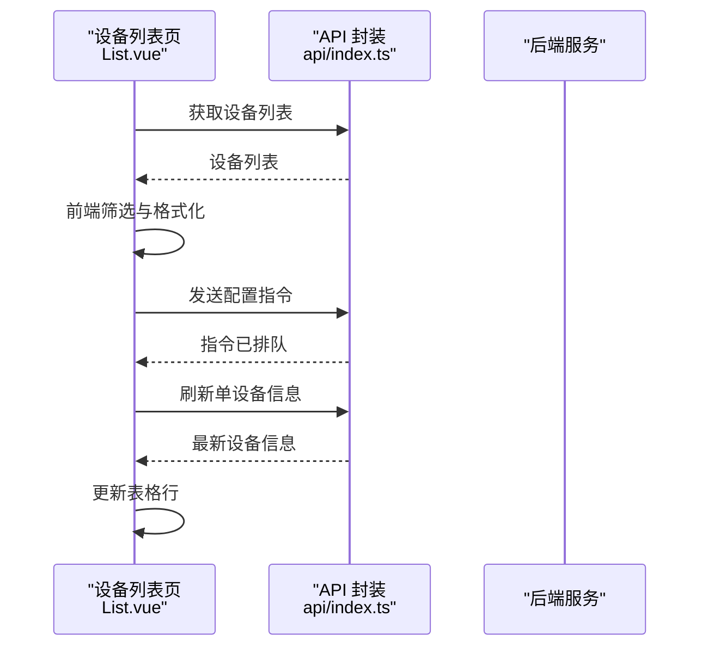
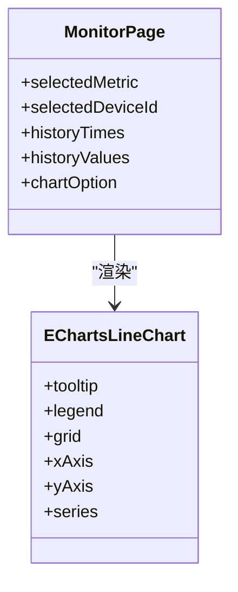
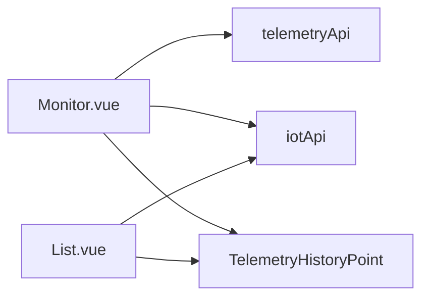
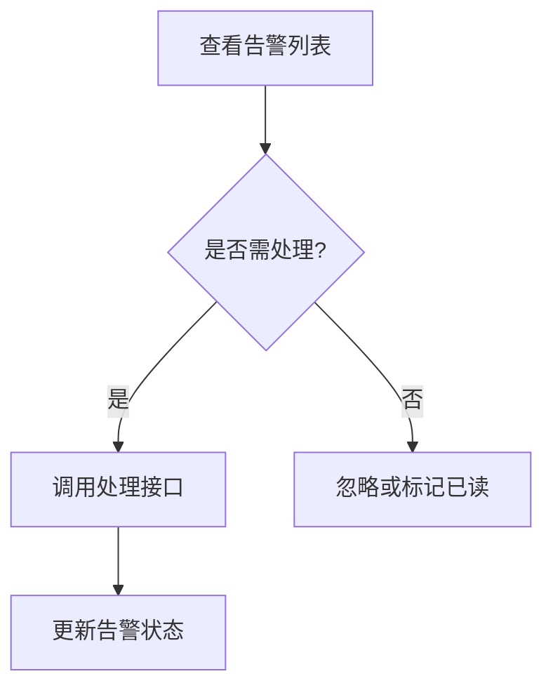

# 设备监控页面

<cite>
**本文引用的文件**   
- [Monitor.vue](file://apps/web/src/views/device/Monitor.vue)
- [List.vue](file://apps/web/src/views/device/List.vue)
- [index.ts（前端API）](file://apps/web/src/api/index.ts)
- [index.ts（类型定义）](file://apps/web/src/types/index.ts)
</cite>

## 目录
1. [简介](#简介)
2. [项目结构](#项目结构)
3. [核心组件](#核心组件)
4. [架构总览](#架构总览)
5. [详细组件分析](#详细组件分析)
6. [依赖关系分析](#依赖关系分析)
7. [性能与实时性考虑](#性能与实时性考虑)
8. [故障诊断与运维管理](#故障诊断与运维管理)
9. [数据存储与查询优化](#数据存储与查询优化)
10. [结论](#结论)

## 简介
本文件面向智慧农业平台的“设备监控页面”，聚焦以下能力：
- 实时监控：遥测数据轮询刷新、设备状态卡片展示、历史趋势图。
- 可视化图表：基于 ECharts 的趋势曲线，支持指标与设备切换。
- 设备控制：通过指令下发接口实现远程控制与参数配置，并获取执行反馈。
- 告警与运维：告警列表、告警处理、设备维护操作入口。
- 通信机制：当前实现以 HTTP 轮询为主；WebSocket 为扩展点，便于后续接入实时推送。
- 数据策略：历史序列按时间升序返回，便于前端直接绑定图表；同时提供最新读数接口用于实时卡片更新。

## 项目结构
设备监控相关的前端代码集中在 apps/web 子应用中，关键文件如下：
- 视图层
  - 设备监控页：apps/web/src/views/device/Monitor.vue
  - 设备列表页：apps/web/src/views/device/List.vue
- API 封装层
  - 统一 API 导出：apps/web/src/api/index.ts
- 类型定义
  - 通用与业务类型：apps/web/src/types/index.ts

**图示来源**
- [Monitor.vue:1-137](file://apps/web/src/views/device/Monitor.vue#L1-L137)
- [List.vue:1-132](file://apps/web/src/views/device/List.vue#L1-L132)
- [index.ts（前端API）:157-194](file://apps/web/src/api/index.ts#L157-L194)
- [index.ts（类型定义）:125-168](file://apps/web/src/types/index.ts#L125-L168)

**章节来源**
- [Monitor.vue:1-137](file://apps/web/src/views/device/Monitor.vue#L1-L137)
- [List.vue:1-132](file://apps/web/src/views/device/List.vue#L1-L132)
- [index.ts（前端API）:157-194](file://apps/web/src/api/index.ts#L157-L194)
- [index.ts（类型定义）:125-168](file://apps/web/src/types/index.ts#L125-L168)

## 核心组件
- 设备监控页（Monitor.vue）
  - 功能要点
    - 顶部卡片展示多类环境/土壤指标的最新值与状态。
    - 中部提供历史趋势图，支持选择指标与设备，渲染折线图。
    - 定时轮询最新读数，保证界面近实时更新。
  - 关键交互
    - 切换指标或设备后重新加载历史序列。
    - 首次进入自动选择默认设备并启动轮询。
- 设备列表页（List.vue）
  - 功能要点
    - 设备分页列表、关键字与状态筛选。
    - 设备详情弹窗、配置指令下发、单设备刷新。
  - 关键交互
    - “配置”按钮调用设备命令接口，提示“已排队”。
    - “刷新”按钮拉取单设备最新信息并更新表格行。

**章节来源**
- [Monitor.vue:33-137](file://apps/web/src/views/device/Monitor.vue#L33-L137)
- [List.vue:75-131](file://apps/web/src/views/device/List.vue#L75-L131)

## 架构总览
设备监控页面的数据流由前端视图驱动，通过 API 层访问后端服务。当前实现采用 HTTP 轮询方式获取最新遥测数据，并通过 ECharts 渲染历史趋势。

**图示来源**
- [Monitor.vue:82-128](file://apps/web/src/views/device/Monitor.vue#L82-L128)
- [index.ts（前端API）:175-186](file://apps/web/src/api/index.ts#L175-L186)

**章节来源**
- [Monitor.vue:82-128](file://apps/web/src/views/device/Monitor.vue#L82-L128)
- [index.ts（前端API）:175-186](file://apps/web/src/api/index.ts#L175-L186)

## 详细组件分析

### 设备监控页（Monitor.vue）
- 实时数据展示
  - 使用定时器每 3 秒调用最新读数接口，将指标映射到卡片字段进行更新。
  - 失败不影响历史曲线渲染，具备容错能力。
- 历史趋势图
  - 通过历史序列接口获取按时间升序的 (时间, 数值) 对，直接绑定到 ECharts 折线图。
  - 支持指标下拉与设备下拉联动刷新。
- 图表配置
  - 使用 ECharts 的折线图、工具提示、图例与网格组件。
  - 计算属性 chartOption 根据选中指标动态生成系列名称与数据。

**图示来源**
- [Monitor.vue:115-136](file://apps/web/src/views/device/Monitor.vue#L115-L136)
- [Monitor.vue:82-108](file://apps/web/src/views/device/Monitor.vue#L82-L108)

**章节来源**
- [Monitor.vue:33-137](file://apps/web/src/views/device/Monitor.vue#L33-L137)

### 设备列表页（List.vue）
- 列表与筛选
  - 支持按关键字（名称/编号）与状态筛选，前端过滤后更新表格与总数。
- 设备操作
  - 详情弹窗：展示设备编号、名称、类型、状态、所属地块、最后在线等。
  - 配置指令：调用设备命令接口，提示“配置指令已排队”。
  - 刷新设备：拉取单设备最新信息并替换表格对应行。

**图示来源**
- [List.vue:95-126](file://apps/web/src/views/device/List.vue#L95-L126)
- [index.ts（前端API）:157-167](file://apps/web/src/api/index.ts#L157-L167)

**章节来源**
- [List.vue:75-131](file://apps/web/src/views/device/List.vue#L75-L131)
- [index.ts（前端API）:157-167](file://apps/web/src/api/index.ts#L157-L167)

### 图表可视化组件（ECharts）
- 趋势图
  - 折线图，平滑曲线，X轴为时间，Y轴为数值。
  - 图例显示当前指标名称，工具提示跟随鼠标显示具体点信息。
- 仪表盘
  - 当前页面未使用仪表盘组件；如需扩展，可在卡片区域引入仪表盘组件展示单一指标占比或阈值状态。

**图示来源**
- [Monitor.vue:73-80](file://apps/web/src/views/device/Monitor.vue#L73-L80)

**章节来源**
- [Monitor.vue:73-80](file://apps/web/src/views/device/Monitor.vue#L73-L80)

## 依赖关系分析
- 模块依赖
  - Monitor.vue 依赖 api/index.ts 中的 telemetryApi 与 iotApi。
  - List.vue 依赖 api/index.ts 中的 iotApi。
  - 两者均依赖 types/index.ts 中的类型定义（如 TelemetryHistoryPoint）。
- 外部库
  - ECharts：趋势图渲染。
  - Element Plus：表单、表格、消息提示等 UI 组件。

**图示来源**
- [Monitor.vue:33-44](file://apps/web/src/views/device/Monitor.vue#L33-L44)
- [index.ts（前端API）:157-194](file://apps/web/src/api/index.ts#L157-L194)
- [index.ts（类型定义）:261-278](file://apps/web/src/types/index.ts#L261-L278)

**章节来源**
- [Monitor.vue:33-44](file://apps/web/src/views/device/Monitor.vue#L33-L44)
- [index.ts（前端API）:157-194](file://apps/web/src/api/index.ts#L157-L194)
- [index.ts（类型定义）:261-278](file://apps/web/src/types/index.ts#L261-L278)

## 性能与实时性考虑
- 轮询间隔
  - 当前每 3 秒请求一次最新读数，适合一般场景；在设备数量较多时可考虑按需轮询或降低频率。
- 图表数据量
  - 历史序列接口返回按时间升序的数据，建议在后端限制 size 或使用分页/时间窗口查询，避免单次响应过大。
- 错误隔离
  - 最新读数失败不影响历史曲线渲染，提升用户体验稳定性。
- WebSocket 扩展
  - 当前未启用 WebSocket；可在此基础上增加连接建立、心跳保活、断线重连与消息分发逻辑，将轮询改为事件驱动，进一步降低延迟与服务器压力。

[本节为通用指导，不直接分析具体文件]

## 故障诊断与运维管理
- 告警处理
  - 提供告警查询与处理接口，前端可据此实现告警列表与“处理”动作。
- 设备维护
  - 设备列表页提供“配置”与“刷新”操作，便于运维人员快速干预。
- 状态展示
  - 设备状态枚举包含离线、在线、故障、维护中，便于在列表中直观识别异常设备。

**图示来源**
- [index.ts（前端API）:187-193](file://apps/web/src/api/index.ts#L187-L193)
- [index.ts（类型定义）:267-278](file://apps/web/src/types/index.ts#L267-L278)

**章节来源**
- [index.ts（前端API）:187-193](file://apps/web/src/api/index.ts#L187-L193)
- [index.ts（类型定义）:267-278](file://apps/web/src/types/index.ts#L267-L278)

## 数据存储与查询优化
- 历史序列接口
  - 返回按时间升序的 (recordedAt, value) 对，便于前端直接绑定图表，减少前端排序成本。
- 最新读数接口
  - 支持按设备过滤，便于监控页仅刷新目标设备数据。
- 查询参数
  - 历史查询支持 deviceId、metric、时间范围与 size 等参数，建议结合业务场景设置合理上限。
- 类型约束
  - 使用 TelemetryHistoryPoint 与 TelemetryAlert 类型确保前后端数据结构一致，降低解析错误风险。

**章节来源**
- [index.ts（前端API）:175-193](file://apps/web/src/api/index.ts#L175-L193)
- [index.ts（类型定义）:261-278](file://apps/web/src/types/index.ts#L261-L278)

## 结论
设备监控页面在当前实现中以 HTTP 轮询与 ECharts 趋势图为核心，提供了稳定的实时监控与历史数据分析能力。通过清晰的 API 分层与类型定义，系统具备良好的可扩展性。未来可通过引入 WebSocket 实现真正的实时推送，并结合告警与运维操作形成完整的设备监控闭环。