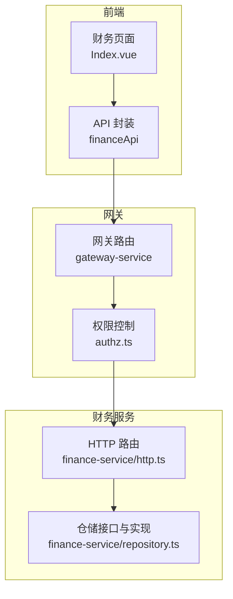
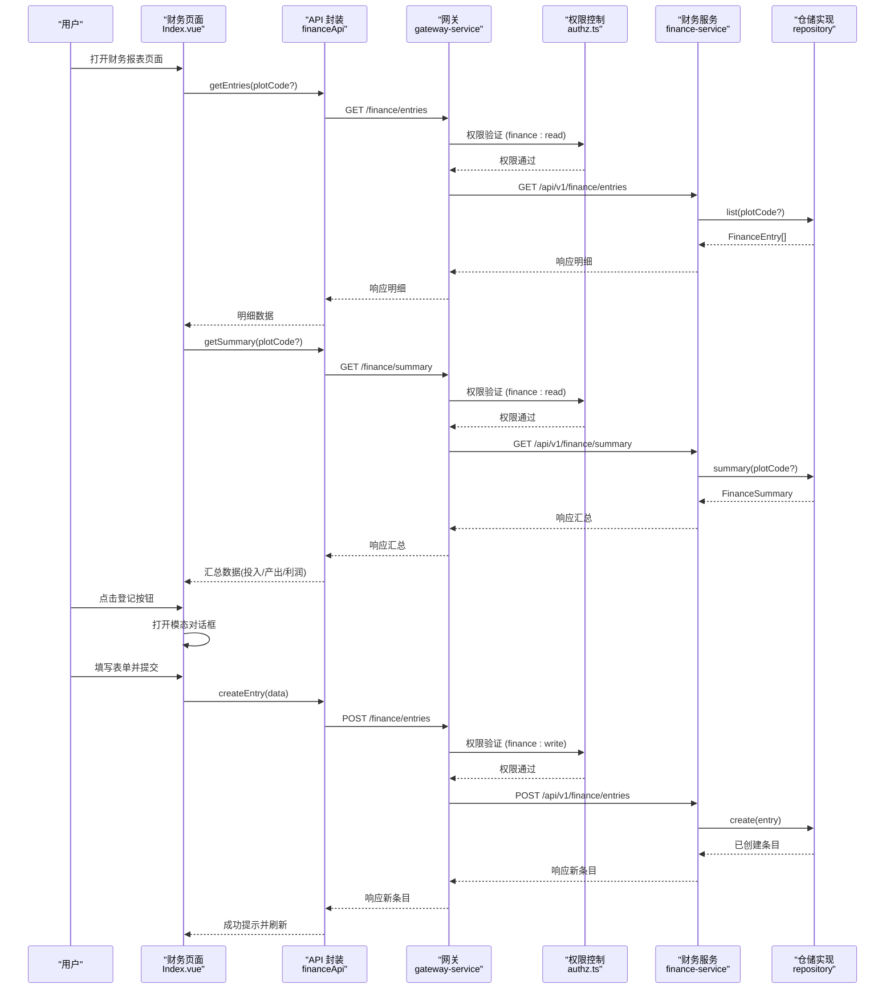
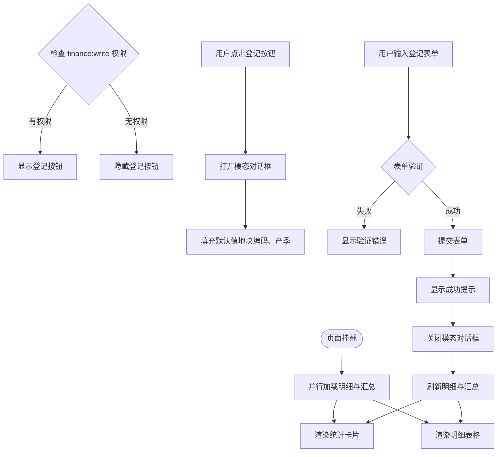
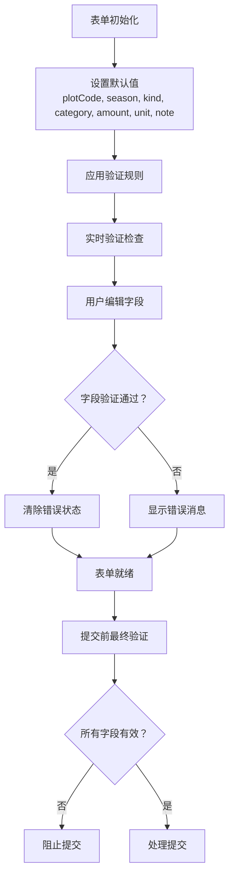
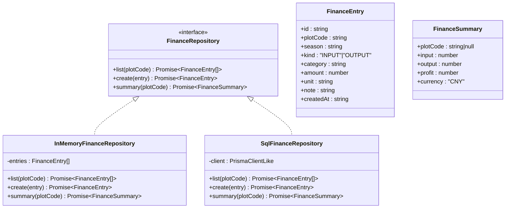
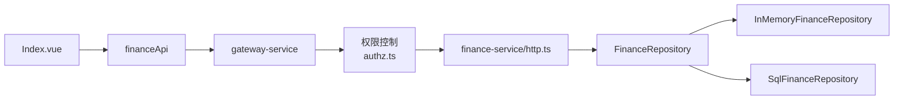

# 财务报表页面

<cite>
**本文引用的文件**   
- [apps/web/src/views/finance/Index.vue](file://apps/web/src/views/finance/Index.vue)
- [apps/web/src/api/index.ts](file://apps/web/src/api/index.ts)
- [apps/gateway-service/src/http.ts](file://apps/gateway-service/src/http.ts)
- [apps/gateway-service/src/authz.ts](file://apps/gateway-service/src/authz.ts)
- [apps/finance-service/src/http.ts](file://apps/finance-service/src/http.ts)
- [apps/finance-service/src/repository.ts](file://apps/finance-service/src/repository.ts)
- [packages/contracts/src/authz/permissions.ts](file://packages/contracts/src/authz/permissions.ts)
</cite>

## 更新摘要
**变更内容**   
- 将内联财务登记表单升级为模态对话框，提供更好的用户体验
- 增强了表单验证规则，确保数据完整性
- 新增单位字段、产季跟踪和备注字段支持
- 实现了基于finance:write权限的访问控制机制
- 优化了筛选功能，支持更多维度的数据查询

## 目录
1. [简介](#简介)
2. [项目结构](#项目结构)
3. [核心组件](#核心组件)
4. [架构总览](#架构总览)
5. [详细组件分析](#详细组件分析)
6. [权限与访问控制](#权限与访问控制)
7. [依赖关系分析](#依赖关系分析)
8. [性能与扩展性](#性能与扩展性)
9. [故障排查指南](#故障排查指南)
10. [结论](#结论)
11. [附录：接口定义与数据模型](#附录接口定义与数据模型)

## 简介
本文件为智慧农业平台"财务报表页面"的技术与产品文档，聚焦以下目标：
- 财务数据统计：收支记录汇总、成本分析与利润计算。
- 图表可视化：收支趋势图、成本结构图、预算对比图（当前实现以统计卡片为主，图表能力可扩展）。
- 数据导出：Excel、PDF 等多格式导出（当前未内置，提供扩展建议）。
- 筛选与自定义：按时间范围、业务类型等维度筛选（当前支持地块编码、类型、类别、产季、关键词等维度）。
- 报表生成与预算管理：基于现有数据模型与接口进行规划与扩展。
- **现代化UI体验**：采用模态对话框进行财务登记，提供完善的表单验证和数据完整性保障。

## 项目结构
财务报表功能涉及前端页面、网关路由转发、财务服务与仓储层四个层次：
- 前端页面：展示统计卡片、模态登记表单与明细表格。
- 前端 API 封装：统一调用财务相关接口。
- 网关服务：将 /api/v1/finance/* 请求转发至财务服务。
- 财务服务：HTTP 路由、仓储接口与内存/SQL 实现。

**图示来源**
- [apps/web/src/views/finance/Index.vue:1-202](file://apps/web/src/views/finance/Index.vue#L1-L202)
- [apps/web/src/api/index.ts:589-600](file://apps/web/src/api/index.ts#L589-L600)
- [apps/gateway-service/src/http.ts:19-19](file://apps/gateway-service/src/http.ts#L19-L19)
- [apps/gateway-service/src/authz.ts:54-54](file://apps/gateway-service/src/authz.ts#L54-L54)
- [apps/finance-service/src/http.ts:33-38](file://apps/finance-service/src/http.ts#L33-L38)
- [apps/finance-service/src/repository.ts:1-22](file://apps/finance-service/src/repository.ts#L1-L22)

**章节来源**
- [apps/web/src/views/finance/Index.vue:1-202](file://apps/web/src/views/finance/Index.vue#L1-L202)
- [apps/web/src/api/index.ts:589-600](file://apps/web/src/api/index.ts#L589-L600)
- [apps/gateway-service/src/http.ts:19-19](file://apps/gateway-service/src/http.ts#L19-L19)
- [apps/finance-service/src/http.ts:33-38](file://apps/finance-service/src/http.ts#L33-L38)
- [apps/finance-service/src/repository.ts:1-22](file://apps/finance-service/src/repository.ts#L1-L22)

## 核心组件
- 财务页面视图：负责统计卡片渲染、模态登记表单校验、明细列表展示与刷新。
- 财务 API 封装：提供 getEntries、getSummary、createEntry 三个方法。
- 网关路由转发：将 /api/v1/finance 前缀的请求转发到财务服务。
- 权限控制系统：基于 finance:read 和 finance:write 权限进行访问控制。
- 财务服务 HTTP：定义健康检查、收支明细增查、汇总查询接口。
- 仓储层：定义 FinanceRepository 接口，并提供内存与 SQL 两种实现，完成数据聚合与利润计算。

**章节来源**
- [apps/web/src/views/finance/Index.vue:72-104](file://apps/web/src/views/finance/Index.vue#L72-L104)
- [apps/web/src/api/index.ts:589-600](file://apps/web/src/api/index.ts#L589-L600)
- [apps/gateway-service/src/http.ts:19-19](file://apps/gateway-service/src/http.ts#L19-L19)
- [apps/finance-service/src/http.ts:33-38](file://apps/finance-service/src/http.ts#L33-L38)
- [apps/finance-service/src/repository.ts:3-21](file://apps/finance-service/src/repository.ts#L3-L21)

## 架构总览
下图展示了从前端到数据库的完整调用链，以及关键的数据流向。

**图示来源**
- [apps/web/src/views/finance/Index.vue:37-39](file://apps/web/src/views/finance/Index.vue#L37-L39)
- [apps/web/src/views/finance/Index.vue:72-104](file://apps/web/src/views/finance/Index.vue#L72-L104)
- [apps/web/src/api/index.ts:589-600](file://apps/web/src/api/index.ts#L589-L600)
- [apps/gateway-service/src/http.ts:19-19](file://apps/gateway-service/src/http.ts#L19-L19)
- [apps/gateway-service/src/authz.ts:54-54](file://apps/gateway-service/src/authz.ts#L54-L54)
- [apps/finance-service/src/http.ts:35-38](file://apps/finance-service/src/http.ts#L35-L38)
- [apps/finance-service/src/repository.ts:7-20](file://apps/finance-service/src/repository.ts#L7-L20)

## 详细组件分析

### 财务页面（Index.vue）
**更新** 页面现已采用现代化的模态对话框设计，替代了原有的内联表单。

- 统计卡片：展示投入合计、产出合计、利润三项指标，货币单位由后端返回。
- 增强筛选功能：支持按地块编码、类型（投入/产出）、类别、产季、关键词、登记时间范围进行筛选。
- 模态登记表单：包含完整的表单验证规则，支持单位字段、产季跟踪和备注信息。
- 权限控制：仅当用户拥有 finance:write 权限时显示登记按钮。
- 明细表格：展示地块编码、类型、类别、金额（含单位）、产季、备注、登记时间。

**图示来源**
- [apps/web/src/views/finance/Index.vue:37-39](file://apps/web/src/views/finance/Index.vue#L37-L39)
- [apps/web/src/views/finance/Index.vue:72-104](file://apps/web/src/views/finance/Index.vue#L72-L104)
- [apps/web/src/views/finance/Index.vue:123-129](file://apps/web/src/views/finance/Index.vue#L123-L129)

**章节来源**
- [apps/web/src/views/finance/Index.vue:1-202](file://apps/web/src/views/finance/Index.vue#L1-L202)

### 增强的表单验证系统
**新增** 模态对话框集成了完善的表单验证规则：

- **类别字段**：必填，用于分类统计
- **金额字段**：必填，必须大于0，支持小数精度
- **单位字段**：必填，支持自定义货币单位
- **产季字段**：必填，用于季节性数据分析
- **备注字段**：可选，用于详细说明处置依据

**图示来源**
- [apps/web/src/views/finance/Index.vue:119-129](file://apps/web/src/views/finance/Index.vue#L119-L129)

**章节来源**
- [apps/web/src/views/finance/Index.vue:119-129](file://apps/web/src/views/finance/Index.vue#L119-L129)

### 财务 API 封装（financeApi）
**更新** API接口现已支持更丰富的查询参数和数据模型。

- getEntries(params?): 获取收支明细列表，支持 plotCode、kind、category、season、keyword、from、to 等筛选条件。
- getSummary(params?): 获取汇总数据（投入、产出、利润、币种），支持与列表相同的筛选条件。
- createEntry(data): 新增一条收支记录，支持 plotCode、season、kind、category、amount、unit、note 字段。

**章节来源**
- [apps/web/src/api/index.ts:579-600](file://apps/web/src/api/index.ts#L579-L600)

### 网关路由转发（gateway-service）
**更新** 网关服务现在集成了权限控制系统。

- 将 /api/v1/finance 前缀的请求转发到财务服务地址（默认 127.0.0.1:3010）。
- 集成权限验证：读取操作需要 finance:read 权限，写入操作需要 finance:write 权限。
- 便于统一入口与跨域处理。

**章节来源**
- [apps/gateway-service/src/http.ts:19-19](file://apps/gateway-service/src/http.ts#L19-L19)
- [apps/gateway-service/src/authz.ts:54-54](file://apps/gateway-service/src/authz.ts#L54-L54)

### 财务服务 HTTP（finance-service/http.ts）
**更新** 服务层现在包含完整的权限控制和增强的数据过滤功能。

- 健康检查：GET /health。
- 收支明细：GET /api/v1/finance/entries（支持 plotCode、kind、category、season、keyword、from、to 查询参数）。
- 新增收支：POST /api/v1/finance/entries（接收 plotCode、season、kind、category、amount、unit、note）。
- 汇总查询：GET /api/v1/finance/summary（支持 plotCode 查询参数）。
- 权限控制：所有请求都需要通过 finance:read 或 finance:write 权限验证。
- 统一响应体：包含 code、message、data、traceId、timestamp。

**章节来源**
- [apps/finance-service/src/http.ts:33-38](file://apps/finance-service/src/http.ts#L33-L38)

### 仓储层（finance-service/repository.ts）
**更新** 仓储层支持更丰富的数据模型和查询功能。

- 接口定义：FinanceRepository 暴露 list、create、summary 三个方法。
- 内存实现：InMemoryFinanceRepository，在进程内维护收支记录，并按 kind 分类求和计算利润。
- SQL 实现：SqlFinanceRepository，使用 Prisma 客户端执行原生 SQL，按 kind 分组聚合后计算利润。
- 数据模型：FinanceEntry（收支条目）、FinanceSummary（汇总结果）。

**图示来源**
- [apps/finance-service/src/repository.ts:1-22](file://apps/finance-service/src/repository.ts#L1-L22)

**章节来源**
- [apps/finance-service/src/repository.ts:1-22](file://apps/finance-service/src/repository.ts#L1-L22)

## 权限与访问控制
**新增** 系统现在实现了基于角色的权限控制机制。

### 权限模型
- **finance:read**：允许查询收支记录和统计数据
- **finance:write**：允许创建新的收支记录
- 权限验证在网关层和服务层双重实施

### 前端权限控制
- 页面根据用户的 finance:write 权限动态显示登记按钮
- 无权限用户只能查看数据，不能进行登记操作

### 后端权限验证
- 所有财务相关API请求都经过权限验证
- 读取操作需要 finance:read 权限
- 写入操作需要 finance:write 权限

**章节来源**
- [apps/web/src/views/finance/Index.vue:123-123](file://apps/web/src/views/finance/Index.vue#L123-L123)
- [apps/gateway-service/src/authz.ts:54-54](file://apps/gateway-service/src/authz.ts#L54-L54)
- [apps/finance-service/src/http.ts:35-36](file://apps/finance-service/src/http.ts#L35-L36)
- [packages/contracts/src/authz/permissions.ts:45-47](file://packages/contracts/src/authz/permissions.ts#L45-L47)

## 依赖关系分析
**更新** 依赖关系图反映了新增的权限控制系统。

- 前端页面依赖 financeApi 进行数据交互。
- financeApi 通过通用请求工具发起 HTTP 请求。
- 网关服务对 /api/v1/finance 路径进行转发和权限验证。
- 财务服务依赖仓储接口，根据运行环境选择内存或 SQL 实现。

**图示来源**
- [apps/web/src/views/finance/Index.vue:111-114](file://apps/web/src/views/finance/Index.vue#L111-L114)
- [apps/web/src/api/index.ts:589-600](file://apps/web/src/api/index.ts#L589-L600)
- [apps/gateway-service/src/http.ts:19-19](file://apps/gateway-service/src/http.ts#L19-L19)
- [apps/gateway-service/src/authz.ts:54-54](file://apps/gateway-service/src/authz.ts#L54-L54)
- [apps/finance-service/src/http.ts:33-38](file://apps/finance-service/src/http.ts#L33-L38)
- [apps/finance-service/src/repository.ts:3-21](file://apps/finance-service/src/repository.ts#L3-L21)

**章节来源**
- [apps/web/src/views/finance/Index.vue:111-114](file://apps/web/src/views/finance/Index.vue#L111-L114)
- [apps/web/src/api/index.ts:589-600](file://apps/web/src/api/index.ts#L589-L600)
- [apps/gateway-service/src/http.ts:19-19](file://apps/gateway-service/src/http.ts#L19-L19)
- [apps/finance-service/src/http.ts:33-38](file://apps/finance-service/src/http.ts#L33-L38)
- [apps/finance-service/src/repository.ts:3-21](file://apps/finance-service/src/repository.ts#L3-L21)

## 性能与扩展性
**更新** 性能优化和扩展点考虑了新的UI设计和权限控制。

- 并发加载：页面同时请求明细与汇总，减少首屏等待时间。
- 聚合计算：汇总在仓储层按 kind 分组聚合，避免前端重复计算。
- 权限缓存：前端权限检查结果可缓存，避免重复计算。
- 可扩展点：
  - 增加时间范围筛选：在仓储层按 season 或 createdAt 过滤。
  - 增加业务类型筛选：在仓库层按 category 过滤。
  - 图表可视化：在前端接入 ECharts/AntV，将汇总与明细序列化为图表所需数据结构。
  - 数据导出：在后端新增导出接口，或在服务端生成 Excel/PDF 流返回给前端下载。
  - 预算管理：新增预算表与对比接口，前端展示预算与实际对比图。
  - 权限扩展：支持更细粒度的权限控制，如按地块或产季的权限管理。

[本节为通用指导，不直接分析具体文件]

## 故障排查指南
**更新** 故障排查指南包含了新的权限控制和表单验证相关问题。

- 页面空白或无数据：
  - 检查网关是否正确转发 /api/v1/finance 到财务服务。
  - 确认财务服务健康检查 /health 可访问。
  - 检查用户是否具有 finance:read 权限。
- 登记按钮不显示：
  - 检查用户是否拥有 finance:write 权限。
  - 确认权限配置正确且已应用到用户角色。
- 表单提交失败：
  - 检查表单验证规则是否满足要求。
  - 确认必填字段（类别、金额、单位、产季）都已填写。
  - 检查权限验证是否通过。
- 权限验证失败：
  - 检查网关权限配置是否正确。
  - 确认用户权限列表中包含所需的权限码。
  - 查看网关日志中的权限验证错误信息。

**章节来源**
- [apps/finance-service/src/http.ts:33-38](file://apps/finance-service/src/http.ts#L33-L38)
- [apps/finance-service/src/repository.ts:7-20](file://apps/finance-service/src/repository.ts#L7-L20)
- [apps/web/src/views/finance/Index.vue:123-129](file://apps/web/src/views/finance/Index.vue#L123-L129)

## 结论
当前财务报表页面已实现现代化UI升级，包括模态对话框形式的财务登记界面、完善的表单验证机制、增强的筛选功能和基于权限的访问控制。系统通过网关与财务服务解耦了前后端职责，并在权限控制方面提供了企业级的安全保障。后续可在仓储层增强筛选与聚合能力，在前端补充图表可视化与导出功能，以满足更丰富的财务分析需求。

[本节为总结性内容，不直接分析具体文件]

## 附录：接口定义与数据模型

### 接口清单
**更新** 接口清单反映了新的权限控制和增强的数据模型。

- GET /health
  - 用途：健康检查
  - 返回：{ status, service }
- GET /api/v1/finance/entries?plotCode={code}&kind={type}&category={cat}&season={year}&keyword={text}&from={date}&to={date}
  - 用途：获取收支明细（需要 finance:read 权限）
  - 返回：FinanceEntry[]
- POST /api/v1/finance/entries
  - 用途：新增收支记录（需要 finance:write 权限）
  - 请求体：{ plotCode, season, kind, category, amount, unit, note }
  - 返回：FinanceEntry
- GET /api/v1/finance/summary?plotCode={code}
  - 用途：获取汇总（需要 finance:read 权限）
  - 返回：FinanceSummary

**章节来源**
- [apps/finance-service/src/http.ts:33-38](file://apps/finance-service/src/http.ts#L33-L38)

### 数据模型
**更新** 数据模型包含了新增的字段和权限相关信息。

- FinanceEntry
  - id: string
  - plotCode: string
  - season: string
  - kind: "INPUT" | "OUTPUT"
  - category: string
  - amount: number
  - unit: string
  - note: string
  - createdAt: string
- FinanceSummary
  - plotCode: string | null
  - input: number
  - output: number
  - profit: number
  - currency: "CNY"
- FinanceQuery
  - plotCode?: string
  - kind?: 'INPUT' | 'OUTPUT'
  - category?: string
  - season?: string
  - keyword?: string
  - from?: string
  - to?: string

**章节来源**
- [apps/finance-service/src/repository.ts:3-4](file://apps/finance-service/src/repository.ts#L3-L4)
- [apps/web/src/api/index.ts:579-587](file://apps/web/src/api/index.ts#L579-L587)

### 权限定义
**新增** 权限定义模块提供了完整的权限码和验证函数。

- PERMISSION_CATALOG: 权限目录定义，包含财务相关的权限组
- PermissionCode: 权限码联合类型，包含 finance:read 和 finance:write
- hasPermission(): 权限验证函数，支持通配符匹配
- parsePermissionHeader(): 从HTTP头解析权限列表
- serializePermissions(): 将权限列表编码为HTTP头格式

**章节来源**
- [packages/contracts/src/authz/permissions.ts:45-47](file://packages/contracts/src/authz/permissions.ts#L45-L47)
- [packages/contracts/src/authz/permissions.ts:56-79](file://packages/contracts/src/authz/permissions.ts#L56-L79)
- [packages/contracts/src/authz/permissions.ts:93-100](file://packages/contracts/src/authz/permissions.ts#L93-L100)