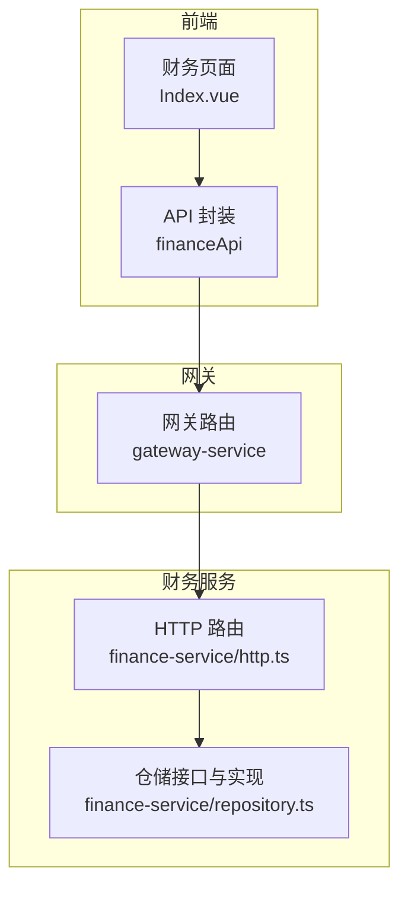
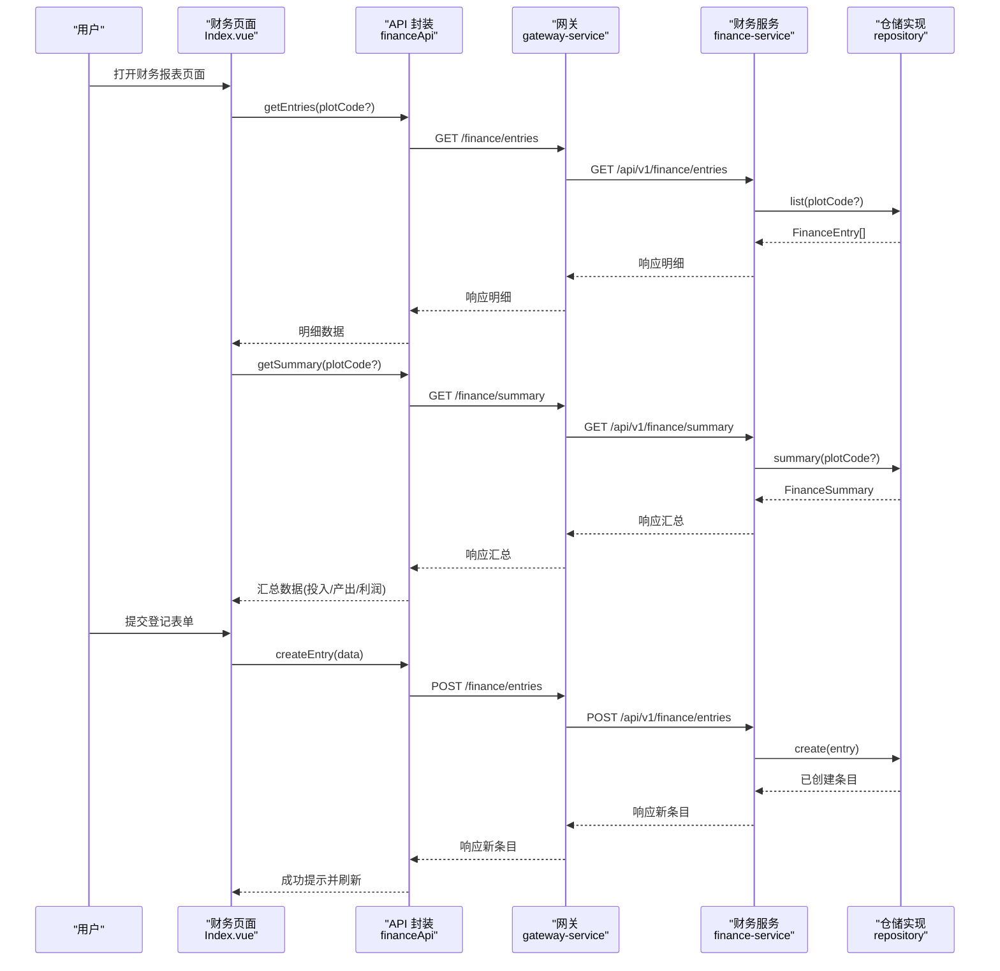
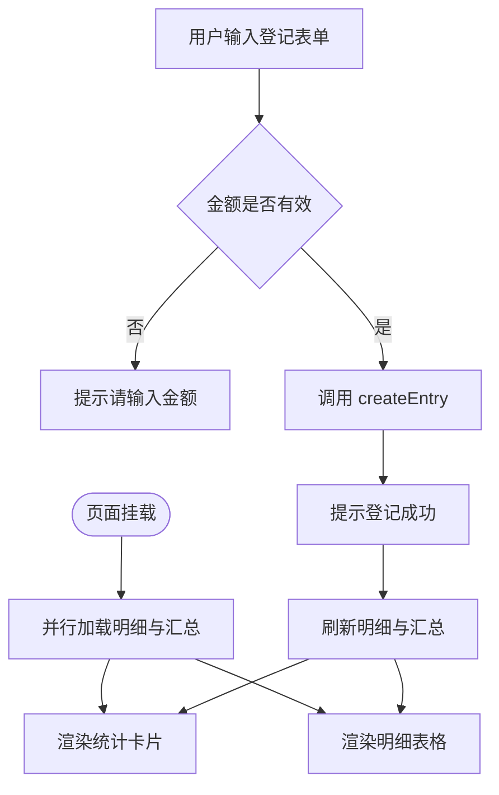
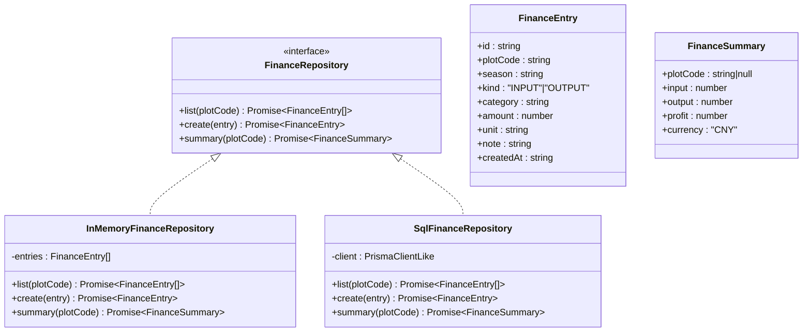
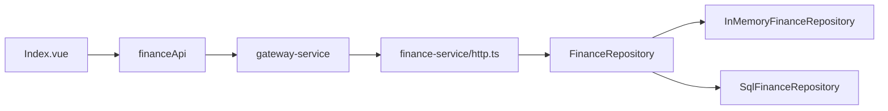

# 财务报表页面

<cite>
**本文引用的文件**   
- [apps/web/src/views/finance/Index.vue](file://apps/web/src/views/finance/Index.vue)
- [apps/web/src/api/index.ts](file://apps/web/src/api/index.ts)
- [apps/gateway-service/src/http.ts](file://apps/gateway-service/src/http.ts)
- [apps/finance-service/src/http.ts](file://apps/finance-service/src/http.ts)
- [apps/finance-service/src/repository.ts](file://apps/finance-service/src/repository.ts)
</cite>

## 目录
1. [简介](#简介)
2. [项目结构](#项目结构)
3. [核心组件](#核心组件)
4. [架构总览](#架构总览)
5. [详细组件分析](#详细组件分析)
6. [依赖关系分析](#依赖关系分析)
7. [性能与扩展性](#性能与扩展性)
8. [故障排查指南](#故障排查指南)
9. [结论](#结论)
10. [附录：接口定义与数据模型](#附录接口定义与数据模型)

## 简介
本文件为智慧农业平台“财务报表页面”的技术与产品文档，聚焦以下目标：
- 财务数据统计：收支记录汇总、成本分析与利润计算。
- 图表可视化：收支趋势图、成本结构图、预算对比图（当前实现以统计卡片为主，图表能力可扩展）。
- 数据导出：Excel、PDF 等多格式导出（当前未内置，提供扩展建议）。
- 筛选与自定义：按时间范围、业务类型等维度筛选（当前支持地块编码与类型筛选，可扩展更多维度）。
- 报表生成与预算管理：基于现有数据模型与接口进行规划与扩展。

## 项目结构
财务报表功能涉及前端页面、网关路由转发、财务服务与仓储层四个层次：
- 前端页面：展示统计卡片、登记表单与明细表格。
- 前端 API 封装：统一调用财务相关接口。
- 网关服务：将 /api/v1/finance/* 请求转发至财务服务。
- 财务服务：HTTP 路由、仓储接口与内存/SQL 实现。

**图示来源**
- [apps/web/src/views/finance/Index.vue:1-47](file://apps/web/src/views/finance/Index.vue#L1-L47)
- [apps/web/src/api/index.ts:223-233](file://apps/web/src/api/index.ts#L223-L233)
- [apps/gateway-service/src/http.ts:19-19](file://apps/gateway-service/src/http.ts#L19-L19)
- [apps/finance-service/src/http.ts:10-16](file://apps/finance-service/src/http.ts#L10-L16)
- [apps/finance-service/src/repository.ts:1-22](file://apps/finance-service/src/repository.ts#L1-L22)

**章节来源**
- [apps/web/src/views/finance/Index.vue:1-47](file://apps/web/src/views/finance/Index.vue#L1-L47)
- [apps/web/src/api/index.ts:223-233](file://apps/web/src/api/index.ts#L223-L233)
- [apps/gateway-service/src/http.ts:19-19](file://apps/gateway-service/src/http.ts#L19-L19)
- [apps/finance-service/src/http.ts:10-16](file://apps/finance-service/src/http.ts#L10-L16)
- [apps/finance-service/src/repository.ts:1-22](file://apps/finance-service/src/repository.ts#L1-L22)

## 核心组件
- 财务页面视图：负责统计卡片渲染、登记表单校验、明细列表展示与刷新。
- 财务 API 封装：提供 getEntries、getSummary、createEntry 三个方法。
- 网关路由转发：将 /api/v1/finance 前缀的请求转发到财务服务。
- 财务服务 HTTP：定义健康检查、收支明细增查、汇总查询接口。
- 仓储层：定义 FinanceRepository 接口，并提供内存与 SQL 两种实现，完成数据聚合与利润计算。

**章节来源**
- [apps/web/src/views/finance/Index.vue:27-39](file://apps/web/src/views/finance/Index.vue#L27-L39)
- [apps/web/src/api/index.ts:223-233](file://apps/web/src/api/index.ts#L223-L233)
- [apps/gateway-service/src/http.ts:19-19](file://apps/gateway-service/src/http.ts#L19-L19)
- [apps/finance-service/src/http.ts:10-16](file://apps/finance-service/src/http.ts#L10-L16)
- [apps/finance-service/src/repository.ts:3-21](file://apps/finance-service/src/repository.ts#L3-L21)

## 架构总览
下图展示了从前端到数据库的完整调用链，以及关键的数据流向。

**图示来源**
- [apps/web/src/views/finance/Index.vue:37-39](file://apps/web/src/views/finance/Index.vue#L37-L39)
- [apps/web/src/api/index.ts:223-233](file://apps/web/src/api/index.ts#L223-L233)
- [apps/gateway-service/src/http.ts:19-19](file://apps/gateway-service/src/http.ts#L19-L19)
- [apps/finance-service/src/http.ts:12-14](file://apps/finance-service/src/http.ts#L12-L14)
- [apps/finance-service/src/repository.ts:7-20](file://apps/finance-service/src/repository.ts#L7-L20)

## 详细组件分析

### 财务页面（Index.vue）
- 统计卡片：展示投入合计、产出合计、利润三项指标，货币单位由后端返回。
- 筛选与登记：支持按地块编码、类型（投入/产出）、类别、金额进行登记；提供刷新按钮重新拉取数据。
- 明细表格：展示地块编码、类型、类别、金额、登记时间，并对类型字段做中文映射。
- 交互流程：页面挂载时并行加载明细与汇总；提交成功后清空金额并刷新。

**图示来源**
- [apps/web/src/views/finance/Index.vue:32-39](file://apps/web/src/views/finance/Index.vue#L32-L39)

**章节来源**
- [apps/web/src/views/finance/Index.vue:1-47](file://apps/web/src/views/finance/Index.vue#L1-L47)

### 财务 API 封装（financeApi）
- getEntries(plotCode?): 获取收支明细列表，可选按地块编码过滤。
- getSummary(plotCode?): 获取汇总数据（投入、产出、利润、币种）。
- createEntry(data): 新增一条收支记录。

**章节来源**
- [apps/web/src/api/index.ts:223-233](file://apps/web/src/api/index.ts#L223-L233)

### 网关路由转发（gateway-service）
- 将 /api/v1/finance 前缀的请求转发到财务服务地址（默认 127.0.0.1:3010），便于统一入口与跨域处理。

**章节来源**
- [apps/gateway-service/src/http.ts:19-19](file://apps/gateway-service/src/http.ts#L19-L19)

### 财务服务 HTTP（finance-service/http.ts）
- 健康检查：GET /health。
- 收支明细：GET /api/v1/finance/entries（支持 plotCode 查询参数）。
- 新增收支：POST /api/v1/finance/entries（接收 plotCode、season、kind、category、amount、unit、note）。
- 汇总查询：GET /api/v1/finance/summary（支持 plotCode 查询参数）。
- 统一响应体：包含 code、message、data、traceId、timestamp。

**章节来源**
- [apps/finance-service/src/http.ts:1-17](file://apps/finance-service/src/http.ts#L1-L17)

### 仓储层（finance-service/repository.ts）
- 接口定义：FinanceRepository 暴露 list、create、summary 三个方法。
- 内存实现：InMemoryFinanceRepository，在进程内维护收支记录，并按 kind 分类求和计算利润。
- SQL 实现：SqlFinanceRepository，使用 Prisma 客户端执行原生 SQL，按 kind 分组聚合后计算利润。
- 数据模型：FinanceEntry（收支条目）、FinanceSummary（汇总结果）。

**图示来源**
- [apps/finance-service/src/repository.ts:1-22](file://apps/finance-service/src/repository.ts#L1-L22)

**章节来源**
- [apps/finance-service/src/repository.ts:1-22](file://apps/finance-service/src/repository.ts#L1-L22)

## 依赖关系分析
- 前端页面依赖 financeApi 进行数据交互。
- financeApi 通过通用请求工具发起 HTTP 请求。
- 网关服务对 /api/v1/finance 路径进行转发。
- 财务服务依赖仓储接口，根据运行环境选择内存或 SQL 实现。

**图示来源**
- [apps/web/src/views/finance/Index.vue:27-39](file://apps/web/src/views/finance/Index.vue#L27-L39)
- [apps/web/src/api/index.ts:223-233](file://apps/web/src/api/index.ts#L223-L233)
- [apps/gateway-service/src/http.ts:19-19](file://apps/gateway-service/src/http.ts#L19-L19)
- [apps/finance-service/src/http.ts:10-16](file://apps/finance-service/src/http.ts#L10-L16)
- [apps/finance-service/src/repository.ts:3-21](file://apps/finance-service/src/repository.ts#L3-L21)

**章节来源**
- [apps/web/src/views/finance/Index.vue:27-39](file://apps/web/src/views/finance/Index.vue#L27-L39)
- [apps/web/src/api/index.ts:223-233](file://apps/web/src/api/index.ts#L223-L233)
- [apps/gateway-service/src/http.ts:19-19](file://apps/gateway-service/src/http.ts#L19-L19)
- [apps/finance-service/src/http.ts:10-16](file://apps/finance-service/src/http.ts#L10-L16)
- [apps/finance-service/src/repository.ts:3-21](file://apps/finance-service/src/repository.ts#L3-L21)

## 性能与扩展性
- 并发加载：页面同时请求明细与汇总，减少首屏等待时间。
- 聚合计算：汇总在仓储层按 kind 分组聚合，避免前端重复计算。
- 可扩展点：
  - 增加时间范围筛选：在仓储层按 season 或 createdAt 过滤。
  - 增加业务类型筛选：在仓库层按 category 过滤。
  - 图表可视化：在前端接入 ECharts/AntV，将汇总与明细序列化为图表所需数据结构。
  - 数据导出：在后端新增导出接口，或在服务端生成 Excel/PDF 流返回给前端下载。
  - 预算管理：新增预算表与对比接口，前端展示预算与实际对比图。

[本节为通用指导，不直接分析具体文件]

## 故障排查指南
- 页面空白或无数据：
  - 检查网关是否正确转发 /api/v1/finance 到财务服务。
  - 确认财务服务健康检查 /health 可访问。
- 登记失败：
  - 检查请求体是否为 JSON 对象且包含必要字段（plotCode、kind、category、amount）。
  - 查看财务服务日志中的错误消息与 traceId。
- 汇总异常：
  - 确认数据库中是否存在对应 plotCode 的记录。
  - 核对 kind 字段值是否为 INPUT 或 OUTPUT。

**章节来源**
- [apps/finance-service/src/http.ts:10-16](file://apps/finance-service/src/http.ts#L10-L16)
- [apps/finance-service/src/repository.ts:7-20](file://apps/finance-service/src/repository.ts#L7-L20)

## 结论
当前财务报表页面实现了基础的收支登记、明细展示与汇总统计，并通过网关与财务服务解耦了前后端职责。后续可在仓储层增强筛选与聚合能力，在前端补充图表可视化与导出功能，以满足更丰富的财务分析需求。

[本节为总结性内容，不直接分析具体文件]

## 附录：接口定义与数据模型

### 接口清单
- GET /health
  - 用途：健康检查
  - 返回：{ status, service }
- GET /api/v1/finance/entries?plotCode={code}
  - 用途：获取收支明细
  - 返回：FinanceEntry[]
- POST /api/v1/finance/entries
  - 用途：新增收支记录
  - 请求体：{ plotCode, season, kind, category, amount, unit, note }
  - 返回：FinanceEntry
- GET /api/v1/finance/summary?plotCode={code}
  - 用途：获取汇总
  - 返回：FinanceSummary

**章节来源**
- [apps/finance-service/src/http.ts:11-14](file://apps/finance-service/src/http.ts#L11-L14)

### 数据模型
- FinanceEntry
  - id: string
  - plotCode: string
  - season: string
  - kind: "INPUT" | "OUTPUT"
  - category: string
  - amount: number
  - unit: string
  - note: string
  - createdAt: string
- FinanceSummary
  - plotCode: string | null
  - input: number
  - output: number
  - profit: number
  - currency: "CNY"

**章节来源**
- [apps/finance-service/src/repository.ts:3-4](file://apps/finance-service/src/repository.ts#L3-L4)