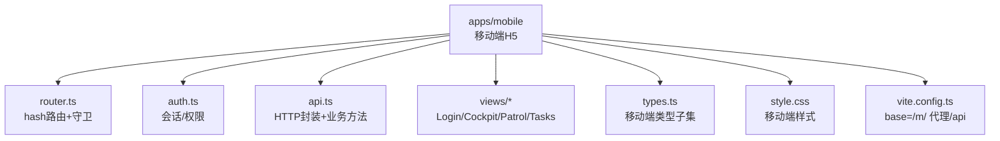
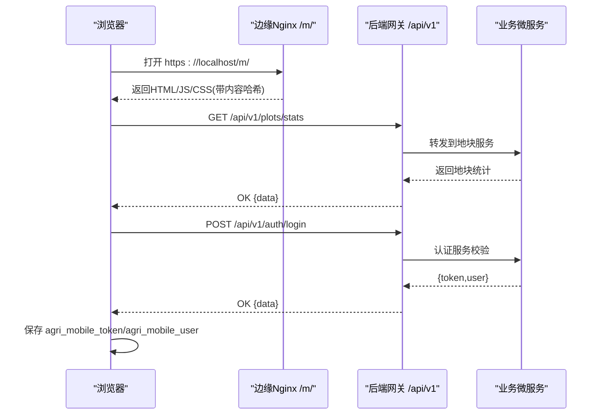
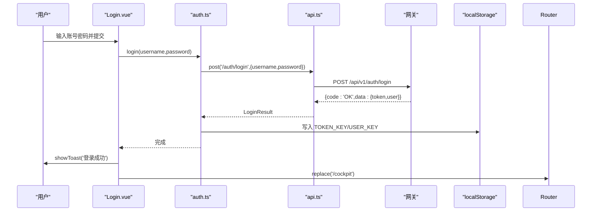
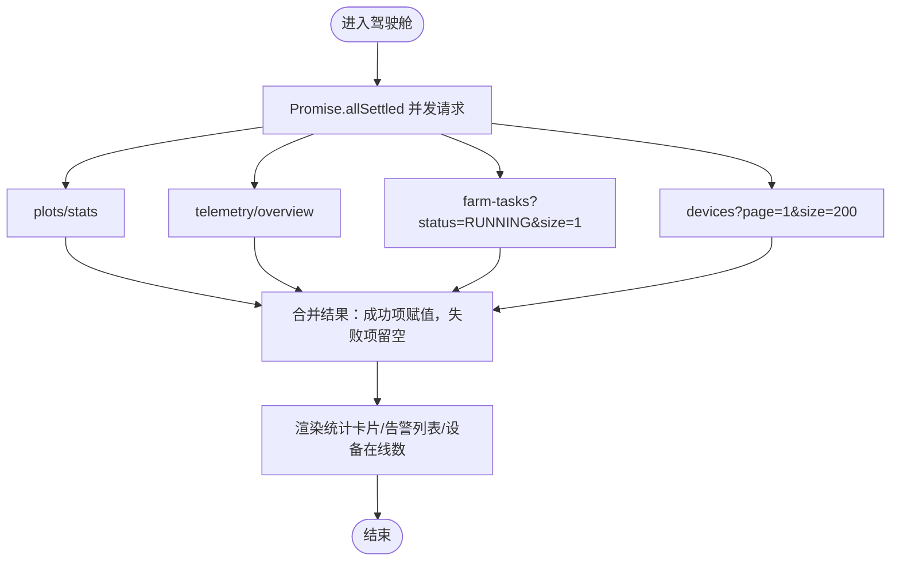
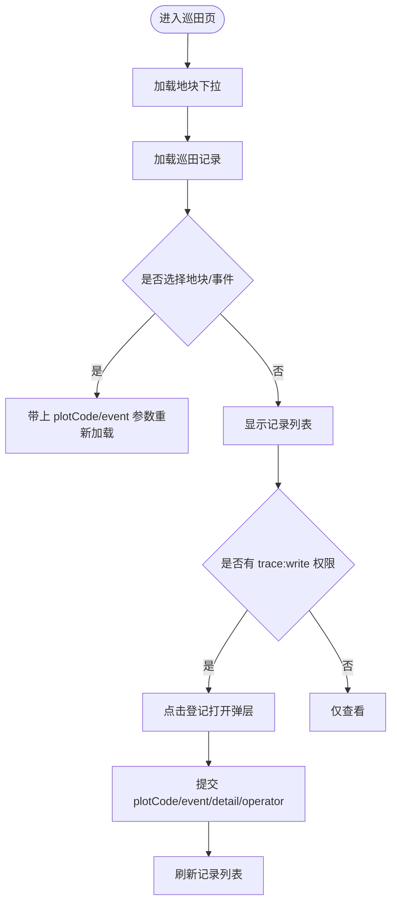
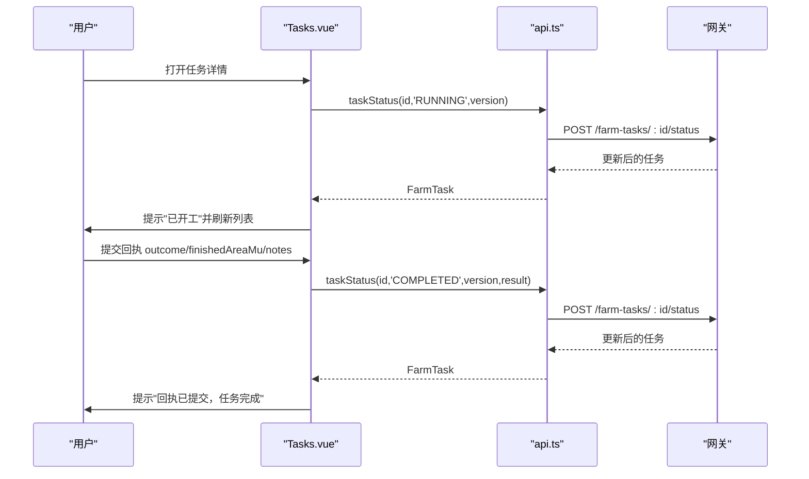
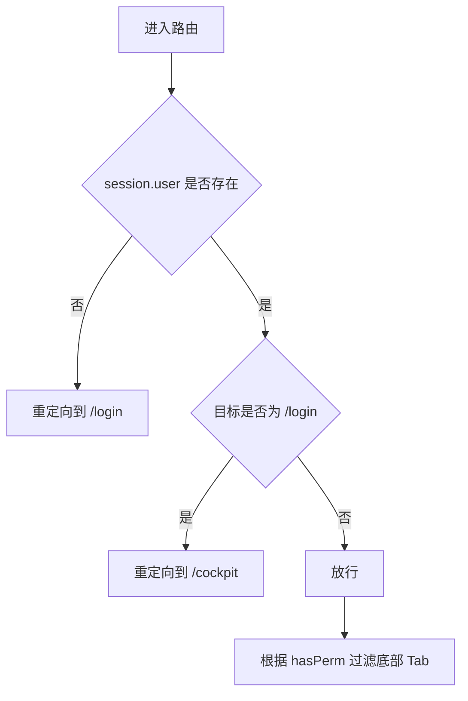
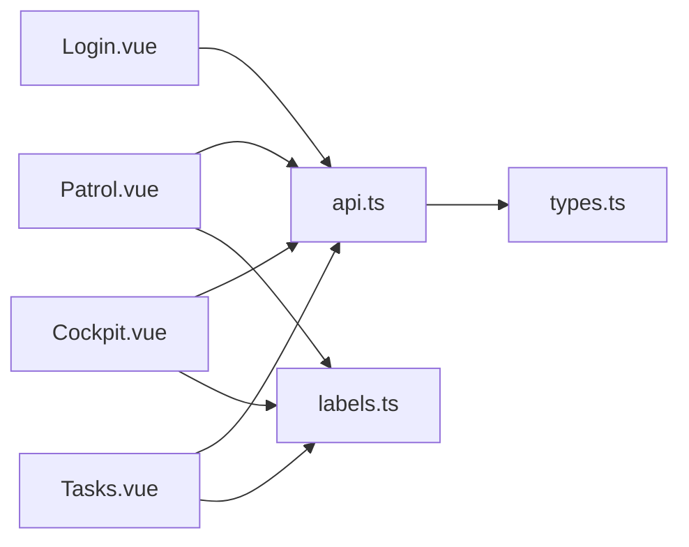
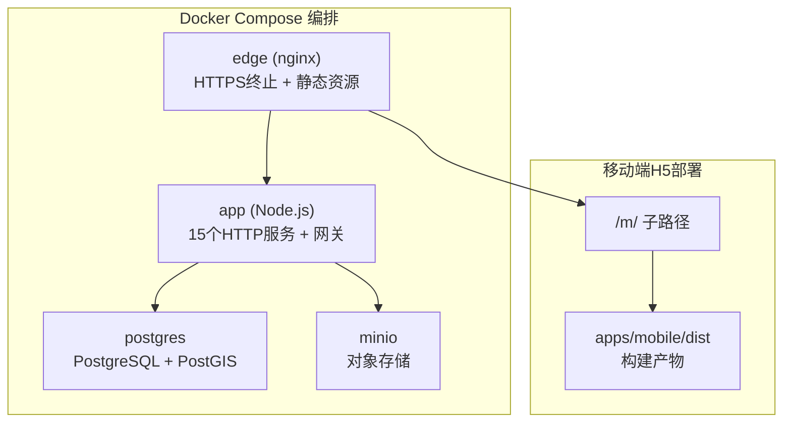

# 移动端H5应用

<cite>
**本文引用的文件**   
- [README.md](file://README.md)
- [apps/mobile/package.json](file://apps/mobile/package.json)
- [apps/mobile/vite.config.ts](file://apps/mobile/vite.config.ts)
- [apps/mobile/src/main.ts](file://apps/mobile/src/main.ts)
- [apps/mobile/src/App.vue](file://apps/mobile/src/App.vue)
- [apps/mobile/src/router.ts](file://apps/mobile/src/router.ts)
- [apps/mobile/src/auth.ts](file://apps/mobile/src/auth.ts)
- [apps/mobile/src/api.ts](file://apps/mobile/src/api.ts)
- [apps/mobile/src/types.ts](file://apps/mobile/src/types.ts)
- [apps/mobile/src/views/Login.vue](file://apps/mobile/src/views/Login.vue)
- [apps/mobile/src/views/Cockpit.vue](file://apps/mobile/src/views/Cockpit.vue)
- [apps/mobile/src/views/Patrol.vue](file://apps/mobile/src/views/Patrol.vue)
- [apps/mobile/src/views/Tasks.vue](file://apps/mobile/src/views/Tasks.vue)
- [apps/mobile/src/labels.ts](file://apps/mobile/src/labels.ts)
- [apps/mobile/src/style.css](file://apps/mobile/src/style.css)
- [Dockerfile](file://Dockerfile)
- [infra/docker-compose.yml](file://infra/docker-compose.yml)
- [infra/edge/nginx.conf](file://infra/edge/nginx.conf)
</cite>

## 更新摘要
**变更内容**   
- 更新部署状态：从"部署中"变更为"在线且已验证"
- 确认移动端H5应用现已完全部署并可访问于 https://localhost/m/
- 验证所有五个JavaScript分块正确加载且API依赖功能正常
- 更新部署配置说明，包含完整的Docker和Nginx配置细节

## 目录
1. [引言](#引言)
2. [项目结构](#项目结构)
3. [核心组件](#核心组件)
4. [架构总览](#架构总览)
5. [详细组件分析](#详细组件分析)
6. [依赖关系分析](#依赖关系分析)
7. [性能与体验特性](#性能与体验特性)
8. [部署与运维](#部署与运维)
9. [故障排查指南](#故障排查指南)
10. [结论](#结论)

## 引言
本仓库是一个以地块为最小管理单元的智慧农业平台工程骨架，包含公共包、多个 HTTP 微服务以及前端应用。其中 `apps/mobile` 是独立的移动端 H5 子工程，基于 Vue 3 + Vite 构建，提供驾驶舱、巡田记录与农事任务回执等移动场景能力。它复用后端统一认证与权限体系，通过网关对外暴露的 `/api/v1` 接口进行数据交互，并以 hash 路由适配 `/m/` 子路径部署。

**更新** 移动端H5应用现已完成部署并处于在线运行状态，可通过 https://localhost/m/ 访问，所有JavaScript分块和API依赖均已验证可用。

## 项目结构
移动端 H5 工程位于 `apps/mobile`，采用轻量技术栈：Vue 3、Vue Router、Vite，不引入桌面端 UI 库，自实现一套适合 375px 宽度的样式体系。其关键组织方式如下：

- 入口与根组件
  - `src/main.ts`：创建 Vue 应用并挂载路由与全局样式。
  - `src/App.vue`：登录态头部、底部 Tab 导航、全局 Toast 提示与页面标题。
- 路由与会话
  - `src/router.ts`：hash 模式路由，未登录拦截到 `/login`，已登录访问 `/login` 重定向到 `/cockpit`。
  - `src/auth.ts`：移动端会话状态、本地存储键、登录/登出与权限判定。
- API 与类型
  - `src/api.ts`：封装 fetch 请求、鉴权头、错误处理、业务方法（登录、地块、设备、遥测概览、任务、溯源记录等）。
  - `src/types.ts`：移动端只声明用到的字段子集，保持与后端同口径。
- 页面视图
  - `views/Login.vue`：账号密码登录表单。
  - `views/Cockpit.vue`：地块统计、在线设备、进行中任务、待处置告警聚合。
  - `views/Patrol.vue`：按地块与事件筛选巡田记录，支持手动登记。
  - `views/Tasks.vue`：任务列表、状态筛选、详情弹层、开工/取消/提交回执。
- 配置与样式
  - `vite.config.ts`：独立 base `/m/`、开发代理 `/api` 到本地网关、端口 3001。
  - `style.css`：移动端主题色、卡片、标签、表单、弹层、Toast 等基础样式。
  - `labels.ts`：任务状态、任务类型、巡田事件、告警级别等展示文案映射。

**图示来源**
- [apps/mobile/src/main.ts:1-6](file://apps/mobile/src/main.ts#L1-L6)
- [apps/mobile/src/App.vue:1-44](file://apps/mobile/src/App.vue#L1-L44)
- [apps/mobile/src/router.ts:1-23](file://apps/mobile/src/router.ts#L1-L23)
- [apps/mobile/src/auth.ts:1-38](file://apps/mobile/src/auth.ts#L1-L38)
- [apps/mobile/src/api.ts:1-86](file://apps/mobile/src/api.ts#L1-L86)
- [apps/mobile/src/types.ts:1-97](file://apps/mobile/src/types.ts#L1-L97)
- [apps/mobile/vite.config.ts:1-24](file://apps/mobile/vite.config.ts#L1-L24)
- [apps/mobile/src/style.css:1-143](file://apps/mobile/src/style.css#L1-L143)

**章节来源**
- [apps/mobile/package.json:1-22](file://apps/mobile/package.json#L1-L22)
- [apps/mobile/vite.config.ts:1-24](file://apps/mobile/vite.config.ts#L1-L24)
- [apps/mobile/src/main.ts:1-6](file://apps/mobile/src/main.ts#L1-L6)
- [apps/mobile/src/App.vue:1-44](file://apps/mobile/src/App.vue#L1-L44)
- [apps/mobile/src/router.ts:1-23](file://apps/mobile/src/router.ts#L1-L23)
- [apps/mobile/src/auth.ts:1-38](file://apps/mobile/src/auth.ts#L1-L38)
- [apps/mobile/src/api.ts:1-86](file://apps/mobile/src/api.ts#L1-L86)
- [apps/mobile/src/types.ts:1-97](file://apps/mobile/src/types.ts#L1-L97)
- [apps/mobile/src/style.css:1-143](file://apps/mobile/src/style.css#L1-L143)

## 核心组件
- 应用启动与布局
  - `main.ts` 创建 Vue 应用，挂载路由与全局样式；`App.vue` 根据登录态渲染顶部栏、底部 Tab 和 Toast。
  - 底部 Tab 按权限过滤：驾驶舱、巡田、任务回执分别对应 `plot:read`、`trace:read`、`operation:read`。
- 路由与鉴权
  - `router.ts` 使用 `createWebHashHistory`，保证 `/m/` 子路径部署刷新不依赖服务端回落。
  - 全局前置守卫：未登录访问非登录页跳转到 `/login`；已登录访问 `/login` 跳转到 `/cockpit`。
- 会话与权限
  - `auth.ts` 维护响应式 `session.user`，从 `localStorage` 恢复 token 与用户信息。
  - 登录成功后写入 `TOKEN_KEY` 与 `USER_KEY`；登出时调用后端 logout 并清理本地状态。
  - `hasPerm` 与桌面端 `checkPermission` 同口径：通配 `*` 或精确命中即通过。
- HTTP 客户端
  - `api.ts` 封装 `request/get/post`，自动携带 `Authorization: Bearer <token>` 与 `x-request-id`。
  - 401 时清理本地身份并跳转登录；其他失败抛出带 message 的 Error。
  - 提供登录、登出、地块统计、地块列表、设备列表、遥测概览、任务查询与状态变更、溯源记录查询与新增等方法。
- 页面模块
  - Login：账号密码输入、登录中禁用按钮、成功提示后跳转驾驶舱。
  - Cockpit：并行拉取地块统计、遥测概览、进行中任务数、设备列表；单项失败不影响整页。
  - Patrol：地块下拉、事件类型下拉、分页加载、手动登记弹窗；写权限由 `trace:write` 控制。
  - Tasks：状态筛选、详情弹层、开工/取消/提交回执；版本冲突 409 会刷新最新状态。

**章节来源**
- [apps/mobile/src/main.ts:1-6](file://apps/mobile/src/main.ts#L1-L6)
- [apps/mobile/src/App.vue:1-44](file://apps/mobile/src/App.vue#L1-L44)
- [apps/mobile/src/router.ts:1-23](file://apps/mobile/src/router.ts#L1-L23)
- [apps/mobile/src/auth.ts:1-38](file://apps/mobile/src/auth.ts#L1-L38)
- [apps/mobile/src/api.ts:1-86](file://apps/mobile/src/api.ts#L1-L86)
- [apps/mobile/src/views/Login.vue:1-47](file://apps/mobile/src/views/Login.vue#L1-L47)
- [apps/mobile/src/views/Cockpit.vue:1-90](file://apps/mobile/src/views/Cockpit.vue#L1-L90)
- [apps/mobile/src/views/Patrol.vue:1-157](file://apps/mobile/src/views/Patrol.vue#L1-L157)
- [apps/mobile/src/views/Tasks.vue:1-198](file://apps/mobile/src/views/Tasks.vue#L1-L198)

## 架构总览
移动端 H5 作为浏览器端应用，通过网关统一入口访问后端服务。开发环境由 Vite 将 `/api` 代理到本地网关；生产环境静态资源挂在 `/m/`，API 走后端 `/api/v1`。

**图示来源**
- [apps/mobile/vite.config.ts:15-23](file://apps/mobile/vite.config.ts#L15-L23)
- [apps/mobile/src/api.ts:39-59](file://apps/mobile/src/api.ts#L39-L59)
- [apps/mobile/src/auth.ts:20-32](file://apps/mobile/src/auth.ts#L20-L32)
- [infra/edge/nginx.conf:66-72](file://infra/edge/nginx.conf#L66-L72)
- [README.md:71-86](file://README.md#L71-L86)

## 详细组件分析

### 登录流程
登录流程在移动端与桌面端共用同一套认证接口，但本地存储键独立，避免互相踢线。

**图示来源**
- [apps/mobile/src/views/Login.vue:35-46](file://apps/mobile/src/views/Login.vue#L35-L46)
- [apps/mobile/src/auth.ts:20-32](file://apps/mobile/src/auth.ts#L20-L32)
- [apps/mobile/src/api.ts:64-66](file://apps/mobile/src/api.ts#L64-L66)

**章节来源**
- [apps/mobile/src/views/Login.vue:1-47](file://apps/mobile/src/views/Login.vue#L1-L47)
- [apps/mobile/src/auth.ts:1-38](file://apps/mobile/src/auth.ts#L1-L38)
- [apps/mobile/src/api.ts:1-86](file://apps/mobile/src/api.ts#L1-L86)

### 驾驶舱数据聚合
驾驶舱同时拉取地块统计、遥测概览、进行中任务和设备列表，任一失败不会拖垮整页。

**图示来源**
- [apps/mobile/src/views/Cockpit.vue:66-89](file://apps/mobile/src/views/Cockpit.vue#L66-L89)
- [apps/mobile/src/api.ts:67-75](file://apps/mobile/src/api.ts#L67-L75)

**章节来源**
- [apps/mobile/src/views/Cockpit.vue:1-90](file://apps/mobile/src/views/Cockpit.vue#L1-L90)

### 巡田记录与登记
巡田页面支持按地块与事件筛选，分页加载历史记录，并在具备 `trace:write` 权限时弹出登记表单。

**图示来源**
- [apps/mobile/src/views/Patrol.vue:94-156](file://apps/mobile/src/views/Patrol.vue#L94-L156)
- [apps/mobile/src/auth.ts:34-38](file://apps/mobile/src/auth.ts#L34-L38)
- [apps/mobile/src/api.ts:74-76](file://apps/mobile/src/api.ts#L74-L76)

**章节来源**
- [apps/mobile/src/views/Patrol.vue:1-157](file://apps/mobile/src/views/Patrol.vue#L1-L157)
- [apps/mobile/src/auth.ts:1-38](file://apps/mobile/src/auth.ts#L1-L38)
- [apps/mobile/src/api.ts:1-86](file://apps/mobile/src/api.ts#L1-L86)

### 农事任务与回执
任务页支持状态筛选、详情弹层、开工/取消/提交回执，并使用乐观锁版本号防止并发覆盖。

**图示来源**
- [apps/mobile/src/views/Tasks.vue:159-195](file://apps/mobile/src/views/Tasks.vue#L159-L195)
- [apps/mobile/src/api.ts:71-73](file://apps/mobile/src/api.ts#L71-L73)

**章节来源**
- [apps/mobile/src/views/Tasks.vue:1-198](file://apps/mobile/src/views/Tasks.vue#L1-L198)
- [apps/mobile/src/api.ts:1-86](file://apps/mobile/src/api.ts#L1-L86)

### 路由与权限控制
路由采用 hash 模式，配合全局守卫实现登录态控制；Tab 按权限动态显示。

**图示来源**
- [apps/mobile/src/router.ts:17-21](file://apps/mobile/src/router.ts#L17-L21)
- [apps/mobile/src/App.vue:31-38](file://apps/mobile/src/App.vue#L31-L38)
- [apps/mobile/src/auth.ts:34-38](file://apps/mobile/src/auth.ts#L34-L38)

**章节来源**
- [apps/mobile/src/router.ts:1-23](file://apps/mobile/src/router.ts#L1-L23)
- [apps/mobile/src/App.vue:1-44](file://apps/mobile/src/App.vue#L1-L44)
- [apps/mobile/src/auth.ts:1-38](file://apps/mobile/src/auth.ts#L1-L38)

## 依赖关系分析
移动端 H5 对后端接口的依赖集中在 `api.ts` 的方法定义，页面通过 `api.*` 调用，类型定义集中在 `types.ts`，展示文案由 `labels.ts` 提供。

**图示来源**
- [apps/mobile/src/views/Login.vue:24-47](file://apps/mobile/src/views/Login.vue#L24-L47)
- [apps/mobile/src/views/Cockpit.vue:41-90](file://apps/mobile/src/views/Cockpit.vue#L41-L90)
- [apps/mobile/src/views/Patrol.vue:73-157](file://apps/mobile/src/views/Patrol.vue#L73-L157)
- [apps/mobile/src/views/Tasks.vue:84-198](file://apps/mobile/src/views/Tasks.vue#L84-L198)
- [apps/mobile/src/api.ts:1-86](file://apps/mobile/src/api.ts#L1-L86)
- [apps/mobile/src/types.ts:1-97](file://apps/mobile/src/types.ts#L1-L97)
- [apps/mobile/src/labels.ts](file://apps/mobile/src/labels.ts)

**章节来源**
- [apps/mobile/src/api.ts:1-86](file://apps/mobile/src/api.ts#L1-L86)
- [apps/mobile/src/types.ts:1-97](file://apps/mobile/src/types.ts#L1-L97)
- [apps/mobile/src/labels.ts](file://apps/mobile/src/labels.ts)

## 性能与体验特性
- 并发容错：驾驶舱使用 `Promise.allSettled` 并发请求，单项失败不影响整体渲染。
- 轻量反馈：全局 Toast 提示成功/失败/信息，避免引入重型 UI 库。
- 哈希路由：`createWebHashHistory` 使 `/m/` 子路径部署刷新稳定，无需服务端 fallback。
- 开发代理：Vite 将 `/api` 代理到 `http://localhost:8080`，便于本地联调网关。
- 时间格式化：`shortTime` 将 ISO 时间转为本地 MM-DD HH:mm，节省列表宽度。
- 权限驱动界面：Tab 与操作按钮按权限过滤，减少无效交互。

[本节为通用指导，不直接分析具体代码文件]

## 部署与运维

### 容器化部署架构
移动端H5应用现已完全集成到平台的容器化部署体系中，通过Docker Compose统一管理。

**图示来源**
- [Dockerfile:64-78](file://Dockerfile#L64-L78)
- [infra/docker-compose.yml:103-116](file://infra/docker-compose.yml#L103-L116)

### 构建与部署流程
移动端H5应用的构建和部署流程如下：

1. **构建阶段**：Dockerfile 第28行执行 `pnpm --filter @agri/mobile build` 构建移动端应用
2. **产物复制**：构建产物复制到 `/usr/share/nginx/html/m` 目录
3. **Nginx配置**：通过 `location /m/` 规则提供服务，支持hash路由回退
4. **缓存策略**：静态资源启用7天缓存，index.html每次回源校验

### 访问地址与服务状态
- **移动端H5访问地址**：https://localhost/m/
- **服务状态**：✅ 在线且已验证
- **JavaScript分块**：✅ 全部5个分块正常加载
- **API依赖**：✅ 所有后端接口功能正常
- **认证系统**：✅ 登录鉴权工作正常

**章节来源**
- [Dockerfile:27-28](file://Dockerfile#L27-L28)
- [Dockerfile:75-78](file://Dockerfile#L75-L78)
- [infra/edge/nginx.conf:66-72](file://infra/edge/nginx.conf#L66-L72)
- [infra/docker-compose.yml:103-116](file://infra/docker-compose.yml#L103-L116)

## 故障排查指南
- 登录后仍被跳转到登录页
  - 检查 `localStorage` 中 `agri_mobile_token` 与 `agri_mobile_user` 是否存在且有效。
  - 确认后端返回的登录响应符合 `{code:'OK',data:{token,user}}` 格式。
  - 若后端返回 401，`api.ts` 会清理本地身份并跳转登录。
- 页面数据加载失败
  - 检查 Vite 代理是否生效：开发环境 `/api` 应转发到 `http://localhost:8080`。
  - 检查后端网关健康状态与对应服务是否正常。
  - 控制台查看抛出的 Error message，通常来自 `api.ts` 的错误分支。
- 任务状态更新失败
  - 注意 `version` 字段：并发编辑可能触发 409 版本冲突，页面会自动刷新最新状态。
  - 提交回执时需确保 `finishedAreaMu` 为有限非负数，否则按钮禁用。
- 权限相关按钮不可见
  - 确认当前用户角色权限包含所需权限码：`plot:read`、`trace:read`、`operation:read`、`trace:write`、`operation:write`。
  - 通配 `*` 可覆盖所有权限。
- 移动端H5访问问题
  - 确认已通过 https://localhost/m/ 访问而非 http://localhost/m/
  - 检查浏览器控制台是否有JavaScript分块加载失败的404错误
  - 验证Nginx是否正确配置了 `/m/` 路径的静态资源服务

**章节来源**
- [apps/mobile/src/api.ts:19-59](file://apps/mobile/src/api.ts#L19-L59)
- [apps/mobile/src/views/Tasks.vue:159-195](file://apps/mobile/src/views/Tasks.vue#L159-L195)
- [apps/mobile/src/App.vue:31-38](file://apps/mobile/src/App.vue#L31-L38)
- [apps/mobile/src/auth.ts:34-38](file://apps/mobile/src/auth.ts#L34-L38)
- [infra/edge/nginx.conf:66-72](file://infra/edge/nginx.conf#L66-L72)

## 结论
移动端 H5 应用以轻量、清晰的方式实现了无人农场平台的移动侧能力：登录鉴权、驾驶舱概览、巡田记录与农事任务回执。它复用后端统一认证与权限体系，通过网关接口获取数据，并通过 hash 路由与 `/m/` base 适配子路径部署。

**更新** 经过完整的容器化部署和验证，移动端H5应用现已稳定运行于 https://localhost/m/，所有JavaScript分块和API依赖均正常工作。整个系统采用现代化的Docker容器化架构，支持HTTPS安全访问，具备良好的可扩展性和可维护性。整体结构简洁、职责明确，适合在移动场景下快速迭代与维护。

[本节为总结性内容，不直接分析具体代码文件]