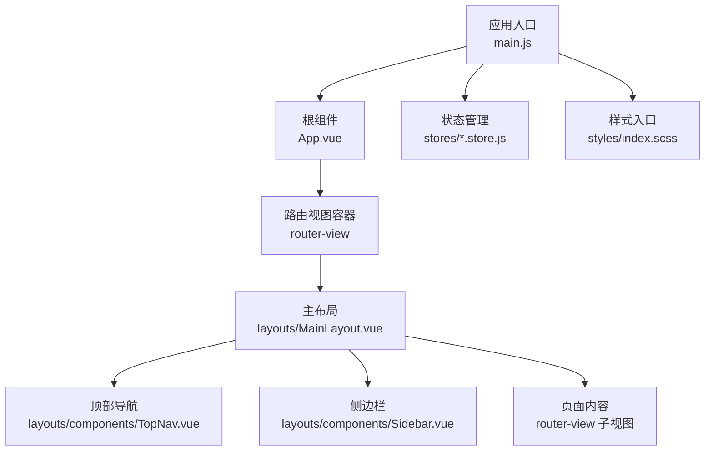
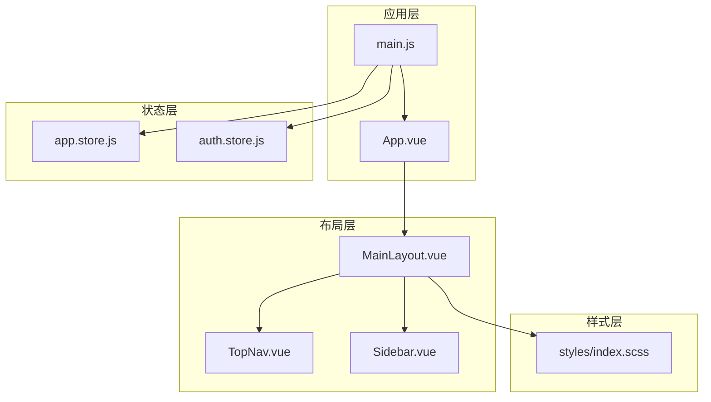
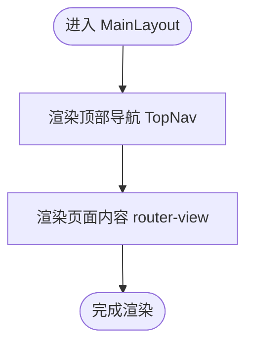
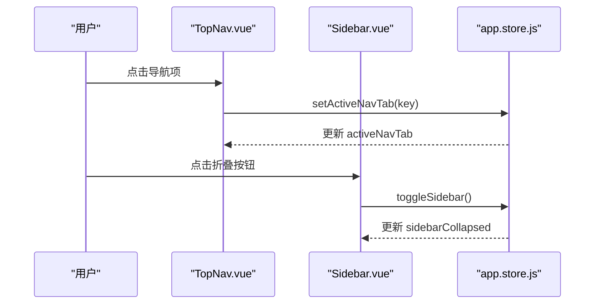
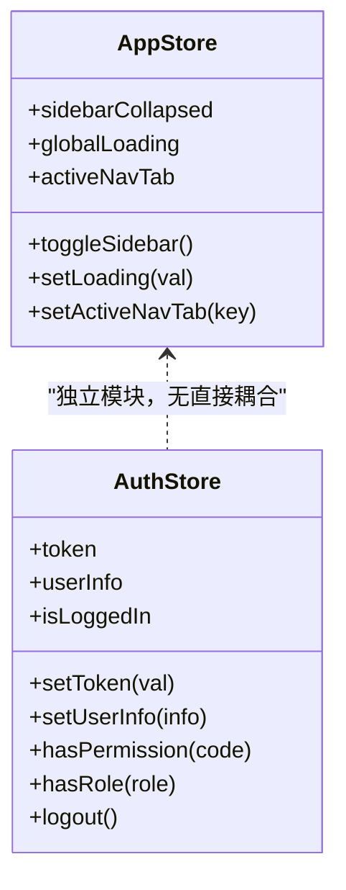
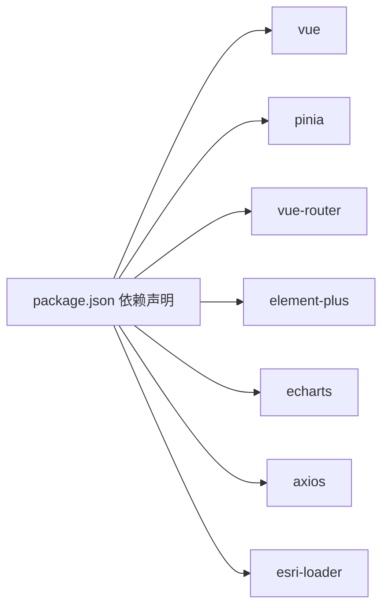

# 组件开发

<cite>
**本文引用的文件**   
- [main.js](file://zhao-guang-farm-master/src/main.js)
- [App.vue](file://zhao-guang-farm-master/src/App.vue)
- [MainLayout.vue](file://zhao-guang-farm-master/src/layouts/MainLayout.vue)
- [Sidebar.vue](file://zhao-guang-farm-master/src/layouts/components/Sidebar.vue)
- [TopNav.vue](file://zhao-guang-farm-master/src/layouts/components/TopNav.vue)
- [app.store.js](file://zhao-guang-farm-master/src/stores/app.store.js)
- [auth.store.js](file://zhao-guang-farm-master/src/stores/auth.store.js)
- [package.json](file://zhao-guang-farm-master/package.json)
</cite>

## 目录
1. [简介](#简介)
2. [项目结构](#项目结构)
3. [核心组件](#核心组件)
4. [架构总览](#架构总览)
5. [详细组件分析](#详细组件分析)
6. [依赖关系分析](#依赖关系分析)
7. [性能考虑](#性能考虑)
8. [故障排查指南](#故障排查指南)
9. [结论](#结论)
10. [附录](#附录)

## 简介
本文件面向智慧农业平台的前端组件开发，聚焦于 Vue 3 组合式 API 的使用模式与组件设计规范。文档覆盖布局组件设计、侧边栏与顶部导航实现、状态管理最佳实践（Pinia）、TypeScript 类型与接口规范建议、组件通信与事件处理、插槽使用指南，以及样式组织、SCSS 变量管理与主题定制方案。目标是帮助开发者在统一规范下高效构建可维护、可扩展的 UI 组件。

## 项目结构
前端应用采用 Vite + Vue 3 + Pinia + Element Plus 的技术栈，入口文件负责初始化应用、注册插件与全局样式；布局层提供主布局与导航；状态管理通过 Pinia 模块划分职责；样式以 SCSS 组织并引入变量与主题。

图示来源
- [main.js:1-32](file://zhao-guang-farm-master/src/main.js#L1-L32)
- [App.vue:1-4](file://zhao-guang-farm-master/src/App.vue#L1-L4)
- [MainLayout.vue:1-56](file://zhao-guang-farm-master/src/layouts/MainLayout.vue#L1-L56)

章节来源
- [main.js:1-32](file://zhao-guang-farm-master/src/main.js#L1-L32)
- [App.vue:1-4](file://zhao-guang-farm-master/src/App.vue#L1-L4)
- [MainLayout.vue:1-56](file://zhao-guang-farm-master/src/layouts/MainLayout.vue#L1-L56)

## 核心组件
- 应用入口 main.js：创建 Vue 实例，注册 Pinia 与 Router，挂载全局样式，并实现基于视口宽度的 rem 自适应逻辑。
- 根组件 App.vue：仅包含路由视图容器，作为页面级路由出口。
- 主布局 MainLayout.vue：承载顶部导航与页面内容区域，内部通过 router-view 渲染具体页面。
- 顶部导航 TopNav.vue：提供全局导航与活动 Tab 控制。
- 侧边栏 Sidebar.vue：提供功能菜单与折叠状态控制。
- 状态管理 app.store.js：管理全局 UI 状态（侧边栏折叠、全局加载、活动导航 Tab）。
- 状态管理 auth.store.js：管理用户登录态、权限与角色判断、Token 持久化。

章节来源
- [main.js:1-32](file://zhao-guang-farm-master/src/main.js#L1-L32)
- [App.vue:1-4](file://zhao-guang-farm-master/src/App.vue#L1-L4)
- [MainLayout.vue:1-56](file://zhao-guang-farm-master/src/layouts/MainLayout.vue#L1-L56)
- [app.store.js:1-30](file://zhao-guang-farm-master/src/stores/app.store.js#L1-L30)
- [auth.store.js:1-47](file://zhao-guang-farm-master/src/stores/auth.store.js#L1-L47)

## 架构总览
整体架构遵循“入口 → 根组件 → 布局 → 页面”的分层模型，状态管理通过 Pinia 模块按领域拆分，样式通过 SCSS 变量与主题进行统一管理。

图示来源
- [main.js:1-32](file://zhao-guang-farm-master/src/main.js#L1-L32)
- [App.vue:1-4](file://zhao-guang-farm-master/src/App.vue#L1-L4)
- [MainLayout.vue:1-56](file://zhao-guang-farm-master/src/layouts/MainLayout.vue#L1-L56)
- [app.store.js:1-30](file://zhao-guang-farm-master/src/stores/app.store.js#L1-L30)
- [auth.store.js:1-47](file://zhao-guang-farm-master/src/stores/auth.store.js#L1-L47)

## 详细组件分析

### 布局组件设计模式（MainLayout）
- 职责：承载顶部导航与页面内容区，提供统一的页面骨架。
- 关键点：
  - 使用绝对定位固定顶部导航，内容区占满剩余空间。
  - 通过 router-view 注入页面内容，便于多页面复用布局。
  - 样式中预留 Grid 布局注释，便于后续扩展为网格布局。

图示来源
- [MainLayout.vue:1-56](file://zhao-guang-farm-master/src/layouts/MainLayout.vue#L1-L56)

章节来源
- [MainLayout.vue:1-56](file://zhao-guang-farm-master/src/layouts/MainLayout.vue#L1-L56)

### 顶部导航与侧边栏（TopNav / Sidebar）
- TopNav：
  - 负责展示顶部导航项与当前激活 Tab。
  - 通过 app.store.js 的 activeNavTab 同步活动状态。
- Sidebar：
  - 负责展示功能菜单与折叠状态。
  - 通过 app.store.js 的 sidebarCollapsed 控制展开/收起。

图示来源
- [TopNav.vue](file://zhao-guang-farm-master/src/layouts/components/TopNav.vue)
- [Sidebar.vue](file://zhao-guang-farm-master/src/layouts/components/Sidebar.vue)
- [app.store.js:1-30](file://zhao-guang-farm-master/src/stores/app.store.js#L1-L30)

章节来源
- [TopNav.vue](file://zhao-guang-farm-master/src/layouts/components/TopNav.vue)
- [Sidebar.vue](file://zhao-guang-farm-master/src/layouts/components/Sidebar.vue)
- [app.store.js:1-30](file://zhao-guang-farm-master/src/stores/app.store.js#L1-L30)

### 状态管理最佳实践（Pinia Store）
- app.store.js：
  - 管理全局 UI 状态：侧边栏折叠、全局加载、活动导航 Tab。
  - 提供方法：toggleSidebar、setLoading、setActiveNavTab。
- auth.store.js：
  - 管理认证状态：token、userInfo、isLoggedIn。
  - 提供方法：setToken、setUserInfo、hasPermission、hasRole、logout。
  - 将 token 持久化到 localStorage，刷新后自动恢复登录态。

图示来源
- [app.store.js:1-30](file://zhao-guang-farm-master/src/stores/app.store.js#L1-L30)
- [auth.store.js:1-47](file://zhao-guang-farm-master/src/stores/auth.store.js#L1-L47)

章节来源
- [app.store.js:1-30](file://zhao-guang-farm-master/src/stores/app.store.js#L1-L30)
- [auth.store.js:1-47](file://zhao-guang-farm-master/src/stores/auth.store.js#L1-L47)

### TypeScript 类型定义、接口规范与泛型使用
- 现状：当前前端代码未启用 TypeScript（入口为 main.js），但模板说明建议使用 Vue 3 + TypeScript。
- 建议：
  - 为所有 store 的状态与方法定义 TS 类型，确保类型安全。
  - 为组件 props、emits、provide/inject 定义接口与泛型约束。
  - 对 API 响应数据定义统一接口，避免 any 类型扩散。
  - 在 Pinia store 中使用 defineStore 的类型推断，结合泛型封装通用 CRUD 方法。

[本节为概念性指导，不直接分析具体文件]

### 组件通信模式、事件处理与插槽使用
- 父到子：通过 props 传递配置与数据，保持单向数据流。
- 子到父：通过 emits 抛出事件，由父组件处理副作用或调用 store 方法。
- 跨层级：使用 provide/inject 共享主题、语言等上下文。
- 插槽：
  - 默认插槽用于内容透传。
  - 具名插槽用于局部定制（如头部、底部、侧边）。
  - 作用域插槽用于向父组件暴露子组件内部数据。

[本节为概念性指导，不直接分析具体文件]

### 样式组织、SCSS 变量管理与主题定制
- 样式入口：styles/index.scss 统一导入 reset、variables、layout、animations、element-plus 覆盖等。
- 变量管理：
  - variables.scss 集中定义颜色、字号、间距、z-index 等设计令牌。
  - layout.scss 定义布局相关样式（如 grid-template-areas、topnav/content 区域）。
- 主题定制：
  - 通过 SCSS 变量切换主题色与背景。
  - 利用 Element Plus 的 SCSS 变量覆盖主题风格。
  - 结合 rem 自适应（main.js 中的 setRem）保证在不同屏幕下的视觉一致性。

章节来源
- [main.js:8-21](file://zhao-guang-farm-master/src/main.js#L8-L21)
- [MainLayout.vue:16-54](file://zhao-guang-farm-master/src/layouts/MainLayout.vue#L16-L54)

## 依赖关系分析
- 运行时依赖：Vue 3、Pinia、Vue Router、Element Plus、ECharts、Axios、esri-loader。
- 开发依赖：Vite、Sass、自动导入与组件按需加载插件。

图示来源
- [package.json:11-19](file://zhao-guang-farm-master/package.json#L11-L19)

章节来源
- [package.json:1-28](file://zhao-guang-farm-master/package.json#L1-L28)

## 性能考虑
- 组件懒加载：对大型页面或地图组件使用动态 import 减少首屏体积。
- 状态最小化：仅在必要时更新 store 状态，避免频繁触发重渲染。
- 样式优化：按需引入 Element Plus 组件样式，避免全量打包。
- 图表渲染：合理使用 ECharts 实例销毁与数据增量更新，避免内存泄漏。
- 自适应计算：rem 计算仅在窗口尺寸变化时执行，避免重复计算。

[本节为通用性能建议，不直接分析具体文件]

## 故障排查指南
- 登录态丢失：
  - 检查 auth.store.js 的 token 持久化逻辑与 localStorage 读写。
  - 确认 Token 过期后的清理流程（logout）是否正确执行。
- 导航状态不同步：
  - 检查 TopNav 与 app.store.js 的 activeNavTab 是否一致。
  - 确认路由变更后是否主动更新活动 Tab。
- 侧边栏折叠异常：
  - 检查 Sidebar 与 app.store.js 的 sidebarCollapsed 绑定。
  - 确认折叠按钮事件是否正确调用 toggleSidebar。
- 样式错乱：
  - 检查 styles/index.scss 是否被正确引入。
  - 确认 variables.scss 与 layout.scss 的变量与类名未被覆盖。

章节来源
- [auth.store.js:1-47](file://zhao-guang-farm-master/src/stores/auth.store.js#L1-L47)
- [app.store.js:1-30](file://zhao-guang-farm-master/src/stores/app.store.js#L1-L30)

## 结论
本项目以 Vue 3 组合式 API 为核心，结合 Pinia 进行状态管理，采用 SCSS 进行样式组织与主题定制。布局层通过 MainLayout 统一承载导航与内容，TopNav 与 Sidebar 分别承担导航与菜单职责。建议在后续迭代中逐步引入 TypeScript，完善类型定义与接口规范，提升代码可维护性与团队协作效率。

[本节为总结性内容，不直接分析具体文件]

## 附录
- 快速上手：
  - 安装依赖：pnpm install
  - 启动开发服务器：pnpm dev
  - 构建生产包：pnpm build
  - 预览构建产物：pnpm preview

章节来源
- [package.json:6-10](file://zhao-guang-farm-master/package.json#L6-L10)