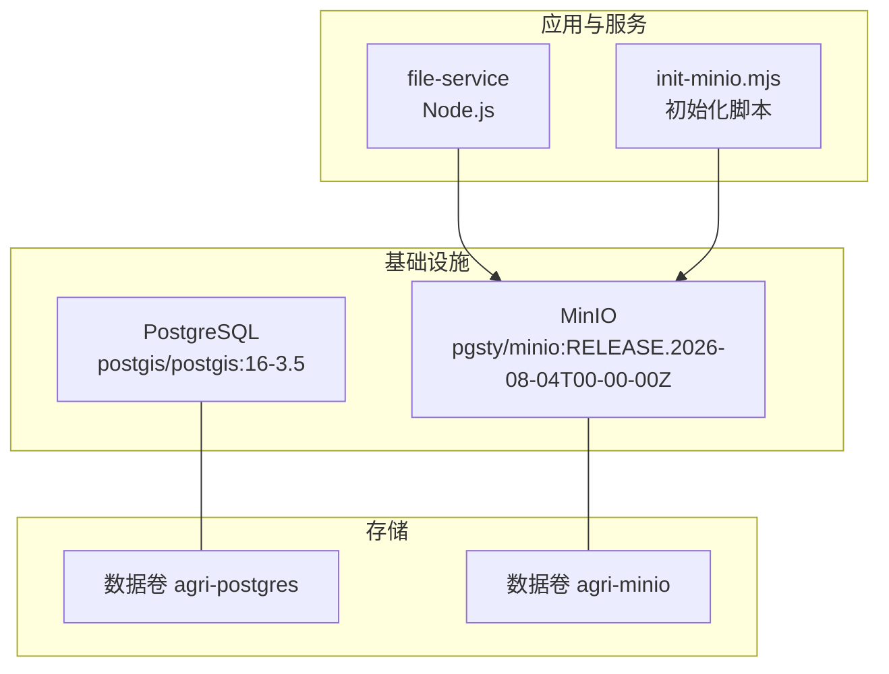
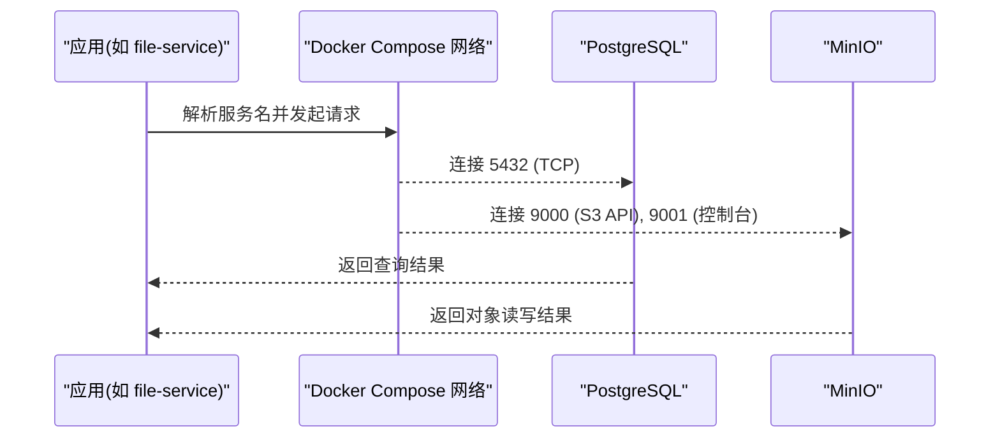
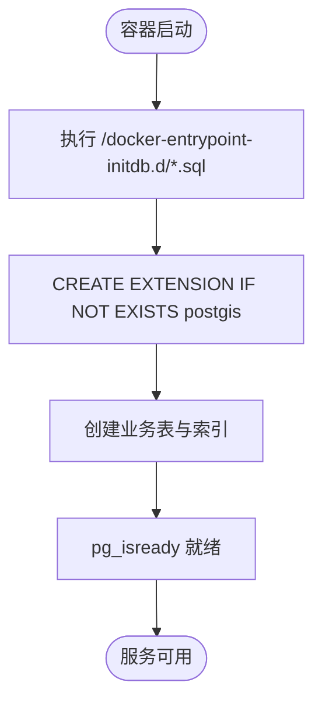
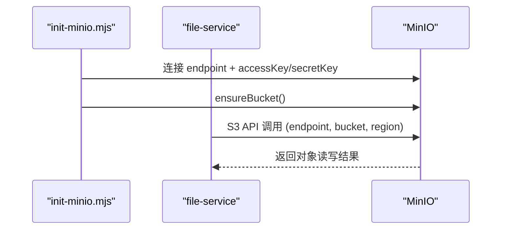
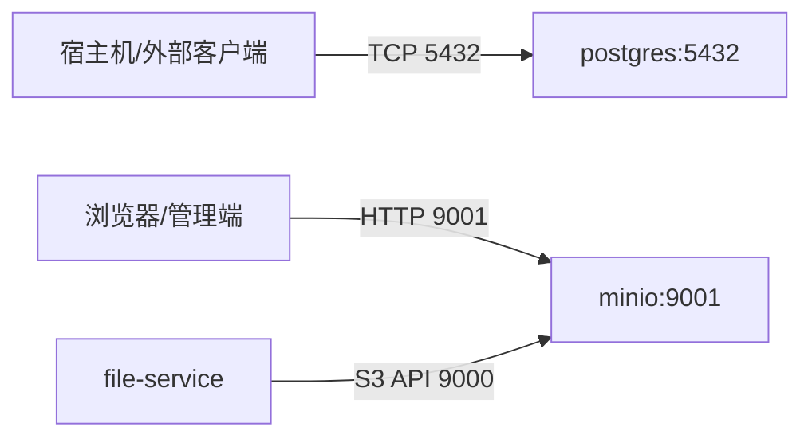

# Docker编排

<cite>
**本文引用的文件**   
- [infra/docker-compose.yml](file://infra/docker-compose.yml)
- [infra/README.md](file://infra/README.md)
- [infra/postgres/001_initial_schema.sql](file://infra/postgres/001_initial_schema.sql)
- [apps/file-service/src/main.ts](file://apps/file-service/src/main.ts)
- [scripts/init-minio.mjs](file://scripts/init-minio.mjs)
</cite>

## 目录
1. [简介](#简介)
2. [项目结构](#项目结构)
3. [核心组件](#核心组件)
4. [架构总览](#架构总览)
5. [详细组件分析](#详细组件分析)
6. [依赖关系与网络通信](#依赖关系与网络通信)
7. [健康检查、持久化与重启策略](#健康检查持久化与重启策略)
8. [资源限制、日志与安全最佳实践](#资源限制日志与安全最佳实践)
9. [自定义镜像构建与扩展指南](#自定义镜像构建与扩展指南)
10. [故障排查](#故障排查)
11. [结论](#结论)

## 简介
本文件面向智慧农业平台的本地基础设施编排，聚焦 infra/docker-compose.yml 中 PostgreSQL 与 MinIO 服务的配置说明。文档涵盖服务参数、环境变量、端口映射、数据卷挂载、服务间依赖与网络通信机制、健康检查、数据持久化、服务重启策略、容器资源限制、日志配置与安全最佳实践，并提供自定义镜像构建与扩展指南，帮助读者在本地或生产环境中稳定运行平台的基础设施。

## 项目结构
infra 目录提供本地基础设施的编排与初始化脚本：
- docker-compose.yml：定义 PostgreSQL 与 MinIO 两个基础服务及其数据卷与健康检查。
- postgres/001_initial_schema.sql：PostgreSQL 初始数据库结构与索引。
- README.md：本地启动命令、默认连接串、MinIO 控制台地址与常用操作说明。
- scripts/init-minio.mjs：用于初始化 MinIO bucket 的脚本。
- apps/file-service/src/main.ts：文件服务对 S3/MinIO 的连接参数读取逻辑，体现应用层如何消费 MinIO。

图表来源
- [infra/docker-compose.yml:1-39](file://infra/docker-compose.yml#L1-L39)
- [apps/file-service/src/main.ts:7-14](file://apps/file-service/src/main.ts#L7-L14)
- [scripts/init-minio.mjs:3-10](file://scripts/init-minio.mjs#L3-L10)

章节来源
- [infra/docker-compose.yml:1-39](file://infra/docker-compose.yml#L1-L39)
- [infra/README.md:1-36](file://infra/README.md#L1-L36)

## 核心组件
- PostgreSQL（PostGIS）
  - 镜像：postgis/postgis:16-3.5
  - 数据库：agri
  - 用户：agri
  - 密码：agri
  - 端口：宿主机 5432 映射到容器 5432
  - 数据卷：agri-postgres 持久化 /var/lib/postgresql/data
  - 初始化脚本：./postgres 目录挂载为 /docker-entrypoint-initdb.d:ro，自动执行 001_initial_schema.sql
  - 健康检查：使用 pg_isready 检测可用性

- MinIO
  - 镜像：pgsty/minio:RELEASE.2026-08-04T00-00-00Z
  - 命令：server /data --console-address ":9001"
  - 根账号：minioadmin
  - 根密码：minioadmin
  - 端口：9000（API）、9001（控制台）
  - 数据卷：agri-minio 持久化 /data
  - 健康检查：mc ready local

章节来源
- [infra/docker-compose.yml:1-39](file://infra/docker-compose.yml#L1-L39)
- [infra/postgres/001_initial_schema.sql:1-41](file://infra/postgres/001_initial_schema.sql#L1-L41)

## 架构总览
下图展示基础设施服务与应用之间的交互关系：应用通过环境变量访问 MinIO；PostgreSQL 作为结构化数据存储；MinIO 作为对象存储后端；两者均通过 Docker Compose 网络互通，并通过数据卷实现数据持久化。

图表来源
- [infra/docker-compose.yml:1-39](file://infra/docker-compose.yml#L1-L39)
- [apps/file-service/src/main.ts:7-14](file://apps/file-service/src/main.ts#L7-L14)

## 详细组件分析

### PostgreSQL 服务
- 镜像与扩展
  - 使用 postgis/postgis:16-3.5，内置 PostGIS 扩展，便于空间数据处理。
- 环境变量
  - POSTGRES_DB=agri
  - POSTGRES_USER=agri
  - POSTGRES_PASSWORD=agri
- 端口映射
  - 5432:5432，供宿主机与其他容器访问。
- 数据卷
  - agri-postgres:/var/lib/postgresql/data 持久化数据库文件。
  - ./postgres:/docker-entrypoint-initdb.d:ro 只读挂载初始化脚本目录，容器启动时自动执行 SQL。
- 健康检查
  - 使用 pg_isready -U agri -d agri，间隔 5s，超时 5s，重试 10 次。
- 初始化脚本
  - 启用 PostGIS 扩展，创建 plot_records、finance_entries、trace_records 等表及索引。

图表来源
- [infra/docker-compose.yml:10-17](file://infra/docker-compose.yml#L10-L17)
- [infra/postgres/001_initial_schema.sql:1-41](file://infra/postgres/001_initial_schema.sql#L1-L41)

章节来源
- [infra/docker-compose.yml:2-17](file://infra/docker-compose.yml#L2-L17)
- [infra/postgres/001_initial_schema.sql:1-41](file://infra/postgres/001_initial_schema.sql#L1-L41)

### MinIO 服务
- 镜像与命令
  - 使用 pgsty/minio:RELEASE.2026-08-04T00-00-00Z，以 server /data 模式启动，并开启控制台 :9001。
- 环境变量
  - MINIO_ROOT_USER=minioadmin
  - MINIO_ROOT_PASSWORD=minioadmin
- 端口映射
  - 9000:9000（S3 API）
  - 9001:9001（Web 控制台）
- 数据卷
  - agri-minio:/data 持久化对象数据。
- 健康检查
  - 使用 mc ready local，间隔 5s，超时 5s，重试 10 次。
- 应用集成
  - file-service 通过 FILE_STORAGE_MODE=s3 与 FILE_S3_* 系列环境变量连接 MinIO。
  - init-minio.mjs 脚本用于确保 bucket 存在。

图表来源
- [infra/docker-compose.yml:19-34](file://infra/docker-compose.yml#L19-L34)
- [apps/file-service/src/main.ts:7-14](file://apps/file-service/src/main.ts#L7-L14)
- [scripts/init-minio.mjs:3-10](file://scripts/init-minio.mjs#L3-L10)

章节来源
- [infra/docker-compose.yml:19-34](file://infra/docker-compose.yml#L19-L34)
- [apps/file-service/src/main.ts:7-14](file://apps/file-service/src/main.ts#L7-L14)
- [scripts/init-minio.mjs:3-10](file://scripts/init-minio.mjs#L3-L10)

## 依赖关系与网络通信
- 服务发现与网络
  - 所有服务位于同一 Docker Compose 网络，可通过服务名互相访问（例如 PostgreSQL 的 host 为 postgres，MinIO 的 host 为 minio）。
- 端口暴露
  - PostgreSQL 对外暴露 5432，供宿主机或其他外部客户端直连。
  - MinIO 对外暴露 9000（API）与 9001（控制台），便于本地调试与管理。
- 应用侧连接
  - file-service 从环境变量读取 FILE_S3_ENDPOINT、FILE_S3_BUCKET、FILE_S3_REGION、FILE_S3_ACCESS_KEY、FILE_S3_SECRET_KEY，构造 S3 客户端连接 MinIO。
  - 若未显式设置 FILE_S3_ENDPOINT，默认指向 http://127.0.0.1:9000；在容器内应改为 http://minio:9000 或通过 Compose 网络解析。

图表来源
- [infra/docker-compose.yml:8-11](file://infra/docker-compose.yml#L8-L11)
- [infra/docker-compose.yml:25-29](file://infra/docker-compose.yml#L25-L29)
- [apps/file-service/src/main.ts:7-14](file://apps/file-service/src/main.ts#L7-L14)

章节来源
- [infra/docker-compose.yml:1-39](file://infra/docker-compose.yml#L1-L39)
- [apps/file-service/src/main.ts:7-14](file://apps/file-service/src/main.ts#L7-L14)

## 健康检查、持久化与重启策略
- 健康检查
  - PostgreSQL：pg_isready -U agri -d agri，间隔 5s，超时 5s，重试 10 次。
  - MinIO：mc ready local，间隔 5s，超时 5s，重试 10 次。
- 数据持久化
  - PostgreSQL：数据目录 /var/lib/postgresql/data 映射到命名卷 agri-postgres。
  - MinIO：数据目录 /data 映射到命名卷 agri-minio。
- 服务重启策略
  - 当前 compose 未显式声明 restart 策略；如需在生产环境保证自愈，建议添加 restart: unless-stopped 或 on-failure。
- 初始化流程
  - PostgreSQL 启动时自动执行 /docker-entrypoint-initdb.d 下的 SQL 脚本。
  - MinIO 启动后需通过 init-minio.mjs 或其他方式确保 bucket 存在。

章节来源
- [infra/docker-compose.yml:10-17](file://infra/docker-compose.yml#L10-L17)
- [infra/docker-compose.yml:28-34](file://infra/docker-compose.yml#L28-L34)
- [infra/postgres/001_initial_schema.sql:1-41](file://infra/postgres/001_initial_schema.sql#L1-L41)
- [scripts/init-minio.mjs:3-10](file://scripts/init-minio.mjs#L3-L10)

## 资源限制、日志与安全最佳实践
- 资源限制
  - 当前 compose 未设置 CPU/内存限制；建议在部署时根据负载设置 mem_limit/cpus 或使用 deploy.resources（取决于 Compose 版本与运行时）。
- 日志配置
  - 当前未配置 log driver 与 options；建议在生产环境配置 json-file 或 journald，并设置 max-size/max-file 控制日志体积。
- 安全最佳实践
  - 将敏感信息（数据库密码、MinIO 根账号密码、S3 密钥）放入 .env 文件或 secrets 管理方案，避免硬编码在 compose 文件中。
  - 仅暴露必要端口；PostgreSQL 与 MinIO 控制台不建议直接暴露到公网。
  - 使用最小权限原则为应用账户分配数据库与对象存储权限。
  - 启用 TLS 加密（数据库连接与 S3 API），并在反向代理层统一证书管理。
  - 定期轮换密钥与密码，审计访问日志。

[本节为通用指导，不直接分析具体文件]

## 自定义镜像构建与扩展指南
- 自定义 PostgreSQL 镜像
  - 基于 postgis/postgis:16-3.5，追加额外扩展、配置文件或初始化脚本。
  - 将自定义 SQL 放入 docker-entrypoint-initdb.d 目录，或在镜像构建阶段预置数据。
- 自定义 MinIO 镜像
  - 基于 pgsty/minio:RELEASE.2026-08-04T00-00-00Z，预置桶策略、用户与权限。
  - 可结合 init-minio.mjs 在容器启动时自动完成桶与策略初始化。
- 扩展服务
  - 在 docker-compose.yml 中添加新服务，复用现有网络与数据卷。
  - 通过环境变量注入连接参数，遵循 file-service 的模式接入 MinIO。
  - 为新服务添加健康检查与必要的端口映射。

章节来源
- [infra/docker-compose.yml:1-39](file://infra/docker-compose.yml#L1-L39)
- [apps/file-service/src/main.ts:7-14](file://apps/file-service/src/main.ts#L7-L14)
- [scripts/init-minio.mjs:3-10](file://scripts/init-minio.mjs#L3-L10)

## 故障排查
- PostgreSQL 无法连接
  - 检查端口 5432 是否被占用或被防火墙拦截。
  - 确认 POSTGRES_USER/POSTGRES_PASSWORD/POSTGRES_DB 与应用程序一致。
  - 查看初始化脚本是否成功执行（/docker-entrypoint-initdb.d）。
- MinIO 控制台不可用
  - 确认 9001 端口已映射且未被占用。
  - 使用默认账号 minioadmin/minioadmin 登录。
  - 若 bucket 不存在，运行 init-minio.mjs 初始化。
- 应用无法访问 MinIO
  - 检查 FILE_STORAGE_MODE 是否为 s3。
  - 校验 FILE_S3_ENDPOINT、FILE_S3_BUCKET、FILE_S3_REGION、FILE_S3_ACCESS_KEY、FILE_S3_SECRET_KEY。
  - 在容器内应使用服务名 minio 而非 127.0.0.1。

章节来源
- [infra/README.md:1-36](file://infra/README.md#L1-L36)
- [apps/file-service/src/main.ts:7-14](file://apps/file-service/src/main.ts#L7-L14)
- [scripts/init-minio.mjs:3-10](file://scripts/init-minio.mjs#L3-L10)

## 结论
通过 infra/docker-compose.yml，PostgreSQL 与 MinIO 以标准化方式编排，配合健康检查与数据卷实现高可用与数据持久化。应用侧通过环境变量与 Compose 网络无缝对接基础设施。建议在后续迭代中引入资源限制、日志管理与密钥管理，进一步提升系统的安全性与可运维性。