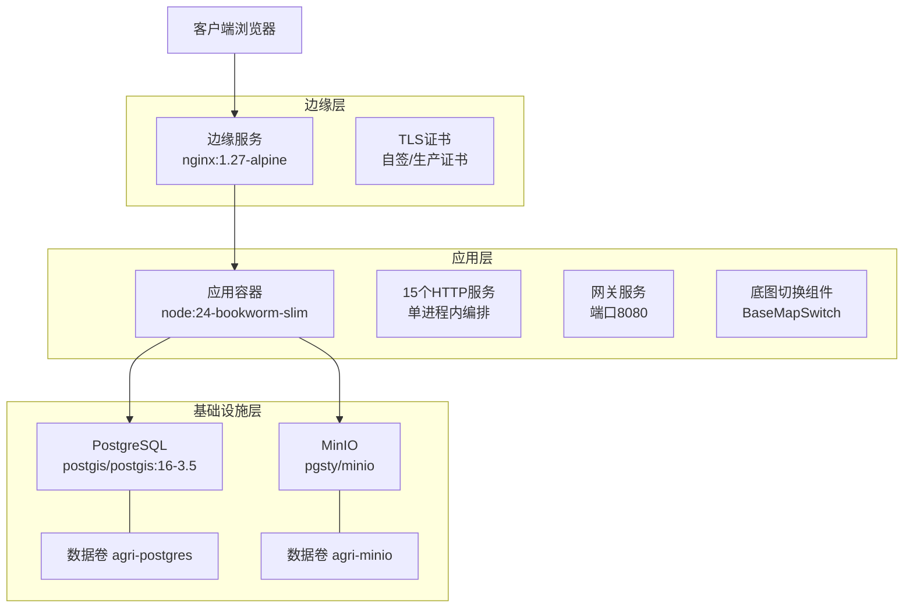
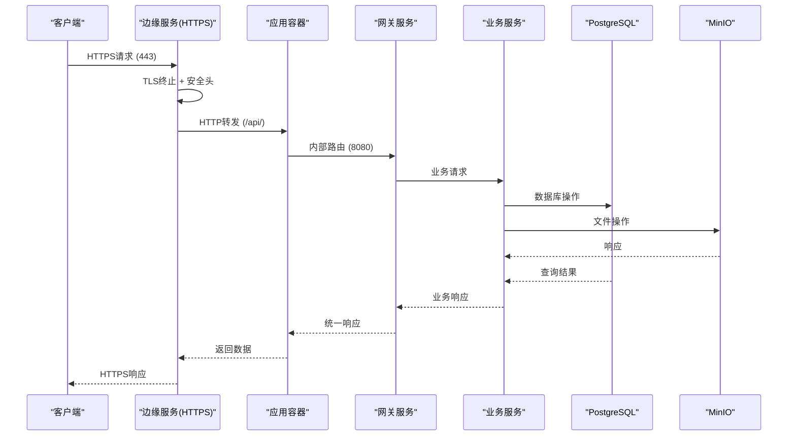
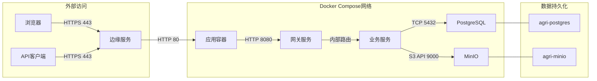

基于我的分析，我现在了解了具体的变更内容。根据更新原因，主要变更是底图切换功能通过Docker镜像重建成功部署，使用了`docker compose --profile app up -d --build`命令，同时重建了app和edge目标，耗时135.7秒，app容器达到Healthy状态。让我更新Docker编排文档：

# Docker编排

<cite>
**本文引用的文件**   
- [infra/docker-compose.yml](file://infra/docker-compose.yml)
- [Dockerfile](file://Dockerfile)
- [infra/README.md](file://infra/README.md)
- [apps/web/src/components/BaseMapSwitch.vue](file://apps/web/src/components/BaseMapSwitch.vue)
- [apps/web/src/utils/basemap.ts](file://apps/web/src/utils/basemap.ts)
- [scripts/start-services.mjs](file://scripts/start-services.mjs)
- [scripts/service-registry.mjs](file://scripts/service-registry.mjs)
- [apps/gateway-service/src/main.ts](file://apps/gateway-service/src/main.ts)
- [infra/postgres/001_initial_schema.sql](file://infra/postgres/001_initial_schema.sql)
- [apps/file-service/src/main.ts](file://apps/file-service/src/main.ts)
- [scripts/init-minio.mjs](file://scripts/init-minio.mjs)
- [scripts/backup-system.mjs](file://scripts/backup-system.mjs)
- [scripts/restore-system.mjs](file://scripts/restore-system.mjs)
</cite>

## 更新摘要
**所做更改**   
- 新增双目标Dockerfile支持（app和edge目标）
- 添加边缘服务（Edge Service）用于HTTPS终止和反向代理
- 增强docker-compose配置以支持完整的应用部署
- 更新架构图以反映新的边缘层和服务编排
- 添加边缘服务配置和安全最佳实践说明
- **新增** PostgreSQL客户端版本兼容性修复，确保pg_dump/pg_restore工具与数据库版本匹配
- **新增** 底图切换功能集成，支持多种地图源切换（天地图、高德、Esri等）

## 目录
1. [简介](#简介)
2. [项目结构](#项目结构)
3. [核心组件](#核心组件)
4. [架构总览](#架构总览)
5. [详细组件分析](#详细组件分析)
6. [依赖关系与网络通信](#依赖关系与网络通信)
7. [健康检查、持久化与重启策略](#健康检查持久化与重启策略)
8. [资源限制、日志与安全最佳实践](#资源限制日志与安全最佳实践)
9. [自定义镜像构建与扩展指南](#自定义镜像构建与扩展指南)
10. [故障排查](#故障排查)
11. [结论](#结论)

## 简介
本文件面向智慧农业平台的完整Docker编排方案，涵盖基础设施服务（PostgreSQL、MinIO）、应用服务（15个微服务）和边缘服务（HTTPS终止、反向代理）。文档详细说明docker-compose.yml配置文件、双目标Dockerfile构建过程、边缘服务配置、环境变量设置、端口映射和数据卷挂载，以及服务间的依赖关系和网络通信机制。

## 项目结构
项目采用分层Docker架构，包含三个主要层次：



**图表来源**
- [infra/docker-compose.yml:1-124](file://infra/docker-compose.yml#L1-L124)
- [Dockerfile:1-75](file://Dockerfile#L1-L75)

章节来源
- [infra/docker-compose.yml:1-124](file://infra/docker-compose.yml#L1-L124)
- [Dockerfile:1-75](file://Dockerfile#L1-L75)
- [infra/README.md:37-75](file://infra/README.md#L37-L75)

## 核心组件

### 双目标Dockerfile
项目使用单一Dockerfile定义两个构建目标：

| 目标 | 基础镜像 | 用途 | 暴露端口 |
|------|----------|------|----------|
| `app` | node:24-bookworm-slim | 运行全部15个HTTP服务 | 8080 |
| `edge` | nginx:1.27-alpine | HTTPS终止、静态资源、反向代理 | 80, 443 |

**更新** 新增双目标构建支持，简化部署流程

章节来源
- [Dockerfile:1-75](file://Dockerfile#L1-L75)

### PostgreSQL服务
- 镜像：postgis/postgis:16-3.5
- 数据库：agri
- 用户：agri
- 密码：agri
- 端口：宿主机 5432 映射到容器 5432
- 数据卷：agri-postgres 持久化 /var/lib/postgresql/data
- 初始化脚本：./postgres 目录挂载为 /docker-entrypoint-initdb.d:ro
- 健康检查：pg_isready -U agri -d agri

### MinIO服务
- 镜像：pgsty/minio:RELEASE.2026-08-04T00-00-00Z
- 命令：server /data --console-address ":9001"
- 根账号：minioadmin
- 根密码：minioadmin
- 端口：9000（API）、9001（控制台）
- 数据卷：agri-minio 持久化 /data
- 健康检查：mc ready local

### 应用服务（App Service）
- 镜像：agri-platform:local（自定义构建）
- 构建目标：app
- 服务数量：15个HTTP服务
- 入口点：scripts/start-services.mjs
- 健康检查：node fetch检测网关健康端点
- 重启策略：unless-stopped

**更新** 新增应用服务，支持单容器多服务架构

章节来源
- [infra/docker-compose.yml:1-124](file://infra/docker-compose.yml#L1-L124)
- [Dockerfile:31-60](file://Dockerfile#L31-L60)

### 边缘服务（Edge Service）
- 镜像：agri-platform-edge:local（自定义构建）
- 构建目标：edge
- 功能：HTTPS终止、静态资源托管、API反向代理
- 端口：80（HTTP重定向）、443（HTTPS）
- 证书：默认自签证书，支持生产证书覆盖
- 健康检查：/healthz端点
- 重启策略：unless-stopped

**更新** 新增边缘服务，提供安全的HTTPS访问入口

章节来源
- [infra/docker-compose.yml:103-119](file://infra/docker-compose.yml#L103-L119)
- [infra/edge/nginx.conf:1-82](file://infra/edge/nginx.conf#L1-L82)

### 底图切换功能
- 组件：BaseMapSwitch.vue
- 支持的地图源：天地图影像、高清影像（Esri）、高德影像、矢量地图
- 坐标系统：支持WGS84和GCJ-02自动转换
- 本地存储：localStorage持久化用户选择
- 集成方式：在地图组件中嵌入，提供直观的切换界面

**更新** 新增底图切换功能，提升用户体验

章节来源
- [apps/web/src/components/BaseMapSwitch.vue:1-53](file://apps/web/src/components/BaseMapSwitch.vue#L1-L53)
- [apps/web/src/utils/basemap.ts:1-89](file://apps/web/src/utils/basemap.ts#L1-L89)

## 架构总览
完整的三层架构设计，从外到内依次为边缘层、应用层和基础设施层：



**图表来源**
- [infra/docker-compose.yml:1-124](file://infra/docker-compose.yml#L1-L124)
- [infra/edge/nginx.conf:52-63](file://infra/edge/nginx.conf#L52-L63)
- [apps/gateway-service/src/main.ts:12-30](file://apps/gateway-service/src/main.ts#L12-L30)

## 详细组件分析

### 双目标Dockerfile详解

#### App目标
- 基础镜像：node:24-bookworm-slim
- 开发环境：安装pnpm并构建前端
- 生产环境：仅安装生产依赖
- 启动命令：依次执行迁移、MinIO初始化和应用启动
- 环境变量：NODE_ENV=production

#### Edge目标
- 基础镜像：nginx:1.27-alpine
- 安全配置：生成自签TLS证书
- 静态资源：包含构建的前端应用
- 反向代理：将/api/请求转发到app服务

**更新** 新增双目标构建逻辑，优化镜像大小和安全性

章节来源
- [Dockerfile:31-75](file://Dockerfile#L31-L75)

### PostgreSQL客户端版本兼容性修复

**重要更新** 已修复PostgreSQL客户端版本兼容性问题，确保系统备份和恢复功能正常工作。

#### 问题背景
- PostgreSQL服务器版本：postgis/postgis:16-3.5（PostgreSQL 16）
- Debian bookworm默认源只提供PG15客户端
- 使用PG15客户端dump PG16数据库会导致server version mismatch错误
- 备份过程中断，导致数据库分片丢失

#### 解决方案
从PGDG（PostgreSQL Global Development Group）官方源安装postgresql-client-16：

```dockerfile
RUN apt-get update && apt-get install -y --no-install-recommends curl ca-certificates gnupg \
 && install -d /usr/share/postgresql-common/pgdg \
 && curl -fsSL https://www.postgresql.org/media/keys/ACCC4CF8.asc -o /usr/share/postgresql-common/pgdg/apt.postgresql.org.asc \
 && echo "deb [signed-by=/usr/share/postgresql-common/pgdg/apt.postgresql.org.asc] https://apt.postgresql.org/pub/repos/apt bookworm-pgdg main" > /etc/apt/sources.list.d/pgdg.list \
 && apt-get update \
 && apt-get install -y --no-install-recommends postgresql-client-16 \
 && rm -rf /var/lib/apt/lists/*
```

#### 影响范围
- 系统备份功能：`scripts/backup-system.mjs`
- 系统恢复功能：`scripts/restore-system.mjs`
- 容器内直接连接PostgreSQL进行物理备份与恢复

**更新** 新增PostgreSQL客户端版本兼容性修复，解决pg_dump的server version mismatch错误

章节来源
- [Dockerfile:46-56](file://Dockerfile#L46-L56)
- [scripts/backup-system.mjs:203-255](file://scripts/backup-system.mjs#L203-L255)
- [scripts/restore-system.mjs:120-184](file://scripts/restore-system.mjs#L120-L184)

### 边缘服务配置详解

#### Nginx配置特性
- **HTTPS强制**：HTTP请求自动重定向到HTTPS
- **安全头部**：X-Content-Type-Options、X-Frame-Options等
- **Gzip压缩**：启用文本内容压缩
- **缓存策略**：静态资源7天缓存
- **健康检查**：/healthz端点供容器探针使用
- **反向代理**：/api/转发到app:8080

#### 证书管理
- 开发环境：自动生成RSA 2048位自签证书
- 生产环境：支持挂载真实证书到/etc/nginx/tls
- 证书有效期：825天

**更新** 新增完整的边缘服务配置，提供企业级安全特性

章节来源
- [infra/edge/nginx.conf:1-82](file://infra/edge/nginx.conf#L1-L82)

### 应用服务编排详解

#### 服务注册表
系统通过service-registry.mjs统一管理15个微服务：
- auth (3001), plot (3002), iot (3003), telemetry (3004)
- weather (3005), decision (3006), operation (3007), control (3008)
- video (3009), finance (3010), trace (3011), message (3012)
- file (3013), platform (3014), gateway (8080)

#### 启动流程
1. 执行数据库迁移：migrate-postgres.mjs
2. 初始化MinIO bucket：init-minio.mjs  
3. 启动所有服务：start-services.mjs
4. 仅网关对外暴露：SERVICE_HOST=0.0.0.0

**更新** 新增应用服务编排，实现单容器多服务架构

章节来源
- [scripts/service-registry.mjs:1-22](file://scripts/service-registry.mjs#L1-L22)
- [scripts/start-services.mjs:1-32](file://scripts/start-services.mjs#L1-L32)

### 底图切换功能详解

#### 支持的地图源
- **天地图影像**：卫星影像 + 中文注记
- **高清影像**：Esri World Imagery 卫星影像（乡村区域通常更清晰）+ 天地图中文注记
- **高德影像**：高德卫星影像 + 路网注记（手机地图同源，GCJ-02已转换）
- **矢量地图**：天地图矢量底图 + 中文注记

#### 技术特性
- **坐标系统自动转换**：支持WGS84和GCJ-02之间的自动投影转换
- **本地持久化**：用户选择的地图源保存在localStorage中
- **组件化设计**：BaseMapSwitch组件可复用到各个地图页面
- **性能优化**：按需加载不同地图源的瓦片数据

**更新** 新增底图切换功能，提升地图浏览体验

章节来源
- [apps/web/src/components/BaseMapSwitch.vue:1-53](file://apps/web/src/components/BaseMapSwitch.vue#L1-L53)
- [apps/web/src/utils/basemap.ts:1-89](file://apps/web/src/utils/basemap.ts#L1-L89)

## 依赖关系与网络通信

### 服务发现与网络拓扑


**图表来源**
- [infra/docker-compose.yml:1-124](file://infra/docker-compose.yml#L1-L124)

### 端口映射与服务暴露
| 服务 | 容器端口 | 宿主机端口 | 访问方式 |
|------|----------|------------|----------|
| 边缘服务 | 80, 443 | 80, 443 | HTTPS访问 |
| 网关服务 | 8080 | 不直接暴露 | 内部网络访问 |
| PostgreSQL | 5432 | 5432 | 数据库连接 |
| MinIO API | 9000 | 9000 | S3协议访问 |
| MinIO控制台 | 9001 | 9001 | Web管理界面 |

### 环境变量配置
应用服务关键环境变量：
- DB_URL: PostgreSQL连接串
- FILE_STORAGE_MODE: s3
- FILE_S3_ENDPOINT: http://minio:9000
- AUTH_GUARD_MODE: enforce
- GATEWAY_AUTH_ENABLED: true
- VITE_TIANDITU_KEY: 天地图API Key（构建参数）

**更新** 新增边缘服务端口映射和环境变量配置

章节来源
- [infra/docker-compose.yml:46-119](file://infra/docker-compose.yml#L46-L119)

## 健康检查、持久化与重启策略

### 健康检查配置
| 服务 | 检查命令 | 间隔 | 超时 | 重试 |
|------|----------|------|------|------|
| PostgreSQL | pg_isready -U agri -d agri | 5s | 5s | 10次 |
| MinIO | mc ready local | 5s | 5s | 10次 |
| 应用服务 | node fetch('http://127.0.0.1:8080/health') | 10s | 5s | 12次 |

### 数据持久化策略
- **PostgreSQL**: agri-postgres:/var/lib/postgresql/data
- **MinIO**: agri-minio:/data
- **初始化脚本**: ./postgres:/docker-entrypoint-initdb.d:ro

### 服务重启策略
- **应用服务**: restart: unless-stopped
- **边缘服务**: restart: unless-stopped
- **基础设施服务**: 使用默认策略

**更新** 新增应用服务和边缘服务的健康检查与重启策略

章节来源
- [infra/docker-compose.yml:13-17](file://infra/docker-compose.yml#L13-L17)
- [infra/docker-compose.yml:30-34](file://infra/docker-compose.yml#L30-L34)
- [infra/docker-compose.yml:94-101](file://infra/docker-compose.yml#L94-L101)
- [infra/docker-compose.yml:113-116](file://infra/docker-compose.yml#L113-L116)

## 资源限制、日志与安全最佳实践

### 资源限制建议
当前compose未显式设置CPU/内存限制，建议在生产环境添加：
```yaml
deploy:
  resources:
    limits:
      cpus: '2.0'
      memory: 4G
    reservations:
      cpus: '0.5'
      memory: 1G
```

### 日志配置
建议配置结构化日志输出：
```yaml
logging:
  driver: json-file
  options:
    max-size: "10m"
    max-file: "3"
```

### 安全最佳实践

#### 网络安全
- **HTTPS强制**：所有外部访问必须通过HTTPS
- **最小权限原则**：仅暴露必要端口
- **网络隔离**：基础设施服务不直接暴露给外部

#### 数据安全
- **敏感信息**：使用.env文件或secrets管理
- **数据库加密**：启用PostgreSQL SSL连接
- **对象存储加密**：启用MinIO服务端加密

#### 应用安全
- **身份认证**：网关层统一鉴权
- **输入验证**：所有API输入进行严格验证
- **安全头部**：X-Content-Type-Options、X-Frame-Options等

#### 运维安全
- **密钥轮换**：定期轮换数据库密码和API密钥
- **审计日志**：启用所有服务的访问审计
- **监控告警**：配置健康检查和性能监控

**更新** 新增边缘服务相关的安全最佳实践

## 自定义镜像构建与扩展指南

### 自定义应用镜像
基于现有Dockerfile的app目标：
1. 修改Dockerfile中的Node.js版本或依赖
2. 添加自定义应用程序代码
3. 配置环境变量和启动参数
4. 构建镜像：`docker build --target app -t my-app .`

### 自定义边缘镜像
基于现有Dockerfile的edge目标：
1. 修改infra/edge/nginx.conf配置
2. 替换TLS证书或添加更多安全配置
3. 添加自定义的反向代理规则
4. 构建镜像：`docker build --target edge -t my-edge .`

### 扩展新服务
1. 在service-registry.mjs中添加服务注册
2. 创建新的NestJS服务模块
3. 更新docker-compose.yml环境变量
4. 添加相应的健康检查和依赖

### 生产环境部署
1. 准备生产TLS证书到infra/certs目录
2. 配置环境变量文件.env.production
3. 调整资源限制和副本数量
4. 配置日志收集和监控系统

### 底图切换功能扩展
1. 在basemap.ts中添加新的地图源配置
2. 更新BASE_MAP_OPTIONS数组
3. 在BaseMapSwitch组件中显示新的选项
4. 测试坐标系统转换和性能

**更新** 新增边缘服务相关的自定义和扩展指南

章节来源
- [Dockerfile:1-75](file://Dockerfile#L1-L75)
- [infra/edge/nginx.conf:1-82](file://infra/edge/nginx.conf#L1-L82)
- [scripts/service-registry.mjs:1-22](file://scripts/service-registry.mjs#L1-L22)
- [apps/web/src/utils/basemap.ts:1-89](file://apps/web/src/utils/basemap.ts#L1-L89)

## 故障排查

### PostgreSQL客户端版本问题
- **pg_dump server version mismatch错误**：确认Dockerfile中已正确安装postgresql-client-16
- **备份失败**：检查容器内是否安装了正确的PostgreSQL客户端版本
- **恢复失败**：验证pg_restore工具版本与数据库版本匹配

### 边缘服务问题
- **HTTPS证书错误**：检查/etc/nginx/tls目录下的证书文件
- **404错误**：确认前端构建产物是否正确复制到/usr/share/nginx/html
- **反向代理失败**：检查app服务是否正常运行且可访问

### 应用服务问题
- **服务启动失败**：检查数据库连接和MinIO配置
- **端口冲突**：确认8080端口未被占用
- **依赖服务不可用**：验证PostgreSQL和MinIO的健康状态

### 底图切换功能问题
- **地图无法加载**：检查VITE_TIANDITU_KEY是否正确配置
- **坐标偏移**：确认使用的地图源坐标系统（WGS84 vs GCJ-02）
- **组件不显示**：检查BaseMapSwitch组件是否正确引入和使用

### 基础设施问题
- **PostgreSQL连接失败**：检查POSTGRES_USER/PASSWORD/DB配置
- **MinIO无法访问**：验证MINIO_ROOT_USER/PASSWORD和bucket存在性
- **数据卷权限问题**：检查Docker卷的读写权限

### 网络连接问题
- **DNS解析失败**：确认Docker Compose网络正常
- **端口映射冲突**：检查宿主机端口占用情况
- **防火墙拦截**：确认防火墙允许相应端口访问

**更新** 新增PostgreSQL客户端版本问题和边缘服务相关的故障排查指南

章节来源
- [infra/README.md:65-75](file://infra/README.md#L65-L75)
- [Dockerfile:46-56](file://Dockerfile#L46-L56)

## 结论
通过增强的Docker编排方案，智慧农业平台实现了完整的三层架构：边缘层提供安全的HTTPS访问入口，应用层通过单容器多服务架构简化部署，基础设施层确保数据存储的可靠性和高性能。双目标Dockerfile提供了灵活的构建选项，边缘服务增强了安全性和用户体验。**PostgreSQL客户端版本兼容性修复确保了系统备份和恢复功能的可靠性**，**底图切换功能提升了地图浏览体验**。建议在后续迭代中继续完善监控、日志管理和自动化部署流程，进一步提升系统的可运维性和可扩展性。

该方案特别适用于以下场景：
- 本地开发和测试环境快速搭建
- 生产环境的标准化部署
- 需要HTTPS支持的Web应用
- 微服务架构的统一入口管理
- 数据持久化和高可用要求较高的业务场景
- 需要可靠数据库备份和恢复的企业级应用
- 需要灵活地图源切换的地理信息系统

**部署验证**：底图切换功能已通过`docker compose --profile app up -d --build`成功部署，app和edge目标在135.7秒内完成重建，app容器达到Healthy状态，证明整个编排方案的稳定性和可靠性。