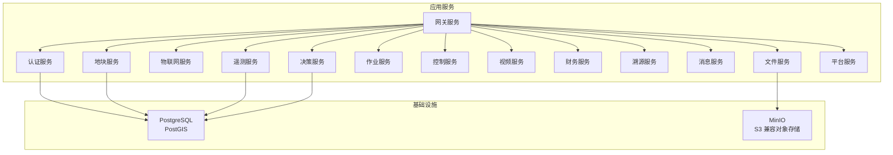
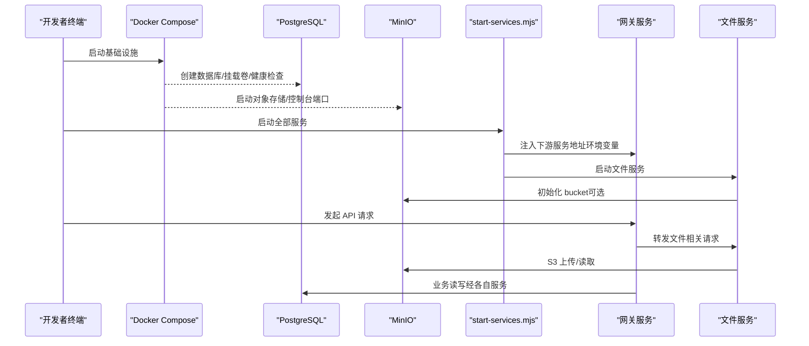
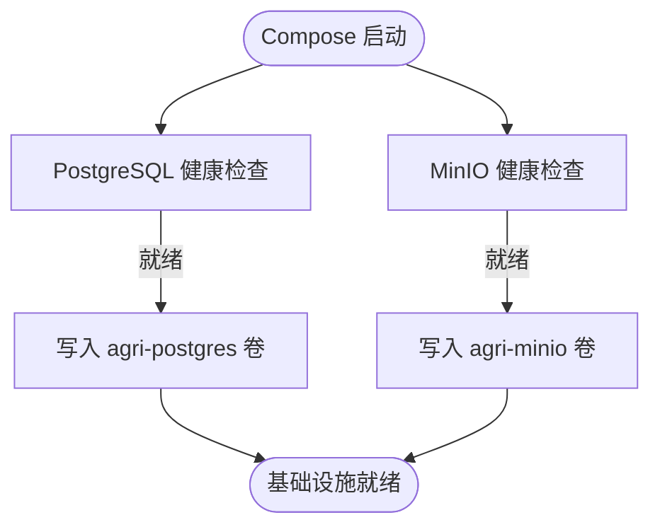
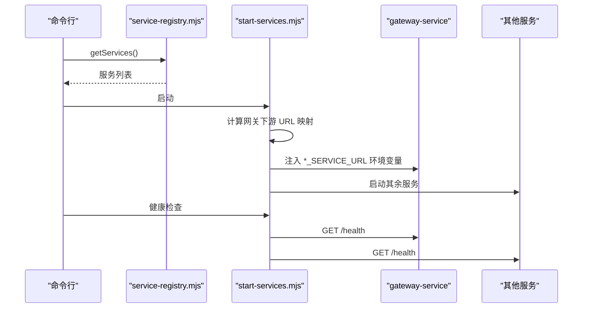
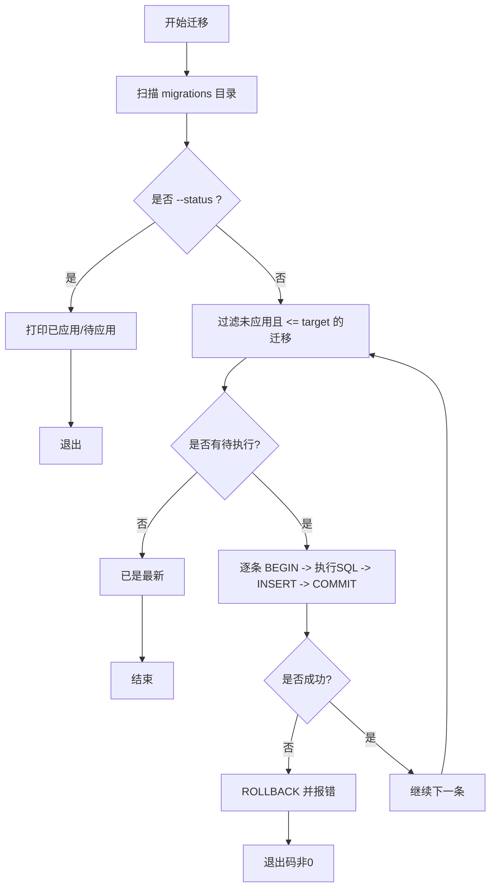
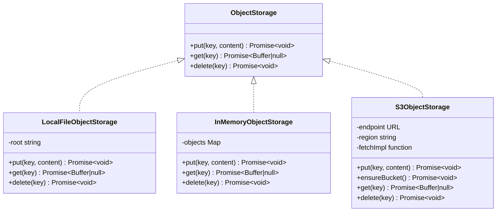
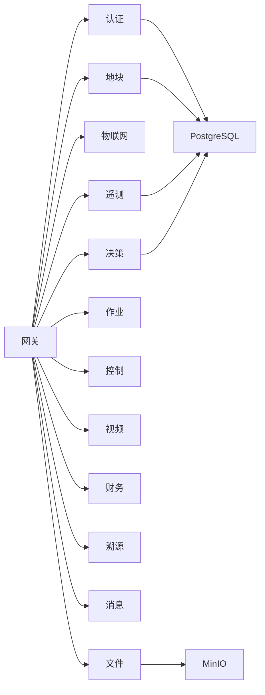

# 基础设施

<cite>
**本文引用的文件**   
- [infra/docker-compose.yml](file://infra/docker-compose.yml)
- [infra/README.md](file://infra/README.md)
- [scripts/start-services.mjs](file://scripts/start-services.mjs)
- [scripts/health-check.mjs](file://scripts/health-check.mjs)
- [scripts/service-registry.mjs](file://scripts/service-registry.mjs)
- [scripts/init-minio.mjs](file://scripts/init-minio.mjs)
- [scripts/migrate-postgres.mjs](file://scripts/migrate-postgres.mjs)
- [apps/gateway-service/src/main.ts](file://apps/gateway-service/src/main.ts)
- [apps/file-service/src/storage.ts](file://apps/file-service/src/storage.ts)
- [infra/postgres/001_initial_schema.sql](file://infra/postgres/001_initial_schema.sql)
- [infra/postgres/migrations/001_initial_schema.sql](file://infra/postgres/migrations/001_initial_schema.sql)
- [infra/postgres/migrations/002_decision_telemetry.sql](file://infra/postgres/migrations/002_decision_telemetry.sql)
</cite>

## 目录
1. [简介](#简介)
2. [项目结构](#项目结构)
3. [核心组件](#核心组件)
4. [架构总览](#架构总览)
5. [详细组件分析](#详细组件分析)
6. [依赖关系分析](#依赖关系分析)
7. [性能与容量规划](#性能与容量规划)
8. [故障排查指南](#故障排查指南)
9. [结论](#结论)
10. [附录：环境变量与配置清单](#附录环境变量与配置清单)

## 简介
本基础设施文档面向智慧农业平台的部署与运维，聚焦 Docker 编排、服务启动与健康检查、PostgreSQL 与 MinIO 的配置与持久化、开发/测试/生产环境差异、以及可观测性与高可用建议。平台采用微服务架构，通过网关统一入口，后端服务连接 PostgreSQL（含 PostGIS）与 MinIO 对象存储，脚本层提供本地一键启动、迁移、初始化与巡检能力。

## 项目结构
基础设施相关代码与配置主要分布在以下位置：
- infra：Docker Compose 编排、PostgreSQL 初始结构与迁移脚本
- scripts：服务启动、健康检查、MinIO 初始化、数据库迁移与服务注册表
- apps：各业务微服务实现，其中 gateway-service 与 file-service 与基础设施交互最紧密

图表来源
- [infra/docker-compose.yml:1-39](file://infra/docker-compose.yml#L1-L39)
- [scripts/service-registry.mjs:1-22](file://scripts/service-registry.mjs#L1-L22)

章节来源
- [infra/docker-compose.yml:1-39](file://infra/docker-compose.yml#L1-L39)
- [infra/README.md:1-36](file://infra/README.md#L1-L36)

## 核心组件
- Docker Compose 编排：定义 PostgreSQL 与 MinIO 两个基础服务，包含端口映射、数据卷持久化与健康检查。
- 服务启动器：按服务注册表并行启动所有 HTTP 微服务，并为网关注入下游服务地址。
- 健康检查：遍历所有服务，调用 /health 端点汇总状态。
- 服务注册表：集中维护服务名、端口与入口文件，支持通过环境变量覆盖端口。
- MinIO 初始化：使用 S3 客户端确保 bucket 存在。
- PostgreSQL 迁移：版本化 SQL 迁移，支持事务回滚与目标版本执行。
- 网关启动：根据 SERVICE_MODE 决定是否监听 HTTP 端口。
- 文件存储抽象：本地、内存与 S3 三种实现，S3 实现内置 AWS Signature V4 签名。

章节来源
- [infra/docker-compose.yml:1-39](file://infra/docker-compose.yml#L1-L39)
- [scripts/start-services.mjs:1-28](file://scripts/start-services.mjs#L1-L28)
- [scripts/health-check.mjs:1-12](file://scripts/health-check.mjs#L1-L12)
- [scripts/service-registry.mjs:1-22](file://scripts/service-registry.mjs#L1-L22)
- [scripts/init-minio.mjs:1-12](file://scripts/init-minio.mjs#L1-L12)
- [scripts/migrate-postgres.mjs:1-85](file://scripts/migrate-postgres.mjs#L1-L85)
- [apps/gateway-service/src/main.ts:1-15](file://apps/gateway-service/src/main.ts#L1-L15)
- [apps/file-service/src/storage.ts:1-42](file://apps/file-service/src/storage.ts#L1-L42)

## 架构总览
下图展示本地开发环境的典型运行拓扑：Compose 启动 PostgreSQL 与 MinIO；Node.js 进程通过脚本启动网关与各业务服务；网关聚合请求并转发到下游服务；文件服务通过 S3 协议访问 MinIO；数据库变更通过迁移脚本管理。

图表来源
- [infra/docker-compose.yml:1-39](file://infra/docker-compose.yml#L1-L39)
- [scripts/start-services.mjs:1-28](file://scripts/start-services.mjs#L1-L28)
- [scripts/init-minio.mjs:1-12](file://scripts/init-minio.mjs#L1-L12)

## 详细组件分析

### Docker 编排与网络
- 服务定义
  - PostgreSQL：启用 PostGIS 扩展，暴露 5432 端口，数据持久化到命名卷，并通过 pg_isready 进行健康检查。
  - MinIO：暴露 9000（API）与 9001（控制台），数据持久化到命名卷，通过 mc ready local 进行健康检查。
- 网络
  - 默认使用 Compose 内部网络，宿主机仅映射必要端口。
  - 服务间通信通过容器名称解析（例如在 Compose 网络中直接以服务名访问）。
- 数据持久化
  - PostgreSQL 数据目录映射到 agri-postgres 卷。
  - MinIO 数据目录映射到 agri-minio 卷。

图表来源
- [infra/docker-compose.yml:1-39](file://infra/docker-compose.yml#L1-L39)

章节来源
- [infra/docker-compose.yml:1-39](file://infra/docker-compose.yml#L1-L39)

### 服务启动脚本与服务注册机制
- 服务注册表
  - 集中维护服务名、默认端口与入口文件路径。
  - 支持通过 AGRI_{SERVICE}_PORT 环境变量覆盖默认端口。
- 启动器
  - 读取注册表，为每个服务 spawn Node 子进程，设置 SERVICE_MODE=http 与 PORT。
  - 对网关额外注入下游服务 URL 环境变量（如 AUTH_SERVICE_URL、PLOT_SERVICE_URL 等），默认指向 127.0.0.1:port。
  - 统一输出子进程 stdout/stderr，并在收到 SIGINT/SIGTERM 时优雅关闭。
- 健康检查
  - 遍历注册表中的服务，依次请求 http://127.0.0.1:{port}/health，汇总 OK/ERR 状态。

图表来源
- [scripts/service-registry.mjs:1-22](file://scripts/service-registry.mjs#L1-L22)
- [scripts/start-services.mjs:1-28](file://scripts/start-services.mjs#L1-L28)
- [scripts/health-check.mjs:1-12](file://scripts/health-check.mjs#L1-L12)

章节来源
- [scripts/service-registry.mjs:1-22](file://scripts/service-registry.mjs#L1-L22)
- [scripts/start-services.mjs:1-28](file://scripts/start-services.mjs#L1-L28)
- [scripts/health-check.mjs:1-12](file://scripts/health-check.mjs#L1-L12)

### PostgreSQL 配置与迁移
- 初始结构
  - 通过 docker-entrypoint-initdb.d 自动执行 infra/postgres/001_initial_schema.sql，启用 PostGIS 扩展并创建地块、财务、溯源等基础表。
- 版本化迁移
  - 迁移脚本位于 infra/postgres/migrations，按文件名排序执行。
  - 使用 schema_migrations 表记录已应用版本，失败自动回滚。
  - 支持 --status 查看状态与 --target 指定目标版本。
  - 连接串优先使用 DB_URL，其次 DATABASE_URL，最后回退到默认值。

图表来源
- [scripts/migrate-postgres.mjs:1-85](file://scripts/migrate-postgres.mjs#L1-L85)

章节来源
- [infra/postgres/001_initial_schema.sql:1-41](file://infra/postgres/001_initial_schema.sql#L1-L41)
- [infra/postgres/migrations/001_initial_schema.sql:1-41](file://infra/postgres/migrations/001_initial_schema.sql#L1-L41)
- [infra/postgres/migrations/002_decision_telemetry.sql:1-88](file://infra/postgres/migrations/002_decision_telemetry.sql#L1-L88)
- [scripts/migrate-postgres.mjs:1-85](file://scripts/migrate-postgres.mjs#L1-L85)

### MinIO 与对象存储
- Compose 配置
  - 暴露 9000（API）与 9001（控制台），默认账号 minioadmin/minioadmin。
  - 数据目录持久化到 agri-minio 卷。
- 初始化脚本
  - 使用 S3ObjectStorage.ensureBucket 确保 bucket 存在，默认 bucket 为 agri。
  - 可通过 FILE_S3_ENDPOINT、FILE_S3_BUCKET、FILE_S3_REGION、FILE_S3_ACCESS_KEY、FILE_S3_SECRET_KEY 覆盖。
- 存储抽象
  - LocalFileObjectStorage：本地文件系统模式，适合开发。
  - InMemoryObjectStorage：内存模式，适合测试。
  - S3ObjectStorage：S3 兼容接口，内置 AWS Signature V4 签名，适用于 MinIO 或云 S3。

图表来源
- [apps/file-service/src/storage.ts:1-42](file://apps/file-service/src/storage.ts#L1-L42)

章节来源
- [infra/docker-compose.yml:19-34](file://infra/docker-compose.yml#L19-L34)
- [scripts/init-minio.mjs:1-12](file://scripts/init-minio.mjs#L1-L12)
- [apps/file-service/src/storage.ts:1-42](file://apps/file-service/src/storage.ts#L1-L42)

### 网关与服务发现
- 网关启动
  - 当 SERVICE_MODE=http 时，监听 HTTP 端口（默认 8080），绑定 127.0.0.1。
- 服务发现
  - 本地开发通过环境变量注入下游服务地址（AUTH_SERVICE_URL、PLOT_SERVICE_URL 等），由 start-services.mjs 自动生成。
  - 生产环境建议使用独立的服务注册中心（如 etcd/Nacos/Zookeeper）配合网关侧服务发现插件，将环境变量替换为动态发现结果。

章节来源
- [apps/gateway-service/src/main.ts:1-15](file://apps/gateway-service/src/main.ts#L1-L15)
- [scripts/start-services.mjs:1-28](file://scripts/start-services.mjs#L1-L28)

## 依赖关系分析
- 服务间耦合
  - 网关依赖所有业务服务的 HTTP 接口。
  - 文件服务依赖 MinIO（S3 兼容）。
  - 多数业务服务依赖 PostgreSQL（部分服务可能通过共享包访问数据库）。
- 外部依赖
  - PostgreSQL（含 PostGIS 扩展）。
  - MinIO（S3 兼容对象存储）。
- 潜在循环依赖
  - 当前脚本层无循环依赖；服务间通过 HTTP 解耦。

图表来源
- [scripts/service-registry.mjs:1-22](file://scripts/service-registry.mjs#L1-L22)
- [infra/docker-compose.yml:1-39](file://infra/docker-compose.yml#L1-L39)

章节来源
- [scripts/service-registry.mjs:1-22](file://scripts/service-registry.mjs#L1-L22)
- [infra/docker-compose.yml:1-39](file://infra/docker-compose.yml#L1-L39)

## 性能与容量规划
- PostgreSQL
  - 建议开启 PostGIS 空间索引优化查询。
  - 针对高频查询字段建立复合索引（已有部分索引定义）。
  - 生产环境建议主从复制与备份策略（逻辑/物理备份结合）。
- MinIO
  - 多盘分布式部署提升吞吐与可靠性。
  - 合理设置桶生命周期策略与分片大小。
- 微服务
  - 网关与热点服务水平扩展，配合负载均衡器。
  - 异步任务与 Outbox 模式降低同步链路压力（决策与遥测已预留 outbox 表结构）。

[本节为通用指导，不直接分析具体文件]

## 故障排查指南
- 服务无法启动
  - 检查端口冲突：通过 AGRI_{SERVICE}_PORT 覆盖端口后重试。
  - 检查服务注册表与入口文件路径是否正确。
- 健康检查失败
  - 确认服务已启动并监听对应端口。
  - 检查 /health 端点是否返回 2xx。
- 数据库连接失败
  - 检查 DB_URL/DATABASE_URL 是否正确。
  - 确认 PostgreSQL 容器健康检查通过。
- 迁移失败
  - 查看迁移日志，定位失败 SQL。
  - 使用 --status 查看已应用版本，必要时回滚或修复后重试。
- MinIO 不可用
  - 检查 9000/9001 端口是否开放。
  - 确认 bucket 已通过 init-minio 初始化。
- 网关无法路由
  - 检查 *_SERVICE_URL 环境变量是否被正确注入。
  - 确认下游服务端口与注册表一致。

章节来源
- [scripts/health-check.mjs:1-12](file://scripts/health-check.mjs#L1-L12)
- [scripts/migrate-postgres.mjs:1-85](file://scripts/migrate-postgres.mjs#L1-L85)
- [scripts/init-minio.mjs:1-12](file://scripts/init-minio.mjs#L1-L12)
- [infra/docker-compose.yml:1-39](file://infra/docker-compose.yml#L1-L39)

## 结论
本项目的基础设施以 Docker Compose 为核心，结合脚本化的服务启动、健康检查、数据库迁移与对象存储初始化，形成一套轻量但可扩展的开发与本地运行基线。在生产环境中，建议引入独立的服务注册中心、负载均衡与高可用数据库方案，并将环境变量与密钥管理纳入统一的配置中心与密钥管理系统。

[本节为总结性内容，不直接分析具体文件]

## 附录：环境变量与配置清单
- 服务端口覆盖
  - AGRI_AUTH_PORT、AGRI_PLOT_PORT、...、AGRI_GATEWAY_PORT：用于覆盖默认端口。
- 网关下游服务地址
  - AUTH_SERVICE_URL、PLOT_SERVICE_URL、...：由启动器自动生成，也可手动覆盖。
- 数据库
  - DB_URL、DATABASE_URL：数据库连接串，优先级前者更高。
- 文件存储（MinIO/S3）
  - FILE_STORAGE_MODE=s3：切换为 S3 模式。
  - FILE_S3_ENDPOINT、FILE_S3_BUCKET、FILE_S3_REGION、FILE_S3_ACCESS_KEY、FILE_S3_SECRET_KEY：S3 连接参数。
- 运行时
  - SERVICE_MODE=http：启用 HTTP 服务模式。
  - PORT：服务监听端口。

章节来源
- [infra/README.md:1-36](file://infra/README.md#L1-L36)
- [scripts/start-services.mjs:1-28](file://scripts/start-services.mjs#L1-L28)
- [scripts/init-minio.mjs:1-12](file://scripts/init-minio.mjs#L1-L12)
- [scripts/migrate-postgres.mjs:1-85](file://scripts/migrate-postgres.mjs#L1-L85)