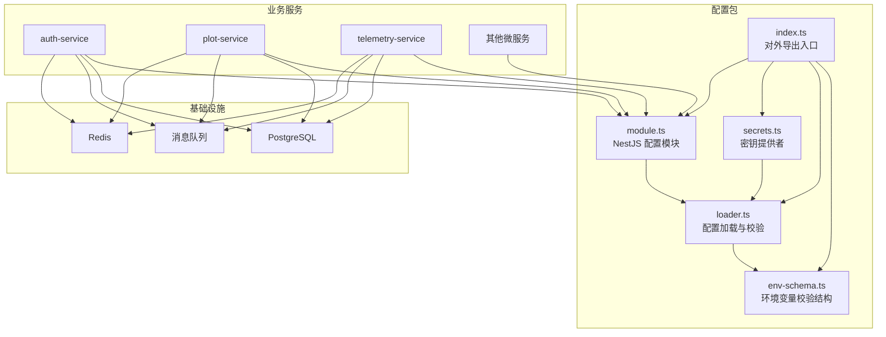
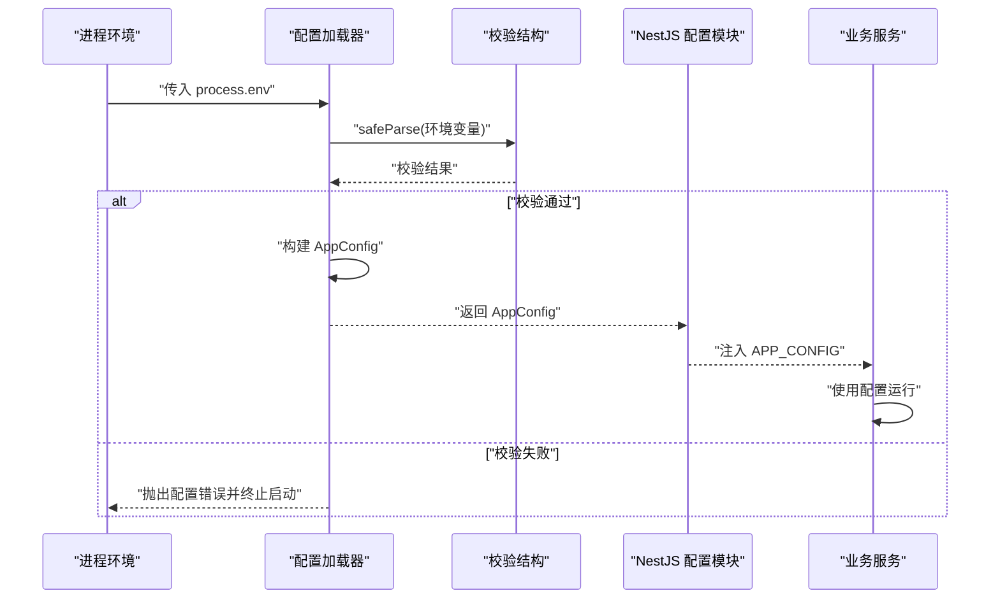
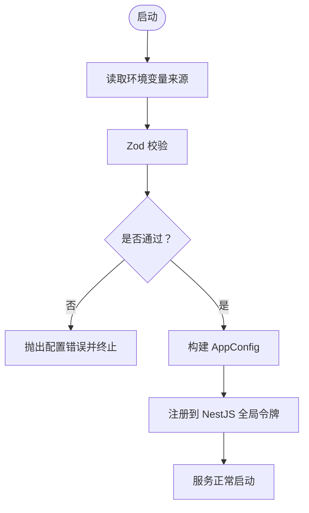
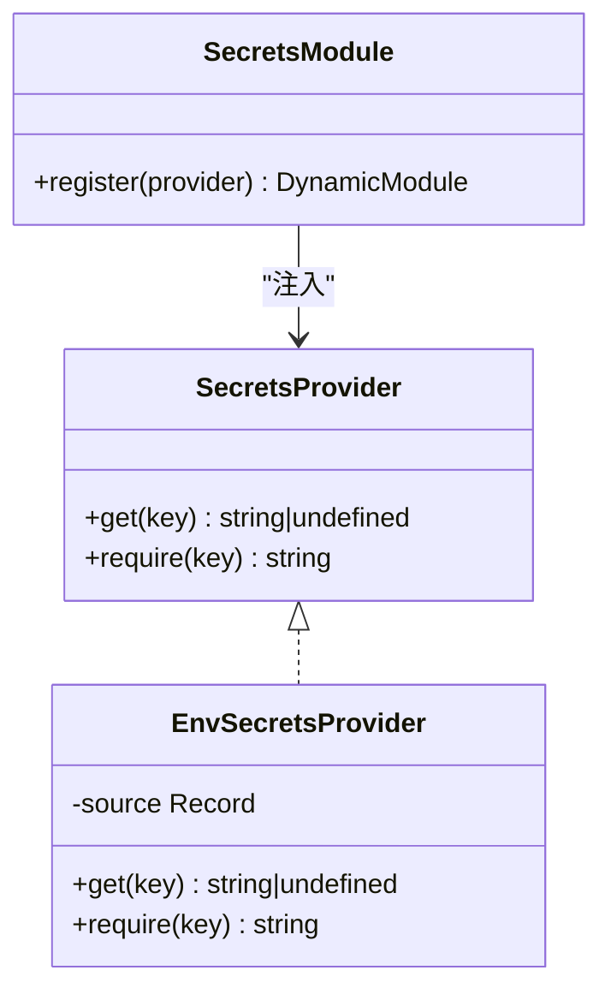
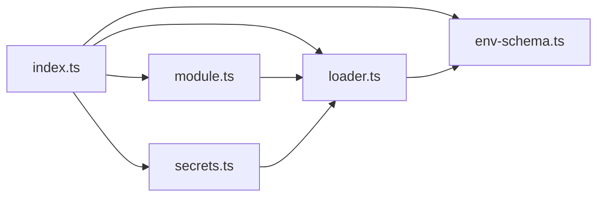

# 环境配置

<cite>
**本文引用的文件**   
- [packages/config/src/env-schema.ts](file://packages/config/src/env-schema.ts)
- [packages/config/src/loader.ts](file://packages/config/src/loader.ts)
- [packages/config/src/secrets.ts](file://packages/config/src/secrets.ts)
- [packages/config/src/module.ts](file://packages/config/src/module.ts)
- [packages/config/src/index.ts](file://packages/config/src/index.ts)
- [packages/config/package.json](file://packages/config/package.json)
- [apps/web/vite.config.ts](file://apps/web/vite.config.ts)
- [infra/docker-compose.yml](file://infra/docker-compose.yml)
</cite>

## 目录
1. [简介](#简介)
2. [项目结构](#项目结构)
3. [核心组件](#核心组件)
4. [架构总览](#架构总览)
5. [详细组件分析](#详细组件分析)
6. [依赖关系分析](#依赖关系分析)
7. [性能与容量规划](#性能与容量规划)
8. [故障排查指南](#故障排查指南)
9. [结论](#结论)
10. [附录](#附录)

## 简介
本文件为智慧农业平台的环境配置规范与管理策略说明，覆盖开发、测试、生产三类环境的差异与最佳实践。文档基于仓库中的配置包 @agri/config，统一描述环境变量命名规范、配置加载优先级、校验机制、数据库连接、消息队列、缓存（Redis）以及密钥管理策略，并提供模板、默认值与迁移指导。

## 项目结构
配置能力集中在 packages/config 包中，提供：
- 环境变量校验结构与环境变量到应用配置的映射
- 启动期配置加载与失败拦截
- NestJS 全局配置模块注入
- 密钥读取契约与默认实现

**图表来源**
- [packages/config/src/index.ts:1-9](file://packages/config/src/index.ts#L1-L9)
- [packages/config/src/env-schema.ts:1-78](file://packages/config/src/env-schema.ts#L1-L78)
- [packages/config/src/loader.ts:1-80](file://packages/config/src/loader.ts#L1-L80)
- [packages/config/src/secrets.ts:1-61](file://packages/config/src/secrets.ts#L1-L61)
- [packages/config/src/module.ts:1-41](file://packages/config/src/module.ts#L1-L41)

**章节来源**
- [packages/config/src/index.ts:1-9](file://packages/config/src/index.ts#L1-L9)
- [packages/config/package.json:1-28](file://packages/config/package.json#L1-L28)

## 核心组件
- 环境变量校验结构：集中声明所有必需/可选环境变量、类型、取值范围与默认值，作为唯一权威来源。
- 配置加载器：在启动期对进程环境变量进行解析、校验与归并，失败即抛出明确错误，阻止服务启动。
- 密钥提供者：定义统一的密钥读取接口，默认从环境变量读取；缺失时抛出配置错误。
- NestJS 配置模块：将已校验的应用配置以全局令牌注入，供各服务直接消费。

**章节来源**
- [packages/config/src/env-schema.ts:1-78](file://packages/config/src/env-schema.ts#L1-L78)
- [packages/config/src/loader.ts:1-80](file://packages/config/src/loader.ts#L1-L80)
- [packages/config/src/secrets.ts:1-61](file://packages/config/src/secrets.ts#L1-L61)
- [packages/config/src/module.ts:1-41](file://packages/config/src/module.ts#L1-L41)

## 架构总览
下图展示服务启动时的配置加载流程，包括环境变量校验、应用配置构建与 NestJS 模块注入。

**图表来源**
- [packages/config/src/loader.ts:21-79](file://packages/config/src/loader.ts#L21-L79)
- [packages/config/src/env-schema.ts:10-40](file://packages/config/src/env-schema.ts#L10-L40)
- [packages/config/src/module.ts:24-39](file://packages/config/src/module.ts#L24-L39)

## 详细组件分析

### 环境变量命名规范与默认值
- 基础项
  - NODE_ENV：development | test | production，默认 development
  - SERVICE_NAME：服务名，必填
  - PORT：监听端口，1-65535，默认 3000
  - LOG_LEVEL：debug | info | warn | error，默认 info
- 数据库
  - DB_URL：连接串，必填
  - DB_SHARD_MODE：single | shared | isolated，默认 single
  - DB_POOL_SIZE：连接池大小，1-200，默认 10
  - DB_SLOW_QUERY_MS：慢查询阈值（毫秒），≥1，默认 500
- 消息队列
  - MQ_BROKERS：逗号分隔的节点列表，必填
  - MQ_GROUP_ID：消费者组，必填
  - MQ_AUTO_COMMIT_INTERVAL_MS：自动提交间隔（毫秒），≥100，默认 5000
- Redis
  - REDIS_HOST：主机，默认 127.0.0.1
  - REDIS_PORT：端口，1-65535，默认 6379
  - REDIS_DB：库号，0-15，默认 0

注意：对象存储（如 S3/MinIO）未在配置包中声明，建议复用相同命名风格，例如 OBJECT_STORAGE_ENDPOINT、OBJECT_STORAGE_ACCESS_KEY、OBJECT_STORAGE_SECRET_KEY、OBJECT_STORAGE_BUCKET 等，并在业务侧增加独立校验。

**章节来源**
- [packages/config/src/env-schema.ts:10-40](file://packages/config/src/env-schema.ts#L10-L40)
- [packages/config/src/loader.ts:38-64](file://packages/config/src/loader.ts#L38-L64)

### 配置加载优先级与验证机制
- 优先级
  - 进程环境变量（process.env）是默认来源
  - 可通过 ConfigModule.forRoot({ env }) 注入自定义环境变量源，用于测试或容器编排
- 验证机制
  - 启动期执行 safeParse，任何缺失或非法字段都会导致启动失败
  - 提供 validateEnv 预检函数，便于部署前检查
- 错误信息
  - 配置错误包含问题清单，列出具体字段路径与原因，便于运维定位

**图表来源**
- [packages/config/src/loader.ts:21-79](file://packages/config/src/loader.ts#L21-L79)
- [packages/config/src/module.ts:24-39](file://packages/config/src/module.ts#L24-L39)

**章节来源**
- [packages/config/src/loader.ts:1-80](file://packages/config/src/loader.ts#L1-L80)
- [packages/config/src/module.ts:1-41](file://packages/config/src/module.ts#L1-L41)

### 数据库连接配置
- 关键变量
  - DB_URL：主数据源连接串
  - DB_SHARD_MODE：分片模式（single/shared/isolated）
  - DB_POOL_SIZE：连接池上限
  - DB_SLOW_QUERY_MS：慢查询阈值
- 使用方式
  - 由 loader 将环境变量映射为 db 配置对象
  - 业务层通过 APP_CONFIG.db 访问

建议：
- 单库：DB_SHARD_MODE=single
- 共享库独立模式：DB_SHARD_MODE=shared
- 独立库：DB_SHARD_MODE=isolated

**章节来源**
- [packages/config/src/env-schema.ts:20-27](file://packages/config/src/env-schema.ts#L20-L27)
- [packages/config/src/loader.ts:44-49](file://packages/config/src/loader.ts#L44-L49)

### 消息队列配置
- 关键变量
  - MQ_BROKERS：逗号分隔的 broker 地址列表
  - MQ_GROUP_ID：消费者组
  - MQ_AUTO_COMMIT_INTERVAL_MS：自动提交位点间隔
- 使用方式
  - loader 将 MQ_BROKERS 拆分为数组，并填充 clientId 为 SERVICE_NAME

建议：
- 多副本部署时确保 MQ_GROUP_ID 一致以实现负载均衡
- 根据吞吐与重复窗口权衡设置 MQ_AUTO_COMMIT_INTERVAL_MS

**章节来源**
- [packages/config/src/env-schema.ts:29-34](file://packages/config/src/env-schema.ts#L29-L34)
- [packages/config/src/loader.ts:50-57](file://packages/config/src/loader.ts#L50-L57)

### 缓存（Redis）配置
- 关键变量
  - REDIS_HOST、REDIS_PORT、REDIS_DB
- 使用方式
  - loader 将环境变量映射为 redis 配置对象

建议：
- 生产环境建议使用专用 Redis 实例或隔离库号
- 结合网络策略限制服务访问权限

**章节来源**
- [packages/config/src/env-schema.ts:36-39](file://packages/config/src/env-schema.ts#L36-L39)
- [packages/config/src/loader.ts:58-62](file://packages/config/src/loader.ts#L58-L62)

### 第三方服务集成配置
当前配置包未内置对象存储与外部 API 的配置。建议遵循以下原则：
- 命名风格：大写下划线，按域分组，如 OBJECT_STORAGE_*、SMTP_*、PAYMENT_*
- 校验：在业务侧新增 zod schema 或在现有 env-schema 扩展
- 敏感信息：一律走密钥提供者 SecretsProvider，不写入日志

示例（概念性）：
- OBJECT_STORAGE_ENDPOINT
- OBJECT_STORAGE_ACCESS_KEY
- OBJECT_STORAGE_SECRET_KEY
- OBJECT_STORAGE_BUCKET

**章节来源**
- [packages/config/src/env-schema.ts:1-9](file://packages/config/src/env-schema.ts#L1-L9)
- [packages/config/src/secrets.ts:1-61](file://packages/config/src/secrets.ts#L1-L61)

### 密钥管理与轮换策略
- 密钥读取契约
  - SecretsProvider.get(key)：不存在返回 undefined
  - SecretsProvider.require(key)：不存在抛出配置错误
- 默认实现
  - EnvSecretsProvider 从环境变量读取
- 安全要求
  - 禁止在代码与镜像中硬编码密钥
  - 禁止写入日志与事件
- 轮换策略建议
  - 双密钥过渡：同时支持旧密钥与新密钥，灰度切换
  - 最小暴露面：仅允许必要服务读取
  - 审计与告警：记录密钥访问与异常

**图表来源**
- [packages/config/src/secrets.ts:6-12](file://packages/config/src/secrets.ts#L6-L12)
- [packages/config/src/secrets.ts:23-42](file://packages/config/src/secrets.ts#L23-L42)
- [packages/config/src/secrets.ts:44-60](file://packages/config/src/secrets.ts#L44-L60)

**章节来源**
- [packages/config/src/secrets.ts:1-61](file://packages/config/src/secrets.ts#L1-L61)

## 依赖关系分析
- 内部依赖
  - index.ts 聚合导出 env-schema、loader、secrets、module
  - module.ts 依赖 loader.ts 提供的 loadConfig
  - secrets.ts 依赖 loader.ts 的 ConfigError
- 外部依赖
  - zod：环境变量校验
  - @nestjs/common：模块与注入

**图表来源**
- [packages/config/src/index.ts:1-9](file://packages/config/src/index.ts#L1-L9)
- [packages/config/src/module.ts:1-41](file://packages/config/src/module.ts#L1-L41)
- [packages/config/src/loader.ts:1-80](file://packages/config/src/loader.ts#L1-L80)
- [packages/config/src/secrets.ts:1-61](file://packages/config/src/secrets.ts#L1-L61)
- [packages/config/src/env-schema.ts:1-78](file://packages/config/src/env-schema.ts#L1-L78)

**章节来源**
- [packages/config/package.json:1-28](file://packages/config/package.json#L1-L28)

## 性能与容量规划
- 数据库连接池
  - DB_POOL_SIZE 需结合容器副本数与数据库最大连接数计算，避免超配
- 消息队列
  - MQ_AUTO_COMMIT_INTERVAL_MS 越大吞吐越高，但重复窗口越宽，需平衡一致性
- Redis
  - 合理划分 REDIS_DB，避免跨业务干扰
- 日志级别
  - 生产环境建议使用 info 或 warn，降低 I/O 压力

[本节为通用指导，不直接分析具体文件]

## 故障排查指南
- 启动期配置错误
  - 现象：服务启动失败，输出配置校验问题清单
  - 处理：对照错误清单补齐或修正环境变量
- 密钥缺失
  - 现象：调用 require(key) 抛出配置错误
  - 处理：确认密钥已在环境中注入，且名称完全匹配
- 消息队列连接失败
  - 现象：无法连接 brokers 或消费者组冲突
  - 处理：检查 MQ_BROKERS 格式与 MQ_GROUP_ID 唯一性
- Redis 不可用
  - 现象：缓存读写失败
  - 处理：核对 REDIS_HOST/PORT/DB，检查网络策略

**章节来源**
- [packages/config/src/loader.ts:8-16](file://packages/config/src/loader.ts#L8-L16)
- [packages/config/src/secrets.ts:35-41](file://packages/config/src/secrets.ts#L35-L41)

## 结论
通过集中化的环境变量校验与启动期加载，平台将配置错误前置化，显著降低运行期偶发故障风险。配合密钥提供者与清晰的命名规范，可在不同环境中安全、可控地管理配置与敏感信息。建议在引入新的第三方服务时，沿用现有模式扩展校验与密钥读取，保持整体一致性。

[本节为总结性内容，不直接分析具体文件]

## 附录

### 环境变量模板（按环境）
以下为推荐的环境变量清单与默认值，请根据实际部署调整：
- 公共
  - NODE_ENV：development | test | production
  - SERVICE_NAME：服务标识
  - PORT：服务端口
  - LOG_LEVEL：日志级别
- 数据库
  - DB_URL：连接串
  - DB_SHARD_MODE：single | shared | isolated
  - DB_POOL_SIZE：连接池大小
  - DB_SLOW_QUERY_MS：慢查询阈值
- 消息队列
  - MQ_BROKERS：broker 列表
  - MQ_GROUP_ID：消费者组
  - MQ_AUTO_COMMIT_INTERVAL_MS：自动提交间隔
- Redis
  - REDIS_HOST：主机
  - REDIS_PORT：端口
  - REDIS_DB：库号
- 对象存储（建议）
  - OBJECT_STORAGE_ENDPOINT：端点
  - OBJECT_STORAGE_ACCESS_KEY：访问密钥
  - OBJECT_STORAGE_SECRET_KEY：秘密密钥
  - OBJECT_STORAGE_BUCKET：桶名

**章节来源**
- [packages/config/src/env-schema.ts:10-40](file://packages/config/src/env-schema.ts#L10-L40)

### 配置迁移指导
- 新增配置项
  - 先在 env-schema.ts 中声明字段、类型、默认值
  - 在 loader.ts 的 toAppConfig 中映射到 AppConfig
  - 在业务侧通过 APP_CONFIG 读取
- 废弃配置项
  - 保留兼容逻辑一段时间，逐步引导迁移
  - 在日志中提示弃用警告
- 密钥迁移
  - 使用 SecretsProvider 统一读取
  - 采用双密钥过渡方案，平滑轮换

**章节来源**
- [packages/config/src/env-schema.ts:1-9](file://packages/config/src/env-schema.ts#L1-L9)
- [packages/config/src/loader.ts:38-79](file://packages/config/src/loader.ts#L38-L79)
- [packages/config/src/secrets.ts:6-12](file://packages/config/src/secrets.ts#L6-L12)

### 前端构建配置说明
- apps/web 使用 Vite 构建，其配置文件位于 apps/web/vite.config.ts
- 若前端需要接入后端服务地址或功能开关，建议通过构建期常量或运行时环境变量注入，并与后端配置保持一致的命名风格

**章节来源**
- [apps/web/vite.config.ts](file://apps/web/vite.config.ts)

### 基础设施参考
- infra/docker-compose.yml 可用于本地或测试环境编排数据库、消息队列与缓存等依赖服务
- 建议在不同环境使用独立的 compose 文件或参数化模板，避免硬编码

**章节来源**
- [infra/docker-compose.yml](file://infra/docker-compose.yml)