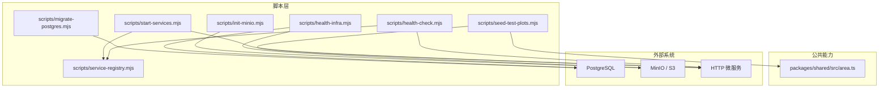
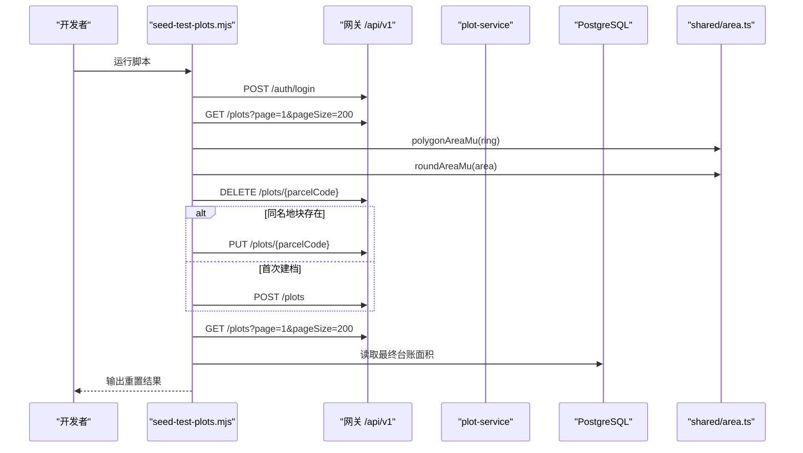
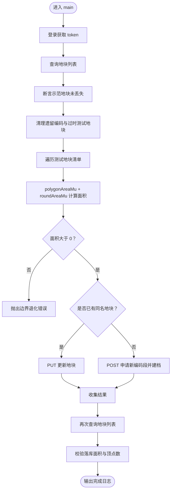
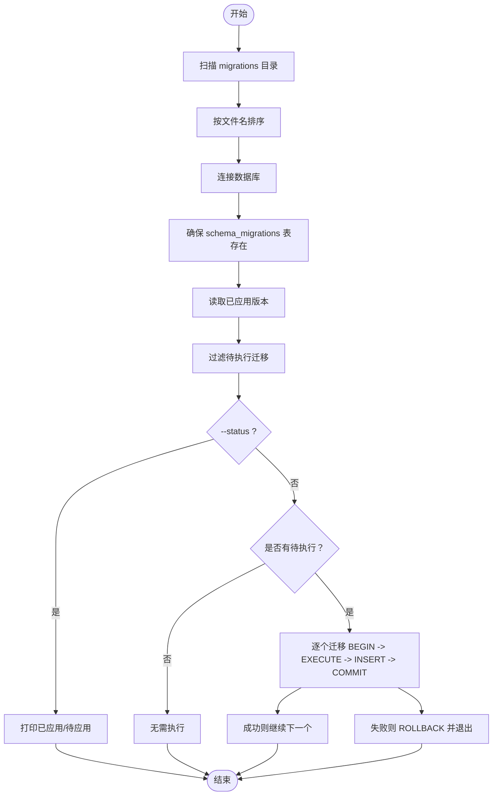
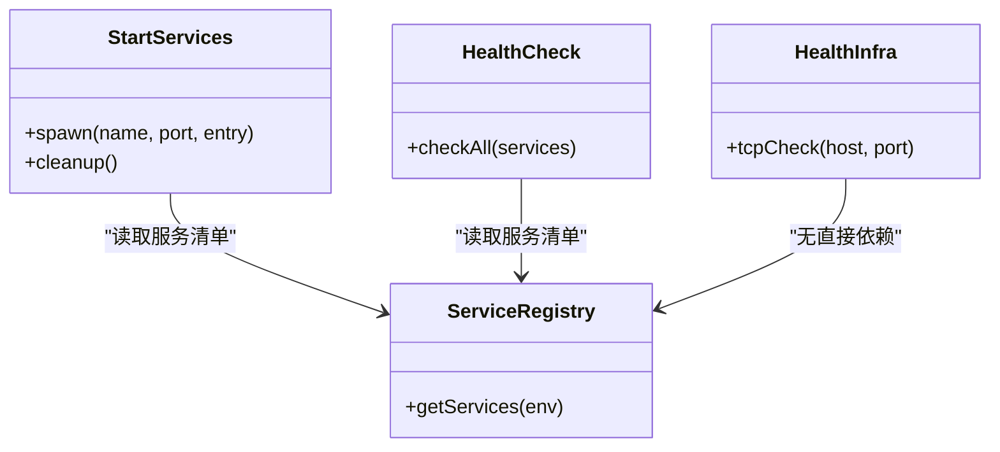
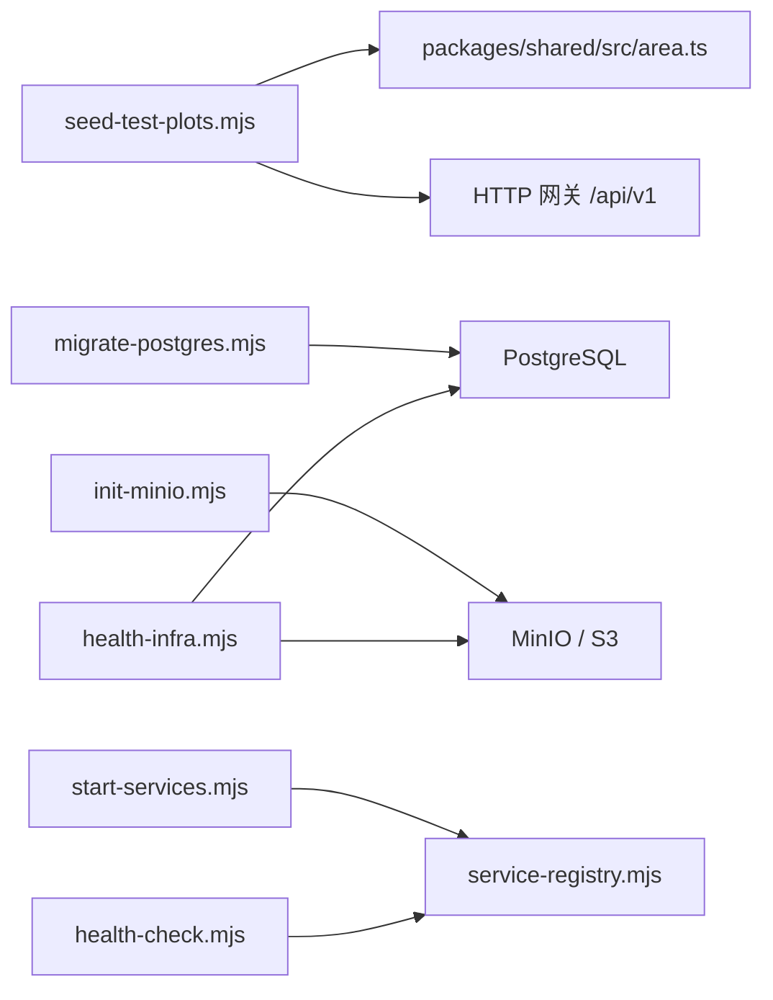

# 测试数据管理脚本

<cite>
**本文引用的文件**   
- [scripts/seed-test-plots.mjs](file://scripts/seed-test-plots.mjs)
- [scripts/init-minio.mjs](file://scripts/init-minio.mjs)
- [scripts/migrate-postgres.mjs](file://scripts/migrate-postgres.mjs)
- [scripts/health-check.mjs](file://scripts/health-check.mjs)
- [scripts/start-services.mjs](file://scripts/start-services.mjs)
- [scripts/service-registry.mjs](file://scripts/service-registry.mjs)
- [scripts/health-infra.mjs](file://scripts/health-infra.mjs)
- [packages/shared/src/area.ts](file://packages/shared/src/area.ts)
- [README.md](file://README.md)
</cite>

## 目录
1. [引言](#引言)
2. [项目结构](#项目结构)
3. [核心组件](#核心组件)
4. [架构总览](#架构总览)
5. [详细组件分析](#详细组件分析)
6. [依赖关系分析](#依赖关系分析)
7. [性能与可重复性](#性能与可重复性)
8. [故障排查指南](#故障排查指南)
9. [结论](#结论)

## 引言
本仓库的“测试数据管理脚本”围绕 `scripts` 目录下的 Node.js 脚本展开，目标是在本地或容器环境中快速准备、校验和重置测试数据，并保证演示数据不被污染。其中：
- `seed-test-plots.mjs` 是核心测试数据脚本，负责通过网关接口清理历史验证地块，并按边界几何重新计算面积后重建三块测试地块；
- `migrate-postgres.mjs` 负责按版本号执行 PostgreSQL 迁移；
- `init-minio.mjs` 负责创建 MinIO/S3 存储桶；
- `start-services.mjs` 与 `health-check.mjs` 负责启动服务与健康检查；
- `service-registry.mjs` 集中维护服务名、端口与入口；
- `health-infra.mjs` 检查基础设施（PostgreSQL、MinIO）连通性。

这些脚本共同构成“环境准备 → 数据初始化 → 服务启动 → 健康检查 → 数据重置”的完整链路。

## 项目结构
与测试数据管理直接相关的文件集中在 `scripts` 目录，并通过根级 README 暴露 npm/pnpm 命令。

**图表来源**
- [scripts/seed-test-plots.mjs:1-206](file://scripts/seed-test-plots.mjs#L1-L206)
- [scripts/migrate-postgres.mjs:1-85](file://scripts/migrate-postgres.mjs#L1-L85)
- [scripts/init-minio.mjs:1-12](file://scripts/init-minio.mjs#L1-L12)
- [scripts/start-services.mjs:1-32](file://scripts/start-services.mjs#L1-L32)
- [scripts/health-check.mjs:1-12](file://scripts/health-check.mjs#L1-L12)
- [scripts/service-registry.mjs:1-22](file://scripts/service-registry.mjs#L1-L22)
- [scripts/health-infra.mjs:1-12](file://scripts/health-infra.mjs#L1-L12)
- [packages/shared/src/area.ts:1-30](file://packages/shared/src/area.ts#L1-L30)

**章节来源**
- [README.md:37-64](file://README.md#L37-L64)
- [scripts/service-registry.mjs:1-22](file://scripts/service-registry.mjs#L1-L22)

## 核心组件
本节聚焦测试数据管理相关脚本的职责、输入输出与关键行为。

### 测试地块种子脚本
- 作用：清理历史验证地块，按边界几何计算面积，重建三块测试地块；同名地块走更新路径，避免唯一约束冲突。
- 对外依赖：网关 `/api/v1` 接口；`@agri/shared` 的面积计算函数。
- 关键约定：
  - 只动测试地块，不碰迁移 010 的示范地块；
  - 面积一律由边界几何现算，不写死申报值；
  - 清理走接口软删，与页面删除行为一致；
  - 回查落库结果，确保面积与边界一致。

**章节来源**
- [scripts/seed-test-plots.mjs:1-15](file://scripts/seed-test-plots.mjs#L1-L15)
- [scripts/seed-test-plots.mjs:25-35](file://scripts/seed-test-plots.mjs#L25-L35)
- [scripts/seed-test-plots.mjs:127-187](file://scripts/seed-test-plots.mjs#L127-L187)
- [scripts/seed-test-plots.mjs:189-200](file://scripts/seed-test-plots.mjs#L189-L200)

### PostgreSQL 迁移脚本
- 作用：按文件名升序执行 `infra/postgres/migrations` 中的 SQL 迁移；已应用版本记录在 `schema_migrations`；支持查看状态与指定目标版本。
- 事务语义：每个迁移在单个事务中执行，失败即回滚，不会留下半套结构。
- 参数：
  - `--status`：仅列出已应用与待应用迁移；
  - `--target <version>`：只执行到指定版本（含）。

**章节来源**
- [scripts/migrate-postgres.mjs:1-12](file://scripts/migrate-postgres.mjs#L1-L12)
- [scripts/migrate-postgres.mjs:46-77](file://scripts/migrate-postgres.mjs#L46-L77)

### MinIO 初始化脚本
- 作用：使用 `S3ObjectStorage` 确保存储桶存在，便于文件服务写入对象。
- 配置来源：环境变量 `FILE_S3_ENDPOINT`、`FILE_S3_BUCKET`、`FILE_S3_REGION`、`FILE_S3_ACCESS_KEY`、`FILE_S3_SECRET_KEY`。

**章节来源**
- [scripts/init-minio.mjs:1-12](file://scripts/init-minio.mjs#L1-L12)

### 服务启动与健康检查
- `start-services.mjs`：根据 `service-registry.mjs` 启动全部 HTTP 服务，为网关注入下游服务 URL，并为遥测服务默认开启事件发布。
- `health-check.mjs`：并发访问各服务的 `/health` 端点，汇总 OK/ERR 状态。
- `service-registry.mjs`：集中定义服务名、端口与入口，支持通过 `AGRI_<NAME>_PORT` 覆盖端口。
- `health-infra.mjs`：检查 PostgreSQL TCP 连通性与 MinIO 健康端点。

**章节来源**
- [scripts/start-services.mjs:1-32](file://scripts/start-services.mjs#L1-L32)
- [scripts/health-check.mjs:1-12](file://scripts/health-check.mjs#L1-L12)
- [scripts/service-registry.mjs:1-22](file://scripts/service-registry.mjs#L1-L22)
- [scripts/health-infra.mjs:1-12](file://scripts/health-infra.mjs#L1-L12)

## 架构总览
测试数据管理脚本的整体流程如下：

**图表来源**
- [scripts/seed-test-plots.mjs:92-108](file://scripts/seed-test-plots.mjs#L92-L108)
- [scripts/seed-test-plots.mjs:115-125](file://scripts/seed-test-plots.mjs#L115-L125)
- [scripts/seed-test-plots.mjs:127-187](file://scripts/seed-test-plots.mjs#L127-L187)
- [scripts/seed-test-plots.mjs:189-200](file://scripts/seed-test-plots.mjs#L189-L200)
- [packages/shared/src/area.ts:1-30](file://packages/shared/src/area.ts#L1-L30)

## 详细组件分析

### 测试地块种子脚本：数据流与算法
该脚本以“接口驱动 + 几何现算”的方式保证测试数据与前端行为一致。

**图表来源**
- [scripts/seed-test-plots.mjs:162-200](file://scripts/seed-test-plots.mjs#L162-L200)
- [scripts/seed-test-plots.mjs:127-187](file://scripts/seed-test-plots.mjs#L127-L187)

#### 面积计算口径
- 后端与冒烟脚本共用 `packages/shared/src/area.ts` 的面积实现；
- 前端绘制预览、SQL 迁移重算与 TS 实现必须保持逐位一致；
- 脚本显式调用 `polygonAreaMu` 与 `roundAreaMu`，禁止写死面积字段。

**章节来源**
- [packages/shared/src/area.ts:1-30](file://packages/shared/src/area.ts#L1-L30)
- [scripts/seed-test-plots.mjs:16](file://scripts/seed-test-plots.mjs#L16)
- [scripts/seed-test-plots.mjs:177-186](file://scripts/seed-test-plots.mjs#L177-L186)

### PostgreSQL 迁移脚本：幂等与事务
迁移脚本的核心是“按文件名排序 + 已应用集合去重 + 单文件事务”。

**图表来源**
- [scripts/migrate-postgres.mjs:37-77](file://scripts/migrate-postgres.mjs#L37-L77)

**章节来源**
- [scripts/migrate-postgres.mjs:1-12](file://scripts/migrate-postgres.mjs#L1-L12)
- [scripts/migrate-postgres.mjs:46-77](file://scripts/migrate-postgres.mjs#L46-L77)

### MinIO 初始化脚本：存储桶就绪
- 通过 `S3ObjectStorage.ensureBucket()` 确保 bucket 存在；
- 若 MinIO 不可达或权限不足，会抛出异常，脚本应提前检查基础设施。

**章节来源**
- [scripts/init-minio.mjs:1-12](file://scripts/init-minio.mjs#L1-L12)

### 服务启动与健康检查：统一注册表
- `service-registry.mjs` 是唯一的服务清单来源；
- `start-services.mjs` 基于注册表启动子进程，并注入下游服务 URL；
- `health-check.mjs` 并发检查所有服务 `/health`；
- `health-infra.mjs` 检查 PostgreSQL 与 MinIO。

**图表来源**
- [scripts/service-registry.mjs:1-22](file://scripts/service-registry.mjs#L1-L22)
- [scripts/start-services.mjs:1-32](file://scripts/start-services.mjs#L1-L32)
- [scripts/health-check.mjs:1-12](file://scripts/health-check.mjs#L1-L12)
- [scripts/health-infra.mjs:1-12](file://scripts/health-infra.mjs#L1-L12)

**章节来源**
- [scripts/service-registry.mjs:1-22](file://scripts/service-registry.mjs#L1-L22)
- [scripts/start-services.mjs:1-32](file://scripts/start-services.mjs#L1-L32)
- [scripts/health-check.mjs:1-12](file://scripts/health-check.mjs#L1-L12)
- [scripts/health-infra.mjs:1-12](file://scripts/health-infra.mjs#L1-L12)

## 依赖关系分析
测试数据管理脚本之间的耦合度较低，主要依赖如下：

**图表来源**
- [scripts/seed-test-plots.mjs:16](file://scripts/seed-test-plots.mjs#L16)
- [scripts/migrate-postgres.mjs:19-20](file://scripts/migrate-postgres.mjs#L19-L20)
- [scripts/init-minio.mjs:3-10](file://scripts/init-minio.mjs#L3-L10)
- [scripts/start-services.mjs:4-12](file://scripts/start-services.mjs#L4-L12)
- [scripts/health-check.mjs:1-6](file://scripts/health-check.mjs#L1-L6)
- [scripts/health-infra.mjs:3-8](file://scripts/health-infra.mjs#L3-L8)

**章节来源**
- [scripts/seed-test-plots.mjs:16](file://scripts/seed-test-plots.mjs#L16)
- [scripts/migrate-postgres.mjs:19-20](file://scripts/migrate-postgres.mjs#L19-L20)
- [scripts/init-minio.mjs:3-10](file://scripts/init-minio.mjs#L3-L10)
- [scripts/start-services.mjs:4-12](file://scripts/start-services.mjs#L4-L12)
- [scripts/health-check.mjs:1-6](file://scripts/health-check.mjs#L1-L6)
- [scripts/health-infra.mjs:3-8](file://scripts/health-infra.mjs#L3-L8)

## 性能与可重复性
- 可重复执行：`seed-test-plots.mjs` 对同名地块走更新路径，避免唯一约束冲突；示范地块编码段被保护，不会被清理。
- 面积一致性：通过共享面积算法保证前端预览、后端落库与迁移重算三者一致。
- 并发健康检查：`health-check.mjs` 使用并发请求减少整体等待时间。
- 迁移幂等：`schema_migrations` 表保证迁移可重复执行且不会重复应用。

[本节为通用指导，不直接分析具体代码行]

## 故障排查指南
常见问题与定位建议：

- 登录失败或 token 缺失
  - 现象：脚本在登录阶段报错或后续请求缺少身份头。
  - 排查：确认网关可达、管理员账号可用；检查 `BASE_URL` 与证书策略。
  - 参考位置：登录与 token 处理逻辑。

- 面积与边界不一致
  - 现象：脚本断言“落库面积与边界不符”。
  - 排查：确认边界坐标顺序、闭合点、CGCS2000 坐标系；检查面积计算是否经过 `polygonAreaMu` 与 `roundAreaMu`。
  - 参考位置：面积计算与断言。

- 示范地块丢失
  - 现象：断言“示范地块缺失”。
  - 排查：确认脚本未误删迁移 010 的数据；检查地块编码段保护逻辑。
  - 参考位置：示范地块断言。

- 迁移失败
  - 现象：某个 SQL 迁移失败并回滚。
  - 排查：查看失败迁移文件名与错误信息；确认数据库连接与权限；必要时使用 `--status` 查看已应用版本。
  - 参考位置：迁移执行与事务回滚。

- MinIO 不可用
  - 现象：初始化 bucket 失败。
  - 排查：检查 `FILE_S3_*` 环境变量、MinIO 服务状态与网络连通性。
  - 参考位置：MinIO 初始化。

- 服务健康检查失败
  - 现象：部分服务返回 ERR。
  - 排查：检查端口占用、服务启动日志、下游服务 URL 注入是否正确。
  - 参考位置：服务注册表与健康检查。

**章节来源**
- [scripts/seed-test-plots.mjs:92-108](file://scripts/seed-test-plots.mjs#L92-L108)
- [scripts/seed-test-plots.mjs:177-197](file://scripts/seed-test-plots.mjs#L177-L197)
- [scripts/migrate-postgres.mjs:62-77](file://scripts/migrate-postgres.mjs#L62-L77)
- [scripts/init-minio.mjs:3-10](file://scripts/init-minio.mjs#L3-L10)
- [scripts/health-check.mjs:5-11](file://scripts/health-check.mjs#L5-L11)

## 结论
测试数据管理脚本以“接口驱动 + 几何现算 + 统一注册表”的方式，提供了稳定、可重复、可观测的数据准备与验证能力。`seed-test-plots.mjs` 保证测试地块与前端行为一致，`migrate-postgres.mjs` 保证数据库结构演进安全，`init-minio.mjs` 保障对象存储就绪，`start-services.mjs` 与 `health-check.mjs` 提供统一的服务生命周期管理，`health-infra.mjs` 提供基础设施连通性检查。配合根级 README 的命令说明，开发者可以快速搭建、验证和清理测试环境，同时避免污染演示数据。