# 开发指南

<cite>
**本文引用的文件**   
- [README.md](file://README.md)
- [package.json](file://package.json)
- [turbo.json](file://turbo.json)
- [vitest.config.ts](file://vitest.config.ts)
- [.npmrc](file://.npmrc)
- [pnpm-workspace.yaml](file://pnpm-workspace.yaml)
- [infra/docker-compose.yml](file://infra/docker-compose.yml)
- [scripts/start-services.mjs](file://scripts/start-services.mjs)
- [scripts/health-infra.mjs](file://scripts/health-infra.mjs)
- [scripts/init-minio.mjs](file://scripts/init-minio.mjs)
- [scripts/migrate-postgres.mjs](file://scripts/migrate-postgres.mjs)
- [apps/plot-service/package.json](file://apps/plot-service/package.json)
- [apps/plot-service/src/main.ts](file://apps/plot-service/src/main.ts)
- [apps/plot-service/src/app.module.ts](file://apps/plot-service/src/app.module.ts)
- [apps/plot-service/src/plot.service.ts](file://apps/plot-service/src/plot.service.ts)
- [apps/web/src/views/plot/List.vue](file://apps/web/src/views/plot/List.vue)
- [apps/web/src/api/index.ts](file://apps/web/src/api/index.ts)
- [apps/web/test/plot-split-view.spec.ts](file://apps/web/test/plot-split-view.spec.ts)
- [IMPLEMENTATION_PROGRESS.md](file://IMPLEMENTATION_PROGRESS.md)
- [packages/contracts/package.json](file://packages/contracts/package.json)
- [packages/db/package.json](file://packages/db/package.json)
- [packages/mq/package.json](file://packages/mq/package.json)
- [packages/config/package.json](file://packages/config/package.json)
</cite>

## 更新摘要
**变更内容**   
- 新增凹多边形合并手工边界编辑功能说明
- 更新地块合并流程，增加凸包面积差额提示和边界编辑入口
- 完善前端合并对话框的用户体验改进
- 补充凹多边形几何处理的业务逻辑说明

## 目录
1. [引言](#引言)
2. [项目结构](#项目结构)
3. [核心组件](#核心组件)
4. [架构总览](#架构总览)
5. [详细组件分析](#详细组件分析)
6. [依赖关系分析](#依赖关系分析)
7. [性能与可观测性](#性能与可观测性)
8. [调试与排错](#调试与排错)
9. [结论](#结论)
10. [附录：命令速查](#附录命令速查)

## 引言
本指南面向智慧农业平台后端与前端开发者，覆盖从环境搭建、微服务规范、公共包设计到任务编排、测试与代码规范的完整流程。工程以 Node.js 24 LTS 为运行时，采用 NestJS + TypeScript，使用 pnpm workspace 管理多包仓库，并通过 Turborepo 编排构建与类型检查；测试基于 Vitest 3，数据库使用 PostgreSQL（PostGIS），对象存储使用 MinIO（S3 兼容）。

**更新** 新增了凹多边形合并的手工边界编辑功能，解决了凸包算法在凹形地块合并时可能圈入中间空地的业务问题。

## 项目结构
仓库采用"公共能力包 + 业务微服务 + 前端应用"的分层组织方式：
- packages：公共能力与规范包，如契约、配置、数据库封装、消息总线、可观测性、测试夹具等。
- apps：HTTP 微服务与前端应用，示例服务 @agri/plot-service 展示装配与事件链路。
- infra：基础设施编排（PostgreSQL、MinIO）与数据库迁移脚本。
- scripts：运维脚本，包括服务启动、健康检查、MinIO 初始化、数据库迁移等。

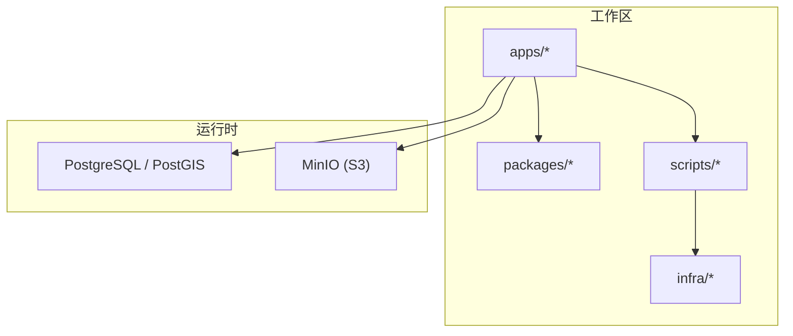

**图示来源**
- [pnpm-workspace.yaml:1-14](file://pnpm-workspace.yaml#L1-L14)
- [infra/docker-compose.yml:1-39](file://infra/docker-compose.yml#L1-L39)

**章节来源**
- [README.md:58-84](file://README.md#L58-L84)
- [pnpm-workspace.yaml:1-14](file://pnpm-workspace.yaml#L1-L14)

## 核心组件
- 运行环境与工具链
  - Node.js 24 LTS、pnpm、Turborepo、TypeScript、Vitest、NestJS。
- 基础设施
  - PostgreSQL（PostGIS）、MinIO（S3 兼容）。
- 公共包
  - @agri/contracts：接口契约与共享类型。
  - @agri/config：配置加载与校验。
  - @agri/db：数据访问封装（事务、分页、软删除、分库路由）。
  - @agri/mq：消息与事件总线（发布订阅、本地消息表、重试死信、幂等）。
  - @agri/observability：结构化日志、链路追踪、指标采集。
  - @agri/shared：通用工具与常量。
  - @agri/testing：测试夹具与内存实现。
- 示例服务
  - @agri/plot-service：地块建档、事件消费、装配示范。

**章节来源**
- [README.md:1-11](file://README.md#L1-L11)
- [README.md:86-103](file://README.md#L86-L103)
- [apps/plot-service/package.json:1-34](file://apps/plot-service/package.json#L1-L34)

## 架构总览
系统由网关与各领域微服务组成，统一通过 HTTP 暴露接口；部分服务通过消息总线进行异步协作，数据落库至 PostgreSQL，文件与图片存储于 MinIO。

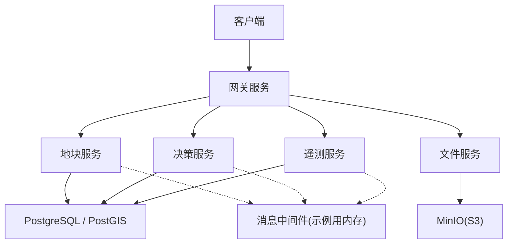

**图示来源**
- [scripts/start-services.mjs:1-28](file://scripts/start-services.mjs#L1-L28)
- [infra/docker-compose.yml:1-39](file://infra/docker-compose.yml#L1-L39)

## 详细组件分析

### 开发环境搭建
- 前置条件
  - Node.js >= 24.0.0（推荐 24 LTS）。
  - pnpm（工作区与构建白名单已配置）。
  - PostgreSQL（PostGIS）与 MinIO（可通过 Docker Compose 启动）。
- 安装步骤
  1. 克隆仓库并进入根目录。
  2. 执行 pnpm install（允许 esbuild 等构建脚本）。
  3. 启动基础设施：docker compose up postgres minio。
  4. 初始化 MinIO bucket：pnpm init:minio。
  5. 执行数据库迁移：pnpm db:migrate。
  6. 全量编译：pnpm run build。
  7. 运行测试：pnpm test。
  8. 启动全部服务：pnpm start:services。
  9. 健康检查：pnpm health:services 或 pnpm health:infra。
  10. 前端开发：pnpm --filter @agri/web dev。

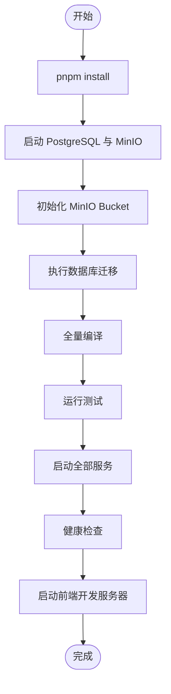

**图示来源**
- [package.json:14-28](file://package.json#L14-L28)
- [infra/docker-compose.yml:1-39](file://infra/docker-compose.yml#L1-L39)
- [scripts/init-minio.mjs:1-12](file://scripts/init-minio.mjs#L1-L12)
- [scripts/migrate-postgres.mjs:1-85](file://scripts/migrate-postgres.mjs#L1-L85)

**章节来源**
- [README.md:12-56](file://README.md#L12-L56)
- [package.json:7-13](file://package.json#L7-L13)
- [.npmrc:1-4](file://.npmrc#L1-L4)
- [pnpm-workspace.yaml:5-14](file://pnpm-workspace.yaml#L5-L14)

### 微服务开发规范
- 服务创建流程
  1. 复制示例服务目录 apps/plot-service 作为新服务模板。
  2. 在根 tsconfig.json 增加新的工程引用，使 tsc -b 能识别。
  3. 在服务根模块中按需导入 ConfigModule.forRoot、PrismaModule.forRoot、MqModule.forRoot。
  4. 定义仓储接口与实现（优先 SQL，必要时提供内存实现用于测试）。
  5. 定义领域事件主题与载荷（先在 @agri/contracts 中声明）。
  6. 生产者侧使用 OutboxService.enqueue 入队，消费者侧使用装饰器注册处理器。
- 代码规范
  - 每个包的 src/index.ts 为唯一对外入口。
  - 契约包只依赖 zod，不依赖任何能力包；能力包之间禁止循环引用。
  - 错误码采用"域缩写-分类码-序号"，含义发布后不得修改。
  - 软删除字段统一为 deletedAt；分页每页上限 200，排序字段需服务端白名单校验。
- 测试规范
  - 使用 Vitest，测试文件位于各子工程的 test 目录。
  - 测试期通过别名直连源码，避免构建顺序问题。
  - 对装饰器的语义，测试构造提供者时显式声明 inject。

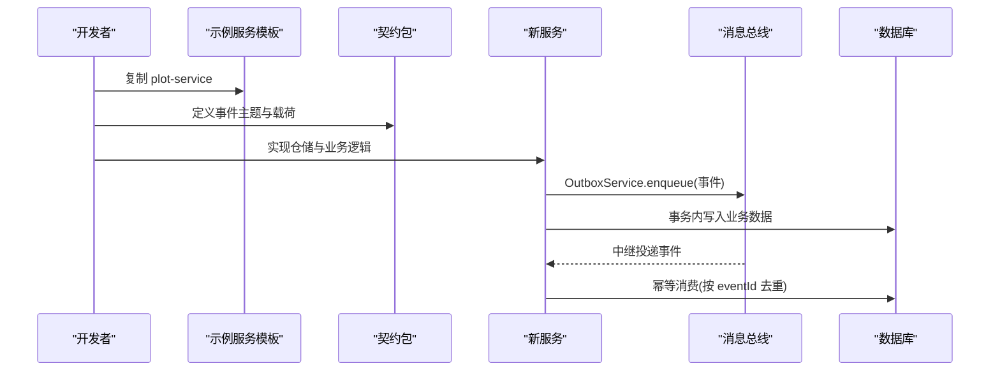

**图示来源**
- [README.md:147-156](file://README.md#L147-L156)
- [apps/plot-service/src/main.ts:115-153](file://apps/plot-service/src/main.ts#L115-L153)

**章节来源**
- [README.md:147-167](file://README.md#L147-L167)
- [apps/plot-service/src/main.ts:48-113](file://apps/plot-service/src/main.ts#L48-L113)

### 公共包开发指导
- 包结构设计
  - contracts：仅暴露类型与 zod schema，供前后端共享。
  - config：环境变量校验结构、启动期加载、密钥读取。
  - db：封装 Prisma 客户端生命周期、事务、分页、软删除、分库路由。
  - mq：事件发布订阅、本地消息表、重试死信、幂等。
  - observability：结构化日志、链路追踪、指标采集。
  - shared：通用工具与常量。
  - testing：测试数据库、内存事件总线、可控时钟、模块构造器。
- 接口设计
  - 所有公共包通过 package.json 的 exports 字段明确主入口与子路径导出。
  - 对外 API 应稳定且向后兼容，变更需评估影响面。
- 版本管理
  - 当前为私有工作区包，版本号固定为 1.0.0；若未来独立发布，建议遵循语义化版本。
  - 依赖方向严格：contracts 不依赖能力包，能力包之间无环。

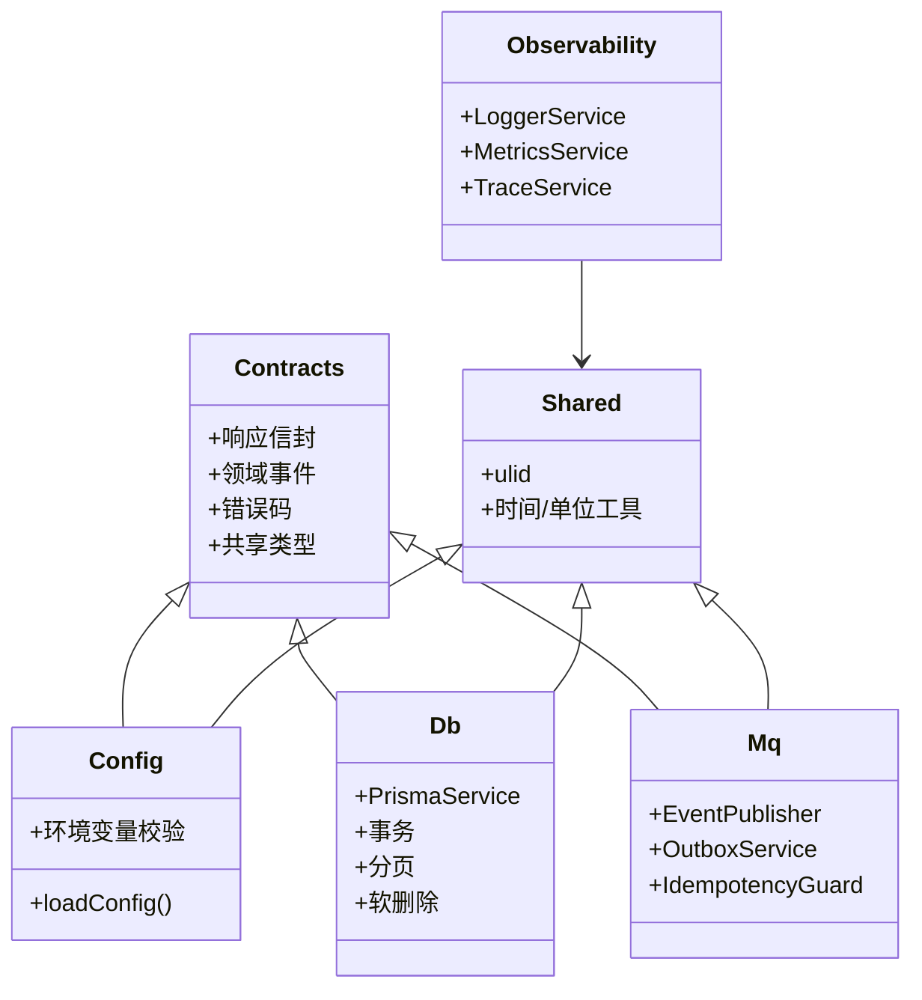

**图示来源**
- [packages/contracts/package.json:1-42](file://packages/contracts/package.json#L1-L42)
- [packages/config/package.json:1-28](file://packages/config/package.json#L1-L28)
- [packages/db/package.json:1-28](file://packages/db/package.json#L1-L28)
- [packages/mq/package.json:1-28](file://packages/mq/package.json#L1-L28)

**章节来源**
- [README.md:86-103](file://README.md#L86-L103)
- [packages/contracts/package.json:9-30](file://packages/contracts/package.json#L9-L30)

### Turborepo 任务编排
- 根脚本
  - build：tsc -b 全量编译。
  - build:changed：turbo run build 增量构建。
  - typecheck：先 dry 再全量类型检查。
  - test/test:watch：Vitest 运行与监听模式。
- Turbo 配置
  - build 任务依赖上游包的构建产物，输出 dist 与 tsbuildinfo。
  - typecheck 依赖上游构建结果。

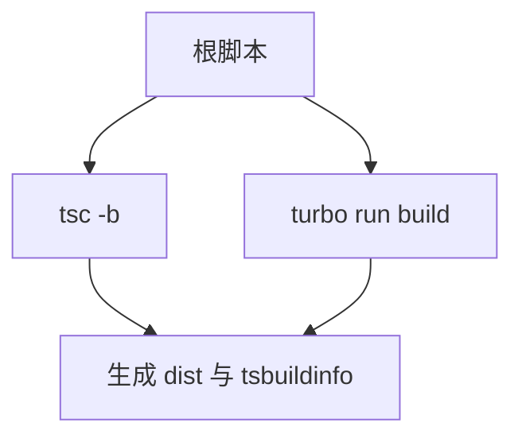

**图示来源**
- [package.json:14-28](file://package.json#L14-L28)
- [turbo.json:1-15](file://turbo.json#L1-L15)

**章节来源**
- [package.json:14-28](file://package.json#L14-L28)
- [turbo.json:1-15](file://turbo.json#L1-L15)

### Vitest 测试配置
- 别名解析
  - 将 @agri/* 别名直接指向源码，避免测试依赖构建顺序。
- 装饰器支持
  - 启用 experimentalDecorators，确保装饰器登记处理器。
- 测试范围
  - 包含 packages/**/test/**/*.spec.ts 与 apps/**/test/**/*.spec.ts。

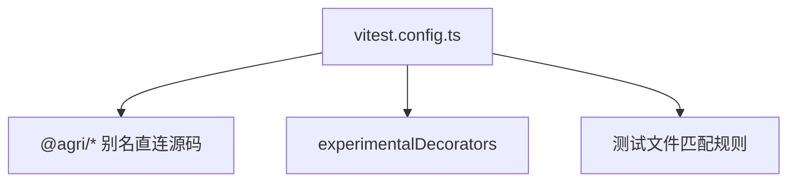

**图示来源**
- [vitest.config.ts:1-42](file://vitest.config.ts#L1-L42)

**章节来源**
- [vitest.config.ts:1-42](file://vitest.config.ts#L1-L42)

### ESLint 代码规范
- 工程内置了 @agri/eslint-config，但本次未安装 ESLint 运行；启用前需在工程内加入 eslint 依赖并按需引用 base/typescript/nest/vue/architecture 配置。
- 规范包已就位，后续可在 CI 中集成 lint 阶段。

**章节来源**
- [README.md:165-167](file://README.md#L165-L167)

### 示例服务装配与事件链路
- 组合根 main.ts
  - 加载配置、初始化可观测性、消息总线、数据库仓储、业务服务。
  - 演示建档 → 写本地消息表 → 中继投递 → 消费幂等的完整链路。
- Nest 模块 AppModule
  - 按依赖方向装配基础设施、横切能力与业务服务。
  - 支持替换仓储、消息发布器、幂等存储等实现。

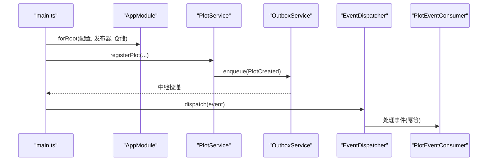

**图示来源**
- [apps/plot-service/src/main.ts:48-153](file://apps/plot-service/src/main.ts#L48-L153)
- [apps/plot-service/src/app.module.ts:80-164](file://apps/plot-service/src/app.module.ts#L80-L164)

**章节来源**
- [apps/plot-service/src/main.ts:1-179](file://apps/plot-service/src/main.ts#L1-L179)
- [apps/plot-service/src/app.module.ts:1-196](file://apps/plot-service/src/app.module.ts#L1-L196)

### 凹多边形合并手工边界编辑功能

**新增** 针对凹形地块合并时凸包算法会圈入中间空地的业务问题，实现了手工边界编辑功能。

#### 问题背景
当多个地块合并时，系统使用凸包算法计算合并后的边界。对于凹形地块，凸包会将中间的凹陷区域一并圈入新台账，导致面积虚增。虽然 `mergePreview` 接口已经能够显示这个差额（`deltaMu`），但合并成功后用户没有直接修改合并后边界的入口。

#### 解决方案
1. **预演增强**：`POST /plots/merge-preview` 返回源面积合计、凸包面积、差额等信息，前端实时显示凹形警告。
2. **交互优化**：合并成功后，如果检测到凹形差额（`deltaMu > 0`），弹出确认框提供"编辑合并后边界"入口。
3. **无缝衔接**：点击确认后直接跳转到新地块的编辑页面 `/plot/edit/:parcelCode`，用户可重新绘制边界修正面积。

#### 技术实现
- **后端逻辑**：`PlotService.mergePlots` 和 `previewMerge` 共用 `mergeGeometry` 方法，确保凸包计算口径一致。
- **前端交互**：`List.vue` 中的合并提交逻辑检测 `deltaMu`，动态调整成功提示行为。
- **边界编辑**：复用现有的地块编辑功能，支持从服务端边界解析成可编辑坐标，提交时按同一 `polygonAreaMu` 算法现算面积。

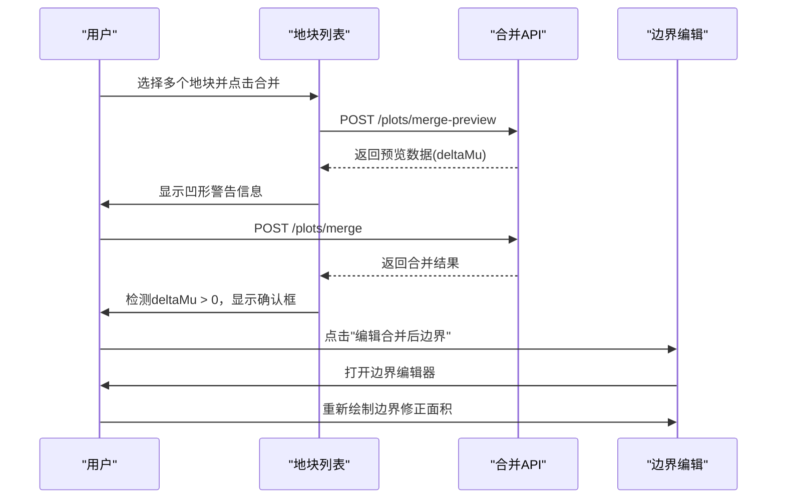

**图示来源**
- [apps/plot-service/src/plot.service.ts:296-413](file://apps/plot-service/src/plot.service.ts#L296-L413)
- [apps/web/src/views/plot/List.vue:411-451](file://apps/web/src/views/plot/List.vue#L411-L451)

**章节来源**
- [apps/plot-service/src/plot.service.ts:296-413](file://apps/plot-service/src/plot.service.ts#L296-L413)
- [apps/web/src/views/plot/List.vue:160-186](file://apps/web/src/views/plot/List.vue#L160-L186)
- [apps/web/src/views/plot/List.vue:411-451](file://apps/web/src/views/plot/List.vue#L411-L451)
- [IMPLEMENTATION_PROGRESS.md:603-609](file://IMPLEMENTATION_PROGRESS.md#L603-L609)

## 依赖关系分析
- 工作区与脚本白名单
  - pnpm-workspace.yaml 定义了 packages/* 与 apps/* 两个工作区。
  - allowBuilds 放行 esbuild、vue-demi、element-plus 等构建脚本，避免 ERR_PNPM_IGNORED_BUILDS。
- 根依赖
  - engines.node >= 24.0.0。
  - devDependencies 包含 NestJS、TypeScript、Turbo、Vitest、zod 等。
- 公共包依赖
  - contracts 仅依赖 zod。
  - db、mq、config 依赖 contracts 与 shared，以及 @nestjs/common。

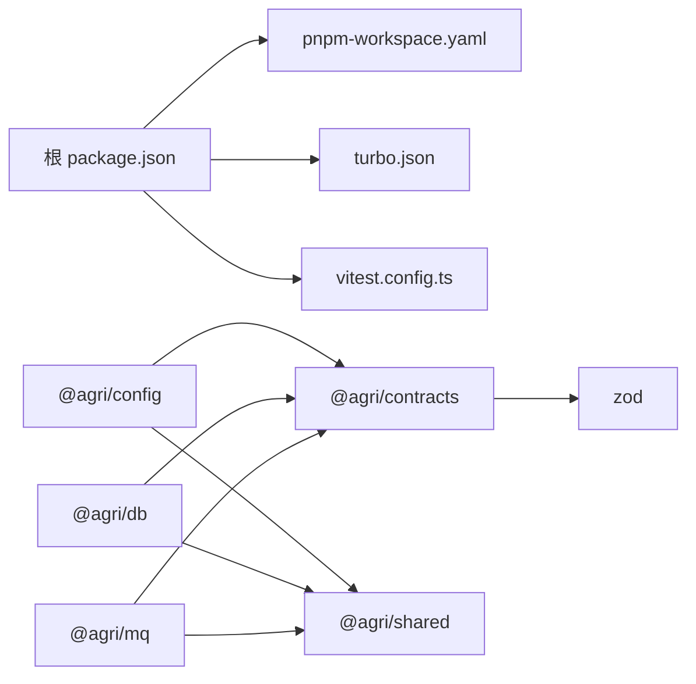

**图示来源**
- [package.json:1-45](file://package.json#L1-L45)
- [pnpm-workspace.yaml:1-14](file://pnpm-workspace.yaml#L1-L14)
- [packages/contracts/package.json:34-40](file://packages/contracts/package.json#L34-L40)
- [packages/config/package.json:18-26](file://packages/config/package.json#L18-L26)
- [packages/db/package.json:18-26](file://packages/db/package.json#L18-L26)
- [packages/mq/package.json:18-26](file://packages/mq/package.json#L18-L26)

**章节来源**
- [package.json:1-45](file://package.json#L1-L45)
- [pnpm-workspace.yaml:1-14](file://pnpm-workspace.yaml#L1-L14)

## 性能与可观测性
- 可观测性
  - LoggerService、MetricsService、TraceService 在 AppModule 中注入，支持结构化日志与指标采集。
  - EventLoopLagCollector 与 HandleCollector 用于监控事件循环延迟与处理器耗时。
- 性能优化建议
  - 空间运算下沉数据库：使用 PostGIS 完成叠加、缓冲区、面积计算，坐标统一 CGCS2000（EPSG:4490）。
  - 分页与排序：分页每页上限 200，排序字段必须命中服务端白名单。
  - 事件可靠性：本地消息表保证事件不丢不重，消费侧幂等去重，重试指数退避，失败转死信。
  - 缓存策略：时序数据不走 @agri/db，由各服务自行使用缓存中间件。
  - 凹多边形优化：凸包计算在合并预演时完成，避免重复计算；边界编辑复用现有几何算法。

**章节来源**
- [apps/plot-service/src/app.module.ts:91-110](file://apps/plot-service/src/app.module.ts#L91-L110)
- [README.md:105-118](file://README.md#L105-L118)

## 调试与排错
- 基础设施健康检查
  - pnpm health:infra 检查 PostgreSQL TCP 连通性与 MinIO 健康端点。
- 服务启动与停止
  - pnpm start:services 启动全部 HTTP 服务，Ctrl+C 优雅退出。
- MinIO 初始化
  - pnpm init:minio 自动创建 bucket，默认 agri。
- 数据库迁移
  - pnpm db:migrate 执行未应用的迁移；支持 --status 查看状态与 --target 指定目标版本。
- 常见问题
  - pnpm install 报 ERR_PNPM_IGNORED_BUILDS：检查 pnpm-workspace.yaml 的 allowBuilds 是否包含 esbuild 等。
  - 测试中装饰器未生效：确保 vitest.config.ts 开启 experimentalDecorators。
  - 生产构建与测试期装饰器元数据差异：测试期构造提供者需显式声明 inject。
  - 凹多边形合并面积异常：检查 mergePreview 的 deltaMu 值，确认是否需要手动编辑边界。

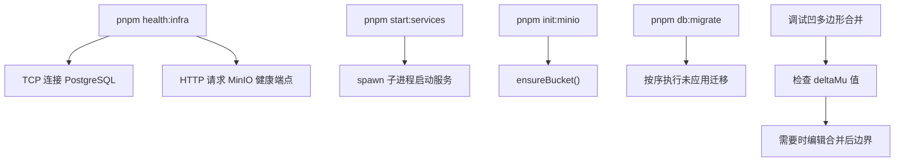

**图示来源**
- [scripts/health-infra.mjs:1-12](file://scripts/health-infra.mjs#L1-L12)
- [scripts/start-services.mjs:1-28](file://scripts/start-services.mjs#L1-L28)
- [scripts/init-minio.mjs:1-12](file://scripts/init-minio.mjs#L1-L12)
- [scripts/migrate-postgres.mjs:1-85](file://scripts/migrate-postgres.mjs#L1-L85)

**章节来源**
- [scripts/health-infra.mjs:1-12](file://scripts/health-infra.mjs#L1-L12)
- [scripts/start-services.mjs:1-28](file://scripts/start-services.mjs#L1-L28)
- [scripts/init-minio.mjs:1-12](file://scripts/init-minio.mjs#L1-L12)
- [scripts/migrate-postgres.mjs:1-85](file://scripts/migrate-postgres.mjs#L1-L85)
- [README.md:157-167](file://README.md#L157-L167)

## 结论
本指南提供了智慧农业平台的端到端开发说明，涵盖环境搭建、微服务与公共包规范、任务编排与测试配置、调试与排错要点。新增的凹多边形合并手工边界编辑功能进一步完善了地块管理的用户体验，解决了凸包算法在凹形地块场景下的业务痛点。遵循契约与能力包分离、事件可靠性和空间运算下沉数据库等约定，有助于在多团队协作中保持代码质量与系统稳定性。

## 附录：命令速查
- 安装与构建
  - pnpm install
  - pnpm run build
  - pnpm run build:changed
- 测试
  - pnpm test
  - pnpm run test:watch
- 服务与基础设施
  - pnpm start:services
  - pnpm health:services
  - pnpm health:infra
  - pnpm init:minio
  - pnpm db:migrate
- 前端
  - pnpm --filter @agri/web dev
  - pnpm --filter @agri/web build

**章节来源**
- [README.md:12-56](file://README.md#L12-L56)
- [package.json:14-28](file://package.json#L14-L28)