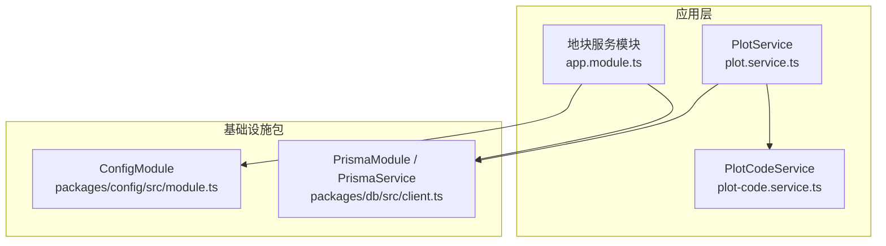
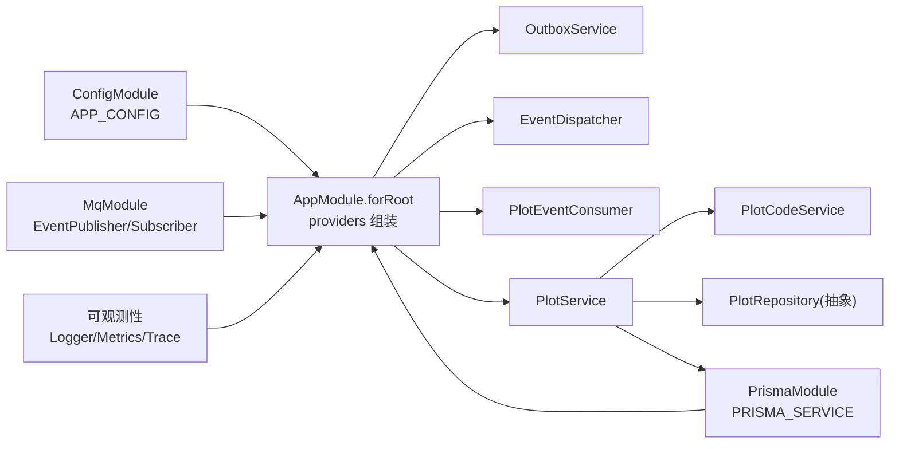
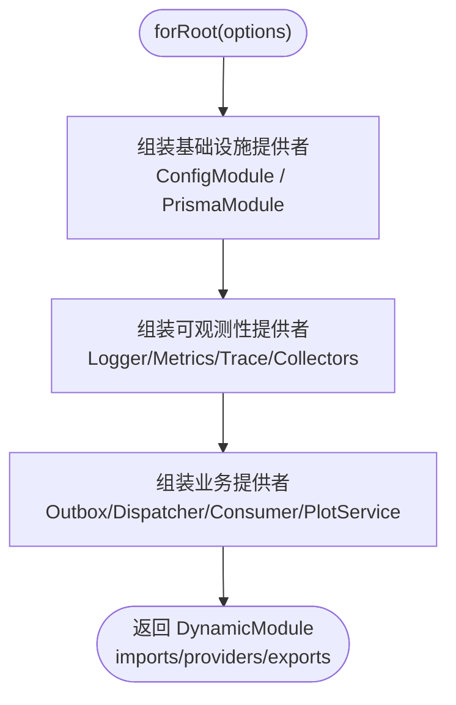
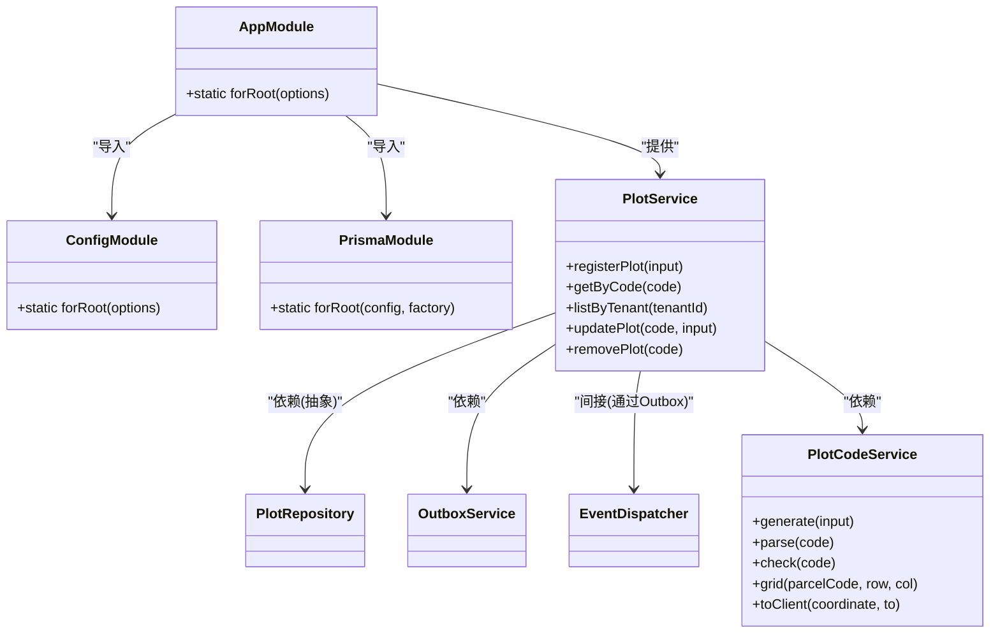
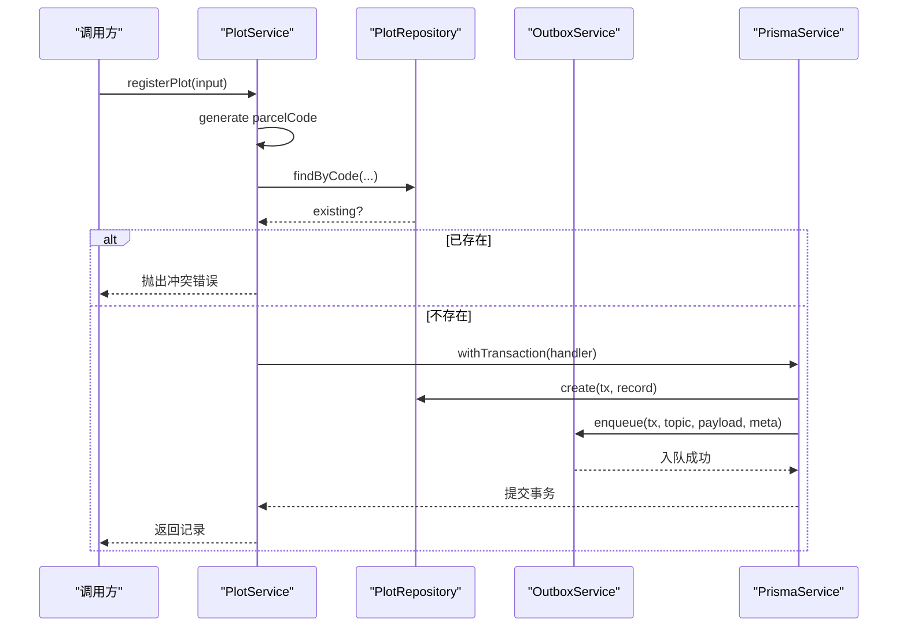
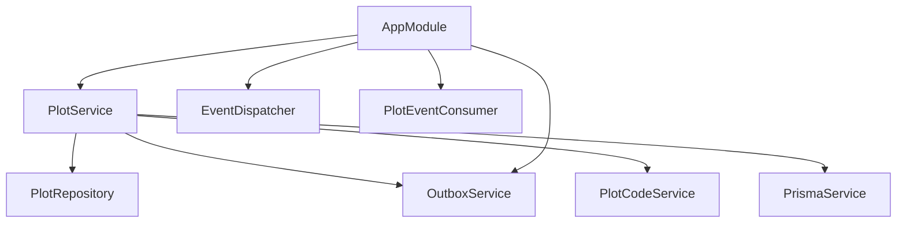
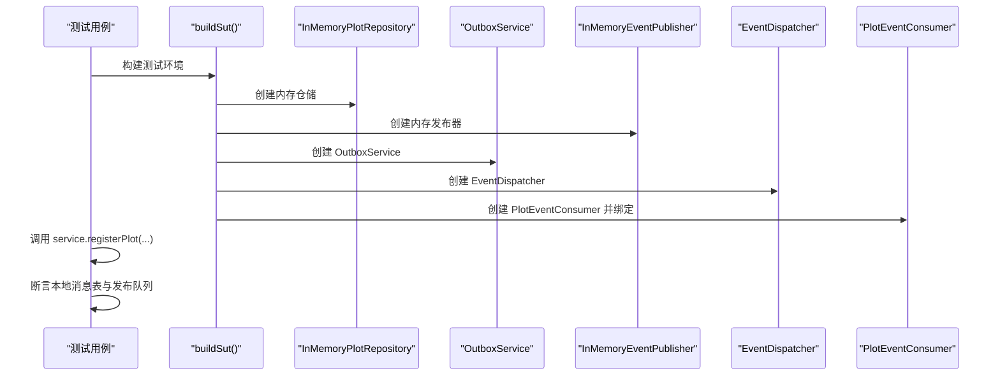

# 依赖注入最佳实践

<cite>
**本文引用的文件**   
- [apps/plot-service/src/app.module.ts](file://apps/plot-service/src/app.module.ts)
- [apps/plot-service/src/plot.service.ts](file://apps/plot-service/src/plot.service.ts)
- [apps/plot-service/src/plot-code.service.ts](file://apps/plot-service/src/plot-code.service.ts)
- [packages/config/src/module.ts](file://packages/config/src/module.ts)
- [packages/db/src/client.ts](file://packages/db/src/client.ts)
- [apps/plot-service/test/plot-service.spec.ts](file://apps/plot-service/test/plot-service.spec.ts)
</cite>

## 目录
1. [引言](#引言)
2. [项目结构](#项目结构)
3. [核心组件](#核心组件)
4. [架构总览](#架构总览)
5. [详细组件分析](#详细组件分析)
6. [依赖关系分析](#依赖关系分析)
7. [性能与优化](#性能与优化)
8. [测试与模拟策略](#测试与模拟策略)
9. [常见问题与排错](#常见问题与排错)
10. [结论](#结论)

## 引言
本指南面向智慧农业平台后端，聚焦 NestJS 依赖注入容器在微服务中的最佳实践。结合地块服务的装配、配置模块、数据库客户端模块以及单元测试示例，系统说明提供者注册、依赖图构建、循环依赖规避、构造函数注入的使用场景、模块化依赖管理、条件注入、异步依赖处理、测试隔离与替换策略，并给出性能优化建议与常见陷阱。

## 项目结构
本项目采用多应用（apps）+ 多包（packages）的仓库组织方式：
- apps/plot-service：业务服务，负责地块建档、查询、更新、删除及事件出队投递等能力。
- packages/config：全局配置模块，提供 AppConfig 注入令牌与加载逻辑。
- packages/db：数据库客户端模块，封装 PrismaService 生命周期与事务便捷方法。
- apps/plot-service/test：基于内存仓储与内存消息实现的集成测试，验证“事务内写本地消息表 + 中继投递”链路。

**图表来源**
- [apps/plot-service/src/app.module.ts:80-163](file://apps/plot-service/src/app.module.ts#L80-L163)
- [packages/config/src/module.ts:24-39](file://packages/config/src/module.ts#L24-L39)
- [packages/db/src/client.ts:72-87](file://packages/db/src/client.ts#L72-L87)
- [apps/plot-service/src/plot.service.ts:39-46](file://apps/plot-service/src/plot.service.ts#L39-L46)
- [apps/plot-service/src/plot-code.service.ts:25-55](file://apps/plot-service/src/plot-code.service.ts#L25-L55)

**章节来源**
- [apps/plot-service/src/app.module.ts:34-40](file://apps/plot-service/src/app.module.ts#L34-L40)

## 核心组件
- 配置模块（ConfigModule）
  - 通过 forRoot 暴露 APP_CONFIG 令牌，支持自定义 load 函数用于测试注入固定配置。
  - 使用 @Global() 使配置在全局可用，避免重复声明。
- 数据库模块（PrismaModule / PrismaService）
  - 封装连接生命周期（onModuleInit/onModuleDestroy），提供 withTransaction 事务便捷方法。
  - 通过 PRISMA_SERVICE 令牌对外暴露，供业务服务直接注入。
- 地块服务（PlotService）
  - 通过构造函数注入仓储、OutboxService、编码服务与数据库客户端。
  - 关键流程：生成地块编码 → 校验唯一性 → 写入本地消息表与数据表同事务 → 中继投递。
- 编码服务（PlotCodeService）
  - 统一地块编码生成、解析、校验与坐标转换，避免业务代码自行拼装导致不一致。

**章节来源**
- [packages/config/src/module.ts:7-16](file://packages/config/src/module.ts#L7-L16)
- [packages/config/src/module.ts:24-39](file://packages/config/src/module.ts#L24-L39)
- [packages/db/src/client.ts:31-65](file://packages/db/src/client.ts#L31-L65)
- [packages/db/src/client.ts:72-87](file://packages/db/src/client.ts#L72-L87)
- [apps/plot-service/src/plot.service.ts:39-105](file://apps/plot-service/src/plot.service.ts#L39-L105)
- [apps/plot-service/src/plot-code.service.ts:25-55](file://apps/plot-service/src/plot-code.service.ts#L25-L55)

## 架构总览
下图展示依赖注入容器的装配顺序与依赖方向：配置与数据库为基础设施，可观测性与消息中间件为横切能力，业务服务仅依赖这些能力的对外契约，不反向被引用，从而保证可测试性与低耦合。

**图表来源**
- [apps/plot-service/src/app.module.ts:86-163](file://apps/plot-service/src/app.module.ts#L86-L163)
- [packages/config/src/module.ts:24-39](file://packages/config/src/module.ts#L24-L39)
- [packages/db/src/client.ts:72-87](file://packages/db/src/client.ts#L72-L87)

## 详细组件分析

### 模块装配与提供者注册
- 动态模块装配
  - AppModule.forRoot 接收 AppModuleOptions，按选项装配基础设施、可观测性与业务提供者。
  - 使用 useFactory 与 inject 显式声明依赖，便于测试时替换实现。
- 条件注入
  - repository/outboxStore/idempotencyStore 等可选依赖通过 options.repository ?? new InMemory... 提供默认实现。
- 令牌与导出
  - 定义 PLOT_REPOSITORY、OUTBOX_STORE、IDEMPOTENCY_STORE 等注入令牌，并通过 exports 暴露 PlotService、PlotCodeService、PlotEventConsumer、EventDispatcher、OutboxService、LoggerService、MetricsService。

**图表来源**
- [apps/plot-service/src/app.module.ts:83-163](file://apps/plot-service/src/app.module.ts#L83-L163)

**章节来源**
- [apps/plot-service/src/app.module.ts:51-67](file://apps/plot-service/src/app.module.ts#L51-L67)
- [apps/plot-service/src/app.module.ts:83-163](file://apps/plot-service/src/app.module.ts#L83-L163)

### 依赖关系图构建与循环依赖解决
- 依赖方向清晰
  - 基础设施（配置、数据库）→ 横切能力（消息、可观测性）→ 业务服务（PlotService）。
  - 业务服务不反向依赖基础设施或横切能力，避免循环依赖。
- 解耦点
  - 仓储接口 PlotRepository 作为抽象，由模块装配决定具体实现（内存或 SQL）。
  - OutboxService 与 EventDispatcher 通过令牌与工厂装配，屏蔽消息中间件细节。

**图表来源**
- [apps/plot-service/src/app.module.ts:86-163](file://apps/plot-service/src/app.module.ts#L86-L163)
- [apps/plot-service/src/plot.service.ts:39-139](file://apps/plot-service/src/plot.service.ts#L39-L139)
- [apps/plot-service/src/plot-code.service.ts:25-55](file://apps/plot-service/src/plot-code.service.ts#L25-L55)

**章节来源**
- [apps/plot-service/src/app.module.ts:34-40](file://apps/plot-service/src/app.module.ts#L34-L40)

### 构造函数注入、属性注入与方法注入
- 构造函数注入
  - PlotService 通过构造函数注入 PlotRepository、OutboxService、PlotCodeService、PrismaService，确保依赖明确、不可变且易于测试。
- 属性注入
  - 项目中未出现明显的 @Injectable 属性注入用法；推荐优先使用构造函数注入以保证强依赖语义。
- 方法注入
  - 项目中未见典型的方法注入模式；NestJS 中更推荐使用构造函数注入与工厂装配。

**图表来源**
- [apps/plot-service/src/plot.service.ts:53-105](file://apps/plot-service/src/plot.service.ts#L53-L105)

**章节来源**
- [apps/plot-service/src/plot.service.ts:39-46](file://apps/plot-service/src/plot.service.ts#L39-L46)

### 模块化依赖管理与条件注入
- 模块化
  - AppModule.forRoot 将基础设施、可观测性与业务提供者分块组装，便于扩展与维护。
- 条件注入
  - repository/outboxStore/idempotencyStore 等通过 options 传入，缺省使用内存实现，利于测试与快速启动。
- 跨模块导出
  - 通过 exports 暴露 PlotService、PlotCodeService、PlotEventConsumer、EventDispatcher、OutboxService、LoggerService、MetricsService，供其他模块复用。

**章节来源**
- [apps/plot-service/src/app.module.ts:112-163](file://apps/plot-service/src/app.module.ts#L112-L163)

### 异步依赖处理
- 数据库连接生命周期
  - PrismaService 实现 OnModuleInit/OnModuleDestroy，在模块初始化时建立连接，销毁时释放连接，避免连接泄漏。
- 事务封装
  - withTransaction 封装重试与可重试错误处理，简化业务代码的事务边界。
- 消息出队
  - OutboxService 在事务内写入本地消息表，再由中继任务异步投递，保证最终一致性。

**章节来源**
- [packages/db/src/client.ts:31-65](file://packages/db/src/client.ts#L31-L65)
- [apps/plot-service/src/plot.service.ts:95-102](file://apps/plot-service/src/plot.service.ts#L95-L102)

## 依赖关系分析
- 组件耦合
  - PlotService 对 PlotRepository 的依赖是抽象依赖，降低实现耦合。
  - OutboxService 与 EventDispatcher 通过令牌与工厂装配，屏蔽消息中间件差异。
- 外部依赖
  - 配置来自 ConfigModule，数据库客户端来自 PrismaModule，消息能力来自 MqModule。
- 潜在循环依赖
  - 当前依赖方向自顶向下，无环；若新增消费者回调到业务服务，需通过延迟注入或重构避免环。

**图表来源**
- [apps/plot-service/src/app.module.ts:112-163](file://apps/plot-service/src/app.module.ts#L112-L163)
- [apps/plot-service/src/plot.service.ts:39-46](file://apps/plot-service/src/plot.service.ts#L39-L46)

**章节来源**
- [apps/plot-service/src/app.module.ts:86-163](file://apps/plot-service/src/app.module.ts#L86-L163)

## 性能与优化
- 连接池与慢查询
  - 通过 DbConfig.poolSize 与 slowQueryMs 控制连接池大小与慢查询阈值，避免资源耗尽与长事务。
- 可观测性采集器
  - EventLoopLagCollector 与 HandleCollector 基于 MetricsService 采集运行时指标，帮助定位性能瓶颈。
- 事务最小化
  - 将数据库写入与本地消息表写入放在同一事务，减少跨服务一致性问题；中继投递异步进行，提升吞吐。
- 避免不必要的实例化
  - 使用 useFactory 按需创建对象，避免全局单例带来的隐式状态污染。

**章节来源**
- [packages/db/src/client.ts:31-65](file://packages/db/src/client.ts#L31-L65)
- [apps/plot-service/src/app.module.ts:91-110](file://apps/plot-service/src/app.module.ts#L91-L110)

## 测试与模拟策略
- 测试装配
  - 测试中直接构造 InMemoryPlotRepository、InMemoryOutboxStore、InMemoryEventPublisher、InMemoryIdempotencyStore，绕过真实中间件。
  - 手动创建 PrismaService 并调用 onModuleInit，模拟连接生命周期。
- 依赖替换
  - 通过构造函数注入替换仓储与消息实现，保持被测单元独立。
- 测试隔离
  - buildSut 每次用例前构建独立实例，避免用例间互相污染。
- 端到端链路验证
  - 验证“建档 → 事务内写消息表 → 中继投递 → 消费幂等”的完整链路。

**图表来源**
- [apps/plot-service/test/plot-service.spec.ts:43-69](file://apps/plot-service/test/plot-service.spec.ts#L43-L69)
- [apps/plot-service/test/plot-service.spec.ts:124-156](file://apps/plot-service/test/plot-service.spec.ts#L124-L156)

**章节来源**
- [apps/plot-service/test/plot-service.spec.ts:24-27](file://apps/plot-service/test/plot-service.spec.ts#L24-L27)
- [apps/plot-service/test/plot-service.spec.ts:43-69](file://apps/plot-service/test/plot-service.spec.ts#L43-L69)
- [apps/plot-service/test/plot-service.spec.ts:124-156](file://apps/plot-service/test/plot-service.spec.ts#L124-L156)

## 常见问题与排错
- 循环依赖
  - 症状：模块启动时报循环依赖错误。
  - 排查：检查模块 imports 与 providers 的依赖方向，确保业务不反向依赖基础设施。
- 连接泄漏
  - 症状：进程退出后连接未释放。
  - 排查：确认 PrismaService 的 onModuleDestroy 是否执行，避免提前关闭模块。
- 事件重复投递
  - 症状：消费者多次处理同一事件。
  - 排查：确认 IdempotencyGuard 与 InMemoryIdempotencyStore 是否正确装配，并在消费侧做幂等。
- 配置缺失
  - 症状：APP_CONFIG 未注入或值不正确。
  - 排查：确认 ConfigModule.forRoot 已在根模块导入，或在测试中通过 load 注入固定配置。

**章节来源**
- [packages/config/src/module.ts:24-39](file://packages/config/src/module.ts#L24-L39)
- [packages/db/src/client.ts:41-49](file://packages/db/src/client.ts#L41-L49)
- [apps/plot-service/test/plot-service.spec.ts:135-156](file://apps/plot-service/test/plot-service.spec.ts#L135-L156)

## 结论
本指南基于智慧农业平台的地块服务与基础设施模块，总结了 NestJS 依赖注入的最佳实践：以清晰的依赖方向与抽象解耦为核心，通过动态模块装配与条件注入实现灵活配置，借助构造函数注入与工厂装配提升可测试性，利用本地消息表与中继投递保障最终一致性。在测试中通过内存实现替换外部依赖，确保用例隔离与链路验证。遵循上述实践，可在复杂微服务架构下维持高内聚、低耦合与可维护性。