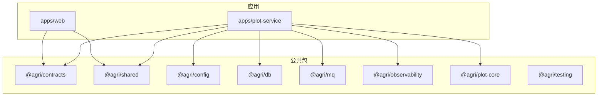
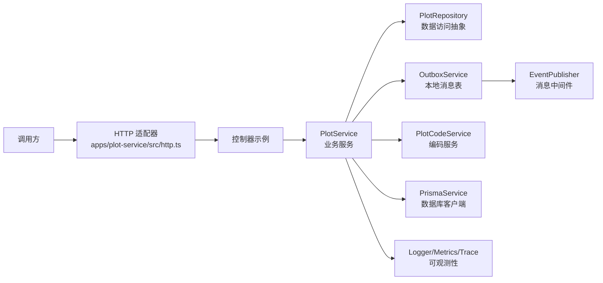
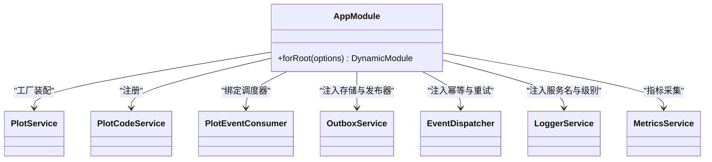
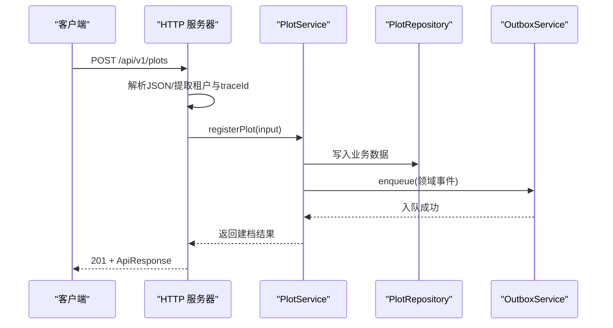
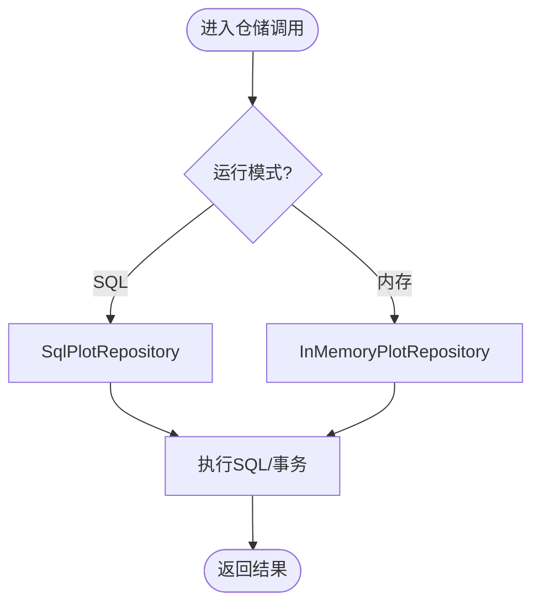
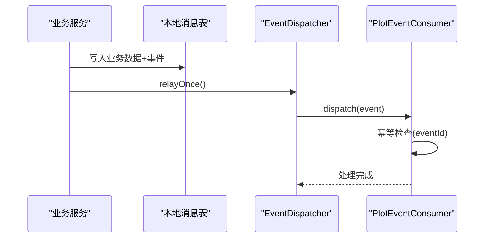
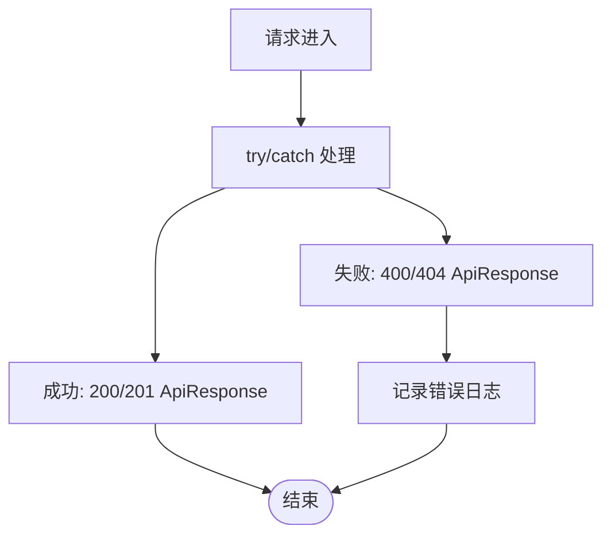
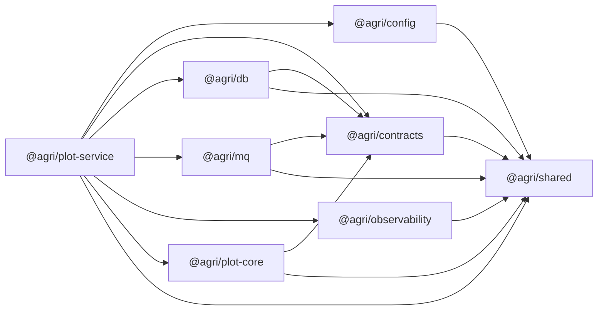
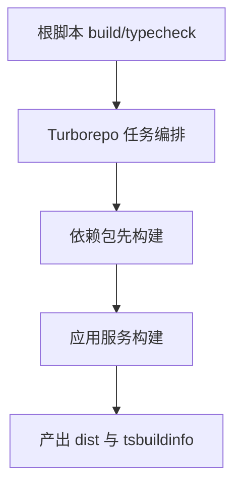
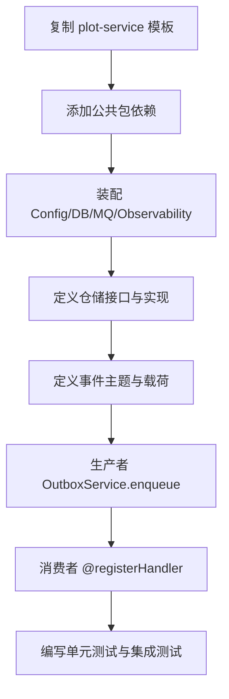

# 微服务开发规范

<cite>
**本文引用的文件**   
- [README.md](file://README.md)
- [package.json](file://package.json)
- [turbo.json](file://turbo.json)
- [pnpm-workspace.yaml](file://pnpm-workspace.yaml)
- [apps/plot-service/src/app.module.ts](file://apps/plot-service/src/app.module.ts)
- [apps/plot-service/src/main.ts](file://apps/plot-service/src/main.ts)
- [apps/plot-service/src/http.ts](file://apps/plot-service/src/http.ts)
- [apps/plot-service/package.json](file://apps/plot-service/package.json)
- [packages/shared/package.json](file://packages/shared/package.json)
- [packages/contracts/package.json](file://packages/contracts/package.json)
- [packages/db/package.json](file://packages/db/package.json)
- [packages/mq/package.json](file://packages/mq/package.json)
- [packages/config/package.json](file://packages/config/package.json)
- [packages/observability/package.json](file://packages/observability/package.json)
- [packages/plot-core/package.json](file://packages/plot-core/package.json)
- [packages/testing/package.json](file://packages/testing/package.json)
</cite>

## 目录
1. [引言](#引言)
2. [项目结构](#项目结构)
3. [核心组件](#核心组件)
4. [架构总览](#架构总览)
5. [详细组件分析](#详细组件分析)
6. [依赖关系分析](#依赖关系分析)
7. [性能与构建优化](#性能与构建优化)
8. [错误处理与可观测性](#错误处理与可观测性)
9. [代码风格、命名与注释规范](#代码风格命名与注释规范)
10. [Git 工作流与发布流程](#git-工作流与发布流程)
11. [新增服务创建指南](#新增服务创建指南)
12. [故障排查](#故障排查)
13. [结论](#结论)

## 引言
本规范面向智慧农业平台后端，统一 NestJS 微服务的工程结构、模块组织、控制器与服务层设计、数据访问抽象、依赖注入、配置管理、错误处理、日志与指标、Turborepo 任务编排、包间依赖与构建优化，以及代码风格、命名约定、注释标准与 Git 工作流。同时提供新服务创建的完整流程与模板使用方法，帮助团队在 pnpm workspace + Turborepo + tsc -b 的工程中高效协作。

## 项目结构
仓库采用多包工作区形态：
- apps：业务微服务与前端应用，每个服务独立入口、模块装配与 HTTP 适配示例。
- packages：公共能力包与规范包，如契约、配置、数据库封装、消息总线、可观测性、领域核心与测试工具。
- infra：基础设施脚本与数据库迁移。
- scripts：运维脚本（健康检查、冒烟测试、服务启动等）。

**图示来源**
- [README.md:58-84](file://README.md#L58-L84)
- [apps/plot-service/package.json:14-25](file://apps/plot-service/package.json#L14-L25)
- [packages/contracts/package.json:1-42](file://packages/contracts/package.json#L1-L42)

**章节来源**
- [README.md:58-84](file://README.md#L58-L84)

## 核心组件
- 契约包 @agri/contracts：定义响应信封、事件、错误码、DTO 与枚举，仅依赖 zod，不依赖其他能力包，便于前后端共享。
- 共享包 @agri/shared：异常基类、时间、单位换算、分页、标识生成等通用工具。
- 配置包 @agri/config：环境变量校验、启动期配置加载与密钥读取。
- 数据访问包 @agri/db：客户端生命周期、事务、分库路由、分页与软删除。
- 消息包 @agri/mq：事件发布订阅、本地消息表、重试死信与幂等。
- 可观测性包 @agri/observability：结构化日志、链路追踪、指标采集与运行期采集器。
- 地块核心包 @agri/plot-core：地块编码规则、网格换算与坐标系转换。
- 测试包 @agri/testing：测试数据库、内存事件总线、可控时钟、模块构造器与夹具。

**章节来源**
- [README.md:86-103](file://README.md#L86-L103)
- [packages/contracts/package.json:1-42](file://packages/contracts/package.json#L1-L42)
- [packages/shared/package.json:1-23](file://packages/shared/package.json#L1-L23)
- [packages/config/package.json:1-28](file://packages/config/package.json#L1-L28)
- [packages/db/package.json:1-28](file://packages/db/package.json#L1-L28)
- [packages/mq/package.json:1-28](file://packages/mq/package.json#L1-L28)
- [packages/observability/package.json:1-27](file://packages/observability/package.json#L1-L27)
- [packages/plot-core/package.json:1-27](file://packages/plot-core/package.json#L1-L27)
- [packages/testing/package.json:1-31](file://packages/testing/package.json#L1-L31)

## 架构总览
以 plot-service 为例，展示 NestJS 微服务的标准分层与横切能力装配：
- 配置与数据库为基础设施层。
- 消息与可观测性为横切能力。
- 业务服务只依赖这些能力的对外契约，不反向被它们引用。
- 仓储通过注入令牌替换实现，便于测试与切换存储策略。

**图示来源**
- [apps/plot-service/src/http.ts:40-104](file://apps/plot-service/src/http.ts#L40-L104)
- [apps/plot-service/src/app.module.ts:80-164](file://apps/plot-service/src/app.module.ts#L80-L164)

**章节来源**
- [apps/plot-service/src/app.module.ts:34-40](file://apps/plot-service/src/app.module.ts#L34-L40)

## 详细组件分析

### NestJS 模块装配与依赖注入
- 使用动态模块 forRoot 装配配置、数据库、消息与可观测性。
- 通过注入令牌（PLOT_REPOSITORY、OUTBOX_STORE、IDEMPOTENCY_STORE）解耦具体实现。
- 将 OutboxService 与 EventDispatcher 装配到消费者，支持重试与幂等。
- 导出 PlotService、PlotCodeService、PlotEventConsumer 等供外部复用。

**图示来源**
- [apps/plot-service/src/app.module.ts:80-164](file://apps/plot-service/src/app.module.ts#L80-L164)

**章节来源**
- [apps/plot-service/src/app.module.ts:42-67](file://apps/plot-service/src/app.module.ts#L42-L67)
- [apps/plot-service/src/app.module.ts:80-164](file://apps/plot-service/src/app.module.ts#L80-L164)

### HTTP 控制器与请求处理
- 示例 HTTP 服务器提供健康检查、统计、边界、列表、详情、建档、更新与删除接口。
- 统一响应信封 ApiResponse，包含 code、message、data、traceId、timestamp。
- 分页参数 page/size 限制上限 200，keyword 过滤 parcelCode/parcelName。
- 从请求头提取租户 x-tenant-id 与链路 traceId。

**图示来源**
- [apps/plot-service/src/http.ts:78-82](file://apps/plot-service/src/http.ts#L78-L82)
- [apps/plot-service/src/main.ts:115-134](file://apps/plot-service/src/main.ts#L115-L134)

**章节来源**
- [apps/plot-service/src/http.ts:11-38](file://apps/plot-service/src/http.ts#L11-L38)
- [apps/plot-service/src/http.ts:40-104](file://apps/plot-service/src/http.ts#L40-L104)

### 数据访问层抽象与仓储模式
- 仓储接口 PlotRepository 暴露按租户查询、按编码查询、建档、更新与删除等方法。
- 提供 InMemoryPlotRepository 与 SqlPlotRepository 两种实现，通过环境变量切换。
- 所有写操作由业务服务协调事务与本地消息表，仓储方法首参显式传入事务对象，避免事务边界扩大。

**图示来源**
- [apps/plot-service/src/main.ts:94-99](file://apps/plot-service/src/main.ts#L94-L99)

**章节来源**
- [apps/plot-service/src/main.ts:94-99](file://apps/plot-service/src/main.ts#L94-L99)

### 事件驱动与本地消息表
- 业务数据与待投递事件在同一事务落库，提交后由中继投递。
- 消费侧使用 eventId 幂等去重，重试按指数退避，超出次数转死信。
- 示例入口演示了建档 → 中继 → 消费 → 幂等的完整链路。

**图示来源**
- [apps/plot-service/src/main.ts:115-152](file://apps/plot-service/src/main.ts#L115-L152)

**章节来源**
- [README.md:114-118](file://README.md#L114-L118)
- [apps/plot-service/src/main.ts:115-152](file://apps/plot-service/src/main.ts#L115-L152)

### 可观测性与错误处理
- 通过 LoggerService、MetricsService、TraceService 注入服务名与日志级别。
- 装饰器配置 configureDecorators 启用结构化日志与指标采集。
- HTTP 层统一捕获异常并返回 ApiResponse，区分 404 与 400 错误。

**图示来源**
- [apps/plot-service/src/http.ts:100-103](file://apps/plot-service/src/http.ts#L100-L103)
- [apps/plot-service/src/main.ts:59-61](file://apps/plot-service/src/main.ts#L59-L61)

**章节来源**
- [apps/plot-service/src/http.ts:100-103](file://apps/plot-service/src/http.ts#L100-L103)
- [apps/plot-service/src/main.ts:59-61](file://apps/plot-service/src/main.ts#L59-L61)

## 依赖关系分析
- 契约包 @agri/contracts 仅依赖 zod，不依赖任何能力包，保证契约稳定且前端可低成本引用。
- 能力包之间禁止循环引用；@agri/plot-core 依赖 contracts 与 shared。
- 服务层依赖 config、db、mq、observability、plot-core、shared，并通过 workspace:* 引用。

**图示来源**
- [packages/contracts/package.json:34-35](file://packages/contracts/package.json#L34-L35)
- [packages/plot-core/package.json:18-20](file://packages/plot-core/package.json#L18-L20)
- [packages/config/package.json:18-21](file://packages/config/package.json#L18-L21)
- [packages/db/package.json:18-21](file://packages/db/package.json#L18-L21)
- [packages/mq/package.json:18-21](file://packages/mq/package.json#L18-L21)
- [packages/observability/package.json:18-20](file://packages/observability/package.json#L18-L20)
- [apps/plot-service/package.json:14-25](file://apps/plot-service/package.json#L14-L25)

**章节来源**
- [README.md:110-113](file://README.md#L110-L113)
- [apps/plot-service/package.json:14-25](file://apps/plot-service/package.json#L14-L25)

## 性能与构建优化
- 全量编译使用 tsc -b，按工程引用顺序构建，增量编译信息保存在 tsbuildinfo。
- Turborepo 任务编排 build 与 typecheck 依赖上游包的 build，输出 dist/** 与 *.tsbuildinfo。
- pnpm workspace 白名单允许 esbuild 等安装脚本执行，避免测试运行器无法启动。
- 建议：
  - 优先使用 build:changed 进行增量构建。
  - 保持包职责单一，减少跨层引用，提升缓存命中。
  - 对热点路径使用 Fastify 适配器与连接池优化。

**图示来源**
- [package.json:14-29](file://package.json#L14-L29)
- [turbo.json:1-15](file://turbo.json#L1-L15)
- [pnpm-workspace.yaml:5-14](file://pnpm-workspace.yaml#L5-L14)

**章节来源**
- [package.json:14-29](file://package.json#L14-L29)
- [turbo.json:1-15](file://turbo.json#L1-L15)
- [pnpm-workspace.yaml:5-14](file://pnpm-workspace.yaml#L5-L14)

## 错误处理与可观测性
- 错误码分段：域缩写-分类码-序号（例如 PLOT-409-001），含义一经发布不得修改。
- HTTP 层统一返回 ApiResponse，包含 traceId 与 timestamp，便于链路追踪。
- 可观测性组件注入服务名与日志级别，采集事件循环延迟与句柄指标。
- 建议：
  - 业务异常抛出领域异常，HTTP 层转换为统一响应。
  - 关键路径添加结构化日志与指标埋点。
  - 对第三方依赖调用增加超时与降级策略。

**章节来源**
- [README.md:117-118](file://README.md#L117-L118)
- [apps/plot-service/src/http.ts:16-20](file://apps/plot-service/src/http.ts#L16-L20)
- [apps/plot-service/src/app.module.ts:91-110](file://apps/plot-service/src/app.module.ts#L91-L110)

## 代码风格、命名与注释规范
- 模块组织：
  - 每个服务一个 Nest 模块，入口 main.ts 负责组合根装配。
  - 控制器负责协议适配，服务层承载业务逻辑，仓储层抽象数据访问。
- 命名约定：
  - 服务类以 XxxService 命名，仓储以 XxxRepository 命名。
  - 常量与注入令牌使用 UPPER_SNAKE_CASE。
  - DTO 与类型放在 contracts 或 dto 子模块。
- 注释标准：
  - 模块级注释说明装配顺序与依赖方向。
  - 函数级注释说明输入、输出与副作用。
  - 复杂算法与状态机需附流程图或时序图。
- 架构约束：
  - 契约包与能力包分离，禁止循环引用。
  - 空间运算下沉数据库，坐标统一 CGCS2000（EPSG:4490）。
  - 软删除字段统一 deletedAt，分页每页上限 200，排序字段必须服务端白名单。

**章节来源**
- [README.md:105-118](file://README.md#L105-L118)
- [apps/plot-service/src/app.module.ts:34-40](file://apps/plot-service/src/app.module.ts#L34-L40)

## Git 工作流与发布流程
- 分支策略：
  - main：稳定版本。
  - develop：集成开发分支。
  - feature/*：功能分支。
  - hotfix/*：紧急修复分支。
- 提交规范：
  - 使用语义化提交（feat/fix/docs/style/refactor/test/chore）。
  - 提交信息包含影响范围与变更原因。
- 发布流程：
  - 合并至 develop 后触发 CI 构建与测试。
  - 打 tag 并发布 npm 包（公共包）或服务镜像（应用服务）。
  - 更新 README 与 CHANGELOG，记录破坏性变更与迁移指引。

[本节为通用流程说明，不直接分析具体文件]

## 新增服务创建指南
- 复制 apps/plot-service 作为模板。
- 在服务 package.json 中添加 workspace:* 依赖：config、contracts、db、mq、observability、plot-core、shared。
- 在服务根 Nest 模块导入 ConfigModule.forRoot、PrismaModule.forRoot、MqModule.forRoot。
- 定义仓储接口与实现，通过注入令牌替换。
- 定义领域事件主题与载荷于 contracts/events，生产者使用 OutboxService.enqueue，消费者使用 @registerHandler。
- 新增表与仓储时，仓储方法首参显式传入事务对象，避免事务边界静默扩大。

**图示来源**
- [README.md:147-155](file://README.md#L147-L155)
- [apps/plot-service/package.json:14-25](file://apps/plot-service/package.json#L14-L25)

**章节来源**
- [README.md:147-155](file://README.md#L147-L155)
- [apps/plot-service/package.json:14-25](file://apps/plot-service/package.json#L14-L25)

## 故障排查
- 安装阶段报错 ERR_PNPM_IGNORED_BUILDS：
  - 检查 pnpm-workspace.yaml 的 allowBuilds 是否放行 esbuild 等构建脚本。
- 测试运行器无法启动：
  - 确认 esbuild 安装脚本已白名单化。
- 数据库与消息中间件：
  - 示例工程用内存实现替代真实中间件，接入真实环境需实现 PrismaClientFactory、EventPublisher 与 EventSubscriber。
- 装饰器元数据：
  - 生产编译开启 experimentalDecorators 与 emitDecoratorMetadata；测试期仅开启前者，构造提供者应显式声明 inject。

**章节来源**
- [pnpm-workspace.yaml:5-14](file://pnpm-workspace.yaml#L5-L14)
- [README.md:157-166](file://README.md#L157-L166)

## 结论
本规范基于智慧农业平台的实际工程实践，定义了 NestJS 微服务的标准结构与最佳实践，涵盖模块装配、依赖注入、配置管理、错误处理、日志与指标、Turborepo 任务编排与包间依赖管理。通过契约包与能力包分离、本地消息表与幂等机制、以及统一的代码风格与 Git 工作流，确保系统在扩展性、可维护性与可观测性方面达到一致标准。团队在新增服务时应严格遵循本规范，结合模板快速落地，并在 CI 中持续验证质量与性能。